# C语言从零编写机器学习库-｜-coding-a-machine-learning-library-in-c-from-scratch--BV1A4kNBbEkM-

Today I'm board， so we're going to make an entire machine learning library from scratch and C and train it to recognize handwritten digits with the eminous data set。

 right。

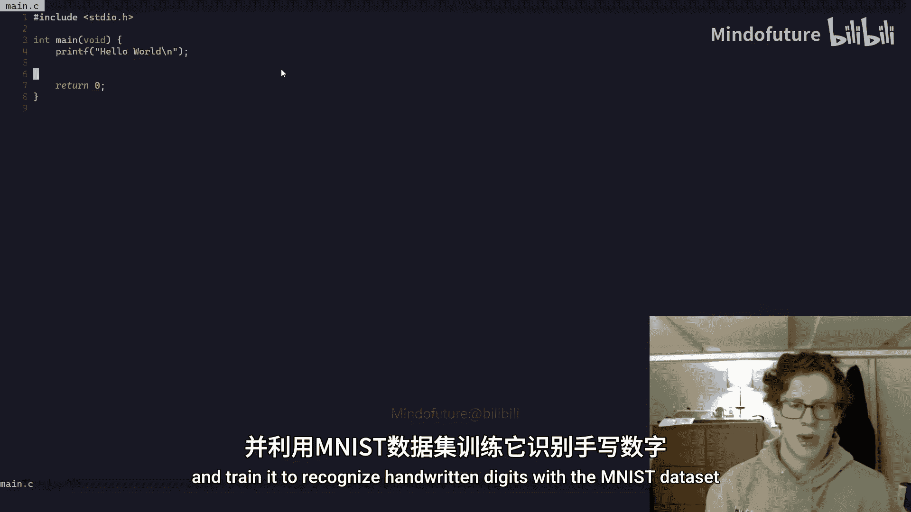

But before I get into any of the code， I want to go over just a bit about what it actually entails to create some sort of machine learning framework or library。

 right？So I would argue that there are three main components of machine learning or like of a framework and machine need to do machine learning。

 The first one is some way to do math with tensors， right。And tensors are just like。I mean， it's。

 it's just like an arbitrary， abitrarily dimensional group of numbers kind of。

 It's like you have vectors matrices。 and then。Those are all examples of tensors。

 although today we're just actually going to be working with matrices to make our lives slightly easier and code。

 And then the second way， the second component is that you need some way to find gradients。

Of arbitrary functions， right， you need some way to define arbitrary functions。

 some way to define define their gradients。And then the third component is just some sort of glue layer that ties all the components together。

 right， now， this might not mean anything right now， but。Let me just dive a bit deeper into it。

So when you have some sort of machine learning model， it's just， it's literally just some function。

 right， that maps inputs to outputs。 This could be， the inputs could be like。

The entire history of a chat with like chattT and the output could be could be a probability distribution for the next most likely token。

 It could be a word in one language as the input， and the word in another language is the output。

 It could be what we're doing today where you have the input is some sort of handwritten number。

 and the output is a probability distribution， right， where。

The value at that number index has a higher probability， right？So it's just a function， right。And。

The， the key difference between like a function that you might be more familiar with from like a math class and a function that you're dealing with a machine learning model is that these functions have a bunch of adjustable parameters。

 right， So you kind of set。Like some sort of shape of the model。

 And then you have a bunch of numbers that can be adjusted， right， a bunch of tunable parameters。

 I think theta is commonly used。To denote parameters。

If you're familiar with the classic perception with weights。

 the weights and biases of that are the parameters。So you have this model and it exists。 It does。

 It performs some mapping from an input to an output。 And because of its parameters， it。

 there are like 8。Very large number of possibilities for what this mapping can actually look like right。

 So that's where the next aspect comes in， which is some sort of cost function or a loss function。

 sometimes it's called which will take in some training sample right。

 some input and some expected output and the model parameters itself right So this is the cost function。

And the cost function quantifies how bad the model did， right？So。If the model was highly accurate。

 If the model's output was close to the actual output， then the cost function is going to be low。

 If the model was very bad。 like at the start of training。

 the cost function is going to be very high。 So the entire goal of machine learning is just to minimize。

The cost function， right？By adjusting the parameters， right？

So the way to do that because the cost function exists in a very high dimensional space。

 like even for a simple network like we're going to make today， there are like hundreds。

 if not thousands of parameters right， so you can't just find the global minimum of the cost function but what you can do is locally find how to decrease the cost function the quickest and that's where the gradient comes in right。

The gradient of the cost function。With respect to all of its parameters tells you in which direction you need to move to change the cost function the greatest。

 right？Wait， that's。Freian， it that way。My bad。 But the gradient tells you in which direction you need to move to find to minimize the cost function of the grades。

 right so。Then that is where the final layer comes in the glue。

You need some way to define this function with a bunch of parameters。

 You need some way to automatically and to define the cause function。

 You need some way to automatically find these gradients of any arbitrary function。

 and then you need some sort of glue layer， which which will go through all your training examples。

Compute the gradients for that training example， and then。

Automatically adjust parameters based on those gradients， right？

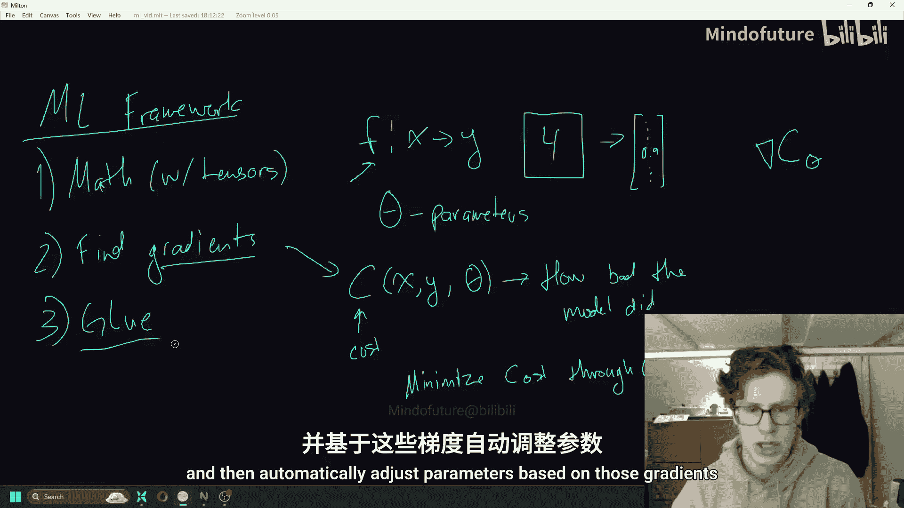

So we have a lot of work ahead of us， but。Let's just start with the basics。

 We've got our hellello world program here， although。Today， what I'm going to do。

To actually take the code from my arena video because we're gonna be。

Needing to do some more complicated memory allocation today， And I。To be honest。

 just do not have the patience to deal with。Micin free right now， so。

If you if you're following along in your own language。

 feel free to use like whatever memory allocation style you're more comfortable with。

 or you can even watch video on my two videos onna on arena allocators if you would like。

 but it's not necessary。嗯。That the arena。 And then the other thing I'm going to do。

Is take my random number generation code from one of my previous videos， so。

This is also something that is not entirely necessary， but。Yeah。

I want to get slightly higher quality random numbers random numbers than you're going to be able to with just a built in。

呃。Rand， function and C。So。AndC base。嗯。So。You see， I made this space file。

 and then I have an arena header file， and I have a random header file。

 And then we're also going to get arena do C。ら see。

And then I'm going to create a permanent rule here。

And because we're going to be loading in large data says I'm going to give our arena。1？Allright。

 and that should be the project setup。 I just want to make sure that we are compiling everything all right。

OkayAll right。是。

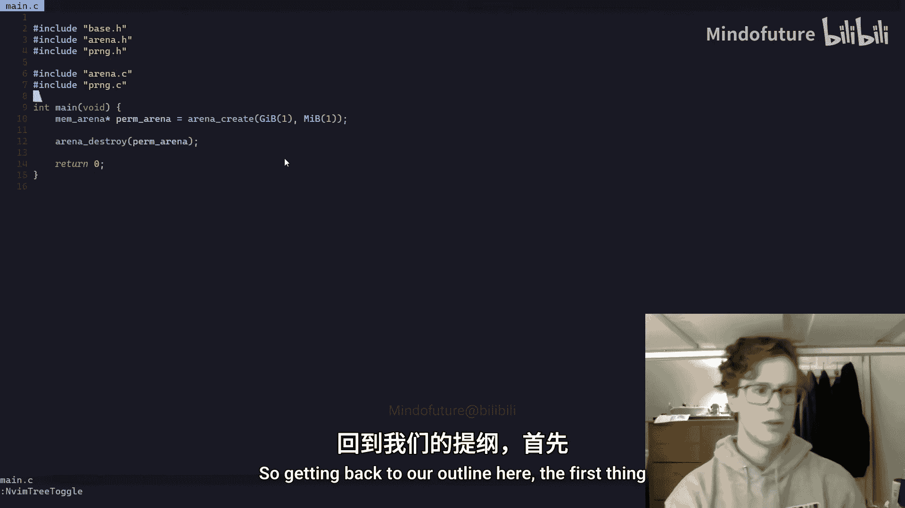

Getting back to our outline line here。 The first thing I'm going to do is just build this mouth layer for us。

 right， like I said before。

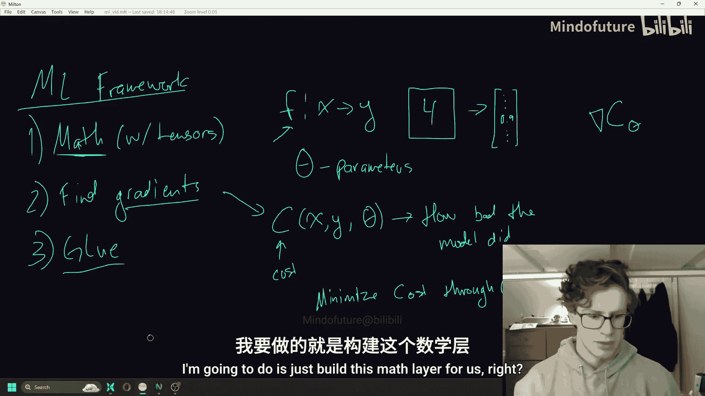

嗯。I'm actually just going to use matrices。呃。If you。

 if you're dealing with like an actually a production ready machine learning library。

 like something like pi towards Tensorflow jacks， whatever。

 it's going to allow you to do arbitrarily dimension tensors， but。For our purposes today。

 the matrices are going to be sufficient。 And then I'm going to have a bunch of functions here。

 So we're first off going to have a function to create it， which we'll take in an arena。

A number of rows。Numb of columns。And then I'm just going to do some helpers here。

 so I'll have a function to clear matrix。I have the function。Copy your matrix。

We'll have a function to。A functioning with fill a matrix with a certain value。

And then getting to the actual arithmetic here， I'm going have a function to add two matrices。

 And for all these functions， I'm going to have it。嗯。Take the input and or take the output as a。

Function or as a parameter to the function and then return a boolean on whether or not the function was successful。

 as is not necessary， you could。Have it return a matrix。 But it， in my case。

 I think I prefer the ability to control when the majorities are allocated and on which lifetime are allocated。

 But again， feel free to do whatever you want。 Oh， another thing much I'm gonna to do here is have a。

Puntion that scales a matrix in place。Okay， we'll just put these on the same on。

 We're gonna have a major smart function。And then I'm gonna have a few more arguments here。

 The first one is whether or not to。0ero the output so if that function if that argument is。False。

 and you don't de the output。 Then it's going to add the matrix multiplication of A And B to out。

 If you do the zero the output， then out， will it just get set to the matrix multiplication。

 And then we're also gonna have two。Functions here on whether or not to transpose A B。嗯。And I've got。

 I've gotten some questions in previous videos about like 8 B bulls versus 32 B bulls。 And honestly。

The， the fact of the matter is that。It doesn't actually matter in most situations here we might be saving some memory in terms of argument costs。

 but it might even be more asmbling instructions to use apids versus 32 bits here。  honestly。

 I would just go on compile or explorer and look if you really care。

 but it's not going to make a huge difference either way。

 and then another thing we're going to do here because we're doing some machine learning stuff。

 I'm going to add a raylu function。 if you're not familiar。

 it's called it stands for rectified linear unit and it's just0。

 if your input is less than if your input is negative and equal to your input if your input is positive So it's also just equal to the max of0 in the input and that's going to be one of our activation functions here。

 and then I'm also going to add in soft max function。And that converts。

Your input vector into a probability distribution， although we'll get more into the implementation of that in the second year。

 And then we're also going do， I'm going to add。Across entropy function here。

 then this is going to be our cost function。嗯。And this is a。

The cross entropy loss is specifically good for dealing with probability distributions generated by Softmax。

So this function， it'll take in and。Some expected probability distribution P。

And some actual probability probability distribution Q like so。 And then one with the next thing。

 final thing is。I'm gonna add functions to。Get the gradient。

Of each of these of the activation functions and the cost functions， so。

The gradient of the Raylu will be just take that。And we're actually going to call。This one。

 this function， it'll add the gradient of the rayor。Yeah that's would be good。

This one will take in the output of the softm。And finally。

We're going to do cross entropy add gradient。The same。So alright， so this is our interface here。

 and we're just going write all these functions in plain C， I'm going to write them in。

 but if you're dealing with an actual machine learning library。

These are going to be the functions that are going to be run on the GP P， right。

 These are going be the things that you want to hyper optimize。

 especially that matrix multiplication。But， I mean， computers are still fast。

 and we still will be able to do relatively complicated networks just on the CPU。 But just so。

 you know， like the in the real deal， something like jack， something like Pi torch。

 these are going to be the functions that are actually run on your GPU。 All right。

 So now to implement them， I'm going to get started on map create here。 And on the right here。

 I'll pull up。Just our definition there。Because we're dealing with arenas， it's。

Pretty trivial for me to actually allocate the urna structure onto the heap as well now。

You might not want to do this， if you were。Dealing with Malc or a different allocator。Where it's。

 it's worse to make a lot many small allocations。 But in this case。

 just the ease of dealing with pointers， for me， outweighs the slight memory cost。But， you know。

 you do you。 So let me set the rows and columns。And then that data is going to be push array。

Onto the arena of size， row， co columns。So here， let me remove my mouse and sort the mat copy here。

We're going do this is just， well， first off， we need to check。 Yeah。

 this should actually we one to go in。And this is going to， first off， I'm going check if。

S if the shape of these is the same。For destination。

And then we're just simply going to do a mem copy here for onto destination data。Chrome source data。

 And then it's just gonna be size of。That's 32 times。Destination rose time。Don。Like so。Matt clear。

 this one is just going to be a meps at 0。Same thing with size of a 32。Okay， and then this one。

I'm going to grab this size from the matrix， and we're just going to do this in the for loop。

 So I'll take the rows times the columns。And then we'll say four eyes left and size。

That data I equals x like cell。嗯。Oh， actually， one function I did forget to add earlier that I'm going to put right here is going to be not。

Which would just calculate the sum of matrix。Let's start off with scale here first。

So I'm actually just going to copy all of this function。And then instead of doing that。

 we're going to say times equal scale。Xel。And then， same thing。嗯。And then this one。

 some we're going to have。I'llTake this out here。嗯。か工。Like， so。Good rid of that， okay。Now。

 we're dealing with the actual matrix chari functions here。 So for add， first off。

 I'm going to check that A And B have the same size。

And then I'm going to check if out and A have the same size， right， and by transitivity， it should。

Oh go。Now what you could do if you wanted to。And I don't know。

 I might do this if I was trying to build a。More robust application is you could。

Havebit so that matrices also have another parameter here called like alloc or something。

Where it's the amount of data that they have allocated。

 and you could dynamically adjust in these arithmetic functions， the size of output， given。

That it has enough， like if it has enough。Of an allocation to hold the output。 again。

 this is kind of you to you。 I'm just going for what is simplest right now。

 And because we're gonna to be hard coding everything and each variable will have its own thing。

 This is the simplest right now。So I'm also gonna， I'm going to take the size here。

The out row times out cause。 And then we're going to go for。I equals 0 is less than size。

Out datata I equals a datata I plus B。对が。嗯。And then for sub。

 it's going to be basically the same thing。嗯。Except for obviously， this edition here。

 its going to be a subscription。And then so make sure more application。

This one is going to be a bit more involved here because we have those transpoposed values。

 So the first thing I'm going to do for a size fix is to get the transposed the like post transposed minimum over rows and columns in a。

So。If we are transposing a， then a rows is input A's columns else。 itss A's rows。嗯。

Did I spell something？But I didn't spell it。And course。I suppose。And then， a columns。

Those can be combs。 Those can be rows。And then this is going to be。Same thing， but for B。Like so。

 And then。So if the number of columns and a is not equal to the number of rows and B。

Then we can other matrix。 And then if the。Output。Does not have the same number of rows as a。

Or the up is not have the same number of columns as B。Then we cannot multip the matrices。

So now we're going to do， then we'll check of zero out。Then。We'll call that clear on out。Now。

 what I'm actually going to do is I'll create four functions here that are for the four variations we could get of transposing。

 And this is so that。Each function can be as performant as possible， right。

 So we'll say mat Ma and full or I'll just call it mat Ma。 And then I'll do N to denote。

That it is not transpoposedse and then t to denote if it is transpose。嗯。So there's this function。

 And then we're going to have four these，T。Like so。

 And then what I'm going to do is I'm going actually just anr an integer here。嗯。That stores。

 I'll take transpose a bit shift it once， and then order with transpose B。

And this is so that I can do each of those four cases。Just in one large switch statement。

 And this is actually， this is kind of a trick that I like to do。

In any situation where you have like two bulls， and you can do。

You're doing something different for each of those cases， each of the four cases。

 So for this one we'll call them that。So。And obviously， you don't actually。

 you don't need the sly braces here。 Obviously， I just。

 I prefer whenever I'm using switch statements to have a new scope for each case。

 but it literally does not matter right now。So for output， what I'm going to do for this one。

 we'll just start with our basic for loop。 And I'm actually。

 I am going to use 64 B integers here for each of our counter variables to make。

Sure that we never overflow when doing。The嗯。To determine。

The one dimensional index from our two dimensional index。嗯。Oh， also。

 I should point out I am going to be doing everything。Ro major here。嗯。Okay， so our far inner loop。

A is less than a columns。So now we're gonna do out dot data at。 So it is going to be at the。

Chafe column or the I column and the Chafe row。And that's going to be plus equals a data。

 which is at the same row。And then the cave column。I。嗯。B， which is at the same。Column。

 but the K of row。 So I actually， I think normally， I'll do。I think normally are I go for real。

I that。So B is going to be at the same column。 So the J column and then theK row。Like so。

 And then if you've seen my first video， you'll know that we should actually swap these two for loops to have the best cash。

Looccalality for a function here。 so now I'm going to copy this and。And modify it， so。

Yeah I'm actually just gonna copy this。All three times here。So okay， so for this function here。

 this kernel， we have。B is transposed so。Literally， that just entails swapping those two variables。

 right， So it's transposed。 And then what we're going to want to do is correct the order of the four loops to get the best cache locality。

 Now that we're iterating J here， we're going to want to move the J for loop up。Now for a again。

 we're going to swap these two。 And then we're also going to have to swap this looptevari because this was based on。

The， this needs to be based on the transposed a， and then。Now， taking a look at this。

 it seems that two of these variables are using K。' going to move K up and I down so that we have the best looping。

And then here， so we're going to have to swap both of these， actually。Like so。

 and now there there isn't actually like a best loop order here。 so we'll just go IJK。

And that should do it。 That is how you do the simplest。

 although still modestly perform matrix multiplication。 And honestly。

 if I'm not mistaken a lot of the issues that you run into that the more advanced matrix multiplication solve like cache thrashing and stuff。

 we're not going run into because our matrix multi are going to be really small in this example。

 but I could be wrong about that。 So now to do the activation functions here。

 although these ones that calculate the gradient and stuff。

 I'm going to leave that to a little bit later in the video so that it makes a bit more sense when we cover the math find all that。

 And let me just start off with the size checks here， but。Like I said before。

 Raylu stands for rectified linear unit。嗯。And it is literally just the max of。0 and x。

 So in other words， when x is less than 0， it's just y equals 0。

 when x is greater than 0 is y equals x。 It's just a straight line negative。

 and then linear when is positive。嗯。And I believe it came。

 the Redlu activation function became popular like a while ago。

 but it wasn't the de facto activation function for a while。 And I think， actually now。

You even have slightly more modern activation functions like Jlu or you can even do like leaky raylu or some sort of exponential raylu。

 but the original one is still great。I believe it fixed the vanishing gradient problem。

 or least helped the vanishing gradient problem from the previous de facto of the sigmoid function。

 but that doesn't even matter。Becauseuse it's the worst for our purposes。

 And then the softm function with that is it each term， so。

The output at sum index I is equal to E to the input。

 We'll call it a over the sum over E's to the input， right。

And you'll see what this does is actually twofold。 The first thing is that because we're exponentiating each term。

 it。Make sure that everything is positive。 And then because we're dividing by that sum there。

 it also ensures。That。The sum of the output will equal on。1， right。 So those two factors。

 each term being positive and the sum being one means that in the end。

 we have a valid probability distribution， which is the goal， right。

So I'm just going to loop through and then starting off。Exponentiateiate each term。And then， also。

 add。That to our sum。And then we're going to get our scale。 Actually。

 I'm just going to call mat scale on the output。And that's going to take one over the sum。Like， so。

And then so cross entropy。This one works on a probability distribution where P is the expected。

 This is our loss function。 by the way， P is our expected probability distribution。

 and then Q is our actual output， our actual probability distribution。And for this one， first off。

 I will do our size checks。So all of these should be the same size。嗯。Same thing for out。

Out roseose as in。To。Oh。Palls isnt the key tunnels。Of course。And then what this is。

 it is the the sum。 the formula is just P times the negative log of Q。

 Although I believe what youd actually want is the sum over this。

 but I'm just going to put each term into the alpha vector。

 I don't know if that's technically correct， but。It's going to give us the correct gradients for our prequiors right now。

So， look through some。Hi。Less than size。And then I'm actually going do a check。 Well here。

 I'll say out out data。s and then I'm going to check if P is equal to 0。If so just set it to 0。

 and if not， we'll do P。Times negative log of。And that should do it。So for now。That's， that's it。

 okay。We have there。 So this is just our basic our backbone， the math library， right。

Although one thing， I'm actually， I'm going to take a quick detourch here and actually open up a Python file so that we can have some way to get our Ms data set。

 So for this purpose， I'm going to use。The module called Tensor flow data sets。

I'll import that as TFTS and then also import in Oki。嗯。

It's a pretty simple interface All we're going to do here is we have a training and a testing data set。

 and that's just TFTS stop load and this。And we'll say our split is equal to train and test。

we have over there。 and then I'll say， as soup。Supervise。True。Still load in the data set。

 but it doesn't actually give us the format that we want right The goal here。

 I'm actually just gonna output four files here。 One for the training images， training labels。

 testing images and testing labels。 So I want to be able to convert from a data set。

To just a standard number array， and then it'll take in a data set。Honestly。

 I'm sure there is some Python magical way to do this quickly or。Okay， I think we're back。 Sorry。

 I had some recording issues just Anyway。 So like I was saying， just。

 I'm just gonna iterate through the data set here and add。Label image， and then return。

And beat out array of images。And the labels like。嗯。Then， so。We're going to have train images。

Train labels equal to DS S2 nu。Of the train data set。And then， same thing。For the test。

 And then the next thing we need to do is ensure that these are in the correct data format。

 So I'm going just kind call as type and then N dot float 32。

 because I'm just going to be outputing these to a file。

 And then the other thing is that the images are。嗯。From 0 to 255。

 So I'm going to convert it from 0 to1 just because the normalized， I believe works better。

For machine learning stuff。And then。And so the other thing here is that the labels right now are not using what we call one hot encoing。

 they're just like if the number is for that the training label is literally4。

 But I'm going to do the conversion to one hocoing in C。

 So now we' need to do let's say train images do2 file。Andimals call this one。ジ a map。

And same thing for all of these。 So we'll say。So， and then the last thing I'm going to do。

For each of these。Prince。Their shape。So that we know。So that。We know what shapes allow them in。Andc。

So again， this is hard coded。 If I was doing this in a natural project， I would probably。

Probably want to make my own file format or use some existing file format that includes size information or and also one that might even include compression。

 right？But we should now see that we have these four files here。That include our data。

 And then you can see these are the shape of our right for our matrices。

 So now coming back in a main here， what I'm actually going to do。

Does have a function called that load。They'll take in a size， and then。A file name。

To load the file from。So。This one we're gonna do， first off。We're going to say that our map。

Just the create function。To create that。I then spell the arena。大家等着吗。

So then what we're going to do is I'm actually just gonna。I'm going to open the file。気し。F open。

And I got some in a previous video。 I mentioned that I don't love using F open and。Honestly。

 that's just because it gives me less control over。How I'm loading files。

 that API is just another additional layer over the actual。

Like over the actual operating systems doings。 So I usually roll my own， but in this case。

 we literally just need to read the entire file。 and this is going to work perfectly fine。

 If you're not familiar with the API， this is just a quick trick to get you the size of the file just because I't want to ensure that we're not reading too much。

 so。I'm gonna say。We're going to read basically as much as we can if our files。

 sizes were mismatched， right？And then we're just going to call F read。

 and we're going to read into map data。3什。And that should do it so。Now， here in Maine。

I'm filing going to load in。I'll say our。Natures for our training images。

That's going to be on the permanent arena。And then we're going to have 60000 rows and 784 columns。

 So it's， this is going to be a bit clunky， but。Basically。

 each row of it is going to be one training example。 This is just easiest because of how the。

Data is laid out in the file。But， you know。Feel free to do it whatever you want， okay， and then。

All right， so that's that。I'll get to the。 I'll deal with the training labels in a second。

 But what I'm actually going to do here is。I'm going to have a helper function。Down here。

 that will draw。An emist digit into the console。So。Data there。

 And what I'm actually going to use here。Is。What's called ansi escape clothes。

 which I believe is a bit of an older。A terminal thing， but it's。

 it's basically just special characters you can output to the terminal that control certain aspects of it like。

The color or the positioning and stuff。 So in this case。Oh， also。

 if I forgot to mention that the M did just start 28 by 28 pixels。So。I believe we're going do 48，5。

 then。Color。This should set。 So there。I'm just， I'm kind of just doing this off the top of my head。

 although I I've written this code before， obviously。Where。There are。255。

 like built in colors to the console。 And this allows you to set the console。

 the background color form of those。 and in those。The 2，232 to 255 are。Great scale， so。If you go 2。

32 plus the number which between 0 and1 times 24。And。We should get a nice grayscale image。

 And then one final thing I'm going to do here。IsReset all the color information at the end of there。

So。Now， if we call draw and。Digit on。Train images。Data and this will just draw the first one in the training set。

And if I remember correctly。Oh wait， first off， that's going to normally me so I'm going to define。

Cts。Yeah， and if you're wondering， F open is crossed out because it's technically not secure。

And there's like a， in theory better version。 But again， does not matter fors。

 And would you look at that， That is a number We can even do， if you do like plus 1 times 748。

748 is just 28 squared。If you worked with emminist， a long field，nel that one by heart。嗯。星期。

We got these images loaded。 Pretty cool， so。We got that working。 Oh。

 and then the one more thing I'm gonna do here。 And I'm actually gonna give us。Another scope。

Although I'll first say that our train labels。Is just map create。In the training， set。

 there's 60000 examples， and then each has 10。Test。嗯。And like I said。

 so the numbers that we would actually load from。The file。Which I will do now。Our。

Literally just the actual number。 So it's， it's a 60000 by one。

But what we want is to have a probability distribution of the output。 And that is called。

One hot encoding when you're when you have it like this， when there's only one correct answer so。

Literally， what I'm going to do is just loop through。The first off the training sets is 60000。

And then we'll say that the R train labels。Data at I times 10。Plus。嗯。We'll say。The nu is。

Ande labels file that data。At eye。So， I plus nu。Equals one。 that'll do the 10 coding for us。嗯。

Do the same thing for。T swimers。Bb another thing there。嗯。And that should do it。

 So now we can go if we draw the Mnes digit。Of our train images。

I believe there was a four and the other thing I'll do here is。

Print the first 10 numbers from our train labels， set。We should see。That there are 0 everywhere。

Except for。Of the fourth end。Al right， and would you look at that。 So 0，1，2，3，4，4 is one。

 That is one hot encoding。

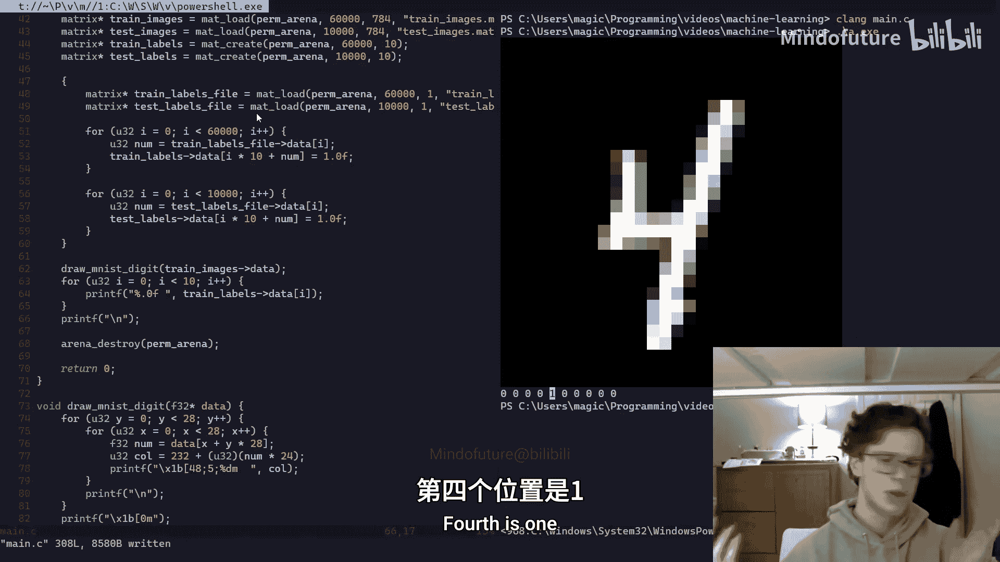

Complete， okay， so we have now successfully。Cross number one of list。

 we've completed the math section that makes this worse work。

 Now we need to focus on is how we can find these gradients。 right？ Remember from a long time ago。

 I said we need some way to programmatically define our function and our cost function and then some way to automatically find the gradients of those functions with respect to our parameters。

 right so。Let's talk a bit about。How to differentiate， right。So again。

 there's actually there three methods that I believe I'm aware of right now。

 So the first one is numerical， right。This is just your classic finite difference， right。

 F of x plus H minus F of H。F of x over， right， like just literally doing it。 But this is bad， right。

 with， I mean， in this case， it might not be that bad。 But when we're dealing with our parameters。

 that might have like thousands。Of numbers in them， right。

 these these exist in many dimensional space to find the gradient。

 we would need to take a little step in each of those dimensions and compute the entire alpha。 right。

 So numerical is out， right。The second way we can do is called symbolic， right？And if you ever。

 if you're familiar with something like math or not math math matter。

WhatW for Al or like Mathematica？Something like that。

 like if you're doing your Cal1 homework and you look up how to derivative。

 like this is what I'm talking about when I mean symbolic， right。

 Like you give it some sort of like input string， right， F of x equals x squared and then。

It literally produces the symbols that give you F prime， right？And this one does work。

 but it has a few disadvantages。 One， it's really complicated to program。

 at least I would have soon because you have to like have all these rules like you're literally just implementing every derivative rule and then simplifying it。

 And two， you can come in， I forget what the exact problem， but essentially。

 you just have a lot of like a large number of symbols， especially when you're。

Driving multiple times。 So kind of complicated， kind of cumbersome， not going to do that。

 The third method， this is specific to computation。I don't know what the specific name for it。

 but I mean， Piytorch calls it autograd。I'm just going to call it autograd basically。

And this method is actually pretty cool what you do。Is given some function。Let's say。

We just have like a classic like M X plus B。 right。

 What you do is you define the computational graph for that function。 So you have some M。

 we have some X。RightAnd we'll say we have some like intermediate variable Z here。

 and then we also have B。And this finally gives us our upper， right。

 So we take this computational graph here。 And then from this。

We're able to compute the gradients of our inputs， or even like our parameters。

 M and B with respect to F by traversing this graph in different ways。 Now。

 there's two ways to do it。 General， there's forward mode and reverse mode。 Today。

 we're going to be doing reverse mode。 But you know， it doesn't matter so。

That this is what we're gonna get started with today is figuring out right now， actually。

 is figuring out computationally how we can create this sort of computational graph that we can then traverse in both directions。

 Well， like obviously， if you traverse it this way。

 you're gonna to be able to literally compute the product， like what f is given your parameters。

 right， And then when you traverse it the other way。

 we're gonna be able to compute our gradients automatically。 So oh， actually。

 one more thing I want to mention if you are， if you have some background in like。

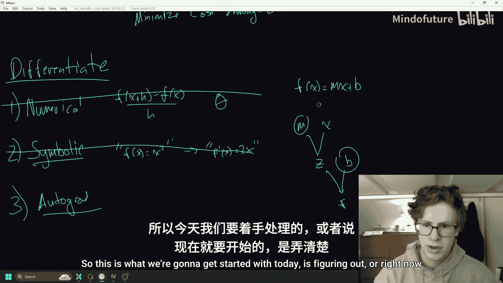

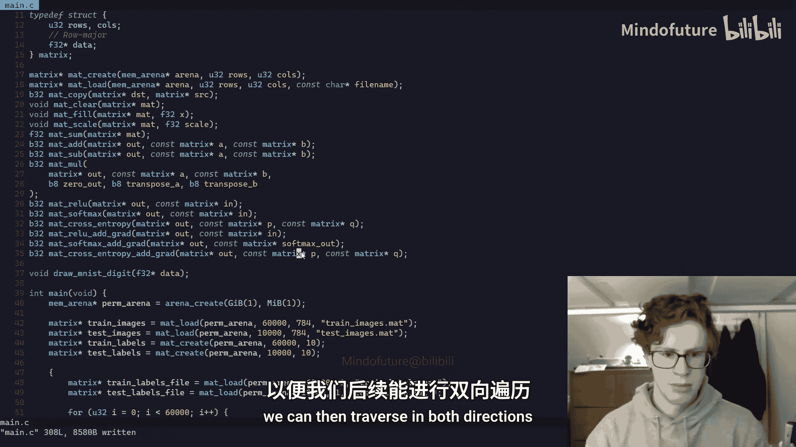

Bas of how perceptrons work。 then you would be familiar with the back propagation algorithm right。

 and the back propag that you do for that is， is， I believe。

 just a strict subset of automatic differentiation， right。Because the way we're doing it this way。

 where we have the full computational graph will be allowed to have like arbitrarily complex。

Relationships between each of the variables， right， whereas in。

When you're dealing with just a basic perceptionron here， right。

 like here I'll just like if you have just a basic。Linear perception like this， right？

 It doesn't allow for something， for example， like a residual connection like。

I believe that's very common in transform architectures nowadays is to have the output of one layer just be added directly to the input of itself And that's the kind of thing where if you have the computational graph of that。

 it's easy to automatically derive it， but its not like it's not like the researchers who made Cha UBT are literally finding gradients by hand right just because that part confused me for bit。

 And actually I know I mentioned in a previous video that I made a machine learning library with a pretty fatal flaw and that was the reason it was because it didn't work with computational graphs。

 it just worked linearly so you couldn't have residual connections。

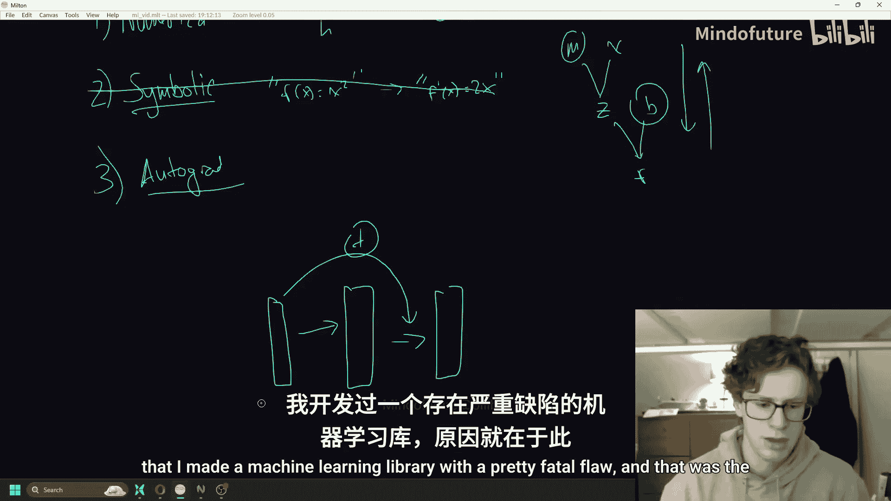

So the first structure I'm going to make here is I'll just call this one。

 I'll call it model there for like model variable。 and it will have an index。And then。

It will have a matrix for its value and a matrix for its gradient。 And then also ox probably。嗯。

I mean。Yeah， like if if Id put the U 32 down here， that technically means the structure is bigger。

 but。You don't have to worry about that right now。 And then I'm going call。

 I'm going to define the flags here。 So the first one here， I would say any flag。

So the first flag I'm going to have is requires grad for requires gradient。

And I'm going to make the flags are going to be a bit field。And then。The next flag。

Is whether or not it's a parameter， right， a parameter of the model。

 And then we're also going to have。金ト。And these are just toote like specific variables that we might care about for a model。

 so we have input output。And then。I'll call this one desired output。 So that's used， obviously。

 when computing the cost。 So desired output， and then finally and honestly probably most importantly。

Is the cost， right？Here I might， actually。Not just a line up all these， so looks nice。erfect。

 alright， so those are our flags。At the， the， the next thing we're going to define is another itemum here for。

The type of operations that I could have， right， so。This is like， how。

How the the variable was created， right， So obviously it can just be created like you just instantiate it。

 but you can also have like unary binary ops so。I'm actually going to create。嗯。Please。

They're not really private， but like internal ens that denote when the s of like each operation type is so that we can from just the operation know how many inputs the variable had。

The only uninary apps that we actually have are just our activation functions。 honestly。

 I don't know。Like， I don't know if it is the best thing to have。

Actation functions B operation themselves。 like you might want to go slightly more granular than that。

 But for today's use cases， this is going be just fine。

 And it's going to make our lives slightly easier。 And then I'm literally just going take a look at each of the ones that we have here。

 So we have MV op add。And the up。Stract。Okay， I go。And we啊。Mamo。And then I'm also going to。

Cross entropy loss。There。And that should do it， okay。Not done right now。

 and then I'm also going to define a macro here。Given an operation will return the number of inputs。

So。Basically， so if the op is less than M the。Uaryary start。Then it is， it has zero input。Otherwise。

 if the up。Less than in the buck。Binary start。So。Yeah， I should let me wrap this in frontheses to。

Slightly more clear。 it was less than binary start than it's going to have one input。

 else it's going to have two inputs。嗯。So now we have a model the ops， we opt， and then we have a。

I actually， I'll define。And the。S input。Okay， so that is our model variable。And then also。

 the the index， I don't know if I mentioned earlier。 that。

 that's gonna be useful later in some operations， so。The next thing I'm going to make here。Is。

A model context。Which this is like going to be the structure that you， I mean。

 as much as you could consider it the model， it is the model。 So first off。

 it's going have a number of variables like the current number of variables instantiated on it。

And then it's going to have a matrix for the input。It's going to have a reference to the input。

 output on desired output。And costs。So cut it， and then。The next thing I'm going to find。

If you remember。I believe， I said。嗯。The。Machine learning is a meta programming right So literally I'm going to have a structure called the program that is going to be a like quote unquote compiled version of some computational graph here right So instead of traversing the graph structure while doing the computations。

 I'm going to traverse the graph structure and then produce a list。 So like for this。

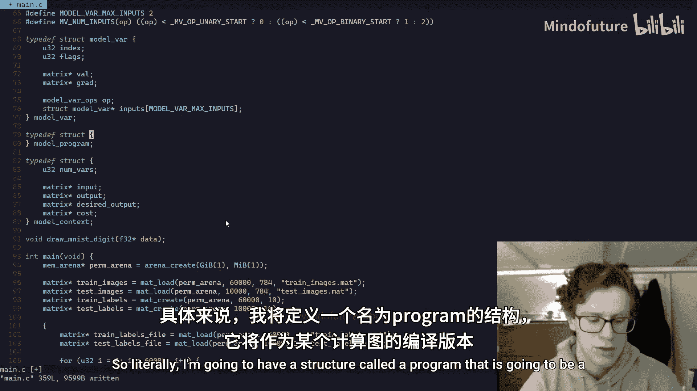

Case it would be like we would evaluate M， then evaluate X， then evaluate Z， then evaluate B。

 then evaluate F， right， So like if we do the evaluations in this order， we will compute the output。

 right you can。

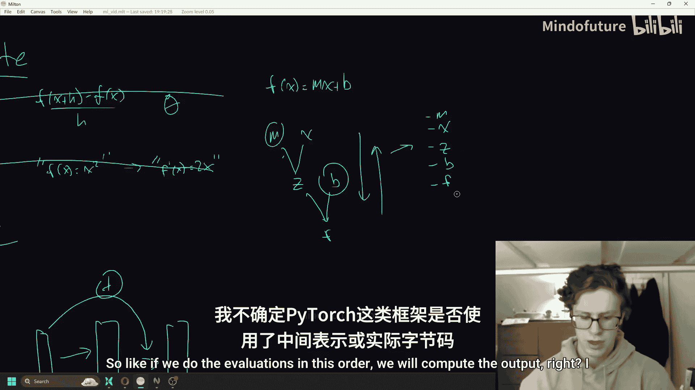

I mean。I don't know if something like pie torch or whatever actually uses。嗯。

Like some kind of like intermediate representation or literal by code。

 But you can think of this kind of as like our by code because the ops are encoded into the variables themselves。

 doesn't matter。Or doesn't not matter that much。 And then we're gonna have two programs here。

 We're gonna have one for the。Just the actual normal output。 I'll call that the forward program。

 and then one that produces the cost， right， So remember。

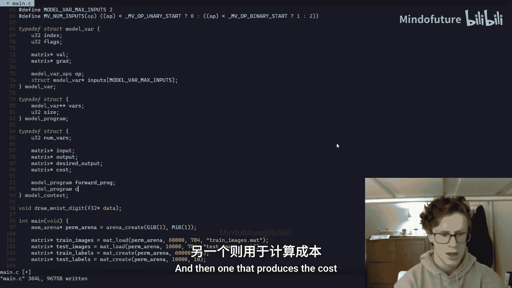

对。We have some actual function here that we're trying to make good。

 and then we also have some cost function， which is the thing that we're optimizing on。

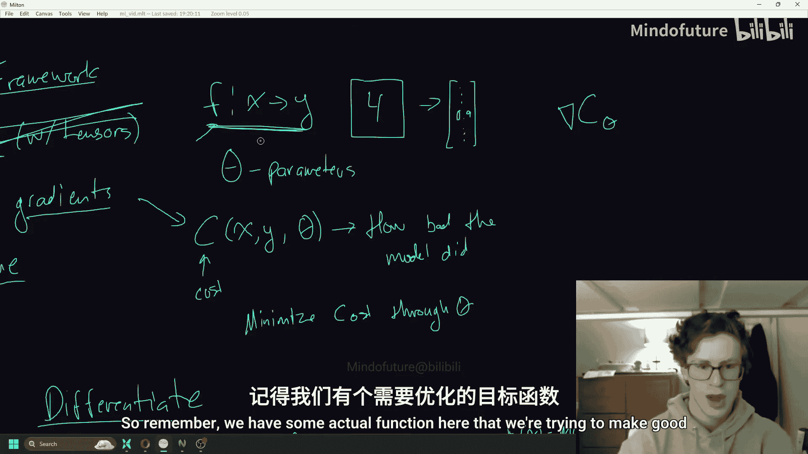

So that means that we need our two separate programs here okay。嗯。So that's that。

 And then so now we need to actually define our interface for using this so。What I'm going to do。

 I'm going to have。Basically， for each operation that we can do。

 I'm going to have a function that creates a model variable， right so。

We'll just start with our basic create function。 and this will take in。And arena。A model context。

A size。And also， a flags。嗯。SoAnd then we're going to basically for each operation that we can have。

 I'm going to have a corresponding function。Model R will have invy relu。And this will take in。

An arena。In model context。And then。An input， and then also some flags。嗯。And also。Well reminds me of。

It's very wide code。Tricket which is。Guy's name。Estyl， something。

Get a video where we talked about 11 wide code。And ended up with some wine and Co today。

So that's for regular and softftmax。 and then we're gonna have。Actually。

 I'll just take four of these lines here。For。Our add function。This is gonna take。A and B。And then。Oh。

嗯，是。Three of those so we're going to have。So。And then。Cross。For P。 And this one。

 I'll call these ones P and Q。Like， so。嗯。So， that's that。So now we need to go here。

 take these functions。And I'll implement all of this below our previous thing。嗯。Okay。

 so now if we create， we're going to do。Is just first out。

 I'm just going to push the there onto our arena。And then。Going to。

Get the index given the model's current contact， the model contexts nu vrs。

 And then I'll also increment that。嗯。And then we gotta fill in。Flas， equals flags。嗯。

And then we're going to say out got value， equals map create。没有。Like I said before。

 this is just a computational graph that we're building here。

 We're not actually doing the computation right now， so。

If you wanted to delay making this arena until you're actually compiling your computational graph into the program itself。

 you could do that。 Our solution today is not going to be terribly memory efficient。

 right because we're going to have all these intermediate variables here。

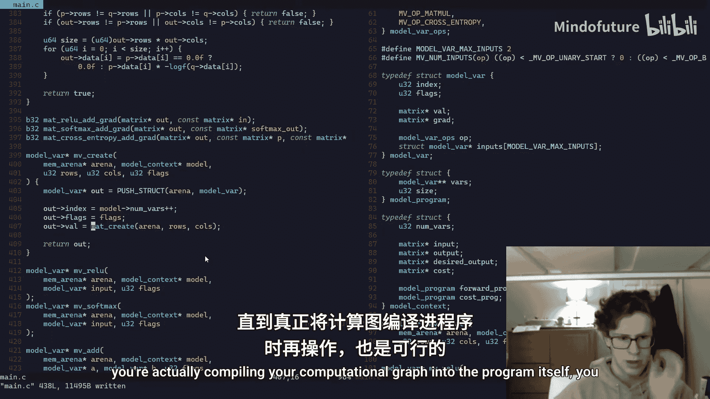

That could， in theory， be used in the same memory。Like， like you could。 this is E variable here。

 the memory for Z and the memory for F。

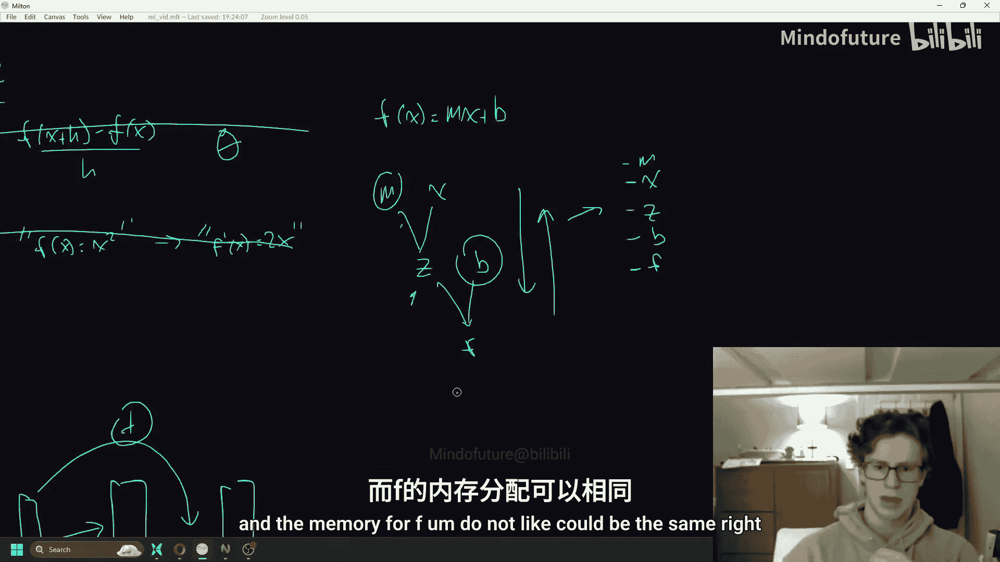

嗯。Do not like could be the same， right， But just to make our lives easier today。

 I'm going make it all separate。 I'm just trying to point out like a potential optimization you can make。

But on our scale， that does not matter。 And then I'm going to check here if we have。A requires grab。

And then then in that case， I'm also going to create our gradient vector。Like， so。So that。

 that's done the up and the okay and then。No。And I forgot to include that as one of the arguments。

Wena have a model。Oops， scroll that up。Yeah， I guess ops doesn't really make sense for the enum。Name。

So。Fix these parameters。We should be good。 So think us the opt fits perfect。

 Now what I'm gonna actually do。I'll create a helper function here。嗯。That does a。

That does a simple unary operation， so。This will take an。Then input。 And then we'll also do。

A operation so model。あ啊。嗯。And in this case。All of these are going to be the same size， but。

What I am actually gonna do。Is include。A rose。Alms。And with this。

 because you might have a unary operation that changes the size of the output。So in that case。

You might want to do that， so。Create。I' going to take you we know the model。

The rows of columns flagged up。Although the one thing I am going to check if we have our input。

 if our input flag requires gradient。And， I'm going to。Override。

That requires gradient in the current flag， right， because like basically anywhere downstream of a variable that requires gradient。

 you also need to have the gradient because the gradient is。With respect to the output。

 and then we're going to say our inputs is equal to。Right。And then now all you have to do here is。

We'll call N the unary impulse。And then we code model arena input。Input。D road。down。Com。

And then flags。 And then our up is Mvy op Raylu。So。We're going to return that。And then， let me just。

So that is for a raylu function Now， obviously， a lot of this code is kind of tedious。

JustSpare with me here。Said this same thing here。 But instead of Ralu， we have a Soax operation。

And then similar to the uninary input， I'm going to make a binary one。

And I suppose you could also make these。Macros， if you wanted to， it wouldn't have a huge difference。

 I just think functions。Are slightly easier here， so。Let do。嗯。Or。The flags。

 and so if it's either of the inputs requires gradient， then the output should require gradient。嗯。

And if you want to be a bit more thorough， you could check if like technically this is going to return a value greater than one。

 you could， I think the more accurate version would be like equals m5 or5 grade requires grab。

 but I I think this should work here either way。嗯。A。比。And that should be good for that。Oh， actually。

 you know what I did。 I forgot to do in our Mvy create function。

 I want to check the flags and then fill in these four variables if。

 if we have hit any of those flags。 So if flags and。And the flag input。Model。And was out。

 That's this nice。Oh wait， these should be， these should be more。嗯。So， we're going for。Out put。I。

Output of such desired output。Song house。嗯。H。UnDes。Oh， I spell it wrong here。嗯。

And then this is going to be the cost。There we go， sorry， my apologies， if you can't tell。

 Ive been coding for a very long time。嗯。Okay， so now our add here is this is gonna return M V binary info。

With arena model A B。 And then for add， it's just。Same thing， although actually。

 we should probably check。we don't have a robust error handling system here。Again， real library。

 you would probably want to。Make sure that you can。

Deal with errors in a more graceful fashion than just returning null。 But right now。

I'm just going to。A B， and then we got。Model， and then we're gonna go for。呃，A。Rose。Even分。Hs。And then。

 our flags。And the up and。So。And then for a sub gear， we're going to do the same。

But just replace this with sub。嗯。And then， finallynily， enough。

Our cross entry is actually more similar to ads and subtracts。I have to replace A with P。

And be with Q。Q。Cown。And。Like so and then。So。For a matmal Gr to if A's columns doesn't equal B's rows。

And that's the only check。And then。It's going to be A's， rows and B's， columns and。Alright。

 so this is the backbone of our thing。 That is the interface for dealing with the model variables themselves。

嗯。And I'm going to go eat dinner and then come back and finish this。 Alright， actually。

 so coming back here， one quick thing I'm gonna make。

I'm just going to remove this argument from MV create。嗯。It just。

 it does not make sense'cause this app is just gonna be the creation。

 and then in the input functions。Themselves， all set。The operation。Like so。Alright。

 so now we're actually done with the model variables。

 And then what I'm gonna do next year is work on the functions for。

The program and the context itself okay。So。Ssscreen soap。We're going to do I' have a function。

No program。This one will be called。This will use to create a program。 So to do that。

 we're going to need some sort of。Arena reing the model context itself。And then also， I'm gonna have。

An output variable。So this will be like。What variable specifies the output of that program， so。

For our forward program， that's going to be whatever is literally the output。

 And then for our cost program， that's going to be whatever variable is the cost， right。

And then I'm gonna do the mono program execute。 So this will be。Conact。

I actually no that doesn't even need the ML member。 This one。

 because the program itself has references to the variables。All this means。Is the actual program。

Or call this one。 I'll call it compute。And then this one can be confused。Perhaps。So。

You'll obviously have to call compute。 Well， this isn't obvious。

 but you will have to call compute before calling compute grads because of how reverse mode works。

 So you might want out to check for that or like some way to verify that that's happening properly。

But I'm not going to do that right now。So now we're going to do arena。

To this will be a function to create the model。 And then we're gonna have。Additionally。

 a function called model compile。And this is the function that will actually create our two programs that we need here。

嗯。And then we're gonna do is have a。ま路。The forward function， and。We'll just feed the input forward。

 So feed forward。 Another word is just like run the function。

 So it'll just directly reference the input and put the output it directly into output。

 And actually one more thing I'm going do here。Is I'll call this one model。Train。

For we'll say a training description。Hope， my header was not covering that。 Okay， but so。嗯。

This is going to be a structure I'll pass into the train function。 So that means a matrix 2 B。Train。

Train label。T labels。Like so。 And then also some hyper parameters， so。

Let's specify a number of epochs。We'll do a batch size。

If you're not familiar with this language we'll go over it in a bit。Also have a learning rate。

It does not high tolerate。So now we're going to have a model。Train function。

 This will take in a model。A model that has to be。 Well， actually。

 for each of these feed forward and train， the model has to be compiled。 So again。

Probably worth it in the real context， to add a。Some way to。Insure。That the。

Model has actually been compiled。um。So that's the train function。That should be good。right。

 so I'm going get started here on our program functions。So， for that， so。

Let's just start off with the cr function the。

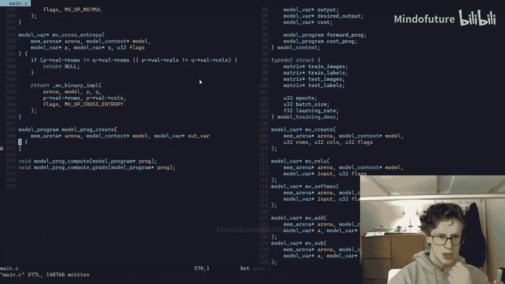

The goal of the create function is here， let me pull up our。Thank here。

We're gonna have some computational graph。 Let's say， let me do a real example。 So let's say。

In a basic feed for network。Your output for some layer， N is equal to。Ru。

Of the weight in that layer times the output of the previous layer plus the bias in that layer。

 right。And then I'll call here。 I'll call this multiplication term。 I'll call this z 0。

 or actually a call。I'll call this Z set A， and then this whole term here。Or call。Sub B， okay。

 so if we take a look at our computational graph， we're going have is。WN。A and -1。

These combine to get Z， A。And then， B， N。These combine to get Z。So， B。And then， Z。

And the just the Raylu right to get a7， okay so。The way that we're going to do this。

As we've set it up now， each of these variables has a reference to their inputs， right。

 So a has a point where Z would have a pointer there and there。

 Z B would have a pointer here and here， and A would have a pointer there so。

What we need to do is what's called topologically sorting。

This in computer science terms is a directed ascyclic graph right So it's a directed graph。

 meaning that the nodes have some order to them。 It's acyclic。 So there's no loops。

 It's not like we can have a pointings at to B and stuff or whatever which actually should probably the code we're gonna to check does not check the code we're going to write does not check if they have if there are cycles again。

 real library make it better than what we're doing right now。 but for this purposes， it's fine。

 Yeah so it's a graph and。嗯。A topological sorting of a directed acyclicalgraph basically means that you have resolved any dependencies before you like before you get to a note。

 you have resolved all of its dependencies so。These arrow are actually a bit deceiveing。

That's how we were representing it computationally。

 And the reason for that is because you can only have like one or two inputs to a thing to a variable but a variable can be used arbitrarily and many of times。

 right， So what we really want to think about in terms of forward in terms of computing the output is the arrows going this way。

 right。So in that context， one topological sorting could be WN then a of n minus1。Then Z of A。

 then B of N， then Z of B， then A of n。 right， So if we look at this order here。

 we know that Z depends on these two。And then。Z Z A depends on those two。 Z B depends on these two。喂。

And then a depends on Z B and。 So anytime that one of these nodes has a dependency。

Whateverever it's dependent on gets resolved first， right。

 So the goal of our program create function is given our computational graph。 And remember。

 we're getting it in kind of the opposite direction of how we would imagine it。

 We need to produce that topological sorting， right。

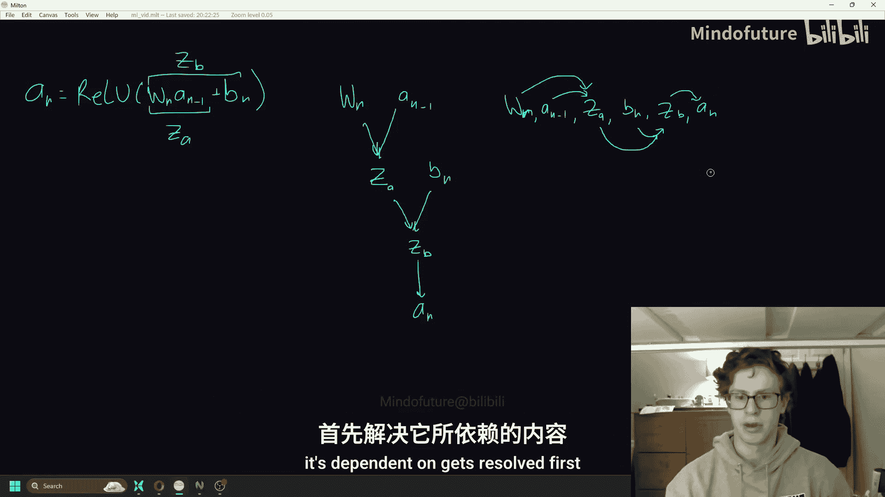

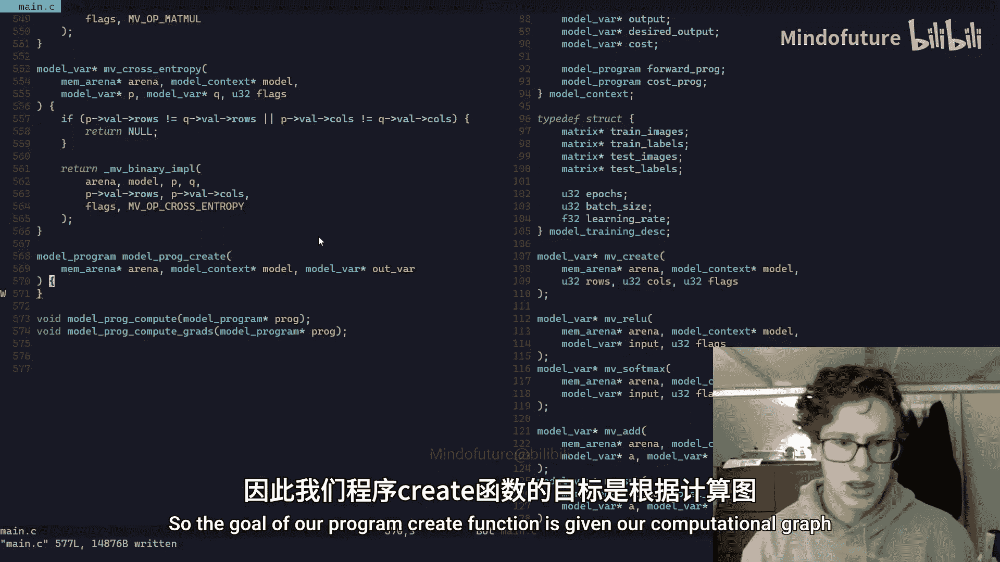

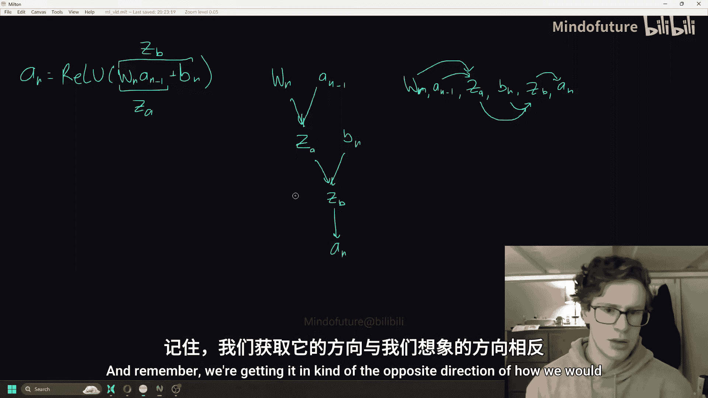

We need to produce this array of variables， right？So how are you going to do it。

 There's like two primary ways to do topological sorting。

 And one of them requires one of them is called cons algorithm。

 And then the other one is with a depth for search。 We're going to use the second one。

 And the reason is because it allows you to more easily。Deal with a subset of the graph。

 And that's what we want to deal with right now。 because we were only like our cost and our output graphs are going to Well。

 our cost graph is basically a strict superet of our output graph。

 So we want to be able to also topologically sort。The subset of the graph。 If don't worry about that。

 if that didn't make it much sense。 But the first thing I'm going to do here is actually grab。

A temporary a scratcher。嗯。And if you want to learn about。

What these are or whatever I recently made a video about that， if you want to check them out。

And then。We're going to keep track of whether or not we have visited each note in the graph。

 and then we're also going to keep track of a stack。For like our searching and then a final output。

 right so。We'm going to start off with our visit array now。嗯Obviously。

I'm going to use aP things here， although。You could。

Get the actual memory usage down a lot if you wanted to do a bitmap instead of a list of Booleions。

It doesn't， I don't think it actually matters that much like you're not using that much memory for this。

And then we're going to have a stack size。We're going to have an out size。

 and then we're going to have a model。A variable array for this stack。hi。

We're going to put that on the scratch arena。And。This size is going to be none。Fars， and then。Out。

Which is pushcheray。

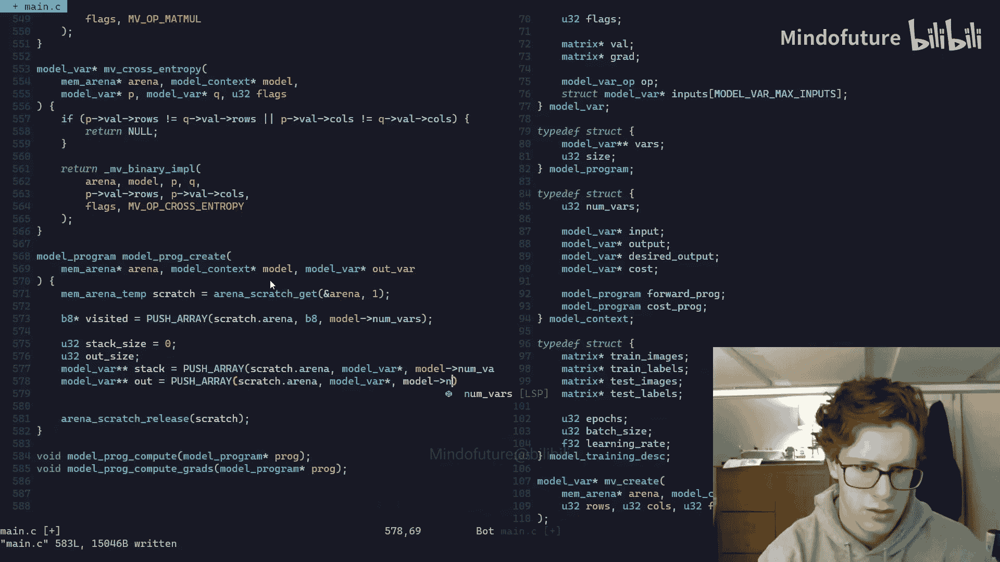

So let me return to this graph here， and I'm actually going to go back to when I had arrows pointing the other way。

Cause this is what we're actually dealing with right now。 We're， we're starting at a of N。

 And the output we want to produce goes。W， N， A and minus-1 in any order then d's2 in any order and then so on。

 right。And I'm， I want to do this non moreclusively。 So it's a bit more straightforward。

 So the way we're going to do this， we're going to have our search stack and then our visited list。

 And basically any time that we get to a node， we're going pop it from the stack and then。So yeah。

 this is going to be our search staff actually let me say。Let's say that we're a Zbi。

 let's say we're starting at Zbi。And our search stack。Has ZB， Okay， so we pop that from the stack。

 and then we mark Zb as visit。 We've said that we've visited it。

 and then we push it back onto the stack， okay。And then we push both of its children under the staff。

 Okay， so we'll push B N and we'll push C。And we'll deal with all of those and so on right。

 And then by the time we get back to Z B， let's say we've done all that searching。 We're back at Z B。

 Now we're put popping it off the stack again， but we know that we visited it， right。

 And because we visited it， we can move it from the stack to the output and add it to the output。

Hopefully， that makes sense。 It's a bit weird to wrap your head around。

 but the code should is pretty straightforward， so。

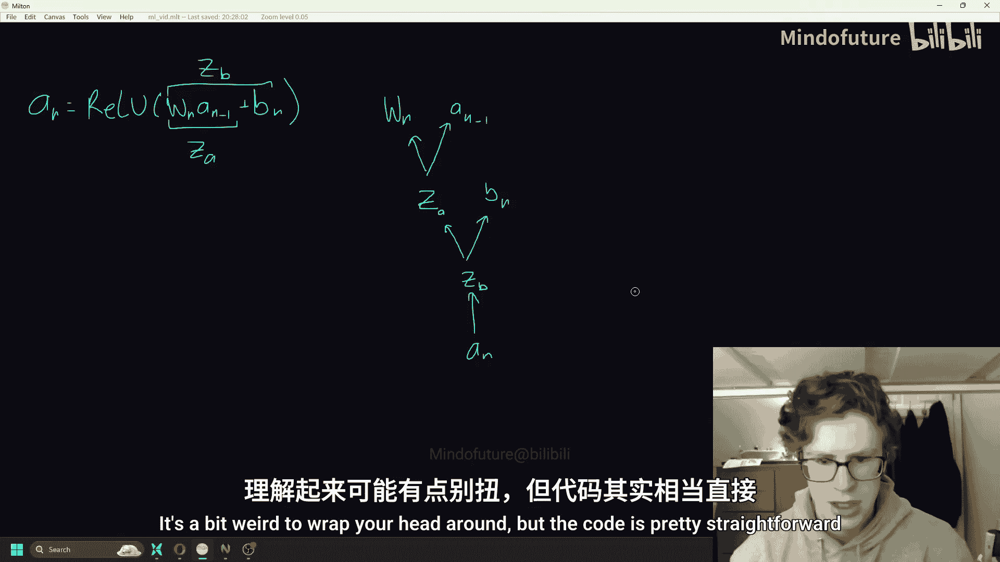

First thing I'm going to do。Is just add our root to the output， right？And then I'm going to say。

 well， our stack size is greater than 0， other is well， we still have。

A variable to pop from the stack。Our current variable is。If you're not familiar。

 when you do minus minus or plus plus before that returns the variable after it's been incremented or decremented。

 and then when you do plus plus or minus minus after it returns the variable before it's been incremented So this is just some time saving measure or like。

Character saving measures， I guess。Alright， so then we're gonna do。 we'， first off gonna check。

Well this， this is where we're using those indices that we created。 So if our index is greater。

 than're going equal to。Ourre numb bears。 Like if somehow we have an invalid index。

 I'm just going continue' causeuse we would endpin and array out of bounds。

And then we're going to do is say， if our。We have visited the current one。嗯。

We are going to add it to the output。And。That's all we're going to do if we visit it if we have not visited it。

First is that we are going to set。The current one， too， visited。And then， we are going to。

And the to the staff。And now we have to deal with the children。嗯。Or its inputs， really。

So I'm going to get numb inputs。And that is equal to the macro we made earlier。Given that operation。

So。4。嗯。So for each input， and we're going to all have。Input equals。Inputs are。If the input。

Index is invalid。Or。We have already visited。The current index。挺便宜了。So discard card that L。

 so we're going to push it onto the stack size。好的。There is actually there's a slight issue with this implementation。

 and that is because I've limited our stack size to the number of variables and there are situations you can run into where you're going to be pushing the same variable onto the stack multiple times so。

日那。The most efficient solutions。But what I'm going to do is actually check to see。

If this variable is already in the stack and if it is， remove it from the stack。

So if stack J equals input， then I'm going to loop through。嗯。And remove it from the stack。

 So let we can say。Yeah， so stack at K， this stack。This is not efficient， but it does fix that issue。

And this is just because I have to make the stack of a fixed amount of memory。 And that should do it。

 So now and one more thing， the reason that I put the output onto the scratch arena instead of the actual arena is because were we might be using a subset of the graph。

 whereas that's enough memory for the entire graph to be included。So。The actual output， we'll call。

Size is outside。And。Push array， this can be 90 onto the actual arena。Of outsize。

And then men copy two program barriers。And just return that program。All right， so that's the program。

Okay， so just one small thing I'm actually gonna do here。Is make sure that our。

Outsize is less than a number of variables。You can。

Probably won't happen but I'll add that for the stack size as well。So。

If you were actually doing proper air handling， this would be where you would。Put an air。Cer。

 and then。Let's move on to the computer function。What the what compute is going to do is basically loop through your or like execute your program for in the forward direction。

 right so。We're going to go。For each。Variable in the program。而。Very variable。Is。And then。

And then going just grab the inputs here as well。What。So， we're now。B a equals。Actuallyate。

No just we describescribe these。Becauseuse。If the inputs。Like， if the number of inputs。Is。

Not correct。 Then we're just not going to access those anyway。 So it doesn't even matter。

So now we're going to do the switch on the operator， and then。do the base。

 Let me pull up all the operators。 So if we have no。Orreo。The up create。

We just safely break out of those and then。I'm also gonna include。The unary start。

And the only reason I'm going to be explicitly breaking out of like the nulls and the uninary starts is just to make sure that。

We're properly handling each's case and getting warnings on everything。In the relu， so。

Rillu is just going to call that Raylu。嗯。嗯。Ex so same thing for soft map， so。It's gonna be。

It's soft next。Like so。 And then we gonna have。呃。AndThe finally start。嗯。

And then we'll go for M up add。And that's just going to call that add。嗯。Yeah， I would say。

How about you。ピが。So， and then sub。So， and then this is going to be。And the only reason， oh， got。

This was a few more arguments。So we're going to zero the output and then not transport either of these。

I am feel free to use。True and false。 I'm just slightly more。

 that will be slightly more compact covi across。不音。

The only I specifying that its major multiplication is that you might have down the line you might addd like component wise multiplication。

嗯。And then we go from that cross entropy， and that'll be curved。嗯。嗯。should be good。 Alright。

 So thus far， we haven't done much too exciting。 But now it's time for the real。

The heart of why this actually works。 This compute grads function， right， So let me go。

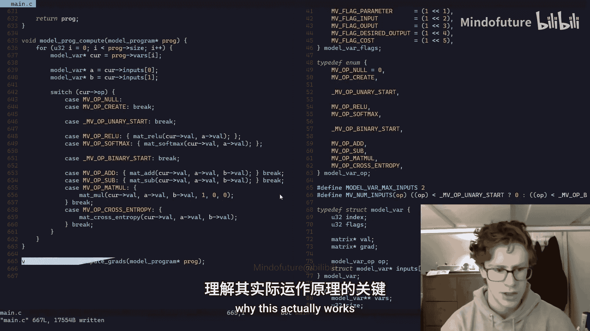

Back to our thing here， back to our graph now。What we want to do， The goal of。

If we go all the way back up to the beginning here。Remember。

 we have this cost function and these parameters， and the goal is to find the gradient of the cost function with respect to each of these parameters。

 right。Given some here， I'll even add。Can add a y here。 And then our cost is based on A and， right。

 So like in this simple network here。Our goal is to find the partials。

Of the weights respect or the parcels of the cost with respect to the weights and the parcels with respect to the biases。

 right？The way that automatic gradients are going to work is just with the liberal use of the chain。

 So we're going to consider。If we go back to a here。

 we're going to consider this as a composition of a bunch of functions， right。

 So instead of Raylu being the only explicit function call here， we're going to call have Raylu。

 and then we'll just have an add function here， and then we'll have like a multiply function here。

 right。So we're going to end up with a bunch of。Function calls， right。And our goal， remember。

 is defined here。 We can actually， right for now， we can ignore the season stuff。

 If we're just looking at this， our goal is to find the partials of the inputs with respect or the partials and derivatives of the output with respect to each of these inputs。

 So as a bit of an example here， let， let's。Flesh this out a bit more。 So we have a here。

 and we can say that a of N is equal to raylu。Of Z B。And then Zb is equal to add。Z， ABM。

And then we can say that Z A is equal to mall。Of W N and A and -1， right。So。Remember。

 our goal is to find the parcels。Of these two， with respect。But what we can do first， is find。

So we know that this is a composition of a bunch of functions so we can define our very like we can define these in terms of channel。

 We know right now that we can get the partial derivative of Z A with respect to W event， right。

Because this is matrix for multiplication。That's just A N -1。 right。

 and we know that we can get the partial of Z B with respect。To Z A， right。

That's just going be one or like the one vector， right。Because this is just an addition。

 And then we also know that we can get the partial of A N with respect to Z B。

And that's just like Ray lose derivative， right？I don't want to say。Like， so， so。

If we look at what we have here， if we write this all out， we want to know with the partial。

Of A and with respect to W N is right。 But if we write each of these terms out。

 we're going to get Z A。WN multiplied by。Cbi。Ce。Multiply by A。Z B， right， This is just the chain。

 okay。And。That just gives us our solution。 So this is just a specific example where is able to like。

 explicitly write out each of these steps。 But the power of having this computational graph is that we know to get like to get C here or to get A N here。

 We know what operation we had to do。 So we know。Like。

TheThe output of AN could be going into any other function。

And Z B could be coming from any other function， but。We know how to add its own term to the gradient。

 right？We know。Like if we're taking a look at just this Z B， Z A term。

 we know that we can multiply this term in and add it to the next gradient。So。

I I don't I don't know if this is totally making sense。

 but this is just called reverse mode automatic differentiation。

 And feel free to look up more about how this works。 And hopefully the code makes more sense。

 But more in generally， instead of the chain we're， we're actually gonna look at is。

The Jacobian vector product or the vector Jacobian product。Let's say that we have some function。

F of x， right where x is some where x is a vector。 So F takes in a vector and produces a vector。

 And then we also have some function G of y where y is a vector so。If we want to know F， actually。

 yeah， that's fine。 if we want to know F of G of y， right？If you recall back to like calc 1。

 if this was just like f of g of x or x is a variable and we wanted to know the derivative with respect to x then。

We would take F prime of G of x。Times G prime of x， right？ But in this case。

 we want to know what's the gradient of y with respect to F， right， Okay， so if we have this setup。

 what we can say is that the gradient。With respect to Y of F is equal to the Jacobian。Of G。

 I believe it might actually be the Jacobian transpose times the gradient with respect to x of G。

I believe， I believe so。 and honestly。You don't fully need to know precisely like each individual component or even what the Jacobian is。

 But the T L DR is just that this is a way to do。 this is like a multidial general。

 almost if that makes sense。 This Jacobian vector product here allows us to convert from。

The gradient with respect to one variable， to a gradient with respect to another。

What we're going to be doing here instead of just dealing with individual numbers here。

 when we have our vectors that were chaining backwards， computing there each gradient。

 we're going to be computing its Jacobian vector product。 right Now， in most cases。

 this is actually going to be something we compute directly， right， Like， for example， Raylu。

If you recall。Of x is just max。0 and x。 So if you pass a vector into Relo。

Each its inputs don't depend on each other。 right。 So because Raylu's inputs don't depend on each other。

 the Jacobian for a raylu function will be。Only the Iagon， right， you love。

And zero is everywhere else， right， It'll just be a diagon。

That means that it's trivial to compute this Jacoban vector product and there's no need to compute the Jacobian at all。

That's that。 the goal。

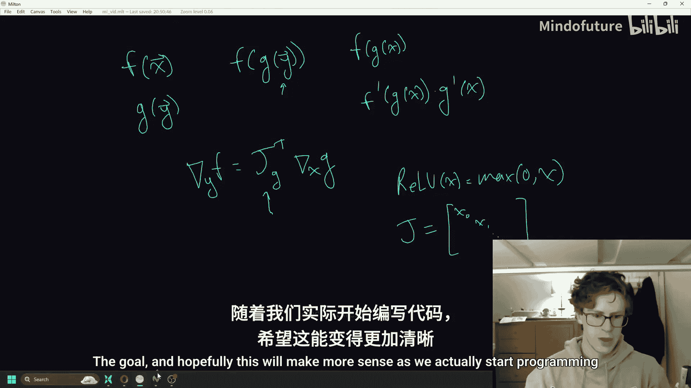

And hopefully this will make more sense as we actually start programs。

So the first thing I'm going to do is actually clear， glue through all of our variables here。

And clear their gradient。So。If。A variable。Well， first off， we're can do。

Our current table here is calling。If our current variable does not require gradients， so。Flas and。

F through class grad does not equal。Can flag your cars grab。

Then this variable did not have a gradient whatsoever， right？And we can just continue。

 And now the other thing I'm going to add。Is。If the current one。Is a parameter。

And I'm also not going to clear it。 and we'll get more into that later， but。For now。

 don't worry about that too much。 But not here， we're gonna clear its gra。 And then I'm gonna do is。

We know that the output is。嗯。We know that the last variable in the program is the output， right。

And that is the variable that we want to find our gradients with reflect。

 So I'm just going to fill its gradient。With。1。In other words。

 that is giving us basically the gradient with respect， to。

The gradient means thing with respect to the sum of the final variable in our program。

Which in this case， is perfectly fine。 What you might want to do to make a more like complete。

 robust system is to have。🤧。Is to explicitly have that last variable be just a single scalar if you're doing something like this。

 But for now， this it。

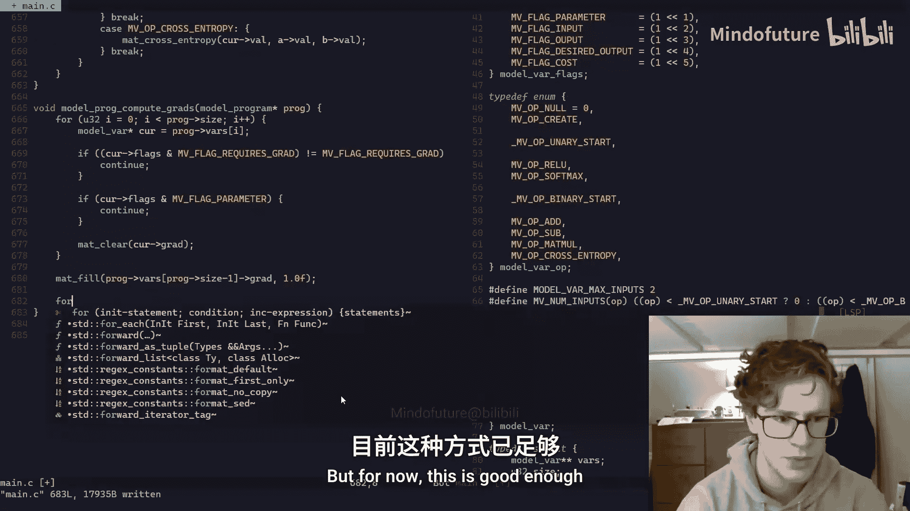

And then the other thing we're going to do， if you remember back to our computational graph。

 our topological order went this way and went from inputs to outputs。 But now we're finding great。

 So we need to go the other way。 So I'm going to say much going to call。 I'm going to do an I 64。

 I equals。

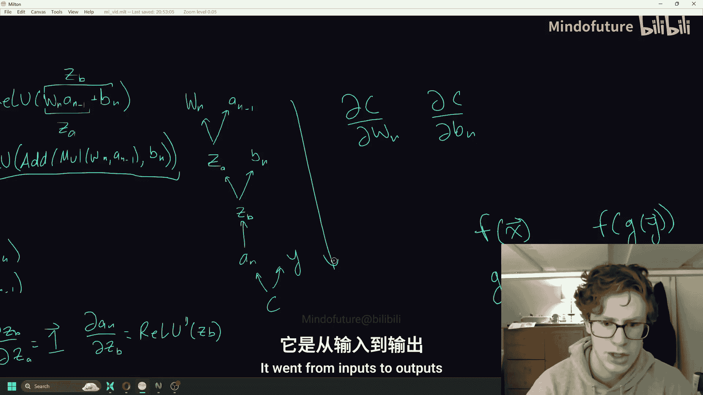

Pm size -1 I red and equal0 I  minus。And now we're decorating。

 we're going through the right backwards。And then we're just kind of a similar setup of grabbing each of our variables here。

 So our current is equal to our current bars I。And then our。AIt was currently。See。

You current if its one。Like so。 And then now we're just going to have。The same switch statement。But。

What we're actually doing in each of these instruments is different。Let me just clear all of this。

But did I not break after these， That's a mistake。In great。That would have been bad。 Okay。

 so don't forget it breaks here in our function。Or in our for loop here。

 where we're computing the gradients。 The first thing I'm going to do。

Is actually check if we need to do it at all so。If we only have the one input and that input doesn't require a gradient。

 then we can just skip this right， because the goal of each loop is to update the gradients of all of our inputs。

 Like at this point in the loop， we're assuming that current， its gradient is already what it is。

 And then we we need to update the downstream gradients。 or I guess the upstream gradients。

 I'm actually not sure down It know。 So if nu inputs equals one。And A flies。Doesn't equal。Then。

 we going to。嗯。Except， we can also do this。If。If no puts is2 and A and B don't require gradients。

We can also continue。嗯。I' out here。 so let's go to the simple case。So at each of these steps。

 we're going to。Take whatever the。We're going to add like the current gradient to our inputs gradient and possibly modify depending on how we're doing it。

 So in the add function here。I to check if a requires gradient。Then we're going to not。And。

2 a's gradient。Current gradientding。And then， same thing for vegan。Because it's adding。

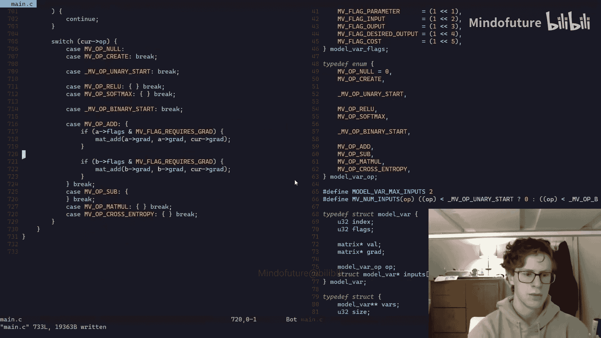

Again， this is just like the。If you imagine。If we have some function， add， it takes an A and a B。

The actually， we're just for now， let's call it capital， or we'll just call it F。

That takes an A and a B and returns a plus B， then our partial。With respectect a is1。

Our partial with respect to B is just one。 So if we're considering the fact that we have some larger。

We wanted to find some cost with respect to A。That's going to be our partialite times。

APartial the cost with respect to that， right， So because this term is just one。

We're just going to add to it。The gradient that we already have at our current， right。

 this Del C Del F term represents current gradient。

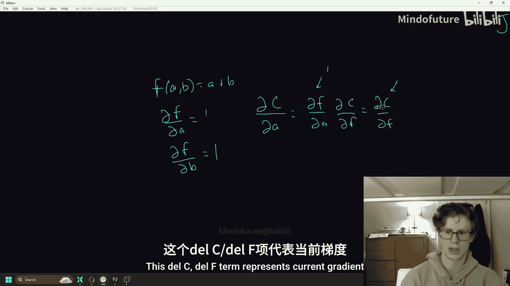

嗯。And then。Same difference here for subtraction。 We're going to switch the add to a sub on D。嗯。可能。

For the not coplication， this is going to be。So here I'm actually going to take。This is well。So。

When we have so we don't， when we have the matrix multiplication here， what we w to do is。

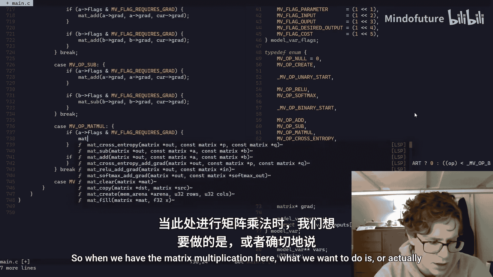

Or is it here， let me con， let's consider if we have just some function。

We'll call this one G of A And B。 That's just A times B， right， our partial of G。

With respect to A is B。 and our partial of G with respect to B is just a， right。In theory。

 when we're computing our partial。Partial C， partial A term。We take our。Current gradient。

And just multiply it by B and vice versa for a， because these are matrix multiplications。

 We're actually going to have to end up transposing one of them so。

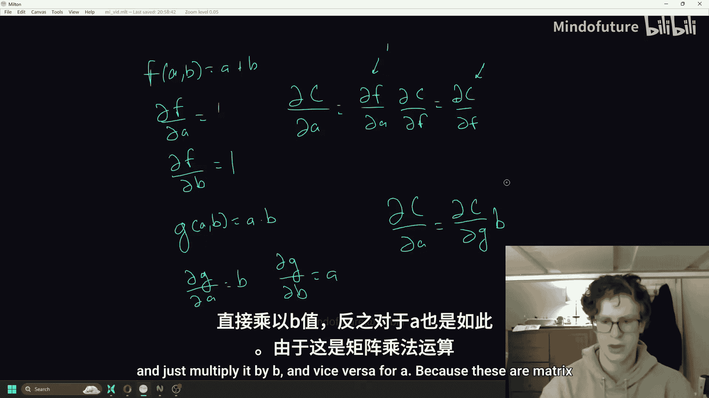

Our matrix multiplication， we're going to add to。A's gradient。 But to get this here。

 we're going to add to a's gradient， we're going to multiply。The current gradient。Times B that。

 right。And I'm not going to zero the gradient because we're adding to it and then I going to transpose beef。

Nice to get the shapes， right。那看。We're going to add to B's gradient。As value。Timeins。gradient。

And then we're going to transpose as value。 Now that we've finished the basic operations here。

 I'm going to come back up to back to our matrix implementation and actually fill in these three functions here。

Although。So I've noticed we actually， we're also going to want to have。Our incoming gradient。

Because we need to multiply by that， and then。In addition。Here in the cross entropy。

 we have two input， so we are actually going to need two possible gradients。That we can multiply in。

So。Let me update these function parameters。 So now we have these。嗯。

And come out here and paste them in so。A Raylu one。 This is the simplest one。 If you， you remember。

 Raylu was just。The max of0 and in data。嗯。Check the。And then we're also going have to check。

With the gradient shape。And then。Here and out we're gonna。Plus。So if in data is greater than。Re is 0。

 It's greater than 0。Then we're going to add the gradient。If it's not， we're just gonna add nothing。

 we're gonna to add 0。 And then， okay， so that's that。 That's the ra of。

 And then for the cross entropy， we're gonna。Take first。We're not to check the size of each of these。

好的。I am going to make these optional arguments， So like。The color could make either of these null。

And that's because。Oftentimes you don't need to find the gradient with respect to Q of the cross entropy or with respect to P。

So， but we'll call this P gra。难less是。Grad， as well。

So then if you recall our cross entropy function here， it took P。

 which was an expected probability of distribution in Q。

 which was the actual probability distribution。 And the cost for that was P times the log of that is not a Q times the log of Q。

 right？ So if we are looking at our partials here， our partial with respect to P is just going to be negative elementen of Q。

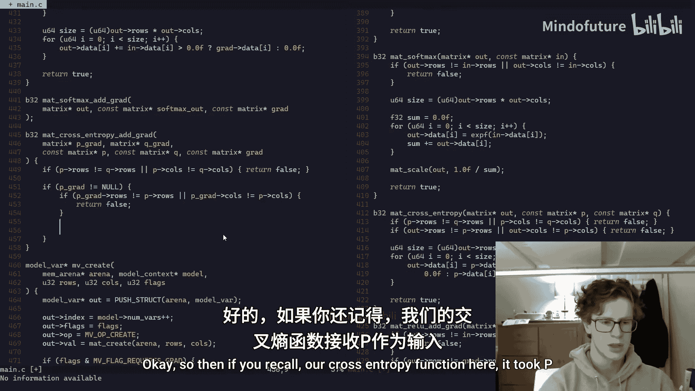

And then our partial with respect Q， is going to be negative P over Q like that。 Okay。

 so when we're doing in this of statement here， we need to compute the partial with respect P。

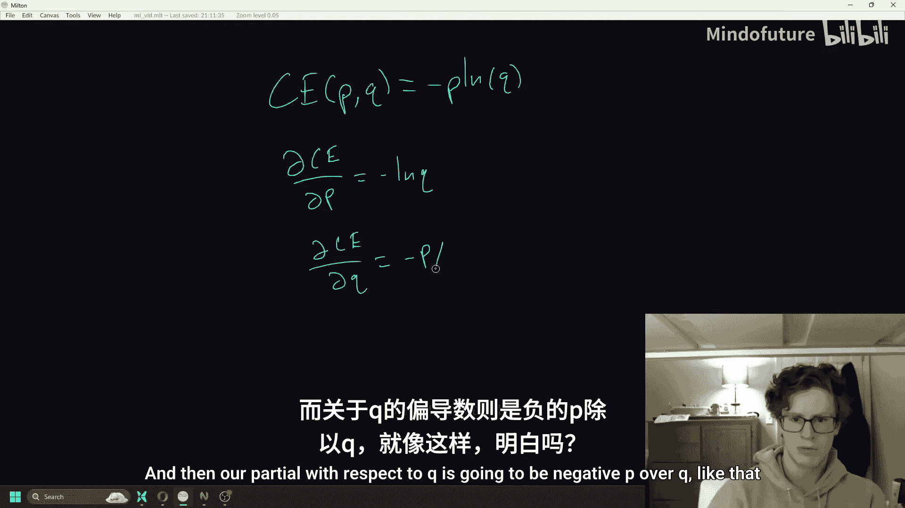

嗯。

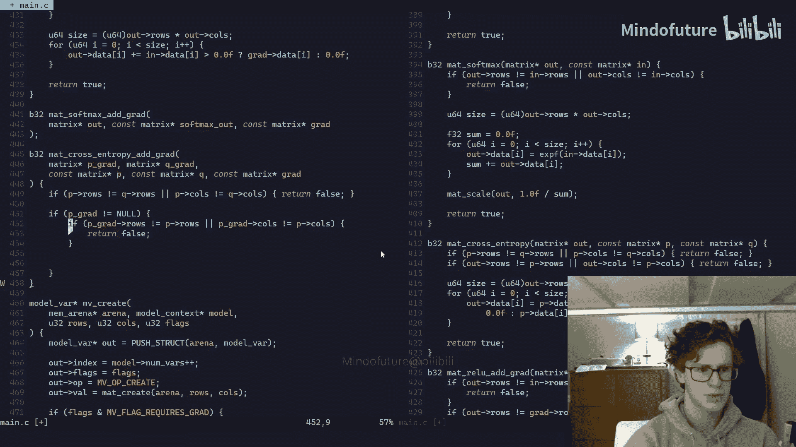

First， let me grab the size of this。So。We're going to go 4 I。Less than size。 And our P grand。

We're going to add to it。It's negative element of Q。

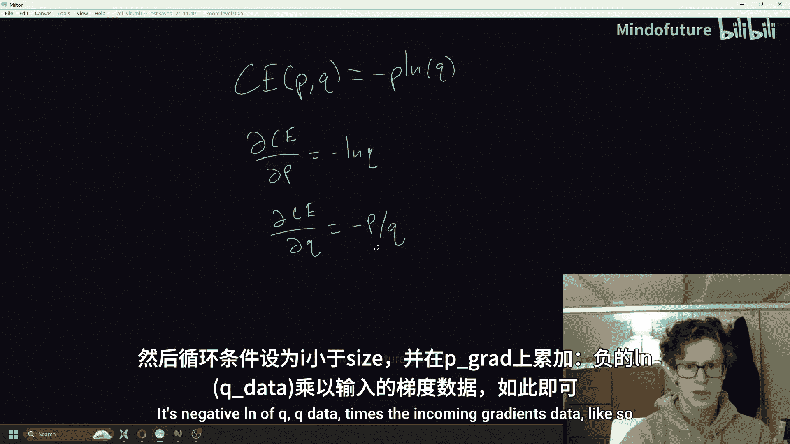

Q data。Times the incoming ingredients theta。Like so。 And then if Q grad is not null。

We're going check the size， again。And then here we're going to go for I was zero eye was than sign。

If。嗯。We're going to say that our Q。H I。Will add that negative P。Data I。Overcud。Times。

We should probably do some check to make sure Q is not0。Probably。

 I don't think we're going to run into that with what we're doing today， but。Again， for completeness。

And then so the softener。

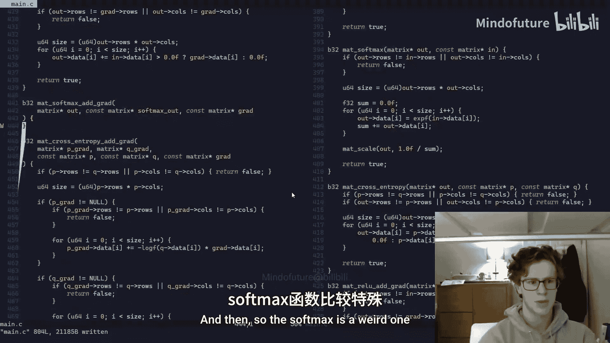

Softm is a weird one。 If you recall from earlier。The soft max。

Of like some term I is going to be E to the a of I over。Sorry， the sum， we'll say the sum of J。

E to a sub J， right。Because of this and in the railer in the softmax。

 there was no interdependence between。Variables in the。Inputs。

 so like the first variable in the output vector only dependent on the first variable in the input vector and so on。

 But with the softm， because of this sum term， all of the variables depend on all the other variables。

 And this means that our， the Jacobian of the softm function is not actually。Is not diagonal， right。

 It has。 it has。

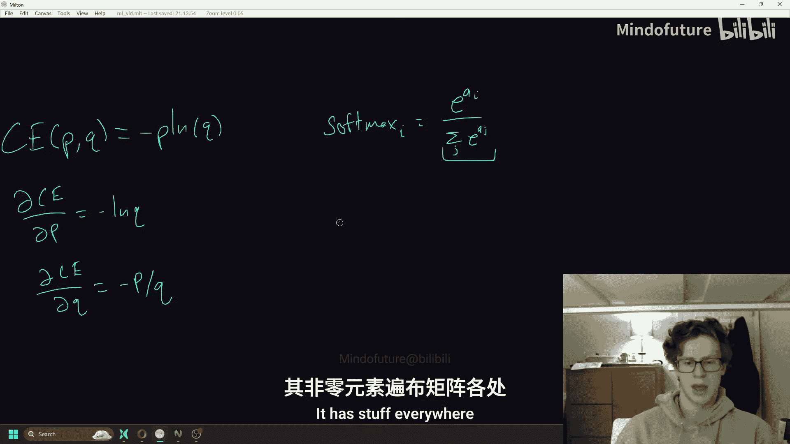

Stuff everywhere。 So when we're going to calculate the vector Jacobian product。What I'm gonna do。

 And I don't know if this is the actually the smartest thing to do。

 I'm sure you could calculate it directly， but。Just for the sake of。

Making my life easier right now for this video。 I'm just going to calculate the Jacoban directly。

 And then we're going to。Multiply thecode games to get the final thing。what we're going to do here。

 I'm going to call our matrix Jacobraian。嗯。First we need to do is say。Oh， and else I should say。

 So the Jacobian of the softm。

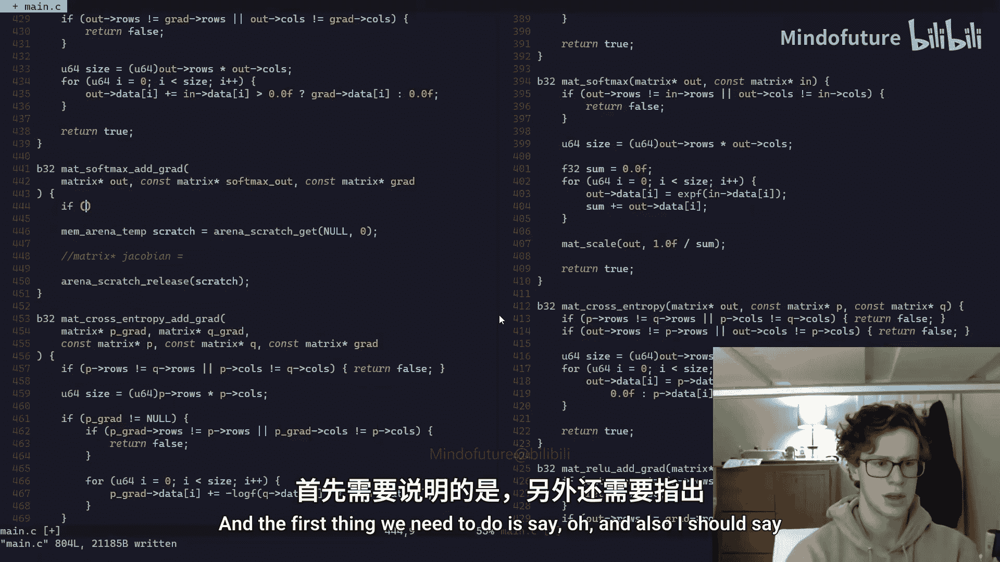

Is just。Along the diagonal， it's the output， which I'll call S times 1 minus the output S and then。

Everywhere else。 So that's along the diagonal。 And then everywhere else is the output at。嗯。Like。

It's the output of the one times。1 or times negative output at J， right。

 where like I is the R and J is the column or something like that。 I mean， it's。

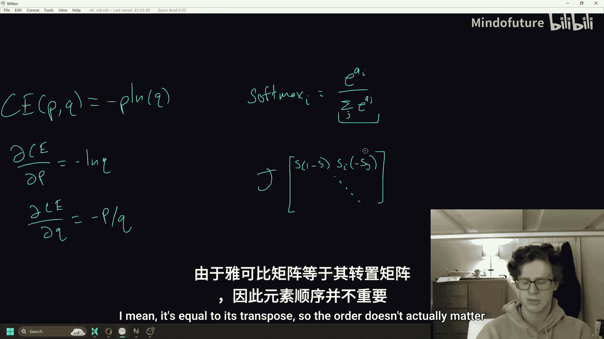

呃。It's equal to its transpose。 So the order doesn't actually matter， but。The output。

It has to be a vector for this to work。 So I am to say if。If the row doesn't equal 1 and。

The column doesn't equal one， then it's in doubt。feeling of that。

But that's also why this function takes the output instead of the input to the offm。

 because it's easier to calculate dicoian that way。 And then we're going to say that the size is。

Whatever。The size of the vector。 So that's the max of the soft。If it's a row vector。

 it the number if it's a row vector's the number of the columns。

If it's a column vector there's the number of rows， either way。

Because we've already checked that it's a vector。 it' just gonna to be the max。

And then we're going to create onto our scratch arena。N by N matrix。嗯呢。We're going go for。

You can see your is and size。For J zero。It is less than size。Jacoian。对的呃。we'll say J plus items。

Science。Is equal to。嗯。I is Joe。Or， well， it's actually。 so it's going to be。Soft melt out。

At I times either  one or 0， right， you can see。

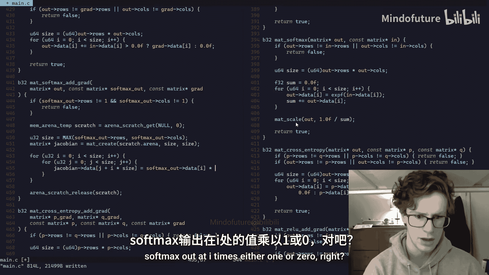

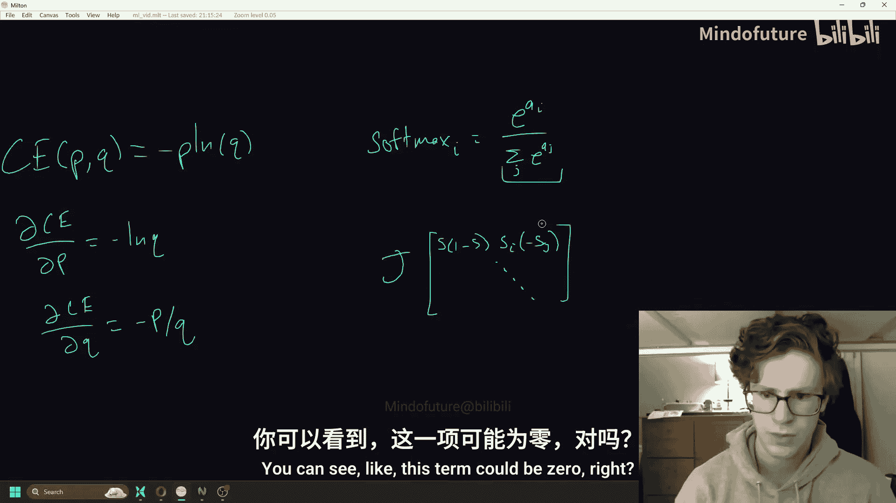

Like。This term could be 0， right。 So I'm going to do that same trick again where I'm using the boing output directly as an in as a number here。

 So I equals J minus soft max out at。嗯。あ。Okay， so that's that。 And then。We're going to say。First off。

 I'm going to return true here。And then we're going to say mat Mo。The output。

 And then we want to multiply our Jacobian by our gradient and add it。 do not transpose。 again。

 I mean， technically， I think he would transpose there。 but because it's square， it does not matter。

right， So that should be each of our gradient functions。 So now we're going to come back down here。

And remember， I already checked that。Earlier， this if segment here checks for uninary functions。

 so we don't have to directly check if a requires grad。 We're just going to call our mat。

Raylu add gradient。 and we're going to add to A's gradient。嗯。Where the input to it was。Is。

And our current gradient is。Softnet， similar story， mat。Om bad bread。That's going to be。

Going to take A's grad as the output。 the softm out is actually our current value。

 and then our current gradient as well。That's that。And then for cross entropy here。

 we're going have to check。 So if a flies。I'll just copy this， so。Actually， no。

 we'll say I'm gonna say our models on。T equals a。And Q equals B。So， if P。Although， actually。

Because our function checks for null， if we have a model variable that does not require a gradient。

 its grad variable is just going to be all anyways。So I'm just going to call this function directly。

 and then it'll take p's gradient。Cient。TQ。Current graing。Oh， actually， this is P value and Q value。

あん。

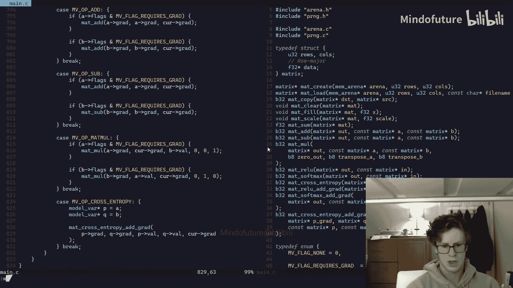

Alright， and that。That should be yet for the compute gradients function。So。Let's recall。

 we were given。嗯。Given some computational graph here。The function program compile。

Topologically sorted the directed acyclic graph to give us a。

List of variables in in the order that they need to be executed， right。And then。

Model program compute looked through each variable and computed its output。 right。

 Model program compute grads went through in reverse topological order。

 It went from bottom to top of the Ar list our tree here and our graph。

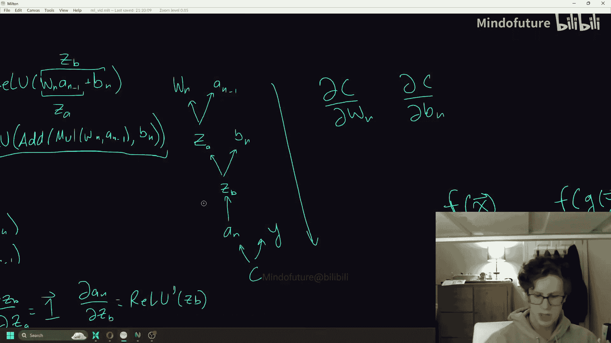

And computed the gradient of each function that requires the gradient with respect to the output variable。

 assuming that our actual output is the sum of the output vector。Are you still with me。All。

Now that we've done that。We are fine。Finally ready to actually make our model， okay。

I needed to class of water。 Alright， so we have done。

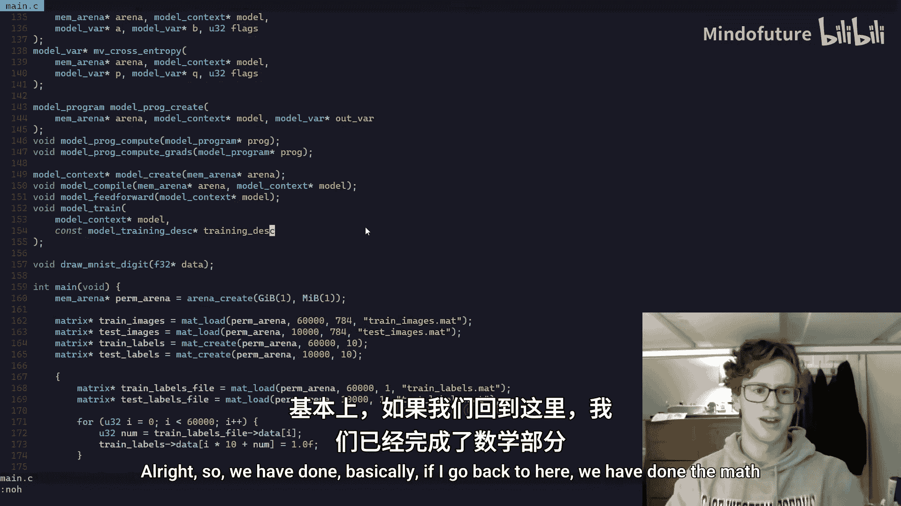

Basically， if I go back to here。We have done。The math， we have been able to find ingredients。 Now。

 all that's left is like the glue air。 All that's left is combining everything into one。

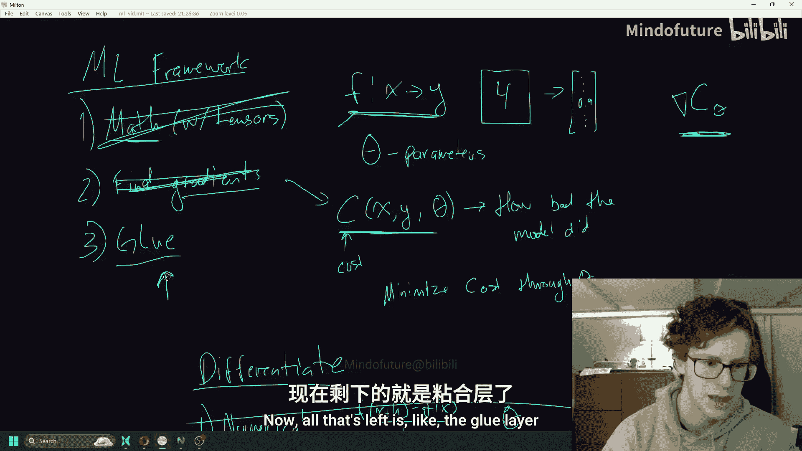

Like。Slightly easier to use interface， And then actually。Making the model and training it。 right。

 So I have these functions here。We're going to take food and implement them， like we always do。

Our create function here。For now， all this will do is literally just。Push the model onto the arena。

And we China it。Because there's nothing in the model that we need to initialize right now。No。

Right now， this is actually。This is an example of why I really like arenas because everything that we're doing here in terms of like our matrices and our model variables are allocated on the arena。

 So when it's time to free the model context， right。

 you just have to like dis clear that arena's lifetime， right。

You don't have to go in traverse the tree and individually free each。

Data variable you allocated for each model variable and stuff。喂。Just as throw that out there。

 But if you were。If you were in a situation where your back end was GPU based or something。

 you might end up having to do that either way。So in your model query function。

 you might have to initialize some stuff。 and you would probably want a corresponding model destroy function that cleans up everything。

 But as it is right now， all the memory cleanup we have to do is just。

Like left the arena that the lifetime， that whatever model。

Like let the arena that used to allocate the model on just die。 So the model compile function。

 This one's pretty simple。 We've got， if you recall， the model context has two programs。

 a For program and a cost program。So I'm going to say if our model does。AF model does have an output。

In other words， we've made a valid program up to that point。

 I'm gonna say that our model forward program is equal to model。Program pre hate。On the arena。

Our models output。And then sa you hear， if our cost did not know。Then， we can make a model。

Cost program。That's also my program create。And that's going to take our cost， as the output。

And then feed forward。 All feed For is going to do is execute。The forward program。

And that takes a pointer。 So do that。I'm actually。 so the train function， obviously。

 that's like the big。The final thing， but what I'm going to do real quick is actually create our model in the main function。

P going take a while to actually pump up there。 So here I'll also have a function here called createate MN mile。

This will take an。This is just。Have the model。You create it all in one place， so。

In our main function。Here we drew that M digit， and then。I'm going to go ahead and create our model。

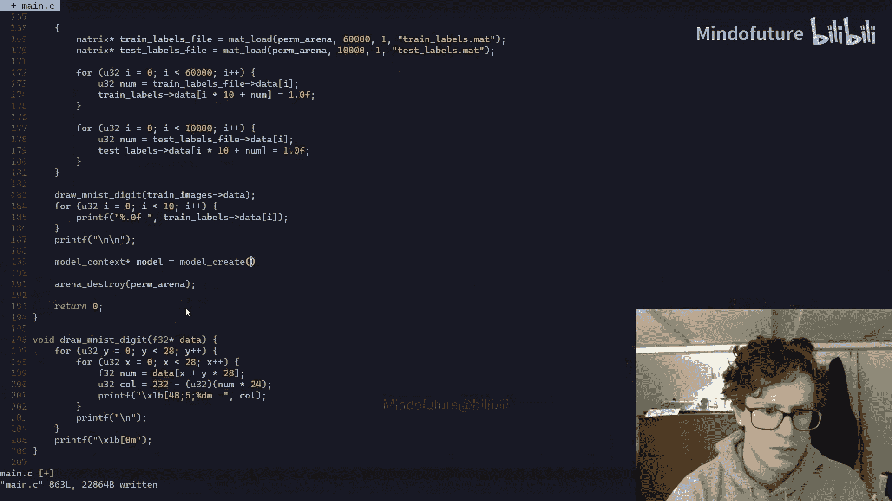

And let me just look。 So what we're going to do in this program is。

I'm going to call the create Ms model。Function here。

 and that will populate all of the model variables for our。Model for the Mmins network。And then。

 I'm going to call。Model compile。To finalize that。 And then what I'm gonna to do here actually。

 is show what the output is before and after training。 Although right now。

 I'm just gonna show the before output。 So we'll say model feed forward。 Or first off。

 we'll mem copy into model。因白。Value data。Train images。And that's going to just be one training image。

Time。4 like so。 And then we'll say model feed forward。And then I'm gonna print out the output。

 So this is。Free。And put。So I is0。Plus。And then， we'll say。And。Model output value。对了啊。

So that's just a mix that it all works。 And then here our actual model。Emist， it is。Here。Your call。

What we have for Ms is a 28 by 28 handwritten digit， right？Here， we'll do。7， I guess。

 so this is 28 pixels here。28 pixels here。 and then our output。Is a。10 vector。

Or a 10 by one column vector of a probability distribution reason。 right。

 we need some way to map that to that so。Obviously， we didn't do， if you wanted like the best。

 I feel like the state that the art probably would still be convolutional networks。

 maybe like a resonant。 But for right now， I'm just going to do a simple perceptionron， so。

Here's the model architecture。 We're going to have 784 input。

We'll do multiply by a weight and have a bias to get to。A layer with 16。

And then we're going to do same thing， weight bias， and then also do。

 I'm going to do a residual connection here。To show that。Our。Auto grad system is enabling for。嗯。

Like more complex models than a simple perceptionceptron could give you。

 And then our final10 output here。Another way to buys。 So all of these ones are gonna be Raylu。

And then this one is going to be soft max。And then obviously。

 our loss is going to be categorical cross entrytropy。

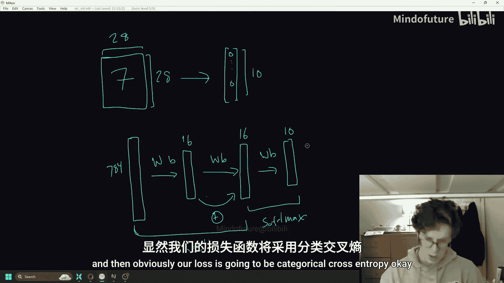

Let's get to it。 So for our model here， I'm going to create our input variable。 It's going to be M V。

 create。Ana model。And we're gonna have。784 rows， one column。 And this is going to be M V fly。Input。

And then。I'm also just going to define all of the parameters at once。 So we， we have four layers。

 So we need three weights and biases。 So our first weight is going to be。Can be。8。Model。

 and then this will be。嗯。16 by 7，84， I leave， and then M flag requires grant， and then M flag。

Pararameter。So that's going be weight， one， weight，2。嗯。1 is going to be 16 by 16。And wait。

Two is going to be 10 by 16。Now， obviously， this is quite verbose。So for an actual system。

 what I would probably do is have。Is you literally just make some lightweight simple functions on top of the layer that we have here that allow you to create these things easier。

create a some condition。嗯。So。Why are these。No biases are not being coloured in。Yeah。

 so like you could just make it a sequential function that takes in like an inputsizing an emphasize size。

 But again， I'm just hard codinging this for now。 So now what we need to do。 So our first layer here。

 I'm gonna have our。Z，0， a。That's gonna be M the。Mmo。Take the W and input。 No additional。Prameters。

 B is going to be。And the add。This gonna take the arena of the model。 and then it's gonna add。C0。

 A and B0。No， there's no。Prameters， and then finally， our A 0 is going to be N Raylu。B。

And parameters。 Okay， so like this is just our basic layer。 It's the matrix multiplication。 Well。

 by the way， it's add the biases。Marou。We're gonna do。For the second layer here。Weight 1， a 0。C1 a。

B1。And then I'm actually going to call this one Z1 C。嗯。

And that's because of our residual connection here。So our model。A 0 is Mvy add arena model Z1。

 C with a 0。Right。嗯。And then same thing for her final error。

This is going to take in weight 2 and a one。Z 2， B2。We2。And this is actually， our outlet。

So this is M softft Max。And then our flags will flag it as the output。嗯。That I misspell output， but。

嗯。Seems I missbull it twice in the same way。Okay， it's been a long video。 So outputs there。

 And then I'm gonna have a desired output variable。 I'll call this one Y。

 And that's going be M V create。Arena and model。10 by one， Em flag desired output。

And then our model our cost is M B。Cross entropy， arena model。嗯。Cross in。 So y output。

 why is the desired probability distribution output is the actual probability distribution。

And then flags will flag this one as our top。That's that's the model。嗯。So。Let me just make sure。

That this compiles correct。So we should see is that I made a mistake。Okay。

 it looks like I forgot to set outs to 0 there。No。呃。Oh， wait， actually， okay。

 it looks like we're getting oh shoot， you cannot see that under my head。

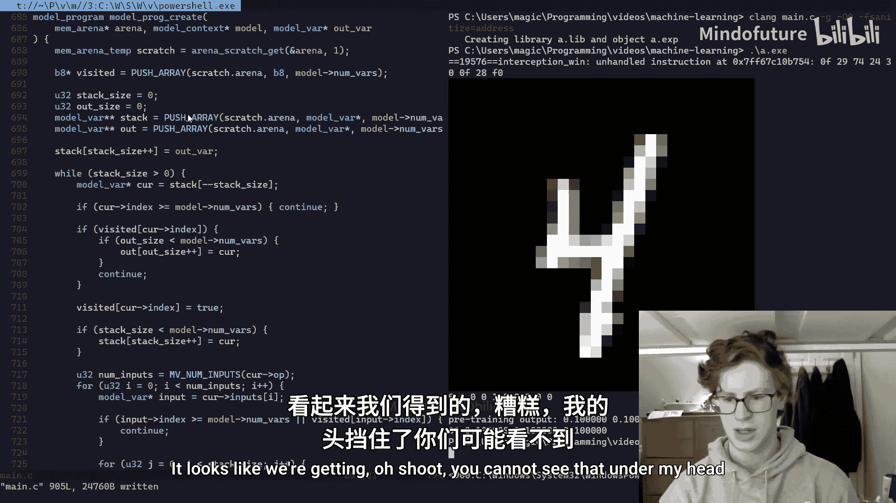

It looks like we're getting。Just completely。Like uniform。

 and that's actually because we forgot to initialize our weights。Okay， first off， I'm going to do。

I'm going to get rid of this so that the view is a bit easier。But what we need to do。

I'm actually going to add another function here。All this one Matt Phil R。

And this will take an upper and of lower。And fill the matrix with random numbers。

Because like your weights should be initialized randomly ideal。So。I'm going to go here。And then。

Each matrix is going to be P and G R F again， if you want to know how this random function number generator works。

嗯。Check out the video I made about that。And then， so that's that。

 And then we're going to say in our create Ms model function。Each of these weights here。

We're going to say Matt。Phil Ramand。So， on the value， and then。This is， I believe， it's called。

It's either， I think it's Xavier initialization。But the bound that you use is。

Here is the square root of six。Over the sum of the layer sizes。So。

That's the first bound and then second bound。 and it's between negative bound and positive bound。

Like， so， so negative button or it's。It should be lower than ever。嗯。

And then just do that for each of those so now。Now， we should see。And randomberry。

I'm going to compile this。All right， so you can see。Roughly uniform。

 but we're getting some nice random outputs too， right。

 So now that we're actually initializing this correctly。We need to make the training function。

 okay so。For this training， we're just going to do the simplest thing you can do。 Well， basically。

 the simplest thing you can do。 and it's just called stochastic gradient iscent。So。What that means。

Is that。We're going to take all of our training examples。

 split it into batches and then find the gradients for parameters with track to the cost for each of thoses batch every example in the batch。

 Aver that out， and then just directly。Subtract those gradients from our model。 Now。

 if you I'm sure you can figure out if you want to do stochastic gradient design with momentum。

 if you want to do mean squared propagation or likely adaptive moment estimation。

 you can look that up It's simple modifications we're going to be doing here today。 But for now。

 I'm justn with a standard basic stochastic gradients。So， I'm gonna take。So。

We're going to have the number of examples that we're training on in。

This thing is going to be the training description train。 Actually。

 you don't understand it's pull out each of these。um。So， that。You don't have to type it as much。嗯。So。

 and then。We're going to say that our number of examples。row， the number of rows in our。

Training images。 And then we'll say that our。Input signings。

The number of columns in our training images。 And we don also say that our number of tests。

I things is it going to be art test？Images， rows。Like so。

 and then what I'm going to do is I'm going to grab a scratch reader here because。

Before we actually test on the input data， we want to shuffle it randomly so that。

It's like it can't learn what each batch is。 So we're going to say then。

 we're going to say arena scratch get。No conflict there。嗯。Remember to release the scratch arena？

And then， we're going to say that。Training order。Here。On theory array。

This is just going to be a list of like the order in which we're going to train it。

That's going to be number of examples。And then I'm just going to loop through real quick。

And fill this in。Now we're going to do the first thing we should do。

So we want to get the number of batches as well， so that's going to be the number of total examples over our batch size。

And for now， honestly， I'm just gonna kind of。Ignore。

The fact that like our batch size might not be or our number of examples might not be completely divisible by our batch size。

 and just we might lose some on the edges there。But now。

 this is the main one we're going an epo a training epoC is just like one iteration of all your training examples。

 basically。So。If we have like， five epochs， per se。

That means that we are training on every single image five times， right。

So at the start of each epoch， I am going to。Shuffle arm。We training order around。So to do that。

 I'm going to say， and honestly， you might be able to get away with doing numb examples over two。

 I don't fully know the best way to shuffle in array。But。

I'm just going to take this and I'm going to modular number of examples。

 If you know anything about random number generation， you know， this theoretically。

 technically won't be uniform unless of no examples， this is a power of two， I believe， but。

I don't care right now。So we're going just to swap these real quick。

 we're going to take training order B。Set training order。The at the training order。And then。

Training order at A equals1。Pook swap， swap to random variables randomized the order。

Now we're going to go for。The batch batches。 So we're gonna say for batch equals 0 batch。

 less than1 batches。Bge plus plus。And then。Yes， should be it。 So at the start of a batch。

 we want to clear all the gradients for the parameters。 And then at the end of the batch。

 we want to update the parameters。 So at the start here， what I'm going to do。Is。

Go loop through the models cost program。And then we're going to take each。

We're going to take each parameter and clear its gradient so with model。If the current flags。Is。

Then we're going map clear。Now， if you recall。Earlier when we were doing the。

Compute gradients function that we， I don't actually clear the G the gradient， if it's a。Parameter。

 so that means that during our training batch， parameters won't have their gradients cleared。

 and they'll accumulate all of it。 And then at the end。

 we can scale down by the batch size to get the average gradient for all of those training examples。

 right， Tru gradient descent which have would have you average over every single training example。

 But stochastic gradient descent does the batch thing。 and it's good enough。 And far。

 far more computationally efficient。 Now， I don't know if you could actually run into an issue。

 I don't see a scenario in which a variable would depend on a parameter like a parameter would not be a leaf node。

 but maybe I could have an。 I Let me know in the comments if you're。Still with me in this video。

So cleared all the parameters。Now what we need to do is go through all of our training examples in the batch。

 So I'm gonna say for I equal plus 0， I is less than。Training us batch signs on plus。

And we're going to say that。Our index。Is going to beb。I'll say that our order index is going to be。

Our batch times， our batch size。Plus， I。 And then our actual index is training order。Like so。嗯。

And then what we need to do is。Copy the actual example， So I'm going to then copy into model input。

Value data， the。A training example。 So it's going to be the train。Images。Dot data。Plus。

 the index time 784， because it's pointer arithmetic， I don't have to multiply by size。But here。

 because this is a number of bytes， I will optimize by size， and I cannot hard code784。

 This is going to be input。Size， and I have not made that variable yet， but we will in a second。um。

Oh， I didn't make that variable well。 Actually， that's fun。 We should do output size， as well。嗯。

Because now wed basically do the same thing。For the modelss output。If you could not tell。

 this is kind of not the， this might not be this is probably not the best way to。嗯。

Like encode training data because we're largely just hard coding it。By。

It is good enough for this example， and I'm sure。Like you can come up with a better way to actually do it。

Yourself， so now we do do is we need to run the forward program。For the models。Cost program。

 we need to compute the cost。And then we need to compute its gradients。Other thing I'm going to do。

During the batch is calculate the average cost。This is just so we can have a bit of a metric。

As to how。Model is doing during training， you know， if you。呃。

You can oftentimes tell if you've made a bug when you're。Cost is going crazy， or if it's na。

Both happened when I was making when I was working on this video， so don't get discouraged。

 programming machine learning can be absolute hell。But so that's。 we've， we loaded an example。

Compute the gradients。 And then after the entire batch is over。

 we're going to loop through all the parameters again。So here， this time。

We have a bit more computation to do。 so I'm going to check。

I'm going to actually just continue if it's not a parameter。And then we're gonna do what。

We're going to say that the。Well， first off， we need to scale the current gradient。

By the learning rate， which is going to be part of the training description。

So the learning rate over the batch size。Which is also in the training description。So。This is。

The bat size。嗯。Well， like the learning rate is just something you multiply your changes by to make it a little bit more tame。

 And then obviously averaging the bad size and then。We're going to say mat sub， the current value。

And。If you're confused about why we're subtracting instead adding here is because gradients point in the direction of steepest ascent。

 we want to go in the direction of steepest descent， so we need to。Subtract， instead of add。

 we've officially hit 1000 lines of code as well。Okay， so。That is the training loop。

 But one thing I am going to add here。After we're done with all the training is to go through all the testing examples。

 actually， the first thing we should do。Is here， I'm just going print some debug information， so。

We're going to say run epoch， whatever out of whatever batch。Whatever out of whatever。

And then our average cost。Is whatever。We'll say dot4 F。 And then I'm gonna use backlash R。

 the carriage return to reset the line。 And that's also why I'm explicitly。

Putting precision on each of those so that it'll look clean when we're doing it。 And Epo plus one。

If方。And then we're gonna。Also， plus one。Thatch no that's actually just a variable we have。Btches。

 and then our cost is just our average cost。 So justing the cost of like the last。The last batch of。

 or like the most recent batch as of printing。 and then。This is at the end。

 so I'll print a new line here。And then。Here we're going to go through all of our testing examples to get our test accuracy。

 So I'm going to say。actually， first I'm going to do。

I'm going to add one more function to our matrix thing。And I'll call this one。嗯。Arg Max。Honestly。

 I forget the。I believe that in like actual libraries， Arggmax。

We will like do along a specific access Act。Yeah， access or something。 But I'm。

 because we're dealing vector here， I'm just gonna get the。Largest index in the overall。嗯。

In the overall。Mattrix。Just because that's easier。嗯么。Well to negative。And then the。0ero。If。

Data I is greater than max。嗯。Then our actually， we can just say。没。Data Max I max。I equal plus I。I。

This is because we're just going to assume that whatever is the highest probability is what the number that the model is choosing。

 So when we're testing the accuracy， we can test compare the arggonmax of the output to argmax of the desired output。

Okay， so now we're going do for I equals 0 I is less than。Tests。IPlus plus。

And then we're gonna have our average well， for accuracy， we're going to needum correct。

And then we're going to do average cost， as well。嗯。So for that， we're going do。First。

 we need to load。An example into a model， I'm going to take this code to load that。But。

 we're gonna have to。Carpy。Instead of train， this is going to test labels and test images。

 and we do not need to do the backwards pass here。 So we're just going to have model program。Compute。

And I am going to use the cost program here。Because this computes the output in addition to the cost。

 So the average cost will plus equal the mat。Of the model。Cost value。

 And then our nu correct will plus equal。 if the arg max of the。Output value equals the arg max。

Of the desired output value。Like， so。And that should do it for that。

 So then our average costs divided by equals our number of tests。And then， we can print。

Test accuracy， or we can say， like test completed。嗯。Accuracy was。We can say like 40 out of herb。

10 O 5 B。A 5 d。嗯。Would be to to a。Let's say， 10%。And then。呃呃。Cost is dot 4 F。

And then that can be a new line。This is just to display the results of the test。And then。

 we're gonna have。Correct。Over。T。And then， this is。To correct over now。Test。10， and then average。嗯。

And that。My friend。Finally， brings us。To。我。I can only hope to be a triumphant end here。

 So this is the pre training output。 Now， we need to make a model training description。

And this will be。We pull it up， so it got train images， it train images do。bel it was screen labels。

Thatt test。We're going just copy these two lines。Yes。And then dot epochs will go for three。

 then we'll say our batch size is 50 and our learning rate is。

That but I'm actually going to do slightly higher learning rate。嗯。So okay。

 that was the pretrain of it。 now we're going to say model train。可怎么喽。With that training。Description。

And then， we're gonna say。呃。That was the pre training output， we'll say was the post training output。

And I'm actually， I'm going to add a new line。Because it didn't fit all on the screen。Or actually。

 you know， it might be better as if instead we just go for it， I've got2 f。

Give it a little more space， okay， so。That should do it。So I'm going to compile this。I should。

I'm not entirely。 I'm not super confident we're going to compile with key bug information。

An address anitizer。I figured out the issue here。This would be the desired output when we're。嗯。

When we're setting up our inputs here， we don't actually want to overwride the output that makes no sense。

So that explains why we weren't getting any cost。Pon clean way。Oh。OK。

So now we can compile these optimizations。Let a train。All right， I have found the issue。

 It was in the major sification function。These two lines here still use transpose A because。

I do not correctly copy the two lines。So。we can do。I am going to compile May noti。

With optimization done。And you will see。That our average cost dramatically decreases after just one epoch of draining。

 We're already at 86 per cent accuracy。 And now look at this。而。

If I go back here and draw our initial input。If you recall， it's a four。And now after training。

 so the probability do distribution we want to see is a one in the fourth index and a0 everywhere else。

 And after training，0，1，2，3，4， and my head is completely covering it。Look at that，89% confident。咁嘛。

I guess。

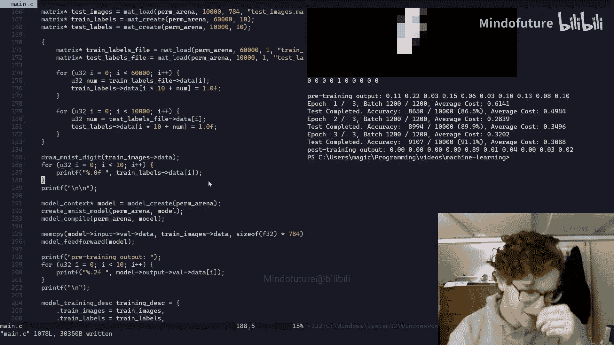

That is pretty cool。