# C语言实现LLM分词器-｜-tsoding--BV1WCLgzZEaK-

Hello everyone and welcome to yet another recreational programming session with Ahu amistta A。

 So there's this very interesting algorithm， which is called bypayer encoding。

 And if you are a little bit into a recent AI stuff and LLMs。

 you probably have heard about this Internet I think it's a way to tokenize the text for LLMs even Wikipedia actually says that a slightly modified version of this algorithm is used in large language model tokens And what's up with tokens。

 So language large language models don't really work on a level of each individual characters right because。

😊，To train a neural network to comprehend the text and a level of characters takes a lot of resources so what they do instead they actually split them into tokens right so one way to tokenize a text is by words separate by spaces but it's not particularly efficient way right so what they use instead is byte payer incoding and it's actually very simple and very smart algorithm at the same time so essentially it tries to。

Compress the text in some sense。 right， So they have a pretty good example on Wikipedia right so I'm going to give the Wikipedia page too。

To the chat and for YouTube people it gonna to be in the description So you have this text right so in what you do you kind of scan this text by pair right so you scan this text by pair So I look at the pair Aa an account that pair then I see another pair which is aa I can see that that pair occurs twice and then I continue scanning with the sliding window of two right I collect statistics of like what pair occurs most frequently and I replace that pair with a single character instead of two right and now I have like a small table with one entry so I replace them with z and z is equal to Aa and I repeat the process again and build up this table right and what's interesting about this table So one symbol for example X in here can actually mean two other symbols then mean two other symbols right so you sort of build like like a tree or directed graph。

RightAnd that way you kind of compressed it and also figured out what is the most optimal way to split these text into tokens and LLMs usually operate on these kind of tokens。

So it kind of it's kind of similar to Hman coding， but it's not reallys really Hmanco。

 So we haven't streamed halfman codes ever， and I did code halfman codes when I was in university and it was super fun。

 I really like this algorithm， but I never actually stream it。

 So maybe maybe it's gonna to be one of the topics of the future streams。

 Thank you for imagining about it Thank you for iming but So yeah。

 and I really want to implement that and I want to implement it for a very specific reason。😊。

So we have this bo， we have this bo which actually implements some simple markov chains based on the logs of of the chat。

 right so you can do carrot and you can say hello world and it will try to continue the sentence so based on the logs and the way it works it's pretty simple right so it just collects the statistics of like eight characters and what's the most probable character that comes after that。

 So and it's kind of stupid， it generates absolute freaking gibras you can see So it's not even that interesting and what I realized after looking at the bite pair ining algorithm is that it kind of implicitly builds up implicitly builds up a grammar。

😊，If you think about it。Right， so do you guys know what is a BN F， BN F Ba nonotation。

 please in English， freaking trillion dollar company， can't even figure out。嗯。Trull into company。そ死。

Freaking。It's freaking unusable， Mo fucking internet is unusable。 like what the fuck is this。😡。

Just look it's。Was never a fucking problem。 This kind of shit was never fucking。 I'm so sorry。

 but I'm so fucking pised of。 right anyway， So this is a Barson orientation。 And essentially。

 what it describes is basically a syntax。 You have this postal address and postal address is a sequence of name part name part。

 street address and zip part。 Then you look， okay， name part is personal part。

 last name and so on and so forth。 you have this sort of relationship。 What is what。

And what's interesting is that the result of B pair encoding is a table that kind of looks like a grammar。

 but it's not coded by a human， it was derived， it was implicitly derived out of the text itself。

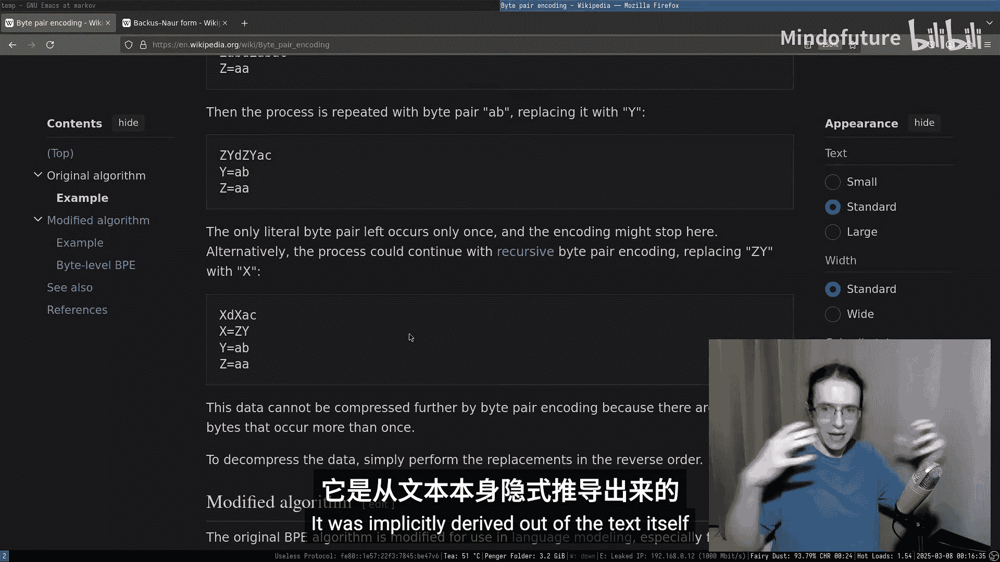

So you can like look at that。 So we have x， which is z and y， and what is Z Z is AA。

 right it's basically an implicit grammar。

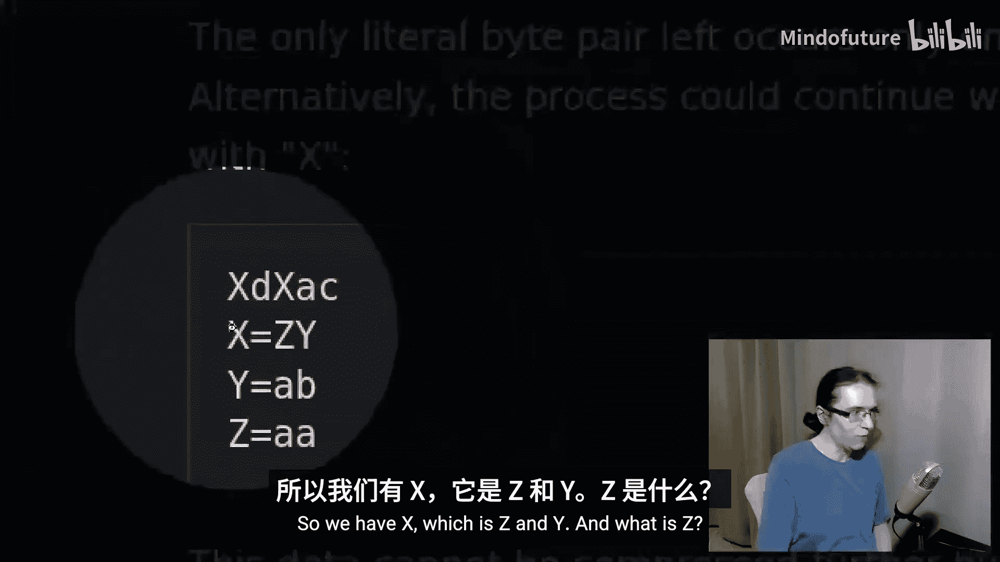

Isn't it， it is literally just implicit grammar derived from the text。

So and once you have this implicit grammar， you can actually traverse this grammar recursively and generate random gibbish out of this grammar。

 something that I I think I did something like in BNF fizer right so let me actually see BNF f some time ago I implemented it privately right I streamed it a little bit。

 but then I couldn't market it properly， so I implemented just like in private。😊。

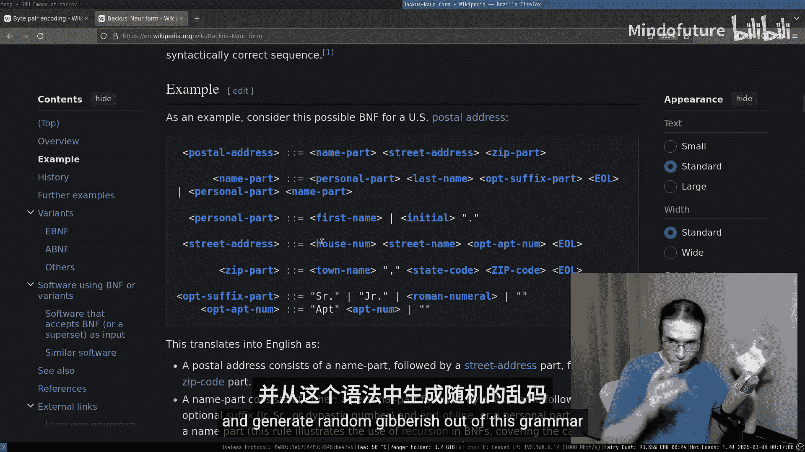

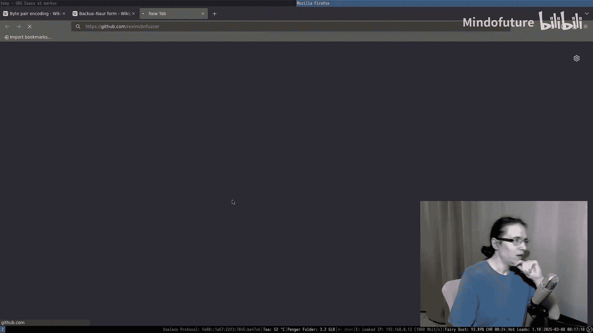

So this thing， which essentially parses BNF files right So let's take a look at some examples。

 So there is the postal code from Wikipedia。 So here it is like it literally pares this kind of examples and then generates random text based on that grammar so you can fuzz your parser if you want to write So I specifically implemented to fuzz some of my parseles。

 I don't remember which one but yeah， so once you have this implicit grammar that you derived from byte payer encoting you can kind of do the same。

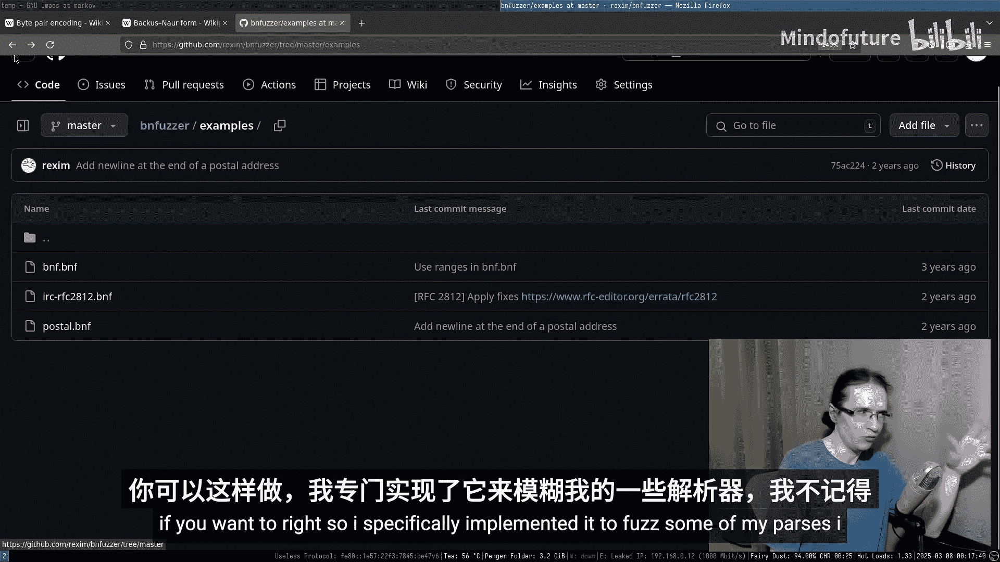

And it's gonna be even cooler than just stupid Mark of chains。 Right。

 So maybe it's gonna be more comprehensible， but not end level of L LMs。 Of course。

 L L M is just like a next level， but。What's funny is that。

Like if you think about it a little bit more deeply。

 LLMs store knowledge not only in the weights of their neural networks and transformers。

 their parameters， right， So they store information not only like in their parameters。

 but also in their tokenizer。Right， there is a little bit of a knowledge stored just in a tokenizer。

 simply in a tokenizer。 Remove all of the transformers and the other of just the tokenizer already contains a little bit of that。

 Isn't that amazing。 It's kind of cool。 actually you think about it。😊。

I see it's like there is a Chomsky normal representation stuff。

 maybe I never read anything from Chomsky。Our home kid I don't know how to pronounce his name。

 but I heard that he's really into linguistic。 He's the linguistic guy。嗯。

He also likes to talk about politics on YouTube。That's the aside side。 So anyway。

 this is what I want to do。 I actually downloaded some logs。 I've been collecting logs on Disc。😊。

Right， so of people chatting and stuff like that and I accumulated I think 30 megabytes of logs and I think I want to try to build a BPE table by pair encoding table on this logs and then just use it instead of my current mark of chains。

😊，So this is what I want to try to do。 But first we need to actually implement like a basic you know compression of this text。

 I didn't think I'm going to be able to finish this idea within a single stream The last time I tried to do that it actually takes more than two hours because there's a lot of like moving parts you need to first compress the text then we need some algorithm that given the text tokenizes it and then we need to figure out how to use this grammar table to generate more text and continue the text so estimated to be like a roughly three episodes right so estimated to be roughly three episodes and on the first episode I suppose we're going to be just implementing the algorithm of compression that given the text just generates you stable right and then on the next one I think we're going to try to implement the tokenizer。

Right， so essentially given the text and given the table split it into theken tokens in the most efficient way。

 right so this is going to be rather useful for us to right because given the text you will need to continue so that means you will need to you know tokenize it first or at least。

😊，You know， know， know the last talkingken right， so maybe you don't need to tokenize the entire thing。

 We'll figure it out。 So anyways， let's fucking start。

 let's fucking start mine the fucking start So do I have BPU already you know I don't have。All right。

Because I already experimented with BP before， but that didn't really go on YouTube like this session I actually planned it to go on YouTube so let's fucking go we're going be using C。

 by the way， we're going be using a see a mother flip and C I'm so tired of using all of these meme languages and stuff like that。

So I wish I could replace C honestly， but every time I try to do that。

 like it's just like there's always something wrong with all of these languages and C is not perfect by any means。

 but it's just its。It's not perfect language， but it occupies the perfect niche which is very difficult to replace it in assembly here's the thing people say assembly assembly is not a replacement for see because assembly is not crosspl C Es cross platform That's the thing right so there is a benefit of stripping off abstractions but only at a certain level after a certain level you kind of not only strip an abstraction you also stripping off the benefits right so you need to be able to stop at some point right so you need to be able to stop at some point。

So also， people talk about C C 3， C 3 is not finished and virtually， right， So it has a。Potential。

 but it has not realized that potential yet， we'll have to wait a little bit。

We'll have to wait a little bit。So anyways。 so maybe I'm gonna actually start using up because we're gonna be using dynamic arrays。

We definitely need dynamic arrays， and that means we'll need to usenob because K Noob has a dynamic array implementation。

 which is rather convenient。 So here is the main thing。 So I think I'm going be calling it B， P。😊。

So people who follow me on X know what the fuck Im talking。So okay。

 so not everybody is on that stupid fucking platform， right， so there' is this weird thing。

On fucking X is that I made a short clip where I explained how to implement the eyeend it's a very short clip like literally two minutes and for some fucking reason all of the grifters and AI bros are absolutely fucking fascinated by that clip and they keep reposting it。

 I have no idea why and not only that this clip upon being repost being liked over thousands of likes all the time and there is a meme going on on X。

 people just re dynamic arrays and see that clip of me and they have no idea why it's so bizarre。

you're here because of the clip。 what's so special about this clip。

 It's the most basic and boring data structure out there， like I honestly don't understand。😊，🤧嗯。

I want to see the click now。 just go X docom slash surging。 and there is one of the reportsos。

 I also re it myself again as a meme so。Thank对。So let's fucking go。

 So it's just like basically a clip where for two minutes I reimple this macro right So because I wanted to share how cool this macro is。

😊，Because dynamic arrays in C are not a new idea dynamic arrays are not a new idea。

 but in many implementations in C theyre kind of overcomplicated and I'm kind of proud that they came up with a very concise and small implementation of dynamic arrays and I just wanted you to share I didn't expect that it's gonna take more than 1000 likes right so just like yeah it's pretty cool thing but I didn't expect it to for people to make it like to constantly re and stuff like that So that's kind of weird but anyway so here is the thing and I suppose I also want to implement Noob dot C which is going to be the builder of NP。

😊，BP， I'm sorry。So let's includenob that H and obviously I want to definenob Iion and strip pres。

Right， so strip books。 and let's do the usual thing。Return， obviously， you need to do orgs and Rrg v。

Sonob， go rebuild yourself， right， otherwise it's not going to go rebuild itself。

And we needed to rebuild itself。So this is going to be CMd。All right， so make， let's make it global。

So because we're going to be having only one instance of C anyway。But maybe not actually。

 I'm not sure if it's a good idea general， right， so kind of。kind of makes me anxious。

 right even though I know that there's nothing really wrong with a global variables。

 if the scope of your program is small， still years of propaganda of good practices and shitd like that kind of makes me anxious when I do that。

 So let's not do that So I'm going do append and what we're gonna be doing in here we're gonna be just like building the whole thing right so with all the possible warnings。

 maybe also with debug information in case we want to debug something and I'm gonna just like create this entire thing。

 So this is gonna be Bpe and this is BP do C maybe I should do that in a separate build folder chat。

 Yeah right recently I like to create a separate build folder build folder right it's going to be just build slash。

So anything I have to do， I think it's make de if not exists。

So I'm gonna put the Cd in here and just create the build folder just create the build folder。

 And if you failed， just exit with nonze exit code。

 So then what I'm going do is create this executable in the build folder then we need to run the command that we just created Cd run synchronously obviously and reset that's the function I'm looking for that's the long function I'm looking for just run it and reset it it may fail。

 let's check for that。 And if it failed return one there you go there you go So let's bootstrap the build system as usual it didn't bootstrap itself。

 right， So let's go through all of these things。 what exactly happened。 So here is the stack trace。

 I forgot got to provide the CMD look at that。 look at that Thank you compilea very cool。 Allright。

 and it compile。 and now if I tried to run this into I think it created the build folder and it created executable inside of this build folder can。

😊，S make do that Can you see make do that， It cannot do shit。

 You have to create beautiful for voicey make yourself manually。

 That's how fucking pathetic you make。Anyway， doesn't matter like I'm just drunk so and let's just try to run BE。

 it doesn't do shit because we we said don't do anything。Alright。

 so let's actually have some maybe some text， right。

 So we're gonna have something like text and we're gonna start with something simple， right。

 so let's not jump into trying to compress like 30 megabyte of logs or anything。 Let's start small。

 right， so the quick brown f jumps over the lazy dog。 The quick brown f jumps over the well。

 that's the。😊，This is the worst， what， maybe not。 actually， maybe。

 maybe this is not the worst thing to do is does it even have a repeating repeating pairs。

 I feel like it doesn't have repeating pair。嗯。Right。

 so I didn't even know we can try to compress something like like this。

So let's just take this text and try to compressr that specifically。うん。Right。

 so this is from Wikipedia。And。Let's say taken from here。 Okay， so what we want to do。

 we want to be able to iterate it like pair by pair。 So how we're going to be doing that。

 I need to maybe have a size of the text。 So text size as certain text。 There you go。

 We have the size of the text。 So now we're gonna be iterating character by character。

 but we actually have to stop。 I think I think we have to stop at the。I get minus one， right。

 so because look at that。Were going to be iterating and we're going to be also looking ahead to the next character because we' iterating by pairs。

 right， So then we increment by one， and we're looking at that pair。

 And it's kind of dangerous if you go here and you try to look ahead， you have a buffer overflow。

 Right， So you have to a little bit careful in here。 And another thing in here is that text size。

 If it's equal to。I suppose zero， right。 So if it's an empty text。

 it's going to under flow and this is kind of dangerous， maybe because of that。

 I want to make both of these things integers。Yeah。

 so I was always using size t for my itators and sizes precisely because they're unsigned and size kind of supposed to be unsigned。

 but for these kind of situations， I think making the size signed kind of works out right so you have a text0 and it will be no iteration in here right because there's no underflow right it can go below zero and what's interesting is that I got this idea from J actually do。

😊，So J， for whatever reason， uses sine integers everywhere for sizes and indices and its constantly taking advantage of this kind of situation where if you size is equal to 0。

 it will become negative and because of that the iterator is not going to go up or anything like that because if it was unsed it would under flow and become the maximum value。

 So it's going to be iteration that goes to infinity。

 not to infinity but to the maximum value of 64 bit integer。

 So I'm kind of growing on not using unsed integers when it comes to sizes and iterators right so yeah。

 it's kind of interesting。😊。

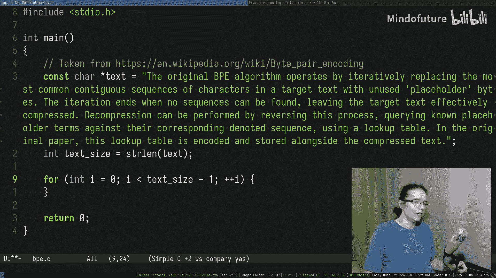

嗯嗯。😊，Have you ever used string to do dot H。So I'm using E L。Esterlin is located in string to age。

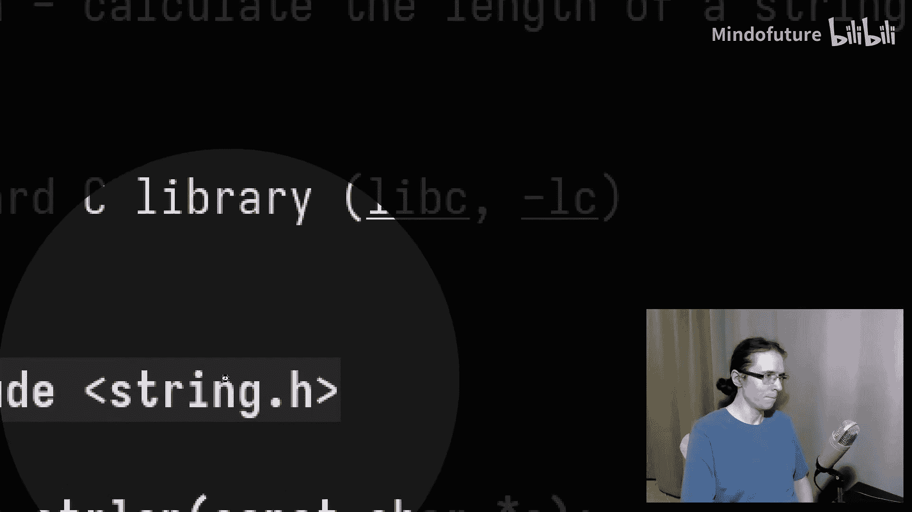

Anyways， so let's fucking go。What we're going to be doing in here。

 What we're going to be doing in here is we need to take like two characters in here。

 So it's going to be a text I and B， text I plus one。 So here they are。

 And let's just print them right So here one character has not one A B。So。

 and let's just review the whole thing and there we go， here are the pairs。

 here are the pairs that we're getting here。Isnt it cool， I think that's pretty cool。 I think it is。

 in fact， pretty cool。嗯嗯。So。So what we need to do next。

 we need to actually collect statistics of what pay occurs the most frequently。 right， So to do that。

 I think the easiest way for us to be is going to be。

To use them of a hash table right so I don't really have a hash table implemented in Noob yet。

 so I think I'm going to go and just take the one from STB so STB has a pretty cool hash table implementation so which we're going to utilize in here。

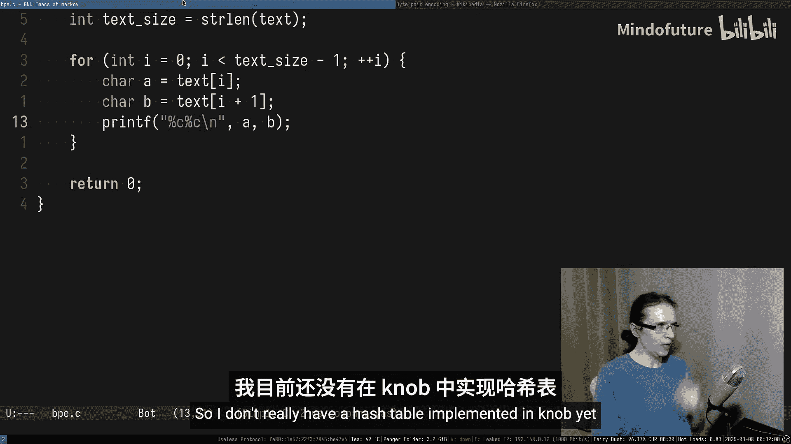

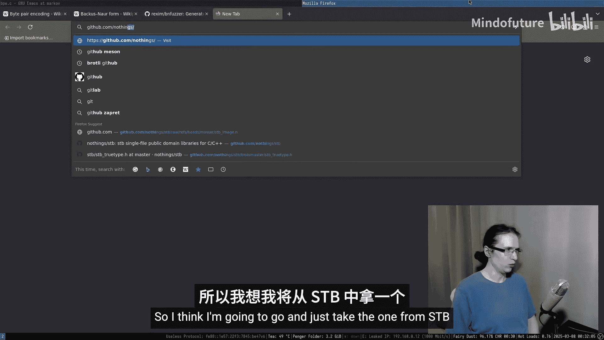

So this is going to be a row and let's just download this in stuff。

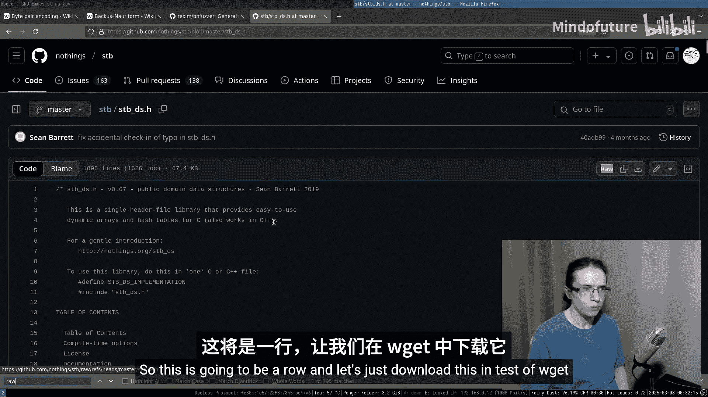

W get。嗯，봉。And let's fucking go， so here are is。STB D S。

 it's a single header library similar to Noob right， In fact， I got the idea of Noob from STB。

 So that means we'll have to include some stuff like STB Ds implementation。 Yeah。

 exactly So this is basically what we have to define in here。 let it go。

 And the way it works actually the way it works。 you have to define a structure with two fields right。

 you have to just define a structure with two fields。

 So let's call this structure maybe something like。呃，配。Alright， so。That's going to be like bear。

 but I'm honestly not sure， Right， So it has to be。What's called Kv。 The key value。

 So the first field is called key。 It must be called key， and the second one is gonna be value。

 and the type of the key is the type you want to have for the key。

 So the type with which you want to index your table and a value is exactly what you want to index in our case。

 I think the key is going to be the pair， right， so it's going to be the pair。

 So I think because of that we have to make the key an array of two characters So it's going to be an array of the characters and the value is going to be I guess size t So it's like how many of them。

 and essentially if you want to create like a hash table some sort of like a frequency table you create a variable which is a point to that Kv and this is going to be like a frequency and let's initialize it with zero。

 and this is your hash table essentially， this is your hash table And the way you work with that hash table。

 you have a bunch of macros in this entire thing。 So something like Hm。

Like put right and this enables you to put some sort of a key in here。

 So you put like a frequency in here and then you put a key in here。

 we need a way to actually combine these two things right one of the thing we can do is that we can say key to right so this is the first character and this is the second one right something like that right so and we're going just like put this key in here and the value is going to be。

Like we probably first have to query it， get it out of the table right。

 so which with something like HM Gi， right， it will enable us to get it。

So usually we probably want to use Hm get I right so we do something like this。 We take the f。

 We take the key， and it's supposed to return an integer PR d T So this type is an integer。

 This type is an integer。 you can even Google it up and it's a standard integer， by the way。

 it is a standard integer and I think it's a signed integer So it's a signed integer type of the result of the subtracting to pointer。

 So when you subtract one pointer from another， the type in standard C is PTR D underscore square t right and it's just like an alias to the corresponding suitable integer type so that's what it is。

So then you can use this particular index to index your specific slot。

rite your specific slot and get a value out of that。 So you're getting the value out of that。

 So this is going be something like count。 right， So here we query in that specific key and we get a count out of that。

 And then we won increment it。 We put it back， right， we put it back。

 Maybe since it's a value since it's a value。 I feel like we could have just， maybe。

Incremented like that， right， So we don't really have to use HM puts。 right。

 so we don't really have to use input。 we can just like increment it and continue。

 But what's interesting interesting is that the key might not exist in in a hash table In that case。

 according to the documentation， it returns -1 so we can check if it's less than0 That means we have to insert a new element in there Let's do put frequency key and we're gonna just insert one。

 And otherwise we're going increment it。 I think that's fair。

 I think this is actually a pretty good way of doing that。

 So in this is how we're gonna be do know that right So here's the key。😊，Here's the key。

 we created the table。 Then we either creating one or increment by one。 So that's about it。

 So after that， we can iterate this hash table and just print each basically the statistics right So let'll just print the statistics。

 So and you can simply iterate this array So this point as an array。

 So as far as I know the elements are stored there sequentially。

 So there is no hole in them which is kind of weird for hash table to usually when they implemented the hash tables there。

 they usually have some sort of holes right So you kind have to be a little bit more careful。

 but in this implementation， you can just iterate them and they're sequential。

 So I don't really know how exactly it achieve them I should probably read the implementation this hash table But anyway。

 so which you can do is basically get Hm L So let's take H then it's also PR and it will give you just the size So maybe we're gonna use PRD from here。

 which is I 0 less than HM left frequency plus plus I。

So and here we can just print a lot of that stuff， so this is going to be double that and then z。

Which is the size， so in then here we can do freak I key0。

Then we need to take the second one like this and then for the frequency value， right。

 and that should print all the statistics for this for this syn test step。 Okay。

 so we didn't compile。 let's go to the compil error。 So we have some stuff in the macros。

 Let's follow the stack trace and see what the fuck is going on in expansion of macros。

 So it really didn't like right Hm get frac， but Frac is actually。Yeah。

 so I didn't really know what's up with that， what you don't like Char makes inte from pointer without cast。

Char from point。 is that because。Is that because？Key is not really a pair。

 I was actually afraid that this may not work。 I have a strange feeling that the way I have to do that is actually。

Something like this， we can call it pair， right， so this is the pair。

And I can just do something like that。 So this is a key pair。 Will that work a bit better， It may。

 right， So let's do pair。So this is the pair and in here， what was the field。

 it was just a pair alright， so we can do something like that like that。

huAnd then we get it by the key。the bear。Per。Whereer。

Right so I feel like just because it was an array it might might have broken some of the macros in there right so but if we make it like astruct。

 it becomes sort of like a solid value so maybe it will work now yeah okay so it doesn't work in here so this is the key and this is pair we have to do something like that no pri pair。

I was right。 I hate that I was right about right。 So stupid frequency like I swear to it like why do we still use this language like there is no a proper C killer yet。

 unfortunately， still no proper secure and as you can see here are the frequency of all of these things。

 Unfortunately， it is not really properly sorted but I don't know。

 So maybe we can actually implement some sort of a sort of for thisyn thing。😊，嗯。So。So basically。

 F is appointed point to some memory segment and macro is managing it exactly in fact。😊。

It is using a very interesting trick， right， so essentially Fre。

Points at the beginning of the array that stores your slots of the hash table。

 but then behind that pointer it actually stores it actually stores the header where it stores the meta additional meta information So the way the macros work they take this pointer then they loop back to get that meta information and then they find the rest of the stuff needed to manage the hash table。

 but for you it looks like a regular pointer but there's a lot of magic behind that pointer so you have to be a little bit more careful when you use this kind of hash table all of that is it so to make it more convenient to use。

 but in reality it's not just it's not a classical C like C array there's a little bit of a magic in there。

Unfortunately， because I personally hate magic。Right， but I mean。

 maybe you need this kind of stuff for the hash tables and see。Anyways。

 so one of the things we can do in here is maybe create a dynamic array of kvs。 First of all。

 I think Kv is not a particularly good name for this stuff。

 I'm going to call it frac right so this is basically a frequency。

 So then maybe I can create something like。Frex which is going to be a dynamic array of fx of fEC because what I want to do after I created a hash table。

 I want to copy it to a separate dynamic array and then sort it within that separate dynamic array with Q sort or something like that right so because I want to actually。

😊，You know， find the maximum I want to find the top 10 of them and see what's the most frequent pair right it's not going to be needed for the algorithm。

 but I just want to do that because I want to like see that。Right。

 so we're going to be implemented dynamic rates。 so let's fucking go。 this is a f。

 and this is items size count capacity。All right， so this is the frex。And in here， I suppose in here。

 I suppose I'm going to do fs。And I'm going to call sorted fs。

So this is sorted fracx and originally it is zero so after we collected the statistics what we have to do。

 I suppose we need to D append these things， these fs into the sorted fracs sorted fs take it by the pointer put this thing in here and there we go we collected them in here After that we need to sort them so the standard Library of C luckily has a Q sort function which actually allows us to do that look at that。

We have to provide the pointeder to where the array we want to sort starts and it starts at sorted fs sorted fx items So here if I remember correctly is the amount of elements you want to sort al right so this is going to be sorted fx count and the size is the size of the element in bytes right so we're going to do sorted fx item I need to item there is a several of them we're going to de reference them and we're going to take the size of that specific type The reason why I do that is because I want to be independent from the specific types in here if in the future I will change the type of the items。

 I don't have to change these specific place right because it doesn't care about the type。

So here is an interesting thing now we need to provide a function pointed to the function that compares the fx。

 but we need to compare them in sort of like a opposite direction so how can we do that I think I'm going to call the function compare fx right so I didn't know how else would it code。

😊，Compare flexs compare。I compare f。 So here we essentially take two pointers。Actually。

 a peakque point is void pointers。 The first thing we need to do。

 we probably need to cast them to pointers to frac。

 right to be able to extract some information out of them。

 So this is going to be f point what's called AF。 So this is that and this is going to be B F B。

 There we go。 So we have to point us and we can access their values。

 We want to sort them by the value right So this is going to be Af value and this is a classical compact which returns0 right。

 which returns an integer right and it returns three main values minus10 and1。

 and it's really mind bending for me personally to figure out what each number means what。

But if I remember correctly， the main A behind these competitors。

 which return minus 10 or1 is that you do compare A and B。And if a is less than B。

That means this entire thing has to be less than zero。

So essentially you must put the sign in here the same that you would put between A and B。

 This is the idea behind the design of these all of these competitorss right so you probably encountered this kind of competitors in all sorts of languages I think C started all of these meme right and then people started to like repeat that me on all the other languages So the idea was that All right so you want to put some sort of a sign in here and you need to return such integer so that you move that sign in here and it makes sense。

So how I want to actually compare this thing， I want to build them from the biggest to the smallest。

 because of that， I need to actually compare them like this， right。

 so I'm looking for the elements that are bigger than the rest of them。 So because of that。

 this symbol in here has to be that。 How can I achieve this kind of symbol well。嗯。So essentially。

 I need to maybe subtract。Value。Like this。Right， because if a is bigger。

 then B is going to be positive failure。 It's going to be positive failure。 so that will work out。

I think that's how we're going to do that。 So if they're equal is going to be0 and if a is smaller it's going to be a negative value okay I think that will work out。

 but we have to be a little bit careful because value is a size T which is an unsigned integer so because of that we prone to overflows and underflows so let's actually first cut this entire thing to integer let's make it sign the first and then we can do the this kind of stuff hopefully I didn't make any mistakes because working with this comparative is always mentally difficult for me so because I can't comprehend how this entire that works right so but maybe I did it correct this time we'll see we'll see if I didn't do correct this time I can always swapwo this two elements and that will be correct。

😊，So there's no reason to fus about it too much。Anyways。

 so let's actually it this sorted array are going to be0 less than sorted fx count plot plus I and let's just bring this syntta。

So I should have not deleted the code that printed all of that stuff。 But I mean， whatever。

 So this is Z U and search Fx items I。 Then I have to take the key。

0 that's a very long gas expression。 So maybe what I'm going do in here。

 I'm gonna just do f like this。 I' gonna be f pointer to f boom。

 and I'm gonna just take a pointer to this entire thing。 So that's a little bit more manageable。

 That's a little bit less hair。 Okay， so now this is the value。 And hopefully that is going to work。

 Let's fucking go。 that didn't compile。 Let's see why because I have some garbage in the code。 Okay。

 so what else do we have in here。 this one is a point。 Thank you so much。

 Thank you so much for not implementing auto dereferencing for the things。 So Dend。 Yeah。

 so we don't have a di pen because it is implemented in No， let's include noob H。

 And in here I'm going define。😊，nob implement thation and obviously also I want to strip the prefacees otherwise I have to put that annoying knob everywhere。

Okay， so it's almost worked。 I think it's more like pay in here right。

 so this is what I have to do payer。Okay， and it works。 And that was wrong， as you can see。

I fucked it up， so essentially to sort it in a different order， I have to do it like that。

But it's not a big deal， right， It's super easy to then just invert that。 and there you go。

 we have the thing sorted。 So now we know top 10。Now in not top 10。

 we can even like literally print top 10 in here， so this is going to be something like this。

 like print only the first 10。Yep， that was super easy。 And according to the algorithm。

 this is the pair that we now have to replace with something else。So this is what we have to do。

 Okay， let's take a look some subs。 Let's take a look at some subs。 Oh that's a lot of subs。

 actually。 Thank you Thank you so much。 blink dynamo for which prime Red man plus。

 thank you so much forier1 Ho Ro 11。 Thank you so much。 Ge M C。

 Thank you so much with the prime with the message can stand add head to sub love from Italy。

 Thank you Thank you so much。 the space Herper。 Thank you so much for1。 And look45，89。

 Thank you so much with which prime with the message。 What do you use to debug memory res。

 something like a and Wal Gr， Yes， Both them。 So it's just like depending on which one works for me。

 I just like use bottle them。😊。

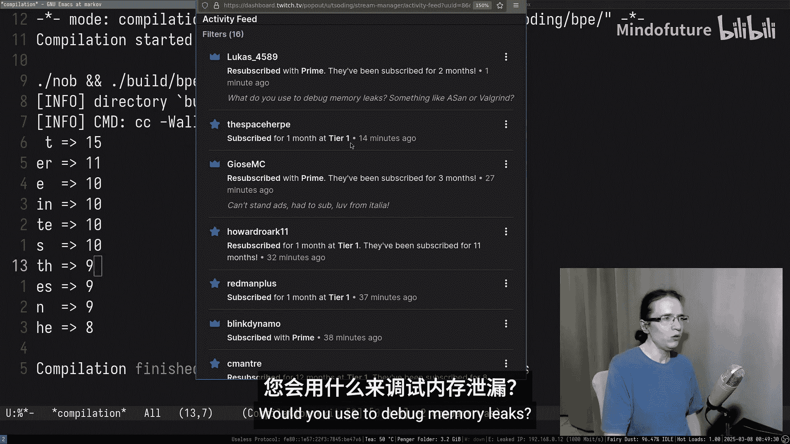

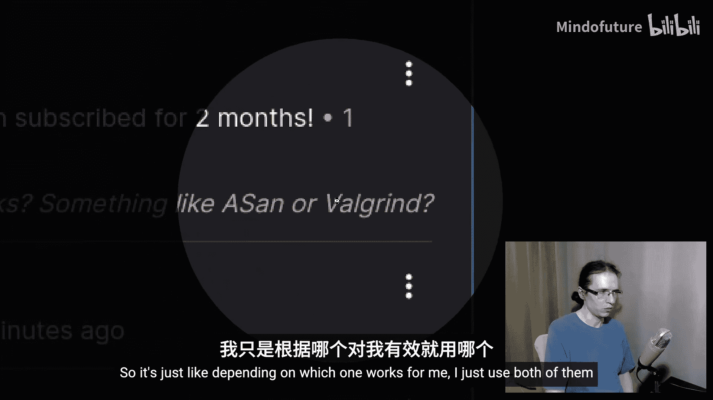

U， but detecting memory leaks with v grind is kind of difficult because the definition of memory leak is kind of fuzzy。

 unfortunately。What is a memory leak chat， What is a memory leak So if you define memory leak as something that was not freed before exiting the program。

 that's kind of a useless definition because that's the shed that happens all the time and doesn't cause any problems because people quite often just prelocate the fixed amount of memory that the use for the entire of the program and then they exit without deloating this memory so technically。

Because of that definition， it is a linkeded memory， but in reality， it is not a linkeded memory。

So in fact， defining linkeded memory is very difficult in reality it is very difficult to define what is leaked memory。

 you can use the definition of garbage collectors right so which is basically unreachable memory but that is a little bit better definition then just memory that you didn't free until the end but it also has their own problems for example。

 the programming language has a garbage collector but it has a limitation because it's a system programming language and it allows you to work with pointers directly。

 you can potentially mess with those pointers So what it does。

 it scans the memory right and looks for integers that looks like a valid pointers to the memory right and because of that it considers the object under such pointer as reachable right if you start messing with the pointers to the point that garbage collector cannot recognize that pointer。

😊，Right， it will basically clean up that memory because it became unreachable。

 but in reality it wasn't unreachable one of such things could be Zor linked list。

Do you guys know what is the Z linked list？Right。ソウルク。It's absolutely useless thing。

 but that's besides the point， the thing about Zor link list is that it takes a zor operation between the pointers。

 so the number that stores two pointers is actually an invalid pointer and that trips off the garbage collector of D。

😊，So and basically the D developers recommend to not do any of such tricks because it tricks a garbage creator into thinking that those objects don't exist anymore and will clean up your linked list。

So。😊，Again， reachability is a better definition， but it's not useful in system languages where you have a direct access to the pointers because you can mess with the pointers。

😊，Furthermore， quite often in JavaScript， for instance， not a system language， right JavaScript。

 you may forget to clean up some of the callbacks that hold pointers to some things and because of that the usage memory is kind of growing because the object that should have been unreachable。

 still reachable。You have a garbage collector。 You have a good definition of memory leak。

 You still leak in memory。 The memory conception is growing because the things that should have not been reachable are reachable and youre still back to thinking about memory management。

 like there is no good definition of a memory leak。That's the thing。

Memory leak is kind of a subjective thing。 If you start thinking about what is memory leak deeply。

 you will realize that。What the fuck is a memory。Right， it's just like it's more like an intent。

 but an intent is a subjective thing。So。You know what I'm talking about。

 it's kind of difficult right so when you only start in programming， it feels very easy。 Oh。

 you just like you forgot to free it's actually kind of more complicated than that。😊。

Are you saying that memory is a social construct。It kind of is， in a sense。

 probably because memory allocation is an artificial construct。

It is kind of an artificial construct because on a level of computational model。

 basic fundamental computational model， what you have， you have a head， you have an infinite tape。

And you have the whole tape in your at your disposal。 Where is the memory allocation。

 the allocation in that computation model。 This is a construct that we put on top of the fundamental computation model。

 right， So， and in reality， if you take a look at the。😊。

X86 so with the X86 machine it iss kind of difficult because you have a virtual memory and memory mapping and stuff like that。

 but look at it like old machines， 6502 or something where you just have a memory right so in a 6502 program。

 you start a program that is located in a memory you have the entirety of the memory at your disposal。

 you have no allocation de， This is something that you made up to make working with the memory a little bit easier。

😊，You see what I'm talking about is' just like kind of you created this artificial construct and now you're dealing with the problems that you introduce by introducing this artificial construct and it kind of spirals down from there。

And and I'm not proposing any solution or anything like that。 I'm just saying。

 I'm just stating the reality we have to deal with， right。

 I'm just stating the reality that we have to deal with。

 I'm not saying that we have to not use memory location or anything like that。 It's just like。

The reality is that we have to work with these very fuzzy concepts， right so。

It it's kind of akin to Godel's incompleteness theorem if you know what I mean。

 I don't know if I make any sense， but it's kind of weird。嗯嗯。

Memory leaks only matter if the code that allocates the memory is code repeatedly true memorym leaks only matter if you're poor and don't have any fucking money to buy Ram Stop being poor。

 That's how you fucking fixed memory leaks。So you fucking fixed memory links。So现的 she子不能 care。嗯。Okay。

trying to just trying to share my experience and people call me okay。Whatever。Very ungrateful。

 I get to say， very ungrateful。So let me， let me say So we we， we got the statistics， right。

 So now we need to build some kind of a table， right， so that。

would enable us to compress all this shit。And what's interesting is that。

We can have if we have like a lot of text in here， if we have a lot of text in here。

 the characters may actually exceed ASI， so we should probably not work with chars in here with the sequences of chars。

 we probably have to work with the sequences of like quote points right maybe sequence of 32 bit integers or something like that I think that makes sense。

So in a table is going to work with 32 bit integers instead of characters and like majority of them is probably not going to be readable。

 right， not going to be human readable。 So in here in this example。

 we use human readable because the example is small。

 but we're planning to work with a lot of characters。

 So the code of the token is could be like you know few thousands right， so could be few thousands。

So as far as I know， if you like try to work with Open air LLMs。

 they have some sort of interface that allows you to show the tokenization of the text and each token has NA ID and the IDs can be very small or like very big right several thousands of them。

 maybe tens of thousands and this is basically the number that is used for that specific token as a result of this B algorithm I think this is my hypothesis。

So because of that， I feel like we need to introduce some sort of like。I don't know， tokins。

That's a good idea。 Right， Well's， let's call it tokins。

 and it's gonna be a dynamic array of 32 bit integers。 right， So it's going to be u pin 32 items。

 size D count。Capacity， right， so and this is basically the tokens。

And we don't want to operate on this kind of stuff。 We want to operate on the level of tokens。

What we can do in here， by the way， for the ASI characters， we can use the code of the talking。

 the idea of the talking as the code of the ASI character。I think this is a good idea。

 I think the last time I implemented BP algorithm in the past。

 this is exactly what I did and it was rather convenient。

 not sure how well it is going to scale if we start working with Unicode。Um but anyway， right。

 so right now we're not working with Unicode。So what we're gonna do So tokens tokens right so this is what we have in here。

 And I suppose what I can do is just like it through this entire text and append it into the tokens as AS here right So maybe I might as well just copy paste this entire stuff right we'll copy pasteing this entire step in just a second。

Yeah。And no。Were just a on all these things， so a pen into Luthercans， a into Luthercans。Text。

 I never go。And in here we have to work with tokens since we work in with tokens now we don't talk about pairs of characters。

 look at that， this is not a pair of characters， this is a pair of tokens right so this is going to be something like this use2 T so this is a completely different thing now。

And so here is not the text， but rather tokins count， All right。Com in here。Tokens items。ど。

I don't have to put some on here and that's about it。

 I don't think I have to modify anything in here。 so then we have ased fs。

 So now these stuff is not characters。 they are integers and actually unsigned integer。

 So let's actually put you in here And I might as well even do something like this right So I think this looks good。

More or less， more or less be good。 So if I try to rebuild this entity obviously it fails because there is no U int。

 I'm supposed to include SDD int and here we have some warnings and stuff like that this is because it's size T Okay。

 so let's use size T in here and here are the players so theyre not human readable right。

 but that's kind of the point right that's kind of the point。So we need to have the table， right。

 So we need to have the table that shows the correspondence from。A particular code to a pair。

A particular quote to a pair。So what I'm thinking is that I think the table is going to be an array。

Where index is the number of the token right and the element is the pair that points to the two other tokens which represent that pair。

I think this is how we're going to represent that。 So let me see。 We already have pairs honestly。

 right， So here is the pair。 We already have that。 And， in fact， this thing doesn't even have to be。

Doesn't even have to be array。 I don't really know why I made it in array。

 I could have actually made it A V。 I think this is much easier， Right。

 So because the hash table doesn't know the contents of thestruct， All it knows is。

The pointed to this element and its size and it actually hashees just like a sequence of bytes right so the hash table just takes the sequence of bytes that represents thisstruct and just hashes it。

 it doesn't care what kind of stuff is in here， I made it array I don't know because the copy pasted some code for us it would be easy to actually use A and B or maybe left and right so maybe it's calledLR。

L order。So let's try to rebuild this entire thing because I obviously changed the definition and think it would be easy to。

 yeah， so we'll need to go and redefine all of these things。

Maybe I'm going to do something like that。So this is R。And to be fair， yeah， so， yeah。

 I can actually make it easy。 Look at it。うん。Hello。嗯ん。All right， so this is just L。

And this is just R left and right over that seems to be working that seems to be at working。

 So now we need to have an array， a dynamic array of such pairs。

 a dynamic array of such pairs is going to be the table right so let's do something like。T depthす。

Fyers。And this is going to be pair items。 and here is going to be size to count and then capacity capacity capacity。

All right。 So since all of the ASI are going to basically represent themselves。

 I feel like we need to go to the the entirety of the ASI table and just append all of them to themselves right so essentially let's have some like this。

 so this is a pay pay Maybe I should put all these global variables that they created into a single place。

😊，Or maybe I can put them as local variables right so because yeah so here's the sort of like tables arrays in hashes that we're working with right so this is the hash table of frequency。

 here is the dynamic array pairs which is the table BP table and here is the tokens that we're currently working with so this I think is going to be something like that。

Right， so let's keep all of that in a single place。 And the pairers， right。

 So the first 255 elements are going to be like so zero element。

 I suppose is going to point to it has to be pair。Right， so we need to represent。

 we need to understand what we're going to be considered the。Leaf pair。

 the pair that basically represents the final element in there。

So I think the way I did that is that I basically set the left to itself。

RightSo we set the left to itself and R stays undefined right so it doesn't really matter what it's in there if you have the left element of the pair equal to itself to the index that means you've reached the final talking and that's the character that you care about and R doesn't matter and we kind of need to repeat that 255 times so we have to repeat that 255 times up until 255 in here。

So after 255， we're going to be inserting new elements in here for new pair for composite pair。

 I would even say。Right， and those new pair are going to refer to things like 69 and 120 or whatever。

 right， So essentially what you're supposed to do， you look at the left pair。 Okay， 69。

 then you go into。69 somewhere in that specific pair like so。Right and then you realize， oh okay。

 so 69 is the final element in here。 so and this is how I know that 256 is a pair of 69 and 12 right so this is basically the table that we're trying to build in here but first we need to initialize the table with this kind of stuff obviously not all of the characters from 200 from 0 to 255 are displayable ASI characters。

But it doesn't matter， right， So I just want to initialize it with something。

 So all of the characters， all of the codes from 0 to 155 are sort of like reserved as leave codes。

 Hopefully that makes sense。 Hopefully that makes sense。 So let's iterate。Through， I suppose。

U insert to0 up until 256。Right， and we're going to be basically inserting all of that stuff。

 So think I want to。Put this thing in here。 So do I append。Pyers and we are inserting pair。Where。

The left element is equal to itself。 We can maybe even do it like that。

 So that's basically the initialization I'm talking about。 That's basically the initialization。

 So we initialize the pairs。 Then we are preparing the tokens and so on and so forth。

 That's pretty cool。That's pretty cool。 that's pretty cool。 So yeah。

 let me see if this entire thing builds and Okay， so does's compiled。

 So essentially what we have to do。 we don't really have to sort this entire thing。

 I sorted it so I can display the top 10。 What we have to do we have to find the maximum right So and the maximum can be found linearly The problem with Q sort in here is that it's all log n and log n So n log n but I can find the maximum in in linear time。

 which is which is better than this。 So I probably gonna remove this entire。

 but it's just nice to have to be able to just sort them and see how they look like So maybe I should not remove that because it's kind of useful。

😊，Right， it's kind of useful。嗯ん。So none of that code is really needed， but it's very convenient。

 convenient for displaying。 So maybe what I'm going do is。

I don't know display sort the rex or whatever I'm just going to keep it in here。

So let's actually go ahead and find something like Max f， Max f。We can try to do something like this。

 so it's going to be zero。 so max。Frarick。It's going to be an index of max f。Max breakrick index。

So we're going to iterate starting from I suppose one right so because we already consider zero to be the maximum and we are iterating HM lens so this is what we are iterating in here right so this is what we're iterating HM lens returns point a deep so maybe because of that just to be safe it's better to keep it as point div like this and we're going be doing something like that okay。

So now， if frac I value is greater than frac。Max f index。 Okay， the word fing here is repeated twice。

 which is kind of dumb， so let's。Do something like this。 So this is a max index。 So if it is bigger。

 what we do is we assign the new max index to this。 And let we go。

 we found the maximum frequency in here。 right， We can even print this entire thing。

 So how do we print those things。 So this is the way we print it。うんふん。😊，So this becomes frick。嗯。

I think it's not really cold fck。 It's called actually。Frerickx， isn't it？

Yeah it's called Frog apparently why do they call F my stupid， maybe I am stupid， but anyways。

 that's besides the point my stupidity is kind of besides the point of what I'm doing。So， okay。

 so it has to be so what you don't like。 This is， I forgot the value。 I forgot the value。

 So what else do we have in here， It is not a point。 Can you see Shiisa that I'm doing， Yeah。

 you should be able to now see the Shisa that I'm doing。 I'm gonna replace the arrow with a dot。

 What the fuck has happened， Brovsky。嗯，哼。第二。どん。Okay， so this is the maximum pair。

 This is the maximum pair。So way so the thing we have to do now is that we need to append this pair into our pair list。

Right， so we need to append it into our pay list。And I think what we can do is just like literally just append it。

 right so just simply append this thing。嗯嗯。Simply append this thing。Let's fucking go。

 so it's going to be Gi append。Bearers， bears。Frerack max index。No。

But it's not even that it has to be the key， right， So because were pending the key。 And there we go。

 we just created a new talkingken specifically for that most frequent pair。

Specifically for that most frequent pair。So this is kind of cool， actually。This is kind of cool。

 So after that， we have to iterate the tos again， we have to iterate the tos again and compress。

 So we need to find every time this pair occurs and replace that pair with the new index。

That's what we have to do。That's what we have to do。So let's fucking go。 because of that。

 we need to like have a second tokens array right， So this is where we store the original sequence of tokens that we analyze。

 and then we need to have a token array， which is like basically the output。

 and then we'll have to swap them out。 but that's that's going to be a separate issue。

 So tokens tokens out。 Let's just call it tokens out。Like this。Tokens out tokens in。

 Maybe we should call this thing tokins in as well。

 I can just select this entire thing tokens tokens in， yeah。I think that's that's a good one， right。

 So we have a tokens in and this one is a tokens out。

 So this is where we're going to do the compression。Okay。Now what I'm iterating。

 I'm iterating tokens in size T。Tokensイ。Count plus plus， Here we go。

And I'm actually iterating it with -1。So that's what I'm doing I'm itrating it with minus-1。

 I have to be careful that this entire thing is not equal to zero。Yeah， so this is。Yeah。

 it's a little bit annoying， but。And by the way， this one has to be with minus ones because we're not iterating pay in here。

 I copy pasted code and did a very dangerous thing。 Yeah。

 so we itating specific elements because we append them into the tokens right so there should be no minus-1 here but here we should have a 1 and it's still unsigned okay。

 I guess I can't win this kind of situation whatever。Okay， so weter the pair in here and。

So what do we do， What do we do。We need to construct a pair the same way we did it in here。

 so we are just constructing the pair， just constructing the pair。And。If that specific pair。

 if that specific pair is equal to the most frequent pair， we have to replace it with an index。

So how we going to be replacing。 So basically we're going to iterate the input tokens and thenend them into the output tokens。

 right And if we encounter the。Frequent pair。 we just replace it。

 So that's how we're going to go about that。 That's how we're going to go about that。

 So here's the pair。 right， So here's the pair。 I need to compare it into the most frequent pair。

 The most frequent pair is actually this。Right， so can I just do something like I don't know。 M C P。

CP， I think I can do that。 I can in C， you can literally compare two chunks of memory。

 And I think it's a good。😊，Appperation that we need in here。 So I'm comparing。Paer。

And the most frequent pay。The most frequent player， like so。And obviously。

 you need to provide the size of this entire thing and the size of。

This test stuff is the pair might as well just say payer。

There we go so and the types of this of the key must be a pair。Is it pair， Yeah。

 it is pair So if these two chunks of memory are equal， this is going to be equal to0。

If they are equal， that means we found the most frequent pair。

 we just found it because of that what we have to do。

 we have to append into the tokens out into the output tokens。

 the index of that of that pair and the index of that pair if I'm not mistaken。

 I think is just like the last index so it's going to be pair count minus-1。All right。

If it is not the most frequent pair， would we attend into the tokens out actually？

What we been in talking out is just the left。The left items in here like this。

Which creates an interesting problem， I think。it does， in fact， create a very interesting problem。

It's when。 alright， So you have ABC， D， E。And for instance， D is the most frequent pair， right？

So in the output， you did ABC and then you replace it with X。Right。

 and that means you have to skip it。嗯嗯。What I'm thinking is what I'm thinking is we have to iterate the entirety of the input tokens and we have to vary this step with which we are iterating。

 we must vary the step with which we are iterating， we have to check。

 I think if i plus one is greater equal， so essentially we are looking at the last character。

If it's that， what we simply do？Is this， right？ We just like append that current thing and forget about it。

Otherwise。We have the next character， and in that situation， we can create a paperer。

And we can compare that that's the pair we're talking about。Alright。

 so we then insert the new pair into the tokens out and we have to kind of increment this entire thing by two to skip both of the tokens that we just replaced so in this case we have to skip by one in this case we skip by two and in this case we also skip by one。

this is I feel like what we have to do， that's what I feel like we have to do is just like we have to very very the step depending on the situation of how we replace this in testa。

And now， I suppose Dawkin is just like， yeah。Basically convert。

 So we took the most frequent pair and we replaced it with a special character。 So。

 let me try to build this into I thing， and we can try to visualize the entire process。 Okay。

 so here's the pair pair。Okay， so and that seems to be working。 So you know what I want to do。

 I want to have some sort of a function that takes tokens and。Basically print them as text。

Let me show you what I mean， render tokens， I'm going to call it the render tokens and it's going to accept the tokens。

And what is it going to do， we also probably need players， by the way， we probably need players。

我不给怎么 here。We are itating litcans， we are itating litcans， so here's thecans count plus plussi。

So first of all， we need to assert that tokens items I is less than we have pairs。

So this is very important。 otherwise we're going to basically have Bos。

 Then we are looking at the pair。At this specific index。And if L。Is equal to the token itself。

 And as you can see， we are repeating this hairy expression too many times。

 Let's actually call it just token。 You inserted to token。 There we go。うんはん。

So talkingken is less than that and if this entire thing is equal to the token itself。

 we reached the leaf talkingken in that case， I think we can just bring it as a character。

 let's just bring it as a character like so if it is not。😊，Let's print it。

Let's just highlight it as the talkingken that we just replaced right so I wanted to scream。

 I'm a talkingken so let's bring it as a number as a number and also wrap it in you know a brackets so we can literally see what what's the new token that we just created and this is going to be a number like that and then I'm going also print the new line in here so this is the function that I want to have。

Okay， so it doesn't really work pairs count pair， yeah so this is actually pairs C。

 there's a several of them， Okay， so this is items， okay， very cool。So what I want to do now。

 I want to render both tokens in the original text and tokens out the text with a compressed most frequent pair。

 I just want to print them and just like compare them did we actually replace the pair or not so I'm going to do render text render tokens and I'm going to do tokens in also with pairs。

So this is playersers， so this is the original text。Bilt。Okay， Emax， fuck cute Emex。

So image doesn't like long outputs right so and you can see it printed everything correctly right so there is no additional tokens in here or anything like that。

 Now let's print tokens out。 So in tokens out the more frequent pair will be screaming with brackets okay。

😊，Okay， look at that。 So replace。Mh。😊，That's very interesting。 replacing。 Okay。

 the most frequent pair is space T， right， The most frequent pair is space tea。

 So if I search space space tea。 Alright， look at that。😊，A space small tea。

 This is the most frequent pair， and in all of these places that pair got replaced with the token 256。

Right。It got replaced with the talkingken2 having56。 We can also print this size before replacing。

Right， so this is the old size。Talking in count， and this is the new size。There we go。

 So we went from 513 tokens to 498 tokens。RightThis is basically what happened。

What we have to do now to implement the you know the compression algorithm is to take this output and feed it back into the process。

 We have to keep repeating until we can't compress it anymore。

And we can't compress it anymore when the most frequent talkingken has account equal to one as soon as you have this situation。

 you can't really compress it anymore so and you've got a table which you can then use as a grammar to generate more text and stuff like that。

 So that's basically it so this is what LLMs use， but obviously it's not exactly that they say that it's slightly modified I don't know how much it's modified maybe it's just like tailored towards the specific infrastructure or maybe specific algorithm and stuff like that。

 but the idea maybe is there。So yeah， we also need to do double buffer。

 basically what we need to do now， we need to swapwo this entire thing we need to swapwo in and out and just continue doing this entire thing。

All right， so let me think how we can approach this entire stuff。

So do we in Knob have something like swap， Do we have swap， We don't even have swap。 Get themnobnob。

 something like Knob swap would have been pretty cool。But in no honesty。うううん。I don't know。

 Maybe it not would be not。Because you need sound of like a temporary buffer or。Or would not。うんうん。

We can implement maybe the swap。The a swap， which takes like A and B。ジエイジビー。Right。

And essentially when we have to swap in here， we need to swap the contents of these two things。

 right？Should be relatively straightforward， usually they have。

But what if your dynamic arrays have more fields in here？Well。

 that's going to be up to you then to swap it properly。

I'm just not sure if this is a good idea to have a macro like that。

 I'm actually just not sure is it a M swap ring？No， there is no such thing。I don't see at least。 You。

 you're debating Miss Cha， Cha。Subjuubating。さ。Oh， it's a suggestion。Well， I mean。

 that means I have to implement it somewhere。嗯嗯。Don't want to implement Shi。 Don't wantna implement。

 I mean， I can just assign this。 What the fuck am I saying。嗯。So essentially， after all of this thing。

 after all of this thing， I can do。Maybe it' something like Tokins tea。Tokens in。

 since I saved the tokens in， I can quite easily replace them with tokens out。Right。

 and now I can like I could do something like that。Can do something there。And mean。

 who said I can't turned it into a swap thinking， right so I can do swap。

So you accept the type and then x and y and in here， yeah。

 well why then' I think that they can just provide the type。 I know don't like providing types。

 So this is a temporary one。 We save x。 we can replace x with y then we put it like that and obviously we want to actually put parentheses around all of this because we don't know what is exactly the sequence of tokens would get from the parameters in here。

also called the focus style。And also we have to escape this kind of thing and go while zero Yeah。

 so this is basically what I want to do， maybe I should put that into No， but I'm not quite sure。

Anyways， anyways， anyways， anyways， so this is going to be a swap， the swap torkens in， torkens out。

 we just swap them， we just swap them。And we just need to repeat the entire process。

 So here we're just initializing pairs there here we initializing tokens in and this is where we're doing the compression。

 So that means in here this is where we got to do the loop So this is where we're got to do the loop compression finding the maximum printing the maximum I'm sure if we care about printing the maximum adding the new token generating talkingken out swaping it out right so but here's the thing in talking out now we have a previous garbage。

 So I think before。Constructing talkingken out。We have to clean it up。Yeah。

 so this is what I think we need to do。 We need to do count0， right。

 because on the next duration is going to be di。 So we need to clean it up first。

 And that's basically the algorithm。 And we have to do that up until the most frequent one becomes one。

 So this is where we actually do that。So if。This value。

 if the count of the most frequent one is equal to one。

 or let's actually do a less or equal than one， this is basically break。

 We're breaking out of this entire algorithm right。So compression is done。 compression is done。

 and we don't continue this fantastic。 So what I'm thinking is that what we can do is print like render the sequence on each iteration。

 right， So we render the tokens。 So this is the tokens and up until it， you know。

 can be rendered no more。 Let's fucking go。 So it didn't work。Rnder tokens。

 you have to provide the payer to to be able to render that token。 So it's called payer。 Okay。

 so swap tokens you't like something。 I don't know what exactly。Provide I， you have to provide them。

 I'm sorry。 I'm sorry。 So this is the tokins， Lukins Brovsky， that's a lot。But I mean。

 it's kind of going somewhere， it's kind of going somewhere。

 but I think what we need to print instead is the size。Okay。

 so weve got some some subs and some beats So thank you so much to Fat G2 Remi。

 So thank you thank you。 Thank you。 Arma Arma， thank you so much for bits with a message。

 Hi So I have a question for you。 Have you ever worked with graph drawing algorithms。😊，No not really。

 specifically planner drawing graphs， No， I've never worked with that。

 so let's actually it that planner drawing graphs。Is there any okay planner graph？Okay。

 the playing graph is a graph that can be embedded in the play。

 so it's sort of like a geometrical theory of graphs。 So because quite often in a graph theory。

 people look at the graph without their geometrical representation， right。

 So it doesn't matter whether the ages or cross each other or whatnot。 Okay， this one is okay。

 this is a very interesting area。 Okay okay， I'm looking for ways to implement a graph drawing algorithm that can fit the rectangular boxes with edge labels ideally。

 I looked through forcedirect als there shed。 I found one algorithm that is good enough。

 but it draws vertices as dots， not boxes。 If you know anything about the topic help would be pretty much appreciated。

 I don't know anything about the topic。 So that's the problem。 I never done that。

 But you just give me a pretty cool idea for a topic for a string。😊，So yeah。

 like I never tried to do that。 I just realized like why didn't I try to do that ever because that sounds like a pretty cool idea on Sling。

 yeah。

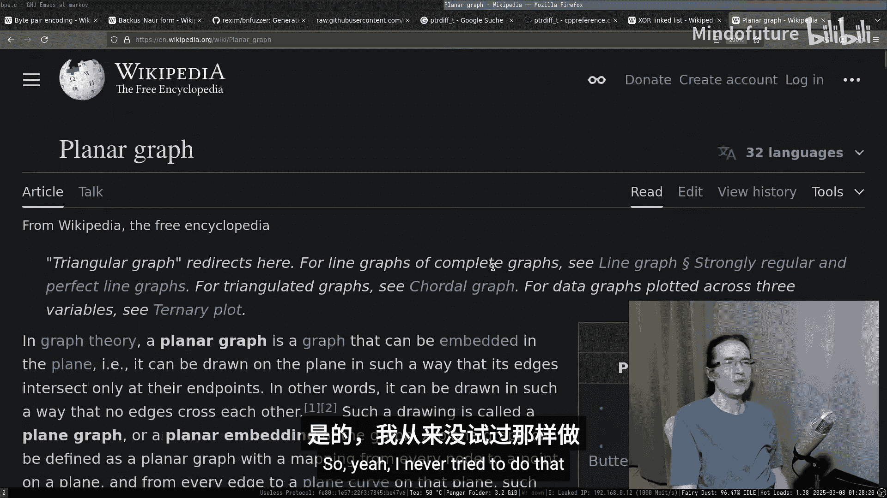

Yeah， and then you try to kind of feed it。Damn， that sounds like an interesting thing to try to code。

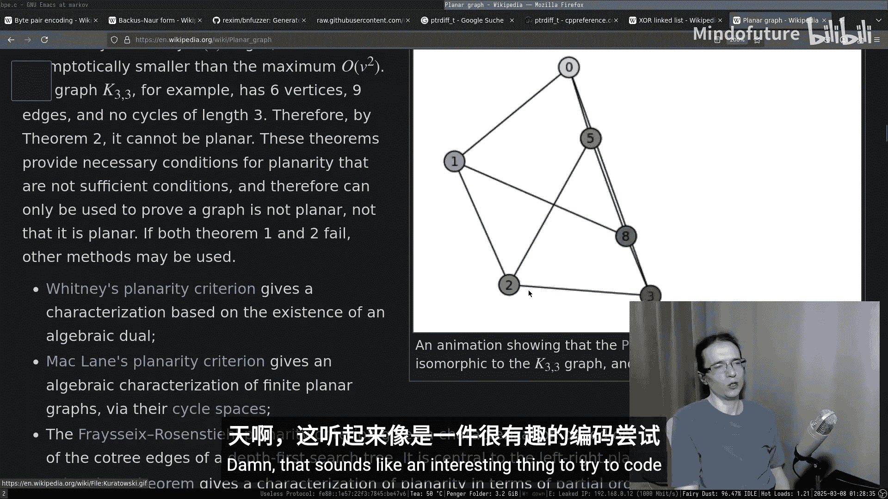

Yeah， I'm so sorry。 like I don't know anything about it， but I will consider doing a stream on that。

 So thank you。 thank you so much。 Maybe I would look into how graph vs work。

 because I think graph vs deals with similar problems because it's literally an application for rendering algorithm。

 but I don't know the state of their code base。 maybe you can't really extract anything useful out of that。

😊。

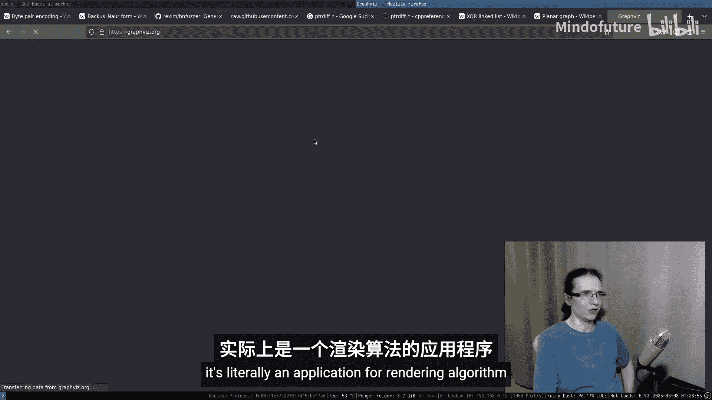

Right， so yeah， maybe you can get some interesting information out of their code。 So yeah。Sorry。

But thank you。 So Kaafka Fu， thank you so much for Titch Prime and never normal。

 thank you so much for Titch Prime Mad message， Thanks for your streams。

 I watched the recording almost every evening。 Thank you。 Thank you for watching them。😊，Right。

So the land of Li had an exercise about graphs， that's very interesting。

 it's pretty cool never read it actually。Okay， so yeah， it takes too much time to render it。

 Maybe this is because the。嗯。Eax is a very slow terminal。

 so let's actually try to render the sizes of the tokens and see if the size slowly increases。

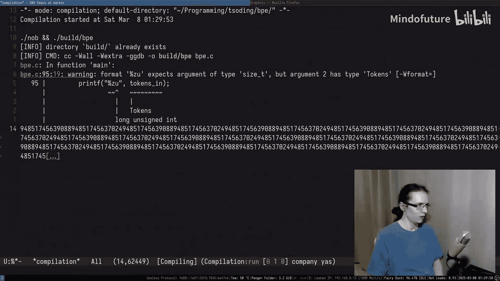

Okay， this is not what I wanted back。Fuck emax， I hate Emax。 I hate emex。 I hate emax。

 when you start outputtting in a single line and you forget new line。

 it literally looks this entire shit fucking editor。 Okay， so let's fucking kill。😡。

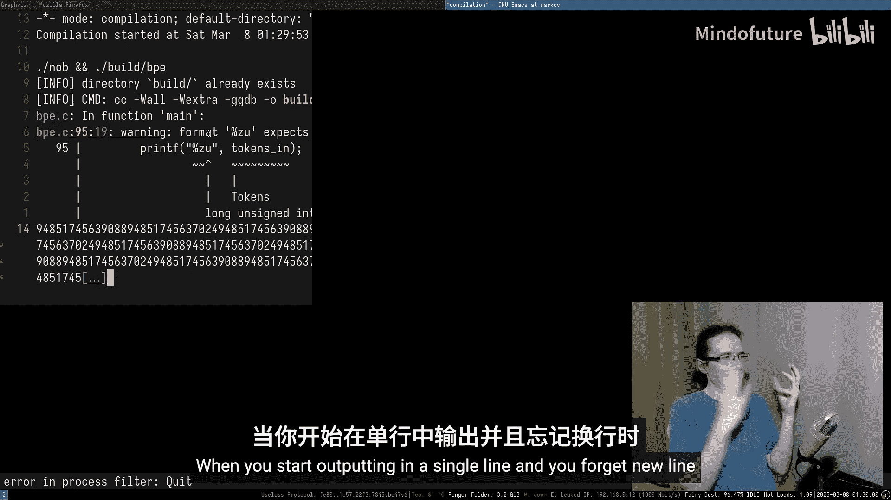

It's just like it's so easy to fucking kill it， okay？It's a shed terminal。

 It's a very fucking shed terminal。 So is that a probe。 I don't remember， is it in probeb。

 Is it in soging， I think it isn't。 Okay， so here it is。 I just forgot the new line。

 And there you go， you're dead。 You're basically fucking dead。 So just just kill Eax， right。

One mistake。 and you've mistaken。 No， but let's fucking go。 So what the fuck are you saying。

 So this is gonna be count。 Okay， well we have cool。 So now I can try to do B P E。 All right。

 and it compressed it to one。 ho。How did that fucking happen， bro？That doesn't make any sense。

 we did a fuckingy wki somewhere， like how did it compress the entire thing into just one？

Because the count in here， oh， I think I know why， I think I know why I have to clean up the goddm frequencies。

 I forgot about this intensha。 Yeah， all right， let's quickly try to do that。

 So where do we start working with the frequencies。 Here's where we start to work with it。😊，SDBD， S。

 HM clear， reset。I don't want to free it。うん。😊，Do we have， You really don't have clear clean。Reset。

There is a STR reset， but there is no reset of the hedge。an bra， I wna free on bra。 This is。

 this sucks。 This hash table sucks as。Like， if you can't clean it up， like。

 what's the use of it then I want， I don't want to free， freeze the hash map and say。Bro。

That fucking sucks anyway， so can I do Hm free on at least at the beginning？Damn。

 not having a reset operation for hash mapap。 F suck。 I'm telling you， alright。

 so it actually went down to 20 and8 and couldn't compress it no more， right。

 It literally couldn't compress it no more。Allright， that's very interesting。

 So let's now try to print the sequences of tokens because I want to see how the text like shrinks over time。

 I think it's going to be interesting。So I hope it's not going to get too bad。 Alright。

 and at some point。Yeah， so at some point， this is basically how it shrunk。

 So we have almost no ASi characters in here。 have almost no ASi characters。

 So it's completely completely compressed as much as possible。 And it created a lot of tokens。

 actually。 So how many tokens we managed to create。嗯。Let's put to bring that。Genrate it。

So Z talkings。So it's going to be players count， so this is how many tokens we now have。349 tokens。

 I'm not sure if the encoding is readable， when you quickly remove that。 Okay， so 349 tokens。

 we started with 256。Right， we said256 now， we have 349。

So and most importantly we have now table right so payers is a table where each entry points to two other entries or the leaf entries point to themselves so this is sort of like a directed graph I wonder speaking of graph viewss can we visualize this entire sheet with graph viewss so generate graph like a dot it's called dot and I'm going to provide just pair。

So this is going to be generally dot。And let's create it as a function。

So this is going be white pair pairs， so this is pairs。So this is something like that。

And what we need to do， we need to just iterate through all these things so this I。 In fact。

 this is basically talkingken， right？Talking less pays count。And essentially。

 what we have to print in here， we have to print。Z U2， I think is just like this。From tokiken to。

Paers items stockken。Left， so this is the left one。 and then the right one。

 And don't forget the new line。 Don't fucking forget the new line。 So after this entire shot。

 it didn't even fucking compile because it's a talkingken。 Okay， cool， it generated。

 but there's still some warnings in here because it's a you。 Okay。

 so let's actually make it something like U32 T。 and this entire stuff becomes just U。

Are you happy now？ You are， in fact， happy now。 Look at that。 So this is basically。Okay。

 so here's an interesting thing。 So some of them are leaf things。 So what we have to do。

 we have to check if talkingken is equal。To the left one。That means it's just， it's a leaf， right。

 and we shouldn't print it。 So because of that。We probably should do something like this。

 if it's not equal to that， only then print。All right， so that makes sense。

 That actually makes a lot of sense。To hand okay， yeah， okay。 So it refers back to these things。

 It refers back to these things， but things themselves are not printed because they are leaves essentially。

Because they're essentially leaves and can we just now make it a D graph if I remember correctly？

It's something like DG。Pyers like this。 And then remember if you put like semico in here or not。

I hope we're not going to spend three hours debugging because of a single missing silicone。

Right so this is roughly what we want to happen here， I think we forgot the new line。

 why I keep forgetting the new line is this I don't quite understand。

Wen't really print anything else。Okay， we can do。 is that a correct， correct dot format。

 I don't know。Honestly， I don't really know。 So heres the pair and a pair dot。 Okay。

 at least my E highlights the entireship。 So do I have dot。嗯。I don't。And let's install graphees。

ULet's fucking go XVPS query or S graph Vis。All right。

Let's fucking install that slice the mine for me so if I can go。Thank you， thank you， thank you。

 thank you。 al right， so here's the graph whiz and yeah。

I can try to maybe even open this entire thing and compile it and。Al right。

 so I actually guessed this entire ho。And let VM documentation， Lets fucking go。 Lets fucking go。

 let VM documentation。 Love it。 But yeah， so this is basically the graph。

 This is basically the graph that we got。😊，That we kind ofgene out of this text。

 I love reading do here。I love reading at Dukes。うんうん。A classic dot unreadable tree， yeah， yeah yeah。

 yeah， yeah， a fucking close to each。Faling classic。So yeah。

 that's what that's how you generate this entire thing。

 we're kind cool to have like a way to dump the the pairers into hard drive and then maybe load them up later to generate some text and whatnot。

 I think that would have been super useful。 How can we do that。

 We can just take these pairs and simply dump them as。😊，As binary。

 So that's one of the thing we can do。 There's a little bit of a waste on the 256 first things。

 but I don't think it's that big of a deal， right， so。Yeah， let's actually try to do that， maybe。

Something like dump。Pyers， we're going to accept the pairs。Bers， sprays， and maybe also file path。

So as far as the know in No。And， we have a function right entire file。

Whi just basically takes a buffer and dumps the entire of that buffer into into the file system so you can do file path。

So payers items。 So this is basically the pointer to the data。

 And then we need to provide the size in bytes， right so we can provide payers count。

 but this is a size in elements。 So we have to multiply it by the size of a single element size of。

Items like this。 And obviously， it may return an error， right？ So。

 and I think this is what we can do here。 So we just like。Return an error in here， okay。

So after that， we can。We can do something like this， so dump pairs。Bers？Bs bin。And obviously。

 if it fails， we're going to return one here。Yep， let's just do something like that。

Did it create pay， it didn't but forgot I forgot to reveal it。ちそ。Alright。So they go。

 here's the button。And here is basically the dumped memory， right。Yeah。

 majority of these things are just。Zeros， and then at the， at the bottom， we have。

Some other stuffs here the hexel editor。Yeah， you can clearly see here's the left。 here's the right。

 And because the numbers are to the left， this is a little engine。 Okay， so that makes sense。

 that makes all those sense。 So we just dump this entire time memory。

 Who needs Jasons and Yamls and some other shitd。 You can just dump memory。

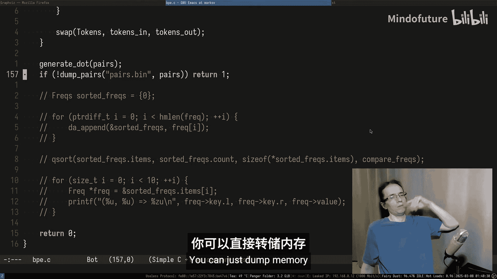

You just can dump memory directly。Oh right。 So thank you so much。 Our Maggie donium for 100 pizza。

 I already forgot how to read your name。 I'm sorry。 thanks for the feedback as a graph drawing。

 I don't recommend graph with It's total shes and。😊，Planum and planummal that is based on it。

 Pum is good， but the layout just sucks。 I never heard about it。 actually。

 and really render graphs that very often plant Ul。 Okay， so that's very interesting。

 so the had versatile tool that facilitates the rapid and creation of wide array of diagrams U M L。😊。

No， what the fuck。

That is a straight up。 No for me。 I will refuse use this software purely for that。

 So thank you so much。 It based on it is why I'm working on replacement for my specific use case。

 but planning to expand it。 If you're planning to dive into the recommend Als from where Merne Tru clean。

 okay， that's。😊，What I'm doing for now。 Okay， so let me see。

So there are people who literally study like， you know， research how to do this kind of stuff。

And it's even part of boost。嗯。Kt fucking them。Boost must have literally fucking everything。

 like what。What does it have to do literally fucking？But anyway， thank you。 Thank you so much。 No。

 it I look into this things。 So thank you for another 100 beats with a message。

 If you're planning to use graphee layout， I suggest using needle layout engine is just gonna look。😊。

A little better。 although generation is slower。 Okay， I'll give it a try。 So let me， let me see how。

 how do you even do this。 So maybe it's part of the dot。Is there just dot， okay。So engine， okay。

Meita damn， this is absolutely useless。Bn。It's okay， it's， it's a wrong thing。Do you have help okay。

So， engine。Se layout out engine to V。 so I have to do something like that。嗯うんうん可。Al right。

 so here's the this stuff and I'm going to open it。 I suppose I have to do something likenito。

 alright。

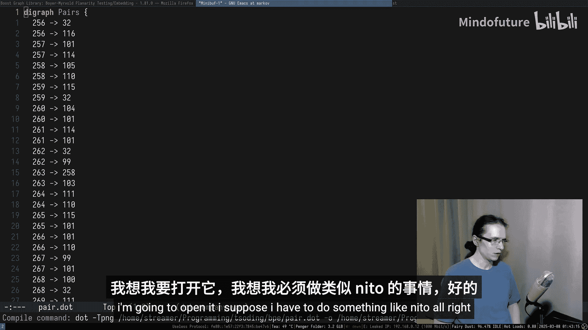

It didn't help， but I see， I see where it come from。 I see where it come from。

 If this entire step was a little bit less complex， maybe it would maybe it would make sense。 Okay。

 that's pretty cool Thank you。USo， and thank you， An was gift her for gifting this up。But yeah。

 which rights， which rights？

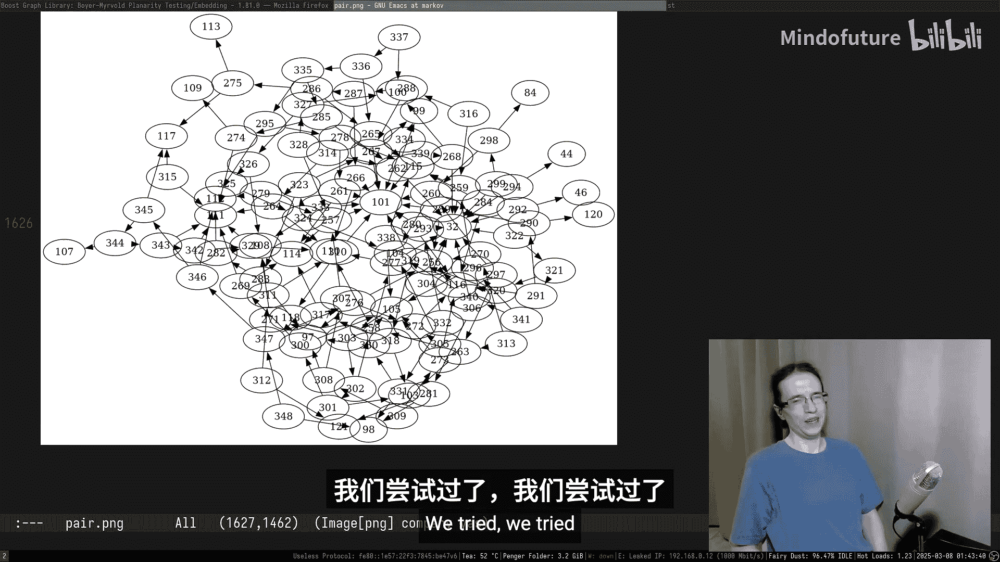

。That's pretty cool all right， so we dumped playerss。And yeah。

 so maybe we need to have a way to restore the pair somehow， there was an attempt yeah exactly。

We can have some sort of operation that loads the pairs， right， so load pairs。

So this is going to be bulling， we're going to do something like that file path and also going to take a pointer to the pay。

So because it might be a quite heavy operation to load the pays back。So。

So to recompute the pairs so because we don't want to recompute them over and over again。

 we're going to be probably working with a bigger text， so much bigger text。

 and I want to be able to just like compute the table once。

 dump it into the memory and then load it later so I don't have to recompute it over and over again so I can experiment with this implicit grammar that we discovered。

So Soin is dumping pairs now。Okay， this is literally the reason why I'm trying to ignore the chats。嗯。

It's like a。Honestly， streaming is a schizophrenia simulator， right。

 So you're trying to do some some job and there is this like a voice。

Like invasive voice that's trying to constantly distract you。It's a little schizophrenia to it。😊。

Anyways， so what we need to do in here， we need to first load the entire file。

 so we have an opposite operation and knob write entire file and we have read the entire file。😊。

So let me， let me do that。 So not that H read the entire file。 So here is。

So it actually accepts the buffer into which is going to ridddle of that。

 so we can actually maybe precate it in here so I'm going to add this is。😊。

I have a shortcut for small breaks called SB and it just got triggered。Freaking classic。

Fricking plastic。 Okay， so I'm going to give it in here。 So this is the file path， file path。

 and obviously it may fail， right， it may fail。 So we're going actually return false in this specific case。

And I'm thinking maybe I should accept this entire stuff， so it's none of the。

Function business to do the memory management。생해서 그요。Allright， so after that。

 we need to take the size of the buffer and we need to make sure that it is divisible by the size of the pair elements。

 right， so these are going to be pairs。Pyers， items。Yeah， so it is divisible。

 We're going to do an assert right， let's actually not do a if it's not equal to 0。

We probably need to fail with an error as to the error。Unex。Now sizeize of S should。Must。

Be divisible by0。Allright， and what should be divisible by， it should be divisible by that。呃。Right。

 and we can also print the size of this thing。 So size of the file path， which is as be count。

 should be divisible by the size of the element。 That's very important。 Otherwise。

 it's just like not gonnaal properly and bridge falls in here。 So after that， what we can do。

We can actually do something like this。So this is items。SB items right。

 so we take a pointer to the characters， point to the buffer and we cast it to the point of the pairs。

right， and now we also need to have maybe items count in here。 And it's going to be。

This thing divided by the size of the element。 And this is precisely the reason why it has to be visible。

 This is precisely the reason。 So after that， we can quite easily just iterate all these items。

 It count like so。 And just keep app them into the pairs。 right， So this is gonna to be the pairs。

 It's already a pointer。 And what we're doing in here is items I There go。 So and after that。

 if it succeeded we neutral。😊，Right， so we just like reading up bytes。

 we make sure that the amount of bytes makes sense。

 it's divisible by the amount of elements that we have and we're just reinterpreting it as an array of these pairs and we're pushing them back into the dynamic array so that's essentially what we're doing here。

In fact， we didn't even have to do that honestly。I just got an idea。 I just got a pretty epic idea。

 honestly。What if we？Do like this。 We own the allocation of this buffer。 Okay。

 let's own the allocation of the buffer。 and then。We're going to actually reassign oh this。

We could reassign the whole thing。Now let's not do that。

 so the cool side effect of this specific approach is that if you already have some pair in here。

 it is going to append more pair in here so you can have two files and you can quite easily conate them。

😊，Right， so you can actually require these con name them。So yeah， so that will allow us to you know。

 sample that quite easily which brick。So what we can do， let's actually test all of that stuff。

 maybe we need to create a separate， let's create a separate utility that loads the pairers and generates dot thing。

Okay， so yeah， let' what can go。 I think it's a cool idea。

 So we can move this do generation algorithm to a separate utility。 Yeah， that's kind of cool。

 So we'll go here and what we're gonna be doing in here。😊，I。

Maybe let's call this utility something like BPE2 dot。That's a pretty good name。 I really like that。

 B P to dot dot C。 Okay， so here' is that。 So B P to dot。

So now we are starting to kind of repeat a little bit of a code。

 maybe we can we could factor out this entire thing to something separating here。For example， build2。

So here we have maybe S C path。And in here we have beam pass。Something like this。

 and now we can quite easily。Just put it like that。

 obviously you probably need to accept the pointer to Sindying because it's going to be using Sinding。

So in here， we have beam path， and this is SRC path like so。SerRC and B。

 and then we just run this entire stuff synchronously， run as synchronously， and there we go。

So after that， what that means I can do。Built to。Bilt folder。Built folder。うん。😊，びピ。BP and return one。

So now we can do B P。呃 two two。So let's fucking going。Jason to B， P， we've got some more subs。

 Thank you so much。 Thank you so much。 coffee before code for Tima subscription。 And Ile。

 thank you so much for gifting sub。 Thank you。 Thank you。 Thank。😊，Right， that's pretty cool。 Okay。

 so now it it now becomes quite easy to just like， you know， add a new tool in here。

 like building a new tool。 look at， look at this neat code。 look at this neat code。

 I'm going just do not this and obviously it doesn't build because it's not a pointer。

 What else do we have in here。 So it didn't like something in here。 build folder。

 you didn't like build a。 This is because I have to put pointer to the same thing。 That makes sense。

 Okay， so now it is working。 It is working。That is absolutely fucking bizarre。W。嗯。

I've never seen this error before。 What the fuck is going on extreme。

So this is what we're trying to build them here。嗯。

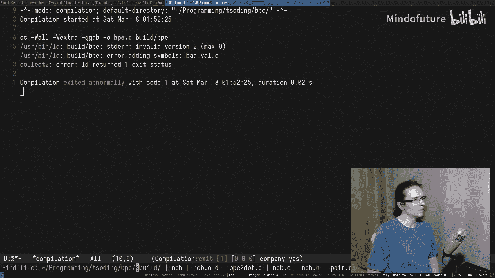

Oh my god。

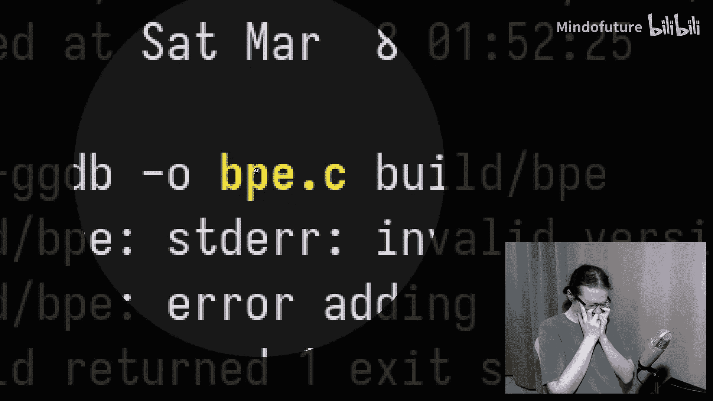

I haven不 saved天。Everyone come down， I have it in my buffer。Eax saves the day。Absolute coach。

 Abs fucking coach。Yep， yep， I'm actually in shirt。

 I think I'm going to like swap them around like this is I can go。And no。 Ohright。

 so this one has to be。ポイント。A pointer， this one has to be a pointer， okay？Another aer。Another aer。

Another。 Thank you so much。 C， for making me freaking replace all these stupid ass dots and shits。

 I'm so glad。 I'm fucking tonight。 Okay， that was the last one。😊，嗯。Alright， so we're Gucci。 We are。

 in fact， a Tamagucci。 Alright， Okay， so B P2。To thatオ no such for B P to I manage it I manage。

 I wanted to do dot。I think I'm already a little bit tight。 That's fine。 That's fine。

 We're gonna get there。 Don't worry about it。 And you find a reference domain。 Okay。

 that makes sense。 B P2 dot I'm going include this kind of stuff Im not looking you。

And I'm going to just switch。 So what' we thinking again is that。

We need to have command line arguments， right， So this is gonna be Char or B， whatever， whatever。

 And then here we， yeah， we need to start parsing things。

 So I'm going to have something like a program name， program name。 I'm going shift。Arc V R C。

 but shift is implemented in N， so what we have to do is we have to bring this thing here。bom。

Alright， so here's the ship and we need to check Rc is lesser equal than0。

 that means you didn't provide the input。 you must provide the input B。

 you must provide the input so let's actually tell that。Right， no input is provided。

 We can even freaking tell the usage， right， so the usage is。The program name。Iンputsピ。

So don't forget the new line， don't forget a new line program name let a go。

 and here we're gonna exit with no zero exit code。 So after that we have the file path which will also shift our green。

 So the next thing we have to do now we have to just read that file path so let's get the code that is responsible for loading the pairs we're going to put it in here so here's the load in the pairs。

Co， but we need the definitions of such things as pairs。

 and we need to share that definition between both of the tools。What that means the time has come。

 Y F S of the camera is done。 The time has come for a common。嗯。For a common module。

 right so let's maybe create something like VP dot H and it's going to be header where were going to share like the definitions and stuff like that。

So let's put the inclusion guards right， so this is the inclusion guard。

 so we're going define that and we're going do N if。

There we go and where is the definition of the pair so here is the pair and also the pairs all right so this is the definitions that we need in here do we need anything else I don't think so I think that's enough for now as we need to share more and more things we're going to be moving them into the BPU edge。

Okay， so now if I try to compile both of these things， yeah。

 it obviously fails because it doesn't know what is a pair， let's include Vp。h。Including BpU dot。

 Okay， so also also need to have pair， but this is BP dot dot。

 So we need to include BPU dot page in here as well。Al right， so you insert your2。

 that's understandable， so that means probably have to do STD int。Action here。 So file path。 Okay。

 that's pretty cool。 And now we're freaking ready to do this thing。 So load the pairs。

 load the mother pairs。 Pro the file path。 Let's put the playerss somewhere here， playerss， playerss。

😊，Zero and also string builder has been like that。うふん。

Its fucking go if not return one and we loaded the pairs。

 So once we loaded the pairs now we can try to generate the dot。うんふん。

So we can move this whole thing there。啊，哼。うんうん。And I'm thinking。

Do we just output that to standard output or do we also accept the？You know， the output in here。

 we can do something like output dot。We can do that actually， who said we don't do that。

So let's call the file path。Input file path。 So we've got that。

Then we can do something like this and say no output。Output is provided。

 So this is the output file path。さザです。It's pretty cool。

 so we'll load in pairs and now we're ready togene。This stuff。We can what we can do。

 We can just open the。We can just open the file and just write into there or。We can kind of render。

とt？So essentially the input is going to be pairs and output is going to be the string builder into which we're rendering this entire shape。

 So instead of print Tin here， we're going to be doing SB。Append sister。

 So we're append chunks of strings into that SB。 So we're rendering that into a single buffer。

 That's what we're doing in here。 We're rendering all that stuff。

So there are a little bit of a problem in here with printf。

 but we can also always use TM as printf right， So and then simply。Append sister  to S B in here。

 We can easily do something like this。 And the same goes for， this think sister。SB， right。

 So we're rendering the dot。Wch makes it then super easy to dump the entire buffer back into the file system。

 So and what's funny is that we can reuse the string builder。

 the same string builder that we use to load the pairs right so we kind of need to clean it up first。

 and we can now reuse it。 And the memory that was allocated during loading the pairs is gonna be reused for now rendering the dot。

 So that's actually kind of cool honestly that's actually kind of cool。

 So then were just render the dot。 Look at that。 render the dot。 we provide B。

 and then we provide the point in here like this。 I think load the pairs also accepts it as a point。

 Yeah， it also accept as a point。 So it has to do like that。 And after that， we can finally just。😊。

You know dump it into the file system just a second。Not the H right entire file like this。

So this is gonna be the output output file path。 The data is SB items and the size is SB count。 In a。

 it can fail。 Can it fails return one。 Alright， so we can also say something in here， maybe like in。

Genurated， generated S。Ill put file path。Yeah， look at that。 this is that chicken can cool。

This is actually kind of cool， so we're not like constantly reading writing into a file。

 we read once， generate this entire into the memory and just write it once。

So that's basically within here。Okay， so this fucking can go。

 so it doesn't compile properly obviously， because， well， I mean。

 we probably don't have to do that anymore。Okay， so payers， it probably needs it as a pointer， okay。

 and that seems to be working and that seems to be working cool。So if I try to run VP2 dot。

 it asks for an input， so the input is going to be pay bin， Okay。

 so we get the pay bin and then I can say pay dot， right， so here's the pair dot。

And it worked if we take a look at this entire thing， okay， that seems to be working。Alright。

 so let's try to work on a simpler text。 right， so here we have a pretty， you know， big text。

What if I say that the text is actually something like， you know， the quick brown fox， right。

 the quick brown fox jump jumps over the lazy dog， so let's do something simpler。

I'm going to try to rebuild the whole thing， which should probably accept the text as input parameter。

 but in the future we'll probably have to accept it as a file right so we have to read the text from the file。

 do the BPE compression and dump it into the binary。 So with other tool。

 we can now inspect it and build the graph and stuff like that right so BP。Just do the BPP。Okay。

 so that should have generated a new pair in here。 It didn't really print anything， unfortunately。

 but whatever。 So B P to dot pay bin。All right， but we have to do pairs。There's。ど？Yeah。

 is that a good one。 Yeah， I think it's fine。 So in in here， it's much smaller， actually。

 surprisingly。It only added。 Yeah， the problem with the quick brown f jump jumps over with the lazy dog is that it。

Yeah， there is no that many repeating pair。Yeah。There's not that many repeating pairs。 And okay。

 so neat。 but I think at least it's gonna look good， right， So at least it's going to look。 Yeah。

 that's basically what we got。 So we managed to find only like。Two pairs， right。

 So the first pair refers to characters 101 and 104。

 and another pair refers to 256 and directly to the space。 There is not that many repeating pairs。

 unfortunately。So， yeah。So， but yeah， so we have something tool that allows us to generate the text and then create a binary file and then turn it into。

The dot file or whatnot。I'm really same for two hours。 Actually， Im ready same for two hours。

 So I achieved what I wanted to achieve today。 Im the compression algorithm for the text。

 the compression algorithm。 So on the next episode tomorrow， probably we're going try to。😊。

So do we need to implement litockenizer？Honestly， to actually generate random text。

 I didn't think we need to have a tokenizer， let's tomorrow try to generate random text out of this entire thing right so I'm going to prepare the huge body of text right so the looks from our discd channel and stuff like that we're going takeken tokenize it。

 we're going to compress it， we're going get this implicit grammar and we're going to try to maybe generate some Szo random out of。

So soundss good。 Sounds Gucci。 Tamaguci as usual。 So yeah， that's it for the day。 Thanks。

 everyone who's watching me now。 Really appreciate that。 Have a good one。

 And I you all on the next recreational recognition session with a who I missed A z is an I love you all。

😊，Alright， this is the footnote of the session and I would like to quickly implement something so we get two tools。

 The first one converts text to BP。 I renamed it to text to B because it makes more sense and I make it accept the text as a path to a file right and it also accepts the output path so before it was actually a hard code in the source code and it's not particularly convenient so now it accepts it as a command line and the second utility converts B table to dot format so then you can render it with graphvs I'm not sure how useful this thing is because if B table is sufficiently complicated you can't remake sense out of the graph anyway so it's kind of useless so maybe I'm going remove it so let's actually try to test this tools right so I put the Wikipedia paragraph into a separate file so I can use it in here。

And now let's actually do TxT to BPE， I'm going to provide the paragraph in here。

 and then the output is going to be with the same name， but with the extension BPE。Right。

 so it's kind of cool， but you can't really see what is going on in here right unless you use dot。

 but it's useless。 So what I was thinking is that we need some some sort of a tool that actually renders the tables of the tokens right so I want to see the idea of the token and the text of that specific token。

 So let's quickly implement that utility let's call it something like Bp inspect in dot C right so in here I suppose we need to include all of the other things that I usually include specifically SDg Io Noob and the common Bp dot H So for the main。

For the main I think we'll need to parse command line arguments so I'm going to put it in here and for the usage I'm going also use the same format of the function right you see how easy it is to program you just copy paste code you don't even need LLMs you don't even need LMs。

L lenss are for people with a skill issue who don't know how to fucking copy paste I'm telling you I'm fucking telling you that's it I don't even have to modify much right。

 so that that's basically the skeleton of the of the utility BP inspect Let's actually add this tool to the building process right so I'm quickly going do something like this VP inspect。

Right， and I'm going to try to compile the entire thing。

Seems to be compelling okay so that's pretty cool。 So I suppose the first thing we need to do we need to load the pairs。

 we need to load the binary file。 we already know how to do that in BP to dot but the function is actually located in that utility so we have to move it to the common part right so we have to move it to BP do H but in Bp dot H will only store the declarations so we'll have to create the translation need for Bp dot H right so I'm going to put this declaration in here and then I'm going to create BP do C。

And I'm going to move load pairers into BP。c。 right。

 so now this implementation is shareable across all of the tools。

Right so and it can't find this specific function in here because we don't link that translation in with anything。

 so let's actually add that translation need to each individual tool we're going to link each individual tool with that translation unit so BP dot see。

 let's go。Okay， so yeah， so now we have a problem that it doesn't know where is the boolean So let's include BPP dot H。

 I think I included theD boan in there。 Okay， yeah。

 so the size T as far as the no is located in isD lip still complaining about boan so that means we need to include。

Bullion in here。With we have string builder。 Okay， okay， so here's the thing。

 so string builder is located in knob dot H。 we have to include knob dot H in here。

But now it raises the question where？The implementations of thenob functions go right。

 so two depend on Noob and the common translation unit also depends on Knob where we're going to put the implementations of thenob functions。

I think it makes sense to actually move the implementations of the Noob functions into the common translation into BP doc right so because it's shared so the BP doC is shared and the Noob functions are shared as well so if you just include Noob dot age it is not going to include implementations for that you need to define Noob implementation so we're not going to put implementation into the here。

But I think we're going to strike the prefies。So and then what we're going to do in here。

 we're going to put implementation somewhere somewhere in BPP。

C but at the bottom of the file so it doesn't disturb anything above because it's C so Class6 remove implementation and I'm including implementations in here but now I have to remove implementations from all of the other tools so there's no conflict over implementation so I can just remove this entire of the thing I can even remove including dot H because it's already included by B。

 H。Right， so this one also should not include that。 And this one doesn't need to include that item。

 right， So hopefully that is going to work。 Okay， okay， so this is a fucking classical problem。

 right so。Essentially there is a problem with chipping prefixes is that Noob defines an alias for rename。

 but the function rename already exists in PoOSex， not on Windows but in postsex。

 and this is a bug that I don't really know how to fix， but the workaround for this specific bug。

It essentially just undefined this specific thing。 right， I mean， I could have just removed。

 I could have just removed this areaslias， but that is going to break all of the code that undeines the rename。

 I think right， we can actually try that。 So first of all， let me just see if it compiles。 Okay。

 so it does， in fact compile。 But then if I remove this areaslias。

 And I still have the code that undefins this areas that doesn't exist anymore。 It is go。 Oh。

 it doesn't break。This is actually kind of cool， so that means that means I can just remove yeah。

 I can just remove this alias in the future versions of no。

 I'll need to test that a little bit more in the future。

 but I mean it's kind of cool so that means it's not going to break much。Okay， so it is fixable then。

So yeah， now this entire thing compiles， let's load the pairs， let's load the pairs。

 let's utilize this entire function。BPE inspect。I'm going to put this entire thing in here。

 we're loading them from the input file path right。

 so then I need to allocate the layerss on the stack。

And also we need the string buffer that is going to be used by the load pair function to load the binary from the file right。

 but then we're not going to be using the bytes of the file right so we only need to load them so they can be converted into pairs。

So I'm going to put it like that。And if this entire function fails， we are going to return with them。

And then zero exit code。 Okay， so now let's iterate each individual talkingken， right。

 so each individual pairer represents the token and the idea of that token is the index of that pair。

 so that's how it works essentially。 So it's a table。

So I'm itrating talkingken from zero up until player counts， and I'm incring this synthetic thing。

So what I want to do， I want to print the idea of the talkingken， right， So this is the talkingken。

 and then the actualual representation of that specific token。

 So we need some sort of a function that will take a token and render it。 So the way it works。

 the way it works is that。If if the player associated with a particular talking has left equal to its own ID。

 you have to treat the idea of the talking as a ASI code。And if it's not。

 you basically have to recursively render left token and right token and cancateate the results together。

 So it's sort of like a tree， but it's not really a tree。

 it's a directed acyclic graph right so it's sort of like a tree that intersects with itself So thats that's an interesting way of looking at it So directed directed acyclic graph is a tree that intersects with itself。

It's a really funny way to look at it， but anyway。So let's create some sort of a function render talking and it's going to take obviously talking you insert to talking and where we going to be rendering it into so we already have a string builder so we might as well actually render it into that string builders so why not so this going bebin and in here again if yeah we need payers as well so pays payers。

So if token is equal to pairers items token left。If the left element of the pair is equal to the token itself。

 this is a leaf right so this is sort of like a termination termination point。

 so we have to treat it as the ASCI code so we have to append we can actually treat stringBuilder as a dynamic array because that's what the list is a dynamic array of characters。

We are a talking。As a character。 And then we return because this is the base of the recursion。

 So after that， we have to render left and right talking separately recursively。 right。

 So this is going be talking pairs。Then I'm taking the left。Token in here， rendering it it into Sb。

 and then I'm rendering into Sb the right token and。

I think that that's the entire of the algorithm honestly that's the entirety of the algorithm。

 So after that let's actually clean up our string buildinger So after we loaded the pairs we don't really need string builder anymore right so it's only used the internal for the internal plantation of load pairers and after that you're free to discard it right。

But what we can do， we can actually reuse whatever memory was allocated within string building。

 which is rather convenient。So render token and I'm rendering pair tokiken pointed to SB。

 Allright And then so since I'm using printf the string has to be multid。

 So let's actually append nu in here。 this is going to be SB and I'm going to put SB items in here。

 So after that I think that's the entire of the implementation。

 So there is a little bit of a problem with render token is that as already set directed acycl graph is the tree that intersects with itself。

 that means it will render the same tokens token several times。 So it will do a lot of busy work。

 So one of the things we probably have to do in here is。

Memorize like employ some sort of a memorization。 So to not re the same tos over and over again。

 So let me actually put some sort of to do here employee。Memorization。

 so to not re the same tokens over and over again。Right， so I'm not going to be doing it right now。

 but I think this is something that would be nice to implement for performance reasons。Alright。

 so let's actually try to rebuild the entire thing。 Okay。

 so let's apply the Bp inspect on the thing that we just okay so that。That works。

 So as you can see this。 So the tokens are like nested， right。

 So a bigger tokens may contain smaller sub tokens so and。Yeah。

 some of them have trailing spaces because of that。

 I have a feeling that we need to put bars around the text of those things。

 Let's actually simultaneously rebuild the end run。 Okay。

 so now we can see all of the trail white spaces and stuff。 and also。

 there is like unprintable characters。嗯。😊，So what we're going to be doing with them， I don't know。

 maybe we're going to just ignore them。So there's also new lines catbook and then it's， yeah。

 we't need to just think how we're gonna print all that0，0 is nothing。

Maybe we should actually not even try to render 0 because0 doesn't make much sense。

 And what about just， yeah， what about just starting from one。Yeah， zero doesn't make sense。Okay。

 so what's interesting is that now we can try to tokenize something bigger， right。

 so because this paragraph is rather small。But what if we try to tokenize the source code of the tokenizer itself right so like this specific text and see how exactly it is going to split it into Tokens。

 I think it iss going to be interesting。So let's do text to BP Allright。

 so this is going to be S or C text to Bp dot C， right， And I also have to provide this entire thing。

 So this is going to be BP。

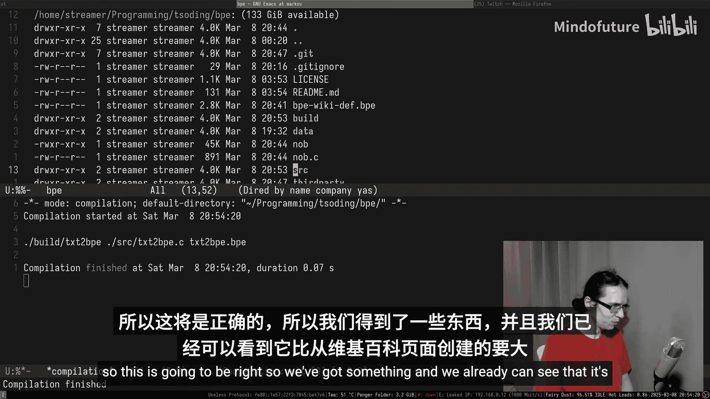

Right， so we've got something。 and we already can see that it's bigger than the one created from a Wikipedia page。

 a paragraph。 It's not a page。 right， just a paragraph。

 And now let's just try to inspect this table of tokens， okay， so。

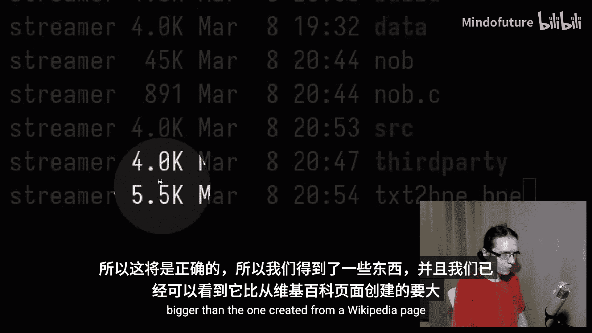

Like a whole line as a token。 So， oh， yeah， this one。Was repeated more than one time。 Apparently。

 this is actually kind of funny。 T X T to B P E。 Alright， so yeah， it was repeated two times。

 And because of that， it became an entire separate talk。

It's actually kind of cool that yeah that it can detect that so and also are these stock in items right so this specific thing also occurred several times in here two times to precise。

And there is a whole chunks of cool Wait a second。 This is actually kind cool。 Right。

 So this thing occurred several。 Yeah， okay。😊，Yeah。

 because in parsing we just like have the same thing and it differs in input and output。

 but this entire thing was considered the same， this is actually clinical cool。Now。

 the whole chunks of code is a separate duggging。So and like new lines。

 all of that kind of looks ugly right so and we have unprintable characters and stuff like that。

 So as far as I know in C there is a function called Eprint which actually tells you whether the character is printable or not。

 we can try to employ that function in here so let's quickly do that in spec。So essentially。

 let's split the whole thing like that， right， so I'm going to actually print。F in here， like so。

And after rendering the token， after rendering the token， we have to iterate。

Through each individual byte of the token as b count plus plus I and we're going to check the following thing is print if it is in fact printable。

 we're going to just print it as a is as a character。

 nothing special as B items I if it is not printable。

 let's actually print it as a hexadeadeimmal value maybe capitalize one right but also let's convert the two in right？

So because it's definitely not printable。 And maybe we can employ the format of escaping bytes of sea string。

 right， So essentially what's actually paddted with0 with leading0 and put slash X。 right。

 So we can be using the same syntax for this kind of stuff。 Okay， and that looks kind of cool。

 There is。you， yeah， we're freaking not just listen to of thing。😊，Alright。

 so that seems to be working right， So that looks a little bit better， right。

 So now like new lines are0 A's。 And what about the things above。Right to。 Yeah， Okay。

 so this is actual clear in clear and so on and so forth。

 So we have this additional argument that is ignored。 So let's remove it。 Allright。

 so now we can basically inspect the BPA tables that we generate it from text， right。

 so now at least it's it's visual we can see what the fuck is going on。Because this is nice。

 this is absolutely nice。Okay， so maybe I' want to get to ignore the BPE files。

 I don't want to commit them into the R and let's now do a committee committee and maybe potentially even push push introduce BPE In In and I'm going to push that right into the Allright so that's pretty cool。

 That's an app for the day Thanks everyone who's watching right now I really appreciate that have a good one and on the next recreation session with who I missed A in a labio。

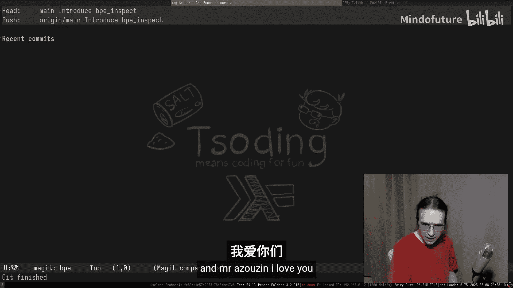