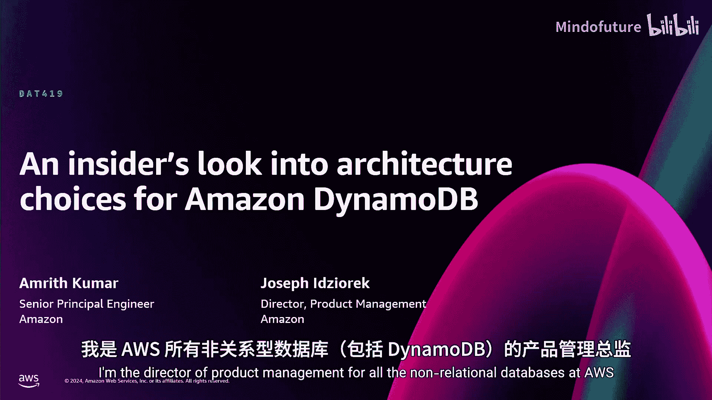
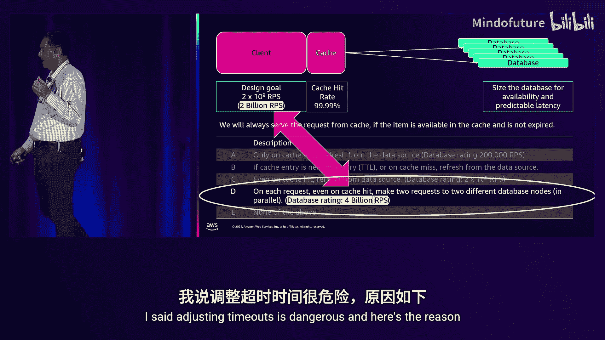
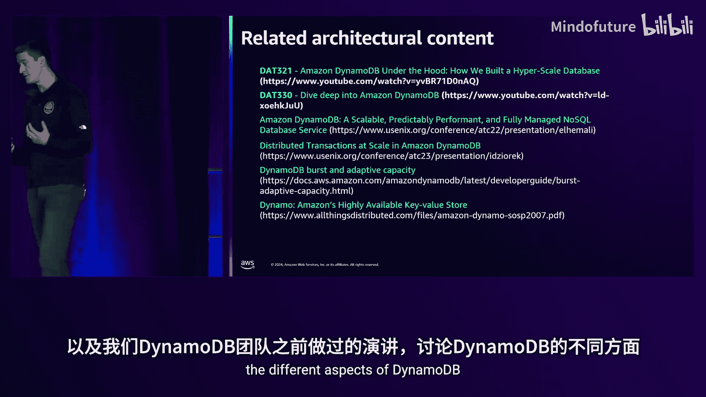
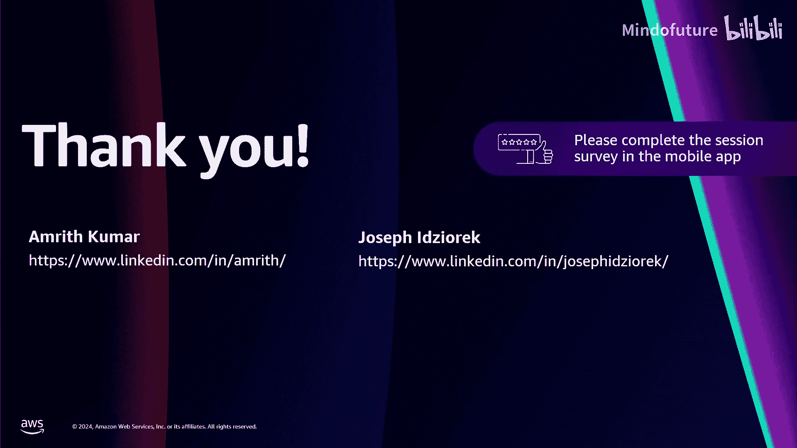

# 【AWS数据库峰会2024全集-•-中英】AWS-re：Invent-2024---Databases-p01-P01-An-insider’s-look-into-architecture-choices-for-Amazon-DynamoDB-(DAT419)--BV1VAR5Y6Es1_p1-

My name is Josephified Zoric。 I am the director of Product management for all the nonrelational databases at AWS。

 inclusive of Dynamo DB。

Joining me today is Amth Kumar is senior principal engineer on Dynamo DB。

 and Amth is one of those people I'm sure you all work with。

But for me it was one of those people that makes every day better for me， either through feedback。

 I learn from them， it makes me laugh， gives me feedback。

 it's a pleasure to be sharing the stage with him today。

 we're really excited about the content we're going to be sharing。

We're going to take a look at some of the architectural choices that we've made with Dynamo DB in the past。

 and we continue to make to serve our customers。 I to try to give a little bit more of the explanation of the why and some of the how of some of the things that we do and continue to do to give you a better idea of。

How to use Dynamo DB， how to think about Dynamo DB。

 and to learn from some of the challenges that we've had。

So we look at the customers in this screen and we look at technology wiser what do all these customers have in common or what do these companies have in common？

Well， they all have high throughput applications that do the same thing over and over and over and over and over and over and over again。

Put an item in a shopping cart， get the location of a taxi cab， start a session state。

 credit something， get a gaming player state。These are not complicated queries。

 They want to do the same thing over and over and over and over again。

 And they all use dynamo D B for that。So we're going to talk about some of the architectural choices on how we achieve any scale。

 high availability， and really consistent performance at scale。

 thinking about how we reduce variance。So one of the mental models I want you to think about dynamo D as we kind of go through this is dynamo Db is really an optimization。

 When we set off to build dynamo Db。 we didn't think about it as like can we make a slightly better relational database We really wanted to build something that was significantly better on the dimensions of scalability of consistent performance of high availability。

 We'll talk about some of those aspects。So kind of in Amazon fashion， who is the customer。

 what we actually working backwards from， and who do we continue to work backwards from when we think about the choices we make and what we're really trying to build。

So it all started as actually about to the week 20 years ago。

 if you can imagine you're doing your holiday shopping right now and you go to the Amazon。

com website and it's down for many hours happened 20 years ago。

That's not a good thing for an online retailer。 So what happens at Amazon when， when we have such。

 I would say， a massive failure like this。As we go off and we write what is called a correction of error document a COE and what the COE really does is from a technical perspective。

 really look at what went wrong， we go through the fiveYs， we look for what cause。

 and we start to think about what are the remediation actions from this one of the really more interesting things that we learned from this COE was the way that we were using a relational database 20 years ago。

70% of the access patterns that we had in this relational database。

Accessing a single key and a single table。20% were just accessing multiple keys within a single table。

 90% of what we were actually doing on the database had nothing to do with any of the relational capabilities。

You knowTheir rational databases afford。So a few people， Swwami and Warrner。

 you've probably seen speak this week。Really question why are we using relational database to this workload。

 we're just doing the same thing over and over and over and over and over and over again。

 why do we need a query processor， why do we need heuristics， why do we need statistics。

 why do we need a query planner？They went after and they wrote this paper called the Dynamo paperper。

 they actually ran the system in production for multiple years before they actually wrote the papers so they could speak from experience。

And what the dynamo D paper really was was our first for into NosQL databases at Amazon and was good。

 we had some downsides。 It was still a self- managedaged thing that was only available to Amazon internal teams。

 So over the years， we continue to use the dynamo。 and I just want to save for the record dynamo。

 dynamo DB are two totally distinct， separate things。 Yes， they're both non-relational databases。

 Yes， they're both distributed databases， two totally separate。We continued Z doing。

 we started to talk to external customers。 we had a bunch of external customers that were doing sharded architectures on top of My SQL that had same things。

 They're doing the same access patterns， just using primary key lookups。

 And they're going through a lot of work to maintain these sharded applications。

 especially is you know， kind of the cloud in some more scalable applications we were ramping up。

 So in 2012。😊，We launched DynamodDB， we've been running this。It be 13 years，13 years in January。

 know， we've learned a lot over the years， and we continue to learn about what we want to do moving forward。

And while we do a lot of innovation and the stuff that you see and what's new posts and blogs and all the kind of the customer facing stuff。

 we do a whole bunch of stuff under the scenes to continue to think about scale， high availability。

 reliance， consistent performance that we're going to share with you today that's a little bit different than the stuff that we do。

 I'm going to talk about some of the choices actually enable a couple of these features as well。

So over the years and we get this a lot is you know what customers come to DynamoDB。

 externally we have a million customers that use DynamoD。

 which is just humbling from the perspective of where it started and where it is now。

 we see two kind of I'd say two kind of two major groups of customers come to DynamoDB。

 you have the customers that come to us and say， hey。You know。

 we've exceeded what our current capabilities have on our existing database。

 or we're going to build an application that we just know just needs to scale from day one。

 We know we're gonna have hundreds million customers。 we know we need a database。 that's a scale。

 for D W， we have hundreds of tables over200 TBtes。

 We have hundreds of tables that do over a billion requests per hour。 We have hundreds of tables。

They do more than half a million requests per second。

And then we have a category of customers that come to us and say， maybe we'll grow that big one day。

 But you know what we really like about dynamo to B。No ops， right。

 I don't have to provision infrastructure。 I don't have to do versions。

 I don't have to manage hardware。 You know， I barely even have to think about capacity。

 and we see a lot of use in that one as well。So if we're really thinking about let's go at the big use case for this。

 and if we're really thinking about， if that's kind of what we're working backwards from and that's kind of the scale of applications。

 what kind of architecture do we need to build to be able to afford those capabilities？Well。

 if you can think about dynaDV really as a distributed hasht if you think about that as a mental model。

 you can think about it really is how do we provide something that provides nearly unlimited limited scale but also consistent performance and for that we have to think about dynaV as an optimization right we have to make tradeoffs to achieve those objectives and some of those tradeoffs we've had to make are in the form of the surface area that we provide from an APIs perspective to be able to trade off to be able to provide these things。

As a distributed system， the second you take the data out of a single image system where you have shared processor。

 shared memory， whatever shared disk。why data modeling matters for distributed systems is not unique to DynamoDB。

 but it's unique to anything that takes data and distributes it across one or two or more machines。

 you need to think about the data model and how you place that data and this is why when you go to reinvent you see quite a few data modeling sessions for dynamodDB。

 Alex degree is masterful at this， he's a wonderful speaker。

 but this is kind of why Alex in his talks and his books are so valuable because as a distributed system you have to think about how you access your data and where that data is distributed。

So for DynaD B to be able to achieve this， we partition data。 We're going to use this green。

 this little green icon here。To be able to kind of denote what a partition is。

 you can think of a partition as a unit of compute， right， it has some reads。

 some write in some storage， and we've place the items that you have in your table。

 one or more items in one or more partitions。Very simplistically， you have a table。

You have a partition key。 That partition key goes through an internal hash function that we have。

 and we use that hash function to determine which of， where that partition lies within the server。

And we think about， you know， how do we start to scale a database， right。

 It's very simplistic scenario。 Let's just consider we have a table that has one partition and has a key range between 0 and 9。

 real life， much more complicated than that， but for illustrative purposes。

You drive traffic to that or you increase， let's say you's an on demand table。

 you drive traffic to that， well do to be able to accommodate additional scale or eventually split that partition。

 we'll split that key space， put half the key space for simplistic purposes on one partition。

 we'll put the other on another partition and off to the races。

 so you continue to drive more traffic。We'll split that as well。

Let's say you continue to drive traffic to you know keys3 and4 We actually go so far as be able to partition or be able to scale out the items in your database all to the point where you can actually have a single primary key on an individual partition and there's a very key design point from dynamo we built it to be partitionable sharding whatever which were you want to use all the way down to the infinitesimal smallest item that we have within the database from the beginning it's not a bolt on on the end or it's not something that we thought about afterwards this was a core design principle that we built into dynamoDB。

Okay， so if we have that architecture， well， what kind of axis patterns does this afford us。 Well。

 as a hash table， a different hash table， primary Q look up to really fast。 Big O of one。

 pretty straightforward。 It's pretty good access pattern for that data model。

 It's why it's so attractive。Donna Modibi has the concept of a range key beyond the purpose of this talk。

 but for part in a range key。Competition that allows us to be able to do。

 So given a partition key and maybe you have know order date or maybe you have a monoomically increasing number。

 you can do range scans within that partition key。 Of course， if you have those two things。

 you can also do the funtable scan thing as well。Where have we seen this before Well partition key lookups or primary key lookups。

 70% of use cases we're working backwards some range scans of the other 20% this is exactly what we're working backwards and this is exactly the architecture that we picked to be able to satisfy our own internal Amazon。

 co。Use cases， turns out highly applicable to people outside of Amazon as well。

As we look at the overall architecture of Dynamo DB。You know。

 every single aspect we have to think about has to be able to scale and horizontally has to be able to scale horizontally from every single component。

 we can't have a single component within the service that becomes a bottleneck for one of the other layers behind it。

 we think a lot about this， you know whether it's a transaction manager or whether it's pitter。

 whether it's the request router， the load balancers。

 every aspect of the system has to be able to have that near infinite scalability component。

Built in from the very start。 But since we're talking about partitioning。

 let's talk about storage notes。So within a given storage node， and I hate to break it too。

 but really the magic of serverless is there's a whole bunch of servers behind the scenes and we do all the hard work to abstract it from you so you really don't have to care about that。

 but I promise you there are many， many， many， many， many servers。

And that's really all it is is is just servers。But logically， you would think about， okay。

 we have done has a whole bunch of storage nodes and you'd say， okay， well。

 I have a table that has a whole bunch of partitions and they all reside on a given storage node。

That would be the case if we had a single tenant system。

 but one of the really key things in Dynamo DB is it's really a multi tenant system。

 and that really allows us。To manage capacity and be able to do it at scale。

 hopefully very efficiently， to be able to afford capabilities to you folks as developers that it's really hard to achieve yourself as a single tenant system。

So we look at a distribution of data and we look at a storage node， there might be a storage node。

 and you might have one partition on that storage node for your table。

 but on that storage node there might be a whole bunch of other partitions there's going to be a whole bunch of other partitions and really serverless in what dynaDB is the illusion。

don that that is that those are dedicated resources you and we do a whole bunch of work on the resource governance of these servers to provide that isolation and to provide those performance guarantees。

But the thing I think， and this is one of the new capabilities and what this really affords us to do。

Is if you look across all the partitions that support your table。

Theum of the throughput for each of those different partations really tells you what that capable is capable of doing。

RightSo you look at the sum of those and this is a concept which has been around for a while and like if you're really savvy if DynaboDB。

 you kind of can back your way into this and you can kind of know what you've talked to us and we've talked to you about it。

 but this is a concept that we recently had launched a couple weeks ago which you' were calling warm throughput and this is really what the table is capable of doing this is really the partitions behind the scenes that are capable of supporting the traffic that you have。

For illustrative purposes why I think this is really important。

 a key aspect of why a multi-tenended architecture， why the scale out architecture。

 and why the way we do this matters to you as customers and as developers is illustrate on this graph so let's say you have an on- demandd table right and we're going along and the orange line on the top that is the warm throughput this is what your table is capable of doing as you continue to drive traffic to Dy moodDB we'll continue to split out partitions to be able to add more resources to be able to accommodate your workload and you'll scale up what effectively the warm throughput is for that table。

And then as your traffic subsides， that warm throughput stays there and your traffic goes down。

 It goes down。 could go to  zero for a while。 That warm throughput is still there。

 So you get the illusion， really， of having a dedicated resources。

 especially with on demand is you only pay for  100% utilize。 You only pay for the request you make。

 but you get the illusion that you have a whole bunch of resources is sitting around such that if your workload spikes up again。

 you don't have to go through the splits again， you don't have to go through the scales again。

 that resource is there。 So this is really what distributed。

M tenantant architecture architecture really affords to be able to do these for our customers。

So with that， I'll hand you off to my good friend Amrith。有。All right。

Everybody able to hear me or somebody say yes or no， yes， okay， cool。Thank you， Joe。

It's fun doing this talk because one of the things I love doing。

One of the things I love about my job is working with you who are our customers and understanding the problems you're trying to solve and how we can help you with that。

How many of you have customers？Who are happy with your application being down for maintenance at any point in time。

Raise your hand if you think your customers are happy with maintenance and downtime。

I can't see too well， but nobody raised their hands。

I believe that we need to build systems which have absolutely no downturn。

Your customers want that in order for you to do that。

 you need a database which can do the same thing for you。 I've been in dynamo Db now for。

The lower four years， less than five years。In this period of time。

 the total number of planned maintenance outages we've had。0。If you use dynamo Db。

For any amount of time， tell me how many times you got an email saying that there's going to be an upgrade in dynamo Db。

 therefore you're going to have downtime。Anyone？No。

We spent a lot of time building dynamo Db to be able to do this。

 and we're really happy we're able to do this。 Now， of course， Murphy is around and well，😊。

We will do that too。The reason for that is very simple。 if databases require maintenance。

It means your applications do not have availability， very simple。

 I've been in round databases for 35 something years。Nobody likes downtime。

 and it's hard to engineer a highly available system。 You cannot bolt on availability after the fact。

 So the reason why we want to do these kinds of talks is tell you what we learned。

When we built highly available systems， because we know that you want to do the same things as well。

So。I am positive that each and every one of us。Is going to make mistakes when we design systems。

Please don't make the same mistakes we made。 make your own mistakes。 and then tell us about them。

 Tell everybody about them so we can all learn， O。So the rest of the stock is structured in the form of。

Some rules and some examples， okay。So Joe talked about the scale at which DynamoDB operates。

Hundreds of customers who drive in excess of half a million requests per second。 By the way。

 this is not including， you know， Amazon。Hundreds of customers driving in excess of half a million requests per second。

And one of the things and of course， since we're in Vegas， this is perfectly appropriate。

If you have a fair and unbiased coin and you flip it 50 times。

 how many times is it going to come down heads， 25 times。

The expected value is the total number times the probability。

If you have an engineer who comes to you and says， I built this code。I tested it。

It only fails once in a billion times。It only fails once in a billion transactions。

 Would you accept that code。Use this。In our case。Once in a billion times means this thing is going to fail many times in a day。

Absolutely， no way。Work to engineer your system such that it has no failures， because at scale。

Anything which can fail。Will fail。This is the statistical part of it。The reality is。

 it will fail at the most inconvenient time。At the time， when you don't want to get paged。

 your pager will go off， which is now where my pager is going to go off。 No， engineer your system。

 so it doesn't fail。The way in which we do these things， here， let me give you an example。

 Everybody here probably has heard about Dynamo DB Global tables。Here's a。

Global table depiction with the table in four regions。You do a right to any region。

 This is active active。 Then Mo global tables are active active。 Yesterday。

 we announced active active， synchronous global tables。Do a right in one region。

 It's synchronously updated to the other regions。 So how do we go about doing it， No， on the top。

You have a replicator， one， singleleton。ARight in US East1 goes to the replicator， goes to AP East1。

A right in USE2 goes to the other three through the same replicator。Here's another architecture。

Every。Combination of regions。In one direction。You have a replicator， these are two choices。

So we thought about this one， and we thought about this one。Clearly， this one's going to be cheaper。

RightYou have one replicator runs on one host here I got three replicators， one in each direction。

 So if you do it right in US East2， there's a different replicator not shown on this picture。

 which is going to get data to US East one。Four regions， 12 replicators。One replicator。

 which do you think is a more available system？The second one。

 this is the way we built global tables replication for every pairwise combination of source and destination。

 you have a single replicator， why。The network link between US East 1 and USE 2 may be seeing a little bit of lag。

Do you want the replicator。Doing that replication to also halt replication to the other regions， no。

You want to confine the failure domain to the one link， which is giving you trouble。 If you did this。

 it's possible that the other regions would be impacted。You want to build a highly scalable system。

 you want to engineer it for high availability， start thinking about what can fail。When it fails。

 because it is definitely going to fail。What is the minimum damage which it can do？

Have multiple replicators。 This is the way in which we start to think。

 And so when somebody joins the team newly as an engineer， we start teaching them things like this。

I'll give you another example。This is a。So I told you I worked with databases for 30 something years。

Amazon and they had a name for something which I had long expected to exist。

 So when you build a system， build it to do constant work。

 operate a system at a steady load wherever possible。The reason for this is。

When a system is running at a steady load， in all possible conditions。

And something unto where it happens， it just keeps going。So think about a system with a cash， okay。

 you have a client。There's a cache bundled with the client and there's a database。Now。

 caches are really good things。If your cache is warm and you're able to hit your cache in 99% of the time。

When your client makes a request， only 1% of the traffic goes to the database， right。

 that's the cache。Fast response， lower and load on the database， all right。Here's a quiz。

 Take a second， read it。Same plan， same cash database。Your client is driving a traffic of。

 what does it say，2 billion requests per second。Your cash should rate is 4/9s。

How would you engineer this database？So I'll give you a hint。 It's not none of the above，Beyond that。

 I'm not going to give you any hint。So let's start from the bottom。

 how many of you think D is the right answer？Raise your hands if you think D is the red answer。

Anyone？Okay。How about seat？Anyone？Is there anybody in the room， I can't see any hands， Any for B。

Okay， I see a couple of hands for beef。Anybody for a。All right。

You guys should be at some of their talk， you know the right answers， that's the correct answer。

Engineer your system for constant work。 I that the cache has failed。

The reason you do that is because sometimes the cash might fail。

In a distributed system drivingaving 2 billion R。Imagine that you engineer your system so you can only deal with a 99。

99% cash hit rate。Let's assume zoom， you do a software deployment on whatever is hosting the cache and you take out 1% of the cash。

Next thing， your database fell down。Not a highly available system。

If you want to build a highly available system， it is going to cost more。

 but pay it'll pay for itself in the long term。 So I did a talk day before yesterday about MS。

 which is an internal component in Dynamo DB。We engineered it with this kind of concept in mind。

 assume that all the caches are cold。Because someday。

The caches will be cold and you will thank yourself for it。

Your customers will thank you for it because your system stays up。

So engineering for high availability is about thinking about these things up front。

And paying the price because it's worth it。 So let me give you another similar kind of example。

Dynamo DB has request routers， your requests come to a request router。

 which is then sent to a storage node where your data is stored and so on and so forth。And。

Like all of you， we use AWS services whenever a new kind of hardware comes along。

 we like to use it because it's more efficient， the scale at which we operate， we can save money。

 we can do good things for the planet， and we tested a new。Pie of hardware。 And we found that。

At about 9，000 Rps。This request router was able to provide good latency。Standard。

Drive higher R through the request router， utilization goes up， latency goes worse。

That's the red line。 We can't cross it。 So 9000 R is where it is。Everybody okay with this idea？Yes。

 okay。So the question now is this。In standard operation。

What would you engineer this request router to deal with？

The first thing you should think about then is what can fail？Okay。Dynamo Db is a regional service。

 We want to engineer for a single AZ failure。Okay， that entire AZ was out。

 we did software deployment or there was a networking issue when AZ is gone。

Dynamo DB should continue to run。Just five。The way in which we go about specing the host is we say。

When a complete availability zone went away。The entire load will put the fleet of request routers in their normal environment。

If 9，000 was the limit。You cannot create a host more than 6，000。

We continuously add hosts to our request for our ref I zooming that a single A Z may go out at any point in time。

What's the advantage to us from this？You know how often we deploy software to request routers？

Continuously。At any point in time。Somewhere in the world。

 there's hundreds of request routers which are getting the latest version of software。

They just go down， their caches get cold。They come back up， they keep running。

That's how you engineer for high availability，Are we good so far， Quick show of hands makes sense。

 All right。Rule number two。When you build complicated systems。Do not build them from complicated。

don't build them as complicated monoliths， build them from simple parts。

The reason for this is simple parts。Have simple failure mode。Use the same parts in many places。

 fix an issue with that part in one place， goodness all along。You have one complicated monolith。

 It's got really peculiar failure mode。 You can build this complicated looking car from these pieces。

Here's an architecture， a simple block diagram of dynamo Db。

We literally built each of these as a microservice。Within each of these microservices。

 there are subservices。This gives us lots of advantages。Leaving all the technical stuff aside。

Amazon has this concept of a two pizza team。A team which can be fed on two pizzas。Now。

 Conway's law says that your org structure and your architecture diagram are going to resemble each other over time。

If you build things as small microservices。You have the advantage that each and every one of these do their own thing。

The request router team says， I expose a contract to you， you can make this API call。

 I will serve this API call， I will do it in this amount of time。

The streamams team says the same thing。Each of these components expose an API。

They provide a contract。And they're independent failure domains。They're not a monolithic system。

 each one is managed by its own team。We build them all as independent systems。

 which are independently going through continuous deployment。 So here's an example。

I got storage notes， I got request routers。We store data on your storage notes。

We store three copies of every item。Request routers are mostly stateless。

We do deployments all the time。As long as you do a deployment in one A Z at a time。

It's perfectly safe because there's two other As which always are running。

You want to deploy it to request routers， go ahead， do it。

 You can take an entire availability zone down。You wouldn't notice it。

Engineer for high availability by thinking about these kinds of things。 And in the long term。

 you will have a system which is much more stable， zero downtime。Now。

 you can't just say I wrote a bunch of code and I'm going to deploy a storage note on hundreds of thousands of hosts。

 so we spend a lot of time going through the normal things which in a software engineering team does。

An engineer does some development。 They test it in the sandbox。

When they're done with the sandbox and theyre committed it， it goes to a one box in learnment。

 which is a smaller environment of dynamoDB， mostly for testing。Larger and larger clusters。Alpha。

 gamma， Zeta。We run non production workloads。Or noncr workloads on our Zeta cluster。At any point。

 if there's a problem， if there's a regression in latency。

If we notice the memory utilization went up， if you noticed the number of file descriptors started to going up over go up over time。

 all right， roll it right back to figure out what happened。A thing which is probably good as。

As a practice in your engineering organizations。Is。Build the practice， which says， at any point。

 if you have a problem， roll back。The reason you do that is because。When you operate at scale。

 if it can fail， it will。Someday you will be in production and you will have a failure。

If that's the first time you're thinking about how you roll back， it's not going to be a good day。

Continuously plan on if it doesn't work， rollback。That should be the first reaction。

 And if you engineer your system with scale and you engineer it with enough microservices in isolation。

 a component which got a deployment and a rollback， US customers would not notice it。

Your customers should not notice it。Okay。The third thing， since we're doing continuous deployments。

 it's really important。That you do these deployments in a compatible way。

It is pointless if you deploy code。And you have tight dependencies between versions on the client and the server and all this stuff。

We took a very， very conscious decision to say。The SDK affordd a very thin client。

There's customers of fars who do not use the SDK who talk to the native API。

You can do everything with the native API that you can do through the SDK。

 but this client is a thin client。The reason is。When you operate at scale。

In how many hosts do you think this client has to be deployed？Tens of thousands。

We have clients who deploy to hundreds of thousands of hosts。

If we say that you need to update all your clients in lockstep， that's going to be horrible。

If you need new functionality。Update to the new SDK。 If you don't need new functionality。

 they don't update the SDK。Security fixes， things like that means it's a good habit for you to periodic de update your SDK。

 but when you engineer that system， engineer it in such a way that you don't need to do lockstep upgrades to all of your clients at the same time。

New progressive deployments deployed to a half percent of your hosts， see if it works。

Then deploy to 1% of your hosts。Then five， move it forward that way。

But always do it in such a way that you can accommodate progressive deployments。

We launched this feature called wormorm throughput November this year two weeks ago。

What does the feature do， It allows you as a customer to say， I have a table or an index。

 How many reads per second or writes per second can that table or index do。

We spent about six months doing the development for this。We deployed the entire thing。

We now have several hundred customers using it。It was completely transparent to customers who did not use this feature。

Customers who didn't need warm throughput。The' matter。Customers who needed it。

 All they had to do was update the SDK。 And we spent a lot of time engineering it。

 And here's how we did it first。There's the client， there's the SDK。

And between the client and the server， there's a data model for the exchange。 Now。

 that's a backward reverse compatible or backward compatible data model。

All the feature implementation is over here。Several weeks before。The feature was deployed。

We started looking at every table and every index in dynamo Db and figuring out what the warm throughput was。

 We built the job， which would say， what is the warm throughput of your table。

 And we started populating metadata。 This happened。Several months ago。

We've got hundreds of thousands of tables， millions of tables， 34 regions worth。

We populated the metadata。Now there's a pipeline which continuously keeps that metadata today。

 great now that that work。The next thing we did was we deployed code to the request routers。

 which understood the new API。But we deployed it disabled。If， for some reason。

 you figured out that there's this feature coming down the road and you made a described table call with a warm throughput。

 or you made an update table call with a warm throughput。The request wrote would say， sorry。

 I don't know。How did we do the deployment， We deployed it1 A at a time。The code is disabled。

No problem， nobody can use it。Okay， hundreds of thousands of request writers now have the new code。

We started testing it， we enabled some internal accounts， we started testing it， everything's good。

 we checked a couple of tables as far as one throughropput looked okay。

We made sure that Cloud formation was able to use it properly because the first thing people are going to use is cloud formation with nanomoDB。

 we enable that account， everything's okay。What do we do， We do the announcement， Flip the bit。

 The code is now enabled。 Hundreds of thousands of request rotrs now can accept the new request。

The code's already there。Did the press release pushed out the SDK， And within a few hours。

 we had the first customers making use of it。Total amount of downtime， because of this。0。

The customers who wanted to use it were able to use it。 The customers who didn't tint up data S。

 That's fine。But。The SDK was pushed to the console。 The console is also a user of the SDK。

 The moment we flipped the bit and enabled it， if you refresh the console。

 you sell a worm through it。Total downtime， zero。All right。So， I talked about。Deploying。

 deploying in parallel。It is important to deploy safely。 Now， I mentioned that。嗯。

You have three copies of your data。One in every Azy。At scale， if something can fail， it will。

At this point in time。What time is it now？5，10，5，10 PMm on Wednesday evening。Worldwide。

 there are some hundred storage nodes which are either being software deployed or had a failure or something。

They're not good。There's some number of partitions on there。Those partitions only have two copies。

 one in each of the other two As。Would it be safe to deploy software to this storage node？No。

 you'd be left only with one copy。 So as we're rolling through our software deployments。

We go and check every single replica on that storage node。We go to the other As and say。

 are you redundant？If you' are reundant， then we will deploy。If you're not redundant。

 we will not make a list of these storage nodes which are not deployed to and we'll come back and clean up after them。

All of this is automated。 The other thing which we have learned in the last 13 years。

There are some things which you should never do by hand。

 This entire process of software deployment is automated。

If you can make it automated and make it happen continuously， it's better for your systems as well。

 That's one of the things we've learned。So we've talked at this point about the availability part of it。

 but the reason why customers come to Dynamo DV in addition to the fact that it's always available is that we give you predictable latency。

 predictable performance at any scale and let me talk about a couple of things which we've done in order to make that possible。

So Joe talked about this earlier。Applications at scale do the same things over and over and over again。

Right。Think about your applications when you operate at scale。

Does your shopping cart suddenly decide wants to do something else like you searching for something。

 No， shopping carts do shopping cart things。Search does search things。

 they do the same things over and over again。The other thing which I want you to think about is this。

Human beings。Will tolerate latency。But they will find inconsistent performance to be intolerable。

 They demand consistency。My flight from Boston to here is a six hour flight。

Nobody complains about the fact that it's a six hour flight。It's five minutes late， oh God。

 the whole world is going to come to an end。Right？They will tolerate latency。

 but they demand consistency， and I'm sure your customers are the same way。

They will search for things on your website many times over。Sometimes the search takes three seconds。

 two seconds。But if it consistently takes the same amount of time。They will tolerate it。

But if it takes three seconds， one time。10 seconds the next time。

 they're going to be really annoyed about it so。Your customers demand applications which give you predictable latency。

 our customers， Amazon customers， demand the same thing。Therefore。

 your database needs to give you predictable latency as well。

 So a thing we spend a lot of our time on is making sure that we give you predictable latency。

In addition to making for a better customer experience， it makes it much。

 much easier for you to engineer your systems。 So we spend a lot of time building predictability。

 And let me tell you about some of the things we do， because those may help you as well。

If you think about predictability and consistency as two axes， and these are orthogonal。

You always want to be。Predictable at any scale。I speak with customers who are starting to use downloadDb。

That's a new thing。 you don't know SQL。 We were doing something else relational database。

 It's not scaling。We're going to do a benchmark。And we're concerned that our benchmark is not going to be at a real scale。

So we're going to test that。And million RPps。Great， they tested a million Rps。

 and they're very happy about it。 They go into production。 They're now running at 5 million R。

 and they're happy。 They've launched it。 And the first thing they tell us is， you know what。

 at 5 million R， the latency is exactly the same。😊。

Predictable latency at any scale is something we value a lot。

 And just like you have to engineer for high availability。

 you have to think about that in your application。 There are places in our code where we literally count。

We use flame graphs， we look at eappsse time in code。

 and we literally see how much time is spent in each part of the code。

 and we spend a lot of time eliminating variants。If your code is going to do very。

 very different things in different scenarios。It's not going to have predictable latency。

So we try to make sure that it always does the same thing and takes the same amount of time about it。

So let me give you an example。DynamoDb has。Host in many As。

 So let's assume you have a client application up here。 It happens to be in AZ 1。

 you resolve the regional endpoint for dynamo DB in that region。

Let's assumeoom we terminate you or terminate your connection with a request router in A Z3。

And you make a consistent read request。Well， or in this particular case。

 you're doing a right request， and the leader happens to be an easy too。In order for us to do this。

 right？Your client in AZ1 talks to AZ3， which talks to a leader， which happens to be an AZ2。

 which needs to guarantee the data goes to one other AZve gone across AZ boundaries so many times I can't count。

The leader could be in another AZ。Like here。Nown what happens。

Completely different number of tra traversals on the intrazy boundary。 No predictable latency。

 So we spent a lot of time。 We built these two features last year。 and we said。

 we will look at your client and where your client is coming from。

 and we will attempt to connect you to a request router in the same Azy wherever possible。

And when you make a request。If it's an eventually consistent read。Wherever possible。

 we will get the request served in the same AZ， total number of AZ traversals， zero。

Predictable latency for your requests。 Do the same thing。

 Don't keep going across the E Z boundary if you don't have to。 Now， I did say， do it where possible。

When it's not possible， if you attempt to do a right and the leader is in another Azy or you do a strongly consistent read。

 and it's another Azy， we will have to do a traversal。 where possible。

 do the same thing over and over。And this takes some thought， some engineering。

 which you'll have to get your developers to think this way。Another kind of thing。

The applications we're talking about do the same things over and over and over again。

It's simple for me to write SQL， which looks like this。

Select these three fields from the table where something or the other， right？

If you do this with a relational database， the first thing is you're going to read English。

Understand English。Try to figure out what to do with this English。 look at some statistics。

 try to optimize it。 You're doing the same thing over and over again。And we said。

 try to do the same thing over and over again。What's the one word up there， statistics？

Statistics itself， means variability。If you want predictable latency， here's the plan executed。

 one step done。This is the difference between a declarative and imperative model。

 We chose this model for a reason。Another example， we implemented transactions in Dynamo D B。

 In a relational database， you can do transactions by saying， begin。Some some statement。

 another statement， so on and so on and so on。 Theyre independent statements You can interspersce reads and writes。

In Dynamo DB in a transaction， the entire transaction is in the API column。

How many of you have been in a situation where you're debugging a problem which appears to hang for some reason in the middle of a transaction。

And you debug and you find that somebody else started a transaction and decided to go and get coffee。

Cannot happen in DynamoD because the entire thing is right there。Do the same thing over and over。

But do it in the same length of time。So we consciously said we will implement single shot transactions because we want predictable laness。

And last I think of these。Rules is wherever possible。

 divide and conquer and use parallelism in your favor。 So we have hundreds of tables over 200  TByte。

Let's assume zoom we stored the  200 terabyte table as a single partition。And we have to recover it。

 okay？F fault isolation says that's going to be really horrible。

 But if I were to chop it into small pieces， which are 10 GB， by the way。

Whether your table happens to be 200 TB or whatever 16 times 10160 gigabs。

 And we can do all these things in parallel， heel time is the same。

And the heal time is the time to heal 10 gig。Divide and conquer。

But you have to think about these things at the point when you're engineering your application。

 because you cannot bolt these things on later。And when we have new engineers showing the team。

 we start by telling them these things。If you have applications， oh。

 this one was definitely added for Vegas。Many customers want predictable low latency。

We find a lot of customers who attempt to do this by adjusting timeouts。This is dangerous。

 and I'll tell you why it's dangerous。 What we've found internally is if you have a client which is making requests to a distributed service。

Each independent server。Well have a response time characteristic。

 which looks like a normal distribution。If you want predictable low latency， hence your request。

 S the request to two servers at the same time。If one of the requests happens to be on the bad end of the latency curve。

 while statistically， the other ones on the low end， take the first response， keep moving。

This is not an Amazon invention， this is a paper which came out of Google many， many years ago。

 secure our code there。So let me。Give you an example of that， the same client server with the cache。

You want to serve 2 billion R， you've got a 99% cash hit rate， you've got a distributed database。

How are you going to size that database if you're going to serve 2 billion Rps？

The way we would do it and the way we've internally done it。

Is that database will serve 4 billion RPS。Because not only is it going to hedge。

 it's going to run at constant work， which was the first part we talked about。

 So if dynamo Db is serving hundreds of millions of requests， a second。

Our internal MDS database is serving twice that。At predictable low latencies。

 Mends does it in tens of microseconds。If you want to engineer for high availability and low latency。

This is how you have to teach your engineers to think， and this is how we do it。

I said adjusting timeouts is dangerous， and here's the reason。

This is a simulation with data from an actual engagement with some customers。

 and we tested it internally。I removed the latency numbers on the X axis because the actual numbers don't matter。

Custom did some testing of their application， and it appears that we， Amazon。

 advised them to use a lower latency。They chose a latency， which was this red light here。

System work fine。Worked for a long time。 So we did this simulation。 and we said， okay。

 here's a histogram of the latencies。We computed the Gaussian model on this。

 these are the two curves， it's a trimodal distribution， great。A very small amount of time。

 they got timeouts。One day something happened in the network。This was the latency their application。

What does that mean。Their application largely went into outage。

Changing the timeout is a dangerous way to try and improve your latency， improve your response lines。

Hedge， it's much safer。 So these are some of the things which we've kind of learned。

 Let me quickly run through these。

Humans will tolerate latency， but they will absolutely demand that you're consistent。

If something can fail， it is going to fail， prepare for it。

Build simple systems from simple pieces used over and over again。

Build them with the idea that you're going to be doing backwards compatible stuff。

Build it in such a way that you can do continuous deployments。

Build it in such a way that you can use parallelism to your benefit。At the end of the day。

 what we want to do。Is we want to build boring systems。The reason is this might sound odd。

How many of you， when you build stuff and you use Dynamo DB， would you like to say option one？

We decided to put our data on Dynamo DbN ever since it's been exciting and enthralling and my page going off every single day。

😊，I don't think any of you。What we want is this。This is an actual customer quote。

We put our data on dynamo Db。And it is boring。Build it。

 So your applications are not going to keep you up at night。 It's worth the time。 So with that。

And I'm going to hand it back to Joe。Thank you， Joe。You should see。

I think you can all see why I'm with this fun to work with。All right so let's do a quick recap。

 we talked about some of the aspects of Donno， I hope you have a bunch better idea for some of the principles that we use and we talk about and we really balance out a lot of these concept of what we can do for customers and how we should really reason over what capabilities we build next want to run you through a couple of things that we've done this year。

If you didn't see it。 it's a really big deal for us as we cut on demand prices this about three weeks ago by 50%。

 One of the things that our engineers do on our teams that you don't get to see is we're continually optimizing our system。

 we get to the point where we can actually pass those savings back to our customers。

 Don't do it a lot。 doesn't happen all the time。 but this is a case in which we were really excited to make dynamo D be on demand。

 we really want it to be the default option for you。

 It's a lot it's a lot less work for you for customers it's a lot easier to use with warm throughput you now have a much more transparency and what that capable is capable of doing。

 you now have an API to be able to scale your table to increase There's a really big deal。

 we're really excited to pass that on same thing with global tables。

 we reduce the premium on global tables used to be there used to be a premium when you wrote across regions with dynaDB。

Now， regional right regional right is the same as a replicated right。 There's no premium， same cost。

We had a big year this year on security we had quite a few launches。

 resourcebased policies are which really helpful to be able to control access for a particular table。

 we can attach a policy to a table， private link support and we just ga attributebased access control as well So just kind of increasing the amount of I'd say integrations within the entire AWS system and as Matt announced yesterday we added strong multi-reion strong consistent to global tables previously global tables has been around for a while used to be eventual consistent replication we now have or sorry asynchronous replication。

 we now have synchronous replication which allows you to be able to achieve recovery point objectives of zero for applications using strong consistency and also be able to do strongly consistent reads across AWS regions with dynamo。

Some other good stuff， in addition to warm throughput and the price cut。

 we also introduced a capability this year to be able to specify a maximum throughput for a on- demand table。

Really good for dev test I would tell you I get many tickets or people that actually had a ticket or a test workload that won ary spiked costs and we kind of go through this dance but being able to being able to cap throughpoint either for your customers or yourself on on- demandmand table is a good cost savingaving exercise can be really helpful depending on the scenario Dynamo Db now has30 ETL integrations we've had open search and Redshift and now we just launched a zero ETL integration with with S3 a bunch of other good stuff one of the things we really love is when our customers talk about what their experience is building on dynamo Db。

 Here's a number of sessions this year from customers like Duolingo， JP Morgan or Maize， Roblocks。

 customers from different industries building different applications on dynamo Db these will all be up on YouTube highly recommend that you check them out again we really like。

Learn from our customers， if you want more talks from the DynamoDB service team。

 the ones with dates on them are still in the future， so there may be availability left。

 the ones that have YouTube next to it。We'll find those on the internet。

Because a lot of our talk related about architectural concepts with DynamoDB。

 here's some related content as well and some of the white papers。

 some of the previous talks that we've done it on the DynamoDB team to talk about some of the different aspects of DynamoDB and some of the things that will supplement some of the things that you learned today as well。

And with that， we just really want to sincerely thank you for choosing to come spend an hour with us。

 we hope you have a wonderful reinvent if anybody has any questions。

 Arath and I'll be over in the corner there if anybody wants to chat Thank you so much。

