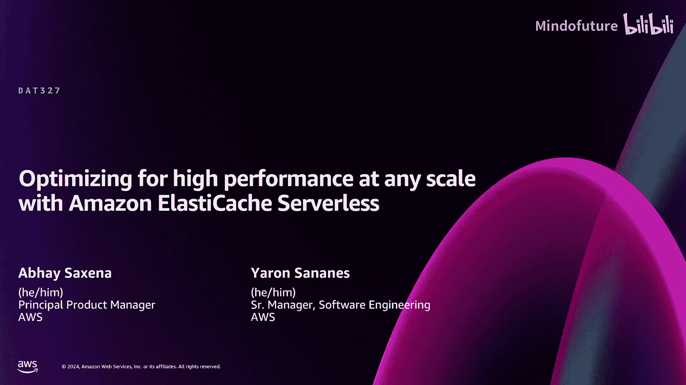
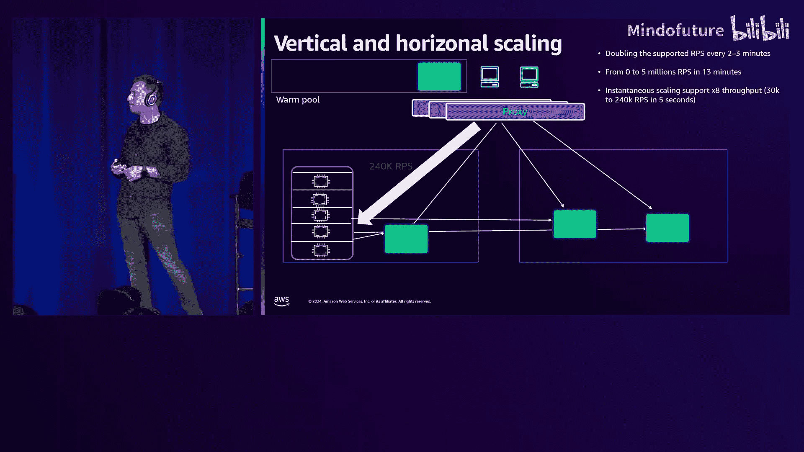
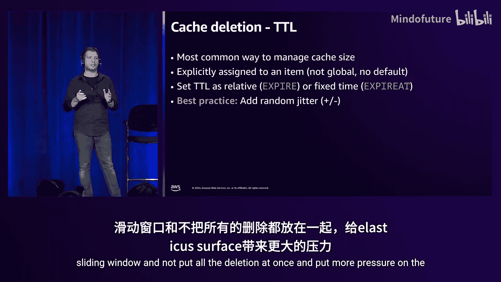
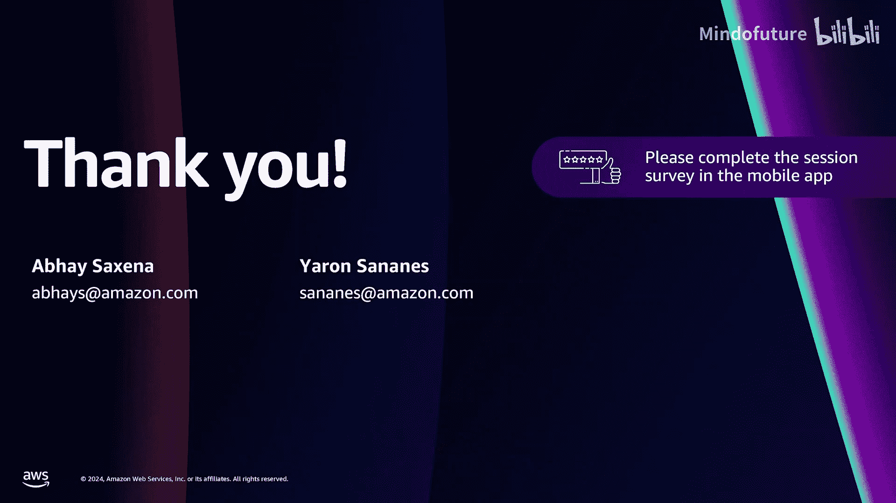

# 【AWS数据库峰会2024全集-•-中英】AWS-re：Invent-2024---Databases-p02-P02-Optimizing-for-high-performance-with-Amazon-ElastiCache-Serverless-(DAT327)--BV1VAR5Y6Es1_p2-

Cool welcome everyone， good morning， welcome to the ElasticA Sal in disco glad you can make it early in the morning and welcome to Reinvent thank you for coming we're going to be talking about ElasticA serverless we will talk about how you can implement caching in a serverless architecture and we will go into details about how we built ElasticA serverless and the improvements we've made over the last year just to give you a glimpse into how it all works under the hood so you can have a better understanding of how it works and how we can use it in your applications。

So let's first start with what is caching right in its most basic form you put something where you need it quickly because you don't have the time or the latency to go pick it up when you need it urgently so that's really basically what caching is you put something in a readily accessible place which can tolerate high frequency of usage and something that can offer really low latency of getting that data。

So you would ask why why cash right the most basic reason why you would cache is really to help reduce latency so here's you know your basic serverless architecture you have your client talking to an Amazon API gateway talking to some kind of compute in this case Lambda and then some kind of data storage。

 say DmodDB and you know there are multiple cases or multiple reasons why your application might be might be running slow right so for example。

 your database might be slow because you've got a really expensive query or you know it it's just overloaded under under a lot of traffic。

You can have network traffic。 Your network might be congested because and adding up to latencies。

 right， So there's， there's many reasons why your application can be running slow and a cache can help reduce that latency。

The other reason why you typically cache is when you have a read heavyav workload typically what you would do if you've got a lot of reads。

 your application is reading the same thing multiple times imagine know session data for example。

 a user is using your ecommerce-merce application and they're reloading the page multiple times you don't want to have to reload their session data like card data or login information etc multiple times from the database what you might do here is you might add multiple read replicas in your database but that can become expensive very very quickly and so instead what you could do is you could add a cache and you store that data in a cache because a cache can help you scale reads much faster as well as at a lower cost where you are not paying for read replicas in your database。

So let's jump into why you would cache right and or rather how you would cache。

 there are multiple things to think about when you're adding a cache in your serverless application so we will cover all of these topics here that you see on the screen so let's jump right in with caching strategies there are various caching strategies you can employ the most basic one or the fundamental one that most people start with is called cash aside or looka caching here essentially you know your compute system is reading from the cache and if you get the data from the cache great you serve up your application if you don't get that data from their cache because and it's called a cache miss you read that data from the database and then you write that data back into the cache and that's essentially look aside ca and think of it as a sidecar pattern right。

Its the benefits of this approach is it's simple right you don't really need to deploy any specific logic to your database。

 it's straightforward you can have your cache live in a separate separate location。

 separate system and it's very simple to deploy in an application your application logic changes somewhat straightforward right you can also control your cache size your computer layer controls what you put into the cache right so that way you know you can control how big your cache becomes。

There are some disadvantages to this approach， right your first read is almost always going to be slow because you're going to have to read from the database that data is not there is no hydration unless you implement specific logic to hydrate your cache right and implementing data consistency is difficult right because now you've got data stored in two different places you've got data in your database and you've got data in your cache and so you maintaining consistency between these two sources is is somewhat difficult and we will cover you know consistency strategies in a bit as well。

The other approach is what is called a right through cache right so here you essentially data is written to both the cache and the database at the same time。

 so the benefit is that you know your data is in the cache is almost never stale because you're writing to the cache and the database at the same time。

Right and so the consistency is somewhat better because you're writing at the same time and so when one is updated。

 say the database you're also creating the cache at the same time and generally there is a less likelihood of a cash miss in this scenario。

The disadvantages is of course， your rights are going be slower because now you're writing two systems right you're writing to a database and you're writing the cache and so whichever is the slowest of the two in most cases。

 the database but your rights are going to be slower and this also means somewhat often ignored that this can be extremely large because every piece of data written is being written to the database as well as to the cache right and so your cache can balloon because all of your data is now in the cache。

The other approach is called right behind caching。 This is somewhat of an improvement or an optimization on the write through caching approach where you write the data to the cache first and then you respond back to the application and then at a later time asynchronously you write that data to the database at some point so this way your rights are faster because your rights are no longer being waiting onto to data commits youre writing to the cache which is usually fast because you're writing to memory and then you respond back to the application so you have better write latency and you have it is very useful for applications that have higher write throughput because if you're writing very。

 very frequently you can just write to the cache and then asynchronously right to the database。

Now the downsides are somewhat obvious right it is complex to implement now you have some in your compute。

 you need to implement an asynchronous write strategy you need to have something which doesn't drop the rights so your drops rights are written to the cache and you need to make sure that it is written to the database at some point in the future and there is some risk of data loss because you're writing asynchronously data can be lost you're only writing to the cache and if for whatever reason your compute fails and you are not able to write it to the database your data could be could be lost and data inconsistency is also a possibility because now you're writing asynchronously that can lead to inconsistencies。

So let's talk about consistency， right， weve， we've spoken about how you can implement caching。

 These are the various basic versions of caching strategies。

Cash in validation or caching consistency， data consistency is hard， it's not an easy problem。

 it's not a solved problem there are trade offs that you will have to consider。

So let's go through them。 The most basic version of cache and validation and ensuring consistency is time based So you essentially when you when you are reading from the cache you you get what is a cache hit and then after some time your time to live on the cache data expires so you can set in most caches in a large cache servers for example。

 you can set a time to live on every piece of data and after that time the cache automatically evicts that piece of data and you would get what is a cache miss and when that happens you read from the database and then you write it in the cache right so that's just basic cache and validation based on time。

Simple to implement right most caches give this to you out of the box。

 you set a time to live on the piece of data and it will it will be evicted after some time automatically。

Although it can be complex to implement in terms of what is a reasonable TTL to choose right now you will have it is oftentimes more judgmentbased even though you can have some logic there right like imagine you've got session data of a user logged in now you can have some reasonable time to live on that right your sessions generally lasts say a few minutes so you can set a time to live off say an hour you don't want the user to log back in after an hour or something like that right so but deciding on the time to live depending on your application could be could be difficult and it is difficult to manage consistency between your database and the cache because the data is not going to be evicted until the time to live expires and so if something changes in the mean time in the database your data will be inconsistent until the cache data is evicted。

The other one is event based in validation here essentially you build a separate system for invalidating your data in this case as you can see on the screen we have a new compute Lambda layer which is which is reading dynamoDB streams to consume the changes in the data and when the data is changed this Lada will invalidate or update the cache data in the cache so you have a separate system which is doing this for you。

This essentially achieves faster consistency right it is still asynchronous consistency because your data is updated in the database。

 you get a event into your computer system which then updates the cache it's asynchronous but usually pretty fast right generally of the order of milliseconds maybe seconds but you achieve much faster data consistency than the time to live approach and this only evicts data when there are any changes in the underlying database。

However， this adds complexity to your implementation now you've got a separate system which is doing your cache in validation。

 you have to test the system， deploy the system so it adds some complexity to your application。

And it is generally when you add more systems to your architecture。

 you add complexity not just in terms of the code， but also in testing。

 making sure things work end to end， and it is especially difficult in an asynchronous system like this where you are depending on streams and asynchronous updates from the database。

The most complex version but also the most precise version in this presentation that we will cover is what is called version based in validation。

 If you haven't used this already the way this works is essentially you maintain a version of every key in your cache and this way anytime you're reading the key or reading data you make sure that you're reading the latest version of that key right and this way especially in a system which has highest with。

U systems trying to talk to your cache at the same time this gives you a much higher level of consistency right so essentially you get the version you read the data of that version and that's how you do reads right so you first get the read you read the version of the key and then you read that version of the key from the cache when there is a right essentially you first update the version of the key and then you essentially you're updating the version of the key so that the next read is going to read the latest version of the data so that way you have much faster consistency of data。

Now， as you can imagine， this is somewhat complexity implement right now you you need to implement this logic in your compute system most caches like elasticasticcache don't give you an outof the box support for versioning even though you can implement it yourself right so you can always set data you can set the version of the key inside the cache and maintain both the data as well as a versioning of the keys inside the cache but it does add complexity of implementation。

 but if your application cannot tolerate you know stale data and you need stronger consistency between the database and the cache。

 this is a great way to do it。So we covered caching strategies and we covered cache data and validation now let's talk about how to store data in the cache right so we will cover a few use cases and we will talk about how you can use elasticC serverless to store that data。

The basic version of most know most applications that start with caching would be session management。

 you want to store your user session data inside your cache so typically the way that would work is you would essentially have that data be stored in the cache in a hash data structure so elasticc server supports Val key and Redis OSsS we will talk about both of these engines in a bit。

 but we support Valki and Redis OSs which support advanced data structures like hash where essentially you can store multiple levels of data or multiple sub values。

 if you will inside inside that key so you have a key here。

 which is the session user one to3 and then you have multiple types of data stored in there so you have the autotroken and you have the login you have the preferences。

You could also store it in JSON format， Elastic Al server supports the JSON format which is a more structured format and this way it also storing it in JSON format gives you the ability to search through data easily and also support updating subparts of the JSON document so you can use either of these data structures to maintain your session data。

The other frequently used pattern in serverless architectures is rate limiting and it is not generally obvious that you could use a cache for rate limiting essentially the way this works is you you want to limit for example。

 access to a precious resource in this case Im showing a database it could be anything could be a service call which is expensive or anything which you want to limit access to or limit how frequently a user can access it right so you essentially simply maintain the data as a string in your cache and you increment the counter every time somebody accesses that resource and so if and as long as your request count is below that value in a given timeframe you can allow access and the way you you control the time limit is through a TTl you set a TTl on the value。

 let's say you want to limit to let's say 10 accesses in in a five secondcon period。Yeah。

 10 axises in a five second period， you set a TTL of five seconds and then you just know increment every time somebody accesses it。

And you know when that count exceeds your value in this case 10。

 you simply deny access right now in this case I've shown an access count of two imagine this whatever that value is that you want to limit access to and you simply deny access so rate limiting is generally important in serverless architectures where you want to make sure you preserve how many times somebody accesses a precious resource and you can do that easily using a serverless cache。

The other one is caching expensive computations typically if you are using let's say a relational database in this case I'm showing a query which is for example pulling product details from your inventory based on what's on discount and based on what has high reviews for your ecommerce-commerce application。

 let's say， as you can see this is doing multiple joins across multiple tables and this can get expensive very very quickly and it can take a lot of time on your database and also it can take up a lot of resources on your databases。

But as you can see， if a user is looking at the details of this product on your website and theyre refreshing the page or coming back and forth through it。

The data isn't going to change that frequently right so this is a great candidate for something to be cached and this is an expensive computation that you could cache in your cache right so essentially you store this data as a JSON document in this case。

 as you can see， we've essentially gotten all of the product details stored them as a JSON document and as you can say a TTL assume for example。

 that your product inventory doesn't change within5 seconds or 10 seconds or even a minute depending on your application。

 you set a TTL and that way you've dramatically reduced the load on your database by storing this expensive query result in in your database。

The other one is leaderboards and rankings right so you imagine you're building a gaming application。

 you want to store the data about your top users， you can store that in sorted sets if you're familiar with Val key and open source Redis。

 I'm sure you are familiar with these data structures but just wanted to cover the various data structures that are supported in ElC to store different formats of data。

So we covered some of these you know details about how to cache right so you've got caching strategies we covered the luaocyte pattern right through and so on so forth。

 how to invalidate data and maintain consistency and how do you store data right so that's generally the basics of caching now let's get into some of the infrastructure pieces of cache right so when people set up a cache you also need to think about how you set up an infrastructure for your cache and this is where a managed service like ElasticA serverless comes in we can help you do a lot of this automatically behind thes because that's what you're focused on。

So， sorry， theres some background don noise I don't know if everyone can hear it， but。

Let's talk about performance at scale we've invested a lot in achieving high performance with ElasticA serverless right there are we support multiAZ data replication and we support low latency read traffic when you do read from replicas right so we have intelligence built into the system where when your application is reading from elasticasticA serverless。

 we detect which variabilityil zone your request is coming in and we route that to the local AZ proxy node and make sure that you get local AZ read performance。

This also gives you we are able to scale from zero to 5 million requests per second and that 5 million requests per second is you know if we can scale from zero where your application has no reads to 5 million requests per second within minutes in under 13 minutes and we will talk about how we do that in a second your is going to cover how we can achieve how we achieved the speed we are able to double your request throughput every two minutes when we launched this last year we announced this at last year。

 we were able to double throughput once every 10 to 12 minutes and in the improvements we made since last year we can now double throughput every two minutes and we will talk into how how we achieved that in a second。

But really just heres you might have seen this you know in our documentation but this diagram sort of gives you a high level view of how things work under the hood and then your is going to go much more into the details but we've got a proxy layer here that is serving the requests for largeka serverless applications so your client application talks to a single endpoint and the requests are routed to the local AZ proxy nodes and behind the scenes we automatically control scaling for you。

 we scale both vertically to give you instantaneous burst capacity and we scale horizontally to give you more capacity over time that's the doubling capacity every two minutes that I was talking about earlier so this gives you know really high really fast performance and high throughput at scale so we can support really high scales really really quickly。

The proxy architecture has other benefits listed on the screen as you can see。

 because you're talking to a proxy layer， we abstract the underlying cache node topology and the changes to the topology from your application so your applications for example don't get disconnected from your cache anytime the topology changes because you are connected to the proxy node and the proxy has intelligence to maintain connections to the cache nodes very very quickly as they change So sources gives us the benefit to apply software patching automatically and transparently we can apply and update all the major all the minder and patch versions of the cache automatically transparently without any impact to your application。

The other important piecere youre deploying a cash is capacity management。

 when you're deploying a cash you need to think about how much cash capacity you will need。

 typically what you would have done for deploying a cash capacity is you would look at what your peaks look like over a certain period of time。

 say last six months one year and you would provision enough capacity for those peaks but what would happen when you exceed those peaks because you have new peaks is you would not have enough capacity or you would have to manually scale the cash at that time and you're paying for cash costs which are underutilized when you don't have those peaks。

But it's not just that capacity management is even harder than what it looks like at first blush because what you would have to do is you would have to look at what is your data size and as we discussed previously when we were talking about this depending on your caching strategy your cache size can be as big as the database or it could be a subset but deciding how big your cache can get is difficult without actually running your application。

 running tests or actually performing significant calculations to figure out what your cache size might look like。

 so deciding how much memory you need is not easy。Then deciding how many requests per second you might have on your cache or how much throughput you would have on your cache can result in different compute requirements so you might need a higher compute if you have really high throughput your command complexity can result in different amounts of compute capacity needed right so imagine we discussed the leaderboard example for example right and if you have an application that is constantly trying to find the top three say players from hundreds of thousands of players that is an expensive computation even though it is happening in memory it can take time and if you're doing that at high throughput that will require a lot of compute that's a compute intensive application。

Your payload size can result in different levels of network requirements。

 your connection requirements can result in different network requirements and so on and so forth。

 so deciding how much capacity you need on a cache is not straightforward。

 let's just spread it that way。And serverless essentially gets rid of all of that for you。

 So elasticasticca serverless is designed on the principles of no capacity management。

 We don't want you to have to think about capacity management at all。

 We essentially make sure that we scale behind the scenes as your application grows and we scale back down when appropriate internally。

 but it doesn't really matter when we scale in or scale back in the capacity because you pay for use So built on serverless principles。

 we wanted to make sure that elasticca serverless offers true pay for use pricing So you always pay for memory so any data that is stored in memory。

 you pay for that and any requests you execute on your cash you pay for those requests and that's it。

 So when you're not executing any requests， you don't pay for any compute。

So we've covered a lot at a high level of you know how serverless can help you achieve some of the basics of you know deploying a cache and weve covered how you can achieve caching in applications。

 let's now go deeper into how serverless works hopefully this will give you a glimpse into how things work under the hood and help you understand how you can utilize serverless elastic cash better for your applications going to hand it over to your run Thanks。

Thank you very much， Abbe， hello， everyone。 Thank you for joining us today。

I's really great to be here for me，'m super excited to talk about serverless every time and the reason is because my team built actually the technology beyond this great product。

😊，So I want to dive deep today to tell you how we solve all the challenges， so let's start。

Let's start from the high level architecture and then I'm going to dive deep into each of the components that I'm going to speak with。

First， your application is running on your VPC and connected to the service VPC is go through the endpoint that we provide you。

Which the you go through first through the node balancer that balance the connection across the proxy fleet。

 I'm going to speak about the proxy a bit more in the next few slides。

And then the proxy responsible to route the request to the correct charts。

 so its actually encapsulate all the connectivity from your point of view。

 but it's much more smarter than that， the proxy used multiplexing connection。

 so we actually have a single channel TCP channel。That can send multiple different client connections。

 so every time that we operate network batchge， we can use less system calls so this is first improve the performance and eventually it help us to maintain less connections to the storage nodes。

Besidesside of the draft， as you can see， our architecture is spread across multiple As。

 so one if we support high availability， of course。

 if one of the AZ is fair and you still have access to your data store。

And we can promise you microsecond response time because we use the route 53 to locate the same raw proxy that is on the same AZ that your application is running。

So you might be surprised by behind the serverless there are a lot of servers that run in and our job is to manage them properly and to scale them every time that you need the serverless to grow the workloads。

So let's start from the cash nodes， the cash notess running on a multi tenants environment。

And they'll share resources like CPUU， memory and networking。

 and our job is to monitor every time to make sure that you have enough capacity。

 enough resources to run your workloads。So let's zoom a bit more and see we have here the client application。

 we have the proxy and we have only for this example only two physical host that run in in a shell the multitenous environment cash nodes so as you can see we have different number of cash nodes of every physical host and the reason is that because every cash node can process different amount of usage。

Now， as I mentioned before， we are responsible to monitor very closely the hardware utilization on each of the physical hosts to make sure that you have enough capacity。

 so in this example we see that we bridge to some network and CPU and memory and CPU utilization and we need to start move things around to make sure that you have enough capacity。

So we have multiple different options to do， the first one called heat management。

The purpose of heat management is to run across the entire fleet of the physical host and to categorize them for which which of them we consider the hot and which of them are called。

 and then we can decide which of the cash nodes needs to be moved to the outer physical host。

 So in this example。You can see that one of the physical hosts reached to some threshold and the heat management located that and now we start to perform the algorithm that we use the power of the two random choices。

 so we always move the second hottest node not the first one。

 the reason that we don't move the first one。Is because the first one probably is going under very heavy load and it's probably going through scale out and we don't want to interrupt them。

 but we still need to find cash note that once we move to a different physical host it will release enough resources。

So once we move them to a different physical host， we start to relieve some pressure from the original physical host and this way we keep our fleet balance and make sure that you have enough resources to run your workloads。

But in some of the cases there are burst of workloads that kicks in， for example。

 on live events or unexpected burst of workloads and pickups and youre expecting from us to have the ability to digest and to process these spiky workloads very effectively and as Ay mentioned。

 we invest a lot this year to make our servers even much more faster than it was when we launch it。

So， let's dive in。So we are using the platform technology that does not have fixed memory O CPUU footprint and allow us to scale up and down very quickly and easily。

This technology deliver a very good performance without compromising only the cost because we are using the oversubscription techniques。

So it actually allow us to instantly grow and shrink our compute in place。

 it provides us the extra memory， CPU and network bandwidth。When we need to rescale and reshaarded。

So the ability for us to do that allow us to make sure that we can have instantly scaling our support by a time so we can jump for 30K for example。

 to 230K RPPS equal per second in just5 seconds， so when a workloads kicks in。

 we can have the ability to digest it very quickly。Now， this that was the vertical scaling。

 Let's talk about the horizontal scaling。 The horizontal scalingleline had three main stages。

The first one is detection。 and as I mentioned before。

 we are constantly monitoring the cash node and the physical loads。

 making sure that you have enough resources for you to run your workloads but not only that we also have the ability to project the future demanding by monitoring the usage pattern and we use it to predict the usage that's going to happen in the few next communities so we can actually scale the cluster ahead of time and once the workloads kicks in。

 we already have the capacity to digest the workload。

The second phase called provisioning and we we can provision a new node that and attach it to the cluster within a minute。

 and the way we do that， we are using the warm pulling techniques。

The one pull techniques is we have a list of cash node preinstalled on standby mode ready to be attached to existing cluster。

 so for example， if we reach to some CPU threshold。

 we can dynamically and very quickly add the cache node to the existing cluster。

 attach them and then they can be part of the cluster very quickly。

Now we reached to the last phase of the scaling， the last phase called data rebalancing。

 It's the fact that we need not to move the data to the new shard that was attached to the cluster。

So the way that the data store on elastic cash is divided by slots。

 each of the slots present a range of data。So we start to move the data from the original slot。

 from the original sh to the new sh， and the way that we do that is because we monitor the usage pair slot level so we can determine which of the slot consider more odd than the others。

 and then we can balance the cluster itself。So this year we also introduced the ability to move multiple different slots。

Rch of data in parallel to multiple different targets so we can actually double the support of express per second every two between the two to three minutes。

 which is amazing result。Now we want to talk about connectivity。

 So we decided to build a single logical entry point to the elastic case serverless product。

 And for that， we built a proxy。And the proxy enable us to to abstract any changes in the underlying cluster topology so anything related to scaling。

 failing， patching， disconnection， everything is hidden from the client itself。The proxy。

 take care of all of that， the main job of the proxy is to w the request to the correct chart。

And the way you do that， you constantly monitor the cluster topology。

 it has kind of the distributed topology table and make sure that the topology table is already up to date。

 so we are removing the responsibility for managing that from the client side。

 we take care of all that。So the proxy with all this technology allow us to support huge scale of hundreds of connection behind the scene while we require for the client to manage only a single connection and with all of that it can also benefit a huge scale of throughput。

 as Aby mentioned before we can jump from 0 to5 million requests per second in 30 minutes。Now。

 if your application is a latency sensitive and has no strong consistency requirement。

 you can get a microsecond response time when you are using elastic servers。

Elastica servers have two replicas built in the system。

 you don't need to configure that it's coming in with the product itself。

 but it's done mainly for high availability。But it also can increase your read reportss and achieve the microsecond response time how we do that。

 the proxy provides a single entry point to the replica itself。

 and we always promise you to read from the localizing。

If you define your channel to work with Readform replica， the proxy。

 no matter what if the repricica is busy or the primary is busy it always it will look for the closestt node in the same easy to read the data so you can achieve the microses response type。

 you don't need to do anything on the configuration of the server side。

 you just need to configure the channel the TCP connection that you establish to the elastic serverless to work with read from replica option。

Let's see how you do it。In this simple code of example。

 you see that I'm connecting to the serverless。 I'm using only single connection while behind the scenes。

 I might have multiple different connections。😊，I'm using TlS because TlS is the default and this is the only option to work with serverless。

And I'm also toggling on the readform replica so in that channel that I'm just established to the cluster。

 the proxy will promise me to read the data always from the local A if there is an option for that。

Now you can see have here three blocks， very simple blocks of code。

 The first one is just populating the data into the cache in a follow loop。

The second and the third one is reading the data from the cache。The first one is in full loop。

 The second one is a batch using a pipeline。What's happening behind the scene is that all these requests go through the proxy。

 or proxy spread the request across the shelvess， making sure that if there is any fail。

 any connection， any scaling happening in parallel， he promise us for seamless experience。

 but not only that he also promise us to read the data from the local lazy。

And as you can see the code is very simple， we don't need to deal with any of that。

 the code is simple， everything is offloaded to the proxy itself and we can keep our business logic only on the client side。

Now， I want to talk about the cash node itself and to dive deep about the technology we invest in that area。

 But for that， I want first to introduce Valki。This year。

 Amazon Elastic C and Meory DB announced the support of the third open source engine called Valky。

Balkey is high performance， key value data store。And it's a community replacement for Eds。

It's built by the existing Redis Open source contributors and it drop in a replacement for Reddis Open source 7。

2。Hes hosted by the Linux Foundation， which promised that Valki will stay open source forever。

So let's see the let's go through the history first。

 Valki and Redis open salt started as a single threadded architecture。 What does it mean。

 Very simple。We are waiting for the command。Once the command received。

 we were reading the data from the network。Then we process the command itself。

 need what we are doing whatever the commander request us for do and then we send back the response that's it and this is the event look very simple and why design like that the main visit is the simplicity。

 there is no race conditions， no synchronization needed you can benefit from share nothing architecture when you scale out and of course you improve the cache coherrency。

But with this technology， you can achieve around 200 k request per seconds and most of the time we're going to spend on the IO on red and white。

Let's visualize it。 What's happening in the reality。

 So this is the maind is working at processing data and then we add in more clients to digest the data so every time I'm adding in more and more clients they are staying in the queue because they are waiting for the slowest command to be processed this is a single threaded architecture and eventually what's happening here is that we face the head ofline blocking problem that we are waiting for the slowest client process to be completed。

Laterter。The IO threadreads were introduced and the job of the IOT threads is to offload the IO to different threads。

So it's improved the IO processing time because it's offload the IO process time。

 but this technology still does not allow us to dynamically add and remove IO threadreads according to the workload itself。

😊，So with this technology we were able to reach to around 400 k request of seconds and this time most of the time that we're going to it will be on the process command。

And of course， the reason is because the IO already offloaded to different threads and now we are most of the time going to wait or the process command itself。

 There are other problems in this architecture。 You see the weight in the diagramma。

 the weight means that every time that we are offloading the IO。

 the main thread is kind idle and just waiting for them to finish。

So we have actually extra time that we can spend and improve the performance。So this year。

 AWS contributed the new trading architecture forvaki to unlock the 1 million requests per seconds。

For single instance， this is amazing contribution and we do that by three major aspects。

 the first one is the acidronous aot trading that enable parallel processing of command。

In eye operation， the second one is intelligent course utilization that distribute the IotT。

Across multiple core based on the real time usage and the last one is the command batch that optimized the memory access pattern by prefeing access data to minimize the CPU cachems。

So the way it works， we have now the that spawned ireads according to the workloads and you can add and remove them as he needed。

 he also is to make sure there is no synchronization issue because it will constantly keep the affinity between the client's connection and the i threadread itself and it will make sure that each of the out have enough workloads to digest so we can utilize perfectly the hardware。

And with that， we can achieve the one minute request per seconds。

So let's visualize that we have the main threadread now and the iotT thread that digesting more and more data that kicks in and eventually we can do all of that in parallel。

 we can also remove some of the i threadreads once the workloads is become more relaxed。😊。

So let's see how everything is now playing together with this technology with the C technology and with the Valky and Iotrates technology that I mentioned。

So we have the proxy， we have the clients。 we have the wpo in rating。

 we have the physical load and just for this example。

 I'm spotting in about only a single cache node that have only CPU attached means that we have only two i threadreads to digest the steady state workloads。

 Let's assume that we are running 30k of workloads and at some point we have some viral live event or some unexpected workloads that come in and we jump for 230k liquid per second。

 So immediately what we do we scale up the cash node， we add more CPUs assigned to this cash node。

 including the memory that these cash node is consuming on the multitalent environment we add in more iio thread to digest the workload so we can jump for by a time in only5 seconds right after that were going to。

As from the Wpool， please assign more physical o to the cluster so we can attach them very quickly and start the scale out process。

At that moment the proxy will identify them and they will be attached to the cluster。

 all the data rebalancing will be woke and move the data concurrently between the shs so we have more resources to digest the workload so eventually we do this technology we can double the supported LPS every between to two。

 three minutes we can jump from zero to five request per seconds in 30 minutes and we can support scanning of eight time throughput in just five seconds。

Then I want to show you a very cool and short demo。

We started with a steady state of 250 request per second running and we slowly add in more and more clients and more connections。

 so you will see the growth of the transaction per second， diagram diagram， how we can very easily。

 quickly digest more and more workloads。As you can see， the P50 latency is a bit jumpy。

 but we still stand behind less than the milliseconds latency P50 latency。

 we are still on the microseconds level。And on the P99 we see some jump to 3 milliseconds because every time that we add in more moreloads until the system will get to some saturation level。

 and what is nice in that is we are still keeping the read the latency on the microseconds and you see how we can jump on the until we reach to the 3 million transactions per second。

Just before we finish， I want to give you a few good best practices how to benefit more from your elastic server。

The first one we always recommend to use a long live connection for the best performance。

 it's very important to know that creating TCP connection is computationalally expensive operation compared to any typical bulkky commands。

 for example， end simple get and set command is an order of magnitude faster when we are using existing connection。

We also talked about Readformm replica if you want to scale your grid report and you want to achieve the microsecond response time。

 you need to use readform replica， you also should avoid from using expensive command like that scanned the entire engine so it will not be busy and of course to limit your large object because it can affect the network exceeded and the CPU cycles to process them。

And if you are using a serverless elastic server for the cache in it's very common to use time to leave to manage your cache size of course when you define the time to leave it's per item and not globally。

 we also recommend to use all the relative option or the fixed option for deletion them but the most important is to use the random j so you can spread the deletion across multiple different sliding window and not put all the deletion at once and put more pressure on the elasticica servers。

That's it， I hope you enjoyed session， we'll get back to Aey。Thanks Iran。

 hopefully you found that interesting and learned some interesting new ways on how we' are using the multi threaded architecture to scale faster Thank you for coming and thanks for taking the time I encourage you to please take the survey in your in your agreementment apps that helps us get feedback about us as speakers about the content and give you better presentations over time so please please take that survey we are a little early so we will hang out outside and if you guys have any questions happy to answer them so yeah feel free to catch us outside and happy to answer those questions but thank you so much for taking the time and welcome。

