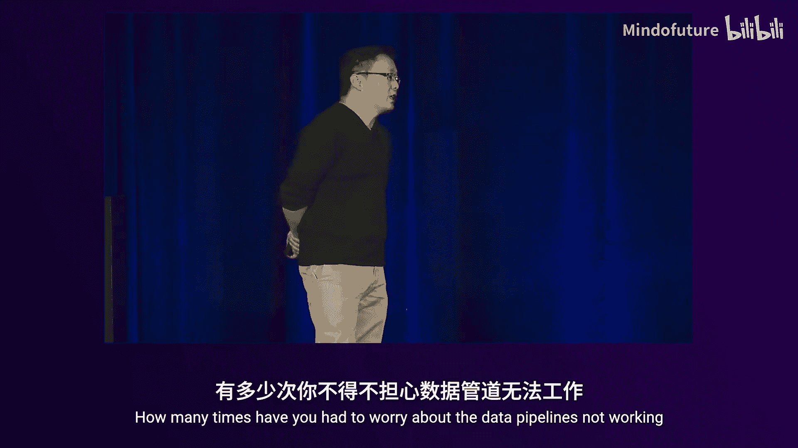
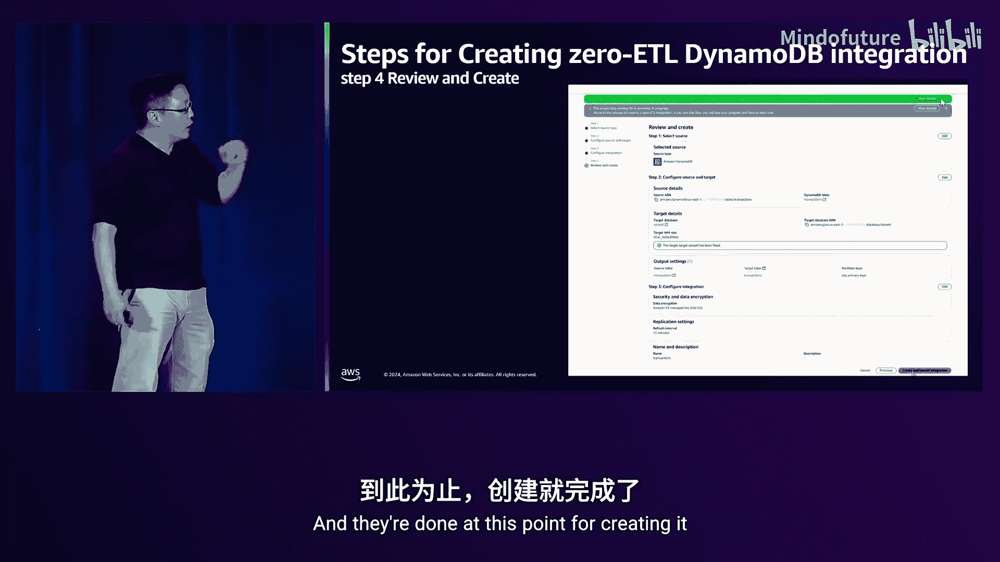
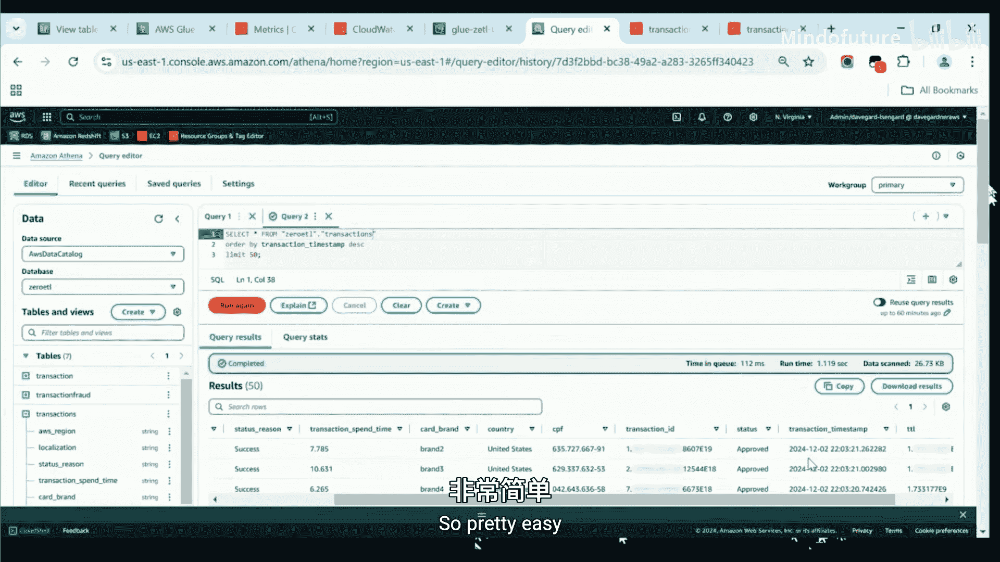
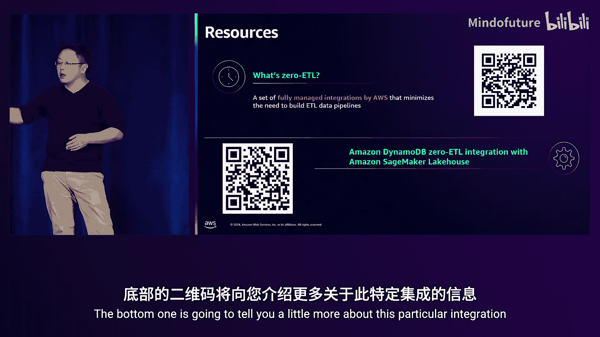
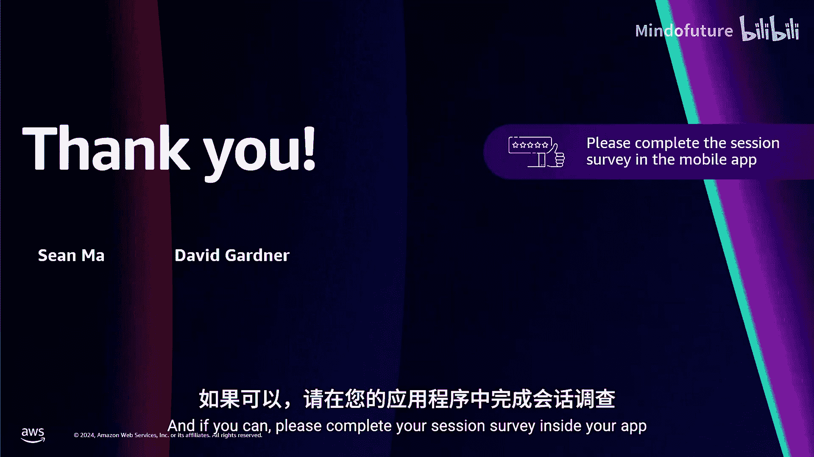

# 【AWS数据库峰会2024全集-•-中英】AWS-re：Invent-2024---Databases-p03-P03-Deep-dive-into-Amazon-DynamoDB-zero-ETL-integrations-(DAT348)--BV1VAR5Y6Es1_p3-

Hi everyone， welcome to DATT 348， where we'll be talking about。

Dnamo DB0 ETL integrations My name is Sean Ma， principalncip product manager with AWS Glu where I focus on zero ETL。

 I have the pleasure to be joined with David Gardner， Pri solution architect with the databases team。

So before we get started， I want to make sure you guys are in the right place。

I have a question for folks love to see our guys hands for this。

 Who here is a data engineer architect who's responsible for building ETL data movement pipelines for the organization。

 right， show your hands here。 Okay， good， now let's ask the more fun one。

 How many times have you have to worry about the data pipelines not working or getting a phone call in the middle of night yep right？

It's kind of a problem at this point right And and last question for everyone here。

 how many of you need to for your businesses， bring together multiple data sources into a single place so that you can support your business initiatives。

 How you go on that。 Everybody here。 Great， you guys are in the right place because that's what we're going to talk about。

Here's what we'll cover0 ETL overall。 This is something that DynawoodDB we've had for several several years now。

 but we're adding on to it so we'll quickly go over so what you can do with 0 ETL then we'll talk a little bit more about the capabilities that will be available David here will go into a bit more detail about the architecture and some of the examples on that of course we have several new launches that came out recently for zero ETL on DymoDB so we'll also talk about that。

 we'll have a demo at the end and then we'll we'll wrap it up and if we have time well take some questions on the side。

Okay， so let's get started。Okay， what are we seeing more and more from our customers Well more enterprises want to become data drivenri for a wide range of use cases。

 whether it's personalization， whether it's marketing optimization， Internet of things。

 there's a whole range of scenarios that you need data in order to be more effective you need to transform that data for your business so that they can gain insights from that data faster。

😡，Now the challenge is that is that in particular with the advent of generated AI。

 that data isn't something that you can rely on from just one place。

 oftentimes you need to bring it together from multiple sources， multiple places。

 bring it together into a centralized locations so you can do model development where you can train your models。

 you can do analytics across a wide range， you can do additional transformations on that need。😡。

On top of that， as data becomes more and more frequent and constantly changing。

 you want to make sure that you have the latest and greatest version of that data so you can make up to date recommendations。

 up to date analytics in that regard。😡，So what do you do， Well， normally， the next step is。

 of course， to build your own ET pipeline right And this is probably what many of you guys said。

 actually， you guys did just say that in the poll right， you're building your pipeline。

 So this should look pretty familiar from you。 You're using Amazon Dyna D today in particular with which is heavily used by so many customers in operational basis。

 You're often saying， well， what's my first step。 Okay that's going be ingesting the data from that system。

 then applying business application logic to it， performing some additional transformations。

 making sure that it's handling errors。Once that's done。

 then you have a pipeline that you're going to deploy。

 you're gonna to schedule going to maintain that。 So great， This is actually what you need to do。

 It gets your job done。 And something that you're gonna to have to maintain。 the challenge， though。

 is that this is often requires a specific skill set。

 specific skill set and people and specialized team that actually understand this。

 So that way you can generate the results that you need and your business goes from there。😊。

And to be clear， and to be clear， there are many times that this is the right thing to do。

 especially if you're dealing with something more complex。

 where you need that custom business logic or you need something a bit more difficult in terms of processing。

 This is probably the right pattern that you want to do and you want to have full control in it。

That said。What we find when we talk to our customers is that a large percentage of time。

 like 25% of time or more， all you're really doing is just ingesting the data and moving it to a destination。

 or other times you're just replicating the data， making sure that it shows shows up in a data warehouse or a data lake so that other people can leverage it。

 you're really not doing all those many advanced transformations。😡，Also。

 for some of those other use cases that we talk about。

 what you're finding is that the day to day operation and maintenance of it can be can be too high given given what you're trying to accomplish。

 right， it's not something that you need you need a large number of people to constantly monitor and maintain。

 You really just want something simple， set it and forget it so that you can move forward with your day to day。

Which is why AWS has been investing in a zero ETL future right This started actually at reinvent 2022 when we launched our first zero ETL capabilities between Aurora and Redshift over last year or 2023 and 2024。

 we've launched many more， including dynamo Db to open search is one of our0 ETL capabilities more recently in October。

 we launched dynamo Db to Redshift data warehouse。 so this is something we've been expanding on it for folks who are not familiar with this0 ETl is a set of fully managed data pipelines managed by AWS So that it minimizes the need for you to build ETL pipelines or common use cases like data ingestion and data replication。

 So if your goal is to get data from dynamo Db and have a replicated single copy of that result with all the updates constantly in there0 ETL。

 may be a very good option for you。😊，Now， one thing to note about all this is that the whole goal of zero ETL is to bring together transactional data。

 operational data， and also application data， something else that zero ETL also has into a single place so you can perform analytics。

 machine learning much easier and faster。😡，And what do I mean by that is that not only can you support various AWS data sources like DV and others I mentioned Aurora RDS and now applications like Salesforce and SAP and ServiceNow。

 but it also supports our new data lake， the SageMaker Lakehouse。

 so that's yet another option for you to centralize all your data。The benefits of zero ETL。

 they are key three key things that we want to talk about today。 Number one is increase agility。

 What do I mean by that， because we are building the ETL pipelines for you。

 So AWS is building the ETL pipelines for you， maintaining that and making sure it's kept up to date。

 Your teams are more free to actually perform the necessary business transformations。

 looking at some of the newer projects that are available out there。

 you can basically try out different combinations now that you don't have to worry about getting that data into your system。

In terms of efficiency， this is obviously cloudbased， it's only pay as you go。

 so you only have to worry about the cost of the data that's coming in and the data that you're writing into your destination。

 you don't have to worry about scale all that's healonely covers because it scales out serverlesslessly and it's obviously running in the cloud。

😡，Last part of this is that data is delivered into the destination that is centralized and more importantly centrally governed。

 simply secure so that any of your AWS services then that can integrate with Redshiftft or with the Lake house with open searcharch。

 they can leverage it almost immediately so it's much easier to get access to that data。

With that said， this is just a quick intro of what that is。 I'm going to hand over to David。

 who's gonna kind of walk a little bit further into the0 ET architecture and show a little bit more。

 right， thanks Sean And thank you all for being here today。 by the architecture a little bit。

 So dynamo dynamo Ds been around for a long time。 But just to make sure everybody is aware of what it is So dynamo Db is our managed nosQL service from AWs。

 it performs at any scale。 it is serverless it's already has security and resiliency built in that you put on top and you're always on the latest version。

 So and it scales all the way up from a few transactions per second all the way up to the last prime day with Amazon dynamo Db was running 14 6 million transactions per second just to support Amazon co that's with everybody else using it。

 So real quick。 a lot of customers do use dynamo Db for their operational databases for that key value lookup single digit millisecond type of response time for a gi or put。

😊，So a lot of customers use that for like managing session state。

 as well as all different types of operational database use cases that DynamoDB supports。

Next we'll talk about Redshift so Redshift is our fully managed AI cloud data warehouse and so it setss your data。

 your transactional data， clickStream， IoT telemetry。

 all your different data sets that you may want to bring into a common warehouse and be able to query across all those data sets to find key insights and that's really what Redshift is about is to enable taking all that data from all over the place。

 bringing it into one centrally located SQLbased tool and be able to pull those insights out of it so data sharing it's got a familiar SQL interface so it's kind of self-learning selftuning it can handle high concurrency with all that data and also literally scales as your data scales and there are serverless options for Redshift as well。

So this really kind of gets into each technology and having its own purpose right so we talked about that NMODB。

 that's really the operational side of your organization or your applications right so this is your frontend apps。

 maybe it's your e-commerce website maybe it's your gaming interface that you've got for users and the business wants to be able to analyze how well are we doing either whether it's selling widgets or games who's playing what game right so you want to be able to generate insights out of that operational data that you've got。

And we to use the right technology for the right purpose。

 right So one of the architectural approaches that addresses。

 and I know there's a lot on this slide right so just bear with me for a little bit there is an architectural approach called command query response。

 segregation or cores。 And so what this does the classic problem is I got my operational database but I want to be able to do reporting an analytics on top of that。

 So what this architecture does is it decouples those into separate streams so that know somebody running an analytic query doesn't impact my operational database system which nobody likes that right So everybody wants the operational stuff to go quickly And so that's what this architecture is going to do for us right we separated the operational side。

 So your API whether it's API gateway or your operational front end it's gonna to be reliable downstream delivery of data from dynamo Db。

 And in this case， we've got dynamo Db streams which is a near realtime feed coming out of dynamo into one of those other target systems from。

Analytical purposes， right so Sean mentioned open searcharch right So open searcharch uses that dynamo Db streams to push that data down in there。

 Other repositories like S3 have more of an analytical use case。

 And I really don't need that near real time within seconds type of update to it。

 I can live with a lower cost option more of like maybe a 15 minute batch right And so we're gonna leverage that under the covers for you to keep cost low as well as be able to deliver the data at the velocity that you need the data on the analytical side。

 So we will kind of leverage each one。 So but that's like I said， there's a lot on one slide。

 but that is the approach that we kind of generally talk with customers about And one of the common discussions that I have with customers on dynamo Db is that there's no joints here。

 how do I do that right or if I want to be able to search by anything any place。

 that is really where this type of architectural approach where we separate that into two separate purpose built services and applications。

Right， so we talked about the dynamo Db data replication pipeline， right。

 So the big red box in the middle is the undifferentiated work that。

 you know as data engineers you all have done right even myself right So back in the days batch batch ETL processes running overnight something breaks。

 somebody put it in a new column You're gonna get paged have to get up and go fix that ETl process of the reports are available in the next morning right So that's really undifferentiated heavy lifting。

 and that's really what the zero ETl features and functionality that we're adding in as AWS are going to try and deliver right So I'm walking get into all the details of the moving parts here。

 but we've got dynamo Db streams， S3 Lada and then getting it to your analytical target in this case。

 It's redshift could be other analytical use cases that you've got here。Right。

 so here comes the magic of the zero EL offering right so it's simple to set up。

 simple to manage and enables powerful analytics。 And that's really what we're going after to make yall's lives easier so that instead of worrying about that ETL pipeline。

 you can focus on more business value added functions to your consumers and your business applications。

 And that's really the key of zero ETls kind of take that undifferentiated heavy lifting and turn it into a black box right So I like to use the pancakes for breakfast analogy right So in this case we're going we're gonna to make the pancakes for you。

 you just say how many pancakes you want。 and we're going deliver them up right so makes it a lot easier for you。

😊，So in this case， we've got a fast end replication from dynamod DB to Redshift that typically completes within 15 to 30 minutes and for most analytical use cases that that velocity of data getting there in a few minutes works for those use cases in terms of scale Sean mentioned this is all serverless on the backend。

 so it's going to work with your dynamo DB table and based on the velocity of changes that you've got coming in there will scale the pipelines up as needed to be able to support that。

flexibility。 And so you can ingest from multiple dynamo D tables into a single redshift cluster。

 right， So again， this is one of those things where customers might have multiple dynamo DB tables。

 There's no joins in dynamo D。 So hey， I can use 0 E TL， push that over to redshift。

 and I can join to my heart's content， right， so that enables that functionality there。Alright。

 so let's do a walkthrough of the console of how you would set up one of these pipelines， right。

 So just a quick show of hands。 How many folks are using Redshift today。Good， about half。 Alright。

 So let's kind of walk through how you would enable this， right。

 So this has been G A for about a month now。 So we're gonna first start in our Dynamo D console。😊。

We've got the integration you drop down in the menu there。 that's new。

 So we'll click there first and we're going to create an integration and you'll see there in the dropdown we've got Redshift and open search right so Redshift is going to be for analytical use cases。

 open searcharch maybe I have a need for search capabilities。

 one example that I've got one of the car rentalal companies that I work with。

 they want to be able to search for show me all the Teslas that are available and Frankfurt。

 Germany today， maybe color red right so a search function like that will be well suited for open search right Dynamo DB is a key value lookup It's not going to be able to give that kind of search capabilities like open searcharch can and so using this functionality gives you that capability and the same thing for Redshift right I want to be able to analyze how many I with a Car rentalal example right how many cars that are rent in Frankfurt last month at this price I'll be able to look that up fairly quickly and easily in redshift that's not dynamos forte right。

Alright， so next step， we're gonna select our source。 So in this case， we got dynamo D B。

 So We're gonna to browse dyna mood DB table list。 We're going to pick one of those out。

And when we do this， this little handy little window pops up that says， hey。

 you don't have the right IamM policy。 Now， I know everybody here loves writing Json with our squiggly brackets and our comms in the wrong place in the square brackets。

 right， This is gonna do that for you。 right So this is a fantastic feature that the service team put in as part of this process。

 So we're gonna click the little button here says fix it for me now， right。

 So great feature makes it super easy for all of us to be able to do that。

 So we're going to click the fix it for me now， Pick our dynamo Db table。 Click the next button。😊。

And now we can see our0 ETL integration details， right So you can see your general settings and we're going to create the database from ingestion and be able to get that up and running very quickly and easy right So if you think about all the pieces that you have to pull together yourself to be able to do this。

 write the Lada function， drop it into a temporary S3 bucket you know。

 pull it out of9Mmo Db streams right So all that's kind of magically done for you here。

 So then we're gonna to select our target。 And this is where we pick our redshift data warehouse。

 we can use one of the things like to call out here because a lot of customers have an operational AWs account。

 And they've got an analytical account。 And so this out of the box has select different account。

 and I can support moving the data from one AWs account to another without having to do all that work myself right so this certainly makes it a lot easier for us to be able to consume that analytical data。

😊，Alright， so now let's talk a little bit about the data itself， right So dynamo Db has a。

 it's more of a container。 When you talk about the table， it has。

 you know a primary partition key And then it has its a nosQL solution， right。

 so I can add in columns。 not every row might have the same attributes。

 So it's definitely different on the redshift side， it has a similar table。

 but it is a column data warehouse right So a completely different orientation of how we store the data that's there right And so in dynamo Db called them items with attributes in a redshift。

 it's a table with columns， right。So kind of breaking that down a little bit further。

 we've got partitions and sorts， sort keys。 And as part of the zero EL process。

 we're going to carry those over between dynamo DB and Redshift。

The other attributes that are in your Dynamo DB table。

 we're going to bring those over to Redshift as a super data type and so that's basically just a nested JSsonN you know kind of a character large object kind of set up and so basically it' will have it in that super data type there for you in terms of all the attributes because those attributes。

 as I mentioned， may change between different items a rows in our Dynamo DB table。

So that gives you the functionality there。 So in terms of best practices and considerations。

 the fix it forming now wizard， right is great。 So you don't have to worry about writing those IM policies。

 I know we all love to do that。 And it does that for you。 And so， and then also。

 cross account is ready to go。😊，All right， two more hand over to Sean for the announcement。Thank you。

What you just heard about was what's been available with IMODB for a couple months at this point towards Redshift on Tuesday。

 you guys probably have heard many announcements coming from Matt among them was first of all Amazon StageMaker。

 our new our new next generation of the Amazon StageMake platform bringing together several of your favorite services into a unified experience in this case showing the studio。

 but what we're I'm also going to talk about here is actually，In this case， the Lakehouse。

 because this is a new destination for your data and the key thing about this is the combination of zero ETL and the Lakehouse now means that you can unify your data across data warehouses。

 data lakes， operational databases like DOODB， and applications into one point。

Why do we talk about this is that the goal is to make sure that the lakehouse itself is open。

 interoperable and secure， and there are several benefits that come along with this。So first of all。

Now， it means when you store your data， it's a single copy of that data that has the benefits of Redshift managed storage and the scale of S 3。

 So you have it one place。 You have one place where you can get where that's data is being stored。

 The second part of this is that it's being governed essentially through lake formation and through catalog。

 the is being catalog through data catalog。 So that's accessible。

 easy to easy to define the security policies， as well as make it available to multiple services。

 The last part is in terms of how you access it。 So obviously。

 we're gonna be talking more about0 O T。 So that brings in the data in。

 But the lakehouse itself is accessible through a standard iceberg API interface。

 So that means any services that can understand iceberg will'll be able to then access the data that's being stored into here。

😊，Okay， so with that， if you combine kind of the zero E TL concepts that we've been talking about。

 Dino Web D B's ability to get that data out of this。

What we also launched on Tuesday was this new capability adding0 E T L for the lakehouse。 sorry。

 adding 0 EL from Dynamo Db with the SageMaker Lakehouse。 right again。

 the whole goal of this is to simplify your data replication and ingestion needs so that you can make your data available without impacting production workloads。

 So all this can be done constantly getting updates， making sure that a single copy of data。

 gets the inserts， get the updates， get the deletes all one place without impacting what's happening there。

 The goal is to reduce that day today operational burden for this use case。😊，So now that said。

 let's talk about， I'm going to walk you through some of the changes。

 some of the improvements that we've made as a result of this new launch。

 and then David's going to show you an actual demo of this scenario。

The first thing we want to show is that0 ETL is expanding。

 You can see here not only do you see Amazon Dynnawood D in the beginning。

 but we've also added applications。 I mentioned that that was also another launch that we talked about for0 ETL。

 Let's focus on Amazon Dynnawood DV in this case。The next part is we've carried over that customer favorite feature for fix it for me。

 making sure that's available， the difference is that now instead of you just selecting in selecting just a reshift data warehouse。

 now you can select the lakehouse as your destination。

 So what that means is that you're selecting a catalog that you're selecting a catalog within the lake house as your destination and once again。

 fix it for me will figure out what are your IM policies permissions that you need to apply and it says if it detects that there's a mismatch。

 something that's not not configured correctly， you can apply those changes。Another change。

 another enhancement that you're going to see with in particular。

 for the Lake House's destination are new output settings。

So just and what do I mean by the new output settings？Now。

 you can perform some various limited transformations on what that data is。

 David had mentioned that the data before was going to be nested Json。

 and it's gonna be key value pairs that associated with that。 Now。

 you have the choice of specifying how much un nesting you want， Do you want to just at a top level。

 Do you want to go further than that。 Do you want to go Do you want to un nestest all the data associated with it。

 So that is stored in your lake house in a manner that you can access it easily through rows and columns。

 What do I mean。Take a look at this image。😡，Can anyone see what the differences are。

 something David just covered。It's pretty subtle， but also very important。

The difference is going to be we don't need we don't have a supertype available in the lakehouse。

 right， It's being stored。 It's being stored。 It's a data lake。 so it doesn't have available。

 doesn't have that supertype availability， which means this is why it'll be more common that you're going to want to unnt that data。

 make it make it basically define so that you can easily access it when you're reading it from other systems。

 especially spark engines， Athena， anything else that may also want to leverage it。 They can。

 they don't have to worry about un nestesting the data itself because it's actually being you can actually say store it in an unnestted form in the lakehouse。

The rest of the integration actually should look pretty familiar。

 This is very much what David was showing before with with the Redshift case。

 you can specify your security encryption mode， you can specify your replication settings and then finally what are you going to name this integration and it all summarizes here。

 Here's a quick overview of what you would do for for a zero EL integration you first define the source same as before you define the new target in this case it's a lakehouse target on that you choose whether what kind of output you want again。

 unless nested is an option for you， you don't have to you can keep it as before。

You have your encryption settings， again， same things that we available。 Now。

 replication settings that are available here are by defaults of 15 minutes。

 because that's what we're seeing most customers are using in the case of analytics。

 And they're done at this point for creating it。 So really， what we did was three steps。

 Def the source， define your target， define what settings you want。

 and you've created your replication。

But you probably might not believe me， So why don't we just show you with an actual demo Sure， Yep。

 thanks Sean。Alright， so we got I've recorded it here just in case Wi Fi issues。 So so real quick。

 we're to start off in our dynamo DB。Table what's see in okay。Is the mouse moving。

 let me click it here so the video actually starts。Yeah， there we go。 We're dnamo D。

 we're looking at our tables， and I did want to kind of cover。

 there's a couple of prerequisites on your dynamo Db tables to enable your El。

 The first of which is to enable the point in time recovery for dynamo Dv table。

 So here I've got my transaction table。 you'll notice here that we've got point in time recovery is not turned on。

 So you see the box there。 we're going to click the edit point in time recovery。 We're gonna say， y。

 that's turn that on， save changes。 So that's one of the prerequisites。

 The next prerequisite for our transaction table to be able to send that over to our lake house is on the permission side。

 So we're gonna click on the permissions。 We need a resource policy that says hey glue and redshift that's depending on which one I'm picking can get access to my dynamo Dv table。

 So we write a resource policy that says hey， I want to be able to so you see the top here。

 the principles， our redshift and then glue。 and then we've got our described table and then also the export point in time features。

 And this is all cover the documentation。So there's a little bit of JSON that you'll have to pull in here to write that。

 and once we get that resource based policy written。

 we'll be able to start setting up our zero ETL process。

So that's the two things that you need to do on your dynamo db table。

 And just to kind of show you real quick what our transaction table looks like here。

 this is a little bit of a fraud use case that I came up with。 So you've got transaction I。

 which region was this transaction run in our AWs account， which country What was the card brand。

 So maybe we have a credit card company and then also the IP address that came from what is the localization。

 what was the status of the transaction was it approved。

 was it successful was it denied and then also transaction time and some other attributes。

 One of the beautiful things about this is if if I add a new attribute on the application side。

 the zero El process just flows it right through right So's a nice thing because dynamo Db does give you that no sQL capability to be able to do that right So now we're in our zero El over in the glue console。

 you'll see over on the lefthand side the zero ETl integration that's new We're gonna click as Sean just mentioned。

 we're going gonna click dynamo Db as our source we're gonna go。To our list of tables。

 look for our transaction table that we've got。And we're going to pick that out and now we're going to pick the target details and I mentioned the same thing here across account that's there and then you notice here in the data warehouse or the catalogs you'll see we've got redshift or we've got glue catalog to pick from and so we're going to pick in our dropdown the glue catalog。

And then we're gonna pick our glue IM that's actually the database。

 the zero El database is what I'm gonna to use for the demo here。

 and then we're gonna pick our glue policy。 I've got a glue default policy it pretty much has all the rights that it needs to send the data to S3 Now here is the integration calling out that hey。

 we need a resource policy， we got a write and dayson， would you like me to write that for you。

 click the fix it for me now button and that's all taken care of a couple of additional options。

 you can put additional Km key here。 So if you want to have a different key between your dynamo table and your S3 data lake。

 you can do that and then there's also some network protocol changes and then last is the output settings that Sean just mentioned where we can unwind the table and basically if you think about it inside our Athena or your glue catalog I want to take all those attributes and dynamo Db I want to make them their own separate columns so that I can query by those different attributes。

 and then last we come to the configure the integration this is where you can also。

Talk about a different KMS key and then also the replication settings。

 say that's set to a default to 15。 We give it a name， give it a description。

 and then click the next button， and then we'll give a quick review of what we're actually about to build and it's going to go build it for us。

All right。And you notice the blue bar there just says， hey。

 I'm gonna in the background Im gonna go fix that。So we click next and then here's kind of review of everything we just talked about right So we're gonna build this0 ETL。

 a couple of clicks， couple of screens， and we're ready to go build that right So if you think about back in having to do this yourself manually。

 there's a lot more code that you're gonna have to right and put together in the glue console And this makes it super easy right So within like five minutes。

 we basically build that zero ETL pipeline right so just kind of checking everything here。

 looking at it， click the create。😊，It'll take， you， just a couple of seconds。

 You'll see the statuses in the creating mode。 So I'll get rid of a couple of the pop ups at the top。

 and then we'll refresh。 and you'll see that the status is active， so。

Now it takes about 10 minutes for the actually build all the stuff under the covers like the pancake making process that I mentioned earlier right so we're mixing up the eggs and the batter and all that kind of stuff。

 so the initial takes about 10 minutes to put that all together。

And then you'll see over in your glue catalog， this table is going to magically appear for you with all the columns。

 And then you'll also on the S3 bucket。 So to kind of fill that time。

 we're just going to walk through some of the additional components that we've got as part of it。

 right， So we've got monitoring， which we've got Cloud watch logs。

And then we also have CloudWch metrics。So here is our glue S 3 bucket sorry。

 This is our S3 bucket called G 0 ETL target。 And so this is just a listing of all the tables that we've already put into our data lake using the zero ETL process。

 So that's kind of just the S3 buckets。 And it builds a folder for each table for us。

Now we're going to take a look at CloudWat logs if you're familiar with CloudWatch logs and basically it's going to just put and make it available。

 all the things are kind of happening under the covers for you。It's a new integration。

 so it didn't show up initially。 It takes a couple minutes for it all to show up here。

 So we're going to show you an existing one。 So we're going to look for our zero E TL examples。

We're going to click on the log group。And like we're going to look at one of these that was already set up and running。

 right。And basically what's going to have here is going to have the details of how many what was the source。

 what was the target， what's our integration on that operated。

 and then also it's going to tell us how many rows that it moves Now there there's two types of movement one is the seed and that basically is your initial seeding or hydration of your table and then the second is a CDC So you'll see here it's just kind of what what it looks like in terms of this is a CDC process and then you'll see here we've got an insert count it is a little small but trust me it's check counting the insert updates and deletes for the CDC process and then for the seed process it's just going to show you what the data got hydrated into the table initially so。

ForFor those who like to look at the cloudwa logs， it's there， and it's all under the covers for you。

 so。And then next， we're gonna to take a look at the cloud watchch metrics so you can keep the observability here。

 So that's kind of also built into the service。This is gonna to show you things again on the seed。

 which is the initial hydration when you first set this up to move all the data over and then we're gonna also look at CDC operations。

 So in the seed， you'll see that we've got what was the last sync timest when was the ingestion complete and then what was the insert count and then on the CDC we got the same timestamp last timestamp sync and then also the ingestion was complete and you'll see we've got deletes updates and inserts that went into our table so that we can monitor that our flow and our data pipelines are still working so for example。

 if I know I have an incoming transaction rate of about 1000 per second I can come here and look and make sure put an alert on cloudwa that says hey my pipeline is still running and I see that every 15 minutes data is pumping in to my data lake so that the folks on the backend the data scientists can can do the reporting and analytics and find those new secret sauce recipes to make us lots of money All right so we're gonna do a quick refresh。

And then， like I said， it takes about 10 minutes for it to run。

 So you'll see that we started this at about 22，10。Yeah， and so about about 22 20 when I ran this。

 you'll see that on the back end， we'll go back to our S3 bucket and then we'll also go to the glue catalog and we'll see that our new table is up there and running so。

All right， so here's our glue again we had six objects before so we have our transaction table we're going to add transactions。

 so we're just going to take a look at one that's already done。

 so you'll see we've got a metadata folder and the actual data folder it drops down the data into parquet format so that it's easy for athena to query and as Sean mentioned it's iceberg aware so that it can track updates insert leadss to your different rows based on that。

All right， and so we have each folder for each table that we've got an integration pipeline for。

Now while we're still kind of filling that time， we're going go over to Athena。

 you'll see here's our AWS data catalog， our database is0 ETL。

 and then we've got our table listing that we're gonna take a look at。

 we've got six tables that are already there the transaction tables very similar to the one that we're building the pipeline for you can see now that we've unnested all those dynamo Db columns into their own column in Athena and we can write simple Json our simple SQl queries here to be able to query our table so we're doing a select star from zero ETl transactions fraud1 just as an example and in this case we're going order by transaction timestamp right so that's not a very easy query to write inside dynamo Db right so this gives you the flexibility to be able to write that query kind of by any the columns or attributes that you'd want and it's fairly performant。

So it's not single digit millisecond， but it is fairly quickly a couple of seconds to complete that query right so and again。

 just to kind of show you what the data looks like coming over from Dynamo DB over to Athena to be able to query it there。

All right， and then we're going to go back over to our。

S 3 bucket list and look at our pipeline again。 just couple a couple like 10 to 15 minutes for this to build out。

 and then it'll be our data will start to be available and the pipeline will continue every 15 minutes to ship the data over to our dyna or to our analytical Lake House database。

And that's pretty much the demo。Let's see。All right。

 we're going to go back over to the S3 tab and then just I'll show you real quickly that the new tables over there again。

 this took about 10 minutes for this to run for that to complete。So again， S 3 will do a refresh。

 Now you notice and in just a second here， you'll have seven objects。

 Our new transactions table will be there。And which is down towards the bottom。

 And so you can see now， we're starting to get live feeds。

 And so that took just about 10 or 150 minutes for that data to start populating over。

 And that's been running ever since I， I built the the demo the other day。

 So that's pretty much the demo。And hopefully we'll have some time for questions and as you can see it's easy to build。

 integrates in with Athena and your glue catalog， making it super easy for y'all to be able to enable analytics on top of this operational data。

 So really the key thing here is to kind of give or data freedom so enable folks to be able to tap into that data whereas before maybe analysts had to like call somebody a data engineer to go。

 hey， can you go get me this data right so this is something now that the data scientist or your analyst could kind of go build this themselves if they wanted to or have the rights to do that。

So again， you can kind of see what day looks like。 And that， again， took about 10。

15 minutes to set up。 So pretty easy。

All right， and with that。I'll let Sean do the recap。

So one thing I'll just say about the demo you just saw and hopefully you saw the simplicity。

 how easy it is to get it going。 But another thing you didn't see was anyone having to maintain that that whole pipeline and the covers。

 Again， I just want to reinforce the fact that0 ETl means that AWS is building that ETL pipeline for you AWS is therefore behind the scenes maintaining that。

 So that's the interface that you're interacting with。 you're gonna see the log of course。

 gonna share the information and Cloudwach， everything and that sort。

 but you're looking at the source the target and then your result in that regard。

 you don't have to worry about notice that we didn't say， hey， here's here's how you maintain it。

 here's how you tweak it going forward。 because it's all being handled on the covers。

 So recapping what you saw and how it fits into the broader space。 you talked about dynamo D。

0 ETl integration into the lakehouse。 you saw an example there where the lakehouse will then use the Athena。

 But now with our Amazon SageMaker unified studio， you can also have access to data processing。

 more SQL analytics， model development GenI。Apps deployment。

 The whole point is that now this data is made available in a common location，ly centrally managed。

 secure。 and now you can access it from there。 The goal of this new launch。

 which is adding on to what Dynamo Db has already had for some time was giving you more choices and where you want to store your data and more ways to use it That's what you should take away from now that Dyna has these set of integrations。

 It supports it supported open searcharch first。 It also had redshift a few few months ago。

 And now the lakehouse is all available through0 ET。So the last thing as a key takeaway for this。

 why this all matters again on this discussion is we want to make sure that we're simplifying the architecture。

 simplifyiming your overall data management effort so you don't have to worry as much about the engineering efforts associated with that。

 That gives you more agility to do things for your business， solve more problems。The next part。

 all this is built on serverless technologies， all this is available in the cloud。

 you only pay for what you use， you only have to worry about that end result。

 so this is going to be very efficient in terms of its actual execution。

 it's constantly being tuned by the zero ETLT in AWS and you don't have to deploy resources to maintain that constantly over time。

😡，And all this， as you just saw was then available immediately inside other services like Athena。

 it's going to be available through the notebook it's available to data processing， engines。

 generative AI， everything， all that's cataloged， so you can quickly query it。

 you can quickly find it。And then you share it and use it for any of your initiatives。With that。

Want to say。Thank you for being here if you want to learn more about zero ETL， the first one。

 the first QR code iss going to tell you about overall zero ETL。

 the bottom one is going to tell you a little more about this particular integration。

And if you can， please complete your session survey inside your app。 Thank you for your time。

