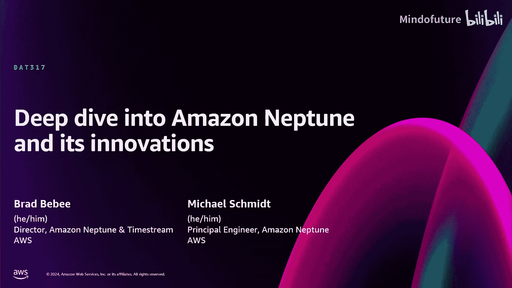
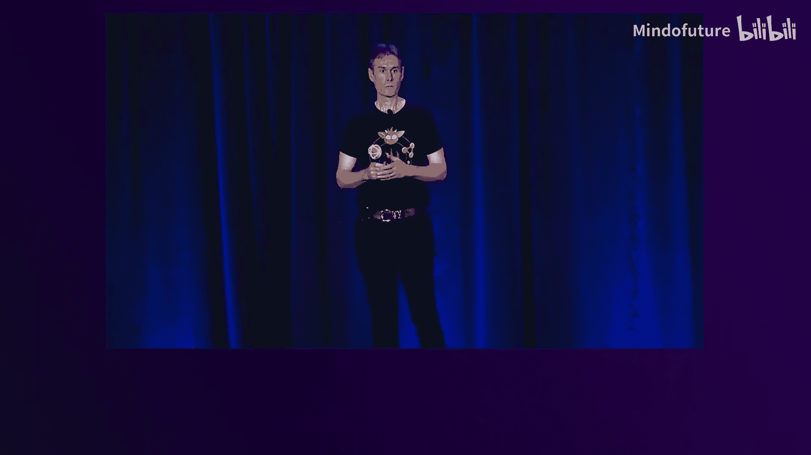
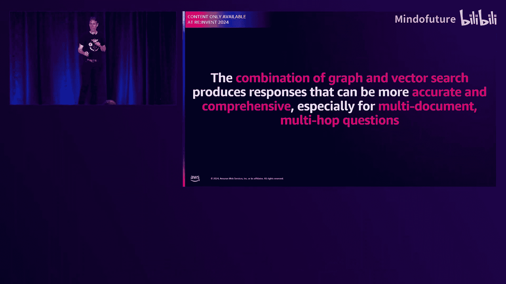
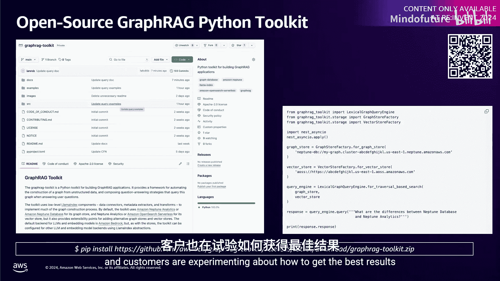
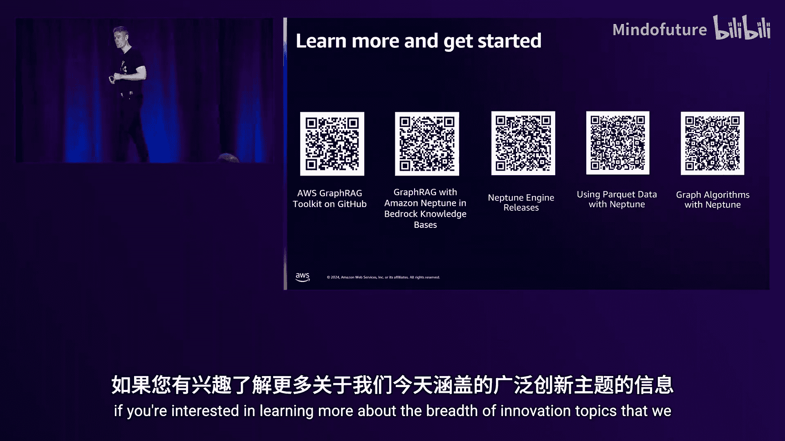
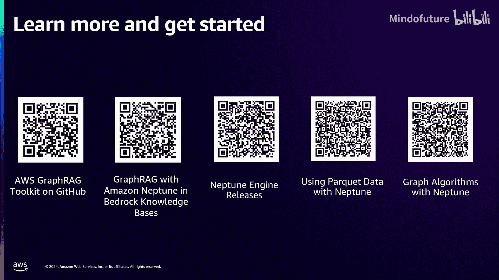

# 【AWS数据库峰会2024全集-•-中英】AWS-re：Invent-2024---Databases-p04-P04-Deep-dive-into-Amazon-Neptune-and-its-innovations-(DAT317)--BV1VAR5Y6Es1_p4-

Welcome to Dt 317。I'm Brad Bebe， I'm the AWS director for Amazon Neptune and Amazon Timestream。

 and today I'm going to be joined by my colleague Michael Schmidt。

 a principal engineer with Amazon Neptune， and we're going to do a deep dive into Amazon Neptune and its innovations。

Before we get started， I wanted to kind of see from the audience， if you could raise your hand。

 how many of you are using a graph database today？Cool。How many of you are using Amazon Neptune？

That's great haven many of you signed up for this session before Swwami's graph Ra announcement yesterday。

 raise your hand？

How many of you signed up afterwards？Cool， we've got great stuff for both of you。

 so looking forward to it。What we're going to do today is give you spend a few minutes。

Given you our journey and our kind of position in the graph space。

 and then we're going to talk about ways that we've innovated to make it easier for you to build applications and operate graph applications。

And we're going to end up talking a little bit about how you can use graphs to improve retrieval augmented generation applications or graphphRAG。

A little over eight years ago。I was the CEO of a small， open source graph database company。

And we were thinking about。How can we have an impact on the graph space。

 We believe that graphs were great， but we weren't seeing how we could have a big impact。

We joined AWS， and I was here at Reinvent in 2017 when Andy Jazzy announced the preview of Amazon Neptune in the keynote at Reinvent。

And the launch of Neptune。As a managed graph database service by AWS had a big impact on the graph space。

 now you could easily create a fully managed graph service with high availability and it open graphs to a broader set of builders。

Neptune's launch was welcomed by others in the space。Since launch。

 we've continued to maintain a pace of innovation。We launched the first serverless graph database。

 we launched global graph databases， we support graph machine learning。

We support in memory graph analytics。And it's never been easier or cheaper to build graph applications。

For a range of different workloads。I'm still super excited。That every day。

Thousands of customers run tens of thousands of Neptune instances across a huge range of different use cases。

The reason they do this， of course。Is because graphs are awesome。

Graphs allow you to represent relationships。As first class citizens in the data model？

Which means that you can build applications。That query and traverse。

Those relationships to innovate and find new insights。

And customers do this across a range of different use cases。Security， finance， entertainment。

 knowledge graph， digital twins， customer 3，60。Broad sets of use cases that you can address effectively when you use the relationships。

In your data。It turns out。The graphs。Are also。A very fast way。To explain complexity。

In a way that can be grounded and in a way that can be understood easily。And this。

 I really learned from watching some of our security customers。Customers like Wiiz。

A fast growing cloud security posture management company。

They use the relationships and their data to build a security graph。But they also use。

A graph representation to present to their customers。

Which of the vulnerabilities in the security graph are the most important for you to address？

And then to explain that to the development teams。And I think this graphs for explainability is an insight that we'll continue to see more of in the future。

When we started our journey。Most of the graph applications。What you might characterize is。

O L TP style。Customers understood the graph models that they had。

 they wanted a strongly consistent graph database that provided multi view concurrency control。

 they wanted high availability features。And these are still true today。

But as we've learned from customers， there's also a range of other things that you want to build with graphs。

You want to build analytical processes， things that look at the entire structure of a graph and allow you to gain insights。

You want to take graph data that's not stored in a graph and produce graphs from it。

You even want to virtualize your graph so you combine your graph application with data that's stored in other places。

And since we launched Amazon Neptune Analytics last reinvent。

We've learned that there's a large number of use cases where you want your online graph。

End your analytic graph to work together。So our strategy。

Is to give you the most choice of graph query languages and data models。

And deliver the best price performance for building graph applications be the graph databases。

 graph machine learning。Graph analytics， and now of course， graphraph Ra。

One of the reasons that you value a managed service。

Is because of it's so easy to get high availability and manage。

 and so let me talk a little bit about some of the innovations we have in this area。

If you're familiar with Neptune today。Neptune database clusters have。A primary writer。

 and up to 15 different low latency read replicas。This sits on top of a multivailability zone， 3 AZ。

Storage service。When you have a source in your cluster。Of a planned downtime， for example。

 an engine update。What happens is that。You're no longer able to read or write from the primary writer。

But you're able to maintain your application's availability by continuing to read from the readers。

And this feature is called Survivable read replicas。A couple of years ago。

 we launched global database。Global database allows customers。Who for business continuity reasons？

Or for optimizing latency to their applications。To have a single primary cluster in an AWS region。

And up to five different。Follower reader clusters。Now， until recently。

When your client application was reading from one of the global clusters。

And it had a similar kind of update。You weren't able to read or write from that cluster。

During the period of the engine update。And so， starting。With the recent engine release， 1400。

Global database also supports survivable read replicas。

 allowing you to improve the availability for your global graph database clusters。

After we launched Neptune analytics at last reinvent。

One of the things that we learned from customers is that they wanted to get started with an even smaller graph。

 So Neptune analytic graphs are sized in something that's called memory MNCs or memory Neptune compute units。

And so they wanted to get started with even smaller graphs。And so we've now launched。

A minimum provisioning of 16 MNCU。And this reduces the cost to get started with in memory graph analytics by up to 87% over the original launch size。

We also heard from customers。That sometimes it was difficult to understand from the size of a graph data that you had in S3 or another location。

 how to properly size your graph。And so we launched an auto scaling feature。

This allows you to specify a minimum and maximum size for your graph。

 and then the system based on the data that you provide will automatically choose the smallest size that fits your data。

We also heard from NeptumA Ana customers that as they were using their graphs。

 sometimes they were adding or deleting data， and they wanted to change the size。

And when they did that， it resulted in a small amount of downtime。

 similar like what we saw with the global database clusters。

And so we've now launched a new capability to allow you to modify the size of your graphs with zero downtime。

 so you can increase or decrease the size of your graph through the console， the SDK or the CLI。

And continue to operate， read and write query operations。

Neptune databases provide strong concurrency。And MVCC views。And as part of that。

 as we take read and write transactions。We create undo logs。These aren due logs。

Are records of the changes in the mutations that are happening in the database。

Ondue logs are purged by a background process and under normal operations。

All of this goes along without being eventful at all。

There's certain cases in certain customer situations where we saw。

 particularly where you have cases of。High concurrency for right workloads。

Where the undo log processing could slow down， and you ended up getting a queue of undo logs backing up。

And what happened here is that this would cause the storage space for your cluster to increase。

And in certain cases， it wasn't fully reclaimed。And so starting with the most recent engine release。

 also 1400。Neptune databases automatically reclaims this undo log space。

Making it easier for you to operate and manage your database。

And so now I'd like to introduce Michael Schmidt， and he's going to take you through some of the ways that we're making it easier to build graphs。

Thank you。Hello everyone， nice to be here and in the next minutes I'm going to walk you through innovations that we made on to make it easier to build。

 manage， exchange and query graphs。But before I get to Neptune。

 I would like to start with a quick overview， So to say， as a motivation。

Over the craft technology landscape。So let me pick up on the questions that Pra asked and ask you a couple of follow up questions。

 So who of you has worked with or heard about labeled property graphs before？

We worked with or heard about RF resourcesource description framework。That's quite a few hands。

 who has experience working with both。So。I could probably spend the rest of the talk， just。嗯。

Diving into the differences， characteristics， strengths of these craft technology stack。

But I guess the key point that I want to make is that the craft technology space is really huge。

 and it is very difficult today， even for me to keep tracka of everything that is going on。

 There are different query languages。APGs and RF， they come with different data models。

 They come with different theorization formats。 And as a consequence。

 there are different ecosystems of tooling in creations into programming languages。

That you can choose， depending on which of the technologies you are using to build your craft applications。

So with Neptune， it was always important to give our customers the choice。

 And when we started Neptune already， we supported both stacks and what we heard from our customers was that they really appreciated having the flexibility to choose the stacks that they found most adequate for their use cases。

 we also heard that。The mere fact that they have to make a choice for one of these standards or used to have to make a choice。

 I should say。Was really a burden to get started building craft applications。

 Because when youre getting into craft， you think about your use case first， right。

 And you think about how this use case maps to the concept of craft。

 which is very similar very easy to， to explain and to to visualize， right。

 But now you are faced with。Having to look into all these standards。

 all these different query languages and decide what is the best to build my applications。

So we started thinking， what if instead of making it a labeled property graph or RDF。

 we could shift the paradigm and make it labeled property graphs and RDF， It's just craft， right。

 That's what I want。What if we could really combine the strengths of， for example。

 RF as a strong format for managing data， for connecting data at global scale。

With the value of having these nice property graph query languages that application developers often value because they are nicely integrated into programming language ecosystems。

This is when the idea of one graph was born。 and earlier this year。

 we launched one graph for Neptune analytics。So the basic idea of one graph from a technical perspective is that we designed a metadata model that somewhat comprises both property graphs and RF and exposes that data。

In Neptune analytics， as if it were a property craft。May sound a bit complicated， but in practice。

 it's really as easy as now you can take property curve data loaded into your graph。

 you can take IDF data loaded into the same graph， and you can query it as a unit with Opencipher as a query language。

Where we made a couple of extensions to bridge some gaps between the data models。

 handling with different data type systems， handling with different types of identifiedents。

So this does not only take away the need to make a choice between the data model between the data models and the technology stack。

 but it also gives your teams， the people that are working in your companies， the flexibility。

 and it gives everyone a chance to contribute， even if they are coming from different backgrounds。

Right，Da architects， they can now combine labeled property graph and R F data as an immediate benefit。

 They can， for example， use what's often referred to as linked open data。 So those are public。

 publicly available data sets that have been published for different domains。

 So to say reference catalogs， if you will。And that you can connect to your applications。

 So those include， for example， datas in the geography domain in the life sciences domain databases about genomes。

 proteins that are freely available in R that you can now just load and connect with your property graph data。

And for developers， it means they cannot continue consuming their data as if it were a property crop without having to learn new technologies。

So let me give you an example of how that works and the running example that I'm going to use over the next slides is assume you are building。

 you're having a company and you're providing services to customers in the travel industry。

 especially you want to support them in flight planning and during their flight trips。In this area。

There are a couple of public dataset sets even out there that you could use to bootstrap your business。

 One of them is called air routes。 That's a property graph data。

 and airs contains information about airport， meta information， descriptions。

 a number of runways and information like that and connections， flight routes between these airports。

Another interesting data that contains a lot of useful information is Wiikidata。

Wikidata is the structured version of Wikipedia。 It's community maintained， and it contains。

Information in all domains， but also specifically about airports。

 So one example that I'm using in these slides is it contains links to the airport detail maps that you may want to embed in your application。

With one private now is as easy as just loading these two data sets into the same graph。

And while these data sets use different identifiers， different nodes to represent the airport。

 So you see， for example， there's node 12 at the top left and the node W D Q8，6，8，5。

 That's the Wiki data identifier for the for the JFK airport。 They represent the same thing。

 They are different nodes because you have two different data sets。

This is where the integrative power of graph kicks in。 because now。

 because these data setss used the same IA T A code， which is worldwide standardized。

 they are interlinked。 If you think about them as a graph， What you get is really a connected entity。

😊，So there's no need to do any E TL or processing， schema design。

 All you do is you load these two data sets and you get this connected graph。

And then you can use open cipher to query that。 So here's just one example that shows how you can connect。

 combined information from these two data sets。So what this query does is select pairs of nodes。

 AP node 1， AP node 2， and it says I'm interested in those pairs where this code property that is the property that's used in thearrow data equals this P238 property。

 which is the name for the IATA code property in Wiikidata。

 So what you get back is this corresponding pairs of nodes that represent the same airport in different data sets and now you can combine information right so in this example we are extracting the information。

 meta information fromarrows and we are extracting this detailed map link from Wiikidata。

And what you get back is a J， and if you render it as a HTML table。

 what you get is something like that， where you see on the left side。

 the structured information fromarrow and on the right side。

 you see that link that has been resolved as an image that you get from WiKdata。

So the idea of onecraft doesn't really end with the problem of preaching the gap between the two graph communities and the two graph worlds。

What's also important for us and where we have made quite a few innovations this year is making it easy to embed other data sources and combine other data with Hycrt and probably the most notable of these improvements is a feature where we now allow to query。

 import and export tabular data。So one example use case。

 assume you are a data journalist and you are working in a story。 when the Panama papers。

 for example， were released。shorthor after， someone published that data as a knowledge graph in a consumer performance。

 So you could take that knowledge graph now load it into the Neune database。

 and you could investigate that。 But now， as a data journalist。

 you may also have your internal information。 you may have C SV files that contain information about organizations about people。

 entities mentioned in the data。 and you in your investigation， you want to be able to。😊。

Plexibly combine the information from these two data sets。So this is how it works， It's really easy。

 it's integrated in Opencipher and theres this new command called Neptune ReT。

 what Neptune RET does is it doesn't store the data in the graph immediately there's also command to do that but Neptune Re just loads of induct query runtime。

And when you call that， you point it to in a three location where your C SV or perque file lives。

 And what you get back is this variable row。 And now you can access the different fields of that CSV file order。

 per K file， by just referencing the column headers。So here's a concrete example。

 As you have a parquet file that gives you carrier information。

 flight numbers and the origin and the destination from where these flight numbers are happening。

So you call an haveune read， point it to this file， you get the row back and in this example。

 I'm just extracting the carrier and I'm composing a string that is pointing from the source to the destination。

 I'm getting my result back as a Jason and I now can really embed that directly into some applications。

So in some sense， this makes Opencipher a query language for processing tabular data。

 but it really gets interesting when you now combine this with a knowledge graph or with a graph in general。

Right， so assume you have yourarrows graph loaded。 So now you can combine your craft structure。

 craft querying with querying of this tabular data。And。I don't want to go into details。

 but the basic idea is you match a part of the craft。

 So in this case we are extracting flight route between JFK and Las Vegas airport。

 then we are reading the CV file， we have this call command。

 and then we are saying we are filtering down the rows of the CV file to those rows that have JfK and Las Vegas。

 So the two airports that we are looking at in this query as their source and destination and we are extracting the carriers。

 the flights and we do some pre post processingces where we are essentially folding folding and collecting the list of flight numbers for each of the carriers。

 right So just really an example that shows you how you now can combine craft and CV data in just a single。

😊，Federated query。This federated paradigm is very adequate if you want to do a ho investigation。

 but it always， of course， in every query， you would reload the CS SV file。 So another thing you。

 you， you may want to do is you may want to embed that data into your craft。

 So you may want to extract the。Relationships that are hidden in your tabular data， directly。

 and embeddedbed。Materialize that in your craft。And also that's easy now right so the prefix of the query that you're seeing here is pretty much the same。

 But instead of just reading and transforming it， what we are using is this opencipher create keyword。

 which is just standard opencipher。 and that creates a new edge in your craft and that edge has a label flight and it has served by annotation that contains the carrier extracted from this CSV file。

😊，If you run that， what happens is that this new edge is materialized in your craft。 And from now on。

 without rereading that CV file， you can query it。 So you can get information that is locked inside tabular data out and can easily augment your craft with information from tabular sources。

So taking all together this new functionality to import， export， query and connect different。Crafts。

 different data sources， makes it pretty easy to write new data processing workflow。

And one use case that Prat already mentioned before that our customers have been asking for is， well。

 I have my data in a Neptune database， I have been using Neptune database， the OTP。

 as an OLTP database， but I have some ideas about draft algorithms that I would like to run so how do you combine Neptune database with the Neptune analytics？

So concretely， as an example， assume you store customer data and data about marketing campaigns that you have run in your Neptune database。

And you would like to get an understanding of the most influential campaigns that you have been running。

A good way to do that would be to run a patroning algorithm over your data。

 because Pating is an algorithm that essentially gives you the information about the relative importance。

 ranking of node in your craft。 And the observation is that， well。

 if my marketing campaigns were more important， then they have triggered more responses and these marketing campaign node。

 they are more densely connected in the graph。😊，And you want to run that on Neptune Ana。

 because Neptune Ana is really a fully in memory system that has been purposeful to Rs。

these expensive craft algorithms， which typically require multiple passes over the graphs。

 and then they converge and attach some scores to some some of the nodes。

 So the computation processes relatively expensive in this case。

 but the output is really compact represented by just a node score。So with。

All this important export functionality that we now have。

 It really becomes a matter of four very simple steps to realize that pipeline。

And when I'm saying steps， I'm really meaning commands or queries that you just sent。

 So the first one is you create an Neptune analytics graph from an Neptune database。 and for that。

 we have this create graph using import task。Which you point to a running Neptune database。

 It snapshots to database， and it spins up an Neptune analytics graph。Once head prep is ready。

What you do is you run a patron， just a simple opencipher query in this case。

 we are using the mutate version of the Pat algorithm， which iterates over the graph。

 figures out the scores for these nodes and attaches this score property to each of your nodes。

Once you have that。You can now use the new CV export functionality。

 and you may know that there is a filter here where you are just saying， okay。

 I'm interested in exporting specifically this new score property because that's what I added to my graph And that command will just export it and write it as a simple CV file into a 3。

 And in the final step， you just take that CV file and you load it back into your Neptune database。😊。

So when I was preparing that presentation there was a workflow where a basic script it took me like two hours to basically script that thing and in this toy example。

 the whole process did run less for less than one hour and you can think of blind that recipe in different variations for indicating with different other data processing pipelines。

So that concludes the part on the more data management side in the second part I want to talk a little bit about improvements on the query。

 graph query usability and performance side， so starting with flexibility。

Weve shipped quite a bunch of new features that we learned from customers where important for their graph use cases。

 first what I'm going to talk about is called sub queries。

 there is a new algorithm for schema extraction from graphs in Neptune analytics and there have been lots of smaller improvements like adding procedures that make it more convenient to write queries that operate deduplicate interect and sort composite types in opencipher。

So the first one called subqueries。Speaking in technical terms called subqueries are the equivalent of correlated subqueries in SQL。

 Who knows what correlated subqueries in SQL are。Very few hands。

So let me try to explain it in simple terms。 When you're doing a craft traersal。嗯。

What you w to often do or oftentimes， your crafts have a high fan out。

 And if you're doing multiple hops in a craft， you are visiting lots of things。😊。

And that's exponentially getting more and more。 So if you have a network of friends and friends and friends。

 and each friends has an average 10 friends。 if you're doing the first hope。

 you see 10 in hundred and00， and it grows very quickly， right。

 then you have an addition these power node in crafts where maybe prominent person may have 1 million friends。

 right And what you want to do is you want to bound your craft。 So when you， for example。

 you want assume you want to do recommendations of of friends。

 right and instead of exploring this full space， you want to explore the most promising results first。

😊，So when you make recommendation for。People that someone might want to connect with。

The way it typically works is well， you're looking at the closest friends of a person。

 and then for each of these closest friends， you're looking at their closest friends。

 and then you get a set of notes back and those notes are potentially candidates for recommending a friendship because close friends of my close friends it's likely that I know them or have some relationship with them。

 right。And call subary lets you allow doing exactly that， lets you doing a hop and it lets you say。

 okay， instead of looking at the entire result， all the friends。

 I'm looking at the 10 closest friends and it's up to you to define what closest means。

 that's what you put into the subtuary。So in a sub。

 you could define closest as based on a squad that you have in your graph。

 you could compute closest dynamic what what you define as closest dynamically based on likes that they have made on posts that they share and things like that。

And we found this called Supriris and this general pattern of exploring and allowing to explore the most promising things and nail down intermediate results。

 especially helpful in scenarios where customers who are using realtime recommendations and you find similar use cases like the friend of refering for social networks。

 you find very similar use cases in many other domains。

The second thing I want to talk about is schema extraction for Neuneanaly so there's now a new procedure called PTT schema。

 what it does is it takes a pass over the graph， it analyzes all your nodes。

 it identifies the labels of these nodes it identifies which types of nodes of whichs node labels are connected with which node labels are edge labels。

 it gives you the property information for these entities。

 and it summarizes that in a compact chasing representation。

And we found that this has become more and more important as you want to integrate your craft data with external tools and the predominant use case that we have observed here is that our customers we're asking for using LLMs to generate openspher queries。

 So if I'm not prompting the LLM in order for the LLM to write a good openspher query。

 It needs to know what's inside the graph it needs to know about the concepts that are inside the graph needs know about the connection types that you have between these concepts and the properties that it can query for these concepts。

And with this PG schema， it now becomes very easy to extract really the structure of your craft and make that available。

 either programmatically or is input and prompt for an LLM。So last topic， performance。

We have made lots of performance improvements in different areas。

 but there's definitely one improvement that stood out and that I want to talk about because it is very generic。

So， and these are about what I'm going to talk about is about an order up to an order of magnitude performance improvement for low latency opensci factoryy workloads in Neptune database。

So a frequent use case for Opencipher that we have observed is that when you build graph applications。

 you do that by using query templates。D query templates， essentially。

Fries that you run to populate certain U eyes。 So assume a user interacts with the graph。

 via are web application。 And as they are browsing through， through that web interface。

 you're submitting different craft query templates to come to， to compose the web page， right。

 to extract the relevant information from the graph。And especially in these interactive use cases。

 a key requirement is that well typically these U to explore a very specific part of the graph。

 So there are simple queries， but you want to really have low latency guarantees because in order to achieve a good user experience。

 you need to make sure that。While the queries return in low single or low double digit milliseconds。

 right， Because if the queries start taking a second to execute because there are too many queries backlog in the system。

 then you start getting a poor user experience。The second characteristics is that。Very often。

 you have these。Times of high throughput where you have a peak amount of users。

 and you need to be able to scale to high throughput while still maintaining these low latency guarantees。

And starting in Neptune 132， we really have made significant improvements for these use cases where query latency now is up to nine times reduced while achieving up to 10 times higher throughput on the same instance type and we achieved that by being really more resource effective in query processing。

 so that this really also results in cost savings because in many cases you are now able to rescale down your clusters and achieve the same latency same throughput with less resources。

So how does that work， The basic idea is that we tied this query template scenario to opencipher parameterized queries。

 So you will get this feature for free whenever you use opencipher parameterized queries。

 which is just really an API where you pass a query template。

With a parameters or a set of parameters separately from the value that you want to plug into this template。

And the first thing that we did is we build a new query plan cache feature。

 So when we see such a template for the first time， the query engine now constructs。Executable plan。

And it returns the result， but it also cashs that exes will plan for the future。

 And when it now sees the same template。Possibly with a different parameter for a second time and this third time and the fourth time。

 it will just take this executable plan and pluck a new parameter into the Expoable plan and run the plan。

And this essentially helps us getting rid of the cost of repeated passing， repeated translation。

 repeating optimization， which， especially for these very low latency queries， S queries。

 really dominates the cost of executing a  query。So this alone already gave us huge cost savings。

 but the second thing that we observed is that when we shipped opencipher。

We had a mood threaded query engine that was potentially running parts of the query in parallel。

 and we found that for these low latency workloads。

 a single threaded engine can be much more effective because it eliminates the overhead of context switching。

 thread coordination， and it makes the whole evaluation and execution process much more streamlined。

So to share just some numbers here， So this is an example from benchmark that was inspired by the social network benchmark。

 which is published by the Linked data benchmarkch Council。

 which is a nonprofit organization in the craft space that focuses on benchmarking。 this case。

 it's a typical graph query。 you start out with a message that was posted some forum。

 you are following the reply chain you are identifying the Post and the For of the message。

 and then you are extracting information about the moderator of that forum。So what is crazy。

 It's fairly limited the amount of data that it touches。 It does a couple of hops， but but。

It's fairly fast to execute because it is really operating in a very local portion of the craft。

And what these two charts show you， they contrast Neptune before 1，3，2， and Neptune starting 1，3，2。

And the orange line is Neptune 131，3，2。 So on the left side。You see the P95。

 which is the latency measure， and you see that the latency now is consistently。

 even if you scale to 64 parallel threats sending that same query to the server below 20 milliseconds。

 whereas this throughput now scales almost linearly up to 4。

400 queries per second of this query template pattern where。Previously in Neptune。

 the limit was like below 500 queries per second。And this is not a one off。

 you will really see that for literally all low latency queries in opencifa so we have been seeing it in internal benchmarks in different benchmarks。

 different types of queries， so as long as you have queries that run quickly where the main that can benefit from this parameterization mechanism。

 you will see these improvements in Neptune。嗯。That concludes my part。

 and I'm going to hand over back to Bradre， who will tell you why。that lamps are awesome。So。

Let's just jump right in。If you want to think about how you might combine。

Graphs and retrieval augmented generation applications。

The first thing you really need to think about is what is searching in vector space？

And what is searching in graph space？And when you search in vector space。

You take an embedding and you measure the distance of that embedding to other things in a very high dimensional math space。

 this is often called semantic search， and it works great for finding things that can be。

Related semantically， for the example here we have is zucchini， summer squash， Corrsette。

 you're going to make or Corette， you're never going to make a text match on that。

A semantic search will find that very effectively， and semantic search works also for text and images and other kinds of media。

But it's also essentially a black box。It's very hard for you to understand why your semantic search made that match。

And it's very hard for you to explain。Why that match is there？Graph search， on the other hand。

Takes advantage of the relationships。That have been created in the graph。

And uses a traversal of those relationships。To find things that are related。 And so in this example。

 we have two actors and we want to see how they're related。We can look at。The relationships。

And remember I was talking earlier about graphs for explainability。

It's very easy for me to explain to you why these two actors are related because they share it in two movies。

So。Graphra。Is a version。Of the retrieval augmented generation or rag architectural pattern。That。

Combininees the use of graphs。With vector search。And this is a very fast moving and rapidly evolving area。

Exactly how they're combined。Is something that lots of people have different opinions about。

There's kind of inherently the combination of graph and vectors can improve this pattern。Now。

We happen to have a point of view on how it can work effectively。And what we see is that。

What graphphite can do is help you to bring together。

Related facts across many different documents or for very large documents that occur at different points in the document。

And so this helps with answering multihop questions or questions where you have to have multiple data sources。

It also helps produce more effective summars of your content。

Now I had an example from a customer that I met with this week here at Reinvent and they are their application is email compliance。

 so they look at the content of emails and they try to understand is there something happening in this email that is not in compliance within this case financial securities regulations and what they said is that they do a great job when the violation is within the content of a single email。

But if something's happening over the course of a month or the course of two months where there's a series of email and no one email itself was a violation。

 but if you look at the set of them， you can clearly see what's going on。

 that was where they needed help， that's where they were looking at Graphra。

 and I thought that for me that was a really good example of the kind of kind of multihop question answering where Graphite can benefit。

Not sure what you guys are doing about 930 yesterday。But Swmi， in his keynote。

 announced knowledge basis for Gphra with Amazon Neptune。Is it in preview？This is the first。

Fully managed。Graph rag solution。And one of the reasons that we're really excited about it is because。

As a RAG user or someone who wants to build a rag application。

You don't have to know anything about graph databases to get a better result。

What you do is you provision a RAG application through the standard bedrock workflow。

 either through the console or the APIs。And。You simply select。Amazon Neptune Anatic， GraphraG。

As your vector store。When you do that， you get bedrock builds a rag configuration。

That will automatically generate a graph from the data that you've provided it。 Typically。

 this is a location in S 3。And what this graph consists of， we think of it as a lexical graph。

 So just in a normal rag workflow， you take documents， you break those documents into chunks。

 you compute embeddings on those chunks。In this case， in the graphphri workflow。

You also use L OMs to perform entity and topic extraction within those chunks。

 And then you build a graph that shows for the chunks here are the entities that existed。

 here are the facts or concepts that existed。 And this resulting graph。

 which is automatically constructed。Is then used within the retrieval process。

Combined with vector search。And so as an example， if you ask the G application a question。

And the embedding brought back En zero with just a vector search。

You would only bring back that single chunk into the generative phase of the RAG application。

With Graphra。We combine the vector search。With a graph search。In the retrieval process。

And this means that we're not just taking the top result。The top end result from the semantic search。

We're also taking。Chunks that are related through a graph reversal。

 and so here you can see that we're pulling in two additional chunks that are related by an entity that shares a fact or shares a topic across it。

And by bringing in this graph toersal and combining them。

And integrating the vector search and the graph search results in the retriever。

We're able to bring in more relevant content。Into the generative phase。

 and so you'll result in you can pull together facts across multiple documents and you can bring together。

Better summars。So it's this combination。A vector search that produces responses that can be more accurate。

And comprehensive for your multi document， multih questions。

In addition。To the fully managed Gphra capability within Amazon bedrock。

We also released the week before reinvent。An open source GraphRG toolkit。

This is available on GitHub under AWS Labs， it's licensed under Apache2。

And it implements the same kind of workflow。But it uses Lama index， Amazon， Neptune。

An Amazon bedrock。 And of course， you can also substitute your own other LLMs or other graph databases with it。

And the reason that we did this is because what I talked about earlier。

 this is a rapidly evolving space， we're really learning from customers and customers are experimenting about how to get the best results。

And so if you recall that email example I talked about。That company actually had。Some very。

 very high precision entity extraction that they were doing based on rules that they' built over years for processing these emails。

 And so one thing that they're interested in doing。

Is taking this open source toolkit and plugging in their entity extraction rather than the L M entity extraction。

 So the graph that's resulting can take advantage of some of the things that they've built there。So。

This is a way that you can quickly get started in open source， experiment， it supports very quick。

 you can do a PIP install， you can build Python applications， we have an example shown up here。

 so if you're interested， I would encourage you to get started。So in summary。

 we have two new capabilities for GraphraG。The first is a fully managed graphphri capability within Amazon bedrock knowledge bases。

You simply create a rag workflow with Amazon bedrock， you select Amazon Neptune。

And you interact with bedrock in the same way you did before。

 so if you have existing bedrock rag workflows， you can recreate them using this as you add new documents and update it。

 it very easily updates that in the graph application。

If you're interested in understanding how Graphrag and playing with different configurations。

 trying different graph algorithms， trying different ways to process the chunks of your documents。

 try out the open source Graphra toolkit。For both of them， we'd love to hear your feedback。

 we'd love to take poll requests on GitHub， very interested。Thank you for your time。

 There's some links here if you're interested in learning more about the breadth of innovation topics that we covered today。

 so I'd encourage you to take those and see if they're useful。

And with that， I thank you very much。Probably one or two minutes if anyone has a question they'd like to ask either to me or Michael in the group。

 if not Michael and Ill be outside and we'd be happy to take any individual questions。 Yes。

 there's one up here in the front。