# 【AWS数据库峰会2024全集-•-中英】AWS-re：Invent-2024---Databases-p05-P05-Powering-the-grid---GE’s-600-TB-migration-to-Amazon-Keyspaces-(DAT318)--BV1VAR5Y6Es1_p5-

Wow， and you're still here learning。 This is incredible。 You guys are like the real superstars。

 So I think you should maybe give yourselves a round of applause you know， just for， you。

 you guys are like hanging in here until a bitter end。 So thanks for coming。

 I like that we have this session here toward the end of the week because you've been learning about all kinds of new technology all week。

😊。

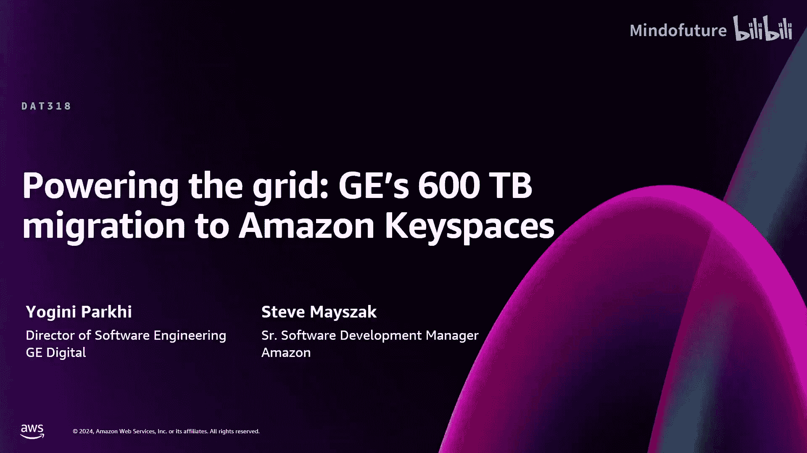

Obviously， thinking about how you could use it and getting excited to take it home。

 ideation to production isn't always so easy， and today's talk is about a massive database migration to key spaces。

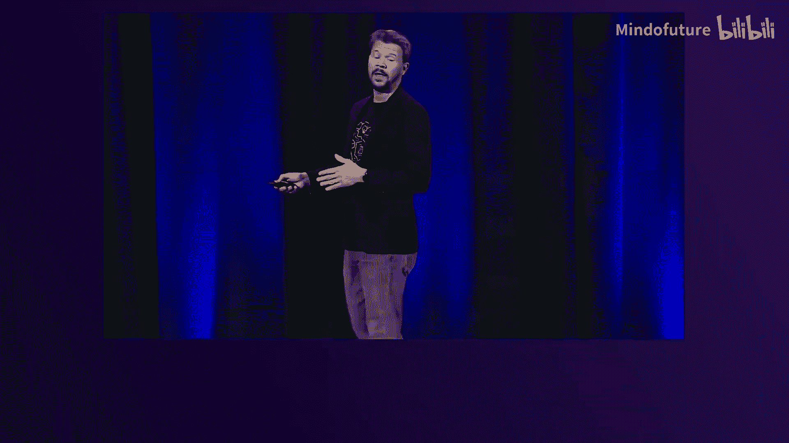

And I have the pleasure of sharing this stage with Yogini Parky today from GE。

 who's going to tell her journey of or actually her team's journey in moving that workload over to key spaces。

And throughout the talk this is about a database migration。

 but really there's some underlining things too about just best practices when you're doing any type of modernization to your app。

 so keep listening for those tips and tricks because they could help you with whatever you want to do outside of the database。

 but our agenda is going to look like this。So first。

 keySps for Apache Cassandra is a serverless database that is CQL compatible。

So I'm going to first talk about Apache Cassandra and how it works。

 sort of with an emphasis on like what kind of things an operator or administrator cares about。

 any cassandra users in the room， anyone use it actively in production。Handful， okay， well。

 so you all learn a lot then about Cassandra today。 So I'm going to go like， again。

 I'm not going to go into the deep internals about， you know。

 all the things you do with Cassandra and how modeling it is and what its purpose built for。

But I'll give you some history in just like the main moving components that you'll care about as an administrator or developer。

And then I'll then transition into talking about key spaces。

 what we mean by serverless and how we make some of the operational things easier for you so you can just focus on that awesome technology。

 which is Cassandra。Then I'll pass the mic over to Yogini。

 who will talk us through their migration on GE。All right， let's dive into it， so Cassandra。

It's an open source。No SQL wide column database， it was introduced。

 or it was at least donated by Facebook in 2008 to Apache。

 so they had originally if you think about back in 2008。

 there weren't a lot of horizontally scalable databases on the market， so they developed their own。

 and they made one that was highly available， it was distributed， ran a commodity hardware。

 had no single point of failure。It's a lot of buzzwords there。

 but what it meant is just like you can keep throwing hardware at it as your problem got bigger and it would scale appropriately。

So I thought the way to best talk about what Cassandra is like as far as a service is to draw out the most simplistic view of the most basic Cassandra instance you can possibly have Cassandra is a monolith essentially in that there is only one binary that runs the thing so we'll get to a ring or like a cluster of Cassandra host working together in a moment。

 but I'm going to start with just a single view of a single host and what you would care about as an operator。

So when you need some compute， it runs on something， so I just pick EC2 instance here arbitrarily。

 it could be your laptop， probably could be a raspberry Pi really if you forced it。

 but you could download the binary through app or yum， snap or whatever。

 and extract that and then you have yourself a binary that's running。By default。

 it's going to give you these four directories on disk now you can change these and there's a whole host of configurations that I'm not going to go into about tuning and that turns into being one of the hard things about managing Cassandra is how many knobs you have to turn So these four directories I want to highlight those because these are one of your main scaling considerations as an admin。

So the first directory data， well， that's where the physical data goes。

 so anything you put into the database， it gets flushed to disk， and that's where it lives。

And I'm going to go a little deeper into that in a moment。The commit log。

 Cassandra uses something called a write ahead log。

 it's a technology that allows you do an append on a log file。

 and once you have that appended it's basically a successful right。

 so it allows it to be super fast on rights。Again， I'm talking about a single cassandra instance here。

 but if you had other cassandra instances in your cluster and you'd set it up so it'd replicate。

And it was trying to reach one of those other hosts to say， hey， I have data that you need to store。

 but that host has gone for some reason。It'll put a message in this hinted handoff folder until that host comes back alive。

And the finally there's the log folder like any service has and then the client and the client connects directly to that host the client is often on that host by default you get something called CQL SH and CQL I said it a couple times already but it stands for Cassandra query language it's kind of a play on SQL it's one of the reasons people really like Cassandras because it's very approachable from a traditional RDS developer where it's SQL like syntax you deal in tables and things like that so it feels very familiar to people。

It just doesn't have relations。So all of these things will consume data and they will fill up。

 and so they have to be monitored by an administrator。

I'm going to go now to talk about how a right request comes into Cassandra and what happens on how we use those files on disk and when we communicate back that the right's been successful。

So the very first thing that happens is we pen to that right ahead log so that commit log we just put a message that that came in and then it sticks it in this in memorymory data structure。

 so now you have another element here of scaling or of consideration when you're operating because that memory in memorymory data structure it's called the ME table。

It is a size that you can configure， but it also uses RA， so we would be concusant of that。

Once those two things have happened， it'll effectively return to the client and say， 200。

 we've got your right word good。If it has to replicate data to different nodes。

 it will then call those other nodes directly and will follow the same first two steps。

 the append and into the MECache， and it'll do that based on the kind of quorum right you if you said。

 I need all the nodes to acknowledge or a quorum of them， so that's kind of another configuration。

But if they're not available， again， it gets shoved in that hinted handoff folder。

When that MEM table fills up and this is configurable value。

 and the MEM table is there is kind of the concept of the data most read is the most recently put in。

 so we keep that data in memory in Cassandra， so we hit that MEM table first before we look at those data files and disk。

But it has a limit we don't want to keep it's not an inmemory database。

 so this is just an optimization， so once it hits a certain point。

 it'll flush that to disk and that's when we populate that data directory in the form of these things called SS tables or sorted string tables。

So now I'm going to take a dive into what are sorted string tables and what are some of the operations that you have to do as an intimate admin on those。

 how do they work and the biggest kind of DBA operation here， compaction。So each in Cassandra。

 it's interchangely used the column column families or a table， kind of the same idea。

 a table has columns。Historically， they called it column families。

 I think recently we kind of killed that off basically referred to as a table。

So a table is made up of multiple SS tables， or these are each individual files if I were to do like an LSN desk。

 you would see a whole bunch of these。Each SS table is related to one proper table。

 modeled table but that modeled table may have many SS tables。

 so just consider the file one and two are part of table A and file three and  four are part of table B。

I've labeled very generically here like what's the contents in each one of these files and so I'm trying to highlight the kind of high level differences in the data that can be in there and so row1 is just has data it's just there you want it there row two has expired data so there's a concept called TTL which is time to live and so for every right you can say what the TTL for that record is。

When a read comes by like that data is still technically in that table and it does pass it by for the time being。

 but you are consuming space， so it can grow based on how often compaction runs。

 you are still consuming that space and has a little cognitive load on the reader because it's got to scan that。

Another thing is a tombstone， when you delete something in Cassandra， you give it a tombstone marker。

 you actually don't delete the data at that point in time。

 you just spill a little marker on that row by its' partition key to say I want this to be gone in the future。

Row4 here has got data and going on the other side， row 6 has got future TTL。

 that means it'll at some time in the future expire， but it hasn't yet。

So this happens in this every time the meM table flushes。

 it creates another one of these SS tables or multiple SS tables based on the tables that it's responsible for。

And then this process of compaction has to happen so what compaction does is it goes through each one of these SS tables and its goal is to make as few SS tables for a table as possible。

 so it basically gets rid of the garbage， it'll drop any TTL expired row， anything's tombstoned。

 it'll drop that and you know retained anything that should like on the others that might left the left side there。

 it kept the future TTL got rid of the tombstoned record。For this brief moment in time。You have。

Duplicated your data， like all the things that we are trying to save and maintain exist two files now。

 so if your data is space is getting limited， we're actually you know consuming it now twice。

 so after the compaction process is finished and we're confident that that is complete。

 then Cassandra will go through and eliminate those。Now， that was all on one node。

And that happens in every node in the exact same way。

 there's no special properties of indi cassandra node。 they're all equal effectively。

And you can add as many nodes as you want that creates a token ring that's the parlance and Cassandra and a token ring is basically a even distribution of a hash value or the hash range distributed across your Cassandra nodes。

 so here I've just arbitrarily picked four nodes， it's an easy number to work with。

Where we have that hash range that I've highlighted， it's 128 bit key。

 so every partition key we take in， we will hash that value。

 and that'll basically say who owns this and each node is responsible for one quarter of that range。

So here's a visual of that，'ve got a table， three different partition keys， each one runs a hash。

Didn't take the time to map or which ones those go to。

 but each one of those has someone who is the primary node responsible for that piece of data。

All right， I mentioned before that all nodes are created equal here。

They work in a cluster and I kind of explained in a minute or a second ago about how we distribute the hash token ring。

But they all communicate with each other， they gossip about what token range they're responsible for。

 and they work together， and if one goes down， they kind of share those messages with each other as well。

So I'm going to talk about replication factor now because now that we brought in multiple nodes。

 the whole point in doing that is to be able to replicate data skip here。

 so a typical replication factor3， if you think about any kind of quorum based system。

 you need at least an odd number it's like total nodes divided by two rounded up is going to be your quorum so typically we'll do something like replication factor three to say I want three copies that way I can make sure I can be confident that if I have two values that match。

 that's the right value。So if a right comes in and it lands on any old node。

 that node can take on a special property of what we call a coordinator if it's not responsible for that particular partition key。

 so the right comes here to the coordinator， the coordinator takes that hash function decides okay our one over there。

 that's where this thing's primary token range is responsible for and so should go there。

 it'll right there first。And then it'll write to the other nodes as well that also share that token range as backups essentially。

 and it'll return to the client a 200 as soon as it's hit that， however， that read has been set。

 whether it's all or core or whatever。So they don'll return back。So I covered like a lot of like。

Vocabulary in Cassandra I'm not going to repeat any of these right now but that's like a lot of kind of a big brain dump on things that admins need to think of and they need to know how all these things work but primarily what they're doing is this stuff they're making sure that they have the right cluster in place that they have the right nodes we've seen people with up to 6000 of these nodes so if you think about those problems on a single node multiply that device 610000 it gets pretty challenging which means that you need to have monitoring in alert systems。

 not to mention implementing your own kind of backup and restore and disaster recovery things like that and then there's all kinds of ways to tune the system。

 whether that's like making your token or your partition keys like more sparse so they spread out better and things like that。

All right。So now I want to talk about key spaces and I'll talk about how we make that admin stuff simple or nonexistent for you。

That way you can just focus on your application so first keyspaces is compatible with CQL and what does that mean basically it means that we design the system so that you could use all of your application code and all the drivers in open source without making any changes all you have to do is just change your endpoint to keyspaces and it works。

This is kind of a departure from a lot of other services where we use the AWS SDK or something like that。

 we would follow on in with the open source community there to support those drivers。

Next is we're serverless， I know it's a little bit of a buzzword but it's a very important one。

 you don't have to do OS patching， you don't have to do application patching。

 you don't have to deal with those compaction， you don't have to worry about that overhead for the disk space。

 none of that stuff that's all gone， you know the provision extra fleets if you don't need to。

 that's all taken off the shelf for you。We also offer single digit millisecond performance at any daily scale。

 and I'll show you how we do that and how it's fundamentally different for Cassandra in a minute。

 I'm going kind of unveil the curtain and reveal some secrets we haven't shared before。

 they're not that exciting。Like here are 51 secrets or anything， but therere never be Jared。

 and I'm going to take you through those in a minute about how we've done our architecture differently than Cassandra。

😊，And not last， but at least。that we're highly available and we are secure five nines of availability with multi-region replication and data encryption at rest。

 and we also have feature that we call PR which is point in time recovery so we're taking snapshots down to the millisecond or second that are capturing your system state at any point in time so if you did a DR event or if you did something that you didn't want to have done。

 you could rewind and play that back to a very specific point in time just through a feature API call。

All right， we're going to go into architecture a little bit here， this won't be too long。

 just another couple minutes， so I'm going to highlight the differences and how we can scale differently than Cassandra。

First， like if you remember， I see the Cassandra client connected directly to the Cassandra host。

In key spaces， the client， the same client connects to one of our endpoints。

The endpoint then forwards to a network load balancer。

 and this is something that you really can't do in Cassandra。

 network the load balancing is in the Cassandra token ring， like it's kind of， again。

 like it takes on many properties。We've introduced a networkload balancer so we can balance many connections across to flex basically to match your workload。

We then have extracted out the query and request handling from the data storage。 So again。

 at Cassandra， this is all in one monolith。 And this lets us do things and scale at different rates。

 And so the N LB。We'll forward to a query request handler。

It'll parse the query and it'll decide what storage node is responsible for that and then it will write that data to three separate AZs out of the box。

 like we don't let you write just one copy that would be dangerous and we ensure that they're not in the same racks or in the same availability zones。

 so we do all that by default。And here's the curtain。

 this is the exact same storage technology that is used by Dynamo DB I don't know if we've ever actually shared that directly。

 Dynamo DB has a whole bunch of routing and request layering on the top and for many。

 many years we've been building this like very durable very resilient storage network at the base of the system and so we decided to use that for our storage layer for key spaces so you get all the same kind of performance and durability guarantees that you do out of dynamo。

And another difference is in Cassandra， a partition key will resolve to a host now that will just continue to go to that host unless you do something like virtual nodes or virtual tokens。

 but what we do in key space is we actually monitor how much traffic is going to that particular key and if you get too much it's kind of considered a hotkey。

 it will split it。So we'll actually at some point say， hey。

 that's as much data as we ever want to put on that storage node。

 so let's split it out and we can keep doing that forever。

And so no matter how much data you throw at us， we can keep splitting these nodes。

 and that's how we guarantee that same performance at any scale。 and similarly。

 we can do that with the query and request handling as well。

That means that if your workload is maybe like an IoT workload or telemetry or something with like maybe lots of connections。

 but small data。It makes more sense to scale the query request handling。

 if you're passing lots of data or have lots of legacy data that goes back farther。

 we can scale the storage at a different rate。So the key points to takeaway are that we are serverless since we don't have to do any of that administrative action。

We've separated those concerns of storage and routing。And we are compatible with Apache Cassandra。

 CQL language， and best of all you only pay for what you use。

 that was one of the biggest things I saw with Cassandra。

 especially big installations is that they're overscaled a lot of the time because people can't predict the bursts and the compactions and things like that。

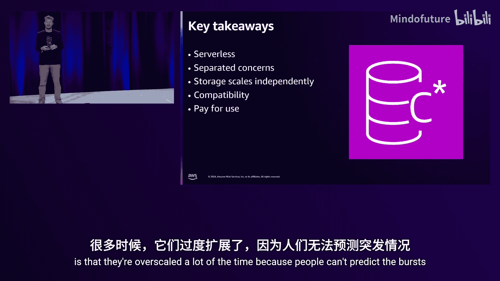

Great。😊，That's my part of the talk， I'm going to hand the mic over to Yogini。

 who's going to talk you through。What they've done at thank you Steve。

I'm sure that clapping was for Steve。 Thank you。 I'm Yo Guinea Parkhe。

 I'm the self proclaimed lean mean transformation queen。😊。

I'm not going to talk about Gen AI or AI today。 Maybe that's why I'm here on a Friday。

I am going to do two things I'm going to ask you one question and then I'm going to tell you about three things。

 One of them is about my company Gvanovava the second is a story it's a good story about moving to key spaces from Cassandra。

😊，And the last part is just what I learned in this six month long journey of large scale data transformation。

😊，So the question first， the question is how many of you you are familiar with or use RD BMS SQL。

That's a good amount。 How many of you use No SQL。Not just Cassandra， any no equalequel。

That's fantastic。 it's good to know it's a wise， knowledgeable audience。😊，嗯。Let me see。

So we are G E Vennova。 How many of you have heard of G E， General Eric。Almost everybody， right。

 almost everybody。 G E Wenova verse stands for green and No is new。 So we are the new G E Wenova。

 We are purpose built。 What are we purpose built for， We are purpose built for energy transition。😊。

And that's what this story is about at the end of the day。

 Even though it's all about software transformation， it's one drop in the bucket。

You can learn a little bit more about G Wenova， the new purpose built company on this slide。

 I'm not going to read it all out。😊，It's a big mission， and we have a real challenge on this mission。

The challenge is to electrify the world， but also decarbonize it。

 This is where you can have the most impact when decarbonizing。It is hard to believe that even today。

 millions of people are without power。 it hinders their chances。Of breaking out of poverty。

Just imagine a weekend with your family。Without power。

 let it sink in and you realize the gravity of the mission。Now。

 we do have a real opportunity resulting from where we are。

 which is to drive the energy transition forward。😊，It's a responsibility I feel personally。

 every day。We are uniquely positioned to take this on。 It's a big challenge。

 And why are we uniquely positioned。 You can see upon this slide the different areas of power generation。

 transmission and distribution where we play， We have equipment。 We have data。And it's。

A key role we are expected to play in the industrial transition。Of course。

 how are we going to do it is important？😊，We do it with the G Wenova way。 We innovate。

 G is known for innovation。 We work for our customers。😊，嗯。Lean is how we work Throughout my talk。

 you will see me refer to lean terms。 Hopefully， you can take back some of the lean terms。

As we progress I。Click something。 but here it is， so。Lan is how we work。We also。Work as one team。

 G is a big company， and we work as one team， and it's important。

 Youll hear me make references in my story to being a one team Here。

 it was a great collaborative team， along with。😊，AWS and and Pro。Apart from that。

 it keeps doing that we are accountable and it's the most important thing。

 we are accountable for decarbonization， we are accountable for the energy transition。

 and I take that job very， very seriously。 So as we are going through various large scale transformations。

😊，One of them in my small world， was a software transformation。

And let's learn a little bit about what was that challenge。

This particular challenge that Steve mentioned。Momentarily was moving 600 TB of data。

 That doesn't seem that much data。 I'm sure many of you have more data。

It's the nature of data and the Sa system in which this transformation needs to happen。

 We have 300 Saas enterprise customers。 They bring in thousands of their users to the system。

 as everybody is using this live。The data store is getting changed from Cassandra to key spaces。

 And that's what makes it challenging。Our accountability。Is at play here with the 99。

999% commitment to availability to our thousands of users。

 We have to make sure that our transformation is， I am gladad。😊，Also。

 the timeline was quite stringent。 It was six months to move everybody over the live ingestion of data。

 as well as the historic data of many， many years。😊。

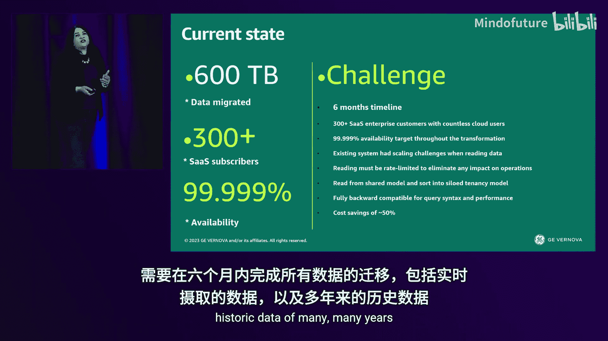

Now， it's good to understand how this data is different。

 right This data is different from internet generated data。

 This data is critical to lot of our everyday living。😊，You can see in the picture on the slide。

I can try to point it we have various industrial equipment like turbines and jet engines and sometimes equipment in manufacturing plants and factories that is generating sensor data it gets ingested in our store and we have a lot of analytics running off of that data we have near real time insights being drawn reports and visualizations getting created。

😊，Control room operators using this data on a regular basis。And this has to continue。

While we are doing this， we have to do it in a cost conscious way。

And those were the challenges in front of us as we were trying to migrate this data。 Now。

 why migrate， We have a system。 It it works， Why migrate。

We did run into some of those maintenance challenges that Steve talked about earlier。

 We did have tombstoneing。 Our model of tenancy was somewhat shared。

 and it was difficult to change T T L and be flexible and configurable。

It was sometimes difficult to focus on what our customers wanted because so much of our time was going in maintaining our store。

 and we wanted to take advantage of the server less。And we started。On this journey together。

 we did have some noisy neighbor issues from time to time and when spikes happened and large amount of data came in。

 We had difficulty。 We had to do manual work to make sure the system kept running。

So now going back to the how， right， how and。I'll go keep going back to some lean terms。

 Lean is how we work。 And we started with a small experiment。

 Lean calls for a small experiment every time you are transforming something。😊。

They had made some prior attempts to migrate。 The challenge was because it was a live system。

 when we tried to access data and bring it out， the customers using it might see。

Impact from some of that might see latency。 And we couldn't let that happen。

So we started with a small experiment with key spaces。😊。

The idea was to send some data into key spaces from our live ingestion。

 so data was going to the old Cassandra as well as key spaces。😊。

We also started building some observability。 and key spaces is really helpful there。

 You can see what's happening at all times。 You can also see a lot of cost analysis data that helps as well。

😊，So it's good to understand our architecture a little bit。Because it'll help with the story。

 I I'm about to tell。 Can I get into some of the details of it。Now， when data first comes in。

 we have an ingestion gateway。 And that's where we started sending that data。To the old store。

 as well as just imagine a key space store in the new world。 We have a queue。😊，Maybe not。

 We have a Kafka queue， as you can see and some go pipelines that actually ingest the data。

 And so we built pipelines to ingest the data in key spaces as well。

 And there's a query component to it。😊，First， experiment。The beauty of it is they almost always fail。

 and you get get to learn a lot from it， right， you learn some and you win some。

 and that's how that journey goes。 And so in this first experiment。😊。

We saw five times increase in the size of data。 We were not expecting it。

And we were scratching our heads。 How did this happen。

 Five times data means five times cost of writing， because we are now using a managed service。

And we started looking at and went back to the whiteboard with our AWS SMmeEs and the pro serve team together to try to see what was happening。

😊，We definitely found a reason What was happening。 What we saw was our data is very unique。

 being all sensor data， but lots of it。 We usually are storing just double values。

 but the key is very large to locate the data because we can have decades of data。

 And that was the the main issue in getting this 5 x storage。😊。

That we were not expecting so team went back to work and hashed out some options。

 We conducted more small experiments to try them out and we found an algorithm a hash that works for us。

 we also tried to see if we could readjust some of how we store the data some of how we can optimize better for the various sizes of our customers because different customers had different sizes of data and we had to adjust some of that to get better performance What we also found in the experiment in the small experiment was that the query performance would hurt because of the 5 x increase in the size of data。

😊，And we kept。Looking through the different hashing algorithms。

 try to regest the data or try to ingest live new data and then try to run our performance test。

Once we did that， we had some better results。During this whole period。

 there were some key learnings for me and team。 and I wanted to share those pepper allwl along this story with you。

😊，Always start with an experiment Le calls for it and have a plan Be ready。

 when when you have those two symptoms， it's good to have to take a take a breath。

 take a step back and look at it。 And some out of box solutions like the hashing might come to you。😊。

Let's look at what we did next。 We started itating on the architecture of how the actual historic data migration will work because now we were good with live data as data came in from the sensors we could our inges gateway could send it to key spaces。

 we were good with live data but we have decades of old data the historic data what about that we needed to move it we had some stringent timeline so we needed to move it fast so we went back to the whiteboard we started itating on this with the pro serve team and we had a good design now let's get into a little bit the migration plan I'm hoping this works for me so I can I can describe it。

 It works for me fantastic。 So here's the cassandra。😊。

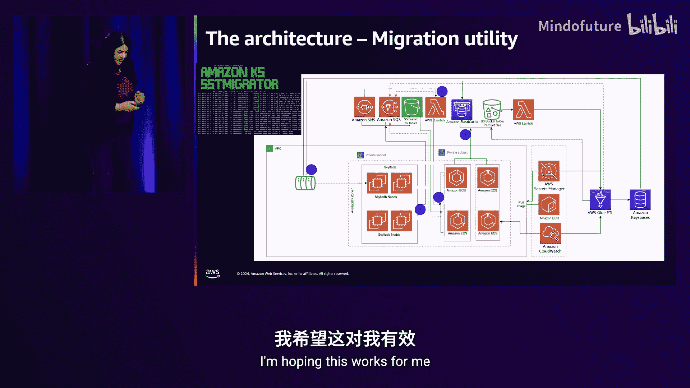

He has some ECS tasks。Here are your glue jobs。You will see a cache up here and few buckets。

And few Lambdas。 And I will now walk through how this migration of historic data works。First。

 we installed a script on each of these nodes， Cassandra nodes。

 We had 54 of them in one of our largest clusters。Once we installed。Once we installed script on。

Theilla or the Cassandra nodes， it extracted the SS tables that Steve talked about into S3 buckets。

Then we used S events to take those SS tables and make an entry into a queue。😊。

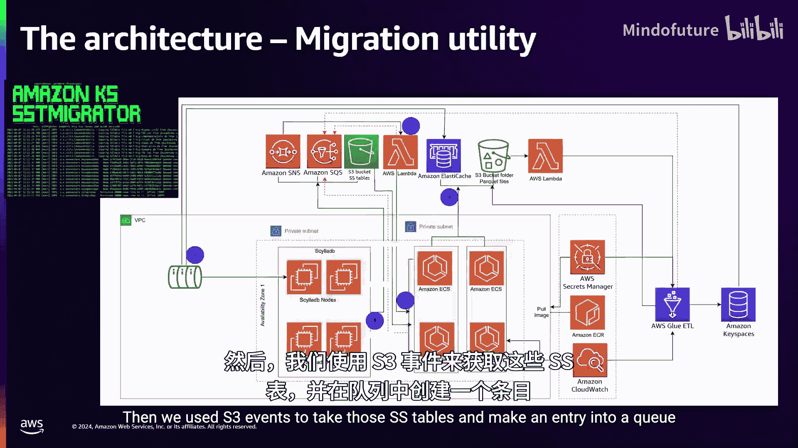

I'll try again。 Oh， yeah there。 make an entry into the queue。 So you'll see S Q S in here。

 Make an entry into the queue。😊，And then convert them into parquet files。

 Why make entry into the queue so you heard Steve talk about the three nodes in Cassandra so we had three replicas of all the data and because it's a managed service we didn't want to write three times because it will cost us three times as much。

😊，Roal team。Helped us have a queue where we could actually have a cache。

 sorry I meant cache have a cache where we can first time we write the data we took key spaces we made a cache entry so the other two replicas will not get processed and thats how we got across that got through that problem of having three replicas for every node。

😊，Once， once we had the parquet files， then the parquet files needed to be written into key spaces to do that。

 we had to do a couple of things as we did the first lean experiment we noticed that our data is quite this separateate。

 It's different customers have different sizes of data in there because there for various domains and applications So we decided to take some metadata as we were transforming from SS tables to parquet files this metadata will later help us greatly parallelize what we were doing in blue jobs and glue is elastic so we could parallelize as much as we wanted we did many calculations to make sure we will be done well within six months because that was our unlimited time was limited。

 Time is the most precious commodity。😊，Once。The glue job triggered。

 they wrote the data into key spaces， made an entry， and then you were done。

This meant millions of glue jobs running in parallel and running in parallel for months。

 So it was a massive， massive undertaking。😊，Here comes the next view into the same story。

 It's the same story of the historic migration， but it's a different way to look at it。

 It give you an idea why the 300 enterprise customers makes it interesting。

 makes the problem interesting。😊，So you can see the ingestion gateway that I described earlier and showed you in the other architecture diagram。

You see on the top the existing Cassandra database at the bottom is key spaces。

 And you can see some statistics about how much data。And the various Saas customers。

 now I have a fun little animation that's going to show you what I'm talking about。

 So when we first started， we started sending all the live data to keyspaces as data came in it went to key spaces。

 After that point on， we started migrating the historic data to key spaces using all those millions of blue jobs running all at once。

 but they kept track of what customer or what tenants data was done migrating once it was done。

 we moved the querying for that customer to key spaces。

 I'm sure most of you know about the strangler pattern and which is just kind of different interpretation of it to make sure customers can move seamlessly without knowing users using the system every day and no idea their store had changed all they saw was a little better performance and and some more benefits。

😊，Now， I want to change gears a little bit and talk about lean daily management。

 because when you have so much complexity to a project。

 one of the takeaways for me was how you manage it daily。😊。

When you have multiple teams like our teams geographically separated as well as Pro serve and AWS SMME is all working together daily。

 we needed a very good Iclad daily schedule and daily management we met every day all across these time zones and we keep taps kept taps on where we were。

😊，We took a lot of data。 data is key。 Data is key。 We live in the world of data。

 So every day we looked at how where are glue jar doing， How many of them were we running。

 We stretched many limits of elasticity when doing this and monitoring was key。

 key spaces gave us really， really good opportunity to look at what was happening。😊。

If there were failures， retries， we could see them all。 We could see them all really。

 really well and pivot as we needed。 And I think the ability to have this observability and pivot as you are experimenting makes for a good transformation。

 it would be really difficult to stop this machine Think of a million glue jobs and debugging them。

 It is like looking for needle in hist stuff。 It's stuff。

 I have had some stressful days during those times， but it all went well。

 as we were monitoring adjusting， there's some fun stories from those days。

 one day I'm walking walking with my friend and her dog around the lake and I got a call from an AWSte in Ireland saying your Cloudwach matrix。

 something looks wrong。 you might get a bill of $80 million next month unless you do something about it for real story。

 true story。😊，So one of the developers turned on some trace level logs。

 and they were they were all going。 We were able to mitigate the problem in an hour or so。

 So we did not pay $80 million bill。😊，But the great observability and the partnership we had really helped us get there。

😊，This kind of transformation has many twist center， and we tackled them as a team。

 We had a lot of help from AWS and RSMs， and we worked hand in hand together。

 as you can see in this colorful slide that many teams came to play as we ran into issues。😊。

We found our data the shape of data we could really see during this transformation and that varying shape of data meant we needed to do some different things in our transformation to make sure we can parallelize correctly。

😊，We also ran into some garbage collection issues in one of our pubs and Procer team rapidly helped us experiment through many garbage collectors so we could get past that problem。

We also had。Some challenges in testing limits of elasticity。

 Nobody had seen the amount of glue jobs we we were running in parallel during some of those really heavy listing months of this migration and。

The pro serve team and the support team came to our rescue helped us in many ways in getting through those periods。

 We ran into a lot of unique challenges towards the end when the jobs were finishing， we found bugs。

 they their part of life， and we fixed them。 The daily lean management help helped us fix them。😊。

We finished towards the end with a quick spark job。 some of the leftover work。 And then we were done。

So again， lots of key learnings from this six month period expect many twist symptoms。

 you know expect those calls where the bills running up。

 runaway Lambda are a glue job and be ready to fix them。

 your AWS team is happy to help and bring you a lot of data that will help mitigate anything you see。

😊，no。One of the important things for me is to check how the team is feeling。

 because it was difficult when， you know， you are the developer who is responsible for these millions of jobs and debugging them is stressful。

Is stressful And really building that trust with each other and having constant communication helped work as one team。

This is my favorite part of this story。 These are my heroes of this transformation。

 Maybe some of you are in the audience。 I don't know today， if anybody is， but these are。😊。

The people who got the word done。 this is my team。 I stand here today very humbly to represent each and every one you see on the screen。

 Also， you will not know that half the people you see here are from G know why half of them are from AWs from various different teams pulled together as one team to get this done。

 no great transformation happens without some serious elbow grease。

 And these are the people who put in the elbow Greecerease。😊。

If you don't mind a big round of applause for my team。Thank you。 thank you。So some key learnings。

 again， people are key。 However their feeling is important。 I got scold at by a mom。😊。

One of the junior engineers on the team was working away in Hyderabad。

 and the mom came on camera in one of our daily management meetings。 and he's not eaten。

 What are you having him do。 He loves it too much。😊。

So work is fun and exciting when you're solving really good problems。

 but it's important to watch health， take a step back， eat on time， etca。😊，Something I learned。

 Something I learned。You， youd think we are done， right， We're not done。 There was missing data。

 So after the transformation is done and our verification scripts are running。

We found some missing data。And I was so exhausted by that time and so was my team that we were just not ready for it。

 But we found missing data。 It was very， very， very minor。

 so small that're almost tempted to ignore it。 but we can't。 We can't。

 We live in the industrial world。😊，Why missing data？

 So I went to work working with our product management team。Highly， highly supportive in this。

 this venture， really identifying why missing data happened。 What we found。Historically。

 there was an error in some edge devices， and they got some data that really wasn't something we wanted to store。

 It got stored until the team fixed the problem many years ago， but the data stayed。

 the data shouldn't have been copied into keyspaces to begin with。 And so we could move on。

 It was a happy day in my life。 and I found out about it。

 But going back to one team the work we did and how the product management team scrambled to help me find why the data I went missing was really really。

 really an important aspect of working as one team without that we couldn't have。😊。

Really had that final sigh of relief as a team when the work was done。

 And we found that the the missing data was never supposed to land in key spaces。 We could move on。

There were some key learnings， start validation early。 It was one of the things I learned。

 We didn't start as early。 I always felt like we could have saved a little bit of time。😊。

My product management team wouldn't have to scramble to find， find things if he had started earlier。

 started just a little late。 We did O。 But even then， I think next time I do something like this。

 I'll start very early。 We lost some time because of it。

The other thing is building trust when you're working with so many different functions and teams like support and your partners and your product management and people watching the cost and our leaders it's really important to build that trust with the team it's key and it only happens over time my grandmother always said that love and trust can never be taken it can only be given and it's a slow process to earn that trust from everybody on the team。

😊，Observability。It's important。 we oftentime build a lot of software and then we say wait。

 how am I going to monitor this， and then we start doing things。

 It's important to bake the observability in from the get go So you find things early and we had a great partner in our AWS peers when doing some of this work very early on。

😊。

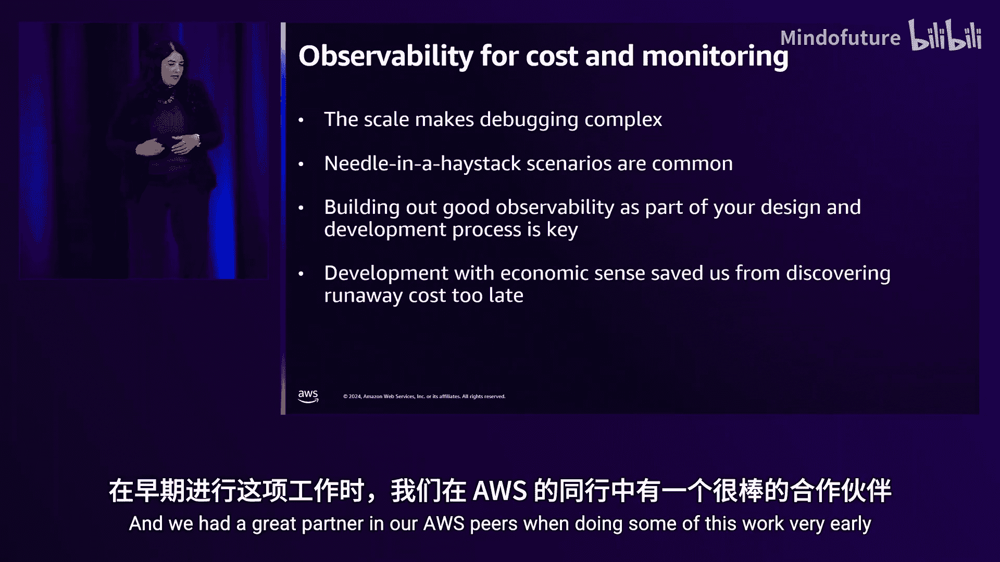

Now to the finish line， my story is over。Be transformed our time series service。

The best part of this slide that I like is the zero， zero outages。

 zero issues while the system was live the whole time and we moved all the data。

 we had decommissioned the old old system， we saved the cost we wanted to from it。

 and we were on key spaces。😊，There were also many benefits that we slowly discovered after moving。

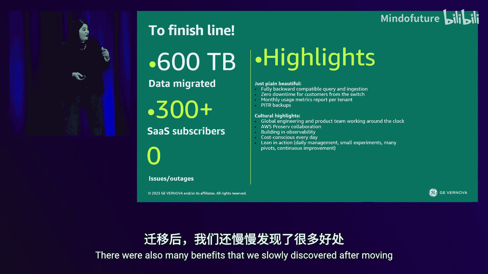

And you can see some of them on the slide。 We got some point in time recovery from this endeavor。

 We also got flexibility。 The time to live that Steve talked about earlier。

 how long does data live in key spaces was now configurable where siloed model of tenancy so we could fine tune things for our various enterprise customers better。

😊，We also could build auto scaling comess with key spaces。

 So we were spending less time doing things about it and excellent observability。

 which I've talked about many times。😊，The best part for me。

 out of all of these benefits really is that my team could now focus on what our customers wanted。

 We didn't really want to be the maintainers of the store。

 We wanted to fine tune our services for our customers' needs。😊，It let us do that。That said。

 we are leading the energy transition， one transformation at a time。

 And you just saw this one small transformation。

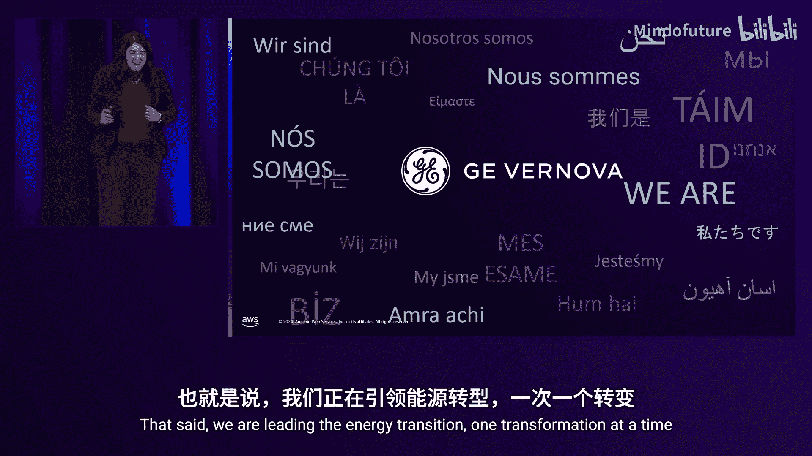

Thank you for staying with me through this talk。 I know I stand between everybody in lunch。😊。

👏And thank you for listening Thank you Yogihini for joining us we so love when we have customers come up here and talk so maybe one of these days one of you will be up here on stage but thank you for the time you gave and so Yogini appreciate it we will be outside if there's any questions we can handle if other than that enjoy lunch and like the kids said don't forget to go smash that like button so we appreciate any feedback on the session so a good afternoon I hope you had a great reinvent thanks thank you。

😊。

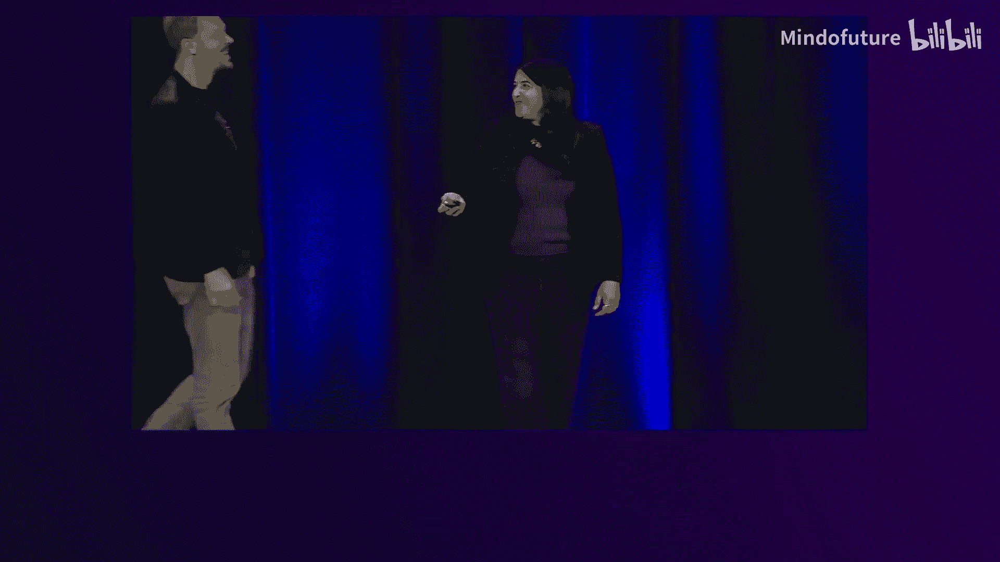

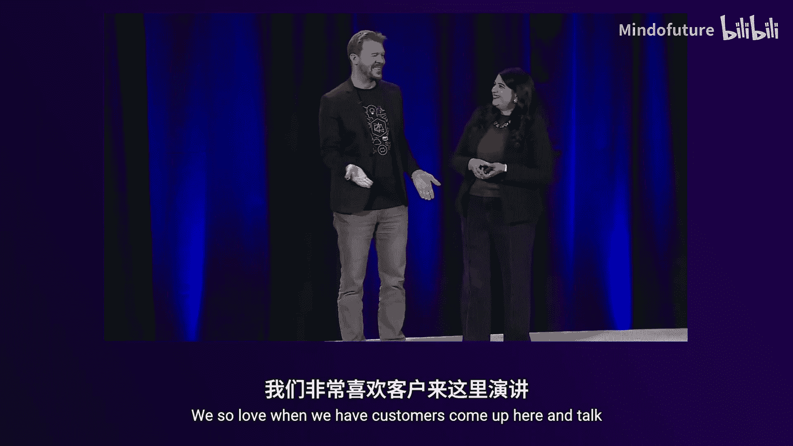

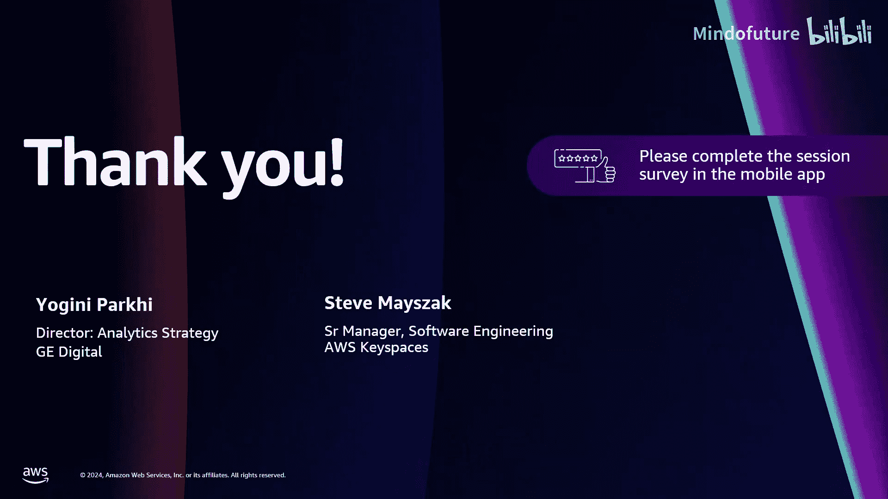