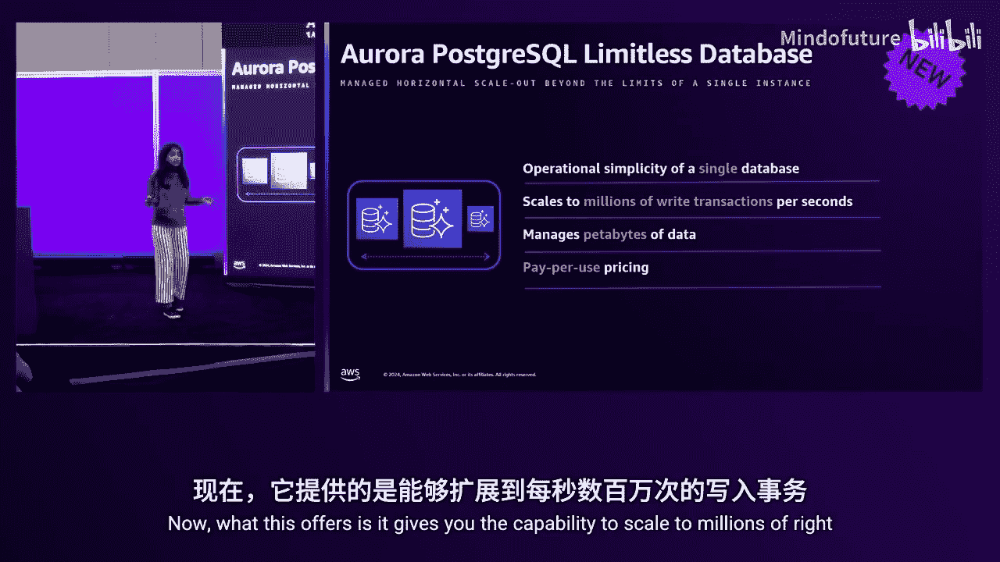
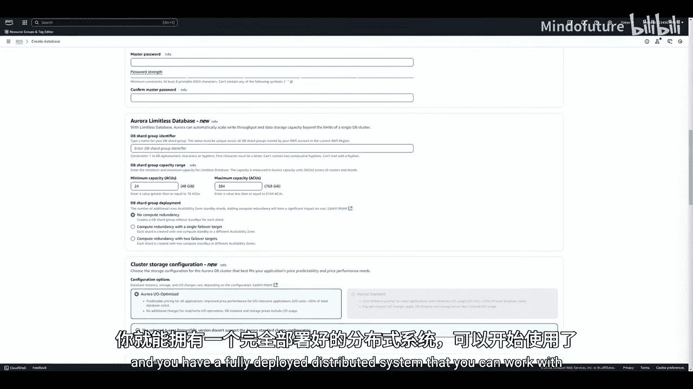
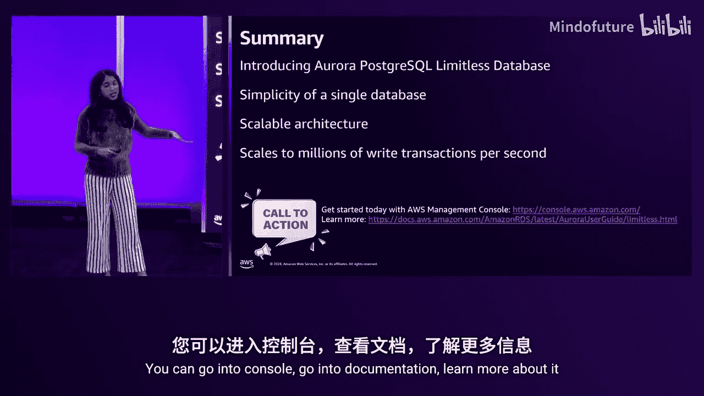

# 【AWS数据库峰会2024全集-•-中英】AWS-re：Invent-2024---Databases-p06-P06-Serverless-scaling-with-Amazon-Aurora-PostgreSQL-Limitless-Database-(DAT338)--BV1VAR5Y6Es1_p6-

Let's try this one more time， so we talked about AI and of course now we have to talk about databases because everybody was getting too excited。

 so in today's world of data intensive applications。

 how do you go about scaling your databases beyond the limit of what a single database instance can offer you My name is A Jhangchei and I'm a product manager on Amazon Aurora and in this lightning session。

 we are going to talk about one of the most exciting launches that we have done recently for Aurora。

😡，We're going to show you how you can go beyond a smaller a single database offers you。

 but with the operational simplicity of a single database。😡，Now。When your usage is。

 you know reasonable enough， what you typically do is you provision a database。

 you plug your application to it， and you're good to go。😡，But pretty soon。

 business starts doing good and good and good， which is great。 but that causes problems for you。

 So now you start hitting the limits of what a single database can offer。

So what you end up doing is you break apart your database into little components。😡。

To be able to get that scale with parallelism。Now， you're going from a scale problem to a management problem because you get the scale。

 but you have all these databases to manage。 So you have a management problem。

 even with managed databases。So this is commonly called sharding。

 which is probably a technique you're all familiar with。 Now。

 sharding comes with a whole lot of problems， and I'm going to touch up on a few of them。

 And let's start off with just squaring。When you've broken your database apart and you have distributed your database。

 data in the database， your application learn needs to know which database to go query。😡。

Another problem is consistency。Now your databases isn't a single component， it's many components。

 you have to make sure that you keep them consistent， you have to make any changes。

 you're adding a column， deleting a column， you're taking a backup at midnight。

 sure you can run the statement at midnight， but every single backup is not going to be exactly the same。

😡，And initially， when you started your sharding journey， you distributed your data bonds。😡。

Are you done with it， not really What happens is one of your nodes may get hard and you have to redistribute again。

 so shing actually becomes like a continuous journey and the entire time you have to make sure your application is up and running。

😡，then problem that you run into is capacity management。

So you basically have to figure out where in your system you're seeing heat and then based on that you have to fail over to a bigger size instance or a smaller instance。

 So what you end up doing is you just over provision everything so you have two problems。

 not just operational complexity， you're also paying a lot of money because you're over provisioning your entire system。

😡，So to help solve this problem， what did Aurora do， we launched Aurora Postgres limitless database。

😡，Now， this is Aurora's answer for a managed horizontal scale out solution。And what does it do。

 It gives you the capability， the power of a sharded solution。

 but with the simplicity of managing a single database cluster。Now。

 what this offers is it gives you the capability to scale to millions of right transactions per second。

 you're able to manage petabytes and petabytes of data。😡。

But at the end of the day， it's just a single endpoint you're working with。 so from your perspective。

 this distributed system is a single cluster under the hood。

 this is a serverless deployment and what that means is you don't really have to worry about the hardware。

 the infrastructure any of that you give a capacity range and the database automatically scales up and down。

 you've got to scale vertically， you've got to scale horizontally， whatever your workload needs。

 the system automatically does it and from your site it's still a single database cluster。

And of course， you're only charged for what you're using。

 so you don't have to worry about that over provisioning problem anymore。😡，Now。

 let me just show you how do you get started。 What can you do today。

 So this offering is generally available。 The screen right here that you see is AWS console。

 you're all probably familiar with it。 this is the regular way of creating a database。

 and if you kind of look down upon a console and you're like show me the APIs and stuff。

 Everything I'm gonna to talk about， you can do the same with APIs as well。

 So we launch the offering with Postgres compatibility。 once you go in to create flow。

 that option is already selected by default。 you don't have to do anything。😡，To make life easier。

 we have filters where you can say， you know what I want the high scale。 I want limitless database。

 you pick that version。 you scroll further down。 This is where the gist of things are。

 So typically at Aurora， what we are used to doing is you say for compute you need a particular instance you need RG。

 you need R7r。 and that's corresponding to you know whatever the E C2 instance is。

 that's what you were doing for compute。 Then serverless came in。

 So instead of picking a specific hardware。 what you said was this is my capacity range。

 keep scaling my instance within this capacity range。 and I'm only going to pay for what I'm using。

 So now we're building on top of the same concept。 So in addition to that serverless vertical scaling。

 what we're giving you is the horizontal scaling。 and we're taking the same concepts for serverless for capacity range。

You give a minimum capacity。What is that， think about what's the starting capacity you need。

 What's that capacity that you want guaranteed always to be there。 That's your minimum ECU。

 The maximum is essentially your budget ceiling mechanism。😡，This is the point where， hey。

 I don't want to pay more than this， this value。 So this kind of keeps like a safeguard for the system to not just you know。

 explode in your face with the giant bill。And of course。

 we're using the same concepts that we have for surveillance for the capacity measurement unit， ACU。

 which is Aurora capacity unit。Within this range， if the system needs to go vertically up or horizontally out。

 the database takes care of it。 So you don't have to worry about any of that。 Now， next option。

 compute redundancy。 So availability， everybody's headache right So for availability。

 we offer the same availability as aurora of 99。99%。😡，And if you want to select that。

 you have to select one of the compute redundancy option with just the click you specify。

 I want a single fill target， or I want two fill standby target。

 and these are literally just clicks that you say to specify this distributed system。😡。

So that was all a compute for storage， this system actually shares the same storage layer that Aurora has。

 so you don't really have to do anything you just say you want the storage layer and we only support IO Opimize。

 which gives you that predictable price and nice price price performance that you are already used to welaunched it earlier in the year。

😡，Now。That's just literally selecting options doing a couple of clicks。

 and you have a fully deployed， distributed system that you can work with。😡。

So now， Dave， who is the engineering leader on the project。

 is going to tell us with those few clicks what happened under the hood。Thanks and enough。

Oh there we go all right so as you click through and you begin creating the cluster we will spin up across three availability zones。

 the scaffolding of the system that you're building now normally an aurora you would have a cluster and then you would have created instances but as a numb just showed instead of creating instances you've created this shard group concept now we split the shard group out across three AZs I'll explain why in a moment but the key thing I want to hit before we move on is this does use the existing aurora distributed storage system。

 a nu mention that now what that gives us is that we get durability of all rights across three availability zones we get elastic volume grow and shrink we get effectively unlimited iOs gated just by the size of the network that you're using off your database node and we get 10 years of innovation and proven durability。

Across hundreds of thousands of databases and tens of thousands of customers all right。

 so within this shard group what's inside that？Well first。

 we create something that we call the distributed transaction routers or just routers for short。

 this is where all of your database connections from your clients are going to go to。

These routers are not simple proxies though， the routers are actually deep database nodes。

 they do your query parsing， they do the planning， they drive the execution。

 and as they say in their name transaction routers。

 they also coordinate the transaction system that keeps this entire thing able to give you a consistent single system view。

As you see， the routers are actually spread out across three availability zones， as I said before。

 this way， if one availability zone goes down， your routers are already there in other AZs。

 we can either vertically scale them up in place using serverless technology or we can create more as necessary in the AZs that are up。

All right but these things don't actually have any data they don't have data on them where's the data so the data is in the data access shards again we distribute them across AZs and they in the example here you have three shards they can be varying sizes because again we're using serverless technology under the covers so as a given shard gets more load you know it's rare that your workload pattern is completely even across your entire keyet right usually there's some hot some cool areas so the system will automatically adapt to that scaling up and scaling down nodes in place as necessary。

😡，We also have failover nodes we call this compute redundancy we specifically call it compute redundancy because your storage is already 3 Az durable so there's no additional redundancy needed for the storage so this would be a compute redundancy one setting which means each shard has a failover and one other AZ and in this case if Az1 were to go down then shard1 would fail over to Az2 shard 3 would fail over to。

I think we've got the labels wrong。We also have the ability to have two failover options and compute redundancy too okay so this is what it's like inside the system now these data access shards as I said they're the ones that manage and own the data for a piece of your database they receive queries from the routers they manage their own local transaction they execute results and pass results back through routers the interesting thing about our transaction system that we've built is that we pass a transaction time from the routers down to all the shards this allows us to have a consistent snapshot isolation view of all your data regardless if it's a single shard transaction a multisard transaction a single statement implicit transaction a multistatement explicit transaction a stored procedure of function any of these things you get the same repeatable read snapshot isolation or read committedmit。

That you get in a traditional single node Postgre system。All right。

 so what do tables look like inside this system？We offer a couple different cable types。

 the first one to talk about is the most interesting one， the sharded table。

So in order we're going to use the example here of a customer's table all right and so we didn't want to alter the Postgres syntax that you have in your create cable statements。

 we didn't want to mess with that so what we did is we gave you a session setting that you set before you execute your create table statements and so we just say we want to have a create table mode of sharded and that the shard key is going to be the customer ID shard keys can be composite keys with multiple columns in them all right so this example is just the simple customer table then we run the create cable customers and it will pick up those options that we've set and it will distribute parts of the customer's table across the system。

Now an important part of this system in this architecture。

 while we execute distributed multicharardd queries。

 we do distributed multicharard joins the real reason you run this system is the performance and the scalability to get the best performance out of any system you want the data that you're working with to be colocated with the compute that you're working with right so a common schema you might be joining frequently a customer table with an orders table and you might have a primary key four and key relationship between on customer ID between customer and orders so you know give me all the orders for this customer right so in order to get the best performance。

 we give you the option to coloccate those tables together with this colocation parameter that means that for any given customer ID。

 all the orders for that customer ID will live on the same shard is the customer record。😡。

And so if you're doing joins between them， the router is actually able to push the SQL to where the data is。

 process that locally and get you the best performance。

Now there's another table that we have here what we call tax rates so you might and your processing orders figure out need to figure out what the tax rate is for the jurisdiction that the orders coming from right so that's data that isn't frequently changed I mean you might change you might refresh it every night but it's not part of your hot transactional path to write new tax rates unless perhaps you're in a very specialized business but for most of us writing a new tax rates we don't do a thousand times a second。

 so what we do is you can create tax rates as a reference table when you create as a reference table that data exists on every shard so all the rows for all the tax rates are effectively duplicated on every single shard they're transactionally consistent the updates and rights to them you absolutely can do they will be transactionally consistent and across but if you're looking to scale aggregate storage。

Aate throughput having your hot table as a reference table doesn't make sense。

 So we put this here for join。 So now if you do a join between customers orders and tax rates。

 we can push that entire join down to where that customer I record is。

 just a little more about the reference tables， they， as I said， are strongly consistent。

 so it's not that you write once and it eventually replicates everywhere， strongly consistent rights。

 and they enable to join push down， all right。So we're gonna to just hit on performance real quick and talk about how the system actually performs in scales so here's an example from our lab this was actually running I say in our lab it's our own testing but this is actually running our production system in the US East one region spun up as a customer we did override some quotas to get some massive scale so if you need to hit this scale call us and we can do a limit increase for you because we wouldn't want you to just go run up everything but let me talk about why this is such a big system so this is an example of doing well sharded updates so we have 100 billion row table here。

And we are doing updates to random fees in this100 billion row table so it's a right as the update and the commit all right so it's a right transaction we got such great throughput we needed three different 24 Excel machines to drive the client okay so this represents thousands of database clients but each of these driver machines is doing over 800000 commits per second in a transactional Postgress database in aggregate this system was running 2。

55 million commits per second not not per minute per second that is a tremendous amount of commit volume in your database and the average latency across this was 2。

4 milliseconds so that's measured from the client into the routers the update down to the shard the commit that's durable across 3 AZs returning the results back to the client back to the。

Back to the client 2。4 milliseconds at 2。5 million transactions per second so this is just an example of the way this system can scale out and reach levels of performance and write throughput you've never been able to get in a Postgres database before so with that i'm going to turn it back over to aum to wrap us up。

All right。Once I get this turned back on， is it all right。

 So what have you learned in the last 15 minutes， you have learned what Aurora Postgres limitless database is。

 So if you are looking for a Postgres compatible horizontally scaled out solution。

 this is what you want to use， you look at it， how it can give you the power of sharding with the simplicity of a single cluster。

And we talked about the underlying scalable architecture that powers all of this and as Dave just mentioned this scales to millions of right transactions per second so we're talking about commits here so call to action for today generally available you can go into console going into documentation。

 learn more about it and this says some of the related sessions that you may be interested in completely understand it's Thursday so some of them are already done but we will have videos up on YouTube for you to watch and as always。

 please do the survey and thank you so much for attending thank you， thank you。😡。

Thank you， Anna。 Thank you， David。 Gu， make sure you fill up the survey。

