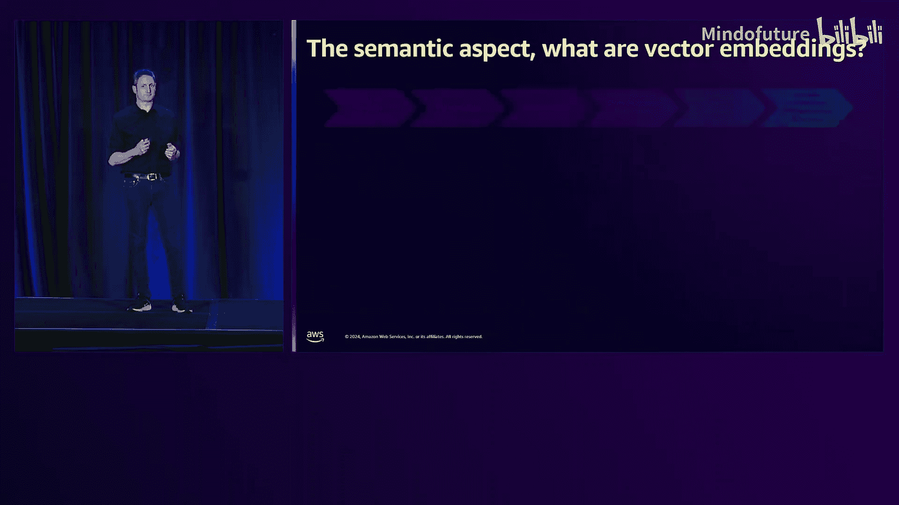
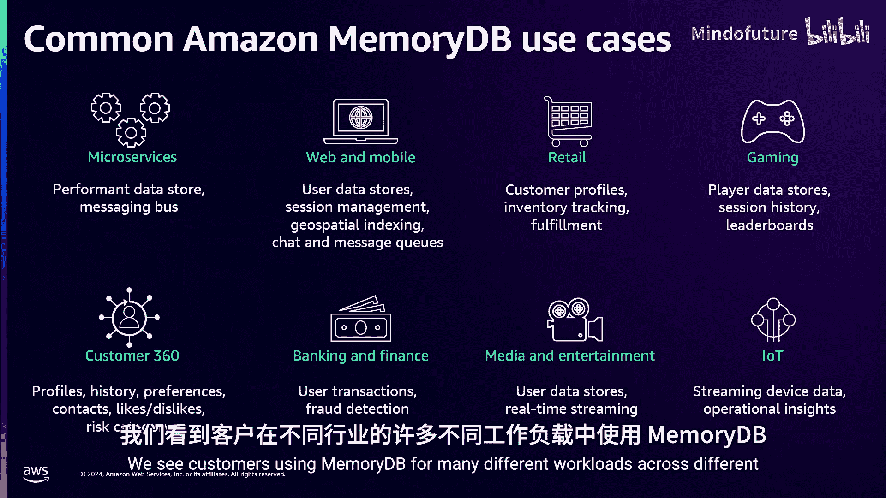
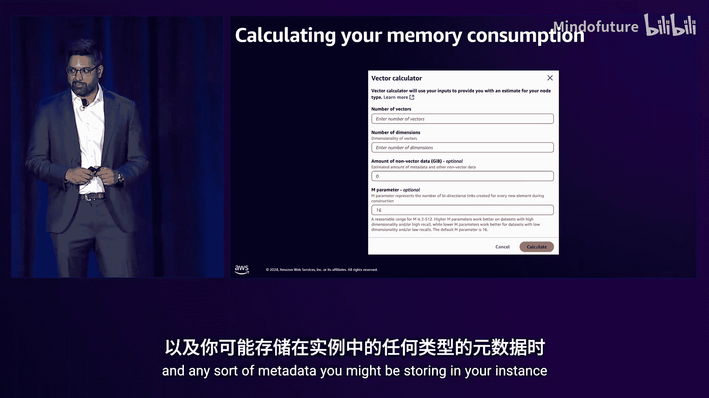
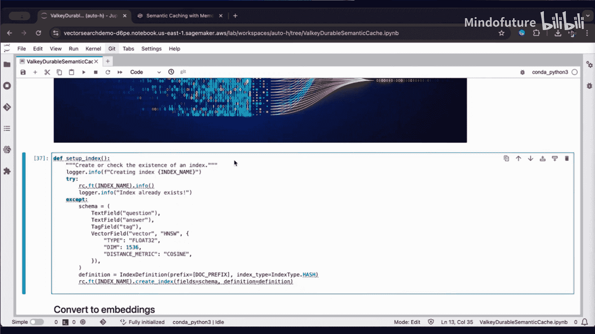
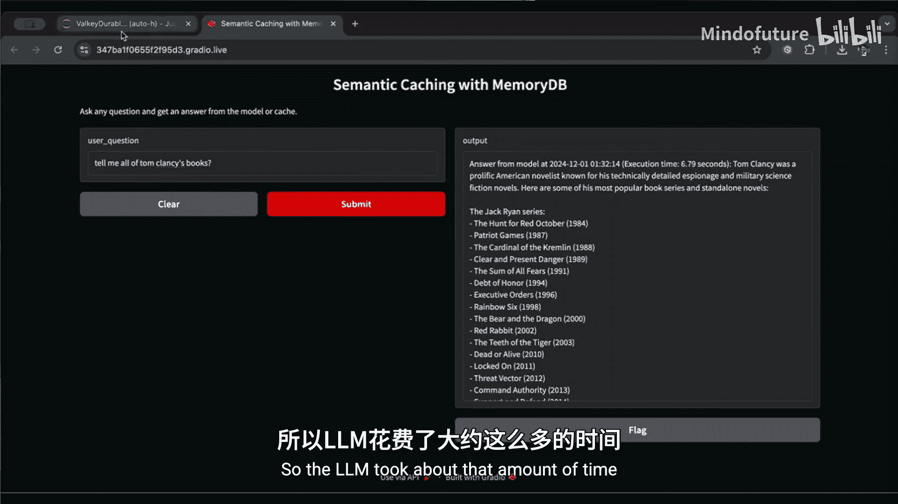
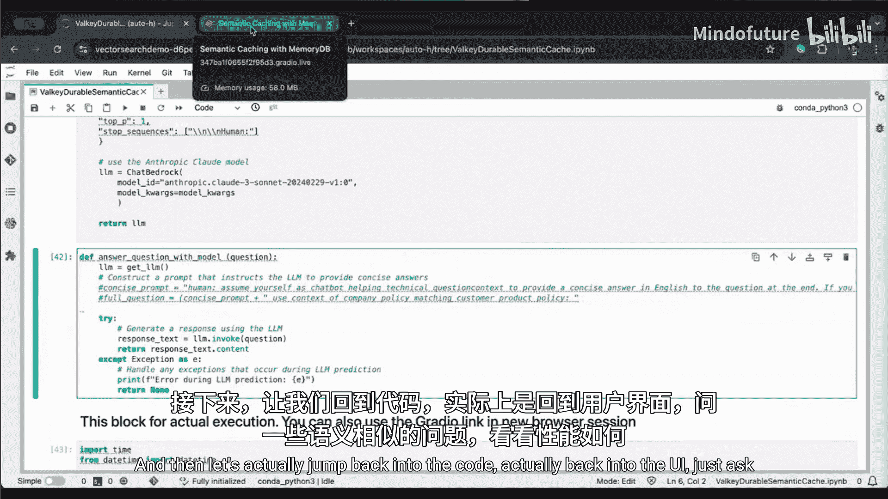
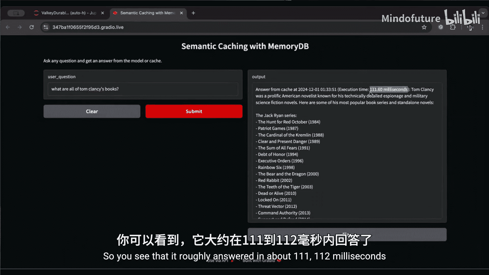
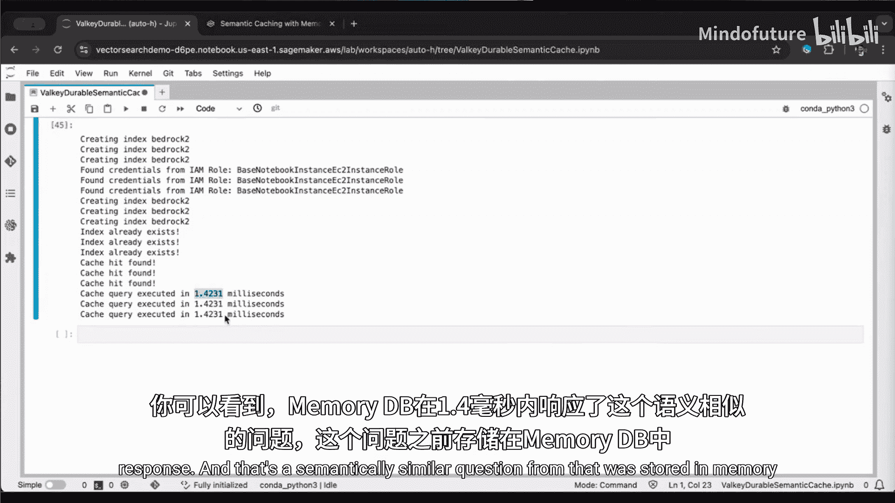
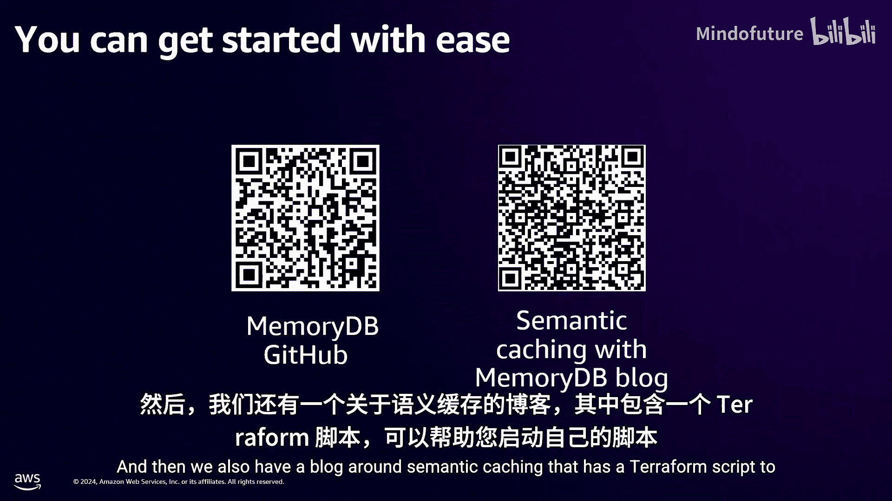
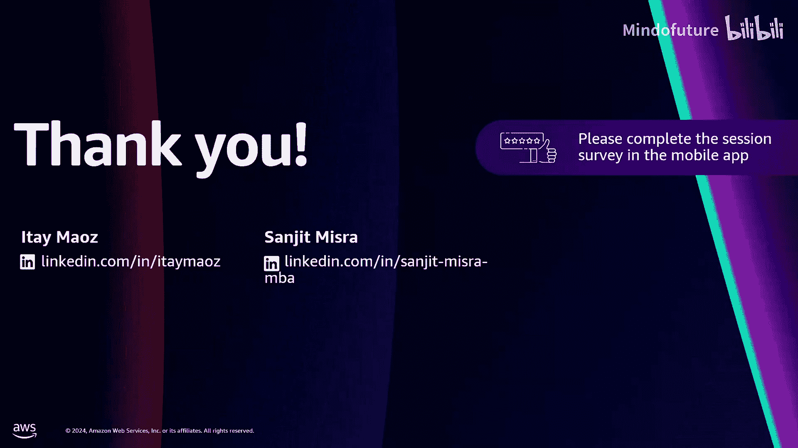

# 【AWS数据库峰会2024全集-•-中英】AWS-re：Invent-2024---Databases-p07-P07-Optimize-gen-AI-apps-with-durable-semantic-caching-in-Amazon-MemoryDB-(DAT32--BV1VAR5Y6Es1_p7-

Hi， everyone。Thank you for joining。We've all been fascinated with what we can do with generative AI。

If you're building a generative AI application on AWS and you're looking for the right solution to scale your application。

 improve performance and optimize cost， you are in the right room。

In this session， we will show you how to achieve that by implementing durable semantic actionching using memory DB。

My name is Iti， and the general manager of inmemory databases。 With me is Sanjit。

 the product manager who LED a feature launch of vector similarity search for memory Db。

Before we start， please raise your hand if you have already started your journey building a J application。

Awesome， great to see so many people raising their hands。So in the session。

 we'll show you how you can scale your application。

 your G application using a memory Db with durable smatic caching。

Genrative AI has captured the imagination of millions of people around the world。

 Companies are at early stages of leveraging Gen AI models。

 and we're starting to see how powerful it is。😊，Gative AI is a type of AI that can create new content and ideas。

 including conversations， stories， images， and music， and like OAI。

 it is powered by machine learning models， these are very large models that are commonly referred to as foundation models。

By 2026， Gardner predicts that 80% of enterprises will use GAI in their production environments。

G AI is powered by foundation models pre traineded on vast amount of antstructured data。

And these are capable of learning complex concepts that can be applied to many different applications。

And if you've heard about large language models， LLMs like Titan， Cude and Yama。

 these are types of foundation models。One of the challenges with LLMs and foundation models is that they become expensive as the usage scales。

Here is an example of a chatbot implementation using Amazon Brock with Titan T Premiere。

 and we can see in the yellow line that as the number of users increases， the cost increases as well。

And what we would actually like to see is something like the green lightinging where it scales sub linearly。

And today， we'll talk about a way to avoid the linear increase in scale and to achieve this green line by implementing durable semantic caching。

The idea of durable semantic caching is similar to other caching systems that you are probably familiar with。

You catch the results of expensive， repetitive queries to improve performance， scale and cost。

So the question is， what is unique to durable semantic caching。

So let's understand the semantic aspect of it。

To understand semantic caching， we first need to understand vector embeddings。

You can think about translating andstructured data like documents。

 video and audio to numerical representations of your data that contains its semantic or contextual meaning。

The vector embeddings can capture the semantic relationships between the different semantic elements。

For example， with text。The semantic awareness lets the model discern whether in a certain context。

 the word book refers to something that you read like a book or to making a reservation like booking a flight。

The process to create these vector embeddings， including jest in data from the source。

 splitting it to chunks and con it to vectors。These vectors have many dimensions。

 typically hundreds or even thousands of dimensions。

And it's ordered to have an accurate representation of the semantic meaning。To visualize this。

 we will use three dimensions。And the main idea here is that vectors that have similar semantic meaning will be close to one another in the vector space。

So now that we understand what vector embeddings are， let's understand semantic caching。

Let's say we have a chat bot or some other application that has a prompt query from the user。

And we'll use the same example of books， furniture， and finance。

 and we'll again visualize it with three dimensions for simplicity。

We've stored these queries in our durable semantic cache。

 And let's say we have a previous query that says， tell me some adventure books to read。😊。

And now we get a new query that says， what adventure books do you recommend？

We can see that these two strings don't match， so classic traditional caching techniques like exact match or hashing of the string just do not work。

And we can see that these two strings as humans have similar semantic meaning。

 And that's what we're trying to do is vectors。Upon the new query。

 we start looking for a similarly semantic vector。And we exp the radius as we go on。

And once we find something that is close enough， and later in the session。

 we'll explain what close enough actually mean， we will go and return a cache hit and the data for this query。

So let's look where durable semantic caching fits in your application。We'll use the same example。

So we have an end user， the end user will do a prompt request to the generative AI application。Again。

 we use the same example， tell me some adventure books to read。

And then the G AI application will go to the foundation model with the same prompt。

 get the response and return the response to the end user。So now let's add caching。Again。

 it starts the same way with the prompt， but now instead of going to the foundation model。

 we'll go and create the embeddings， you can see that it adds a little bit more latency。

 you know about 100 millisecond more latency， a little bit more cost。

 but we don't go and create the embeddings。We get the vector and then we do a search in our durable smatic cache。

 so this is a cache miss because this is the first time that we see this kind of vector。

 so we'll get a cache miss。And then we'll do two things。

 first we'll go and get the data from the foundation model。

 We see that this foundation called to the foundation model is pretty expensive。

 it takes and it takes usually an order of seconds。

We'll get the response and then we'll do two things in parallel。First。

 we will return the response to the end user。And the second thing we will go and update the cache with this vector data。

So that's what a kshmist looks like。And we see that this is a little bit more work。

 a little bit more work creating the embedding， we can see a little bit more work with the cash。

 it's very low cost and very low latency。And now let's see why it's worth doing that。

So let's see what happens when there's a cachehe。 We will again start with the same query。

 Tell me some adventure books to read。 We'll create the embeddings。 We'll get a vector。

And with this vector will go， search for this vector in our durable semantic cache。 But this time。

 we'll get a cache hit。And with the cachehe will return the response to the user。

 and that will be in a very low latency， avoiding the expensive call to the foundation model so we get rid of the expensive call and the high latency。

But then you guys can look at this and say， hey， but what's unique here。

 this is what we get with any caching system。So let me show you where the real power of semantic aching comes to play。

So here， instead of sending the same query， let's say the user sends a different query with a similar or similar query with the same semantic meaning。

 instead of tell me some adventure books to read， the query is。

 what adventure books do you recommend？So this is not the same query。Now again。

 we'll create the embeddings， we'll get the vector。We'll search it in a durable semantic caching。

 And then this time we'll get a cache hit because it's very similar。 It's close enough。

 And we do a vector search。 We'll get a cache hit because it is pretty similar。

And will return the response to the user and will again。

 avoid the expensive call to the foundation model。So this is the power of durable semantic caching。

So let's look at the numbers。Here is an example of an application that uses Cloud Sonet on Amazon Brock。

 and it has 100，000 questions per day with a configuration that balance cost and relevancy。

And the cost per month is 28，000。Using memory D B with durable semantic caching。

What we see is that we can get significant cost savings。In fact， if you look at this。

 once the cost savings correlate to the cash hit ratio。If you have a 25% cash ratio。

 you get almost 25% cost savings， and if you have 75% cash hit ratio。

 you get almost 75% cost savings。This demonstrates that most of the cost is coming from the foundation model and that the overhead of adding durable semantic caching is very low。

Let's look at the real case， you know， a real case study of iterate AI。

So iterate AI is an AI company that helps their customers。Build Gen AI applications。

So they help one of their customers build a J application， a chatbot application with Amazon Brock。

Ats 57000。QuQuestions per day per month。 They thought that the LL M cost is becoming a concern。

And they realized that 80% of the queries are semantically repetitive。

So using memory D B durable semantic caching， they were able to save 70% of their cost。And moreover。

 they were able to lower the latencies from seconds to milliseconds。

 significantly improving the customer experience。So， we talked about。Durable semantic caching。

 But which database should I use for this purpose。So， let's break it up。Let's start with semantic。

 So we talked a little bit about semantic。 You want the database to support semantic search。

Vctor similarity search， you want advanced features in vector similarity search。

 you want different distance metrics。 we will talk about these things a little bit later in the session。

 but at the high level you want a database that supports semantic caching and vector similarity search。

The second aspect is performance， you want a database that has low read performance and low write performance。

 you want the low write performance because whenever you have a cachem you update the database。

And you want this to have a low cost per query or alternatively high throughput per node。

 because that's one of the main goals that you have， which is to reduce costs。

And you want to do this without sacrificing relevancy。

 and we'll define relevancy in a few more minutes， but you want this to have with good results and not sacrifice on the quality。

And then the last aspect， which is a bit less intuitive， is the durability aspect。

And you can think about if you do a search， you can always do a linear search and just compare every vector in your database。

 something like a table scan。But obviously， that's not going to give you the performance that you want。

 So anything that has vector similarity search with good performance has some kind of an index。

And when you have an index， rebuilding this index can be expensive， so if you have a full cash loss。

 that's never fun in any system， so you have to rebuild the cache and that's expensive。

 but rebuilding the cache when you also have to rebuild the index is substantially more impactful and that's why we recommend for these kind of use cases to also have durability。

Similar to other database use cases， you will care about things like security， high availability。

 fully managed， AWS operational excellence， and so on。

 things that we offer with all over the databases。So AWS provides a wide range of purpose build databases to meet modern application demands。

And with the explosion of cloud native applications that require different access pattern。

 data models， performance and scale， you can choose from a solid portfolio of purpose build databases that fit your application needs。

Memory DB fits the requirements of performance， search and durability。That we just talked about。

 and we'll dive deep into it in the next few slides。All right， so what is Amazon memory to be？

It is the fastest durable database that AWS offers today with microseconds read latencies and low single digit millisecond write latencies。

 and we'll talk about more on performance aspect later on when we talk about the vector search performance。

Memory D B is Valky and Redis open source compatible。😊。

So before we move forward talking about memory D B， please raise your hand if you're familiar。

 if you heard about Valky。Okay， please raise your hand if you're familiar with Redis。Okay。

 a lot more hands， so I kind of expected this answer。

So let me take a small detour just for a couple of minutes before we move forward with memory DB。

 just two slides， two minutes to explain to you what Valki is so you have context for the rest of this session。

In March this year， Redis announced that future versions of Fredis will no longer be under the open source license。

Almost immediately， the community of Avi developers forked the project and created Valki。

It is developed by some of the same people who previously developed already before the license change。

And some of the previous reds maintainers became vacuumky maintainers。

 and many other developers in the community joined。Besides a large community of developers。

 it is supported by over 40 corporates， including large cloud providers。

It is hosted by the Linux Foundation， ensuring that it stays vendor neutral。

 and it always stays open source。And the first version of Valki is also the last open source version of Redis。

 which is 72 and is fully compatible with it。And this is also the first version that we released in our managed services。

 Elasticache and memory Db。We released these Vki on both of our managed services with substantial lower prices。

 and both services provide an online upgrade in just a few clicks as a drop in replacement and when you move from memory DB for Redis to memory D for Vki。

And specifically for memory DB， we launch it at 30% lower price on the instance and 80% lower price on the data written compared to memory DB for Red's open source。

This gives you additional benefits when you want a save cost。

 which is one of the reasons that you're implementing durable semantic caching。All right。

 so let's go back to memory to B。So it is Valki and ready open source compatible。

 you get the rich functionality and data structures like lists and sets and hashes and sorted sets。

 and you benefit from the popular Valki ecosystem and you get client libraries in over 50 programming languages and you get the rich functionality of Valki with durability。

Memory DB is designed for zero data loss， and one of the main innovations that we built into memoryoryDB is the multiavailability zoneone transactional log every write is acknowledged after being written to at least three different copies in at least two different availability zones。

And it leverages the same underlying technology that is used by S 3 and Amazon dot com ordering data。

I will later in the next few slides， dive deep on how we achieved durability with memory DB。

And then similar to other AWS databases， it is fully managed with high availability of four9s and other important traits across security。

 scalability and performance。So under the hood， let's see how memoryDB achieves its durability and high availability。

So here's a memory toB cluster， it's the one shard out of the cluster。

 and it has one primary node and one or more replicas。

It has the multi AZ transaction log that we've just talked about。And let's see how the right works。

So the client will send the right request to the primary node。

The primary node will go write the request to the transaction log。

 and then the transaction data will be replicated across the transaction log。

Once there are three copies and at least two different availability zones。

There will be an act sent to the primary node， and then the primary node will send the act to the client。

 At this time， the client knows that the data is durable in that transaction log。

We see that there is an asynchronous replication to the replicas。

 and this is important because we need this for high availability。

So let's look at the high availability。 Let's see what happens if there's a failure。So again。

 the client send write request to the primary node。Send them to the multi transactional log。

 gets an act， and then the client will get an act。And now， let's say that the primary node fails。

What we do at this point， we don't do an immediate failover。 What we first do。

 we favor durability over availability， and we ensure that we replay all of the data。To the replicas。

 So before we promote a replica to be a primary， we make sure it has all the data。

Because we continuously replicate asynchronously， this is relatively fast。

 usually it happens in less than a second。And that's how we provide high availability and durability。

Once we promote the replica to a primary。The client will be redirected to the new primary node and will continue to send the I O。

Asynchronously， the data keeps on replicating to the replicas again to have high availability in case there is an additional failure。

All right， so that's how we do fast fail over without losing data。

We see customers using memory DB from many different workloads across different industries。

 and some of the common use cases include microservices， data stores， session stores。

 and leaderboards。

Customers benefit from memoryDB， data structures， its low latencies and scalability。

And now with the launch of vector similarity search， we enable new use cases。

 including durable semantic caching that we are talking about today。😊。

And now I will hand it off to Sanjit to talk about these use cases in durable semantic caching。

Awesome， thanks he type。So as Eti noted， we've enabled a lot of different news new use cases with vector search。

Many of our customers trust Beckcker' search for memoryory DB in production。

The main use case we've been talking about today in the focus on our presentation is durable semantic caching。

 which is really kind of storing off your LLM inferences。

 such that subsequent semantically similar questions can be served from your vector store instead of the LLM。

 helping you improve performance and save costs。Then also additionally， fast semantic search。

 So think about catalog search。 you search one item like a shoe。

 and you want to return all the semantically similar products and catalogs and being able to deliver this within single digit millisecond latencies。

Then I'm sure many of you are very much aware of retrieval augmented generation。

 which is really using your own proprietary data to basically serve up context to L M to have more of a precise answer for your users。

And then finally， anomaly detection for a lot of our FSI customers to really detect fraud within single digit millisecond latencies to reduce loss。

But today， we're gonna really focus and dive deep on durable semantic caching。

So before we actually get into that， there are a few key terms that we need to align on。

 So exact match。Exact match in vector to search is essentially searching every vector。

 every distance from your input vector to all the vectors within your vector data set。

So let's take this input vector that's shown in the red circle here。In exact match。

 you're essentially doing a distance computation to every single vector。To return back， in this case。

 the top three nearest vectors。Highlighted in purple， this is obviously extremely。

 extremely Comp intensive and very time， timely。😊，So another piece to really consider is in really understanding approximate nearest neighbor search。

 So what is this， A And N is really kind of searching your all similar vectors without searching all of the vectors in the vector data。

So， for instance， it's much faster than the exact match because you're really searching a few of the vectors to really find the top three nearest vectors。

 So let's take an example。😊，So one example of this is more of a cluster based approach。

 So let's take these three different regions。 We name them A， B and C。

What we're essentially doing here is we're doing a distance computation to the center of each of these three different clusters。

Once we do that， we identify that cluster A is the closest。

 Then we actually do a direct distance computation to all the vectors within that cluster。

And then we identify the top three nearest vectors。Which are highlighted here。 However。

 you do notice that that light pink circle is actually further away than this circle representing this vector in red。

So as， as the name indicates， approximate nearest neighbor search， it gives you most of the vectors。

 but might miss a few like this。So another term to really consider and really understand is recall。

 what does this mean in terms of A N search。Recall is a measure of the quality of the results return。

So let's take this example to the right。All the green bubbles represent vectors that you expected to be returned from your A And N search。

However， you say you got only eight out of the  ten0。That essentially means your recall is 80%。

And this is really kind of how you measure the quality of the search results from your N end search。

So let's go over some of the basic A N N indexing algorithms to actually enable this AN N search。

A few of them are hash based and tree based approaches。

Hash based tree based approaches performed well in lower dimensionality vectors。 However。

 in high dimensionality vectors， they do struggle and theyre compute intensive。

 and they occupy quite a bit of memory。Then there are cluster based indexing algorithms， which。

 as we noted earlier， it's a really easy approach。 It's very fast to build these indexes。 However。

 they do struggle at very high levels of recall。Then finally。

 there are graph based indexing algorithms。 You can see that these are very highly interconnected。

 and they perform extremely well at high dimensionalities and high levels of recall。😊。

So one of these graph based indexing algorithms is HNSW， which stands for Navigable small worlds。

This HNSW optimizes between performance and recall and really provides you that high throughput。

 the high QPS， that low latency on memory DB specifically。When you actually think about H andSW。

 there are three different variables to really consider。The different index parameters。There's M。

 which are really the bidirectional connections that all the vectors within the index make。

You can set M extremely high， and you'll get very high levels of recall。 However。

 this will affect how much memory your index consumes。Then there's EF construction。

 EF construction basically represents how much time do you want to spend in terms of creating a high quality graph。

And then there's E F runtime。 So when you're actually conducting your search， essentially。

 what E F runtime is doing is trying to return back as many of the vectors that you expect。

A higher EF runtime essentially means that your， your queries。

 your vector search is going to take a significant more amount of more time。

 just like EF construction， higher EF construction will basically cause you to create your index creation time will be much longer。

😊，So each of these three variables are things you need to consider as you actually run your own vector search。

So you can't increase these all dramatically as there is diminishing returns as you increase them。

 So you really need to understand your application use case to determine how you want to set these。

So let's think about how memory DB really enables this。

So the FT dot create command basically allows you to specify how you want to store your vectors。

 whether in Json or hash formats。You can also specify the indexing algorithm that you want to choose here is H and SW。

 You can also specify exact match， if that's your choice。Then you specify the dimensionality。

 which is aligned to the embedding model that you chose to actually generate those vectors based on your text。

You can also specify the distance metrics， cosine similarity， Euclidean， or dot product。

So let's go over how we actually run N can and search with F T dot search。

So in this F T dot search command in the memory DB API。

 you see that the K and N 10 means that are basically returning the top 10 nearest vectors to your input vector。

 as we kind of noted， and we showed a little bit earlier。When we think about semantic cache。

 this is kind of a slight spin on the traditional can and search。

In the F T do search command with vector search for semantic caching。

 we enable this functionality called vector rage。 What this basically is allowing you to do is to set a similarity threshold that you want to return vectors that are closely and semantically similar enough to your input vector。

 so you can return 0。 You can return 10。 It highly depends on how you actually set this radius。

 The radius is set between 0 to 1。 The default is 0。2。 and the lower you put it。

 the stricter and how much closer your input vector has to be to whatever is returned in terms of semantic similarity。

😊，So let's actually go through an example of the FT dot search command。So as we kind of noted。

 this is kind of how the vector range functionality works。 You specify a radius。

But there is additional functionality to enable you to actually personalize the types of data that youre actually。

 the types of vectors you're actually returning from your vector range query。So in memory D B。

 we enabled numeric tag based filters。 So here in this case。

 you see that we tagged the metadata tags around country or associated each of the individual vectors within the vector database。

😊，That basically means that in this query， we are basically filtering down the vector data set and then running that search。

So let's think about a practical example and what this actually looks like。

So let's take these users from the United States， Canada and Mexico。

All represented by these colors and the types of questions that they asked。

 And this is all the data thats stored within your semimantic cache associated to the answer。

So say we have this user in Mexico ask this question， what was the best romance novel this year。

You can increase your radius to kind of increase that semantic similarity。 then。

 but eventually you got to this user in the United States to ask。

 tell me the top romance novel of the year。This is semantically similar。 However。

 you wouldn't want to return this answer to this user in Mexico because it might be irrelevant based on their country。

 So you could apply a metadata filter。 As we noted earlier， that country tag。

 to allow you to actually prefil down that vector that vector data set such that that data from that user in the United States is excluded。

 And as you increase the radius threshold， you eventually get this other user in Mexico。

 the as something semantically similar in terms of what was the top rated novel about romance this year。

 And then with that tagbased filter and this semantic similarity of this radius。

 you essentially just return the answer back from the other user in Mexico。

So these vectors consume quite a bit of memory。😊，So one piece to consider is that when these vectors are created。

 they're actually stored within the key value and the vector index。

 So in each of those questions I noted， the vectors generated through bedrock。

 And then it's actually stored within the key value of the vector index。

 So you can kind of see that each vector is duplicated in memory。😊，However。

 let's think about how memory D B handles this with the memory de duplication。

So in this same use case， in terms of these questions that these users in the United States and Mexico were asking。

 the vectors generated。But however， what memory D B is doing is actually storing a reference pointer within the vector index to the actual vector within the key value。

 such that you're really saving out， saving that memory。So you can see roughly around 50%。

 And further this， we actually ran a few benchmarks and tests on the Y axis。

 you can see the memory consumed。 And each of these two groups are around 15。

36 dimensionality vectors，5 million and 7，68 dimensionality vectors and 10 million vectors。

 You see both of those， basically without D duplication， occupy about 70 GB of memory。😊。

But with that deduplication technique， you can see that the memory consumption is actually reduced from  about 52% to 56% for both。

And to actually help you not over provision and under provision the type of instance you need for your vector workload。

 we actually released a vector calculator within the memory D B console。

 So allows you kind of specify the number of vectors， the dimensionality。

 your M value and any sort of metadata you might be storing your instance。😊。

This will help you right size what you need。And to go through a real practical example。

 I have a jupy notebook here that I'll kind of step through。

 It kind of goes through a semantic cache miss， a semantic cache hit to really show you the performance improvement that you'll see as we T noted。

😊，So let's go through this。 This is to start this is actually how memory D B is actually configuring the vector index。

 So as we noted earlier， this really allows you to actually specify the index。

 the algorithm that you want H and SW， how you actually want to store your data。

 the dimensionality here， 1536， and that actual distance metric that you want to use。😊。

So let's actually jump in to the， to the actual U I to actually ask a question。

 This is a cache I just created。 So there was nothing in it。 So let's ask a fresh question。

Tell me all of Tom Kellyney's books。 This is actually hidden in our L lab in Quad 3 Sonet。

So you can see that this is actually taking quite a bit of time。 There was a cache miss。

 So it's actually rerouting to the LLM to answer this question。So you can see it answered it。

 And we also can see， as we scroll up， we'll see that this roughly took about 7 seconds to answer。

 So L M took about that amount of time。 So let's just jump back into the code。😊。

So here we see that first we look up from the cache。 as we noted earlier。

 we run that vector range query。 We have the radius set to  point2 here。 and obviously。

 you can configure this based on your needs。And we sore off that question， embedding。

And we actually have a here wine here to actually output execution time。

 which I'll highlight to you in a moment。And then in the terms of a cache miss。

 we obviously need to add this back to the cache after we respond to the user with the L M。

 And here we have a cache add to cache function， basically just inputting out the question。

 the answer and the actual embedding model that was used。And then finally， here。

 you can see the model I actually chose to answer the questions when there was a cache miss in terms of the cloud 3 sonnet model。

And then let's actually jump back into the code actually back into the U I is ask something semantically similar and see what the performance is。

So maybe we'll ask it something like， what are all of Tom N's books for simplicity。

So we asked this question and let's see how fast it goes。

 So you see that it roughly answered in about 11112 milliseconds。 But as Ithan noted earlier。

 much of this is actually coming from the embedding bottle。

 So let's run back to the very bottom and see how fast memory D B responded。

 So you can see here the memory D B responded within about 1。4 milliseconds to that response。

 and that semantically similar question from that was stored in memory D B from earlier。😊。

So one thing to really take away here is that memory D B really provides that optimal performance at the highest levels of recall。

😊，We actually conducted quite a bit of benchmarking here at AWS to really evaluate memory DB's performance。

 So in this graph， you'll see the y axis is latency in milliseconds， the P99 latency。

 and you'll see these two clusters around are co cohere 10 million dataset and open AI 5 million dataset set both common vector data sets to benchmark against。

 And you can see in both these cases， memory DB outperformed both the other vector databases pretty significantly。

😊，And then in terms of QPS， the Y axis down here is obviously the QPS and the same two vector data sets。

And we see， in this case， memory D B also performs quite exceptionally well in terms of delivering nearly about 10000 Q P for each of these vector workloads。

But some there are best practices here to really consider。 So really managing data staleiness。

 So this is very similar to operating any other cache。

 There is inherent trade off between staleness and cash heads。

Like any other caching use case you can use， then consider using time to live or TTs on your keys。

But some critical considerations here is that， obviously， with lower T， T L。

 you're going to have a lower cache hit rate， less staleness。And with a higher T， T L， obviously。

 you'll have a higher cash hit， rate and more staleness。

 So you really need to consider how you action can finally balanced and what your business use case is。

 Some use cases might need very minimal staleness， and some might be able to tolerate it。

 So this really highly depends on your customer and your application use case。😊。

So specific to vector range and semantic caching， as we noted earlier。

 there are things around optimizing for similarity， threshold and personalization。

So what I what I mean by that is really optimizing your radius or your similarity threshold and leveraging filters。

 So tag based and numeric based filters that memory DV allows for you。

So similarly to the other to the prior slide， you know。

 smaller raduses are more strictly confined in terms of how semantically similar your your input query to what stored in the vector database have to be。

 and more filters basically will constrict the amount of vectors you're actually searching。

 This will result in a lower cachet rate， but more relevance to your users。And alternatively。

 larger radius， less filters will have a higher cache hit rate with less relevance of your users。

So you really need to consider how you actually want to tune your similarity threshold based on how you on want to respond to your customers。

And similarly， using the filters。And then memory D B also allows you to really opt monitor your memory and space consumption。

So using the F T dot info command， you can actually see the vector space usage。

 the number of documents that were indexed and the vectors。

 This kind of help you kind of tune and use and set details appropriately or filters and your radius threshold as needed for your application。

😊，And finally， you know， some great benefits to durable semantic cash and they wrap up is cost reduction。

 So you're making those fewer， expensive calls to your L Ms and can result in quite significant savings。

 And then scalability， very similar to other cash and use cases。

 You can handle more users without that proportional cost increase。😊，And then finally。

 improve a speed so you can really respond to your users within that single digit millisecond latency that we highlightedd earlier。

😊，And then finally， here's two great QR links， One is to the memory DB GitHub that has some great semantic caching use cases and code samples to help you get started。

 some basic vector search code samples as well。 And then we also have a blog around semantic caching that has a terraform script to kind of help you launch your own to really start。

😊。

So， with that。I will wrap this up and say thank you to everyone for joining us。

 Please fill out the survey。 We really appreciate your feedback。😊。

