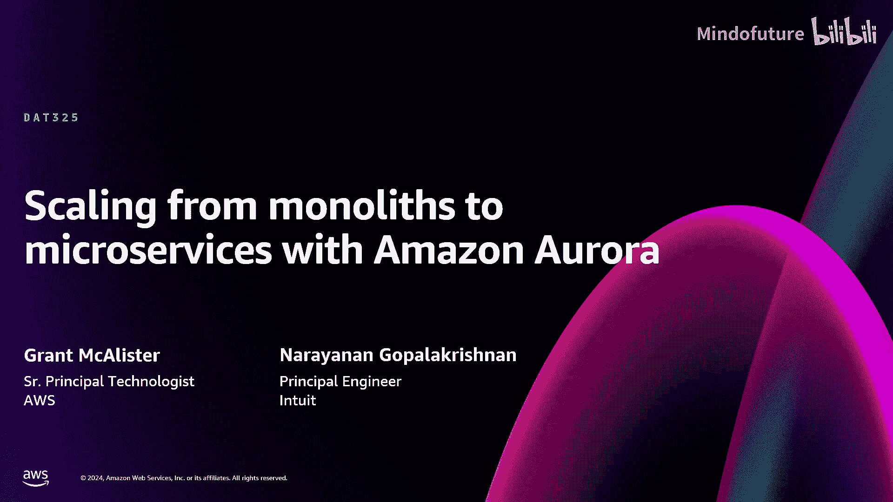
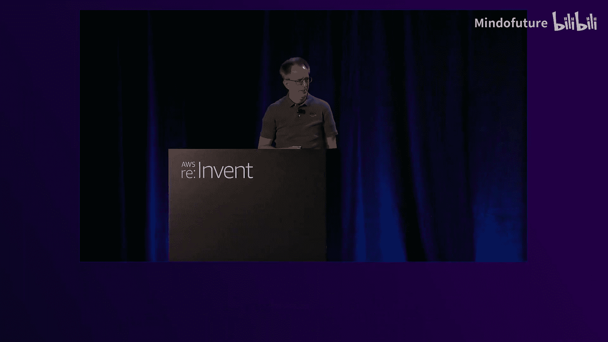
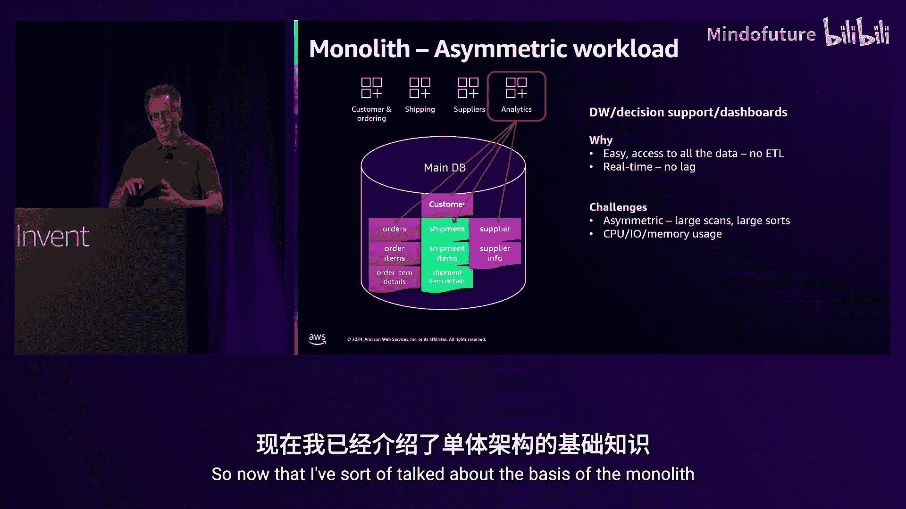
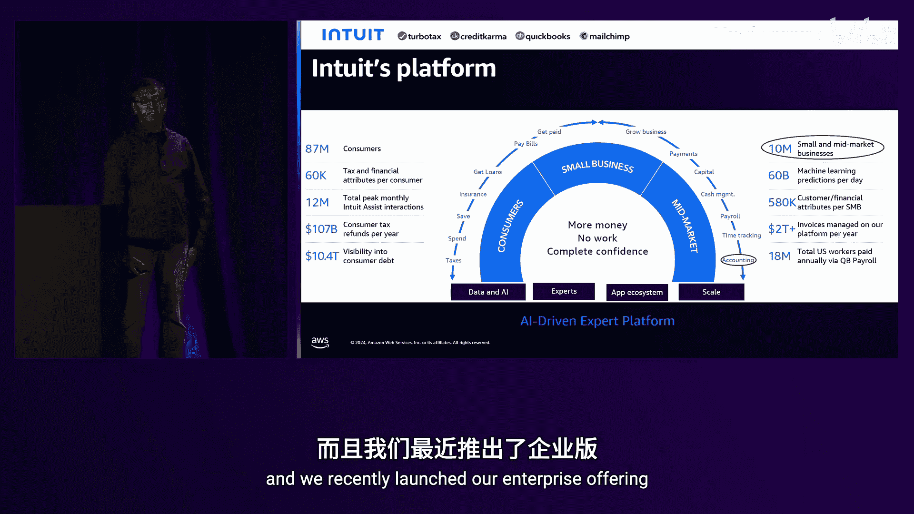
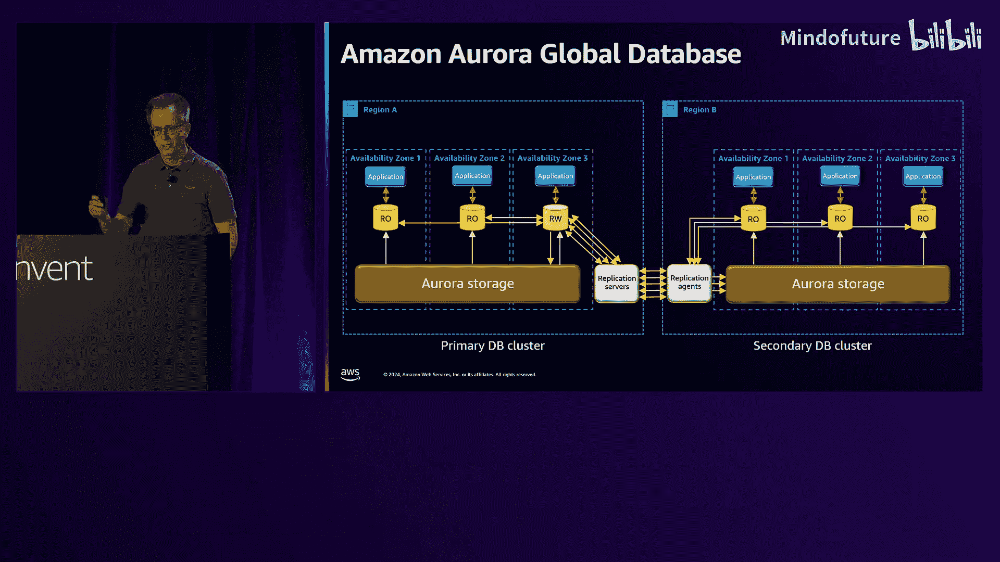
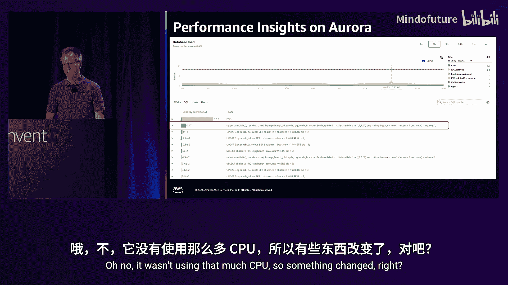
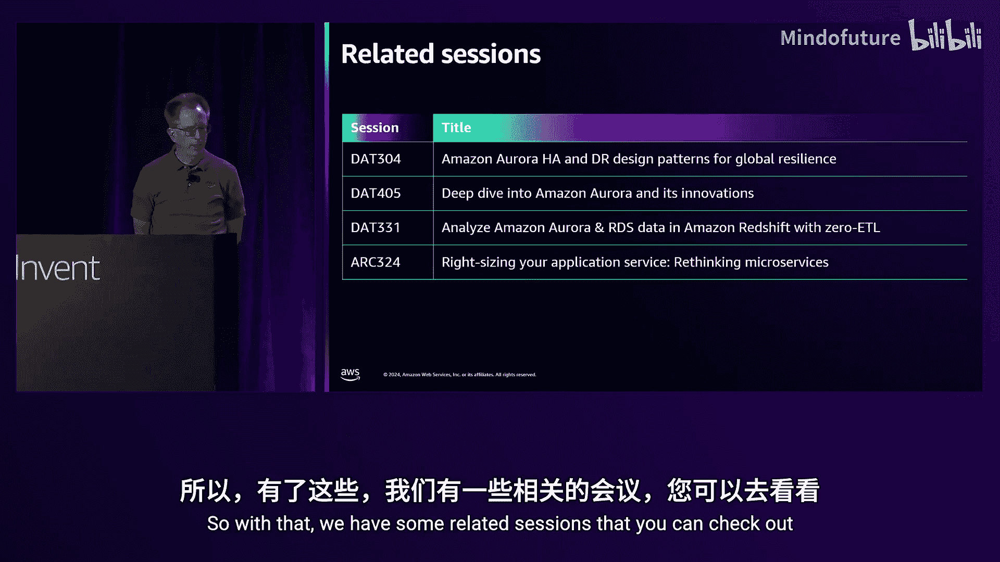
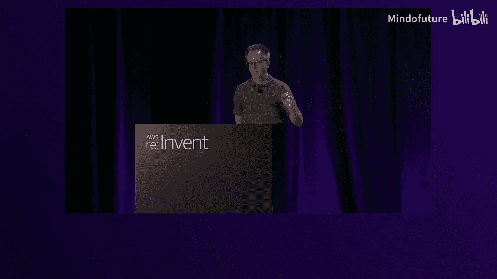
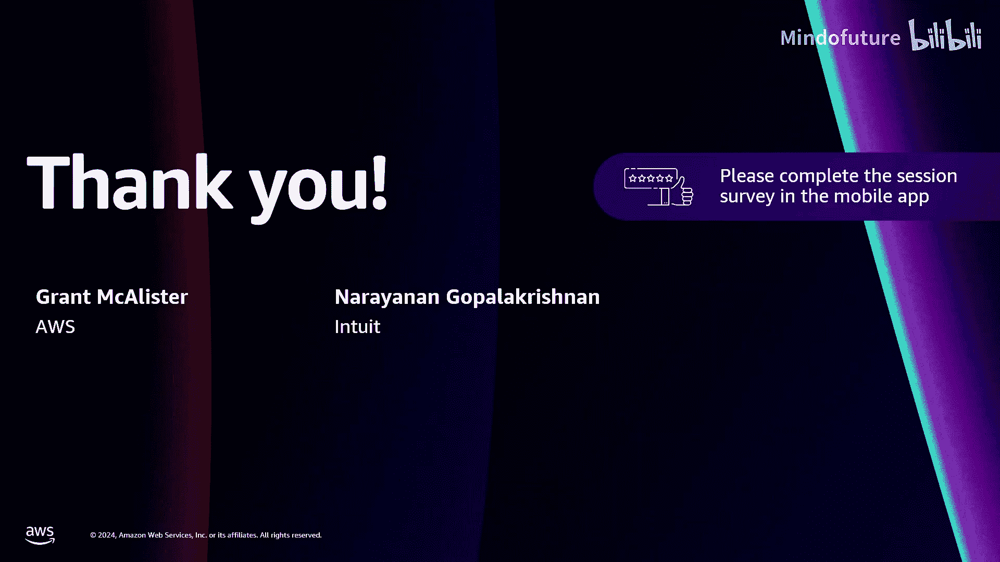

# 【AWS数据库峰会2024全集-•-中英】AWS-re：Invent-2024---Databases-p08-P08-Scaling-from-monoliths-to-microservices-with-Amazon-Aurora-(DAT325)--BV1VAR5Y6Es1_p8-

Yeah。Me today is， that's read loud。 And with me today is Orion from Intuit。

 And we're going be guiding you through this journey of how to do this。

And special thanks for showing up at this late on the Thursday right before the party because I know everyone's getting really tired。

So you have a monolith。 What are you doing， Wait， not that kind of monolith。 This kind of monolith。

 You got a really big database。 And there's lots of different ways to think about monolith。

 right because there are just something that's kind of a little bit out of control from a database perspective。

 And in this case， I've got a lot of different applications talking to one database。

 I got a lot of different data that's in the one database， right。

 So this is what I classically think。 But there could be lots of different examples of what a monolith is。

 Let's dive into this example， a little more detail。 So。😊。

You might have small isolated workloads running。 and we had a lot of these at Amazon when I first started。

 And this is like an unrelated thing that's just co-housed with the database。 So in this case。

 it's our supplier app。 It's got a few tables。 It's not that big。

't work it doesn't do that much stuff， but it's there right So why do we end up like this。 Well。

 you might have a licensing challenge because you were on a commercial database So you didn't want to buy another license。

 might have just been that you had a resource。 You got a box right， Thr it on there。

 And another one was at the time， you didn't want to have to have another database to manage because that was challenging right So just throw it in together。

But the problem with that is you know you can have problems where that table gets out of control right or you know you just get bad queries on it unrelated to your main application。

 So even though it doesn't usually use a lot of CPU。

 it could and this can cause disruption and there you you also got to talk to people about when you can do maintenance because they might have different maintenance windows and all that kind of fun stuff right so not a great thing to have in your database if you don't need it。

The next one's a little more challenging， this' is what I call an entangled workload。

 so this is where you have multiple applications typically sometimes in the same app or sometimes spread out across different deployments that are talking to a set of data where it's all together right in this case it's customers orders and at our shipping right and the same reasons that we had before。

We have， except for now we have another reason which was it was very easy for the developers to do this right because it's so much easier to write these apps when you don't have to go figure out where the shipping data is if you're in the ordering system right it's just in the same database so you see a lot of databases get created this way。

The problem with this and this is one that a lot of like leadership misses is that you've got shared state now right and what do I mean by that like if the shipping team decides to make a table change to one of the shipping tables right adds a column and they don't coordinate with the other team bam you got an outage right this is horrible so what does that mean that means you got to do shared QA shared testing right shared certification。

That's going to increase your errors， decrease your velocity。

 and as you have more and more developers working on these systems。

 it's going to become more and more challenging right。

 so you really want to get rid of that shared state and we'll show you how to do that in a bit。

The other one that isn't sort of as commonly thought about is sort of temporal data。

 So over time as your database has been growing and living right， especially in the ordering world。

 you just keep getting more and more orders right So to start with when you store an order And I'm just going to talk about sort of the heat portion of the storage。

 not indexes， but you can imagine the indexes here。 when you have an order come in。

 it's going to go into a block that block can get filled up with other things at that time。

 but to find that order， it's really cheap right， you just got to go get that one block but another order comes in a couple weeks later into a new block right So again。

 it's still cheap to find it。 So this  query is very predictable So that's great over time we have lots of orders for that same customer and but it's still cheap。

 So no problem right except for you have queries like this。

 find me all my orders for last year And now this costs 10 times as much But that's really a simplistic example because in our system for each order we have。

 we have。reorder items and two item details per order item right so that actually means we're grabbing more like 100 blocks on this query and I remember back in the days at Amazon we had some customers where we were literally gathering like tens of thousands of blocks to go answer the query of show me my orders from last year the last couple years so this is quite painful and it destabilizes your system because these large queries start almost looking like reporting queries not things that you'd run on your main application。

So that's kind of another problem with sort of the monolith， right？

And then the last one I want to talk about is sort of an asymmetric workload and what do I mean by asymmetric。

 it means something that's not really core to what you're doing with the main application in this case。

 analytics could be other things could be search， you know there's lots of different examples。

But you might be doing data warehousing decisions board or running real time dashboards against your LTP system。

 That sounds good， right。Because I don't know have to do any ETL。 My data is all up to date， right。

 There's no lag。 The business leaders are happy。 but guess what happens。

 You have these queries that are doing massive things against your database where it's going to be destabilizing。

 right， largege scans， large sorts。 And that's what I mean by it's asymmetric because it's not these points select small joins。

And again， CPUIO memory usage can all be completely destabilized by just someone running a bad one of these queries and I'm sure most of us have had that happen to us。

So now that I've sort of talked about the basis of the monolith。

 I want to invite Narayion up to talk about Intuit story and their journey。

 and then after that I'll come back and we'll talk more。

Thank you， G。Good afternoon。 My name is Naraan Goalakrishnan。 I' a principal engineer intotuit。😊。

And it's my pleasure to walk through the journey of QuickBook modernization with you。

And share some of the recipes behind its success。First， a quick introduction to intotuit。

We are an aI powered Fintech platform serving consumers， small business and mid market customers。

Through tuboax， credit kma。QuickBooks and mail jump。When I say quickBooks。

 you may think of bookkeeping or accounting， but QuickBooks does a lot more than accounting today。

As you see， the feature Brad we have， accounting is one of the many things。

Our platform helps you manage business， and accounting happens along the way。

And we do this at a massive scale。Over 10 million smaller and mid market customers use QuickBooks。

 and we recently launched our enterprise offering。

That let's start looking at our legacy architecture。

QuickBooks is a Java application deployed on Kubernetes。

 was using a commercial database on relational backend。

And we deploy this in a swim lane architecture and let me define what it is。

 A swim lane is a single independent deployment of our application with the database。

 basically our version of a cell based architecture。We use this for two reasons。 One is scalability。

 as we need to scale the system， we can keep adding swim lane and scale horizontally。

The second is geopartitioning。 So you have a global customer base。

 This allows us to host customers from different regions in different film liness and possibly even deploy in different interface based regions。

Today， we have a fleet of these to manage our 10 million customers。

Our databases managed hundreds of terabytes of data was using over a million pro diops and running old TP app search use cases un relationlational。

The application is millions of lines of code。Thousands of dynamic queries， several complex queries。

We have a homegrown database schema generator and data access and dynamic SQL generator。

 All of this was designed to work with our legacy database and optimized using several database features。

Now， let's take a look at the need for modernization。

 So as QuickBooks evolved and we kept adding features over time， it grew into this monolith。

And what were the challenges？So over time， it was getting difficult to scale。

 especially for some of our large customers and also for our next chapter of growth。

 where we want to handle 10 times the data we currently have。

It was also slowing down our development velocity。And。It was。

Getting increasingly expensive to manage it。So to address these。

 we decided to switch to a service based architecture using cloud native open source databases。

 and that gave us。A blueprint for our target architecture that looks like this。As you can see。

 this architecture allows us to choose from a number of databases based on the use case rather than one size fits all。

 let's look at the requirements。So our goal was to take this monolithic system and transform to this architecture。

But do this with minimal disruption for our 10 million customers。

With 00 percent data pary and feature parity with full support for fallback。

And improve our performance resilience and finish it by a fixed end date based on our licensing。

And we had to do all this while we continue to develop features and ship to our customers。

 So in a way， this was like changing an a engine while still flying。😊，Is that sounding exciting？

Let's take a look at how we approached it。So we took a phased approach starting with evaluating technologies based on a set of features we were looking for to support our product。

And based on the feasibility， we define the scope of what we are going to change。

Had some high level technical design and had a planning phase。

And then started looking on the actual execution， doing schema conversion。

 data migration and application conversion。We did extensive testing and had a careful rollroad strategy to complete it。

 Now， let's go through each of these phases and look at some of the decisions we made and some key takeaways。

Let's start with the evaluation phase。So as a Saas application。

 one of our foundational requirements is multi tenancy。Let's do a quick prim on this topic。

 So as you may know， there are three basic models for implementing market currency in the database。

The first。It is a silo model where you have a dedicated database for customer。

This gives the highest level of isolation。 It also comes with high operational overhead。

 So this is a good option。 If you have a limited number of tenants。😊。

The second option is the bridge model where a single database is shared by multiple tenants。

 but each having a dedicated schema。This is a good trade off between data isolation and operation overhead。

 In fact， QuickBook started with this model in its early days and we soon realized we had to grow out of it because it doesn't scale for millions of tenants and it took us to the third model which is a pool model。

😊，So in the pool model， you have a single database schema shared by several tenants。

This is great for scaling for a large number of tenants at low operation overhead。

 but it doesn't have high data isolation。So address these concerns as we switch from bridge model to pool model。

 we followed certain sche or design principles in the database and implemented a layer to guarantee data isolation and also make our tenancy model transparent to the application and these principles have served us very well in the long run。

Now， let's take a look at some of the other features we are looking for。

We have tables with billions of rows and tables with temporal data。

 and we need commercial grade partitioning to manage it。

We want to be able to make complex schema changes without downtime to continue developing features。

 So we need an online scheme evaluation。We the full power of SQL to implement all the complex query use cases we had in the system。

We need tools and techniques to tune those complex queries to make sure they are performant。

 and more importantly， once you tune them， ensure that performance is consistent over time。

 which is where query plan stability is critical。And then we needed the veryted scale to thousands of connections to handle our load。

So based on these features and a careful evaluation， we chose Aurora Postgres。

 Postgres for rollable security and some of the other features it has that we are looking for and Aurora for scalability H and UR and more importantly the Aurora query plan management which gives us the much needed query plan stability we are looking for。

Now， let's take a look at our execution。Since we have a homegrown schema generator。

 we added support for Postgres in schema generator and implemented some rules around data type mapping based on Postgres best practices and this is a very important step。

Then we converted triggers and stored procedures， which we didn't have too many。

And started working on data migration。And for some of the critical features。

 we did extensive poOcs to make sure those features work as expected for our use case。

 but also can perform and scale。And as the application was written for the legacy database。

 the first thing we did was introduce a SQL abstraction layer and we factored all our data access behind it so developers could continue writing application without worrying about the database。

And then we added support for Postgres to our dynamic query generation and code generation tools。

And put it behind the same abstraction。 So developers could continue working without worrying about the database。

 and we could do parallel builds and deploys on both the legacy stack and the target stack。

And this allowed us to continue doing these refactors while we continue to develop features on the product。

Let's take a look at data migration。 We chose Dm S for our data migration and used a couple of patterns from D M S playbook。

The first pattern we used is the fall forward pattern。 the way it works is。

You have replication from your source to target aurora using DmS。

 and then you set up another leg of replication from this target aurora to a clone of your source database。

The benefit of doing this is you are continuously testing the full pipeline and if there are data issues during the application。

 you have your source database still intact。The second pattern we used was the fall back pattern。

 it starts with an identical source to target via DMms。

 but once you do the cutover to the target you start replicating in the reverse direction back to your source。

The challenge with this is you are testing this side of the pipeline only when you are live on aurora。

 And if you have issues and you need to fall back， you may have data loss。

Since Quickbook ceasees multiple swim lanes， we use the first pattern for the initial set of swim lanes。

 And once we gain confidence， we switch to the second pattern for efficiency。😊，Now。

 with all these changes， a brand new database and a completely reffactored data access code。

Testing the system for both functional and performance was a huge challenge。

 And we didn't have a lot of time left。That's where we came up with an innovative approach using a capture replay technique。

 And that was a game changer。 Let's take a look at how this works。

So we have our application running in production。We added some lightweight instrumentation to capture every query it executes on the bind variables and cut them in a queue。

And we ran it through our dynamic query generation component to convert every legacy query to its corresponding postb query。

And then he stored them in a repository with this， we could capture millions and millions of queries from our production workload。

 convert the legacy queries to corresponding postg queries。And store it in this repository。With this。

 we started working on a replay。To do the replay， we set up a clone of our production environment by setting up continuous replication from our production database to both the source as well as target engines with a continuous replication。

With this， we could replay the captured queries again through a queue and the queue workers replay。

The legacy， as well as postgress queries against the corresponding engines。

And they did two things for every query they executed。

 they checked the results row by row column by column to see if there are functional differences。😊。

They also collected performance metrics， SL performance metrics to identify areas that needed tuning。

We did this over 100 times to find a number of functional performance issues。 We also use this。

Technique to test our target system under different configurations before we went live。

And this gave us the confidence to move to the next phase， which is the rollout。

So we used a progressive rollload phase starting with a4 rollload during off hours。

So the idea is to start with just testing the waters。

 see how the new system behaves during off peaks。And then monitor and do a plan switch back within four hours in four hours。

Then we try a 24 hour rollout this time handling peak hour traffic。

 we continue to monitor how the system behaves。During 24 hours， for health and stability。

And we do a plan switchback in 24 hours。Then we take these learnings and do a one week rollout。

 This time， the goal is to stay on the target system unless there are unexpected issues。

And based on these learnings， we started doing the cut for the initial set of swim lane。

 We had a two week rollback period， meaning we were replicating data back for up to two weeks。

 and then we could cut the card， so to say。And then for the remaining swim lane。

 it was just a rinse and repeat and scaling the process。And completed。

So one of our broadest accomplishments in this project is we had zero unplanned switchbacks in this entire process because of the meticulous testing done through capture replay。

😊，And the rollout process was flawless， and we could complete migrating all of our swim lanes on time。

Now， let's look at the benefits and results。So with Aurora， we have better scalability。

 especially for a read heavy system like QuickBooks using multiple readers。😊。

Is giving us much better scalability。We also have H A and using Aurora global。

 We have D R out of the box。And we are able to do one click disaster recovery drills using aurora global。

So we switched search from relational to open search， and that has unlocked。

Our ability to go beyond simple text search and do semantic and hybrid search。

 And this is powering some of the A use cases in the product。

We built audit as a reusable service in the ecosystem。

 and this has unlocked some interesting fraud and anomaly detection capabilities and also unlocking some gene use cases。

Plant stability was a pleasant supply surprise for us， as we had better plant stability on Postgre。

 and we had much fewer unexpected spikes due to plant flips。

I'd like to take a moment to thank the Aurora QPM team for the great partnership they had and all the features and announcements they made to QPM to support our use cases。

And by switching from paying for millions of provision diops to a paper use model。

We are saving on hosting cost。So in summary， we have better scale and velocity at lower cost。Now。

 what's next for us？So with a service based architecture。

 we have a number of databases from where we need to integrate data and we are looking at using0 El for that。

With a large suite of databases we manage doing version upgrade takes up a lot of effort。

 and we are looking at blue green for making that simple。

And while the homegrown sharding works great for us。

 it is still a lot of undifferentiated heavy lifting。

 We are looking at leveraging arounduror limitless as a managed sharding solution。😊。

before I pass it back to Grant， I'd like to thank the entire team from Intu that was part of this amazing journey。

 As you can imagine this was not easy。 It was full of challenges。

 but it was a team's passion and commitment that got us through every single challenge。😊。

I also like to thank AWS for their awesome partnership throughout this journey。

Hope that was insightful。 Thanks for your time。 I'll pass it about to Gr。Thanks， Naine。

So we're going to dive a little bit into some of the services that Naion talked about that they used and that we think are useful on this kind of path。

 this migration。So the first is DMS， I have a fun story about how we had a lot of discussions about whether it should be called the migration service or a replication service because it kind of does both the first thing I'm going to talk about is mostly migration and that's why we ended up naming it as it is。

Because it does a lot of things that help you with migration。

 if you are moving from one engine to a new engine， from like a commercial to open source。

 we have this really good schema conversion tool that can allow you to really analyze your schema。

 tell you what's going to be different， find out what the problems are and help you get to the new system。

But that's just part of the solution right so for the whole conversion you start with your source database you got your target on the end and there's a lot of steps right but DMS can really help you get there completely the first thing it does that can do assessments so it can see all the databases you have look at all the code and really tell you what's going on then it can use that schema conversion tool to get you a new schema now some of this stuff includes stored procedure code that can be quite complex we now have GenI integration that really helps with some of the more complicated code that was really tough for us to convert in the past and then the last step is that that step that Noray was showing where you're using it as a replication tool to go from the source to the target and replicate both that new schema and that data inbound so that's only half of it though that's only half the picture because that's just your data you might have your target but you don't have your application yet so you need to do your application and this again is where Q developer can come in and can help you actually do conversion using the schema that you've got from the schema conversion tool。

To help update your applications to become useful for that new database。And of course。

 you can skip a lot of this if you're going from the same engine to the same engine and you just can use DMS for their application as you'll see in a second。

So as I was saying， it can be a replication service。 we got our target on the left。

 the destination on the right DMS in the middle， it does a full load， so it dumps all the data。

 loads it in and then it does CDC logical replication to catch up and once you're caught up。

 you can basically switch Now that's not the end of the story though we're using DMS you can use it as part of your microservice architecture you can actually fan out data now that you're running from Aurora。

 it can replicate to DMS you can replicate to other aurora databases or various services that we have or things of your own other applications。

 so this is really a way to not just to have tight coupling between your systems。

 So it's another very useful tool in the journey。So of course， I've got to talk about Amazon Aurora。

 that's kind of the thing I do on a daily basis， but it really is a purposebut database for the cloud。

 it's fully MySQL and fully Postgres compatible not at the same time that would be weird so you can have either mode。

 you can run it either way， depending on what engine you like because we believe that every engine has its benefits so the commonality though is these aspects like performance。

calalability， the availability， the durability， the secure， and the fully managed。

 and the fully managed is one of the key things that when we started RDS and now Aurora is really key to going to microservices because you're going to end up with more databases。

 which means you have to get to something that's easier to manage than the classic systems， right？

So let's dive in a little bit to the architecture what makes Aurora different and what I hope is better for you。

 So we start with storage and that blue line is sort of your virtual volume you get for your database。

 and it spans across three availability zones。And this is for durability。

 The yellow boxes are our storage service。 I'm showing nine of them。

 but it could be thousands or tens of thousands in a particular region。

So you get your first database instance against your storage cluster。

 and that's the thing that you're going to use with most of your applications。

 And the first difference is that we write log records， we don't write blocks。

And there's a lot of advantages to this， we don't have to do checkpointing。

 we do a lot less work on that headn and you'll see that we write to six places and those are the little rings that now each of those is a 10 gig chunk。

 we're not writing 10 gig chunks， but that's our organizational unit in storage。

So we need four of six of those rights， so when you see two in each availability zones。

 we need four of those to complete before you're going to get an act on commit we actually only we do that on all things but we don't actually have to wait on rights because we know before commit we can move forward。

 so it means that we get very good performance， but you have full durability。

ButWe want to make things simple and not have to change too much of the code of the great open source systems。

 so we actually read back blocks， so we change from logs。

 we apply those to the blocks and we ship back blocks when we need to read them。

 so this makes the database nice and simple and reliable。

So sometimes you might have a right that got missed。 that's that little red circle。

 that one might not have got an update。 Well， we can we do a whole bunch of cleaning and testing behind the scenes to make sure that we have all the data。

 So if we lose a right， one of the peers will just do peer-to peerer replication and correct that。

 If we have a failure in a storage unit， we will just replicate a new copy to a new storage unit。

 So all this happens behind the scenes。 you knowt have to do anything， it's very nice。

And the other major differentiator， as Noriim was saying。

 is we have these read only nodes that can really help you with read scalability and you don't have to buy more storage for each one of these that you get。

 so that can save you a lot of money。And you can have up to 15 of these in whatever kind of configuration you want across the region and I'm showing that each one of mine is actually a different instance type。

 so I have graviton on the one side， Intel in the middle and serverless so you can mix and match whatever size and configuration you want and this is a great way where if you want to switch from let's say Intel to graviton you can just fail over between them and test and then if don know if you're like oh that didn't really quite wasn't as fast or whatever you can switch back but the most part you're probably going be happy there so。

Now the other one that's really nice again for manageability is our storage。

 it grows and shrinks depending on what you're using。

 so you no longer have to like a file system be like， oh。

 I got to allocate a whole bunch of storage I don't need just so I don't run out so that's another nice manageability feature。

In the case of a failure of a DB instance in that middle availability zone。

 we're going to fail over to one of the read only nodes and this takes less than a minute to happen and you're back up and running again fully durable and we have some nice ra drivers that can actually bring that down because some of that time is DNS propagation。

Now， this architecture allows us to do really neat things， and one of them is global database。

 so global database allows you to have DR across regions。

What we do here is we create a volume in the other region and we start replication through these replication servers and agents between these two systems。

 and this is storage- based replication， so you'll notice I don't need an instance on the other side so you're not paying for something you're not using。

So when you do it right， just like normal， it's got to update the read only nodes。

 it's going to go to storage in the local storage， it's going to go to this replication server that's going to afford it to the agent over to the storage on the other side。

 and at that point you're good from a DR perspective so your boss is happy because they have DR and you're not paying for a doubling of your system。

 but if you do want read only nodes， we do support that so you can actually from the replication server it's going to keep that read only node updated。

So you can actually use it for applications over there for readscaling， as Nrine said。

 so this allows you to actually do rescaling on a global basis and you can have up to five destination regions close to your customer。

Now another piece of the sort of manageability puzzle is you know query tuning。

 making sure your thing is performing well performance insights on Aurora and we have performance insights across alreadyS and Aurora。

 but I'm going to show it just for aurora here allows you to visualize what's going on with your database and your queries so that green box is the green colors for CPU so as you can see at a certain point my CPU kind of goes crazy and I actually hit sort of 100% CPU on this and that's not going to be very good for my application。

 but I can drill into that and I can say what's going on there and I can see it's this specific query。

So now we know that we know what changed， we don't know why。

 so let's go and look and say an older period， let's go look a few minutes before that problem。

 Oh no， it wasn't using that much CPU， so something changed right， this is always bad。

So let's look at what the plans are。So before we were doing some bitmap and some nested loops。

 and now we're doing things like you know hash joints， sequential scans， it's like horrible， right。

 way more expensive。 Now this can change because of stats changes and you didn't analyze。

 config change， maybe an index change can change your plans。Now， in my case。

 it happened to be because I turned off two of the planner features。

 which is not something that I would advise， but it's very good for doing demos。

 This is where query plan management comes in。 and that was one of the things that Naine talked about。

 We call it QPM。 This is for plan stability。So we capture statements。So as you're running statements。

 we're seeing two different queries here query and Que B and we got their plans。

 so we like those plans they look good to us， so we approve the plans and that gets us a baseline what this means is that's the plans that are going to be used so even when another plan is generated by the planner it won't be used but we do keep them so that if let's say a third version of that plan comes in and it is actually now better because let's say the data volume has changed we can compare those plans and evolve our system and get basically promote that plan to be the active one right so this isn't a static one-time thing you can evolve your system but if you don't need to you can just keep your plans right so this is really important for if you've got a lot of systems and you don't want to have to worry about plan changes。

And this is the result I enabled QPM and my stable plans and of course I just go back to my plans。

 even though I have those planner settings still disabled at the instance level。

 everything is still working。 So that's how well this works。

 One of the enhancements we did you know as part of the as for into it was that we could do this on read only nodes as well because originally it was just on the readr。

 but of course that makes sense why wouldn't also want to work on the read only nodes so。

We've also done some other the nice features to really kind of improve performance or price performance for a lot of folks and that's a tiered cache if you're doing a lot of reading from storage so if you have a large large working set size and you know you want faster reads so Postgres normally it's going to read from shared buffers if the block is there and it's just going to get a nice fast reply if it's not there it's going to come from storage and that's going to take a little longer and if you do this occasionally it's kind of fine but if you do it a lot that's probably going affect your application performance so。

What we can do now is we can have a tiered cache。If you're using the IO optimizeized storage S。

 we now have this tiered cache option and all you have to do is order the different instance types。

 the R6 GD or R6 ID， that's really very tough to say quickly for these aurora versions or higher and we use part of this for caching temporary objects like so for spill so we get faster sorting when you have to spill larger than memory but the main use case is for a tiered cache that is actually four times the size of main memory。

So how do we do this well we use a little bit of the shared buffers as metadata。

 and now we're going to check in that metadata before we do reads， so if it's not in cash。

We read the block into cache and notice we haven't touched the tiered cache。

 we haven't changed the read path we don't want to make any complexity there right so got your read fine it's in shared buffers at some point you stop reading that block it's going to get ejected This is where we move it to the tiered cache on eviction asynchronously so it doesn't affect your regular processing we update your metadata。

So that we know it's in tiered cache， so the next time we ask， we go and say。

 is it in the tiered cache， yes， it is， boom， it's red。

Now the main challenge you have with these kind of systems is when you do updates on a tiered cache with checkpointing and everything it gets very complicated because you've got to det and do a bunch of stuff while you're checkpointing。

 but remember we don't do checkpointing with Aurora so we don't have this problem so when we do an update for invalidation all we have to do is invalidate the metadata。

And that's it。We don't have to go touch the tiered cache。

 so we're not doing a lot of excess rights to the cache to burn out that NVME。

 So this is very efficient。So this allows for really nice performance。

So let's look at that performance difference。 So what I have here。As that cis Bench。

 it's a read only point select， very simple workload uniform distribution。

 which is not the normal cisbech one。 So that means it's going to read all the blocks right it's not just going concentrate on a small number I'm using a four extra large So the working set size for this workload is around 85 gig that fits all in ramp So whether I'm running ti cache or regular I'm going to get the same result because it's all just coming from the shared buffers and that's what we see on the horizontal access is how long those how many queries are taking how much latency So you want it far to the left and you want it as high as possible on the vertical axis。

 So either one of these we're getting about 0。23 milliseconds very fast reads right。

But what happens if we coulddrupal our working set size， right， we got more than 300 gig now。

We're going to get storage level latencies so you can see that the line has a little bit on the cache side right but a lot if it is now coming from storage and this gets to a 4x higher latency So what's your choice here right you can buy a much bigger box you can go to 16 xL your boss isn't gonna to be very happy about that or you can suffer with poorer performance right or maybe between the queries which is probably usually the best thing but that's not always possible so what can you do about this if you introduce into your cache we now have the NVME in the picture so the purple line is the NVME queries and you can see that we have some coming from memory and all the rest is coming from the NVME because the NVME is big enough it's four times the RA size it all fits。

So now we're only 50% higher on latency so that is a bit of a jump。

 but probably not enough for your application to notice and so with this technique you can either take your existing system and make it much faster or possibly you can go to a smaller system if you don't need the CPU and actually save more money for your company So this is a really nice thing on manageability when you're going to break up those monoliths and have lots of databases you can actually possibly save on costs。

So let's jump into sort of more details on breaking up the monolith。

 So let's go through my examples again。 So we have our suppliers app。 It's quite small。

 The first thing you want to do is you really want to make sure from a security basis that you're changing your permissions and what accounts you're using to prove to yourself that it really is isolated right because you don't want to move it and then find out that someone was depending upon it So the best thing to do is to make sure you've done that so that you're proving the suppliers are the only one using this once you've done that we can move it but remember this is very frequently used it's only used like five days a week It's pretty small。

Bo， moving us to its own database seems like a lot of cost， right。

This is where Aurora serverless comes in。 So this is a pay per use。

 second by second version of our system。 So it's just another instance types。

 So it's not a different configuration。 You just order DB dot serverless instead of an R6 I。

It scales up and down second by second for both CPU and memory and the memory stuff is really fairly cool technology that we spend a lot of time working on。

 and there's no impact to the performance while it's doing this。 And again， as I said。

 you pay as you go。 So I'm showing Lambda here， but it could be any regular application just Lada obviously in serverless kind of go together。

 So when your Lambda starts off you need a little bit of memory and a little bit of CPU。

 but as it grows， you keep adding more and more CPU and memory until you get up to this using quite a lot and we can go up to 256 As。

 which is about equivalent to a 16 X now with serverless so quite large。

And it will shrink back down when you're not using it。

We just introduced in the last month the ability to scale to zero on serverless。

 so for this application， we might be able to even turn the database off over the weekend if no one's using it and save more money。

So now that we've got our costeive solution， we're going to do a technique that's fairly similar to what Init did。

 which is we're going fire up our serverless database， we're going fire up DS。

 we're going start replicating that supplier data in and we're going to get that database all caught up and then we're going to stop doing updates。

 we're going to fire up the new supplier app and we're going to start that up and you'll notice what I've done with DMS is I'm doing that same technique that Ryan talked about where I'm replicating back to my original database and this is in case I need to fail back to that because there's some challenge with the new application code。

But if there's not， then shortly thereafter， I can just delete that and we can remove the data from the monolith。

So that's pretty clear cut， but let's go to the more complicated one。

 which is the entangled solution， right， So we want to move the supplier app and maybe the customer app。

So the first thing we're going do is that same kind of security thing to try to figure out who's using what do our analysis so we find out that the supplier is actually sorry the shipping applications is only using the customer data read only and that's the same for the ordering app because they just need to read the customers they're not actually modifying them and same thing goes for the shipping data the ordering application is just checking on where shipments are right so we've proven that it's safe that these are entangled but not on a readrite basis。

 so what we can do is we can set up and I'm showing serverless here but these can be provisioned new databases for both customers and shipping。

And DM M， and we're going to replicate into those databases， just like we did with the other one。

 And now we're going set up new applications for those ones。 Now。

 remember that the customer data was needed by the shipping。

 but we're not going to have it access its data。 We're going to actually build that through the new application。

 right， just to simplify and separate out our microservices。But so this is all working fine。

 but now we have a problem right， because what about that poor ordering app。

 it still needs access to those tables。Oh， do we have to move in at the same time。

 That's going to be kind of painful。 No， right， we can reverse the replication and leave that long term replicating from those new ones back to that。

Moth database until we take care of refactoring the ordering database so once we do that we could disconnect this。

 but until then this allows you to do a stage by stage so you can imagine if you had like 20 or 30 which in some days in the old days in Amazon we had more than 30 or 40 things in one database at a time it was kind of crazy so there was a lot of things that we had to separate out we use this technique a lot to kind of move in stages because we didn't want to try to do a big bang that would have taken years。

So we've gotten that done we still have this challenge with our ordering database and our temporal data so what we're going to do is again very similar to what Init did sorry that we're going to try to use different services for this kind of data right so in their case they got some data to doing searching we're going to do it in S3 so we're going to use S3 to store our older data。

 we take the last year's orders and we're going to put those in one S3 item and this includes all the order item details and all the information that we need to answer that query so then when we need we can rewrite the application to do that query against S3。

And even though you might think， well S3's got a much higher latency than talking to a read on Aurora。

 you're right， but remember we're doing one call to S3。

 not thousands of round trips to get blocks from the database right so this can actually be way more efficient both on the application side and on the database and of course。

 once you've done this。What you can do is you can remove all that data from your database right and that's going to make it smaller。

 more efficient， and more cost effective。So this is another good thing as you're going through and chopping up your monolith is to think about how some of your other data can kind of temporarily。

 it can be different because now it's no longer needing to be written to right。

 just read only at that point。So we've gotten some pretty good work done here。

 but we still have the ordering database and it's growing like crazy。

 so we're now worried about whether this is going to continue to fit。

 so we're going to move to a sharding model and you can use something like DMS or some other method to essentially again replicate the data into a set of shards and this is good。

 but as N was saying managing a lot of shards can be complex right but at least we have scale now right but we have a bit more of a burden。

And what's part of that burden Like one of the burdens is resharding。

 So you do your initial sharding， you say make some guessimate it you typically and you're like I think four is a good number。

 I don't know why it's four or five and you go yeah we're never gonna need more than four of these that'll be fine。

 And then of course this happens。 One of them grows。

 and guess what you're resharding and this happens more than you'd think because I think people's time horizons or a few years and I can tell you I've been in Amazon for 25 years。

 so any number I chose back when I started， I can probably tell you it was wrong right so consistency is the other issue with sharding you have to start dealing with if you want to add a column to a whole bunch of these shards。

 you have to worry about actually getting it right across all of them and making sure your application can handle it while you're rolling out these changes right。

If you want to do things like tell me the number of open orders right now。

 it's going to be slightly inconsistent because it's going to run just slightly off on each one right。

 maybe it's okay， but that's just a challenge you have to know about and backups is probably actually one of the bigger ones because if you do any transactions across these shards if you restore that you're going to get slightly different things where you might have actually broken one of those cross shard transactions across that time boundary so this is pretty complex。

The other one is capacity management when you have a single large database。

 this is easy from a heat management perspective you make sure the box is big enough to hit the maximum of your daily thing and that's fine right but when you break things into tiny shards the shards typically the heat moves around depending on what customers doing what or where the heat is and so what's hot in the morning might be cold and then the other one's hot in the afternoon and guess what you end up just scaling up your shards right and because you have a lot of these shards your cost may actually be quite a bit higher because you have more wasted space in all the shards。

So our answer for this is Aurora limitless。 This is our sharding solution。

You order Amazon Aurora cluster just like normal， but what you do is you create a database shard group instead of an instance。

And this is going to give you the distributed transaction router layer。

 and this is the thing that you're going to connect to as it name implies。

 it does the transaction handling and the routing。 we're not magic namers here。

 And you can see that the connections just go in your normal sceneing that you would normally use for your cluster and it's going to connect to this routing layer so it doesn't look different from your application。

And that routing layer is going to route your queries down to the shards and that's where you're going to get your answers from and that goes back through the layer to your application so this scales very well in our benchmarking we're above 2 million T which is quite impressive if you get a hot shard。

 we can do automatic resharding for you or you can do it。

 you can decide when you want to do that split。We use the serverless capacity that we have in our limit list for all these data shards and the routers。

 so as the heat moves up and down in the day， we don't have to resshard just because we grow up or down like 30 or 40% because we can scale up to like I said。

 256 ACUs。And we have consistent query and DDL and backups because we use a global clock across this entire system。

 so when you issue a DDL， it's actually going to all of the nodes and is executed as one distributed transaction so you don't have to worry about getting weird answers right and the same thing for your backups when you ask for a backup you know all the transactions will be exactly correct so this simplifies a lot of things you don't have to make as many changes to your application。

So we now have our earning application， but we've moved to limitless。

 and doesn't that look a lot simpler than having all those shards to manage， right， and it is。

So we're doing nicely on our journey。 We've got our ordering done。We've got our customers done。

 We've got our shipping done。 and of course， we got that supplier app done。 But what about analytics。

 right， We kind of we had that nice solution for analytics that was nice and simple。

 What are we going to do。Well。When you're doing analytics， typically on the one side。

 you got your relational database for LTP。 and the other side。

 you have something like Redshift for data warehousing to get that data in between。

 You typically have to build a data pipeline。 It might involve D M S， you know， S 3。

 a bunch of different of our services。 You probably have a data engineer that has to work on that。

 They have to monitor， make sure it's always running。 This works， but it's complicated。

So we thought we want to simplify this， and that's the zero ETL that Naan was talking about earlier。

 So you can just set up a zero ETL integration from your aurora instance to redshift。 and that's it。

 We're going to do all the loading， all the management。And the testing I was doing。

 you're getting like maybe five to 10 seconds lag on this。

 so it's very real time so you can actually do your real time dashboards。 How do we do it that fast？

Well， we actually do storage level work for this replication。

 so not only does it not impact your head node， but it's very fast inefficient。

 so we do parallel direct export here， we do that directly to Redshift。And for the CDC。

 we do that again from storage， not from the head node。 And then we stream that to redshift。

 So this is all very efficient and very fast。So we now have all of our properties。

And we set up  zero ETL， and you'll notice that I can set up  zero ETL from many databases up to 50 into a single redshift cluster。

 so you don't have to have a ton of redshift clusters for each one of these right So you can see that we've simplified' we do have more databases than we did in the beginning。

 but they're all running a really well managedage system and most of the management is on the aurora side。

 So this is kind of a good model for a journey that still allows you to get to that control of the microservice get rid of all the problems you had with a monolith but not end up with basically sort of as I consider it the microserv sprawl that you can kind of get into if if you're not careful。

So with that we have some related sessions that you can check out。

 they're doing a great job this year， the videos are actually coming up very soon， for example。

 I think both the very first two or talks that I've given。

 theyre already videos are available if you want to look at them。

 the other ones probably if they're not up yet we' be up very shortly so check those out and thank you and thanks Naion。

And that's everything， and please remember to fill out the survey form。

