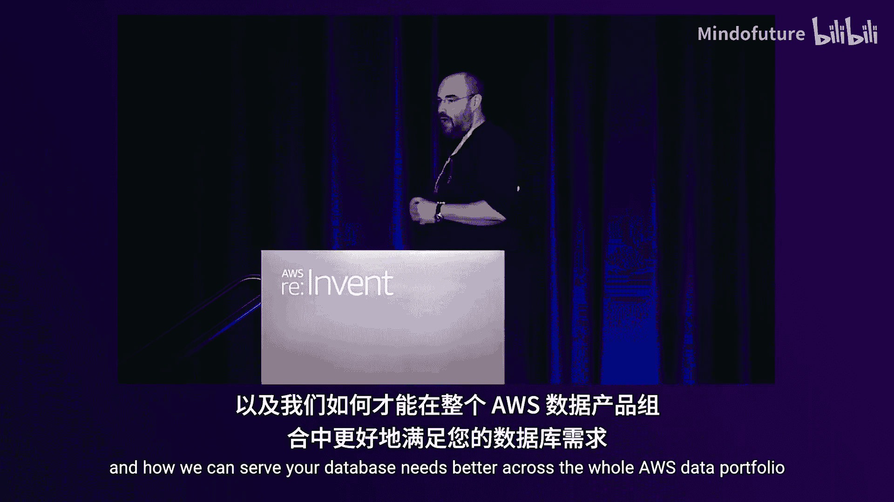
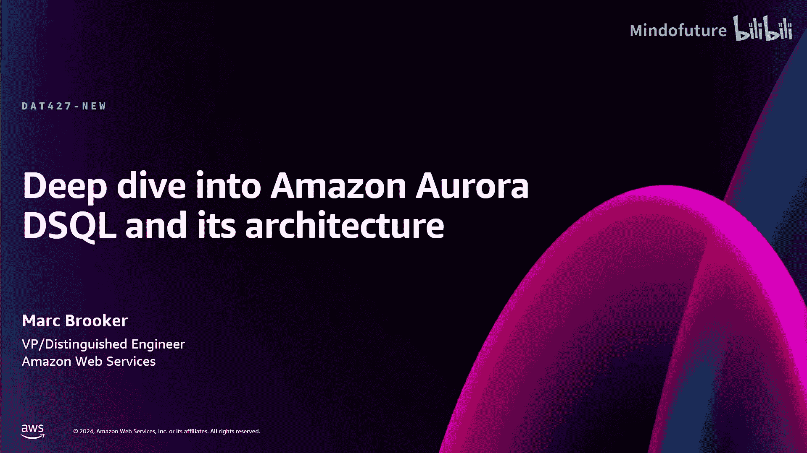
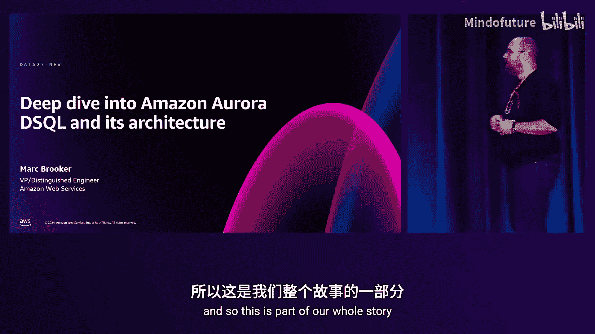
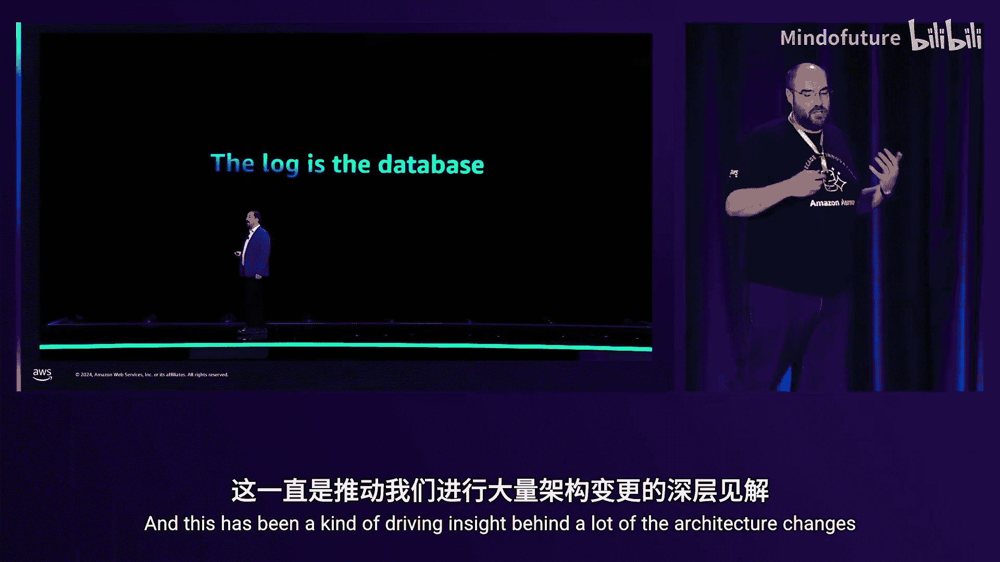
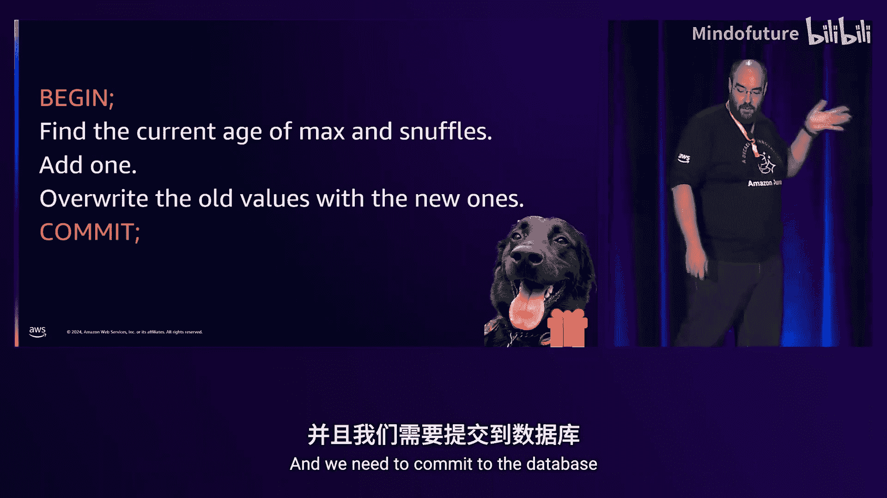
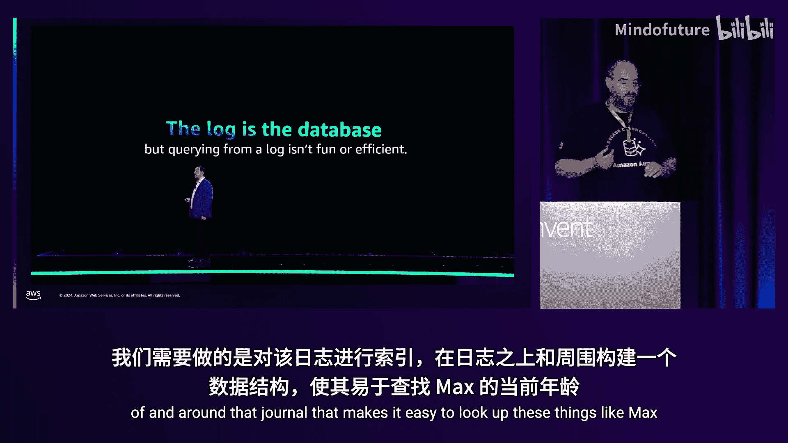
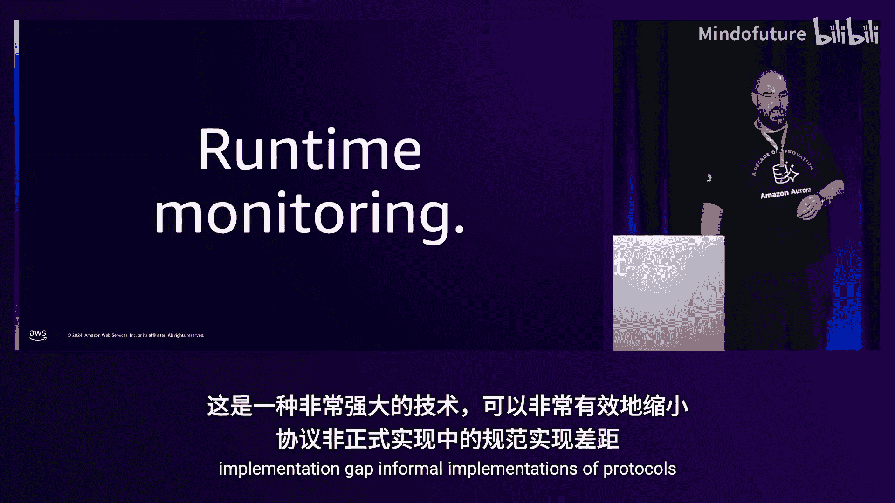
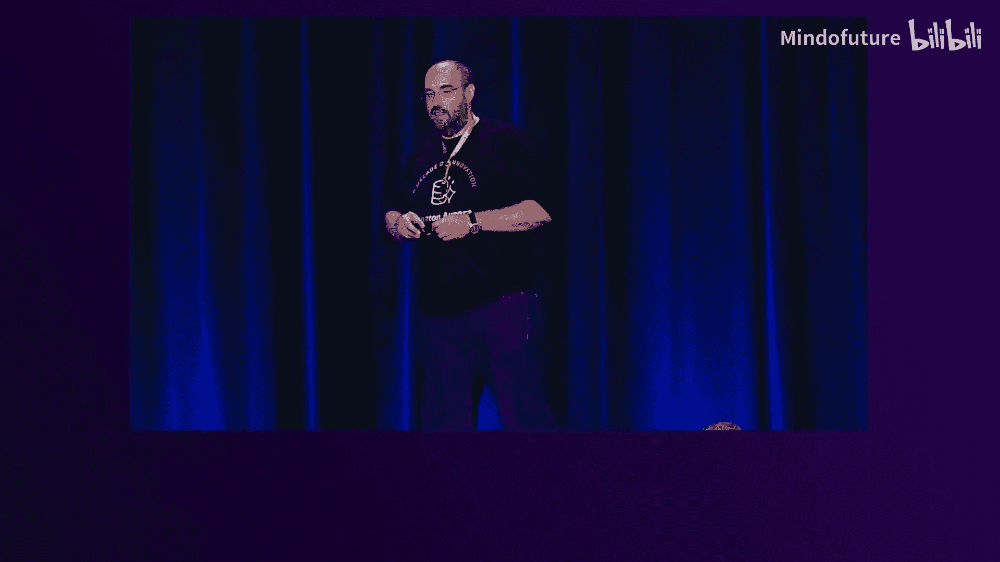

# 【AWS数据库峰会2024全集-•-中英】AWS-re：Invent-2024---Databases-p09-P09-Deep-dive-into-Amazon-Aurora-DSQL-and-its-architecture-(DAT427-NEW)--BV1VAR5Y6Es1_p9-

That's louder than I expected thank you well thank you all for coming we're just super excited to have Aurora DCQL out in the market to have folks like you。

 you know coming to join us for the preview， give your feedback on what we've built what you find interesting about it。

 what you would like to see us add as we move towards GA and how we can serve your database needs better across the whole AWS data portfolio。

😊。

Today's talk is a deep dive into the architecture of DSQL。

 so yesterday I did another talk about how to build your applications on DSQL。

 my friend James and Eric did a chalk talk today， this workshop tomorrow and so this is part of our whole story but this is an architecture deep dive and the most important thing you need to know about this is you don't need to know anything in this talk to use the product。

This is all for your interest， your elucidation， because I felt like talking about it and a couple of other reasons。

 but these are internals of DCSQL and one of the things that we've tried to design from the beginning is a database where you don't have to worry about the internals to be able to build great applications with great properties on top of it。

Um。And I'll also say before I start that， there's a little bit of guilt that comes with talking about this stuff。

 know is the work of a great team of experts across AWS。

 fantastic support from just a bunch of folks， and so as I talk about this。

 just imagine that there is a big group of us all here talking about the pieces of work that we all contributed to this system。

So I'm going to talk about just a quick reminder most of you have seen this hopefully you saw Matt's keynote announcement or my talk yesterday or our documentation。

 but I'll go over quickly what is aurora ESQL I'm going to talk about rights and concurrency control I'm going to talk about reads and scaling out SQL execution inside a scalable database and finally I'm going to talk about cross regiongion I'm going to talk about scalability and I'm going to talk about what I think is the fundamental most important thing about building scalable distributed systems which is avoiding coordination and communication when you absolutely don't need to do that。

😡，So this is the reminder part Amazon Aurora DSQL is a relational SQL database optimized for transactional workloads right we built and have optimized this for those OLTP style workloads for the kinds of workloads that back your microservice architecture your SOA architecture。

 your website your mobile app and so on， this isn't a database optimized for analytics。

 it isn't going to be the database that backs your or dashboards and analysis and reporting there are fantastic options for that across the AWS portfolio and the broader data ecosystem。

 but this is not that database。Aurora DC SQL is designed to be scalable， both up and down。😡。

And you know when we say scalable at AWS， sometimes we get a little bit too focused on the app。

 right， this is for building really big applications at almost any scale。

 up to millions of transactions per second。But it's also for applications that need to scale down those applications that might do tens of requests a second or tens of requests a。

 we wanted to build an application that was a database that was a great choice for applications across the entire range of scales that applications exist at。

And the most important part about that is that it allows you to pick DSQL。

 start building your application， and know that as your business grows。

 you aren't going to regret the choice that you made。😡。

One of the hardest conversations I've ever had with my boss over my career is， hey。

 we've got to pause feature development for six months while we do a data migration and figure out how to do that。

😡，One of our goals is to never have that conversation again。

I certainly don't want to have that again there we go it's serverless and I'll admit that AWS we have abused this term a little bit over the years。

 maybe a lot， I don't know， but what we mean here is in some sense taking databases back to the roots of AWS if you think about S3 and SQS。

 which were the first two AWS services that's what we mean by serverless like dynamoDB like Lambda right no infrastructure you go to the console。

 you go to the CLI， you create an endpoint， you start running your SQL against that endpoint。

 you never have to worry about patching， you never have to worry about Inence or maintenance downtime。

 you never have to worry about adding read replicas。

 you never have to worry about any of those operational things that might go into running databases。

😊，It offers active active and multiregion， so cross AZ active active in a single region for one region deployments。

 an active active strongly consistent transactional multiregion for applications that want to span multiple regions。

 whether that's for offering great latency to your customers。

 or because you have compliance or resilience requirements that require you to go across region。

And finally， it's Postgres compatible and what we mean here is that a majority of the Postgres SQL surface area works today in DSQL。

 you'll see us expand that surface area over the coming months and years。

 you can connect with the Postgres clients you have。

 you can use the PCQL CI and almost all of your Postgres code will work in DSQL with few modifications。

😡，DSQL is built on our experience building the cloud and running the cloud。

And as I go through this talk， I'm going to touch on some of the slightly controversial decisions that we've made and each of those decisions was based on our experience building and maintaining applications at large scales。

 we've learned some hard things about locking， we've learned some hard things about pessimism。

 know we've learned all kinds of hard lessons over our 20 years nearly 20 years of running AWS and a lot of that experience is baked into DSQL you can see I have my 10 years of Aurora innovation shirt on。

 we launched Aurora 10 years ago and we've baked a lot of the lessons that we learned as we built and improved that service into Aurora DCsQL。

Okay。We're trying to rethink the idea of transactional databases， there are some old ideas in here。

 I'm going to touch on things like MVCC which are ideas that date back to the 1960s and 1970s。

 and then there's some ideas here which we think are new and special and like any large system。

 it is a mix of those ideas， those new ideas and those older ideas。So the best place to start。

Conversation about a transactional database is with a transaction。

And we're going to start with the easiest transaction。The easiest transaction of all。

 which does two inserts。And here what I'm doing is I'm inserting two rows into my dog's table。

 I'm adding snuffles and soie to the table， so let's talk about how we're going to execute this。

 but before we talk about how we are going to execute this transaction。

 let's talk about the properties that we want as we execute that transaction One way to frame this is with the classic acid properties。

 it's kind of a bad pun from an old paper but it has become the dominant way in the industry of thinking about。

😡，Thinking about the properties of transactional databases。We want a databases that is atomic。

 that is we want that transaction to appear entirely or not at all in our database。😡。

We want a database that is consistent， who allows us to build consistent data models and keep those data models consistent。

We want a transaction that is isolated and that it doesn't see the effects of other transactions running at the same time。

 this is a hugely deep topic I mean this is an area that's been ongoing database research for 60 years and we're going to talk about our take on isolation and why we think it's the right one over the course of the talk and finally and maybe most importantly we want a database that is durable that when that commits returns。

 you are sure that that data is durably written down， it's not going to disappear。

 you don't have to worry about those rights， those customer orders。

 those access control changes disappearing in your database and finally there's some kind of open properties that we need here we need a database that is secure we need integrity。

😡，We need encryption， all of these other things， which are all built into DsQL。

 So let's talk about how we get these properties as we execute that transaction with those two inserts。

 and I'm going to wind back。

To reinvent lost here。This is Petera DeSantis on the main stage， Monday night， 2023。

Saying the log is the database。And this has been a kind of driving insight behind a lot of the architecture changes that we've made。

 So let's see what that means。

Here we have our two dogs that we're inserting into the database。

 This is snuffles on the left and Sophie on the right。

 and we're going to write them into the database。And because we have concluded that the log is the database。

 our insert is going to involve taking snauffffles and Sophie and putting them into the log。

And as we put them into the log they are going to become durable and we are going to be able to do that atomically。

 so we're going to get two of our four properties just from writing these to the log and we call this log service journal This is a internal log service we've been building at Amazon for over 10 years it's a key part。

😡，Of the infrastructure that powers S3， dynamoDB， kinesis， Lambda and other services。

 there's an atomic distributed， scalable replication system。

And one of the cool things about building on primitives like this is that we don't need to solve these really hard problems around atomity and durability they're built into this tool that we can use to build the database。

So we're going to take snuffles and Sophie， and we're going to put them into the journal。

But now we also have to solve isolation。What if there's another transaction trying to insert these same rows。

 the rows with the same IDs or rows with trying imagine there's a unique index on this table。

 how do we make sure that this transaction and that transaction that conflict？😡，Don't both commit。

And this is the third part， this is isolated。😡，And we do that in our architecture with another service。

 another piece of the architecture， another distributed layer。

 and you're going to see a lot of that in this talk。

 what we've done with DSQL is we've taken the monolithic architecture of databases and we've disaggregated it into scalable layers for each component and each part of the task of running a transaction。

😡，And so we call this isolation system the adjudicator。

 the adjudicator's job is to look for conflicts between this transaction and other recently committed transactions Now get to the rules of what recently committed transactions are as I go through the talk。

And so we go to the adjudicator and we say， you know， hey， adjudicator， can I commit this。

 it says yes， we write it to the journal， and we've ended up with a transaction that is atomic。

 durable and isolated。Here's another property， scalable。

If we have a database that we need to be able to scale out to arbitrary sizes and arbitrary transaction rates。

😡，We can't only have a single adjudicator。 We need to be able to scale that adjudicator too。

AndSo what we've done is that we've designed this adjudicator as a scalable service。

 as a service that takes the keyspace and partitions it up。

 but unlike with most databases we don't partition the key space in the adjudicator the same way as we do in storage。

We can choose key space partitions in the adjudicator that are optimized for this task of detecting transaction conflicts。

And reducing how often multiple adjudicators need to work together。

But when they do need to work together， they work together using a distributed commit protocol。😡。

In our architecture， that distributed commit protocol is a variant of two phase commit。

With some really good ideas from decades of database research to further parallelize and make that two phase commit variant much more fault tolerant。

😊，And so now we have， we've completed this transaction。 Let's go on to a harder one。This is Max。

 it's Max's birthday。So we want to increase his age。

So we're going to say update dogs set age equals age plus one， oh snuffles birthday two， that's cool。

 I forgot about that。 Maxs got a present for his birthday， That's nice。

 So what do we need to do to execute this transaction。😊，Well we're going to begin。

 this is saying this is a transaction it's starting now。

 like all of these things need to happen atomically and isolated。😡。

Then we need to go and find the current age of Max and snuffles。

 because remember that s at age equals age plus1， that update is a read modify right。😡。

We need to add one。 That's easy。 We can all add one， hopefully。

And then we need to overwrite the old values in the database with the new values。

 and we need to commit to the database。😡。

So we're going to go back to Peter and add a little bit to what he's saying， the log is the database。

 but querying from a log sucks， I mean isn't efficient。

 and it isn't efficient because a log contains all of the history of changes。😡。

So we could query from the log if we could go back from the beginning of the log all the way back in time。

 but that's this kind of ON operation across every transaction that's ever happened。

 and we don't want to do that because that's really slow and is going to make the whole transaction stream take ON squared time and ON squared isn't a very scalable speed to be doing things at。

😡，So what do we need to do， what we need to do is take that journal and index it。

 build a data structure on top of and around that journal that makes it easy to look up these things like Max and Snle's current ages。

😡。

And so this is where our storage engine comes in。The storage engine provides efficient ways to query data。

 efficient ways to extract pieces of data from the database。But again。

 unlike most database architectures， the storage layer is not responsible for durability。

It's not responsible for concurrency control。😡，The journal has already made that fact durable。

 We could lose every storage engine and not lose a single transaction。

It's not responsible for concurrency control that is detecting those conflicts between transactions because that's the adjudicator's job and so what this allows us to do is design our storage system in a way that is much more efficient and much more scalable because it is a simpler job in life it doesn't need to sync to disk。

 it doesn't need to worry about power recovery， it doesn't need to worry about many of these other things that database engines find hard to do and why is it so hard to build a database engine because database engines do tons of things and the combination of those things is just extremely difficult to get right。

😡，And so what we've done by extracting this hard task of durability and the hard task of concurrency control from the storage engine is we've simplified it and we've been able to make it much cheaper and more efficient。

There we go， we also want to make the scalable or how are we going to do that。

 we're going to do that with a very traditional database technique of partitioning keys across storage。

 we're going to take our space of rows in the database， put some of them over here。

 put some of them over there。😡，And so here we have snuffles and Macs。

 there are on different storage nodes， and so as this workload grows。

 we can add more storage nodes to capture more data。

 as the read workload grows we can make more copies of each of those storage nodes。

 as the right heat increases we can split those storage nodes up to be able to absorb the speed of rights that is coming in。

😡，And you can also see here that we have multiple journals。

 I'll kind of get into how we scale across journals a little bit later。

 but there can be as many journals as we want in this system。

 so this again is a very traditional way of scaling out a database architecture by partitioning the data across multiple nodes。

One of the fairly unique things we've done， maybe not unique。

 but one of the very important things we've done as we've built the storage engine is be add capabilities in it to be able to push down parts of the query into the storage engine for efficient execution。

😡，And this is really important for performance in a distributed data system。

 and it's really important for performance because of one of the oldest and most consistent trends across the whole history of large scale computer systems。

 and that trend is that data is getting bigger very fast。Thput is going up quite fast。

 and latency has barely improved at all。In fact， storage goes up about 10x for every 20% improvement in end to end latency and that has been a durable trend over multiple decades of computer systems and so being able to push down work into the storage layer in a distributed database significantly reduces the number of round trips that the query processing layer and the storage layer with the query processing layer needs to make to storage to answer a query and so when we say push down we're talking about a few operations and here's some of them。

 you know get me snuffles right I want the row called snuffles。😡。

You know get me all of the good dogs right and that could be a scan， and that could say。

 look over this entire table you have sequentially and find all of the rows that match this particular predicate。

😡，In account to all of the good dogs。Just look over all of those rows and count all of them with a that match a particular predicate you get me snuffles or get me all of the good dogs。

 but only their ages in favorite treat right I don't want you to also get their favorite bed or whatever right and that's a projection and so that is the kind of operation that we can push down from this SQL engine into the storage engine which significantly reduces how often the SQL engine has to talk to storage which has a hugely positive effect on performance。

Okay。And let's look at an even more complicated query。

Here we're selecting all of the dogs with a particular state。

 We're selecting all of the hungry dogs from the database。 We're counting how many there are。

And then we're going to choose in our application code which ones we want to feed。

We're going to reduce the amount of food that we have on stock。

 and we're going to send Fito and Max's state to being well fed right we decided to feed them。😡。

And so between these lines of SQL is a round trip to your application code。

 it's a round trip to your Java to your Java or whatever language you've built this thing in right and this is the nature of SQL transactions。

 they are interactive in this way， your application is going to say begin。

 it's going to run some SQL， then it's going to do some business logic。

 maybe it's even going to go back to a human， then it's going to run some SQL。

 then it's going to do some business logic on the client side and so on。

And this is one of the things that makes implementing scalable SQL databases fairly difficult。

And even this is a kind of trivial SQL example， you can do pretty much arbitrary computing SQL。

 in fact you can do arbitrary computing SQL， and so it is a fullpowered programming language and to run a fullpowered programming language and interacting with a client means that we need a fullpowered compute service。

Which is just as well because 10 years ago， we also announced a full powered compute service that's super scalable。

Called AWS Lambda。 And we've built that for a long time。

 and we've learned a huge amount about running those kinds of compute services。

 And we've built those lessons into the compute layer of DsQL。😊，So what we have at the front。😡。

Is a transaction and session router that takes the Postgres protocol。

And it routes each connection to the right place as it comes in， as it starts a transaction。

 you can think about that as the logical equivalent of something like PG Bor if you're familiar with those。

 but it is built into the database。And then our actual compute layer is a large set of firecracker microVMs。

 This is a technology that we built for Lambda and for our container services。

 I think we announced this at Reinvent 2018 there's an open source microVM hypervisor。

And we've used it here to put a secure box around the Postgres engine。

And we needed to put a secure box around the Postgrace engine again。

 because SQL is an arbitrary programming language， it has pretty much arbitrary power。

And so we needed to make sure that we could run that power， we could run Postgres itself。

At least departs the pause that SQL， execute that SQL， optimize queries。

 decide how to do your queries in a secure and scalable way。

 and so each of these firecrackers and there are three pictured here but there could be thousands or tens of thousands or more in a single database。

😡，And they could all be on different machines in our fleet。

 this is completely invisible to you as you connect to the database。

 and as you create a connection and start a transaction。

 we'll create a new firecracker from a snapshot。To serve your work。And this is quite different。

 I think from how you think about most Postgres databases where there is kind of one machine。

 it's running a head node， Postgres does fourk and so there multiple processes。

 but these are multiple， completely independent query processes， multiple。

 completely independent instances of Postgres that literally just can't talk to each other。

 they are completely isolated from each other， and they complete isolation is the key to scaling well。

😡，Okay， so let's talk about read， I said isolation I'm going say something else called isolation。

 but a different thing。 Let's talk about transaction isolation or reads。

 how do we make sure that when we read， when we do our reads in a transaction。

 all of those are from a consistent point in the stream of transactions right we don't do a read of snuffles' age and then a reader Max's age and see a partial effect of another transactions that's applied in the system。

 we want to make sure that when we run that read， we see all of one set of transactions and none of another set of transactions for the whole lifetime of this transaction。

LetLet's talk about how we do that。We do that with the atomic。😡，Clocks， satellite clock distribution。

 and custom clock distribution network then Matt Garman spoke about on stage two days ago and that Peter Desantis spoke about in his keynote at last reinvent we've built a custom time distribution network in AWS exposed through AWS TimeS service we use that heavily within the SQL。

 but it's also available to you in EC2 on regular EC2 instances for your own data infrastructure。

And so as that query processor starts a transaction at the beginning of a transaction。

 when you do your begin or start transaction， it reads the clock value from the clock。

 We're going to call that time T。And every time for that transaction it goes to storage， it says。

 hey storage， do these things for me at time T as the data was at that particular time。😡。

And because that time stays constant for the whole lifetime of a transaction。

It can go to one shot of storage and say， tell me about snuffles at time five。

 it can go to another node completely independently。

 and say tellll me about Mac at time five and get a consistent snapshot across the database without communicating between those nodes。

😡，So how does that at time T work？It works with a classic database technique called multiversion concurrency control or multiversioning each of those storage notes stores not only the data in the journal。

 not only that index of the data in the journal， but also a recent history of changes to that index。

 which allows it to answer these questions of do this read at a particular time。😡。

And what's really cool about this is it allows us to avoid a whole class of coordination between storage nodes。

 we don't need to run a twoface commit style protocol， we don't need to do any locking at this stage。

 there doesn't need to be any coordination between this query processor and other query processors or between the storage nodes this query processor is talking to。

😡，And if there are multiple storage nodes containing snuffles。

 they don't need to know about each other at all， they don't need to communicate about each other。

 there isn't a leader or a primary of that set， they're all equal peers。😡，And so here we say。

 do this read at time three and the storage node will look and we'll find the snuffles at time3。

 if there's a snuffles at time4， it will just ignore that one。😡，If it looks at its watch and says。

 well， I've seen all the snuffles but I've only seen snuffles up to time two。

 there might be a time31 I don't know about yet， it will tell that query processor to wait for a little bit while it applies the journal up to time three to be sure that it has the most consistent version at that particular moment。

😡，The alternative to this。ItWould be a locking scheme， right， where you say， well。

 I'm going to read snffles at time 3。But you can't accept to new snuffles until I'm done with that one and what's unfortunate about locking schemes is now we're talking about readers。

 we're doing a read transaction here， blocking writers slowing down other commits in the system and that's not particularly scalable and it also means that we would need to find the place to take this lock。

 we couldn't just have a whole peer set of storage servers。

 we would going and have to find a leader and create a leader for this partition and do the lock there so by doing multiversioning what we do is completely avoid that coordination and completely avoid any locking on the read path。

This is a different implementation from multi versioning of multiversioning from the one inside Postgres。

 if you're familiar with that， there are some pros and cons to their implementation。

 but the big thing we wanted to change here is not having to worry about vacuum and we think the approach we've taken to implementing this particular or the data structure that we've chosen here avoids those problems。

😡，And so here what we've done so far is we've talked about a transaction and session router。

 query processor， which is running the SQL， the adjudicator， which is doing isolation。

 the journal which is handling atity and durability and storage which is doing these indexes and handling those pushdown compute。

 and each of these layers， scales horizontally， it scales independently and dynamically based on the demands of a particular workload。

😡，And so if your workload is very read heavy， you'll see storage scale out with more replicas。

 if it's very right heavy， you'll see split you'll see and actually you won't see。

 we'll see storage split up into more places， more journals。😡。

If you run a lot of SQL for each read and write that you do， then there'll be more query processes。

 and by being able to scale each of these layers independently。

 we can right size every DCQL cluster for the particular workload that it is executing。😡。

And in a lot of ways， this is a continuation of the aurora story。Right like 10 years ago。

 what we did with Aurora is break the storage layer and the replication layer and the data consistency layer of Postgres and put that into our own storage engine。

 and so what we've done here is sort of double down on that and completely disaggregate all of the functions of the database。

 and so the Postgres engine itself is running inside that query processor layer and everything else here is custom implementation that we've built。

😡，So now let's talk about scalability and where scalability comes from。

Fundamentally in distributed systems， scalability comes from avoiding coordination between components。

If every component has to talk to every other component for every request， a system is not scalable。

😡，Luckily and thankfully， the same technique helps with resilience。You knowIf you don't coordinate。

 you can't have locks held for too long， if you don't talk to failed components。

 they can't affect your performance and so on， and so the less coordination and communication you have in a distributed system。

 not only the more scalable it is， but the more resilient and reliable it can be。😡。

So let's look at what a transaction commit looks like across these layers。

Here we're going to do some reads and writes。Your reads will flow through the routing layer to the query processor。

Which will then choose the right storage replicas of or some replicas of the shards of data it needs and gets data from those。

😡，Again， there's no leader sh or leader of every shd。

 and so it doesn't have to pick a particular one， it can pick any storage or any replica of a storage shard。

 and it only needs to talk to the particular shards that have the data that it is interested in。😡。

Writes in there at the query processor。😡，They don't go any further。

I'll talk about when I get into multire， I'll talk about why that's such an important property。

But for now the important thing about it is that those rights are not coordinating with any other part of this system。

 rights aren't going to storage， which makes isolation implementation much easier。

 rights aren't having to communicate between query processes which makes the scalability of that layer much easier。

😡，So you're thinking， well， what happens， how did these things end up in the database。

 what it's a transactional database， and so they end up becoming durable at commit time。

And so this is the second step of running a transaction scalably。

Here we can see that the commit of your transaction requires two of the three adjudicators。

 it has data that spans two of the three adjudicator shardds。

 and so we need to run the distributed isolation checking protocol against those adjudicators。😡。

They go atomically into one journal， always one journal that makes sure that that right is atomic。

 it's never broken up into multiple pieces。😡，And then from that journal。

 the storage engines that contain the written keys can pull those off the journal and apply them to their storage and again。

 only the storage engines that contain those written keys。

 the storage engines that contain keys that were not involved in this transaction。

 never even need to become aware that this transaction happen from their perspective。

 it may as well not have happened， again， help scalability， if you're not involved in a transaction。

 you never have to worry about it， you never have to know about it it never has to slow you down。😡。

So let's dive into the isolation layer a little bit。

So I talked about how we choose a timestamp for reads and then use multi versioning to get read level isolation。

 What about a commit time， how do we isolate written or committed transactions？

So at begin of start transaction， the query processor chooses that start time using the AWS Time Snc service。

Asks its local clock for a window of time during which it is sure that the start time of this transaction happens。

Then as I talked about earlier， when it goes to storage。

 it does all of its reads at the start time of that transaction。😡，Writes， inserts， updates。

 everything else that is a change to the database are spoled at QP。

 updates which are read modify write do exactly the same thing as selects on the read side and exactly the same thing as inserts on the right side。

 those happen inside the QP。😡，And then at commit time。

 we have to check the isolation rules and see whether we are allowed to commit this transaction。

So again， it's know， risk of being super repetitive。

A huge part of the scalability story here is that no coordination is required before commit time。

 There is a big scalability and latency optimization。Then at commit time。

 we use a variant of an optimistic concurrency control protocol， and this protocol says。

 if looking over a brief window of transactions， transactions which might have happened concurrently with this one。

 can I commit this transaction while respecting my isolation rules？😡，And if you know databases。

 you will know that there are many variants of isolation rules。 The strongest one。

 mostly the strongest one is called serializable。 That is a set of isolation rules that can make you。

Able to pretend that there are no concurrent transactions in the system at the other end of the spectrum of super weak isolation levels like read and committed。

 that it this kind of Yolo transactions， yeah， we don't really need them。

 we're just going to sort of do statement by statement。

What we've chosen for DSQL is a level of isolation called strong snapshot isolation。

Strong snapapshott isolation is equivalent to Postgres's repeatable read level。

 which as far as we know is the most， actually by far， the most common level to run Postgres at。😡。

It's a little bit controversial in the database community that Postgres calls the snapshot level repeatable read it actually isn't N repeatable read。

 this is Postgre's cheating a little bit， it's better than repeatable read though by the way the Postgres people are right which they often are anyway so our isolation level strong snapshot isolation is equivalent to Postgre's repeatable read and there are two things in there one of them is that word strong and for us that word strong means strongly consistent and specifically linearizable and I'll get into that in a second you don't see any kind of distributed system reordering or data disappearing effects in DsQL and then snapshot isolation which is a high level of isolation that provides repeatable reads it prevents most of the common transaction anomalies。

Snapshott isolation， you never see uncommitted data， so you never see data from transactions。

 other transactions in the system， whether they are going to go on to commit or go on to roll back。

And that one is easy to implement for us because the QPs never talked to each other。

 and so there just is no path where you could see uncommitted data。

 just not even in your cone of view yet。😡，Reads are repeatable。

 if you read the same row multiple times， you're going to see the same data every time。😡。

Unless you do a right， in which case you will see the effects of your right in addition to that read。

 all reads come from a single point in logical time that spans rows， it spans tables。

 it spans schemas。😡，And then finally， conflicting rights are rejected。

 And what that means is that if there are two concurrent transactions that write the same row。

 those rights are。at least one of the actually if there are two。

 exactly one will be rejected at commit time。 And so that's an important thing。

 And something I talked about in my previous talk， as you build on DsQL。

You need to be aware that commits can fail because of conflicting transactions。

 and sometimes you need to retry them。St isolation is not serializable。😡。

I'll get into why we still picked it and think it's the right choice， despite that in a second。U。

So these two transactions。We'll both commit。And， and this would not commit in a serializable isolation level。

 right， There would at least we have to be one of these that does not commit。

 And so what these two transactions are doing is they're reading the same rows。

And then one is writing row 1， and another one is writing row 2。 In a serializable database。

 one of these two transactions， at least would need to either block on its select。

Because there's locking or abt on commit。 if it's optimistic。 You can't commit both of these。

And so this is a really important point about serializability is in a serializable database just doing reads can make it more likely that your transaction is going to abort in a snapshot isolated database just doing reads has no bearing whatsoever on whether your transaction is going to abort and so as you think about designing and optimizing your application。

 you don't need to in DsQLs isolation level， be extremely careful about what you read。😡。

You'll see some people claim that serializable isolation is strictly better in all ways。

 those people bluntly are wrong， serializable isolation pushes a whole bunch of concerns into the application programmer as they think about building applications that are scalable and specifically you have to be really careful about what you read and in typical OLTP applications。

 you do a lot more reads than write， both because almost all write are read anyway。

 because you have to go and look for unique keys for inserts。

 updates are read modify rights and because a lot of workflows start with go get some data from the database and write that data。

 do some client side logic and choose what to write。😡。

So what does this look like as an implementation recipe for us。

We perform more reads at TStartt as I've talked about a bunch， and then at commit time。

 at the time that we write to the database， we choose a second timestamp。

 that's called TCommit again we choose that based on those physical clocks。

 but also based on the isolation implementation protocol。😡。

The transaction can commit if and only if no other transaction is written to the same keys between T start and T commit。

And then we have to do that right into the database at TCommit。

 and so it has to appear to other readers at that logical time or not at all。😡。

And so this is the contract that we have with the adjudicator at commit time we say， hey adjudicator。

 here are the keys I attend to write， if no other transaction is written these same keys inside my transaction window。

 then pick a commit time。And write this transaction to the journal along with its commit time。Oh。

 and by the way。Now， from now on， if you commit this transaction。

 you are never allowed to pick a lower T commit。And this is the property that makes sure that time does not logically move backwards in the database and keeps the read and write stream consistent。

As I talked about， we think that snapshot isolation is something of a sweet spot for distributed applications。

There sure are our benefits to serializable， but also costs。And for us， there are also benefits。

 or there are also well known performance benefits to lower isolation levels。But for us。

 there are actually no benefits in our architecture to going to a lower level of isolation。

If we went to Reed committed or we could avoid doing multi version concurrency control。

 but we would have to actually coordinate rights actually slightly more closely to meet the NC spec。

And there's no point for us in going to read uncommitted because we get that read isolation。

 essentially， that isolation between concurrent transactions and uncommitted transactions for free just because of the way that we scale the query process of fleet。

Over time， we're quite likely to add other isolation levels。

 other consistency levels to DSSQL to meet the requirements of particular applications that need those。

But we think for most distributed applications， strong snapshot isolation is a sweet spot。

Specifically， we think strong consistency is very important。

 and this is one of these lessons that I talked about kind of taking from years of running at Amazon。

We've found that application programmers find it very difficult to reason about eventual consistency and still write correct application code and correct business logic。

If you can do a right and then see that right disappear， or if you can be told by another system。

 another part of the architecture that it's done a right and then not see the effects of that right。

 it's very hard to implement code that knows what to believe when it reads from the database。😡。

And so while we've settled for， in some sense， a lower level of isolation。

 we believe that strong consistency is a crucial piece in writing correct applications and comes for a relatively low cost in our architecture。

And let's talk about multireion。Multireion performance is about optimizing for one thing。

 and that is round trips between regions。Unfortunately， despite many attempts from our science teams。

 we have a fixed speed of light to deal with。That speed of light in fiber travels at about 123 miles per millisecond or 200 kilometers per millisecond。

It sounds extremely fast and it is slightly faster than I can run apparently。

But it's actually quite slow when you're crossing an entire continent or crossing the globe。

 And so you want to incur the cost of those crossings of large geographies as infrequently as possible。

 and in fact， the whole game of performance in multi region databases is about optimizing for that number of round trips。

And so again， because I've repeated this so many times。U。

We don't need to coordinate in our architecture between transactions， until commit time。

And so if you watched Matt's keynote， this is the thing that Matt was talking about， those begins。

 those selects， those inserts， those updates， or they happen locally。They have it in your region。

 In fact， if you're running inside A Z， they'll happen right there in your availability zone。

They don't even cross availability science。And so you can write a relatively complex transaction that does a bunch of inserts。

 that does a bunch of selects， that does a bunch of updates without having to worry about incurring a cross regiongion penalty for each of those。

 and by the way， this is true on both sides of a multi-region implementation of DSQL。

And you this unlike some other product offerings in the marketplace。

 which have one fast side and one slow side because they use a bunch of primary election。

Then at commit time we have no option but to do cross regionion coordination and this is for two reasons。

 one of them is we have to coordinate to meet those isolation rules。

 and much more importantly we have to copy the data into multiple regions to make sure that it is durable。

 even in the case of a catastrophic failure in one region。😡。

And so this is the fundamental law of physics， you can't do better than this。

 you do have to move that data out of region， at least into one other region to get that property。😡。

So coordinate once at commit time， and we'd actually do a little bit better than this。

 Read only transactions don't need to coordinate at all。 They can always commit locally。

And that's mostly because commit is a no op for a read only transaction， there are no rights。

 keys written so it doesn't have to even go and ask the adjudicator。

 it's not making any changes and so it doesn't have to go to the journal。

 it doesn't care about durability because it's just a read。

 and so you get to commit single region mode or multi-region mode it just returns immediately。😡。

So coordinate ones at commit time and only for Readwrite transactions。

The second important design goal for us was optimizing for fast fail over。 And what this means。

Is optimizing for a very fast recovery in the case that there is a multi region failure。

And to do this， we made sure that changing leadership， changing which of the adjudicators。

 because it's the only layer in the system that cares about this is responsible for any given key is as fast as possible。

And to do that， we made sure as we designed the transaction protocol that those adjudicators only contain transient soft state。

 they don't have state that grows with the size of your database。

 and they don't have hard long lived state like Lock state。Let's look at how this。

 see how this looks。In our preview release， we support configurations that span three regions。

 two of those regions are active， you're going to get an endpoint that you can point your application at。

 and one of those regions is a journal only witness region。😡。

The journal only Wi region ensures that if there is a split between two regions。

 one of them is clearly on a majority side and can continue to be available and consistent for clients on its side of the partition。

And it also ensures that for。For distributions that go across large geographies。

 you can put that witness kind of in the middle and optimize it for latency。

 that's a nice sort of additional property。So what happens when there is a region isolated。

 right somebody drags their anchor and pulls up one of those cables under the sea and isolates a region。

Hopefully that doesn't happen， we do have a very redundant multire architecture。

 but the whole reason we're here is because these things do happen。So what happens？Well。

 the journal stops replicating into that third region。The adjudicator leadership。

 their short lived state for doing isolation， moves out of this region。

 moves all into the remaining healthy region。😡，Clients in the unhealthy region are now unable to perform transactions。

 They cannot read and they cannot write in that unhealthy region。

 the database has become unavailable。On the healthy side， on the majority side。

 the database remains available， durable， strongly consistent。😡。

Now there are some people who would tell you that this breaks some kinds of laws of physics in the CA theorem that's not true。

 there is nothing that stops you from continuing to be available and consistent on the majority side of a network partition if you can reliably identify which is the majority side and so if you have three regions and you pick the majority side being the one that contains two you can continue to be available and consistent and that's what we do the cost here is that this unhappy dog this is Sophie is not able to do transactions the database has become unavailable to Soie。

😡，And so the way that you would use this in your applications talked about this a whole yesterday。

Is readout your。If you can onto the healthy side of this network partition。

 and you can do that with something like Ro 53 latency， sensitive routing， health checks and so on。

Now there might be some of your clients that just can't get to these other regions and the system would be unavailable for them at that point。

 and that is the fundamental trade off， that's the high law of physics here is we can't be available on both sides of this partition without giving up strong consistency。

So what happens at fail over time？Read path， no change， it's always been local， write path。

 no change， it's always been local， adjudicators move this small amount of transient state into the healthy region。

 the journals already had a majority in the healthy region and so continue to execute the quorum-based protocol that they always executed and there is no data loss because we have copies on both sides and there is no availability loss on the healthy side of the partition。

😡，So building a new database。It's a tough task。It required a lot of new code。

 a lot of new design decisions。 And one of the hardest things we did as we built this project was coming up with and thinking about how do we know this is correct。

How do we know that this thing works？Can we talk about some of the decisions we made as we built DSQL to grow our confidence and hopefully your confidence in the correctness of our implementation。

We picked rust as the programming language fall of our new code。

We like that for several reasons it gives us great performance。

 we've been very happy with the performance of our RA code and it gives us memory safety which helps us avoid whole classes of stability and security bags which are sometimes hard to avoid in other languages with similar performance properties。

 we've been very happy with our decision to use RAT。

 we've rest widely across AWS in almost all of our services now。

 it's become somewhat of our default implementation choice。

 but we've been very happy with our choice of restT from a performance and stability perspective as we've built out DSSQL。

😊，We've invested deeply in a technique called deterministic simulation testing。

One of the hardest things in distributed systems is testing their behavior during network failures。

 during periods when the clock is unreliable， during periods when particular parts of the architecture are unreliable or flaky deterministic simulation testing is a technique that allows us to test those cases in deterministically written tests at build time。

 essentially these are unit tests for a huge multi region distributed database system。

 you can run them inside your IDE and test those distributed properties。😡。

We built an open source deterministic simulation library for Tokyo called Trmoil。

 you can go and check it out on GitHub， and we've built some other very cool deterministic simulation testing infrastructure that allows us to deeply test the behavior of our code in both happy cases and failure cases。

😡，We've invested in。Tests that are written by humans and tests that are written by systems that can go and create novel scenarios and explore the state space of failures and failure scenarios all at build time。

 This is a super good way and a way that we love to accelerate the testing of distributed systems without having to build out large integration testing infrastructures and so on。

We've invested deeply in fuzzing， especially fuzzing of the SQL surface area。

 weve built some tools that allow us to generate millions and billions of unique SQL transactions。

 run those， and check them against the behavior of the SQL specification。

 and against the behavior of Postgres， running on Aurora， Postgres or on RDS。😡。

This has allowed us to build up a lot of confidence in the correctness of our SQL implementation。

 in the correctness of our pushdown implementation， and so on。

Fuzzing is a way to accelerate testing and generate a much larger test corpus than would be possible to generate by human means。

 it would have taken us at least thousands of years to write the amount of SQL that we have generated and run against the system using the ffizer over the last year or so。

😡，We have some， you know， some of this phuzzing is based on open source tools and some of it based on tools that we have developed ourselves and are working on。

And we are going to be releasing some of those tools as open source in the future。

We've invested deeply in formal methods。U。Both at the architecture level were tools like TLA+ and P。

 which allow us to formally reason about the correctness of the protocols that we have designed and make sure that they implement the behaviors that we think are most important to correctness。

😡，These are languages that allow us to write things with kind of mathematical levels of crispness and specificity。

😊，And not only implement the protocols that way， but also write down the specification and write down what they need to do with that level of crispness and exactness。

We use formal methods across the board at AWS and have been big investors in this area for more than a decade。

But they have been extremely useful to us here。We also use formal methods at the code level to reason about the behavior of particular lines of code and particular code implementations。

And then to close the gap between the implementation correctness and the formal specification。

 we use a technique called runtime monitoring， which you're going to hear about us more about from us in the coming weeks that allows us to take our application logs。

 take the logs from this system and compare those and check those against that same formal specification that we used and developed as we wrote the protocol。

 and that means that we can check that our actual implementation that rest implementation that does the same thing that the P and TLA plus code and model of the protocols does。

 is an extremely powerful technique that very effectively closes the specification implementation gap inform formal implementations of protocols。

Well thank you all very much， I can't wait to see what you do with DSQL。

 we would love to get your feedback， we would love to hear more from you about our current feature surface area。

 the features that you would like us to see， the things you would like us to invest on。

 your experience with performance and anything else you would like to tell us。

The reason that we are doing a preview is to get that kind of feedback and make sure that the GA that we launch is the product that is most useful to all of you。

 most useful to your needs， and so please do give us your feedback， please do kick the tires。

 the preview is public， you can go to the console right now and check it out。

 you can download the API tools and check it out and so please try it out and let us know what you think Thank you very much。

