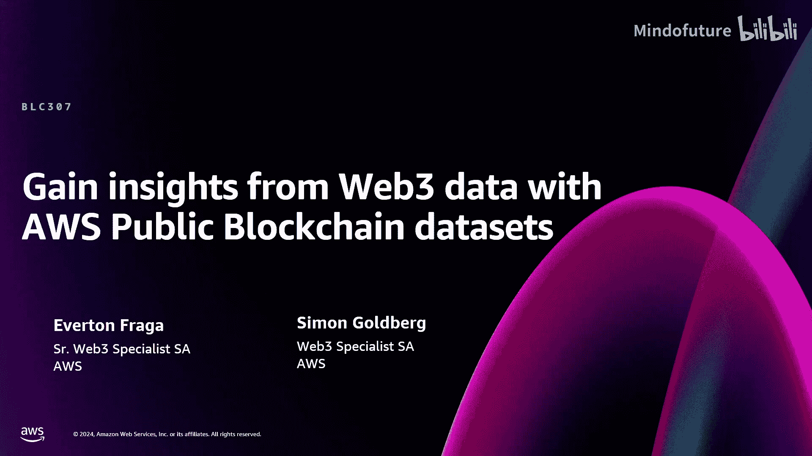
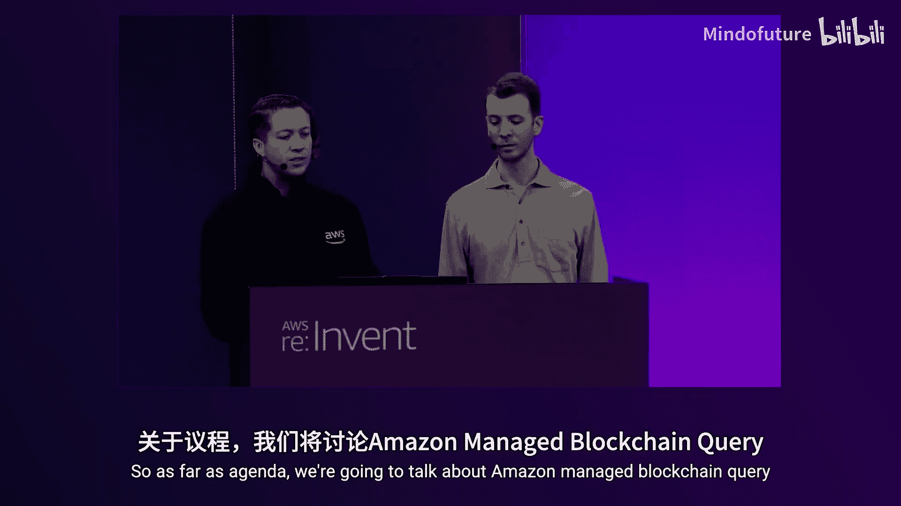
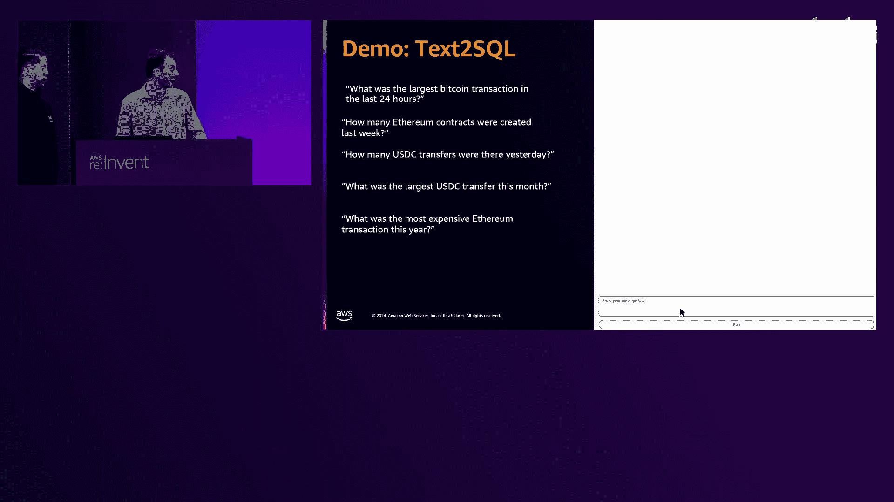
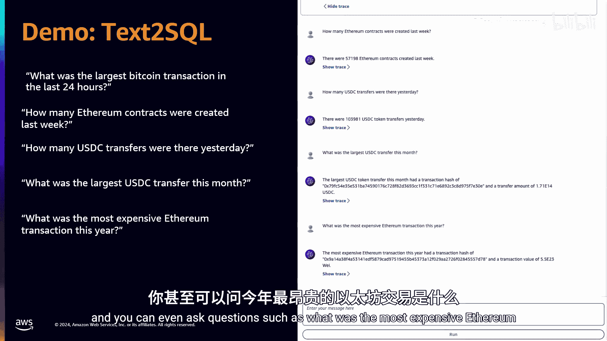
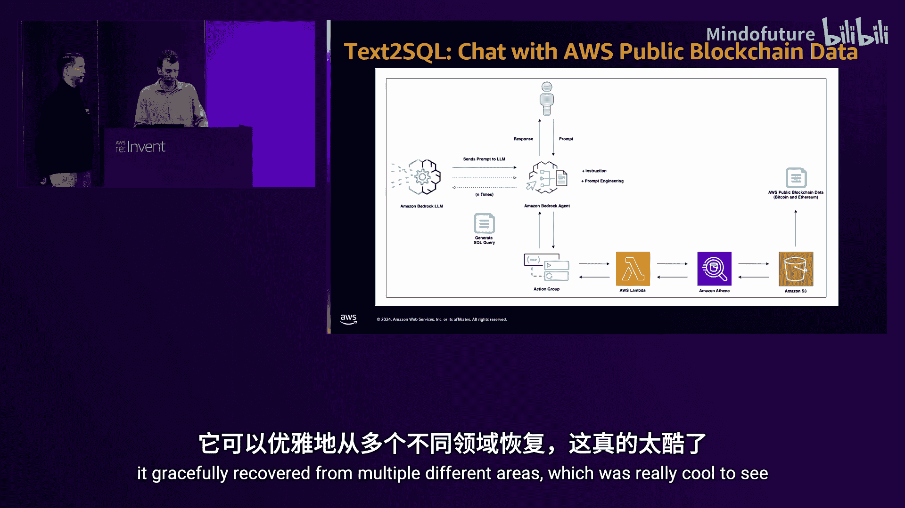
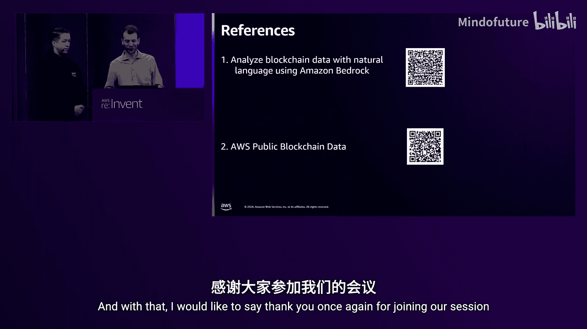
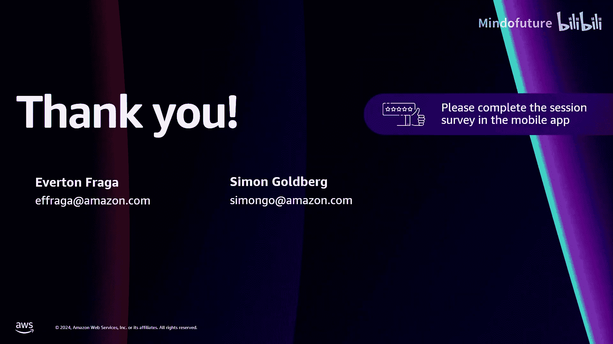

# 【AWS数据库峰会2024全集-•-中英】AWS-re：Invent-2024---Databases-p10-P10-Gain-insights-from-Web3-data-with-AWS-Public-Blockchain-datasets-(BLC307)--BV1VAR5Y6Es1_p10-

All right， how's it Gary， everybody， big crowd。

All right。 so I'm Everton。 I'm a senior Web3 specialist solution architect with me， Simon Goberg。😊。

I'm a Web 3 specialist and solutions architect basedside of Atlantic， Georgia。

 Thank you all for coming today。All right， and today we're going to talk about this very interesting topic of blockchain data sets and why we're doing with having them publicly available。

 right？So as far as agenda， we're going to talk about Amazon managed blockchainlock query and data blast public blockchain dataset sets。

 then we're going to go over some of the dataset schema examples。

And then talk about one of the partners that we have， and also。

 we have a little demo that we prepared for you about T to SQL queries using Amazon Athena。Also some。

 you know， a deeper dive on A And B query overview。 and that's it。All right， so。

Amazon managedage blockchaincha query is a fully managed service that we created to help with to go around all the complexities of indexing your blockchain data right so AMB queryry provides very simple APIs for you to query directly from your applications set of structured data from your blockchain from your blockchain workloads。

So we take care of all the indexing， the loading， and we provide very low latency access to those informations。

As far as Jane's support。We have Bitcoin and Ethereum available for those。

 so you can query some of the hard quiries to make， I would say like past balances。

 something that will require you to have an archive node that comes with all the complexities for it on Ethereum and for Bitcoin you can query out the native Bitcoin balances。

 transaction histories and more。All right， it take over。The AWS Public blockchain data Sa for。

 released least as an open source project in 2022 with support for the Bitcoin and Ethereum blockchains。

AWS has built up an ETL process internally to perform a transformation on data as we perform RPC requests on both the Bitcoin and Ethereum blockchains。

And once it goes through the transformation process。

 we persist it into a public S3 bucket called AWS Public Buction。

Let's take a look at a couple of schemas that represent what the data sets actually look like and the insights that can be gained from them。

For the first schema， well look at the one for Ethereum。 and it has。Six different tables。

 one for blocks， one for transactions， one for logs， toing transfers。

 traces and contracts is quite an extensive set of data sets， just for Ethereum itself。

When it comes to Bitcoin， we have just two separate tables。

 The first one is blocks representing the first Bitcoin block that was mined in 2009。

 up until the most recent blockhead， along with every single transaction in the data set。

We have found that these data sets are very useful for performing SQL queries。

 whether them being basic or advanced。 For example。

 you can determine what the largest Bitcoin transaction was of all time。

Or you could also create a type of heat graft to show the flow of money between different accounts。

 which is pretty interesting。And now I'll throw it back to advertising so we can go over how we've actually expanded on this initial set of chain support for just Bitcoin and Ethereum and how we are going above and beyond on that。

Thank you， Simon。All right， so we've been asked by customers many times， so hey。

 are you folks going beyond Bitcoinco and Ethereum。

 we heard that for many and we tried to address that in the best possible way。

And we are happy to announce that this week we， we just made available five new data sets。😊。

Those are provided by our indexing partners， shown our X at the bottom。

And so we effectively have onboarded Optos， Arbitrum， Bays， Prodance， and XrRPL。

And the way that it works is actually pretty simple。

 So all the data is loaded onto our public S3 buckets every day。 and folks can。

 without even free of cost， folks can even download those data sets。

And or they could plug to one of to some of the AWs services， such as Rashift。

 SageMaker or Amazon Athena。 so you can start querying right away。

 So way that we the way that it works is that you can create Amazon Athena data catalog pointing to that to those as three buckets。

 or it can create a gluecraer that can periodically take a look at simple sample files of these dataset sets and then it creates a schema so you can effectively query that from Athena。

So we hope that we are lowering the cost of indexing for for indexing data for folks that are researching。

 they're experimenting with data Moreoverover， we have folks on the financial services that sometimes they have a very high requirement for appsAC right。

 so they can now start working with public data without having to go through all the hurdles。

So they can first learn about the data， and then that can effectively help them with their procurement process and with theI T requirements。

So we see these as a way to really lower all the burdens that some customers told us about。Right。

 so those are the new ones。If folks want to have， we。

 we know that five blockchains plus the two that we have before that that does knock cover the whole universe。

 right， So still on that partner， they have offerings for over 70 blockchains。

And they have their proprietary data quality framework。 and they are you know。

They have the enterprise writing infrastructure about scalability。And such。All right。

 so we prepared a demo。 Want to take over， Simon。 Yes， please， yeah。

You have a pretty interesting demo to show you all today。

We essentially built on top of the AW S public blockchain data sets and added an additional component。

 We all know that generative AI is quite a hot topic right now。

 And we are really thinking about genuinely useful solution， combining。Ven AI， along with Web3 data。

And with that， we can take a look at the demo。 We prepared a bedrock agent that does text dis sQel。

 And you can ask questions and play in English where the agent。Understands the user's intent。

 generates the SQL query， calls an associated Lambda function。

 executes the generated query on Amazon Athena， and then the response gets returned back to the agent。

And in the case of there being an error， the system automatically analyzes the error Massachusetts tries to formulate a new query。

 which is quite an effective way to improve the overall posture of the solution。

But y，ll let this play real quick。 and we'll look at how this works。As you can see。

 you can enter in a natural language question such as what was the largest Bitcoin transaction in the last 24 hours and you get a nice response back in an easy to read format。

 You could also ask how many Ethereum contracts were created in the last week or how many stable coin transfers that there were yesterday。

You may even be curious about what the largest stable coining transfer this month was。

And you can even ask questions， suchsize what was the most expensive Ethereum transaction this year。

One of my favorite questions to ask is what are the most popular smart contracts of the last 24 hours or the last hour。

 for instance， and that really shows you where all the activity is happening in the greater DeF ecosystem。

 and I think that is pretty interesting。We'll now go over a quick architecture diagram of this solution just so you can learn about the bedrock Asian pattern and how we integrated into this Lambda function that can execute a query on Amazon Athena。

We start with the user who types in a prompt suchize what was the largest Bitcoin transaction of all time。

Or how much Bitcoin trading volume has there been over the last month or year。

The bedrock agent in this example was utilizing the Cla anthropic Haiku model due to us not having。

That mucks context in the prompts that are baked into the ancient itself。

Based on the user's initial prompt， the cloud Hiku model really understands your intent， for example。

 if I ask what the most popular smart contract today was。

 the model is inherently aware that Ethereum has smart contract support， but Bitcoin does not。

And the agent knows to craft a query for the Ethereum data set rather than Bitcoin。

 which I thought was pretty cool。Once this query gets created。

 it gets passed to an action group and an action group is essentially this middleware between the agent itself and some type of compute functionality。

 and in this case our action group had a very simple description。

 you will take a SQL query and return response back to the user took a single input。

 the query and return back the raw data response。Once that action group goes to the Lambda。

 the generated query gets passed in， and then the Lambda function executed on Amazon Athena。

 which gets run on the AWS Public blockchain data sets。When this solution was first built out。

 we only supported the Bitcoin Ethereum blockchains。

 but now that we have added five additional exchanges it can be further extended to allow for Texas SQL queries on other exchanges such as base and XrPL。

And going back to the error handling technique， sometimes the agent can make a mistake due to the nondeterministic behavior of it。

 and a SQL query might not have valid syntax， but by simply telling the agent in its associated instruction that analyzed the error message to generate a new query。

 it gracefully recovered from multiple different errors， which was really cool to see。

We'll now talk about some synergies between the AWS public blockchain data sets and A M B query。Yeah。

 absolutely。 Thanks， Simon， for the demo and for all the information about it。

Gracefully recovering from non deterministic behavior is something really useful， right。

 so thanks for showing in detailing that。Alright， so there is certainly some overlap between what you can have from A And B Query and what you can have from AWS public blockchain data sets。

 However， the differences are actually big。 So A and B Query allows you to to make very low latency requests to our service。

 then you have very structured information already， including past balances。

So you would not find that on AWS public blockchain though on the data sets though。

 you have all the transfers， you have block information， transaction information。

 but not the actual balances right so there's definitely some synergy or I can definitely see some use cases where you could have you know a merger of both。

So if based on so many other analogies， you can properly say that AWS provides you with a lot of options and this is one of those right。

 so I'm really curious to hear more from your use cases and to see exactly what are your folks planning to build。

And to go over one concrete example from the research we've done comparing the public blockchain data sets in A And B query。

 we found that querying a single Bitcoinco balance via Amazon Athena took approximately $75 seconds to complete due to having to scan 1。

15 TB of data， which is quite a lot of data。 And when you look at Athena's pricing and how cost works with that service。

 You have to pay around 5。Her terabyte of data scanned。

So if you want to get the balance of a single bit wallet， you have to wait $75 seconds。

 You're paying about $6， and it's not exactly an ideal experience。

 And I really believe A And B queryry fills in this gap by offering millisecond latency and the fixed cost of around 6 to $7 per million requests。

 where if you did a map， it's about a million times keep your which is not so bad。 Yeah， absolutely。

 All right， and I'm sure that。You folks have heard or seen the recent launch about S3 tables right and some comments about this is we store the files currently in parkque format on S3。

 so that allows us to read those files quickly， but we're looking to explore other avenues for that and whatever is makes the million times of difference right to shorten that to shorten this gap were pretty much up here for that。

 All right so we have some QR codes for you folks about references we have the AWS public blockchain data website is the landing page with all the with all the S3 URLI folks can can explore and we have this amazing guide about analyzing blockchain data natural language using bedrock。

And thank you all for coming once again。 And as we look forward。

 we really hope to see how these new chains do in our open data sets。

 and we hope to expand the more chains in the inevitable future sheet。😊，And with that。

 I would like to say thank you once again for joining our session and have a great rest of your day and a happy reinvent and an even happier holidays。

 of course。 Thank you。 Thank you。😊。

