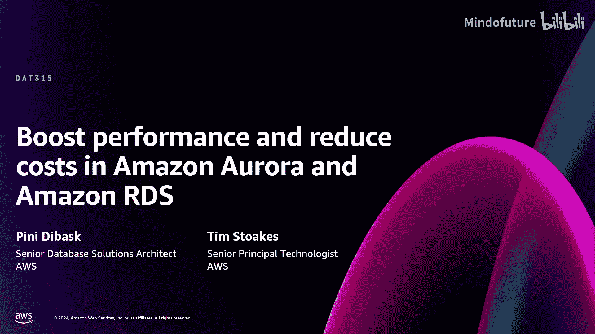
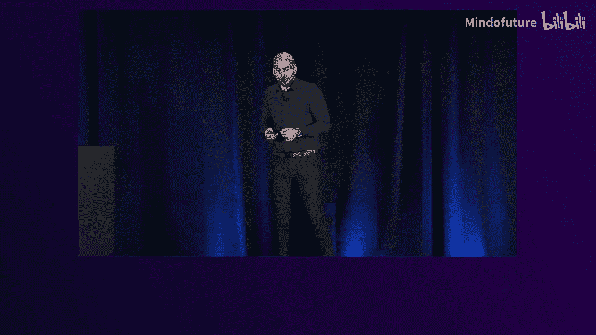
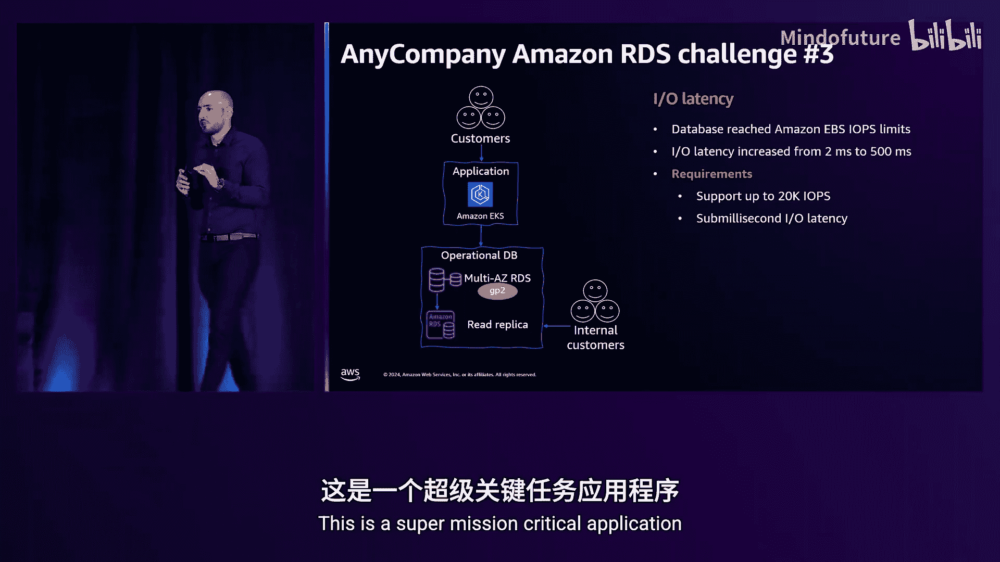
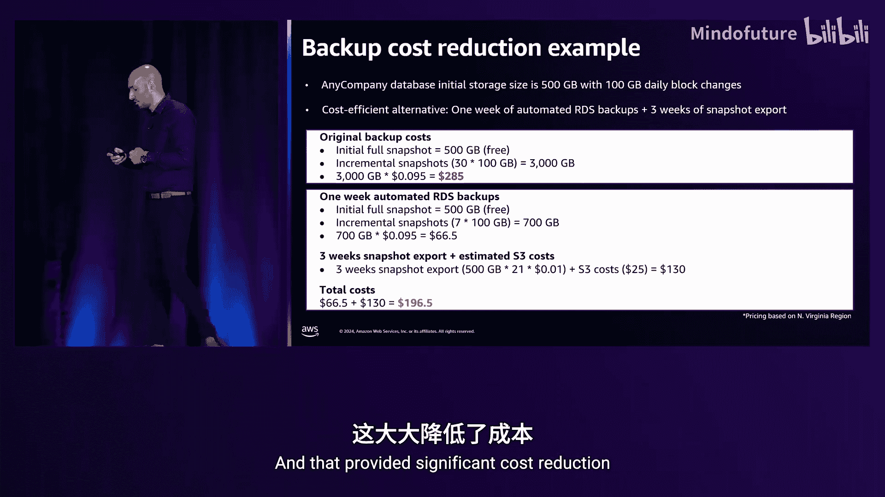
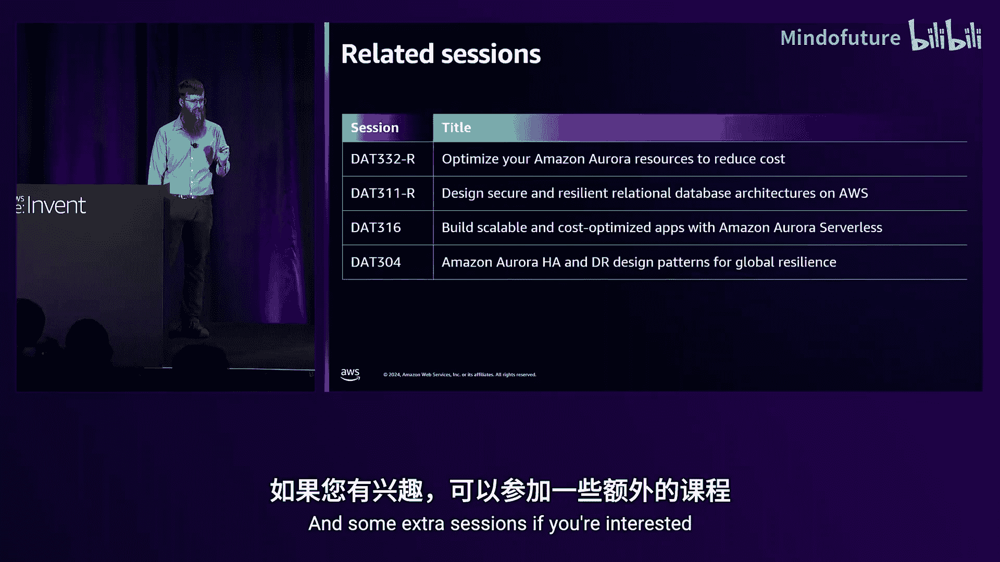
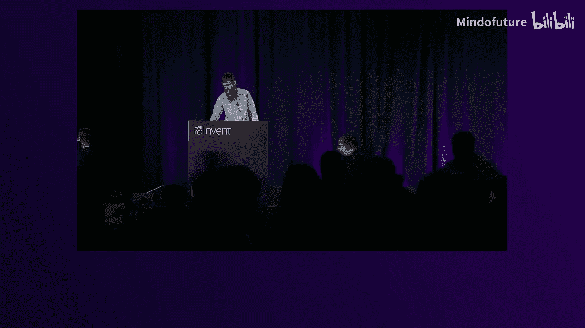

# 【AWS数据库峰会2024全集-•-中英】AWS-re：Invent-2024---Databases-p13-P13-Boost-performance-and-reduce-costs-in-Amazon-Aurora-and-Amazon-RDS-(DAT315)--BV1VAR5Y6Es1_p13-

Okay， hello， everyone and welcome。 Thank you for joining us。Before we get started。

 I'm curious to know。How many of you have faced performance or cause challenges in Amazon R D， S。

 if you could raise your hands。Okay so looks like everyone here。

 which means that you came to the right place because in today's presentation we will explore tips and best practices on how to boost performance and reduce costs in Amazon Aloa and Amazon RDS I'm Pein Dibask。

 I'm a Se database solution architect at AWS and I will be joined later by my colleague Tim who is a senior principal technologist at AWS。

I assume many of you are already familiar with Amazon RD S。

 but just to level set is the fully managed relational database service with Amazon RD S。

 you're able to spend time innovating and optimizing your applications。

 rather than focusing on the operational database management tasks like upgrades， backups。

 provisioning， etc。 Its supposed commercial engines like Oracle， SQL server and DB2。

 as well as open source engines like Mysql， Postgres， Maria， DB and Amazon， Aa。😊。

Amazon Aurora is quite unique because it is a cloud native database engine。

 which was designed to provide you the enterprise grade， security。

 availability and reliability of commercial grade enterprise databases with the simplicity。😊。

And cost effectiveness of open source databases。 And used to some of Amazon A all unique features and characteristics。

 it is actually the fastest growing service in the history of AWS with hundreds of thousands of AWS customers use it today as the relational database。

 I would like to start to dive a bit deeper and talk about the various RD S cost dimensions。😊。

There are costs associated to every audience cluster， and these would be compute storage。

 There are additional costs which are very common， and we find them in most of our customer workloads。

 and these would be backup， data transfer and IOs。There are also costs。

 which really depend on your specific application use cases and which database features use for your applications into this's presentation。

We will walk you through some of the most common cost dimensions and how we address those and how we optimize those。

 And the way we will do that is by using examples from a company named any company。

This is just a made up customer journey， but it does represent some of the most common customer challenges that team and I often see in our day to day with customers like you。

So to give some context about any company。Any company empowers ecommerce-commerce sellers with geneative AI to turn every product into the best seller。

 Their key AW S services are Amazon E K S for the application layer and Amazon RD。

 S for the operational database layer。Any company is a fast， growing， successful startup。

 but they are still an early stage startup。 And one of their challenges is balancing cost and performance as。

 as theres as as their scale。 And this is a challenge that we typically help customers tackle。😊。

So the way we will do that， we will walk you through the journey with Amazon RD S。

 And then in the second part of the presentation， Tim will walk you through a similar but different journey this time with Amazon Aa。

 So you will also learn about the similarities and differences when it comes to RD S and Aurora in terms of performance and costs。

There are three key dimensions that I would like to talk about and focus on in today's presentation when it comes to cost。

 compute storage and backup。So let's get started with compute。

And I would like to introduce any company's first challenge。

Any company started with an instance type R 6G X to large。And in the beginning， it worked just fine。

 Everything was working smoothly。 However， as customer adoption increased。

 they noticed that the CPU utilization metric in Cloudwatch occasionally spike to 100% utilization。

 And that made an impact on the reliability of the， of their solution。

 Some customers even complained about slowness and timeouts。😊。

So the obvious question that many customers ask us， what is the right R D S instance to use。

That could be a tricky one， because there are so many r instance types that you can use。

And this is a common question we get from customers。

So we need to make sure we find a solution that is both performance and cost conscious。With AW S。

 you have plenty of options。 So burstable instances are great for smaller or variable workloads。

 general purpose suits。😊，CPU intensive applications， memory memory optimized application。

 memory optimized instances are a great memory In applications and Grviton。

 which is based on architecture， provides improved past performance compared to X 86 counterparts。

 making them ideal for various workloads。 By the way， you see here Grviton 3。

 But we actually announced recently Grviton4 support for Amazon RD S。

 So now we also have R A G and M A G support for Amazon RD S。😊，Now。

 you may ask about what are the best ways to find the right instance to use。

 because there are so many options。And I would like to show you which tools any company uses before they make rightsizing decisions。

 And let's start with monitoring tools。When it comes to monitoring the， there is the obvious service。

 Amazon Cloudwat。 This is AW S main monitoring and observability service。 It allows you to monitor。

 visualize and alert based on dozens of instance level metrics like CPU memory network。

And this clever utilization metrics。When you need to dive deeper into more granular operating system level metrics like Linux。

 huge pages and swap activity and OS process list， this is where RD S enhanced monitoring comes into play。

😊，And when it comes to deep dive database level monitoring。

 including visualization of SQL statements and weight events。

 this is where RD S performance insights is the right tool to use。😊。

And speaking of R D S performance insights。What we found is that many of our customers told us they found it very effectively and efficient to diagnose even the most complex database bottlenecks。

 because it helps you visualize， drill down， slice and dice activity by various dimensions like weight events。

 SQL statements， applications servers， etc ceter。 It supports all of the Amazon R D engines。

 So this is a very useful tool that we typically recommend customers to enable。😊，Now。

 we also found that many customers use performance insights prior to right sizing decisions。

 So when we find a database low chart that looks like this。

Where the number of V CPus in the instance is much higher than the database load。

 We know that this is a potentially oversized instance。

 So we might have cost optimization opportunities。 On the other hand。

 when we look at the low chart and we see that the number of V CPus of that particular instance。

 is lower than the actual workload and the actual database load。

 Then this is a potentially undersized instance。 So we will need to either tune the application。

 the database， the SQL statements， or alternatively right- sizeize the instance。Many customers。

 and I'm sure some of you could resonate， told us that you find Cloudwatch and performance insights useful when it comes to right sizing decisions。

But you also told us， loud and clear。That you need more help with automated recommendations at scale。

Some of you have dozens or hundreds or thousands of instances。

And you need more automated recommendation at larger scale。 And this is why a few months ago。

 we listen to your feedback。 and we actually announced AWS compute optimizeal support for Amazon RDS MysqL and Amazon RD S Postgres。

 So now we can help you identify the right instance size for your fleet of instances in this example in this screenshot。

 you can see accommodation to move from R 6G， which is based on Gviton2 generation to our 7G。

 which is based on Grviton3 generation， that provides improved price performance。😊。

And using the right tools and using AW S compute optimizer helped us to solve the first challenge of any company。

And by moving to our 7 G extra large， which is based on a newgaviton generation。

 they managed to achieve27% price performance improvement。

 and that allowed them to provide a most steady state and and stable workload for their customers。😊。

So they provided an improved price performance。 And this is also a great example of taking advantage of the latest galon innovation。

 not only to boost performance， but also doing so in a cost conscious manner。😊。

The second challenge is noisy neighbors。So in the case of any company。

The performance started to degrade once's internal customers who are essentially data analysts started to to query the database for reporting purposes。

 They needed to build some dashboards for the executive leadership team。

 And those reporting reporting queries made an impact on the core customer application。

 So this is a a classic case of noisy neighbors。😊，And this is a common scenario when we say competing workloads on the same database resources。

And we need to find a way to effectively separate those or manage them in a more effective way that they don't interfere each other。

 So the the， the obvious approach or the traditional approach is to scale vertically。

By rightsizing the instance and moving to a larger instance。 However， with grid replicas。

 we have more flexibilities so we can create up to 15 grid replicas。

 Each one can be in different size。 And by doing so。

 we can eliminate the noisy neighbor issues and ensure higher throughput for our application。

You may ask about the cost differences between vertical skating and horizontal sating。

 And the answer is that it really depends on your specific application use case。

 each local is unique。 But in the case of any company。Scanning vertically from R 7G Xo to R 70 to Xo。

Actually， double the compute cost。So they decided to go with horizontal skating using grid replica。

 And they found that using a smaller grid replica R 7G large actually managed to address their reporting queries very effectively and very efficiently。

 And that provided a more cost optimized approach for this noisy neighbor issue。And by the way。

 you may notice some price examples here。 We are using pricing from North Virginia。

 These are on demand pricing。 Just be aware that with Amazon RD S。

 you have the option to use reserved instances。 So if you can make a longer total commitment for one year or three years for your steady state workloads。

 you could actually achieve significant discounts。 But for simplicitys sake。

 we will be using on demand pricing for North Virginia in this example and all the remaining examples in this presentation。

😊，Another alternative to address the issue is to。Cash frequently access data like SQL resultsets using Amazon elasticastic cash。

This enables to provide faster performance。 And in many cases。

 at a much lower cost compared to other alternatives。😊，Now， the way it works。

 there have several allocation strategies。 But one common one is every time we write to the database。

 let's say we insert or update the record， we also simultaneously update the cache。

 the Amazon elasticastic cache。 And once we need to read the data。

 we can do that directly from the inmemory database。 and that provides improved improved performance。

😊，However。Using elasticasticc to cache frequently results sets。

 it doesn't meet all use cases in all workloads。 There are some situations where you have very unique ad hoc。

 dynamic filters。 And in those cases， using elasticastic cash doesn't necessarily provide the best outcome。

 So in these specific use case for any company， because most of the workload。

 most of the reporting queries are a dynamic， Theyre ad hoc that are based on unique queries。

In that scenario， they decided to go with a different route。

 which is offload queries using using grid replica and using that approach。

 they managed to achieve an overall 50% improvement in the core customer facing application performance。

In the， in the API， essentially。So this is， this is a great way to see how using red Applics by offloading red heavy queries。

 you can make sure that you eliminate noisy neighbors。😊，While allowing both to run smoothly。

And now I would like to talk about the second dimension， the second cost dimension， which is。

 which is storage。In Amazon， RD， S， you have a range of A， B。

 S options to match your performance needs。GP2。Ties the number of iops to the to the amount of allocated storage。

 So as you allocate more storage， more gigabyte or more teryte， you will benefit from more iops。 G3。

 on the other hand， allows you more flexibility， so you can allocate iops and throughput independently of the storage size。

 So again， more flexibility。 However， both G2 and G3 are best suited for development and testing environments。

😊，And also， for medium size workloads。When you need to make sure you have emission critical applications that require consistent low latency。

 this is where Io1 and Io2 B Express are the go to options with IO2 being more recommended due to its improved durability。

 throughput and low latency。So just to understand the comparison with I O2。

 you get five nine of durability，99。999% durability。This is 100 times more durable than I1。

 You also get。Submiit a second I O latencies。 This is the only E B。

 S option in Amazon RD S that provides you Sub a second I O latency。By the way。

 I1 and I O2 are price the same。 So if you are using I1 today， you can。

 and you should consider moving to I O2 to benefit from improved performance。Drability。

Without additional cost increase。 So definitely recommended to move from I O1 to I O2。

 It's an online operation。 But as we always say to our customers， please test that。

 please test that in a preproduction or nonproduct environment before you do so in production environment。

😊，So back to any company now for another challenge， which revolves around E， B， S I O latency。

 As their database scaled， they reached E， B， S Iops limits。

And that caused their eye latency to spike from 2 milliseconds to 500 milliseconds。

 which is a significant performance heat。😊，This is a scaling issue we occasionally see where high IO demand could lead to IO bottlenecks and IO latency issues。

 So we need to find a solution。 and sometimes in addition to instance ride sizing。

 we also need to do storage rights sizing and the requirements from the customer Devopps steam from any company's Devopps steam was very clear。

We need sub minutesise second IO latency。 This is a super mission critical application。

And similar to all the other challenges that we're talking about in this presentation。

 using the right money to link tools， we were， we managed to easily identify the bottleneck。

 So here we can see RD S performance insights， metrics dashboard。Clearly。

 indicating that there is increase in both number of E B， S IOs and the Iol latency。

 which as mentioned， increased to 500 milliseconds。

So the solution here was using storage rights sizing。 In our case。

 moving from G2 to I O2 Block Express was the right move because that provided the customer subminisecond IO latency。

😊，Using tools like monitor， like Cloudwatch， performance insights and compute optimizer help you understand when and where adjustments are needed。

And now for the challenge number 4。The fourth challenge is around slow reporting queries。

 So the customer， we talked about internal customers data analyst to run reporting queries on the read replica。

 And what they do， they essentially run these complex SQl queries。

 which include a lot of joins and auto buy and group by。

 And what we found is that the average load time of those dashboards is around 10 seconds。

 Executive leadershipship team said we can tolerate up to 5 seconds。😊。

We started to dive deeper into the performance issue。

 And what we have found is that these complex SQ queries generate a lot of temporary objects。

 database systems like Postgres try to perform operations in memory for optimal performance。

 but in some cases， in some situations。😊，When there is not enough memory for those operations。

 they actually write temporary objects to disk。And in our case， to E， B， S。

 And that could add latency， especially for large data sets and complex queries。

So one way to address this issue。Is using a great feature。

 which I highly recommend to most of my customers who face this issue of temporary objects being written to the E。

 B， S。 And that's called called RD， S optimizeized reads。😊。

ADS optimize rates essentially provides you local， fast NVM E SSD that is targeted。

 especially for that use case， instead of writing those temporary objects。

 which are needed to store intermediate results of sort or group of group for queries。😊。

They store it in these local N VM SSD。 So that require you to use instance that supports this type of local N VM SSD。

 like R 6 G or R I， R I， R I D。And in our case， by using optimized rates。

 we managed to address this issue。 So we can see here request example。

 any company could have chose to scale vertically and move to our 7G Xel arch for the red replica。

 And that would double the compute costs。However， they decided to use optimized reads with the latest graviton generation that currently supports optimized reads。

 which is R 6 G D。 And with a smaller instance type， R 6 G D large。

 And that provided them the performance they needed。 So they get they achieved two time。😊。

Faster execution time for the queries。Without。Increasing the expense of their infrastructure significantly。

 In fact， the difference between the original instance type to the new instance type。

 which is based on optimized rates， was less than 10%。 and yet it provided。

2 x performance for their reporting queries。So if you are facing issues where a lot of temporary objects are being written to the disk because of complex queries that need to store intermediate results for sorting or querying for group by auto by operations or drawing operations。

A D S optimized rates could be a great candidate for your solution， for your problem。

And now I would like to talk about the last cost dimension， which is backup。

 R D S offers two types of backups， automated backups and database snapshot。

Automated backups include daily A B， S， snapshots。 And in addition to that。

They also store transaction logs in S 3， every five minutes。

The benefit in automated backups is that it provides you for a granular point in time recovery in your retention period。

 and the retention period could be up to 35 days。35 days is the maximum。Database snapshots。

 on the other hand， can be taken at any time。And you can retain them until you delete them。

 So there is no expire date for those snapshots。So that provides you more control over long term backup management。

And this leads us to the last challenge of any company， which is high backup costs。

Any company had a backup retention of one month， which is pretty standard for companies。

 one month of backup retention。However， a closer look at the customer requirements actually revealed that they only need one week of data to be restorable。

 and any data older than a week needs to be accessed for compliance queries only。

Doesn't need to be restorable。 just needs to be access for compliance queries only。

So we had the requirement to reduce backup costs dramatically。

And there are several cost efficientic way to handle long term backups。

 One way is using Snapshot export to S 3， which could be either full or partial so we can do that for the entire database or for specific schemas or tables。

 And then we store it in Apache parquet format， which is ideal for storage querying using tools like Amazon Ata。

 It is a compressed format。Another alternative would be to use logical backups using native database tools。

 So， for example， with Postgres， you have PG dump with MySQL， you could use MySQl shell dump。

 So these are different ways to provide cost efficient long- term backup methods。

And the benefit in both of these cases， whether it's snapshot Expo to S 3。

 all logical backup to Amazon S3 is now data is stored in your customer owned bucket。

 So you have full control over the storage class。 So， for example。

 you could define it to be S 3 standard， which is ideal for frequently access data。Or alternatively。

 if you know that the access pattern requires less frequently data。

 less frequently access to that data， you could use S 3 infrequent access or even S3 glacier。

 So it provides you more flexibility around how you store your data。

 whereas with native RD S backups like automated backups and database snapshots that we mentioned earlier。

 You don't have control over which S 3 storage class you use。 So this gives you that flexibility。😊。

Now， using this approach， we managed to reduce cost of backups completely， significantly。

We can see here the original backup cost， which uses the 30 days of automated backup。

Let's assume the database size is 500 GB， and we have 100 GB of daily E， B S block changes。

We assume the initial snapshot is 500 GB and it's free because AWS provides you up to 100% of your database size as free backup backup storage costs。

And then we charge for each incremental snapshot。 And you can see that each incremental snapshot is 100 GB。

 represents the daily block changes。Alternatively， with the cost efficient alternative。

 what we can see here is that we only use one week of automated RD S backup and the remaining data。

We use the S 3 snapshot export approach that we just mentioned in the previous slide。

And that provided significant cost。

Reduction。And to be more accurate， that reduced their backup cost by 30%。

 demonstrating how efficient backup data retention could lead to significant savings while still maintaining compliance。

 access and data retention requirements。Now， I would like to pause for a moment and ask you。

 what do these three pictures have in common。So we can see here flashlight。

 radar and magnifying glass。Exactly， they all provide visibility。

 So these are all tools which provide visibility and detection。

 And the reason they show it is because when it comes to database performance and cost。

 you can't fix a performance or cause problem that you can't see。😊。

So we discussed about some of the tools like Cloudwatch， performance insights， enhanced monitoring。

And this tools。A great for our customers。 And any company used them throughout their entire journey。

 as you saw。However， any company also raised some challenges with the traditional monitoring tools AWS provides。

 and maybe some of you could resonate with those challenges。

 So I would like to talk about those challenges and show you what we've built to address those。

 So we have an interesting announcement coming soon。😊。

The first challenge is that while performance insights is very useful for deep database diagnostics。

 the information is always presented at instance level view。 You can switch between instances。😊。

But you never see the full picture because you always see one single instance at a time。

And when you think about any company's journey， they started as an early stage startup。

 But once they scaled and became bigger and had to manage dozens or hundreds of instances。

That problem became very relevant for them。Another challenge。I， as you know， in A W S。

 we have a lot of data， performance data， traces， logs。Scattered around so many tools。 So。

 for example， Cloudwatch and Cloudwatch logs， R D S enhanced monitoring， R D S performance insights。

R D S events， many of our customers asked us to provide a centralized telemetry so they can have a true single pane of glass。

😊，And lastly， many customers told us that they would like to better understand application context and particularly correlation between application API and database performance。

 So we've listened to your feedback。 and today， we are very happy to announce Cloudwatch database insights。

😊，With CloudWtch database insights， with this new announcement。

 we consolidate all of your database monitoring into a single unified view within Amazon CloudWatch。

 so you can define a fleet of instances by specific specific tags or specific instances within a region。

😊，And then once you do that， you， you get a heat map that shows you instant summaries so you can understand where are your bottlenecks based on various dimensions like database load。

 database alarms， and different metrics。So with this launch。

We support both Amazon Aurorga Postgres and Amazon Aorga Mysql with additional RD S engines coming in the future。

 So stay tuned for that。😊，Also， another innovation with this announcement is that for the first time。

Once you dive into a specific instance， you can correlate all the traces and log data and weight events。

Because now you have a full out of the box， native centralized telemetry。And lastly。

 maybe some of you are familiar with Cloudwach application signals。

 which is an application performance monitoring solution。 It's an AM tool。

And Cloudwatch application signals allows you to use Cloudwatch agent and AWS Distro for open telemetry to capture performance and trace data。

 Many customers told us we need to better together story。

 We need to better understand the correlation between database performance and application performance。

 So we need to see the dependent API calls and dependent services that are associated to any database bottleneck。

😊，So now with Cloudwach， you can do that。With Cloudwa database insights。

 we provide you this visibility into dependent API calls for each database bottleneck。

Last but not least， many of you that use performance insights。

 you're probably familiar with looking into a specific instance and diving into a problematic sQel statement。

 You're looking at the metrics or statistics like number of executions。

 number of temp reads or temp write， number of page reads or page write。And you may be seeing number。

 but typically， the number is aggregated across the time period that you selected。

 So looking at the last week and seeing that this specific statement took 10000 execution is useful。

But it would be much more useful to see the trend over time。 So now with this launch。😊。

We also provide you the ability to see trends over time for each SQL metric and each SQL statistic。

 So it's not only seeing a total number， which could be helpful， but doesn't tell you much。 Now。

 you could see how it behaves over time。So just to summarize。

 you can't fix a performance or cost problem that you can't see。

 So you should leverage the latest monitoring innovation。

 like Cloudwatch database insights and be more proactive。😊，And definitely。

 any company uses those tools in order to address their challenges。 And speaking of any company。

 I would like to quickly make a recap of their audience journey before I hand it over to Tim。

So we started with the issue of increased workload due to customer adoption rates。

 We solved that using instance rate sizing and specifically by using Grviton。

 the latest graviton innovation。 and that provided improved price performance。Later。

 we have the issue with noisy neighbors and we solve that by offloading the reporting queries into Ri replica。

 So now both the core customer application and the report in queries can run together smoothly without interfering each other。

Later， we had the issue of I latency。 and by doing storage right sizing by moving from G2 to I O2 B Express。

 we managed to achieve subisecond IO latency。Later， we had the issue of slow reporting queries。

 We noticed that these queries are complex。 They run a lot of joins and Auto by and grow by operations。

So we， we identify they create a lot of temporary objects on the E， B， S。

 And by moving to R D S optimize ratess， we managed to improve performance。Pay two time。And lastly。

 we had the issue of high backup costs， which we solve by using cost efficient long term backup methods like snapnapshott Expo to S3。

And now I would like to hand it over to Tim， so you will learn about a different but similar journey。

 And this time with Amazon Oa。 So Tim stage is yours。You're clapping for me or for penny？😀Ha。😊。

Alright， button。 Get on button。 Allright。 Hi folks。 My name is Tim Stokes。

 I'm a senior principal technologist with Aurora here。Thanks to Penny， you know all about RDS。

 And now I'm going to tell you kind of a similar story。

 but with a whole different punchline with Aurora。So。Excuse me。

 we're going to start again with this any company journey but this time in their fictional startup。

 they're deciding to begin with Aurora instead of beginning with RDS Open sourcece Okay so Aurora is a relational database management system built for the cloud with full MysQL and Postgres compatibility。

Penny told you a bit more about that before， so I won't dwell on it。

 The idea here is it gives you five times standard the throughput of standard Mysl and three times out of Postgres and it gives you a whole bunch of resiliency down in the storage layout。

 That's what's magic about Aurora that's different to RDS gives you some different trade offs and they come across differently when we're talking about price and performance right。

But just because any company， the fictional one， chose to do this at the beginning doesn't mean you have to choose to do this for real at the beginning。

 You can always migrate between R D S and Aurora using AWS data migration service if you wish。

 or some of your own tools。 Okay， you can do this whenever you like。Cool。So just like with RDS。

 we got these three cost dimensions that we need to get through。

 So we're going to go through them here。 But like I said， Aurora talks about the storage a lot more。

 So what I'm going to do is break the script and kind of do storage in the middle first。

 because it's more interesting for Aurora。Aurora storage。

 I have to learn a little bit about how it works first before we can talk about the rest of it。

 So it disaggregates the storage from the head node。

 right It's down in that bottom Aurora storage green box at the bottom there。

 You can see it spread across three availability zones。

It's made up of a large number of storage nodes here I've just got six because I can't draw that well。

 but there's a whole bunch of them in each availability zone。

 The little colored boxes indicate other people's data。 these are multi tenant storage nodes。

 It multi tenant storage fleet。So when you do a right。

 Aurora makes six copies across all those storage nodes and you're only paying for one of these copies it's the first time I've talked about payment。

 that's only paying for one of these things but you're getting six way。

 can't even do it with one hand six way durability across three AZs So all that means is that we can lose availability of a whole storage a whole AZs worth of storage nodes and one more storage node in your volume。

And we don't have any durability or availability problems。 That's all out of the box with Aurora。

 It's what you youre getting when you're paying for a Aurora storage， okay。

But how does this impact performance， We'll talk about that， Okay， so we've got some challenges。

 different challenges， though， for this company， right。And so some customers are bursty， right。

 We've got these regular customers off to the top corner there， and now we add some bursty customers。

 That's a bit of a challenge， right。So maybe this can happen when their geography wakes up or maybe some Taylor Sw goes on scale or something like that。

 right， maybe whatever your any company does has this kind of similar pattern。

 So Aurora will take care of some of that stuff for you already。

 we don't have to worry about it quite as much， not quite so much handholding。

 But with this flexibility。Comes maybe a bit of a problem in that it can lead to I O cost surprises right。

 just because you've got practically infinite I O on the back end doesn't mean you maybe want to pay for it。

 So we can， we have these challenges。 What we want is to have improved cost predictability for our aurora database cluster。

And what we'd really like is for that I cost to reduce as well。 Okay。

 so we'll talk about how we're going to do that。So Aurora is paid for what you use with respect to storage and other things。

 too， right with storage， it's storage size and its ios。

So first we'll talk about storage size right so this is build per gigabyte month。

 just like a lot of other AWS services are。And AWS is going to expand that volume when you need it。

 You not， you're not doing it by hand。 It's going to contract it when you no longer need it。

 You can see what's happening。 You can look at that Cloud watchch metric。 volumeume bytes used。

 And some of this is in your control。 You can if you're in Postgres。

 you can run some vacuum to keep your size under control。 you can configure auto vacuum， right。

So now let's talk about Is。😡，Every database page read operation counts as there' one I O here。

 right doesn't matter which database engine you're using and the rights。

 because of the way aurora works and the database engines work。

 theyre built in lumps of 4 kiloB units Okay， because they could be of varying sizes and get patched together。

Excuse me。 So in Aurora， they build a per 1 million requests， both of these things。

 So the number of ios you can make is scalable。 So it's not provisioned like what Pennny was talking about before。

 just as long as you can drive the IO through the instance， we're going give you the I O。 Okay。

 That's how aurora works。So here also you can see I've just got one aurora instance at the top。

 Now we'll talk about a bit more， but I'll spoil the surprise and say that you can have multiple of those replicas at the top as they're doing IO it all for the purposes of price and performance。

 it all works the same。 They share the same storage。

 They share the same building methodology and the same performance methodology。Okay。Next one。

 So now we're going to do a little example here， just like we did before。

 So we start at 100 gigabytes of volume， and we're growing at 100 megabytes per day。

So they can look at this in CloudW any company if you like and so this will show their instance cost there。

 you can see we're using an R6G X large， we're doing it for 30 days Time sum rate gives you about $370 We have the same provider at the bottom there about North Virginia and on demand instances I'll do the same thing that Penny did for consistency right。

And their base loaders reads and writes as's 600 Ios per second。 Okay， so what does that look like。嗯。

That looks like 600 times 30 days， 24 hours and all of that comes out to about $207。

Now storage costs that gigabytes cost per month。 You can see a bit of a complicated math there。

 It's not too scary， 10 cents per gigabyte month。Counting out that base size plus the growth。

 plus the growth， plus the growth gives you about $300 a month， okay。

So the problem comes for this customer when we introduce this burst of load， right。

 So there's a big burst。 It's 15000 i Os per second。

 You can see this again in the volume right Iops Cloudwach metric there。

 So we do the same mass again。 And we， we look at what the I O cost looks like for that burst。

 And it's another $648。RightThat's pretty significant。 And it's， in this case。

 it's not very predictable。 We don't like that。 Okay， So how are we going to deal with it。

What we're going to do is we're going to introduce this thing called caching， right。

 So we I'm sure it's not very unfamiliar to people in the database speak already， right。

So we're not trying to avoid provisioning a large number of ios like we did in Pis talk。 right。

 We're instead trying to reduce I O cost by insulating against those bursts。

So here we can scale up the instance， right， Ins is getting bigger。

 and we don't have to do so many reads anymore because the cache is getting bigger。

 We scale it up again。 F less reads have to go through。 Sc it up again。 Cash gets bigger， less reads。

So you can see the correlation here between more cash。

 less i might save some money there and your performance probably improves too so this is a good trade off to make。

So this is a valid technique， right， but it might not be the best solution for any company just because of their balance of burst versus regular Ris。

 so we'll dive into another solution and see what happens。Alright。

 so what we're going to do is we're going leave the instant size the same in our example now。

 just so that my example can continue through， Allright。

So Aurora's got a different option here that we can use。 It's called Aurora IO optimised。

 It's a pricing option。 So this is different to standard。

 which is what we've been talking about already。 with IO optimized iss no charge for Read R IO operations。

 right0。 We no longer worry about that。You only pay for your database instance and you pay for your storage gigbyte months just at a different rate。

 Okay， this makes it really easy to predict the amount of cost that you're going to have because it doesn't have this variable component inside it。

 right。It also can give you up to 40% savings。If your I O charges exceed about 25% of your bill generally。

 that's where this will start to break even and become positive for you， right。

 I I want you to choose it if it's not positive for you。 So this is the rough rule of thumb。

 you can use the pricing calculator to find that out for yourself。And。

You can also it will also increase your throughput and reduce latency， not just the pricing option。

 We're actually doing different things in the storage here too。

 and any future performance optimizations will definitely go into optimized first， right。

You can switch your cluster to I optimizeim just with a single click， you can flick it on and off。

 doesn't take any downtime， it can turn it on whenever you want， you can turn it off once a month。

 if you give it a try， it doesn't work out for you for any reason， turn it back off again。

 it's up to you okay no downtime， no failovers none of that。Alright。

 so let's see that cost example again that we just did。 But this time， we' will use I optimised。

 So the conditions are the same。 The gray bits are they're no different than before。

 So we don't have to pay attention to them。 So we use the instance cost here。 right。

 The instance has built at a different rate， but all the other numbers are the same comes out to about $486。

Storage size， all the parameters are the same。 So you still grow the same amount。

 You just end up with with a different cost multiplier，$675 roughly， Now， your storage ios。

 the regular base load ones and the burstty ones it cost you nothing because you're using I optimized and they're probably going faster too because you're using I optimized。

So adding this up， trust my maths or check me later。 That's about a 28% cost saving。

 This is pretty typical。 If you've got a fairly IO dominant application。

 IO optim will save you money。 We want you to switch to it。Alright。

 so our solution to this first challenge。 we seamlessly switched over to why I optimized just that one click in the console on CI。

 and we were able to improve our predictability。 Now。

 we know what our bill is going to be and we save some money to and improve some performance。Cool。

 challenge number two。We've got different internal customers at the back end here right they might be running read heavy reporting jobs end of month that kind of thing。

 I'm sure you've got a similar idea in most of your companies so what these can do is that they can cause issues with performance because they can thrash out the buffer pool inside your node and they can impact the performance of the other queries too the front enquiries that's where our money comes from as a company we don't want that so we want is a way to reduce the impact of these backend jobs on the front end quiries。

And we'd also want to reduce the impact of these back end jobs。

 and we'd like to improve the overall performance， right。And remain cost effective。 That's the idea。

So how we're going to do it。 Here's this picture。 Again， We have an aurora instance。

 We have that shared storage layer at the bottom。 What we're going to do is we're going to add another instance。

 We just add another instance to this cluster。They see the same physical storage。

 we're not copying storage here， we're not migrating anything here we've got two read replicas and I'll put them in different AZs。

 but you can do whatever you want， you can pack them in the same AZ， you can make more than two。

 can make up to 15 actually an aurora。They can be different sizes， too in the same size here。

 Allright，'s no effect on data durability。 It is not a durability question。

 That's all in the storage。So there's only one writer node， right。

 And one of its jobs is to keep all these replicas up to date as the transaction is coming。

 So it's not perfectly synchronous， but it's milliseconds lag， right。

 So you don't really have to worry too much about having inconsistent results。Alright。

 so what this can do is we can。It's also a failover target。

 each of those replicas is also a failover target， so we can think about this as a performance improvement。

Tactctic， but also， it's improving your resiliency by giving you fail over targets。 Okay。

 so you can balance cost， performance and availability on the same scale，But for any company。

 it's got a pretty big working set。 So maybe we'll say。

This set of trade offs doesn't make much sense。Maybe it's not economical。

 So we're going and look at something else， okay。Optimized reads for Aurora Postgres。

 So Penny talked before about optimized reads for RD S。 This has got the same name。

 same kind of idea。 but it's a little bit different。 So we still have the NVME SSD in your node。

 The R6 G D， for example。 And just like in R D S， we can use that instead of E， B。

 S for storing temporary data。 Okay， that's the same as RD S。 Penny explained it before。

 I'm not going to touch on it， but it's still a really good idea to do it for that reason。

 But it also gives you this thing called tiered cache。

Tedcash lets you expand your buffer pool out of memory onto that SSD， as well。

And so that can give you up to eight times performance improvement on some of the queries if they're particularly read heavy。

And it might work out more cost effective because obviously it's not quite as fast as the memory that you're replacing it with。

But that instance is a lot cheaper。 So it might balance out。

 Just have to do the sums on your working set。 All， So let's see how it works out for these guys。

Remember， you can， you can do this by just switching your instance type。

 which is just a quick failover operation in a。 You have to choose one of those instances with the D on the end。

 And that's it。 And you have to be using I O optimizeised like I talked about before。

 There's no other settings for you to turn on。Alright。

 so we work through a cost example of using optimized reads。

So this is any caching solution is going to depend on how cashable your workload is， right。

 So we have to have a discussion about working set， how big your queries are。

 how likely these pages are to be read again， you have to have this idea。

 same same calculus you're doing with an in- memorymory Buff。

 you're going to do the same calculus here。So you can estimate this by looking at a couple of CloudWch metrics if you're unfamiliar with this。

Hope that you get into that pretty quickly。So we've been using an R6G。

Dot large X large story in the example so far。 just so remember。

 So what we're going to do is we're going to switch that to an R6 G D dot X large， right。

And going be using optimized reads。 So this instance supports 230 GB of Td cache。 If you want more。

 you choose a different sized instance。 So to get the equivalent amount of memory in a cache。

We would have had to use an I X G dot 12 x large。 Obviously。

 that's a lot larger than a single X large。Rightright， so what's that going to cost us。

 We instance cost if we choose the 12 x largedge， that's going to be $5830， roughly。

For a whole month， if we choose the G D dot X large， different size is 583， it's 10 times less。

 right。So obviously， if the performance works out comparable for you。

 this is a much more economical option。 In both cases。

 the storage Os are included because we're using our optimize。 So that makes makes no difference。

 And the the size is the same for both。 So we don't consider it as a difference。Okay， so overall。

90% cost reduction。I think that's a pretty nice technique if you're using a Aurora Postgres and it fits your model。

All right， so the solution to that challenge number two， what did we do， we used I optimizeimised。

 reduced our cost by 90% and was easy。 We just switched instance type that was there。Okay。Right。

 so the developers at any company now， they need to test their work。 They can't do it in production。

 because that's a bad idea。But they can， they need to test it with production like data。

 So up until now， they've been copying production， right。

 and they've been using an E TL job to do the copying。

 and it's complicated and it's expensive because you need to have full copies of the data。

 We don't want to do that anymore。Also， these developers are pretty keen。

 but they don't work 24 hours a day。 So when they're not using the system， it's idle。

 It's wasting money， too。 And it takes time to refresh these things through that E， T O job。

 So people don't do it too often。 So you don't end up with a very。

Accurate representation for your testing。 You're just getting stale testing It not too good。 right。

 So what we want。Is we want to reduce the storage cost。

 and we want to reduce the compute cost by using some new technique and the creation time。

What are we going to do， We're going to use fast clients for aurora here。

So Aurora does this thing called Fast claim， which is like a virtual copy。

 uses copy on right to copy these things。 We don't。 we make a new volume。 We don't。

Copy the actual data。 It doesn't take very long。 And it doesn't cost you anything because you're not actually making copy of the data。

 right So you make a new volume。 It just makes a few pointers， right。

 So what we might choose to do is we might choose to let's say daily and do it whenever you like。

 We'll make a daily clone of this。And we'll maybe anonymize the data because that's what we need to do for testing。

 Okay， we'll call that golden image。And so that that is visible through a new database instance。

 new volume， new database instance。 It's not costing you anything yet for the storage because you haven't modified it。

 right， You're paying for the instance， of course， for what you use。

And then what we can do is we can clone that thing and we make a test environment。

And we can make another test environment， another one。

 another one as much as you want up to a limit of 15 clones in this family。15 f coins in his family。

Now， only when you modify the volume， those modifications。

 they start to add on your storage cost bill and any IOs， of course。

 if you're not using I optimizeimised。All right。So in our example， that deals with storage。

 I'm pretty happy with that， but we need to then leave the world of storage to talk about the next thing。

 to talk about compute， the problem that they have in compute。

So remember the test environments thing they're trying to do。

 We have to find a way to give them good performance when they need it so that their tests can work properly。

 but not have to pay for of these huge instances all the time when people are asleep or something like that。

 So what are we going to do， We can use aurora serverless here。

 Aurora serverless is an on demandd automatically scaling instant size。

It's just like a regular instance。 You choose it in a console just like a regular instance。

 except it's a magic well that gets big and small， however it needs to， okay。

So you can set the limits on it based on。What you can figure to tell me in this thing called an A U Aurora capacity unit。

 you say， Tim， I want this thing to not get smaller than this size and not get bigger than this size。

 but otherwise do what you think is right inside in that range， okay。

And you only built for the ACUs that you're using。Her second。 it's pretty fine granularity。嗯。

And it's by no means limited to a test workload。 here， We're talking about a test load。

 but you completely valid to use this in production as well。 many customers already do。

And so we just announced two new changes in serverless in case you missed them。

 so serverless can now scale up to the maximum of 256 ACUs。

 which is twice as big as it used to be before， it's pretty large and it can also scale right the way down to zero or actually go to sleep and charge you nothing if you're not using it at all okay。

So we'll follow this cost example， right？So Aurora standard we talked about before was the thing that's not I optimizeimd in testing。

 we're not doing too much iO， so we're not really worried about the I optimizeised part。

 we use standard in this example。They have a team of 10 developers。

 They're doing 100 gigs of storage，10% change rate， just like we talked about before。

 And by looking at their historical load patterns。They know that the instance they're using is idle for roughly half the time during a one day shift that these developers are doing。

 So we'll use all of that in our maths。 Okay and we'll use about an 8 A C U sized workload seems about R for what they're doing。

Cool， so the instance is going to cost us if we do an R6 dot large that provisioned instance about $62。

If we do it with serverless， with those provisos before， at $38。That's 35% reduction。

 That's pretty good。Happy with that。Now we go back to the clones thing。 We remember that。

 we're talking about if we did it with full volume copies， we'd end up with 1000 gigabytes。

And if we did it with clones， that'd be 100 gig， because we're just paying for that rate of change。

That's a 90% reduction there， too， And the Ios are the same for both。 so we don't consider it。Go。

So how do we do， Weve got 90% cost reduction。And by using servers for the test instances。

 we save 38% on the compute as well。 and for bonus points， right。

We were able to scale down to zero that new fi go all the way down and to go up to 256， really big。

 So if we want our testers to be able to do something really big， we can do that as well。😊。

Awesome backup。 We'll quickly talk about backup。So Aurora provides built in continuous backup。

 we're writing from that storage thing at the bottom there to S3 all the time by the storage continuously。

 it's not done by the DB instance so that you don't have to factor it into your performance calculations。

 there's no scheduled maintenance time it's happening all the time and it's typically up to date within a few minutes of an active database rolling along okay。

So the backups are incremental， and they're charged based on。

The amount of space that you'll need to restore them。At any point in time。

 remember having a full point in time restorability here within the backup window that your preten window that you're asking me to do from one to 35 days。

 same as what Penny described。Right，If you want to retain data beyond the backup retention period。

 you can use snapshots， just like Bennie described as well。 same as is in as in R D S。Right。

 so very similar to the way that I D S works。 So I'm not going to dwell on it very much here。go。

So you can manage this in a few different ways。 The cost of backup， you can。

Use Snapshott export to get it out to S3， Same as before。 You can use logical dumps。

 You can change your retention period or very similar。

 You can reduce your volume size by doing some vacuum or something like that。

 all very similar to what RD S does。Because you pay for what you use。 So if you don't use it。

 you don't pay for it。 Allright， So now let's consider some challenges that go all the dimensions。

 right。Challenge number 4， things are going great。 We're going global now。

 So we have over on the left。 we have region A， which is what we had before。

 And then we've just cookie cutted the same thing over into region B so we can get some global resiliency。

 right， Now， you could build this yourself。😊，You has to write all this software and keep it up to date yourself。

So what they want to do is they want to get rid of some of that crossregion read latency。

 they want to maintain consistency as best they can。

 they don't have to want to write all this software themselves so they want global resilience with low latency reads and sublinear cost for multiple regions so how we're going to do it They have auror global database that gives us low RPO disaster recovery it gives us fast local in-region reads if you configure it that way and it can give you follow the sun So if you have a workload that moves from say Sydney to the US to Europe you can switch your rid over there and your read latency will remain low。

So what we're going to do is we're going to focus on how global database enables fast local reads in this example。

 right？So at the starting point， we have our cluster on the left hand side。

 the same thing we had before。 And what we could do is we could just cookie cutter it over to the other side。

 We can only do reads on this side。 Otherwise， we'd have multiwriter and things would get very confused very quickly。

 We don't want to do that。 So what we're going to do is we're going to set up aurora global database。

What that's going to do is that's going to read from the storage on the primary region and write into the storage on the secondary region。

And global database will keep them all in sync。So here we've only got one region B。

 one global secondary， but you can have up to five of these things。

 so it gets a bit more flexible there too， and each one can have multiple re replicas inside it like we talked about before。

 so you can pay for the compute and storage and the right IO operations that you replicate and otherwise the cost dimensions are all the same as we talked about before just in two agentss。

All right， multiple replicas。So we do this。 And what we do is we get local relay here。

 We get single digit milliseconds instead of hundreds of milliseconds。

 We can make asymmetric clusters。 We can make the primary be bigger than the secondary， if we like。

 so we can balance that nonlinear cost。And for some pretty good bonus points。

 we can't global D R as well。 It doesn't just help with low lane seas。 So it's pretty good。All right。

 last challenge。TheCustom has grown this any company thing iss growing and growing and growing。

 And they're thinking about， they're going to hit some of these limits that we have。

 We have 128 TB volume size， and we have the biggest8 G dot 48 X instance。 It's pretty big。 it's。

 it's not infinite， right， So you got to plan for this。

So they need a way to scale their storage beyond 14 terabytes and they need a way to efficiently。

To scale the right through， but beyond that of a single rider without paying for a huge amount。

 We only want to pay for what we use， okay。How are we going to do this Postgres limitless database。

 went't G just a little while ago。 So I'm just going to skim this quickly because there's a whole couple other talks on it that you can dive into more detail on。

 So what this is doing is doing automated horizontal scaling through sharding。

 You tell me the shard key。 and I will split your database into pieces。

And then I will change the size of those pieces and the number of those pieces as the database load goes up and down。

Right， and the size of them， I'm adjusting by using serverless technologies。 So those A C Us。

 aurora capacity units。 that's the thing that I use to， to control cost。 You tell me how to do it。

 and Ill I'll scale it up and down。 so we get distributed serverless， we get right scaling。

 but it's just a single database from your point of view， single endpoint and all that。

You pay for what you use。Right， summary， I think we nailed it。 We challenge number5， all good。

So now we reached the end of any company's journey。 All right， Just to sum the whole thing up。

 What did we do， We gave them 28% cost saving by using Aurora IO optimized。

 and we gave them predictability。 Remember， we solved the challenge of reperformance and gave them like a whole extra up to eight times reperformance by using those D instances that optimized re feature。

We solved the challenge they had with exploding costs due to testing or exploding failing tests and gave them 90% storage cost reduction there and some compute cost reduction too by using clones with a rural global database to have local low latency reads and some global DR。

And then we saw quickly Postgres limitless database that will let you scale to petabytes of volume and millions of rights per second。

 En you to see the other talks to learn some more about that。So finally， for all of you。

 any companies out there， not just pretend ones， right。

 we saw how optimizing cost and performance are complementary tasks。 got to do them together。

 We saw some patterns here that let us do that independently or together。😊。

We saw that both Aurora and RD S share many common tools。

 all the performance insights and everything we saw before。They， they share those things。

 That helps you choose the right tool for the job。And Penny also helped us with what we could not see。

 with tools like CloudWatch database insightsights to guide us to where the bottlenecks are。

So what we'd like to do， Penny and I is to leave you with this mission。

 go home at the end of revent after you've had a good time。 And with what you've learned here。

 whether you use RD S or and Aurora， go forth and optimizeise your price and performance。

 You can do them both at the same time。😊，Thanks for your time today and some extra sessions if you're interested。

Please do fill in the survey。 We really are a data driven company。

 and we'll use that to adjust what we're doing for you。 Give you the right content。Thank you。

