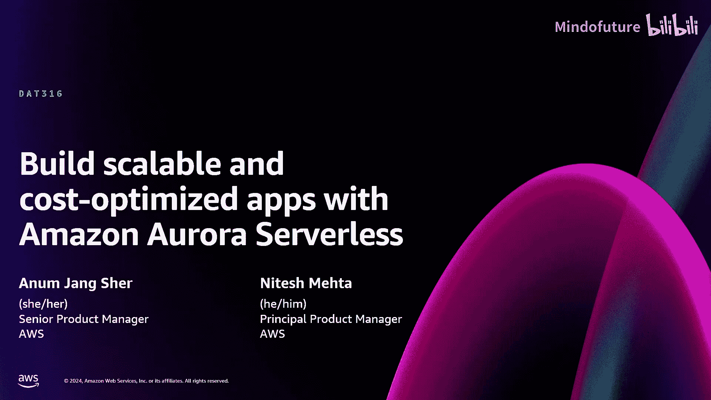
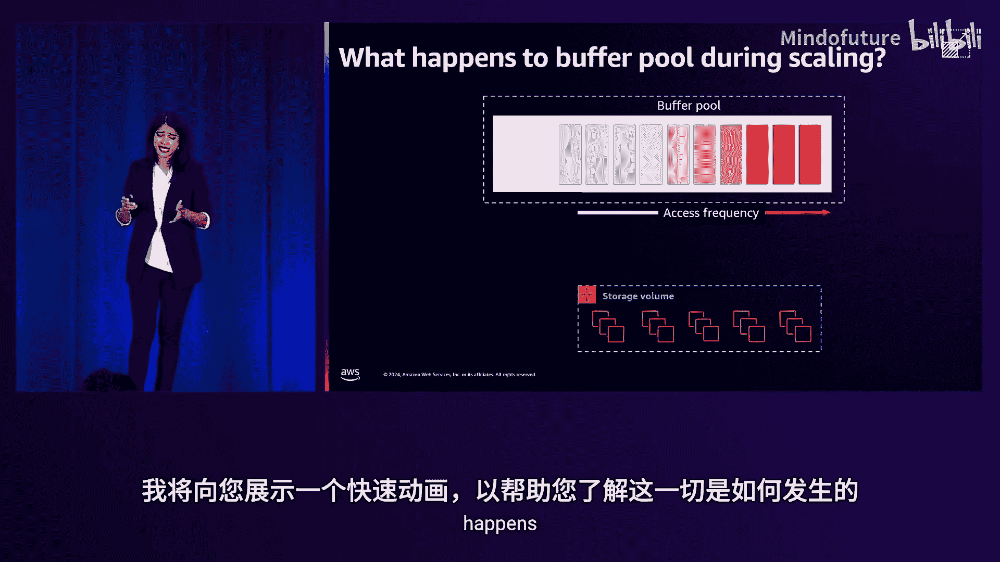
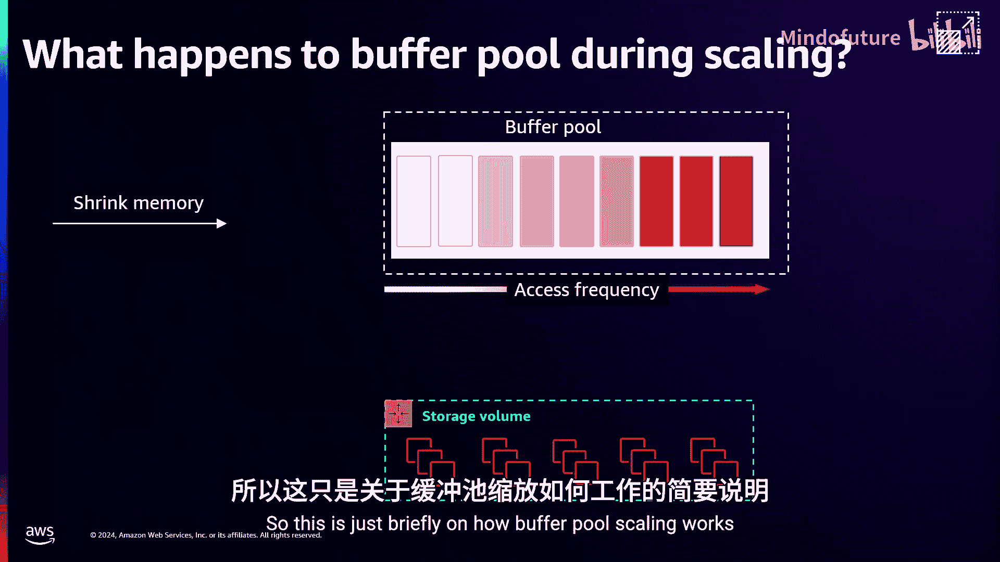
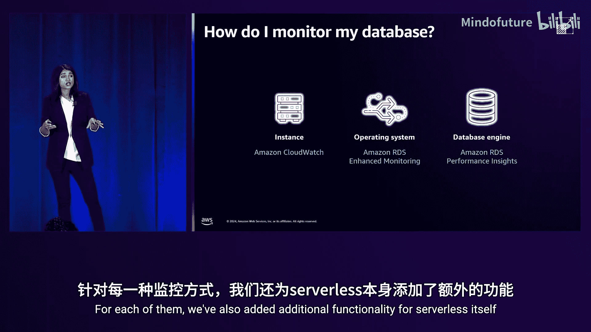
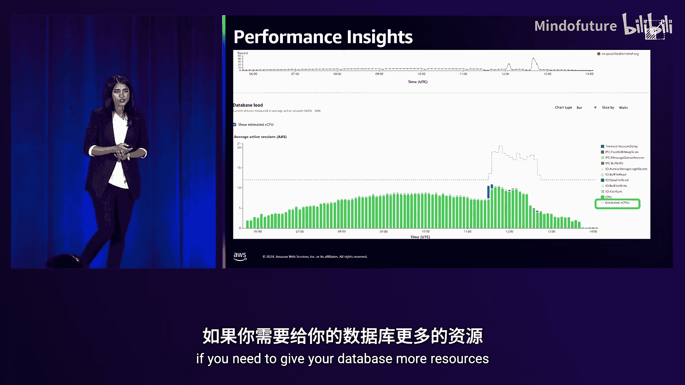
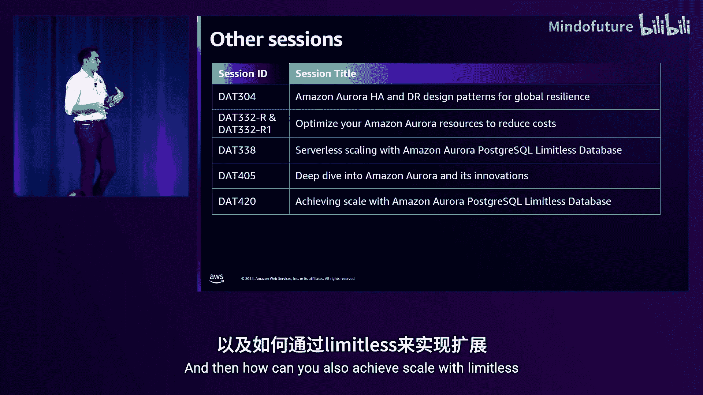
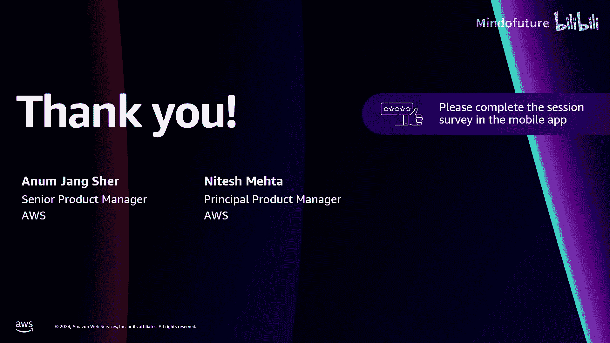

# 【AWS数据库峰会2024全集-•-中英】AWS-re：Invent-2024---Databases-p14-P14-Build-scalable-and-cost-optimized-apps-with-Amazon-Aurora-Serverless-(DAT316--BV1VAR5Y6Es1_p14-

Hello， everyone。So in your application stack， your database is one of the most critical components。😊。

You want to make sure that you have enough resources for your database， you make your estimates。

 you worry about your estimates， and at the end of the day。

 you end up over provisioning because there's only so much you can worry about。

My name is An Zhangsha， and I'm a product manager with Aurora。 And in this session。

 we're going to talk about exactly these problems。 We will talk about how Aurora serverless can help you build scalable and cost optimized apps。

😊，A little bit agenda of what's going to happen in the next 45 minutes or an hour。

 we will give a brief overview and motivation of why you should care about serverless。

And then directly， we'll start talking about the auto scaling capabilities and how that can help you solve your problems。

😊，And when you're looking at your critical application。

 it's not just the auto scaling capability that you require。

 you also require other critical aurora functionality such as multi AZ。

 so we'll talk about some of those functionality and how those are enhanced by serverless。😊，Next。

 we'll touch a little bit on billings side and we'll close it off with how you can get started today。

So to set context Aurora serverless is a feature of Aurora， what is Aurora。

 it is a MysQl and Postgres compatible relational database that's built for your cloud what do you get with Aurora you get the performance and availability of a commercial database but at just fraction of a class。

😊，And this year is a little special for us because we are celebrating our 10 year anniversary。

 so I want to thank all of you for being on this journey with us as we build features and functionality to help you solve your problems。

Now， when you are building your apps， you figured out how much database resources that you need。

 and this is a very high level overview of how you go about it， and you provision resources for that。

Let's say business starts doing better， you need more resources。

 you do a failover to a bigger size database。If your application is coming to end of life。

 you do reverse of that and you'll provision a smaller size database。😊，Now。

 what if youre running hundreds and thousands of applications and each one of them could be backed by one database or multiple database。

 Now， all of a sudden， you are going from worrying about one database to hundreds and thousands of databases。

You could be running a multi tenantant application for scenarios where for some of your customers。

 you may need complete isolation or you're backing your customers for some cost saving benefits。

 So again， you're going from a single database to having to worry about hundreds and thousands of database capacity。

 capacity management for these databases。And for each of these databases， the workload may vary。

You could be an ISV， so you probably may not know what the workload is。

And every single time you need to get more resources or you're trying to optimize。

 you have to do failover， which requires downtime。All of this is to say capacity management is a hard problem and in an ideal world what you can do is get the biggest available database and just go with that so you don't have to worry about it。

😊，But in reality， that's not a realistic solution。So you have to make a certain tradeoff。Now。

 if you want to closely follow your workload。What that requires is expert knowledge。

 you need to know the database， you need to know your actual domain。

 and you have to have a complex monitoring system to keep following that。 and then， of course。

 at the end of the day， you're still stuck with that downtime of switching the machines。

And if at any point， your database resources were less than what was required here in the diagram I'm showing an average workload。

 your application will experience degradation。😊，The other side of it if you go like okay that's not acceptable。

 let me just go provision for peak the whole time that's also not acceptable because then this is a very expensive solution for you so if you look at each of these issues。

 none of them gave you an idle solution。So this is where Aurora serverless comes in。😊。

It is one of the fastest adopted feature in Aurora。

 and what it gives you is an on demand and auto scaling configuration for Aurora。😊。

It gives you this capability where the database will automatically scale up and down based on what the workload is experiencing and at the end of the day the billing model is paper use so whatever the workload is consuming you're paid for that so in this way it provides you a very free capacity management experience for a variety of workload。

😊，Now。The gist of all of this is the auto scaling capability。

 so let's talk a little bit about how that works。So in Aurora。

 you' are typically used to thinking about provisioning an instance。

 which similar to the EC2 instance， so think about you know you are getting R 7G。

 you're getting RG where you get fixed memory and you get fixed CPU， you use it， you don't use it。

 you get all of that capacity to yourself。😊，Now with serverless。

 that mental model shifted slightly instead of thinking about getting that fixed capacity。

 what you do is you specify a range， you say this is the minimum， this is the maximum。

 and then the database scales within that specific range。😊，So now for serverless。

 also think about it just having this special instance in your cluster。

 which is essentially scaling up and down。😊，Other than that， apart from this auto scaling capability。

 everything else stays the same so under the hood we use the same engine code。

 we have the same security posture that you get with regular provision aurora the additional goodness that you get with serverless is the autoscal capability that we build on top of these instances。

😊，And in terms of you know engine support for MysQL。

 anything onwards of MysQL 8 for Postgres upwards of Postgres 13 is supported and since we have built it such that you know most of the code is the same it's also easy to switch between regular provision flavor or serverless so you're not logged into one or other and depending on your use case you can use whichever you want it's basically you're going from an instance which could be a provision flavor or a serverless flavor instance so think about it in those terms。

😊，Now we talked about。Capacity， the min and the max you're setting。

 how do we go about measuring this capacity？😊，We measure capacity in this high level abstraction called an ACU Aurora capacity units。

What it means is it's a combination of two gigs of memory， so it's one is to two ratio， one ACU。

 two gigs of memory， and you get corresponding CPU and network that you require。

 Think about what you get with provision it's very similar to that。

When you're provisioning your database， what you do is you set the minimum capacity and the maximum capacity in ACUs and the database scales within it。

😊，And if you're thinking about what's this minimum I should set， what is the maximum I should set。

 for minimum， think about this as your starting point， this is the capacity you're always guaranteed。

 think about what your starting working set requires， that's where your minimum should be at。😊。

For the maximum， think of maximum as this upper ceiling of how much you want to spend。

 so it's more of a budget controlled mechanism。If the workload does not consume that maximum。

 you're not going to get bill for it， you only get bill for what you're using。😡。

Now one of the exciting features we launched， I think a week。

 two weeks ago is automatic pause and resume it's this capability where the database can now scale all the way down to zero ACUs so when theres zero connections on the database it will scale down to0。

😊，And when anything' is needed in terms of， you know。

 you need to run a query or anything on the maintenance side is needed。

 the database will automatically resume you。In this resume。

 because when we are passing at the end of the day there is no functioning database under the hood。

 So resume will be a cold start and it can take typically 15 seconds and there are also other factors that can increase that number。

😊，And the most important part to notice about that is for compute when it sets zero ACUs。

 there are no charges for compute， so for zero ACUs， you pay zero。And of course。

 for storage that's attached storage stays the same， so those charges are exactly the same as before。

Now， in addition to zero ACUs。A couple weeks back， another announcement that we did was increasing the upper ceiling of what serverless can offer。

 So previously it was offering up to 128 As。 Now Aurora serverless can go up to 256 A。

 So I said one is to2 ratio 256 A。 so you get 5，12 gigs now。😊，And of course。

 anything existing you are running， anything new you are running。

 you can use both of these functionalities and similar to other features in Aurora。

 we usually release these new features on more recent minor versions。😊。

And now together with these two announcements that we did recently。

 now Aurora severaleverless can go from zero ACUs all the way to 26 A， 256 ACUs。😊，Now。

 let's talk about how does this automatic scaling works， what are the factors that we're looking at。

😊，For when the database should be scaling。Now the three key factors we look at your CPU utilization。

 your memory utilization network throughput， and this is not just for any of the queries or the workload that you are running if there's anything that the database is using in the background to stay healthy or any of the background processes this database will scale to accommodate those as well too so for these three factors if any one of the factors says it requires more resources the database scales up。

😊，Now for scaling down， all three of the factors deciders need to say no resources are needed and then the database will scale down and we take a very cautious approach for scaling down because we don't want to be stuck in a situation where you still need the resources and the database decides to scale down。

Now。How does the database actually scale？We scale by this process called in place scaling。

 so traditionally when you think about scaling， it's more of a failure mechanism where you go from a database instance and you fail over to other database instance。

😊，For Aurora serverless none of that happens What we do is we take a running database process and we allocate more resources to it the workload needed needs more CPU resources。

 more memory resources， so we give those resources to the running database process。And then。

Because of this， because of the reason that we're not going from one instance to another instance。

 scaling is not a disruptive process， so you could be running hundreds of thousands of transactions and your database will still scale so you won't see any disruption you don't have to wait for a quiet point for scaling to happen。

Now， another functionality that Aurora serverless offers is a fine grain scaling。😊。

So usually with machines you are either like it's almost like doubling capacity or you're always in a situation where you're always overproing。

 even if you need just a little bit， you're going to get a whole lot more。

 but with serverless we have a lot of control over it so we can scale in granularity as small as 0。

5 ACUs。😡，If that's the smallest you need， that's what we can provide。

 but if the workload requires more， of course the database is also capable of doing bigger jumps so you get that fastest scaling。

If I just take an example， let's say your database is currently at 16 ACUs and it just needed just a small push for those additional resources。

 it can go up to 16。5 if it needed something bigger it'll go from like 16 to like 20 or however big of a jump is required。

And lastly， scaling is instant。 so whatever resources are available to your database。

 it'll consume it right away。 So as soon as the database realizes there's pressure on the internal structures。

 the database will start scaling。 Now this comes with a caveat that。😊。

Base coupled with the initial earlier feature that I talked about zero ACUs when there is no database。

 only then there'll be a cold start where the database needs to be resumed once it's resumed and it's active and available。

 it'll start scaling up。Now， let's talk a little bit under the hood about how does this scaling algorithm work。

 So imagine the database has this bucket of ACUs， which are characterized by two parameters。

 your bucket size， so how big is this bucket。😡，And the refill rate。

So how quickly can we continue to refill the bucket Now， these two parameters are also variable。

 So the first graph shows how the bucket size varies。

 So as the database capacity gets bigger and bigger。

The bucket size that the database gets is also bigger and bigger。

 so that increases and same for the ref rate。As the database capacity gets bigger and bigger。

 it will refill at a faster and faster rate， so together with both of these。

 what that means is that the bigger the instance， the faster the scaling will be。😊。

So if at any point you look at your database and you say it's not scaling fast enough。

The knob that's in your control is that minimum database capacity because you can dictate the current capacity of the database。

 but you can control what the minimum capacity is because as I said。

 that is your starting point so if you increase that minimum capacity you get a fastest scaling rate。

😊，Now， having said all of that。Test your application out。

 test out to see what minimum ACU works for you， what scaling rate is good enough for your application。

Now let's talk a little bit about how buffer pool what happens to B pool during scaling so B pool is the primary cache of your database so we also scaled the buffer pool during the database capacity scaling operation now these are the parameters that are going to be changed our InODB buffer pool size for MySQL and shared buffer for Postgres。

😊，And when the buffer pool is scaling down， we do it with a combination of least frequently used and least recently used algorithms。

😊，I'm going to show you a quick animation just to help you understand how all of this happens。

 so as pages are read from the buffer pool， they become hotter and hotter。

 so these are the pages that are least likely to be evicted from the buffer pool。😊。

Now in the scenario where you get more pages read from the storage layer。

 you don't know the future access pattern right now so we don't want these pages to be evicted so these are going to be your warm pages now the pages that are most likely to be evicted are the ones shown in gray so we evict these cold pages we reclaim the memory and then at the end of the day we shrunk this buffer pool down when your database is scaling down。

So this is just briefly on how buffer pool scaling works。

Now， you can also get into scenarios where you're looking at your database and you're wondering。

 why is it not going down to the minimum that I configured？

So they could be different factors impacting them。So it's not earlier I mentioned that you know it's not just the queries of the workload you are running。

 it could also be stuff running in the background， so think about background processes such as you know out of vacuum purge。

 if the database is running anything in the background。

 then it requires the resources to run those processes。

 so you'll probably not see the database scale down to those smaller minimum capacity that you set。

Let's say your minimum was very tiny 0。5 ACCOU which is one gig and you're running lots of features with your database。

 so it requires additional resources which are not sufficient 4。

5 so if you're running let's say global database or any of the bigger features like performance In。😊。

Those could be one consuming additional resources， so that's something to check are you' running those features。

 if you have a large storage volume attached， your minimum could be 0。5。

 but your volume is super large。 So can the compute support that or not。

 so you have to look at those factors。And then there are other configurations which essentially forces the database to not scale down。

 so for example， if you gave it priority tier for high availability of 0 and1， which basically says。

 always follow whatever my writer is doing。😊，If the writer is not scaling down。

 independent of how much load is on the reader， the reader will not scale down。

 so these are just some of the examples of scenarios where database may not be coming down to the minimum that you configured。

😊，Now we talk about scaling how it works when it scales and all but will there be enough capacity for your instance to actually do this scaling operation so there are two things to think about one is of course capacity available in the region so based on our experience of running RDS and Aurora we do capacity planning for each of our regions so that's for the broader capacity available in the region。

😊，Now what about the capacity on the host， what if you're scaling up and the host itself runs out of capacity。

 what do we do in those scenarios？What we do is we look around for idle instances on that particular host and those are the instances then we're going to move away from the host to a different host so we have more room within the host for your instance to scale。

😡，And whenever we are doing any of these movement from one host to another。

 we want to make sure that we preserve the background process。

 so you know your buffer pool connections， so from your side， you shouldn't see a difference。

 but in the background we're moving things around to make sure that everybody has capacity available for scaling to happen。

Now I'm going to give you like a little sneak into how we are managing heat at scale so this is just an example for one of the region a sample set of how are we managing heat What you see on this plot each of the blue dot it represents an instance and the colored one the purple ones that are scattered across are very large instances。

😊，And each vertical line is a host。So if I play this animation。

When the number of instances on the host gets too big that they're scaling too much。

 more resources require， we identify instances and move them away。

 so it's the idle instances that we move away from the host make more room and this is just to show you a sample of how heat is managed within our fleet。

No。That was all about like scaling and how it happens under the herd how it's working。

 Let's talk about monitoring。 So in none of that scaling operation。

 you weren't really providing an input。 It was the database taking care of all of that automatically how do you find out what's happening。

 what's going on So same as Aurora， we support a couple of different products so you have Cloudwatch。

 you have RDS enhanced monitoring， you have performance insights all to monitor specific characteristics of your database。

 So Aurora serverless supports all of these for each of them we've also added additional functionality for serverless itself。

 So for example for Cloudwatch。😊。

We have the metric called several as database capacity you are setting Min and max。

 How do you know where your database actually is at so this metric will tell you where the database currently is at and you're going to get billed for your current usage you don't get bill for the minimum worth the maximum you get bill for whatever your workload is utilizing。

😊，Another example of a metric is CPU utilization， which is a percentage of the CPU and it's based on the maximum ACU available。

😊，You can look at this metric to see does your workload have enough resources available。

 so you have two options you go optimize your workload further so it consumes less resources or you can go ahead and increase the Macs AU so there are more resources available to the system。

And then same for freeable memory， if you don't have enough resources。

 you can take measures to adjust that。Now performance Insight is another feature that we offer。

 it gives you this simple yet powerful tool for performance debugging。😊。

Now for severalless what you want to be monitoring is the dotted black line that you see。

 which is the estimated V CPUPU， this will help you determine if you need to increase your Mac AU。

 if you need to give your database more resources。

Now， that was all about scaling and just to summarize this a little bit。

 we talked about how Auraces gives you automatic in place non- disruptruptive scaling。

 we talked about the factors that influence scaling。

 the rate at which scaling happens and how do we go about managing heat。

 and we briefly touched on monitoring。Now let's talk about other functionalities and features that Aurora supports and how Aurora serverless influences that。

 and for that I will have Nie Sha here to talk about it。Thank you， A。

 for that deep dive on Aurora serverless V2 and the primary benefits that it offers to you。

 which is instant non disruptive scaling。Because of this instant non- disruptrupive scaling。

 a lot of you told us，Hey， how do I use this in my applications。

 in my organizations to realize primarily some of the cost savings and the scaling and performance benefits of Aurora serverless V2？

So， let's discuss about。The key capabilities again， which is in place scaling that is non disruptive。

Can scale in 0。5 ACU increments and there is no downtime when Aurora serverless V2 scales so what this means is you can use it whenever your provisioned resources that are either underutilized or when you think you do not quite know what your access patterns or consumption patterns need for your application you don't know if you need let's say5 VCPUs or 100 VCPs and so Aurora serverless V2 lets you figure out what your access patterns are without having to worry about it upfront。

So because of this， we have a few use cases that are enabled by Aurora serverSV2。

 namely along the dimensions of high availability and disaster recovery。

Analytics and business intelligence。Application connectivity and also scaling。

 which is powering some of our most powerful features today that you might have heard about at this reinvent。

😊，Let's deep dive into it， starting with high availability。 So first off。

 Aurora is a distributed compute architecture， sorry。

 a distributed storage architecture that is spread across three As。

The storage is completely disaggregated and scales automatically based on how much you store at it。

Now with serverless， your compute can also autoscale based on your application patents。

In an aurora cu cluster you can have up to 16 read replicas and today you might be looking at having a writer。

 which is probably your primary instance。 your your application is using the cluster endpoint mechanism that Aurora offers which ensures that you do not have to keep changing your DNS。

 you only talk to one endpoint at all times， but for your analytics or to perform any sort of ad hoc workloads。

 you might be using a reader endpoint which might be pointing to one read replica and today you might be using an provision instance in this case we have an R6G large which is just sitting there at all times。

But sometimes you don't really need to use this instance。

 So what you can do is instantly add an Aurora serverless V2 instance， which autoscales。

And we let you do that， we let you mix and match instances based on your workload so that if you don't need that capacity on your read replica is either underutilized。

 you can have it sitting there。And as you can see Annana mentioned the failover priorities So the writer is obviously tier 0。

 it's the failover priority is critical。 we will not touch that tier1 is your reader which is exactly the same configuration as your writer and the tier 2 is aurora serverless V2 so at this point the tier2 Aurora serverless V2 instance is not really following the reader and it's not an R 6G large so with pause resume it can be sitting there waiting for your connections and only when connections arrive it will wake up。

But if you want to take this one step further， you can make your entire cluster serverless V2。

 which means again for that unpredictability spiky workloads。

 you can have everything be serverless V2 and indicatecate scale up and down again the writer with tier 0 and the reader with tier 1 will be mimicking each other so that you always have an equal sized instance that's ready to be serve as a fail over target but your reader will serve again based on the size of your workload and transactions that are coming through。

So this again， gives you a lot of flexibility and a lot of cost optimizations because you don't have to have a provision instance sitting there potentially underutilized。

Next， let's talk about global database。 So how many of you use or a global database today by a show of hands。

 right， I see a few folks so。Aurora global database allows us to take a single database and replicate it physically across multiple regions up to five regions and you have 16 read replicas in each。

 which means you get 90 read replicas。This also means you can you have a secondary region or maybe more that you can fail over to and so a lot of you are using it today for disaster recovery and some of our most mission critical apps and mission critical applications are using global database today because what it gives you is a one-min disaster recovery RTO so you can recover very quickly from any failures this is much better than using potentially let's say snapshots or backups which might have a variable restore time。

But sometimes again， customers have have been using aurora aurora serverless V2 in the secondary region or other regions of global database。

 And what this means is sometimes you might have a secondary region that is not being used。

 and there is， for example， an active passive fashion or an active active workload that is maybe not being used all the times。

 So in the secondary region you can have an aurora serverless V2 cluster with scales up and down。

 That's what the yellow arrows mean。 So again， you don't have to provision any compute sitting there idly and some of you might be using it and let's say a follow the sun model。

 Well， let's say a east Coast comes up first。 and the West Coast comes in。

 and then the East Coast sort of dies down and this kind of architecture。

 serverless V2 will scale automatically to ensure you always have that capacity available for peak without having it sitting idle。

 So again， a lot of cost savings passed on to you and global database failover always works。

 you get low read scalability。Next， let's discuss analytics。Today a lot of you has told us， hey。

 I want to perform analytics on my operational data in Aurora。

 but potentially saving a lot of better bytes of data becomes untenable because you start to hit the limits of what you can do in a single aurora instance and then you have to start thinking about scale about potentially moving data and when you start moving data。

 let's say to a warehouse like Redshift， you have to build ETL pipelines。😊。

What we did last year and all across AWS， we have embarked on a zero ETL journey。

 which means we do not want you to manage any ETL pipelines。 It's undifferentiated heavy lifting。

 which we believe Aurora and all AWS services should take on。

So with zero ETL there is no need to create or manage any data pipelines。

 this makes moving data to any downstream systems such as Redshift。

 which is an integration already available in Aurora today， very easy and seamless。

And with having Redshift as your analytics store， you can derive near real-time insights to then derive value for your business such as generating realtime insights。

 personalization for your websites， monitoring fraud everything can be done in real time， but again。

 today you might be using aurora provision on one side of the equation and a Redshift warehouse that's sitting there potentially idle or underutil at times what we are doing across Aurora and AWS is in addition to serverless and zero El。

 we want to make the standard for all customers which means you have serverless resources on both sides of the equation。

 you have Aurora serverless which is scaling up and down if you have any ad hoc analytics and similarly you have Redshift serverless also ready to scale up and down for any traffic patterns that are evolving or any usage patterns that are unpredictable。

And with Redshift， you also get a lot of more capabilities when performing。

Analytics on Redshift using the zero E integration such as ML based workload monitoring。

 data sharing， you only pay for again what you use and it's automatically tuned so you don't have to worry about any undifferentiated heavy lifting when managing your redshift cluster with both serverless in Redshift as well。

Next， let's talk about application connectivity。 A lot of developers do worry about application connectivity。

 They might find it hard to， let's say， manage drivers。

 connect to an aurora serverless or aurora instance， figure out your authentication methods。

 figure out what sort of。Network you need to set up and so to remove this undifferentiated heavy lifting。

 we launched data API so this was only available for Aora serverless V1。

 but now it's available on Aurora serverless V2 and provisioned clusters So across both all our auroras features you can now use data API and what data API offers you is one single HttP endpoint that you can connect to which lets you connect directly to your Aora cluster。

 you do not have to manage drivers， do not have to worry about application connectivity。

 we take care of that for you and again with Aurora serverless V2。

 you simply have a simple endpoint that scales up and down。 you send your connections。

 The server comes online， you don't have connections it dies down。

 This makes developer productivity much higher and gives you a lot of benefits from now having to worry about infrastructure。

And data API also powers our inbuilt query editor， so this also now works with both serverSv2 and provision clusters and we are continuing adding features to data API what data API offers you is a native in-built AWS management console query editor that lets you perform your DDL or DL natively without having to。

 let's say install some sort of client， let's say PG admin for Postgres， for example。

 so every query can be run natively if you have an Aor7Sv2 or a provision or any aurora cluster using the query editor。

Which， again， with， with several S V2， you don't have to set up any instances to perform in queries。

 any E C two instances， any clients to perform queries on a。Rightright。

 so let's talk about limitless。 So you might have heard about limitless。Quite a while ago。

 And we recently just Ged that for Postgres。 We are very excited about this launch。

 A lot of you told us you wanted capability that lets you scale beyond a single instance and limitless powered by serverless offers you that。

 So what is limitless。 limitless is powered by serverless。

 It's fully instant scaling based on your transactions and your workloads。

 It's a classic sharded architecture。 So what it means it offers you the routing layer。

 which figures out which queries need to go where and also offers shards that manage queries for you and where you can store your data。

😊，So with sharding today you might be worrying about okay how do I manage my shards。

 how do I move it when do I add shards， but with limitless。

 we take care of that for you shard management is handled by aurora and all you have to worry about is figuring out your data model and what yourard sharding architecture。

 let's say a shard key looks like we also offers a lot of capabilities within limitless like reference tables which is replicated on every single shard。

 so this means that you don't have to perform cross shard queries which might have a latency impact for you because there are some tables that are always replicated on every shard。

 which again gives you some more performance benefits。

 but again you have to think about a little bit more about what your application looks like when youre doing sort of those reference tables and single shard workloads。

And limitless is truly limitless。 It can scale to petabytes of data and millions of transactions。

 So today， we are using the same aurora distributed storage in limitless that powers our aurora clusters。

 But instead of having just one storage layer for aurora cluster， you get individual storage。

 which means it can go to petabytes of data。 So if you。

Think you need limitless scale or if you have an application that you think is going to grow very fast year over year and you don't want to worry about。

 hey， have to rearchitect it， worry about data migration， moving data from one service to another。

Limitless offers you that the initial launch of limitless is Postgres。

 which means it is fully Postgres compatible and we are continuing to add features to limitless to make it even better for you。

 including support for let's say global database， more zero downtime operations。

 better performance capabilities and we would love to hear from you on how we can continue to building a better database for you。

So we discussed some of the features that are enhanced by Aurora serverSv2。

 which includes limitless global database， some of the high HDR features。

 but it's very important to also understand the billing concept for serverlessv2。

 just so you can plan your spend and budget accordingly。

 it is a different way of thinking about your resources， for example。

 if you are moving today from an on-premise environment or somewhere where you have static databases provision and you are paying for course。

 serverlessV2 forces you to think a little bit more about your pay as you go compute because now you're not paying a fixed amount at all times。

 it's variable， it goes up and down， and if you don't quite understand it。

 it might be it might lead to some tough conversations with your stakeholders。So again。

 and Im covereded this， but to just reiterate Aurora serverless V2 is only charged by an AU model which maps to a specific amount of memory and compute。

😡，And the unit is aurora capacity unit an ECcu， and you are not paying a static amount at any time。

 Annana mentioned that this we launched aurora serverless pause and resume。 So again。

 zero aus compute used means 0 for you。 But at the same time， if your application spikes。

 your workload spikes and goes through the maximum of 256 then you pay for that 256 So you see these peaks and valleys which eventually forces you to think about what should my budgeting be And so customers come to us and ask us。

 hey， how do I set this budget， What do I know how will I know that there are no runaway costs。

 let's say some developer writes a rogue query or a suboptimal query that consumes a lot of a Well。

 to do that we let you set limits on aurora serverless V2 capacity you can set min and max like Anna mentioned what the min and max gives you is okay my min spend will always be this or my minimum database footprint would always be x dollars but the maximum gives you the maximum upper bound of your storage spend。

 So if you said it。Let's say two VCps or two ACs you always know your bill will never be more than a maximum of two AC。

 so this gives you that upper bound in our conversations we feel that's what a lot of you are looking for。

 which is knowing the minimum and upper bound if you spend and then you're always spending in between those upper and lower bound and if you don't like that you can change that based on some of the alarming that anm had mentioned earlier and you again only pay for per second there are no minutes or hours minimums per second billing the rates vary by region so depending on if you're in let's say Japan or Asia or India or America the rates vary a little bit but the calculation is simple it's a per hours based on the amount of hour hours consumed the hours in a month if you're not using the database on that zero and then the costs per A hour the rest of the billing components stay the same there is no change in the billing for storage IO replicated iOos which are consumed for global database and backup storage so again when aurora serverless V2 scales down to zero we don't release。

you still have the storage sitting there， it's not sent released and so when you resume。

 youre still billed for it all the time， whether it's resumed or sleeping because the storage is not released and IOs are only consumed for pay as you go。

 that doesn't change for you as well。😡，So。On the compute side。

 you get a lot of savings by this infrequent consumption of As but what about storage and iOos So iOos might be consumed if you have a Iioheav workload。

 this could mean you might be doing a lot of reads a lot of rights。

 which is pretty common based on the application pattern you might have So we recently also launched aurora Iio optimized。

 which is a few months ago， but this gives you a much more predictable price performance for all workloads especially for the Iio heavyav workloads because you no longer have to pay for iOos。

 which might be consumed for every read and write， you also consumes IO for operational activity on your databases。

 including auto vacuuming and with IO optimizeized you just don't have to worry about it。

 you get a fixed bill for just storage and just compute with no IO charges it's a new cluster configuration it's available at the storage layer have screenshot here that shows how you can switch between aurora standard and iO optimized it's a no downtime operation you can just click on。

You can make this switch once a month。And then if you don't like it， you can switch back。

 so there is no lock in。And you only pay for compute and storage。

 and it's available for serverlessV2， Postgress， MySQL。

 and also has support for reserved instances so you just don't have to pay for IOs period。

So we discuss a lot of benefits about Aurora serverless V2， how you get instant scale。

 non-derupive scaling。 We also discuss some of the features that are powered by serverless。

 but how do you get started。 So in the next few slides， I'll discuss how you get started。

 This is primarily for customers who might already be using Aurora serverless provision today sorry Aurora provision today and they're not using serverless yet or they're trying to migrate from Aurora provision。

 If you are trying to get started with Aurora serverless for a new cluster。

 that's a very simple onecl operation， you just go to the console select the Aurora serverless V2 option and you can get started But if you are migrating。

 that requires few more steps。Now， let's discuss first from Aurora provision。

 which is one of the most predominant versions of Aurora today。 A lot of you might be using it。

 So how do you move from that to Aurora serverlet。 So like I discussed。

 we let you mix and match instances within the same cluster。

 So you can simply just add a serverless V2 reader and then failover to it。 So in this example。

 we already have a provision writer in A Z1 and another one in A Z3 and we just added a serverless V2 reader。

 Your cluster endpoint stays the same。 That doesn't change all you have to do is perform a failover。

 And again， we don't convert the serverless reader to a writer for whatever reason。

 it's only the same VCP and memory as the primary writer。 So it'll mimic the primary。You do that。

So your endpoint here the same。The reads and writes that were going to the provision writer or the provision writer。

 which is now the reader， because the failover has been happened。

 are now going to go to the second serverless writer。

 which has now been promoted to be the primary writer and the cluster endpoint points to the serverless V2 cluster if you have an RDS proxy that DNS propagation delays or connection management is also handle for you and once the failover is done you can continue using or a serverless V2 as is or you can drop the reader if you don't want to use it anymore。

Now， aura serverless。V2， as its names implies， is the second iteration of for Aa serverless。

 We already have Aurora serverless V1， which is reaching end of life soon。

Moving from Aurora serverless V1 requires a few more steps than what I showed you earlier on provision。

 What you first need to do is convert your Aurora serverless V1 instances to provision。

That's a simple API call。 You can just call engine mode provision。

 change the engine mode from let's say server S V1 to a graviton or an Intel instance。

 and you can apply the change。 Once you do that， that opens up the possibility to then migrate to or a server SV2。

And that's sorry， The reason for that is because。Y。

So because you need to be on a provision reader that you can fail over to and once you have a provision reader。

 you can easily fail over to similar to what we did showed you earlier performing a single failover Some of you might be on older versions Ups are hard we understand so that's why we launched bluegreen deployments for all of Aurora and it's also supported for serverSV2 So if you're not on a supported version that lets you move to or a serverSV2 you can use bluegreen deployment to get to a supported version that's a one minute downtime operation and max and then you can add a serverless leader and then follow the same failover steps。

Alright so I just want to take it back and summarize all the benefits you get from Aurora serverSV2 so like we discussed Aurora serverSV2 can help you reduce operational complexity and reduce costs so you get scaling benefits with no work from you all the scaling is done by us it's performed by us so you don't have to worry about it it has the same architecture as provision aurora so it supports the entire surface area of aurora which means you can go all the way up to 1 to28 terabyte storage。

 you get global database， you can use RDS proxy as you want you can use high availability and multi-esezy deployment for aurora as as well as redralicas which can be both instances and serverSV2 clusters。

Again， the piing is pay as you use， you only pay for per ACU for your compute。

 which combined with your storage， which already is pay as you go。

 you are only paying for just as much as storage and compute as is used by you and there is no extra charges beyond that and you pay at an ACU level get granularity at a per second granularity。

And you can get started for new clusters with a few clicks and if you have an existing cluster requires a few more steps from there。

So we just want to share some more sessions that you might potentially be interested in。

 Some of these we are talking about today。 We also launched Amazon Aurora DsqL。

 I know some of you might be excited to learn more about that。

 So we welcome you to go to some of these sessions。

 We have deep dive into aurora and its innovations。 We have several scaling。

 How to optimize further aurora cluster to reduce costs。 A lot of customers have asked us for that。

 So that will help you know what else you can do to optimize your costs。

 I touched upon a little bit today。 And then how can you also achieve scale with limitless。

 which again， is our sharded database that we discussed earlier。😊。

So again， thank you， everyone for coming。 We realize you have a choice in session。

 So Anna and I definitely appreciate you coming today。 We do w to hear from you。

 So please do take a minute to leave feedback in the app。 And with that。

 thank you once again and enjoy the rest of your revent。😊。

