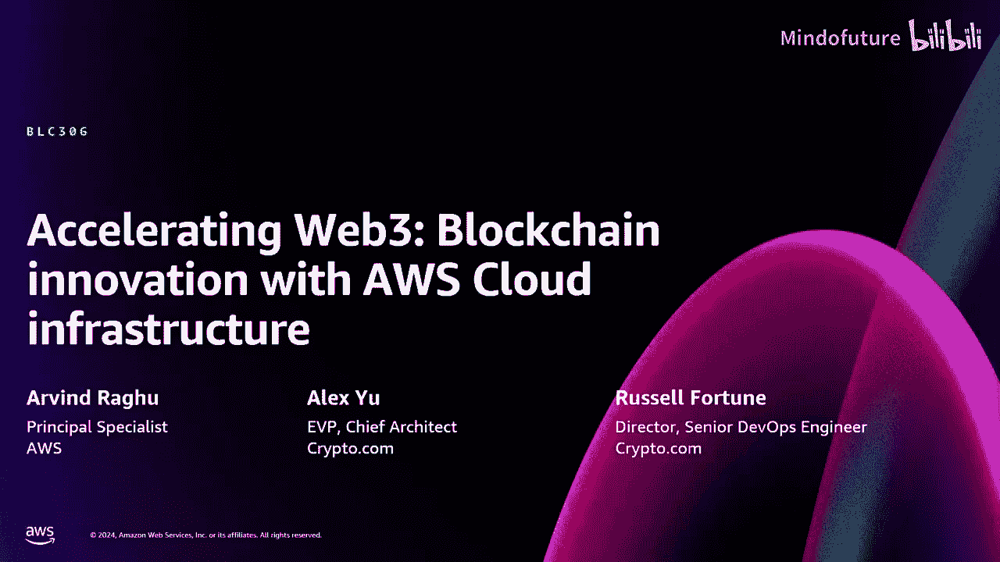
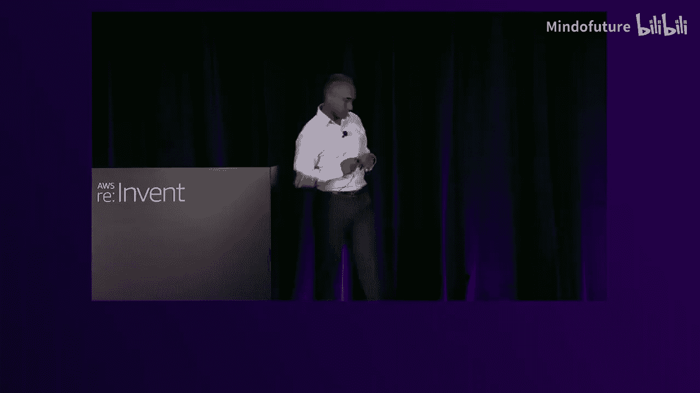
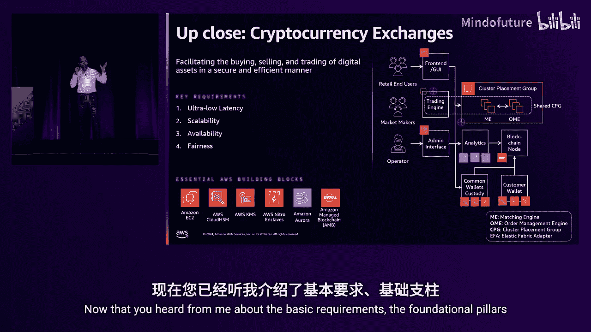
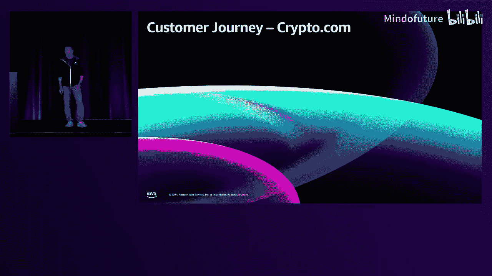
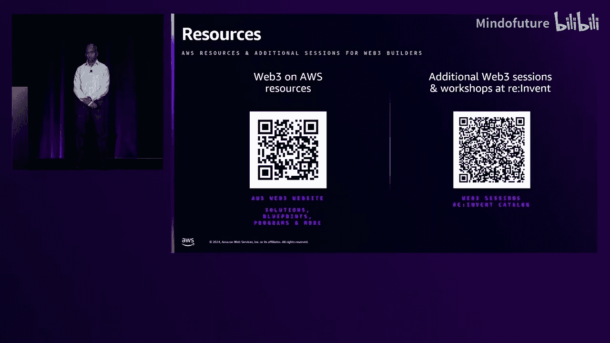
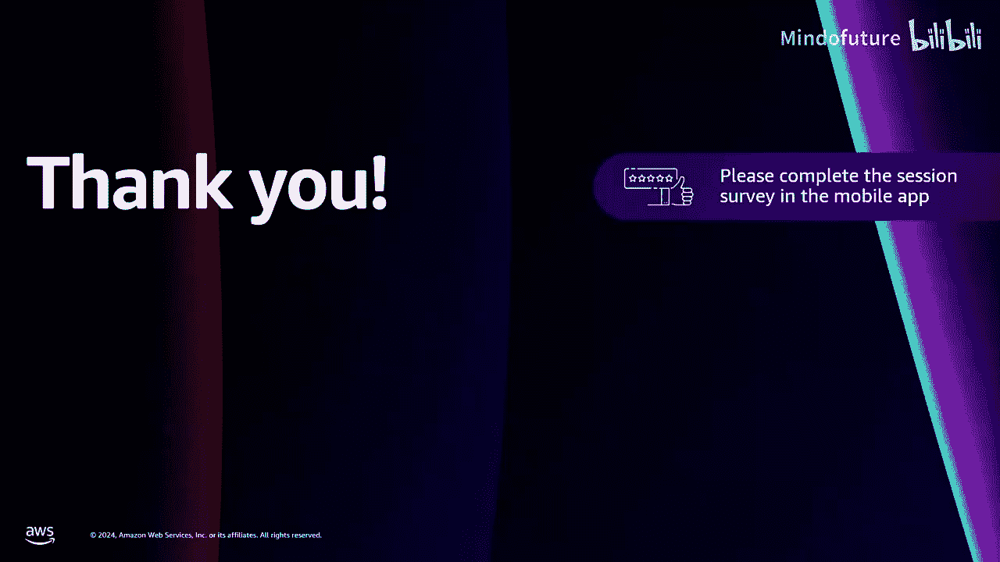

# 【AWS数据库峰会2024全集-•-中英】AWS-re：Invent-2024---Databases-p15-P15-Accelerating-Web3---Blockchain-innovation-with-AWS-Cloud-infrastructure-(BLC--BV1VAR5Y6Es1_p15-

Hello， everybody and welcome。 Welcome to Alerating Web 3。😊。

My name is Arvind and I'm the specialist responsible for the Web3 business at AWS。

I will be jointly presenting this session with Alex U， Chief architect cryrypto。com。

 and Russell Fortune， Director Devopps engineeringering at cryrypto。com。Now， before I begin。

I want to tell you， I'm very aware that I'm standing between you and lunch。

Right so if you're choosing to do your survey， do it after you've had some food。

 Okay that's my only request to you。

But that aside， thank you so much for skipping that and choosing to hear from us today。😊。

So let's see what you're going to hear about。We'll start the session。

By sharing AWS's perspective on Web3， how do we see it and how are we addressing it？

We'll then jump in and talk a little bit about the different。Technological blogs that enable Web 3。

 What are some of the requirements。And how does AWS address it？

With building blocks that we already have in our cloud infrastructure。

We'll then switch gears and talk a little bit about use cases。

 The idea there is not to educate you on the use cases， but to show you in complex Web3 use cases。

 how do we play， how do we enable you。So we'll take a 30，000 foot level of things。

 but we'll show you how we play there and how we're making sure you're able to build your Web3 products on AWS。

Well then completely switch gears， and you're going to hear from our customer， crypto com。

They are going to share their journey with you。In leveraging AWS to build a world class exchange。

How do they do it， What are they doing。And what are they planning， some of what they're planning。

And then I'll come back and talk to you a little bit about some of the trends we are seeing in Web3。

 I won't call it so much future trends， and we put it like that。

 but it's trends that we are already starting to see shape up and we are working on it and I'll share a little bit about it with you and then we'll close the session out with some resources for you to learn more about Web3。

 more about what AWS is doing there and also links that will help you engage with us more directly if you choose to。

Sound good to you。You yeah， I want to see that， right？Alright， so what's our perspective on Web 3。

 When I say Web 3， how many of you immediately start thinking about cryptocurrency。😊，Yeah。

I used to before I took on this job， right？That's， that's what people immediately think about Web3 crypto。

 right。Today， I'm here to tell you that while crypto has been the most popular Web3 use case in the public eye since 2017。

For good and not so great reasons。There are a lot more workloads and use cases that take advantage of the same foundational principles。

That power of cryptocurrency。So these are the foundational building blocks and foundational principles that power all Webory workloads。

And we at AWS are here to provide you with the building blocks that you need to bring your workloads。

 to bring your products to life on AWS。Web 3。Really came about as a response to the perceived shortcomings of the current Internet infrastructure。

Now， if you abstract away from all of the， all of the noise around everything。

You can start focusing on the core tenet that drove this。And that's decentralization。

And that's the lens with which we view Web 3。 That's our perspective。 When we look at Web 3。

 we we're really thinking about decentralized technologies。

And we're really thinking about how do we enable those technologies with the right building blocks for you。

Many applications leverage decentralized technologies。Blockchain networks。

 virtual machines for smart contracts。Decentralized storage。And quite a few more。

And sometimes it takes a combination of all of these different building blocks for you to operationalize your workload。

 in some use cases， all of these building blocks for you to operationalize your workload。

The most common class of decentralized applications that we see most people are focused on are digital assets。

Two types there， right。 Number one is the digital representation of real world assets。

 like real estate， financial instruments。And number two are the more natively digital assets。

 like tablecos and cryptocurrency。All of which are accounted for on a blockchain ledger。Now。

 very quickly there， this talk went from， here's Web 3 to， you know。

 starting to talk about these different building blocks of decentralized storage and and all of that。

 right， So what we're going to do next is really get into some of these。

Specific requirements and talk about what we are doing there and how we are enabling you。Now。

 if you're in the business of building any of these applications。

You will notice that there are some fundamental and foundational principles that all are required as you build your products。

These decentralized applications leverage the exchangeability and the programmable nature of digital assets to facilitate two things。

😊，New product development。Like decentralized finance。And also。

 reimagine existing paradigms like payments。😊，A lot lot of customers we work with。

 they're looking at how how to reshape that。 How do I bring payment on crypto rails。

 How do I offer crypto payment solutions， right？ So we are starting to shift from a world that had classic payment solutions into brand new ones that are leveraging these decentralized technologies。

So there is that exchangeability and programmability and all of that。

 and then there is there are some other foundational principles like transparency and direct ownership of your assets。

 direct ownership of your data。Blockchain networks are also immutable in nature。

So with that comes immutability and a certain level of transparency that did not exist before。

Blockchain networks also leverage public key cryptography， which brings with it one more benefit。

 verifiability。So if you put it all together， the programmability， the transparency。

 the direct ownership， the verifiability all have enabled not just new use cases。😊。

But also a movement now to overhaul traditional financial use cases。

So we are seeing more and more what we would like to call Web2 customers。

 traditional financial institutions that are starting to look into developing web3 based solutions。

 web3 based products that they want to take into the retail customers。

It's my personal opinion that we are at that point where the wheels are starting to turn。

 where it's starting to get more into consumers and the retail market， if you will。

But when you start building one， and then how many of you are in the business of actually building Web3 applications。

 Can I see a show of hands， Don't be shy， Just want to know。Okay， there's quite a few hands going up。

 right， So you probably relate to that squiggly curve right there。

When you start building Web3 products， you're looking at all of these different building blocks。

 these decentralized technologies you want to pull together。 But to get to that Web 3 product。

 it's a really complex process。It's not easy， to leverage all of this， make all the right choices。

And， and get your product out。The adoption of these decentralized technology itself is not the end goal。

 It's just a means to the goal。And without prescriptive guidance。

 it can get very difficult very quickly to navigate some of the technical and strategic challenges that you will face。

Because at the end of the day， what you build and some of the critical decisions you make will affect how your customers interact with your products。

You will be faced with a lot of choices upfront when you start thinking about building a Web3 product。

 If you haven't built one and you're just starting your journey。

 you're going to be faced with a lot of choices， both from core component perspective and some other strategic considerations perspective。

First， you will have to determine whether to build on public or permission。Protocols on， on。

 on those chains， right， And then will you build exclusively on a public chain or a private chain。

 Now， are you going to use some combination of both。Are you going to use multiple chains。

 And if you're going to do that， are you going to have to build a cross chain interoperability layer。

These are fundamental choices you have to make。And then once you've made those choices。

 now you're starting to look downstream。 Now you have to decide。Okay， am I going to。

 am I going to do a custodial or non custodial wallet。What kind of wallet am I going to build。

 Am I going to， am I going to build multiparty wallet， You know。

 I have some wallet customers in in in the audience today。 I I know personally。

 and I know they've had to face all these choices before。

 before they decided which way they're gonna to go institutional retail， you know。

 on all of those choices that had to be made upfront。When you have to deliver your product。

And once those decisions are made， once you decide how you want to go about with these basic fundamental decisions。

 then you have to start thinking about the core components。

How am I going to present data and and analytics？ How am my customers going to interact with it。

What kind of protocol nodes am I going to use， What What kind of smart contract standards am I going to use。

So many choices to make。And the main message I want to leave you with in the session。

 if you forget everything we talked about today。Is that we are here to help you make these decisions and we have a lot of experience working with a ton of customers in this space。

 both from， from a customer perspective and as a partner as well。

 And we have gathered a lot of best practices that we we are happy to share。

 and I'll share some of that with you today。😊，And that's really the message I want to leave you with。

 It can look complex， but we can make it。Fairly simple for you。

And we can make that quickly curve start to look like something like that。

We can take you from that decentralized technology building blocks you're looking at to your Web3 product。

By leveraging our foundational pillars。We have three of those。1。Manaage services to。

 do it yourself with solutions。 and three。Partner based Web 3 solutions。With our managed services。

 we offer a range of services that serve as core infrastructure。

And use case specific solutions with some specialized services as well。In addition to that。

 we have also proactively created and curated reference architectures and solution blueprints。

That tackle our most commonly seen problems by customers。 And those are your do it yourself。

 We have three solutions。And let me be clear with those do it yourself solutions。

Those are not production grade， like our managed services， but those help you hit the ground running。

Now'll share some of that solutions with you， and when you hear about it。

 it'll become clear to you why it will be helpful and how you can leverage them。And lastly。

 partner led solutions。Our AWS marketplace and partner network feature a variety of solutions built by our partners。

That are ready to deploy and use on AWS。Now， let's explore each of these， right。

 Let's explore each of these foundational pillars and see what we have。😊。

Let's start by talking about managed services。This is， this is a talk focused on， you know。

 Web 3 solutions and and our infrastructure。 right。

 So I'd be remiss if I didn't spend a minute or two talking about the most foundational one of all。

 which is E C2， right， So if you think about the workloads， the Web 3 workloads。😊。

Regardless of whether it's a Web 2 or Web 3 workload， they all have similar needs。 You need compute。

You need some storage。You need a certain level of security depending on where your security bar is。

And you might need some specialized services。 So let's talk about compute。How many of you， you know。

 think， if I'm building a Web3 application， a blockchain based application。I want to protect。

 I want to make sure my content and my nodes remain protected from operators in the cloud provider。

 Can I see a show of hands， How many of you think by getting on the cloud。

 you're defeating that whole decentralized ten。Nobody。That's good to know。

Because that's what I've been talking to with many people， right， You are not really。

Violating that tenet by getting your nodes onto the cloud。 In fact， you're helping yourself。

Gone are the days when you have to run from a garage。 if you want to scale。

You want to be in a scalable platform and a highly available and scalable platform。Right。

So if you're thinking about compute， if you're thinking about running nodes。

 there is no better place to run your blockchain nodes than EC2。And I'm about to tell you why。

All modern EC C2 instances that we have launched since early 2018。Are based on our nitro system。

Nitro system is the foundation of virtualization that underpins C， C 2。

And if you're using a nitro base instance today to run your blockchain nodes。

It comes with a default assurance of no operator access。

 What that really means is if you are running your nodes oneasy to。And if it's a nitro based node。

 there is no mechanism whatsoever for any AWS operator to access your content。Thereby making it。

Always on confidential computing at AWS。So depending on which security and privacy dimension you're really looking to address。

 And if you're only concerned with running your nodes is protecting your content from us。

You're already protected。 Just spin up an E2 node， run your blockchain node on it。 You're done。

There's nothing you need to do。 Nothing you need to turn on。Now， if you have more specialized needs。

 let's say you're trying to build a wallet。And you want to make sure your content remains protected from even yourselves。

 even admin level users at your end， or you know malicious actors who could pose as admin level users and gain access to secrets like keys with which you assign transactions Then we offer specialized capabilities in EC2 specialized confidential capabilities like Nitro enclaves and nitro enclaves help you spin up and isolated and secure computer environment。

😊，Within which you can then safely process and secure your data。

 you can decrypt your data inside an enclave and nobody will gain access to it， not even yourselves。

So if I have to put it very simply to you about what an enclave does。Because in Vegas。

 I'll tell you in terms you will relate what happens in an enclave stays in an enclave。

RightSo that's really the security bar that we hit when we offer solutions like Nittro enclaves and we have first class integration with AWSKMS。

 our key management service。😊，And if you choose to use any other key management service。

 that's fine too， because keeping with all the core tenets that we talked about earlier when you operationalize your decentralized applications。

 you want verifiability。 enclaves provides your own attestation document。 you can then use that。😊。

To anything else that you're attesting to to bring secrets into your environment。

So if you're in the business of building applications that sign transactions， create solution。

Very organic solution， especially if you're thinking about multiparty wallets。

Enclaves have a very organic， multipart collaboration environment。😊。

Helps you assign multiple transactions as well prior to this。

 if you were doing it on an EC C2 instance， you may have to sign one at a time now you can batch it all in an enclave and just go off decrypt everything and sign it。

 improves your performance too。That's a little bit about compute and a little bit about security。

We also have services， like Dynamo D B。Which is a key value。

 no SQL database that runs high performance applications at any scale。Now， lastly， if I。

 if I want to touch on one thing that's very specific to Web 3。

Because I did get the question earlier， you know， hey， we came to this session。

 Are you guys still still doing Web 3， Yes， we are still doing Web 3。 So we have this session。

 But more importantly， we are continuing to invest in it。😊。

And the testament to that is a Web3 specific service that we have launched。

 a very successful service。😊，Called Amazon managed B。

Amazon managed blockchain helps customers build resilient Web applications on both public and private blockchains with instant serverless access to multiple blockchains and their data。

😊，Let's take an up close look at Amazon managedage blockchain before we move on and talk about other foundational pillars。

There are two separate offerings within M B。AMB axis and AB query。

AB axis provides public blockchain RPC access for Ethereum， Bitcoin and polygon networks。

You can engage directly with the public blockchains。

And remove any undifferentiated heavy lifting associated with provisioning and managing blockchain infrastructure。

 We do that for you。 We take care of that。 We remove the heavy lifting。 We manage the infrastructure。

 You can go focus just purely on what you're building。

There are a standard set of APIs that committed that allow instant scalability。Because and。

 and because we fully manage it。You can just completely forget about。

Any any of the other aspects that you would have to if you were trying to do all of this on your own。

 if you're standing up your own nodes and doing it， there's a lot more toil。

 a lot more operational overhead involved， and we remove that for you。The second。

 second capability of Amazon managed blockchain is A B queryry。

AB Query provides you with serverless access to standardized multi blockchain dataset sets。

With developer friendly APIs， MB BQury makes blockchain data accessible without you having to do complex ETL processes。

Or run costly archive notes。So now you can quickly start seeing， right。

 Not only are we removing the toil of managing infrastructure。

 but we're also taking care of some of the complex processes that are involved maybe cumbersome。

 you know， not so much complex， but very cumbersome for you to go， go and do all of this E。

 T L and implement it yourself and maintain it。 We take care of that。If you haven't heard of A B。

 I highly encourage you to go take a look at it。 I'll share the QR code and the link for it later。

 So definitely go and take a look at what that service looks like。😊，Now。

 we move on and talk a little bit about the do it yourself Web 3 solutions。

 What we have done here is we have collected a lot of customer feedback。 And based on that。

 we have built some solution based accelerators that will help you hit the ground running。

 and we have double quite a few of that。😊，We are showcasing a few here because these are the most popular ones that we've seen customers go back to again and again with。

 with hundreds of deployments in each of this。 And when I say deployment。

 these are not production deployments， right， These are what they use。

 Try and see how to get things moving。The first 1 I want to tell you about is AWS node runs。

 This is an open source initiative aimed at simplifying the deployment of self managed blockchain nodes。

😊，So if you don't want to use the Manserv we talked about earlier， you want to run your own nodes。

 feel free。But we， will help you get going faster。Right it's nearly like providing you with a one click solution。

 not quite one click， but nearly， you know， help you get the node spun up。

Next one is our AWS public blockchain data。Weve built an indexer that performs E T L functions for you。

For Bitcoin and Ethereum data。These blockchain data sets are made available to you for free through the AWS Open data initiative。

 and it's updated every day。And then。AW is natural enclaves， blockchain wallets。

 So if you remember what we talked about， the secure， isolated computer environment。

 those are very fundamental building blocks。We built it with the。

 with the goal of making it easy to use。But it's also very low level。

 So it's easy to use for people who know how to work with low level system design and for others。

 it may not be。 So what we have done is gathered all of the best practices that we have seen from people whove built wallets。

 institutional retail， custodial， nonco， all of that。

And build blueprints that' will help you going in case you choose to build your own wallet。

And then lastly is the graph blockchain indexer， we built an indexer that will help you spin up a graph node in your own AWS account。

And it lets you index a few smart contracts in great detail。 Why am I stressing on that。

 Because you do have a different A B service that still lets you do all of the querying and everything。

But what it does is more of a broad search and a broad query。

 it doesn't go deep if you already know which are the smart contracts you want to focus on。

And go query in detail。 Then you can use one of our blueprints here leveraging graph。

 and that'll help you go mind that mind that data you're looking for。😊。

So these are just some examples of very， very popular blueprints that we have built to help you in your journey。

 Let's take a closer look at one or two of them。The blockchain node runers I talked to you about。

 which helps you spin up your own nodes and run your self managed nodes。

This is very popular and becoming more and more popular。 And the reason for that is， as we speak。

New chains are being developed。 There's a lot more proliferation in the L2 space as well。

 as you all know。So what we're doing is constantly updating this set of blueprints that we have and keep adding to it。

We have support for EVM and non EVM chains。Public and private chains， layer 1 and layer 2 as well。

 As recent as last week， we released support for Beu。

So this is aimed at helping our customers stand up nodes for private chains as well。

 and well continue to add more。These are just a few examples on the screen of what we have and we're continuing to add a lot more。

 there are blogs for each of these that accompany the blueprint that will help you understand what you have to do and some of the best practices。

 some of the prerequisites and all of that along with the template that we provide。

The next thing I wanted to touch on before we move over for partner solutions is our public blockchain data blueprint。

 right？The public blockchain data makes valuable blockchain data sets freely accessible for research and experimentation I'm stressing on that because the research and experimentation piece。

 because the data is made available through the AWS Open data I so that's if you're leveraging that for research and experimentation。

 the data is available to you for free basically。😊，And we began this in 2022。

 and we offered data sets for two chains。The top2 you're seeing on your screen， Ethereum and Bitcoin。

These data sets have really enabled our customers and developers to analyze data and eliminate indexing costs for them。

As recent as this week。We have now added support for five more， five more chains。So。Number one。

 apttoos， Abatraum， Bay， Proance and XRPL。But we didn't do this by ourselves。

 These data sets have been generously given to the community by one of our partners， Soar X。

 and I believe they are here in the audience today。 So if youd please indulge me and thank them know。

 with a short round of applause for what they've done for us here for the community。

So what they're providing is free access to those five chains。

 but if you want to go beyond that and if you actually want to leverage their own product。

 then they have an offering for you， which gives you access to 70 plus blockchains and also it comes with an assurance of their appropriate data quality framework which speaks for the veracity and integrity of the data that you're handling as you go access these data sets that they pull for you。

And it also comes with its own enterprise， ready infrastructure。deployedeped on AW S。

 so makes it scalable and available and all that jazz， right， So if you're interested， you know。

 take a look at that。 And I believe they're in the audience today。

 So if you want to talk to them later， you should。😊，Now， let's move on。

 talk a little bit about our our partner LED solutions。

 There was a good segue to talk talk about our partners。

 right through the AWS partner network and marketplace。

 AWS provides access to turnkey solutions that will let you build and deploy。😊。

Your Web3 products I have a lot of partner logos here and I'm also very aware that some of the partners are here in the audience today。

 so thank you， thank you for partnering with us and thank you for being here right we talked about wallets earlier very popular use case and we have partners like fire blockslocks I believe are in the audience and some others who have extensively not only leveraged our capabilities but have also helped us hone and improve on those capabilities。

 helped inform our roadmap right so were continuously working with our partners too to understand how to go and make these building blocks better and more useful for you。

😊，One partner I'd like to showcase here as we speak about this is chain link labs。

Chaining labs enables secure smart contract interactions with trusted off chain data sources。

 web2 data sources， if you will， right and AW services through the centralized Oracle network Now just that keep that Oracle network in your head and I'm going to show you a representation of how a partner building block can integrate into into a full platform okay。

They also leverage AWS's serverless architecture to deliver their oracle services。

 and they eliminate the need for customers to manage complex node infrastructure。

Now by now it should start becoming apparent to you right， regardless of what I talked about。

 manage infrastructure or managed services or do your self-factory solutions or partner solutions。

 any of these， the main theme of what we're trying to do here is remove that heavy lifting from you。

Of， of running your infrastructure， standing it up， whatever the case may be。

 So we can let you freely focus on the Web3 application that you want to build。

 You are the experts there。We know what to do at the back end and we'll take care of that for you。

 right， That's the whole theme of all of these foundational pillars that you heard me talk about today。

Now， let's take a look at a couple of use cases。 And the reason I'm doing this is to show you how we play in these use cases。

 It's not necessarily to actually dive into any of this。

So I'm not going to walk you through what what the data flow or the actual platform looks like。

 but I'm going to show you what's required from some of these。

Some top use cases that we can think about when， when we talk about Web 3， tokenization。

 trading payments， wallets， right， Tokenization of traditional assets。From equities to real estate。

 also of digital assets。And then there's trading and within trading， you know。

 centralized exchanges have exist existed for a while and decentralized exchanges are up and coming。

And there's a lot more in terms of facilitating the purchasing， trading and custody of assets。

 everything that's going on。And payments， and we touched on this earlier， you know。

 with new payment solutions that are starting to emerge。

 especially around crypto and stable coin settlements。And of course。

 if you're handling any of these assets， you want to custody things you you want a way for peer to- peer interaction。

 you need wallets， you need to dip into something to go pull your assets out。 and there's a very。

 very high bar for security with those solutions。that said， let's take a look at tokenization。

Right there on the screen is is a。I would say a 30。

000 foot level of what a organizationkenization platform looks like， right？

What I really want to draw your attention to is look at the key components that are involved here in a tokenization platform。

 There's a tokenization engine。There's a big block that has to do with data and analytics so they can provide insights or monitor asset performance。

And then theres， there's a custody solution that's required to securely store all of these tokenized assets。

And then lastly， there are quite a few times when real world data is needed to be pulled into these things。

 So there's on chain data， but there's also off chain data you want to pull in and make some decisions based on that。

And that's that Oracle service I talked about where you're seeing it on your screen right now without any of the AWS logos because those are the kind of building blocks where we fully lean on our partners to help our customers。

😊，Now， let's just take a look at， you know， what that end user flow is going to look like， right。

 The end user is typically going to interact with the platform through a through a front and Gui。

And then assets are probably inside a customer wallet。

 which are leveraging blocks like Nitro enclaves， KMS， Cloud HSM。

 depending on how you've built your solution。And then that goes into you know this smart contract block that we're talking about。

 which is also ingesting data from that Oracle service。

 which you could be leveraging from a third party like chain Li。

And then gets exposed through a blockchain， blockchain node。 right， that， that's the R PCC end point。

 if you will。Now， if you look at it from the asset issuer standpoint， that is that big。

 big and most important block there， which is the token management。 It's an automated block。

 It runs on its own right and it responds to two different things。

 Sometimes it responds to requests coming from the asset issuer themselves on on the other side。

 it could respond to a set of events that triggers it to go do something and that's heavy compute fully leveraging EC2。

And just like。What you saw on the other end from the end user， there's also a custody side of things。

 So on the end user side， you saw the wallet on the asset to issue side。

 you're going to see custody right and same thing it has a very。

 very high security bar that that needs to be met And those are some of the solutions that we provide here right and that blockchain node。

 which is the RPRPC endpoint we talked about， could be your own node or could be one of the managed services that we offer with Amazon managed blockchain。

Now let's take a look at one more， cryptocurrency exchange is probably the most popularr or at least the most used one in terms of Web applications。

 right？Cryptocurrency exchange is a very， very complex beast， right， And。

 and anybody in the exchange space。 And I know probably Alex is sitting there and cringing a little bit at my block diagram here。

 looking at it and going。this guy who drew a few rectangles and triangles and called it crypto exchange。

 But to keep it simple。At the heart of the crypto exchange is that trading engine。

Now there are two different personas who interact with the trading engine。

 there could be retail end users and there could be market makers and they interacted it at different levels。

 The end users are coming at it from a frontend Gui and that's it that's the level at which they get access to this and they have to submit their request and wait for completions。

The market makers can interact with the engine at a slightly lower level。

 they can go few levels lower than your retail user and interact with the engine。

Regardless of what your persona is， the requirements are very。

 very similar for the user and the folks running the exchange themselves。There's a very。

 very ultra low latency requirement。There's no reason for me to explain why we're talking about trading。

 right？And there's a scalability requirement because it's very unpredictable。

 There are events in the macroeconomic conditions that could make exchanges go up and down because of the trading volume that they will see。

And there is a very， very high availability requirement。Because unlike traditional exchanges。

 crypto exchanges run 24，7。So there is no question of downtime。

It's very high availability requirement and lastly。

 there is a requirement very centric to the exchanges themselves， not necessarily for the users。

 but for the exchanges where they have to assure a certain level of fairness amongst the players could be regulatory compliance requirements。

 whatever the case may be。The reason I'm telling you all this is as you look at the trading engine。

 as you look at all of the other solutions。😊，There are specific things that we have gone and built to address this。

 If you look at the ultra lower latency requirement， after a certain point， you're fighting physics。

There's only so much to reduce the latency。 And then it comes to the length of the cable。

Or how close the servers are to each other。 And to address something like that。

We developed the product called called Amazon clusterster placement Group， which lets you place your。

 your key components very close to each other so we can reduce the latency。😊。

And you're going to hear from our customer later today about what they have done to address that。

 right。I don't need to really spend time talking about scalability and availability。

 If you're using the cloud， if you're using E C2 today。

You probably know how elastic it is and and how available it is as well。

 So those are all specific requirements that we have gone and address and continue to improve on。

And just like everything else that you saw before， there are also custody and wallet requirements。

 which we continue to work on with the wallet providers with the exchanges to keep hoing。

 to keep developing and improving upon those solutions that have helped us set this very。

 very high security bar。Now that he heard from me about the basic requirements。

 the foundational pillars， the building blocks that power Web 3。

I am going to invite our customer， crypto dot com， Alex you。

 chief architect at crypto dot com to come and talk to you about their journey in leveraging AW S services to build a world class crypto dot com exchange platform。

 Alex， please。😊，Thank you， Alex。Thank you， often。Hello， everyone。

How many of you has heard of Kuttocca。Wow， our sibling should be very proud。O。

So first， first， let me introduce dot com。So cryptocon found in 2016 with the mission。

Cryptocurrency in E wallet。Today， we are proud to serve over 100 million customer worldwide。😊。

Our exchange platform launched five years ago， is now the second largest crypto exchange by sports trading volume。

 supporting over 400 tokens and 700 older books。Let me take you for the journey of how our exchange has evolved。

At the end of 2019， we launched the first generation of the exchange。Purely focus on sports trading。

In 2021， we make our first major upgrade by launching a new derivative exchange。😊。

Bilt with event sourcing design and sequencer architecture。

The platform quickly gained a reputation for its stability， out latency and portable variety。

Our measuring engines can process order in less than 400 nanoseconds。

Our festival design allow us to expand from perpetual swap to more compact instrument。

 like our TV product。😊，In 2022， we introduced one exchange by merging the sport and div exchange into a unified platform。

With this upgrade， we can support multiple assets trading in a single wallet。With cost margin policy。

We unlock a lot of advanced training strategies and provide substantial margin savings for users。

Even during the bear market， we stay focused。Wing out new features like sticking fixed gateway as one tracing advanced trading pot and portfoliofo margin policy for our users。

😊，This year， leveraging our core technology。We develop O TC at institutional trading component。

Supporting advanced execution method， such as RFQ and smart order routing。

We have transformed exchange into a multi asset， multi execution trading platform。A grandbreak。

 a grandbreak evolution that serve as a foundation for the entire dot com ecosystem。

So this advancement enable us to serve with a wider range of traders， with diverse products。😊。

So operating a crypto exchange is highly challenging。

Especially in such fast moving and competitive environmentment。Here are some key challenges we face。

Stability is our top priority。Krypto never slipped。Its trading 24 by 7。

With leverageage portal on our platform， it is absolutely critical to have a consistent performance with Suu Dantan。

Scalability is another key concern。全布 market。The traffic em volumem can surge by 10 to even hundred times。

So our system is seamlessly auto scale to meet the demand when volume increase。

Performence and latency are equally important。In water market。

Any delay can impact the trading experience， especially for high frequency traders。

That's why we invest heavily on our technology to to optimize performance and minimize the tail latency。

Quick Porter innovation is the key to our success。We build out key features frequently to ensure us our offerings stay up to date and competitive。

😊，Lastly。Reulture and compliance is an area we focus seriously。Our exchange operate globally。

And meet various compounds requirements around the world。So， in this presentation。

We will be focusing on stability， scalability and latency and how we leverage AW S technology to help us。

😊，So let me first talk about our system stability。To meet the demand for operating 7 by 24 by 7。

Our platform is designed for seal downtime。To achieve that， it support instant recovery。

 even during hardware failure。And also support seamless upgrade to roll out new features and puff fixes。

😊，All critical component are running with active standby setup with both active and standby component。

 Listen to the same event stream。😊，This ensure they always be synchronized and deterministic。Besides。

 we develop our own failover guardian process to monitor all core component。

If any active component is done。The fail of guardian promote the standby component immediately to be active。

To up， to make sure that no interrupt。This active stand setup can be extended to differented ability zones。

The standby component can be running in a different data center to ensure no disruption。

 Even the primary data center is done。The active stand， together with feature design。

 allow us to upgrade our system without downtime。😊，Here is an example to upgrade our O M， S to。

 to support new features。First of all， we promote the secondary O M S to be active。

 then bring down the primary O M S。Once primary o S is done。 We upgrade the version， bring it up。

Then we do the， we do the， we repeat the steps again for the secondary way O M S。

 Proote the primary O M S to be active。Bring down the secondary awareness， upgrade the version。

 and then bring it up。 Once both version are up and running with the new version， and then we can。

 we can upgrade with the new features。😊，With this design and upgrade procedures。

 we can roll out new changes every week， without impacting trading。Next。

 let me talk about scalability。As a cloud native exchange。

 our sc objectives include dynamic scaling and no fotering。Talium is scary。 Allow us to scale。

Semlessly， adapt both normal and extreme trading volume。

This allow to scalp quickly and cost effectively， when the volume increases。

No photoing ensure every request is possible without delay， according to the allow way limit。

This is very critical， especially for high frequency trader， or maybe for normal trader。

 Imagine the market is very volatile。 You want to cancel or amend a PVC pace order in the system。

You don't want your request is being fored or rejected by some system B C errors。

When our exchange was first launched in day 1， the architecture was simple and lightweight。

We have order gave way to handle order from， from clients。And market data。

 like all the book canticick are published for the market data gaveway back to the client。

This gateway can be scale seamlessly， quickly to meet the demand。On the core part。

 we have multiple O M S to perform the risk check for the client。

 and we have matching engines to process a train match for the orders。So。On day 1。

 this setup can only handle hundred thousands transition per second on a handful of servers。

And our latency is crazy。 It was measured in microseconds level。

As our user and order book increase in number， we need to ensure we scale for the future。800000 T， P。

 S may not be enough。 Therefore， we D sign the backbone of the system to incorporate shing。

This allow us to speed the workload into multiple event stream。And achieve unlimited scalability。

Without imping the latency。All latency sensitive core application， one on bare metal E to surface。

 and they are collooke within the same customer placement group。

 This ensure the lowest possible latency。😊，At the same time， for long latency sensitive task。

 we leverage it was M SK。They managed Kafka system integrate seamlessly with our event sourcing design。

Allow us to offload long latency sensitive low to， such as reporting。

 Pory and editing to a more cost efficient surface。So with this upgrade。

 our platform now scale seamlessly to meet any demand while remaining highly cost efficient。Next。

 let me pass pass the time to my colleague also to talk about latency optimization。我빠 to you吧说。

Thank you， Alex。So I'll be walking you through how we've optimized our connectivity。

 our placement and our performance to achieve the ultra relatency that is required for our exchange。

In the world of crypto trading， speed isn't a nice to have。 It is a necessity。

 And our clients are demanding lightning fast execution to stay ahead of their competition。

 And latency is the deciding factor。To put it in perspective。

 we are regularly dealing in the order of single digit microseconds and a microsecond is 100 thousand00 times the speed of the blink of the human eye。

 And it's this relentless pursuit of speed that allows us to provide our clients with the edge that they need in the fast paced world of crypto trading。

Now， this isn't something that we've achieved overnight over the years， we've innovated and iterated。

 and I'd like to take you through some of the steps in that journey。So， firstly。

We sought to enhance our client connectivity。 So the public internet， whilst it is convenient。

 it simply isn't reliable or fast enough to sustain high frequency trading。 variabilityability。

 bottlenecks and even small delays can affect the trading outcomes。 And so to solve this。

 we implemented A S private link。Prate link allows us to offer a direct connection between our VP and our clients。

 VPs and bypassing the complexities that come with that with overlapping ci ranges and the unpredictability of the public roing。

 And by leveraging network low balances， we achieved ultra low latency connections while maintaining secure and isolated communication。

And with privately， we took philosophy of a minimalist approach where we interrogated and scrutinized every step in the pathway to try and eliminate it and offer the shortest possible pathway for our clients and optimize their interactions。

 And this ensures that all a process with the maximum efficiency and delivering the performance of our traders demand。

The next after that。We， we sought to。We sought to optimize for our internal latency， so。Typically。

 instances， E C2 instances by default， they could be scattered anywhere around an availability zone。

 and this is。Bad for us because we need them to be as close together get as possibles to minimize latency between our services。

 So to mitigate that， we chose to use cluster placement groups。

 And this ensures that our E2 is allocated。As physically close as each other as possible under the same network spine。

 and by colocating our services， such as our matching engine。

 our order management service and our gateways， we're able to drastically reduce the internal communication delays。

 And this allows us to process the massive data volumes that are required for realtime trading with unmatched speed。

 And this optimization is another key step in our journey toward beating the demands of our clients。

😊，So by combining private link with cluster placement groups for our internal forms。

 we've been able to establish the solid foundation for low latency trading。

 And to further enhance our performance， we also implement O S level oxs。

 and whilst subtle these adjustments。😊，Allow kernel tuning and process prioritization。

 ensure each server optimize peak efficiency， and we also have continuous monitoring process in place to ensure that if the state changes or it drifts。

 we're alerted and we can remediate on that。 And so together these strategies enhancing our connectivity。

 optimizing our placement and our precise operating system tuning。

 create the environment needed to deliver the speed。

 scalability instability that our clients depend on。And with that， I hand about both。

Thank you us all。So with our architecture and the support of Aw， our。

 our platform exceptional performance and stability。😊，Our up time has increased from 99。5% to 99。99%。

 even as we hit the all time high for both volume and order per second record this year。

Our order processing foodput has scaled up at least 20 times。 We achieved unlimited scalability。

 but simply just adding more server， and it didn't impact the latency。Finally。

 we have reduced our littency at 99。9% out by over 90%。Meaning our latency stay consistently low。

 no matter the volume and traffic。To sum up。Our platform now support a wide range of product。

Including sports trading， margin trading， future， perpetual， and our latest offering， CF FDs。

It operate globally across multiple country。And besides order book trading。

 it offer advanced execution like RFQ and smart Auto routing。😊。

With a robust built time management system。We accommodate various prototype and multiple margin policy。

 ensuring flexibility and better margin savings for our users。😊，And finally。

 our global feed on and op make it seamless for our user to enter and exit the crypto ecosystem。😊。

But on the strong foundations and parted by the AWS infrastructure。

Our platform has evolved from Epto exchange。Into a highly versatile， multi asset trading platform。

And looking ahead， we are excited to take the platform to the next level。😊。

As many of you have seen from our public 2025 world map。

 we are expanding into traditional asset classes and banking services。But。

Crypto remaining our core mission。Cryptocurrency in E wallet。

By bringing the retail client into a multi excess trading platform。

We can seamlessly integrate Fiats and crypto surfaces。

Combine the best of both well and unlocking the potential of Web。

Quub dot com ecosystem and various port offerings are becoming more and more integrated and to provide the best experience for our users across Cfi and Difa。

😊，And I believe AWS pay a pivotable in this space， not just for us， but for others organisation。

 and we embrace the next way of every and decentralized finance。😊，On this note。

 I will pass the time back to Avin。 Thank you for listening and supporting Twitter dot com。

 Thank you。😊，Thank you， Alex and Russell for sharing your experience with us and thank you from the bottom of my heart for choosing AWS to be a part of your journey。

And as you heard from Alex and Russell。You could resonate。 I'm sure if if， if you know。

 looking back to some of the building blocks and requirements that I talked you about earlier。

The latency requirements， the unpredictable demand and scalability that's needed and the level of availability that's needed。

 these are very， very demanding requirements。And we are continuing to work with our customers to raise the bar on these things。

 And these are building blocks that you can take advantage of today if you're building Web3 applications。

After this session， I will hang back for autographs。But jokes aside。

 you know I'll hang back if you have any questions for me， you know， we can talk about it。

 stick with me here for a minute and let you go for lunch， okay。

I just want to touch a little bit on what the future trends are that we're seeing from talking to customers and partners。

嗯。I would put it in the three buckets， right there's a lot of advancement in blockchain technologies。

There's quite a bit of innovation going on in decentralized finance we're seeing a lot of action in that space and lastly you know 2024。

 I don't think I can get by this session without talking about AI even once right so there's a little bit of convergence there with web3 and AI and what's going on so on the blockchain side of things there's a proliferation of high throughput chains that are aimed at improving efficiency that we're starting to see。

😊，We're also starting to see the emergence of rollup as a service from a lot of providers who want to help customers stand up their own networks using popular frameworks like optimism。

And there's also a number of you know increase in the number of networks and there's a big need for underlying interoperability type of solutions that are starting to emerge as well。

 and we are working with partners you know to help develop those solutions。In the Dfi space。

 were seeing an emphasis on improved user experience with solutions like em wallets。

 interopoperativeerability solutions addressing the issue of fragmented liquidity。😊，And then lastly。

 new yield generation opportunities as well， you know。

 with staking and resttaking and all that good stuff。😊，RightAnd lastly， you know。

 under emerging use cases with， with AI。we have some blueprints and some demos that we've already started to create for natural language processing to query blockchain data and provide you with some data analytics and predictive analytics for especially for trading if you heard Alex talk about bots and whatnot。

 So there's a little bit of predictive analytics work that's going on as well。 and of course。

 AI agents in defi。 So these are some areas that we're starting to see more traction this year and we think itll continue and have some legs for next year as well。

 So that's where you will see us working on and investing a little bit more。

 and I can't wait to come back and talk to you about all of that next year。 with that。

 I will leave you with some resources if you're curious to learn more about any of the products。

 the blueprints。 or if you want to get your hands dirty on some of the workshops that we have created for you。

 Most of them are selfhel self-p free for you to use。

 So I encourage you to take advantage of the resources that you have at your disposal with that I will thank you for。

😊。

Spending your time with us today and for listening to us。 And as I said earlier。

 if you want to do this survey， do it when you're not hungry。 Thank you。

