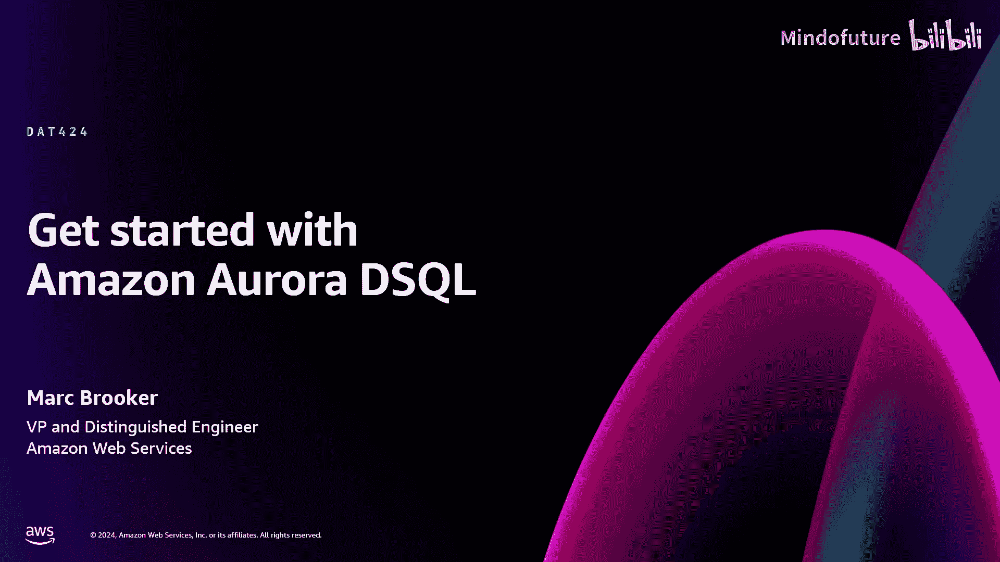
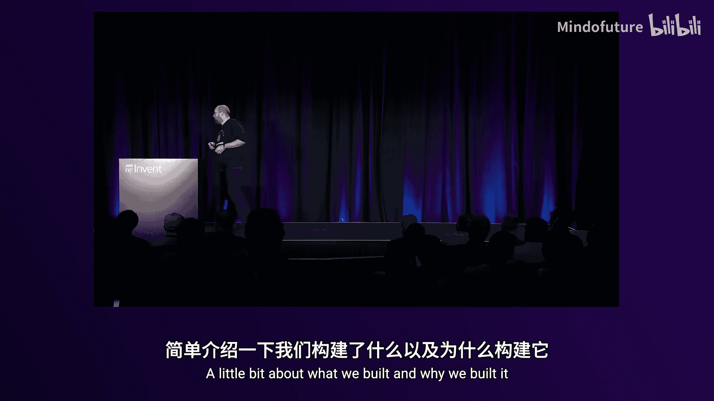
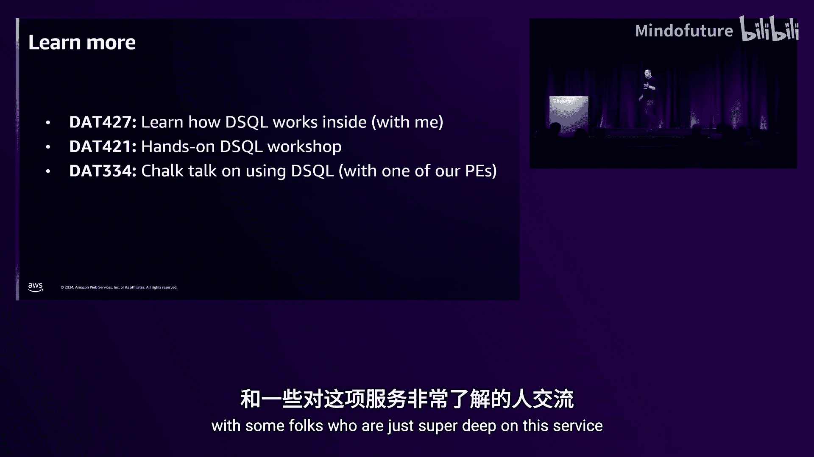
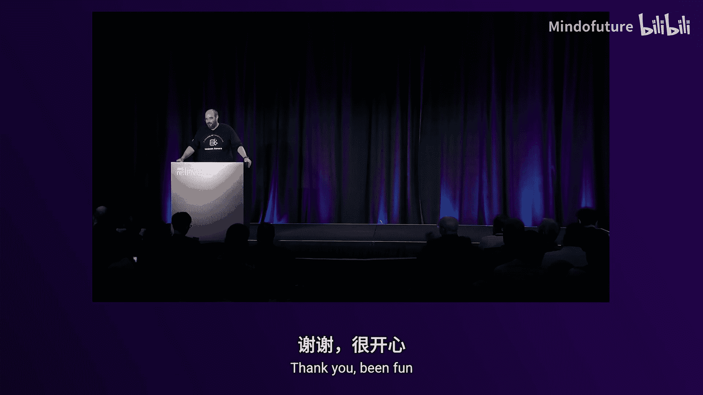
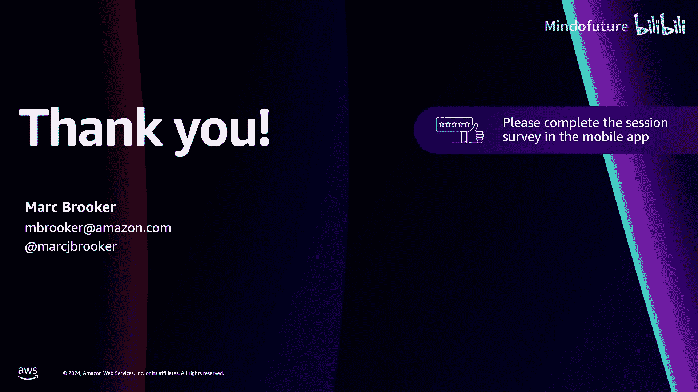

# 【AWS数据库峰会2024全集-•-中英】AWS-re：Invent-2024---Databases-p16-P16-Get-started-with-Amazon-Aurora-DSQL-(DAT424)--BV1VAR5Y6Es1_p16-

there we go， there's the title slide， whohoa， okay， that's bright。

Yeah， thank you all for coming。 You know the title of this talk changed a couple of hours ago。

 which was very exciting for me and the team。 and so I'm glad you all found it in the catalogue and made your way here to join me to talk about Aurora D Sel。

 I'm really hoping my voice makes the hour。 That's and why we can't hold this in a city with normal humidity。

😊，I don't know about you all， but I am infinitely thirsty anyway。 Yes so this morning。

 Matt announced Aurora DsQL。 It's our newest database offering and in this talk we're going to be。

 I'm going be talking about kind of getting started architectures on Aurora DsQL know a little bit about what we built and why we built it and then getting into a little bit of depth because the 400 level talk on our isolation and consistency model tomorrow I'm doing another session where I'm going to dive deep on the internal architecture of aurora DsQL。

 the architecture choices we made and so on。 but this one is about you know building your architectures on top of DsQL。

😊。

But first， I wanted to start with a little bit of a personal story about how I got here。

So in in 2020， I was working on the Lambda team。 We were doing some really cool things in the serverless compute space。

 helping out across the AWS compute business。 and as I was， you know。

 talking to customers about that， which was one of my favorite things to do at work。

 I kept hearing the same story， right like I kept hearing from customers that they wanted to build on relational databases。

 They wanted to use the power of SQL， they wanted to be able to bring their existing Postgres or you know。

 SQL code， but it was difficult because AWS's existing database offerings were a rather poor fit for for serverless。

 there was this sort of impedance mismatch between them。😊，And so I。

 I moved over to the databases organization in AWS kind of shifted my career into a little bit of a previous mode of thinking about。

 you know， databases and data storage。And ended up talking to a whole lot of database customers who were saying that what they really wanted was a multireion active active database。

 which was something else that was missing from AWS's fairly rich database portfolio。And so。

 you know， we found a team grew a fantastic team of talented folks to build this product。

 which I've just been honored to work with， but this has been， you know， four years。

 we wrote the first version of this PRFAQ in January 2021。 so it's been a long journey to get here。

 and I'm just super excited today to share it with all of you and to see what you build on top of DSQL。

😊，So what is aurority SQL？😡，Fundamentally， it is a relational SQL database that is optimized for transactional workloads。

 And you know， by transactional workloads， we mean the kinds of things that run your service architectures。

 your microserv architectures， mobile backends and so on。

 This is not a database that is optimized for analytics or data warehousing。

 we have other great options in the AWS portfolio for that。

 This is optimized for those transactional workloads， doing small reads and write， you know。

 generally sort of 5，10 or so on， statements per transaction， relatively simple SQL。

 maybe a handful of joins。😊，It is scalable， both up and down。

And so when we talk about scalability at AWS， we often talk about app， right。

 This is perfect for applications that are huge thousands， millions of transactions per second。

But the truth is that relatively few of you in this room have applications of that scale。

 and if you don't consider yourself lucky， it's less fun than it sounds。

And so one of the things that we built into aurora DsQL from the beginning is the ability to scale down the ability to be the right size database for applications of all sizes。

 from a few transactions a day to millions of transactions a second and beyond。It is serverless。

And this is this is a word that I'll admit。 we've abused a little bit of AWS over the years。

 But what I mean here is that an aurora DsQL database is like a dynamo DB database。

 or it's like an S 3 bucket， or like a Lambda function。

 There is no visible infrastructure for you to look at， worry about， monitor， patch， Keep up to date。

 worry about compliance。 All of that is fully built in under the covers。

You go to the console or into the API or use the CI。 You create an aurora DsQL database endpoint。

 You connect your application to that endpoint， and you never worry about the infrastructure again beyond maybe changing your IM policies。

 looking at your transactions to optimize your bill and so on。It offers active。

 active and multiregion support。 And this is optional， by the way， you know， we we。

 as I go through this talk， I'm going to talk about both single region and multireion applications。

 But this is one of the most important parts for those large and critical applications one of those most important parts of auror DsQL。

 is it allows for architectures that are active active。

 actively running in multiple regions at the same time without compromising on isolation。

 without compromising on consistency， without compromising on atity or durability or those other critical acid properties。

😊，It is also Postgres compatible。 That means you connect with a Postgres client。

 You can use the Postgres C I。 Most of your SQL code that you've written for Postgres will work in DsQL。

 I want to talk about some limitations on that summer because we are have announced a preview today and we're working on towards G A。

 But over time， what you should expect to see from us is that we cover almost all of the widely used Postgress surface area。

And again， this was an important lesson for me from running the Lambda business for a long time where you know。

 we we were very excited from the early days when we launched Lambda about customers。

 building new applications。 But it turns out that for many of you。

 building new applications isn't something you do an awful lot of。

 You have you have code that is your your crown jewel of your business。 In some cases。

 it is the only exist encoding of your business logic and business rules。

 You aren't just going to press control in or command in and rewrite that code because you just simply can't and can't afford to。

😊，And that's why compatibility with an existing database engine and compatibility with existing SQL features was so important to us。

And finally， DSQt is built on our experience。We announced Aurora 10 years ago at Reinvent 2015 sorry 2014。

 and actually the same reinvent， we announced Lambda。

 and we've been running Aurora for that entire time。

 we've been running dynamo DB for longer RDS for longer and large scale serverless services since the beginning of the cloud。

 In fact， AWS started serverlessly， S Q S and and S3， which were the first two AWS services。

 which was actually first is a little bit controversial， by the way。 we're both serverless。

 And so this is based on our many years， decades of experience building large scale systems。😊。

As you can see from my T shirt， we're celebrating a decade of aurora innovation。 And so， you know。

 this isn't starting new。 This is built on our lessons。😊。

From running aurora in production for critical customers for more than a decade now。Okay。

 let's dive into architecture。 talk about building an application。

 And here I'm going to build a small， simple single region application。

 going to get a little bit more complicated as the talk goes on。Here's the simplest architecture。

Oh not quite the simplest， but a very simple architecture you could build on top of aurora D sequel。

They have DNANS so your customers can find your service A L B。

 because it's a useful place to do things like terminate T， L S。

And then a single machine running your application。Talking to a regional DsqL endpoint， right。

 you've gone to the the DsqL console or you've used cloud formation or used the CI to create a DsQL database。

 and your application is connecting to that database。So this is a very simple。 and in some cases。

 in some ways， kind of naive architecture， right， There's not much going on here。

 We could get much more sophisticated。 But what do we get out of this。Well。

 we can get hundreds or thousands or perhaps tens of thousands of requests a second。

 depending on how efficient that application is， depending on how much CPU each request takes in your application。

If we hook up something like auto scaling groups on that instance to detect when it is failed and replace it。

We could get 99。9%， or better availability。We get no data loss on failure。

 There's no single machine in this architecture whose failure would cause us to lose data or lose more than a few seconds or maybe a few minutes of availability if that single application box failed。

And it's easy to add more boxes as your traffic increases because of those powerful semantics of SQL。

 because of concurrency control， because of transactions， you can scale this architecture out。

And so the bottom line here is that this is a very simple and again， kind of naive architecture。

 But it is an architecture that has actually some pretty fantastic end properties。😊，You know。

15 years ago， I， I couldn't have wished to build something this simple with such great properties。

And this has been a goal for us， as we've thought about the AWS database portfolio。

 we want to take complexity out of your architectures。

 we want to simplify your job as builders as architectures as designers of systems by taking the hard parts of running a system。

 like the hard parts of making sure that data is durable and low latency and high availability and so on。

 into our services， allowing you to build simpler architectures with fewer moving pieces。

But could we get even simpler？How about we use the Lambda function and Lambda function URLs？

The combination of Lada and D SQL here。They go together great。 This is like。

 this is like chocolate and peanut butter。 It allows thousands of requests a second。 or much more。😊。

I tested this the other day up to up to tens of thousands of requests a second。 you know。

 with just in some code that I typed in into the Lambda console。

 This might be the simplest possible you know multith0 requests a second architecture that is available。

 There is no infrastructure here to worry about。 It is multi-ese resilient。 It's scalable。

 It's easy to monitor。 It's easy to think about。 It's easy to reason about the security。

 and there are very few moving pieces in this architecture。 So again。

 this is our asset AWS trying to take on the complexity of building or applications in services like Lambda like Fargate。

 like EkS that make it easy to deploy applications at scale。

 and then taking on the hard tasks of transactional relational database in DsQL。😊。

So this has been fun。 these kind of naive applic architectures。😊。

What about something a little bit more complicated， You know， as I said。

 a lot of your applications are more complex than this。

 Not many of us ran applications that can fit into a Lada function， right。

 Our businesses are more complex than that。 Our needs are more complex than that。

So let's go a little bit more， a little bit more complex here。Here。

 what I've done is I've taken my application。 This might be a single box。

 or it might be an application stack。 It might be a whole microservice graph。

And I've deployed it three times， once into each of three availability zones。

I put a load balancer like an A LB or an N LB in front of that， which is going to do health checking。

 It's going to balance load。 It's going to send the right load to the right places。

DN S in front of that for my customers to connect to。 And again， that regional D SqL endpoint。

 So what kinds of properties can I get out of this architecture。Well。

 thousands of requests a second or or much， much more， right，99。95% availability。

 the ability to survive the failure or disconnection of an entire availability zone with essentially no customer impact。

And then thefr the infrastructure needs and how much management you have depends on your application stack and how you've built that application stack。

And so that could vary between being very simple if you've built out in Lambda functions or foggate or one of these higher level services to be much more sophisticated if your application's needs require that。

And so， again。What we've tried to do here is provide really great end user properties。

 that availability， that scalability， the latency。 And I'll talk more about latency as we go for rather simple architectures by taking on the hard database needs。

 like availability zone fault tolerance， like find detecting when things fail。

 like scalability inside the database service。 You don't have to worry about that with DsqL at all。😊。

So what's the trade off？Well， as with all things， there are some pros and cons and things you need to think about。

 And especially with scalability， you need to think a little bit about。

Some patterns that will allow your application to scale。

So here I'm going to give you a a one tip for scalability。

 And this is the single most important thing to keep in mind as you scale applications on on DsQL。

Is to avoid hot， right keys。And so here's an example of a SQL query or a equal statement。

 This could be on its own as an auto commitit or it could be part of a larger transaction。And here。

 what I'm doing is I'm saying， you know， every time I see a poodle， I'm going to count up， right。

 and then I'm going to return that count， very simple piece of piece of sequel。

And so the key that we're selecting here， the row that we're selecting out of this database to update is based on this type of poodle。

And this is the one that if I see lots and lots of poodles， right， I go to the poodle show， right。

 and I see thousands of poodles a second， this is where I could run into scalability concerns。😊。

And so if I have two concurrent transactions， two transactions running at the same time， right。

 they did one began， the other began， they ran the sequel， They run for some amount of time。

 and then they commit The first one will work。 It will commit， right。

 There's no contention because it is the first transaction that has tried to change that row and that row hasn't changed since it read it and we' get into what that means as we talk about isolation in a little bit more depth。

The second of those two concurrent transactions will come to try and commit。And it will get rejected。

 The database will say， no， you've tried to write a row that has been written by another concurrent transaction。

 Your commit is going to fail with an optimistic concurrency control error。

And then what your application needs to do is go back up to the beginning of this transaction。

 Rerun the transaction， rerun your business logic that ran inside this transaction。And hopefully。

 committed the second time。And so this is the single most important thing you need to think about as you scale applications is watch out for those commits that say。

 I can't commit this because I found contention。But this is only true。

In cases where there are actually conflicting rights， right。

 And so here I have two transactions that are updating the same table。

 but they're updating different rows of the table。And because the type here is different。

 right one of them I'm counting poodles and the other I'm counting golden retrieveeverrs。

 this is going to be fine。 Both of these transactions will commit perfectly happily。😊。

And so the lesson here is that you need to think about designing your schema in a way that spreads out updates and write over multiple keys。

The right number of keys depends on the target scale of your application， right。

 If your application is seeing a few requests an hour， Yeah， don't worry about it。

 You can have everything in a single row。If you're trying to get to millions of requests a second。

 you're going to need to think carefully about the way that you design your schema to avoid having rows that are concurrently updated。

 not for correctness reasons， the databasebase will always make sure that the right thing happens from a correctness perspective。

 but for scalability reasons。One way to do that。Is to choose keys in queries like this in your updates that are finer grained。

 right？ There are many poodles in the world， but there aren't quite as many dogs called snuffles。

 And， and so if you use something like the dog's name or its's U U I D。 My dog has U A U U I D。

 I don't know if yours does， you should give it when it's useful。

Then you're not gonna to run into these kinds of problems。 And so again。

 this is kind of schema design issue。But this is very specific to rights。And， you know。

 here you can see that I'm count selecting from these two from the table。

 selecting the same row in two concurrent transactions。

These two transactions in D SqL will never contend。 They will always both commit。

And what's more is one cannot slow down the other。 They won't， They won't contain for resources。

 They won't contain for concurrency control。 They will always commit。

 And it doesn't matter how many keys you read。And so that's kind of the end of my scale tip is。

 you know， avoid right hot right keys。 If you scaling up， the more you try and scale up。

 the more you're gonna have to avoid hot right keys， reads never conflict。And that's true of。

 of reads in read only transactions， but also true of reads in read write transactions。

 It's true of the reads behind an update。Rights to different keys never conflict。

 rightss to the same key from concurrent transactions can conflict。And then finally。

 the final property is that read only transactions in the SQL always commit。 They can never be。

 They never get OCC failed for for the reason of their first statement。

 which is reads never conflict。 And if it's a read only transaction。

Then you know if that can't happen。And so between concurrent transactions， read， read conflicts。

 Two transactions that read the same data do not conflict。 That is okay。 write， read conflicts。

 one transaction writing a piece of data that another transaction reads never conflicts。

 and that's okay。 read， write conflicts， the kind of flip of that situation， never， you know。

 never conflict， and that's okay。 So those first three cases will never cause a transaction to abort。

The final case is right， right conflicts。 This is the case where two concurrent transactions are writing the same row。

 that one will cause at least the second transaction of their concurrent set to rollback。

My second scale tip as you think about scaling out。Is to avoid hot key ranges。

And this is a little bit of a weird one。You know， for folks like me who have are very familiar with kind of more traditional relational database designs。

 whether that is Aurora， Postgres or IDS， Postgres， or you're running your own database instance。

Traditional database engines love data locality from a performance perspective right so they love having a small working set of hot rows and the reason they love that is because that means they can keep those rows in their cache。

 they never need to write read from their storage。 They never miss that cache and they can offer you fantastic performance。

 And so a lot of the kind of performance tuning of single machine databases is about optimizing for better data locality。

 and in the kind of computer science sense， data locality is is just a great thing in single systems for performance。

😊，DsqL， on the other hand， from a performance perspective， loves dispersion。 It wants your。

 your workload， especially your rights， spread out over the key space just as much as possible。😊。

And so from an optimal scale perspective， you can try to load each piece of the key space about equally。

And again， how much this matters really depends on the target scale of your application。

You're talking tens， hundreds， maybe low thousands of requests a second。

 You don't need to worry about this。 Just write things in the most natural way。

 If you're going out for millions requests a second。

 you're gonna to have to pay careful attention to the way that your workload is spread out through your key space。

 a very natural way to do that if you can is to pick things like version 7 U U Ids as primary keys。

 which will often， you know， fairly naturally spread out of workload across a key space。

 And so this doesn't necessarily mean that you have to do something that is difficult or artificial。

Okay。So let's get back into architecture and talk a multi region active active application。

And I'll get into the talk a little bit later about why we like active active so much。

But fundamentally multiregion here can be about two things。 It can be about latency。

 especially read latency， for local clients and optimizing for the experience of clients。

 for example， you want your clients on the East Coast to have local read latency。

 your clients on the West Coast to have local read latency to their data。

 and so you might want to spread your database out across the continent。

And the other reason that folks will pick a multi region architecture is for applications with really critical availability。

 resilience or compliance needs。And at least some of you in this room who have compliance regimes that are requiring multiregion。

 are requiring applications to be spread out across multiple AWS regions。

So this multiregion active application architecture is gonna have to be really complex， right。

 Like there must be a lot going on here。 Well， no， what I've done is I've taken my multi A Z single region architecture。

 I've just stamped it out twice。 I've steppeded one out in region A。

 I've stepped one out in region B。 They don't need to talk to each other。

 They don't need to think about each other。 They don't even necessarily need to know about each other。

What you've done is you've gone to the the D SQl console。You've created a DsQL linked cluster。

 which is what we call a multiregion DCsQL cluster。

 What that's going to do is it's going to give you a pair of endpoints。

 a region A endpoint in a region B endpoint， you're going to point the region A application at the region A endpoint。

 the region B application at the Reg B endpoint and beyond that you basically don't have to worry about that other than stamping out that application。

 stamping out your management architecture and so on multiple times。

So let's talk about the properties that we get from this architecture by talking about failures。

What happens in this architecture if we lose an availability zone gets disconnected， power fails。

 natural disaster， whatever reason。And actually， the much more likely reasons， by the way。

 are you messed up a software deployment。 One of your operators terminated the wrong box， right。

 I that stuff happens way more often than the natural disasters。 unless you're super careful。

So what's the availability impact of that。Well， your load balance is going need to figure out how to stop sending customer traffic to the bad application。

So that might take seconds。Dsql is going to do the right thing within milliseconds。

 remaining available in the two remaining in the two remaining availability zones in that region constantly throughout。

 there will be no data loss， no loss of durability whatsoever。

 No committed transactions will disappear。There will be no consistency loss， right， again。

 there will be no， no time when you see weird time moving backwards or anything like that。

 And depending on how good your application， architecture is from a health checking and load balancing perspective。

 the availability impact to some customers could be as short as milliseconds。

And so even with this relatively simple application architecture。

 what we can get is an application that has， you know potentially milliseconds of downtime。

 even in the case of a major infrastructure failure or even in the case of a major operational mistake。

 and that is a huge advantage。Now， I didn't even want to。Build the next slide， scares me。

 I don't like thinking about it， but I do have to think about it。

 And that is what happens if you lose an entire region。Well。

 let's be nice and say we're going to lose this entire region because of an operational mistake。

Because of an expired credential or something like that。 you know。

 because you did a deployment of bad software， This could also be because of natural disasters。

 loss of connectivity in the backbone and so on。 Again， those things are rare。

 but you need to plan for them for the most resilient applications。You lose an entire region。

How would this have worked before DsQL， before an active active architecture， Well。

 what you would need to do if you lost your primary region is figure out how to fail over onto the secondary region。

 You're gonna blow the dust of that application， which might not have seen traffic for weeks or months。

 You're gonna really hope that it still works despite not having done match for a long time。

 maybe not have been maintained correctly。 You're gonna flip your database over which you know can be can be really easy。

 It can be difficult depending on the nature of the failure。And you're going to see， you know。

 potentially minutes， hours of downtime。With an active of active of architecture and desequel， this。

 the downtime， even in this disaster scenario could be as short as milliseconds。

D SqL will detect this case。 And tomorrow， I will go into details of exactly how this will work。

 It will remain available in region B throughout。 It will remain strongly consistent in region B throughout。

 It won't lose any data。 So no committed transactions will disappear from the system。And you can。

 again， even in this real kind of disaster scenario case， have very short amounts of downtime。

So I keep going on about active active。Why might I prefer active active。 Well。

 there are a whole bunch of reasons。 And again， this really comes down to us learning from our experience in running A W S。

 running large scale applications for a decade or more。

 And those lessons keep telling us that active fail over architectures are hard to get right。

 It doesn't mean they're always the wrong choice。 It just means that they are architecturally difficult。

I prefer active active architectures。 It means that both sides are continuously working。 And so。

 you know， both sides of your application are working。

Because they are taking traffic because you can monitor them in sit show that they're working every second of every day。

Cashs stay full。 Jets stay warm， right， These aren't applications that have been sitting quiesing for days or months。

It makes capacity planning and forecasting easier again， because you're running the whole time。

 you're gathering continuous operational experience across multiple regions。

 across both halves of this architecture。😊，It gives you the option。

And I'll talk about why this is so cool in a second to route customers to the closest region and offer them better latency for both their reads and their rights。

😊，And that's cool because DsqL offers symmetric latency。

 The latency is the same on both sides that endpoint A and endpoint B will offer you the same latency experience。

 And that's quite different from some other distributed sQL products where there is a primary region。

 which is fast and a secondary region， which is sometimes kind of arbitrarily slow。😊。

And so I prefer when building multire applications。To choose active active。

 the vast majority of the time， it seems at some level， like you might look at it and say， well。

 that sounds more complex。 But because you can hand off the really difficult task of concurrency control and consistency to the database。

It really simplifies the rest of your application by knowing that it actually works on both sides。

Okay， so let's talk about that symmetric latency and talk about why it's so interesting to be able to route customers to their closest region when you're building a multireion application。

In DsQL， reads are always in region。 Theyre always fast and in region on both sides。

 And so when your application in region A talks to its endpoint in region B。

 it SQL will be executed in region。 sorry Reg A talks to its endpoint in region A。

 It SQL will be executed in region A， it will get data from a storage node in region A， In fact。

 in the same availability zone。 It's running the SQL in， by the way。

And we'll never have to reach out across the， you know， across the continent potentially。

 across the world， potentially for read data。So you'll begin fast， local in region。 these selects。

 they're fast， they're local， They're in region。 you'll commit fast local in region does not require reaching out over the continent or coordinating at all with the other end of the database。

And because a lot of transactional applications are read heavy with a majority of read only transactions。

 this is a really great optimization opportunity。😊，Why are there so many read only transactions。

 Well， Because， you know， imagine you're like building Amazon dot com， right。

 Like a customer comes to the application， they browse the catalog。 That's a read only thing。

 You know， they look at product detail pages。 That's a read only thing。

 And only when they come to making a purchasing decision to put something in their cart。

 which is more infrequent。 do you need to do rights。And a lot of applications。

 a lot of web applications， a lot of mobile applications。

 A lot of service architectures have very similar patterns。

And so taking advantage of these fast reads is super useful。So here's the surprising thing。

This is where some of the distributed systems folks in the room might be thinking， Ha。

 what's going on here。 Turns out that rights are also in region。They're also fast。

 They are also local， and they also never reach out across regions。

And so here I have a transaction where I am doing a begin start transaction。 I'm doing an update。

 I'm doing another update。 These are happening from the application in region A to the endpoint in region A。

 SQs running in region A。 The， the reads that are used for this update。

 because an updates are read modify right coming from region A， nice and fast。😊。

Even in readwrite transactions， the， the selects are still fast and local。嗯。

And so you can have mixed mode transactions that do both reads and write without losing this cool locality property。

And again， this is happening because because all of these operations can happen in that region with strong consistency。

 And the reason they can happen in that region with strong consistency is because of this investment that Matt talked about this morning in building out our multi regionion。

 clock architecture in building out the E C2 time service that distributes very high accuracy clock signals to every E C2 instance around the world。

 And you can use it in your own applications， by the way。

 this isn't something we built only for aurora。 I mean。

 you can take advantage of in your own stuff today in E C 2。 It's available to you。

And so here we can see that the reads and writes are happening locally in region。

 The Reeds are going to local storage， and nothing has to cross that chasm。

 that long latency chasm that might cross a continent across the world。And so when do we pay。

 When do we pay for this， or we pay a commit time is the answer。

 commits cross regions because they have to cross regions。

And this is the law of physics that we ran into。Right， we can't tell you that if we lose a region。

 you don't lose data unless we synchronously make that data available in both regions or in multiple regions。

At commit time before that commit returns to the client。There is no way of doing better than this。

 You know， you just have to do it， right， It is the game。So how， you know， when I say slower， how。

 how much do I mean。Well， I mean about 15 to 100 milliseconds， depending on region configuration。At。

 at commit time。And， and so if you look at the， the region configuration， we， we support for。

We support for the preview that you can you can try out now。 That is in US East1。

 It's in US East 2 with what we call a witness region in US West 2。

 and that you'll see commit latencies in the multiregion mode of around 20 milliseconds。

So you can typically expect a single update like this to take3 to 5 milliseconds。

 maybe a little bit faster， depending you can expect a a trivial select to take something on the order of 1 to。

 maybe， maybe 3 milliseconds。 And then you'll come to the commit and the commit will take kind of 10。

 sorry，15 to 20 milliseconds， maybe 100， depending on how you've set up your multiregion cluster。

And so this leads to another surprising thing that sometimes surprises database folks and distributed systems folks。

Is that in D SQL， transactions improve latency。RightLike a lot of people， you know。

 you come out of thinking about distributed systems with this idea that transactions are a slow concept that slows things down。

 But in DsQL， because we can amortize the cost of all of their cross- regiongion coordination。

 across all of the statements in a transaction， writing transactions with multiple statements。

 improves your latency。 It improves your throughput。And so， within reason。

Within the constraints of your application。You want to write transactions that do multiple things。

I wouldn't say quite as many as possible， but try and amortize multiple work units of work across commits。

 right， if you're doing auto commitit or equivalent。

 you probably aren't getting the best latency experience out of DsQL。And again， read only if you can。

 you know， don't write to the database unless you need to。

 because remember those read only transactions， they're always fast。 They're always local。

 Even on commit time， you never pay a cross region coordination penalty。

The huge caveat to making big transactions is going back to conflicts。

The more keys you put into a transaction， the more likely it is that that transaction is going to conflict with another concurrent transaction just because there are more keys。

 There are more option opportunities to conflict。And so here you can see some simulation results。

Where I have compared for two distributions of key heat， the sort of zip distribution。

 which is very hot on the the kind of head of the distribution and a uniform distribution where I've spread off the load across the key space。

And I've looked at the probability of the second of two concurrent transactions conflicting。

 depending on what percentage of the keys in the database your transaction is accessing。Right。

 and so here we can see at 1%， one in every hundred0 keys in the database with a zip distribution where you've got a lot of hot keys。

 The chance of those conflicts is fairly high。With uniform distribution。

 they sort of trend it up towards 50% when we've gotten to this point where we're accessing 1% of the keys in the database。

 So this seems dire， right Like this seems like， oh， no， this is a problem。 But honestly。

 how often do you write transactions in a I mean， right right transactions in a transactional application that accesses or rights to 1% to the keys in the database。

 Well， actually pretty seldom right， you probably have thousands of customers。 If you're lucky。

 you have tens of thousands or millions or billions of customers right， your data sizes are very。

 very big， And so unless you have designed your schema or your application in such a way that it is very skewed in the key space。

 you're unlikely to run into this style of problem it is something worth being aware of， though。

So in our last 15 minutes or so。I wanted to take a little bit of a deep dive into isolation and consistency。

So。I've talked a lot about consistency。 I've talked a bit about isolation during this talk。

 And here by isolation， I mean， the eye in acid， this is kind of the isolation level that database folks are familiar with。

 And by consistency， I mean， the distributed systems definition of that， not the C in acid。

 And that means， do I read my own rights。 Do I see other transactions effects at the right time。

 do transactions appear to be ordered correctly and so on。 So let's dive into that。DsL。

 in our preview mode， offers a single isolation level。

 This is an isolation level called snapshot isolation。 Its a fairly strong isolation level。 In fact。

 at least one famous database provider calls this level serializable。

 makes database academics real mad， but doesn't seem like anybody else particularly worried about that。

😊，But this is our， our chosen isolation level that we're supporting for the preview。

 And I'll get into why we chose that in a second。So how do we do this？So each DsQL transaction， well。

 actually sorry， not how do we do this。 What are the properties of this。

 Each D SQL transaction commits atomically at a time， this time T。

And so atically means it all happens or it all doesn't happen。

 It appears to all happen at a single point in time。It is visible。

 All of its effects are visible to all transactions that start after time T。And is invisible。

 None of its effects are visible to transactions that start before time T。

Transactions through are bought or roll back are never visible to other transactions in this system。

U。In flight， pre commitmit transactions， those transactions we've done rights。

 you've made some changes， we haven't called commit yet。

 are never visible to other transactions in DSQL。 They are fully isolated from other transactions。

And so so far， this concern is serializable is， right， Like transactions are atomic。

 They happen at a single time。 You don't see， you don't see newer transactions。

 You see all old transactions。 What's going on。Well， a transaction that starts at time T。And here。

 I'm saying starts and not commits。 And so this is a slightly different concept。

 A transaction that starts at time T sees a snapshot of the database。

 a fully consistent snapshot of the database at that time T。

It sees all the transactions that were committed before T。

 It sees no transactions that were committed after T。

 and it sees no in flight or reborted transactions。And so here we have two conflicts， two concepts。

 We have the commit time of a transaction， which is the time that your transaction gets written to the database。

 And then we have the start time of the transaction。

 which is generally the time that you call begin or start transaction。And between those two。

Is this period of conflict where you can read keys that another transaction that goes on to commit rights？

And this is what fundamentally makes snapshot isolation non serializable。

And there's some really great examples of this。 explaining isolation levels is super hard。

 And so I'm not really going to go into a lot of examples。

 but there's some fantastic kind of material on this online。😊，The other thing D SqL is。

 is strongly consistent。Even in the multireion mode。And specifically。

 what we mean there for the distributed systems people is that it is linearizable。

Every transaction appears to happen， as I said， atomically at a certain time， T。

That time that a transaction happens atomically。Is。And that happen。 I mean， comeette。

 that time that it happens atically is。Definitely after the time。

 the real wall clock time that you started the you started commit。

 and definitely before the real wall clock time that you got a response to your commit。

And so those things don't happen instantaneously， right， This is a distributed system。

 And so there is some period of time between those。

But that atomic moment of commitment always appears between the start of your commit and the end of your commit。

 And so this is this really strong consistency property called linearizability。

And the upshot of this is that if you write， do a write to the database。

 and then you tell somebody else that you've committed。

 they will always see the impact of that right。 Or if you do a write to the database and then you do a read immediately after。

 you will always immediately see an impact of that right。

 even if you do or the effects of that right， even if you do that right in a different region。

And so this is a very strong consistency property。And so putting these things together means the DsqL offers what the literature calls strong snapshot isolation。

 It's a combination of snapshot isolation and strong consistency or linearizability。

 And for most applications， this provides a really simple programming model where your developers don't need to worry about the distributed nature of the system。

And again， this is us learning from， you know， decades of running AW S services。

 We found that developers find it very difficult to write correct application code in the face of eventual consistency。

And this is a bit of a turnaround for AWS and for Amazon， right， we， we started as you know。

 one of the big proponents of distributed of， of eventual consistency，1520 years ago。

 we were talking about all of the scale benefits of eventual consistency。

 And what we found as we built some of the world's largest applications and some really complex business logic applications。

😊，Is that application programmers just find it super hard。

 sometimes impossible to write correct code in the face of eventual consistency。

 And so we have chosen strong consistency for DsQL by default right now。

 as it' only mode because we think that is such an important lesson that we've baked into the service。

So if you're familiar with other databases。You might be wondering where our isolation level。

 this one we're calling strong snapshot isolation， fits in the whole spectrum of isolation levels offered by different databases。

MysQL read committed， Postgre read committed and MysQL repeatable read are all strictly weaker isolation levels than the isolation level that we offer in DsqL。

 Postgre iss serializable mode， which is truly serializable is a stronger isolation level than the level that we offer in DsqL。

 and our isolation level is equivalent to Postgre's repeatable read mode。😊。

There's also something it's a little bit。Controversial in the database community。

 Postgre's repeatable read is not implemented the way that Ansy says it's implemented using snapshots。

 And so is actually kind of not strictly repeatable read。 It's just better。

 Postgres did the right thing。 It's just not， not the right thing。 that the SQL specs。

 as it should have done。It's a common thing with Postscript。 Postc does the right thing a lot。

 It I really appreciate it。Designed by smart people， I think is is part of that。

 So why strong snapshot isolation， right， Why not serializability or why not a weaker level？ Well。

 this is because we think that for distributed low scale applications or applications of all sizes。

 strong snapshot isolation is something of a sweet spot in the trade off space。

 I spoke about the benefits of strong consistency again。

 those are all about making it easier for application programmers to build correct code to write applications that actually work and actually do the things that those applications are intended to do。

 and that's super valuable。😊，So why snapshot， Why not serializable。Well serializable is actually。

 I mean， in some level， it sounds better， right， Like， hey。

 I don't have to ever worry about transaction anomalies。

 All of my transactions are going to be lined up in time。 You know。

 the world is just going to be so pure and so nice to me。

 but folks have been around the database industry for a while。

 know that serializability comes with some pretty big performance downsides。

And theres are performance downsides that push complexity onto the application programmer because application programmers need to write their queries and write their applications in a way that doesn't fall into the pit of serializable performance problems。

 And specifically because serializable requires you to look at the set of reads that a transaction does。

And compares that to rights that other transactions have done。

 It requires you to write code that is very careful about how many rows it reads in a transaction to get good performance and good scalability。

And so while serializability sounds like a great idea。 And in some ways， it is a great idea。

It is also something that adds a bunch of complexity into application programmers lives。

So then why not weaker than snapshot isolation， Why not like you know。

 read committed or or read uncommitted or just no isolation at all。 Well。

 it turns out that in our architecture， because of the benefits we get from the way that our storage works。

 And I'm going to talk about that in detail tomorrow。 if you're interested。

 we use a technique called multiversion concurrency control。

 combined with our those hardware clocks that we have。

 It turns out that we actually get no performance benefit from weaker isolation levels in our architecture。

It also turns out that if you are building a scale out SQL layer。

The way that you achieve scale as you scale out that compute layer is by having all of the individual components of that compute layer not talk to each other。

 Fundamently， the way that distributed systems scale is by avoiding coordination。

And so if you have multiple things running SQL， a horizontally scalable fleet of things running SQL。

 you don't want them talking to each other midtransa because that's just more coordination。

 And if they don't talk to each other midtrans。 Well。

 there's no way for uncommitted effects to become visible to other transactions because they're happening completely independently and completely independent spaces。

And so in a lot of ways。We get a big isolation benefit。Almost for free。

Because we've designed for scalability at that layer for reducing coordination。

 reducing the number of messages that fire around the system when you are running transactions。

And that is a very big scalability benefit。 It's a big availability benefit。

 It's a big latency benefit。 It's got all kinds of other good things。

 And so it's nice to get kind of a little bit of isolation benefit also for free out of making that decision。

😊，And so we think that for distributed systems， strong snapshot isolation is a sweet spot。

 It's somewhat of the ideal kind of isolation level， the ideal set of trade offs。😊，I think over time。

 you might see us support other levels。 We might end up doing serializable if there's demand for it from you know。

 folks who run their databases at that level， which relatively few people do， by the way。And。

 we're not saying， hey， there's the only thing we're ever going to do。

 We are saying we chose it because we think it is a really good default for the kinds of applications that we think our customers are going to build on Aurora DsqL。

So what have we learned over the， the course of this talk， hopefully， hopefully。

 you learned something。 having just talked for an hour for no reason。嗯。

Simple architectures can scale well， too。 Simple architectures can have great availability， too。

They can have great durability properties。 They can have all kinds of really nice properties if you can get a database like Aurora DsqL。

 or like dynamo D B， by the way， which handles a lot of the failure tolerance， multi A Z。

 durability and so on for you。😊，And this is a huge benefit of running against a cloud database。

 is it allows you to get great properties out of simpler architectures。😊。

We learned that active active is good。It's not the only way to design multi region applications。

 or multi A Z applications。But I think it's a really good default。

 I think it's a really good default choice for folks。

And what's so interesting to me about this point is that if I say to folks， hey。

 you're going to build across multiple availability zones。

 you're going to build across multiple data centers。

Almost nobody is going to do that in a kind of active failover kind of way， right。

 You're gonna to do it active active。 You're gonna lay out your application across multiple availability zones。

 You're gonna have them all talk to the database and your application is going to run in that mode。

 And why do you do that， Because it simplifies things because it lets you spread out the work。

 because it lets things you know， be more resilient because you don't have to worry about failover。

 And so all of those same reasons you would choose that as a multiese architecture apply to multireion architectures if your database is great active active across regions。

 which we have designed aurora DsqL。To be。We've learned that one of the important things for scalability is avoiding hot right keys。

Probably the most single most important thing for scalability on aurora DsQL。Again。

 as I said earlier， if your application is doing 10 requests today， yeah。

 you don't have to worry about this。 It's not a big deal。 Just do whatever。

But if you're trying to get into kind of millions of requests a second or hundreds of thousands of requests a second。

 you're gonna have to design things quite carefully to avoid hard ride keys。

 give great throughput and great scalability up at that end。😊。

We learned that you should use transactions。 It's potentially a little bit surprising for folks that transactions can make things faster and more scalable。

 lower latency and higher throughput。But they' are a great tool。

 Theyre a great tool for application developers。 They make writing concurrent code much easier and cleaner。

😊，They make writing full tolerant code a much easier and cleaner because if you， you know。

 if you have failures， you can just roll back。And in DsqL， they can improve your performance。

 which is a super great。😊，So if you would like to learn more about DsqL。

 we've gotten most of the documentation app now。 we've had a bit of some false starts there。

 you can check out stuff online。 But there was some really great talks coming up tomorrow in in。

 in D A T 4，2，7， I'm going talk about the internals of DsL。 What we designed and how we designed it。

 how we built this thing and the pieces of it that we think are powerful and interesting and and unique。

😊，4，2，1 is a handson DsQL workshop。 We are going to be actually building an application on DsQL。

 getting from 0 to 1， seeing how that works。 I love those handson workshops as work learning opportunities。

 because you actually get to see not the theory that I've been waving my hands about。

 but the actual reality of what it takes to build things。😊，And then 3，3，4， we have one of our Ps。

 James and the product manager who's been with us for this whole journey talking doing a chalk talk。

 answering your questions， kind of got a sketch out on the board you know architectural choices。

 different ways you can structure schemas， you know some of the features of DSQL and so that should be a really great talk too if you would like to have a bunch of kind of question and answer time with some folks who are just super deep on the service。

😊。

Well， thank you very much。 again， I I'm Mark Brooker。

 You can reach out to me at my work address on social media， reach out on LinkedIn。

 however you want to please go and try Dsql。 It's in the console We got the tools。

 You can use your Postgres driver。 you can use your favorite Postgres CI give it a try tell us what you think。

 tell us what features you would love us to build next。 tell us what of these things that we've done。

 you think are great and you're happy with， tell us what you should change。

 The whole reason that we are going preview before we offer a G is to get feedback from customers like you You're at a 400 session。

 I assume you're quite sophisticated。 You're an expert on this stuff。

 and you are the kind of people who would really like to hear from to get our GA just to be the perfect product for you all and please do complete the session survey in the mobile app that helps us plan a better reinvent for you all next time。

😊，👏Thank you。 In fun。

