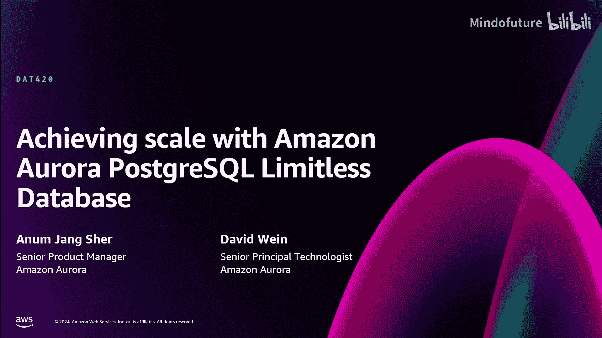
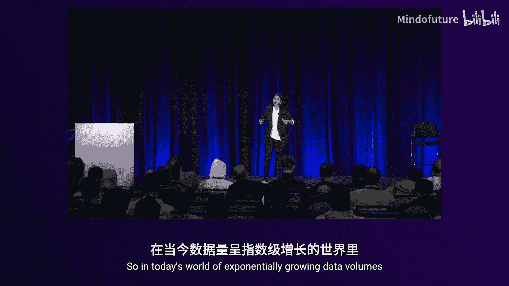
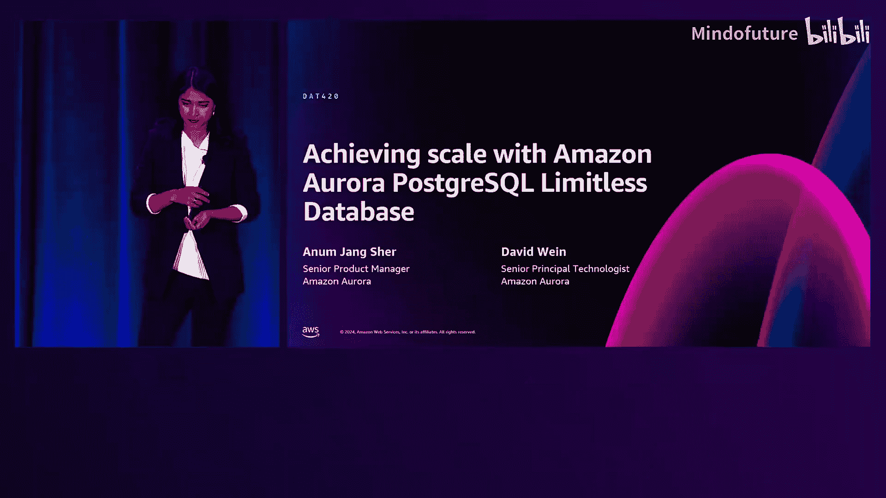
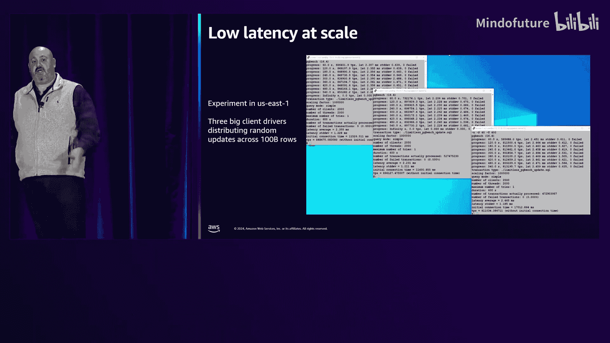
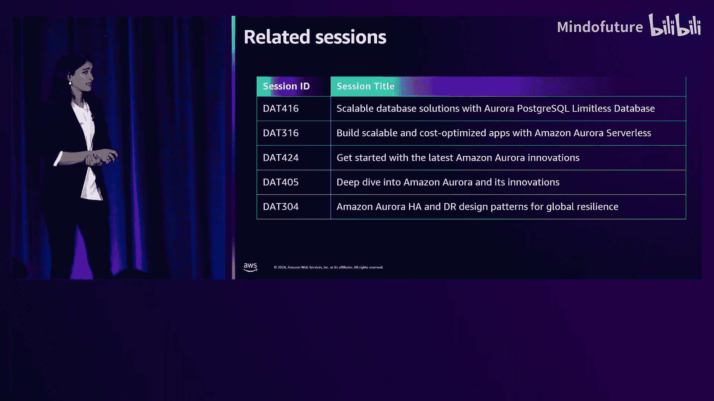
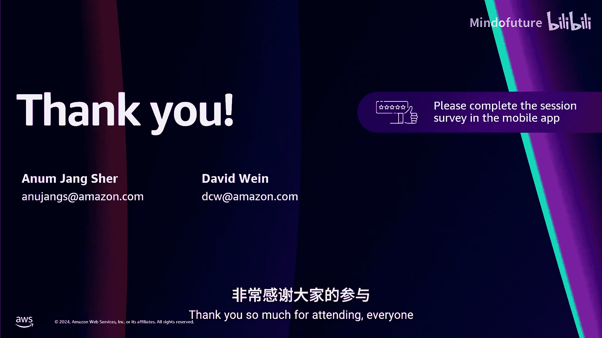

# 【AWS数据库峰会2024全集-•-中英】AWS-re：Invent-2024---Databases-p17-P17-Achieving-scale-with-Amazon-Aurora-PostgreSQL-Limitless-Database-(DAT420)--BV1VAR5Y6Es1_p17-

Hello， everyone。So in today's world of exponentially growing data volumes。

Your ability to scale your databases efficiently is super critical for your organizations。

But how do you go about getting that level of high performance and scale without compromising on any of the core database capabilities such as availability and consistency。

My name is Adam Zhangsha and in this session we are going to talk about exactly that We're going to talk about how Amazon Aurora Postgret limitit list can help you scale your databases beyond what a single database offers。

Very high level agenda of what you're going to hear in the next 45 minutes or an hour is we will start off with motivation。

 some of the scaling challenges that you face， and well jump directly into the product overview what it is。

 how do you use it and the rest of the time we're going to spend。Feeing it apart。

 We're going to talk about how it works under the hood。 We're going to talk about the architecture。

 how the data is distributed， and we'll talk about how transactions and queries work。

 and then we'll close it off with how can you get started today。

Now limitless database is a feature of Aurora and this year is super special for us because we are celebrating 10 year anniversary for Aurora。

 so I want to thank all of you for being on this journey with us as we build new features and capabilities to help you solve your problems this gives a nice timeline of all the key capabilities that we launched and the very recent one is limitless database。

😊，So a very， very， very high level， when you are building your application。

 what you do is you figure out what level of performance and skill that you require and you provision resources corresponding to that。

When you need more resources， you do fill away， you go to a bigger size instance。

Business starts doing better and better， which is fantastic。 But then you have another problem。😊。

You start running into the limits of what a single database。Can we offer you。

You require more throughput you're storing more and more data。

 so at that point this is when you get introduced to the world of sharding。

 so what you do is you take your database， you break it apart into multiple different components so you can get parallelism out of it。

😡，This helps you bring scale。 So this is one of the common think of it as like an optimization technique to give you the performance and scale that you require。

But now that you have broken your system down into so many different components。

 sure you're getting the scale， but you are having a different problem now。

 Now you have to manage all of these different components。So this poses a bunch of challenges。

Right now， I'm going to touch on just a few key challenges。

 We'll talk about four querying consistency， resharding and capacity management。

So let's start off with Queing。😡，So when you have broken up your system into multiple components。

Running a query on the system becomes more complicated。

 Your application needs to be aware of where the database resides。

And same goes for keeping your entire system consistent at all times， so you could be doing。

 let's say any kind of alterations on the table， you're adding a new column。

 you're deleting a column， how do you go about doing it in a consistent manner？

You could be running any of the routine operations， things like you take a backup at midnight or 2 a。

 you could run the command then， but it may get executed at slightly different times for each of the different components。

So it's your responsibility to make sure that you have a consistent system。

Another problem I want to talk about is reshing。 So initially。

 when you realize you need to go beyond a single database。You go about distributing your data。

Are you done， Is this a one time thing that you do and you call it good。Not really。

 so this is something that youll need to do over and over again。😡。

Every time any one of the nodes get hot， then you have to go about redistributing。

 and you keep doing resharding over time， depending on what your future usage pattern is。

 it could be more frequently or less frequently。And the last challenge I want to touch upon is database capacity management。

When all of your data is in this single big database。

 all you have to do is worry about capacity management for that particular database。I'm sure。

 you know there'll be fluctuations， you might be over provisioning just a little bit。

 but once you have broken off your system into multiple databases。

You could have heat at any point within that system。

 and it may fluctuate depending on the time or the year or the month of the year。

 so you have to figure out where that heat is and address it。

 So what you typically end up doing is you would end up over provisioning all of these nodes。😡。

So now the problem isn't just operational complexity。 You're also paying additional cost for it。

So to tackle these challenges， I'm seeing some of you nodding so I can see that you've been through this trauma。

 so to tackle this， what we launch is Amazon， Aurora Postgres limitless database。

 this is Aurora's answer for a managed horizontal scale out solution that gives you the capability to go beyond a single database。

Now the overall thinking behind this is that we want to give you the power of a shed or a horizontally scale out solution。

 but with the simplicity of how you use a single cluster。

So limitless database scales up to millions of right transactions per second。

 it gives you the capability to manage petabytes of data。All the while。

 while giving you all of this goodness， we also wanted to make sure that we give you the operational simplicity of a single database cluster。

😊，When it comes to billing as well， we want to make sure that you're not paying for that additional cost。

 so you only pay for what you're using。Now， for Aurora， typically initially。

 what you were looking at was when you have to get compute， you provision an instance。😡。

You get R 7G RG， you get that fixed capacity In 2018， we launched Aurora Stless。

 so we changed the model slightly where instead of provisioning this fixed capacity you're specifying a capacity range and you don't have to worry about what hardware you get。

 you specify minimum capacity， maximum capacity and that the database automatically scales within that range。

Now with limitless database， we're going one step further that now we're doing horizontal scaling。

 so not just vertical scaling， we're scaling out the system horizontally so now instead of thinking about instances。

 what you have to think about for compute is a DB shard group so you create a DB shard group and you give capacity range for that。

And for a compute you can also specify redundancy， you know bad things can happen。

 so in case an AZ is down， what you can have is one a fail target or two fail over target if this is just development environment。

 not interested in that， you can just specify your compute redundancy to be zero。And of course。

 similar to Aurora， limitless database also supports the same SLA of 99。99% availability。😊，Now。

 when I talk about capacity management of your DB Shaard group。

We're building on top of the same concepts of serverless that we already have。

 So you measure capacity for this D short group in AU's Aurora capacity unit。

One ACU is a combination of two gigs of memory and whatever CPU and networking that you need along with that。

 So you follow a ratio of one is to two。And when you're creating a limitless database。

 what you do is you specify the minimum capacity for the DBSard group in ACUs and the maximum capacity。

 and the database is going automatically scaled between these limits to give you the right amount of compute that you require。

Now， let's go through a simple scenario。 So let's say I am a database engineer at an E-commerce company。

 and we sell stuff。One of the things that we do is we calculate sales tax based on the city。

So this is just a sample schema I'm showing you that three tables customer order tax rate。

Pay attention to the customer ID column in customer and order table。Now。

 how does limitless fit into this example？With limitless database。

 we support three different types of tables。 First， you have the regular standard progress tables。

We have added two new tables， so shed tables and reference tables。

So shted tables are the ones that are going to get distributed across different nodes within your system。

Now for our example， we have the order table that we want to shard across our system。

 so the different color in this example represents different customer ID。

 so this is what's going to get distributed across these different nodes based on the shard key and in this example。

 remember customer ID that's what I'm going to use as my shard key。

Now another table that we have is the customer table Now in a lot of my use cases I want to have customer table order customer data in the orders data together so it makes sense to have it on the single node instead of my system going to multiple nodes so we also have this concept of colocated tables within limitless where we are essentially specifying to the system that they share the same sharp key so the data goes to the same node。

 so when you're running a query we don't have to go do joins across multiple nodes。

So go ahead and distribute that data across these different nodes。

Now then you might have tables which aren't really like there's super tiny tables。

 fewer write on it for such tables is what we use the reference tables which get copied all in full across each of these nodes。

😡，So in our example， it's the tax rate table， so this is the table。

 we copy it in each of the three nodeds that we are showing in this particular example。😊，Now。

 this is just conceptually how you'll think about this example。What about the syntax？

So to specify intent that this is going to be a sharded table or a reference table。

 we are using session parameters so for this particular example we are going to set the session parameter。

 this is a new one that we created limitless create table mode as sharded。

And with charter tables you have to specify your shard key。

 So customer IDd is the shard key that we're using for it。

Now we wanted to make sure that we keep the syntax as。

Pretty much like no changes on the syntax as much as possible。

 So if you see that the create table statement， we're not making any changes there。

 this is just like a sample create table statements when we had to specify which is a shed table。

 we're setting it as session parameters。 you said it once you're good to go have your createable statements。

 all of them and then。If we switch gears to how do I go about specifying co located tables？

So same idea， we want to keep the syntax same， so not touching any of the creativeable statements。

This is how you specify your sharded table， the new thing for the co located table would be another session parameter to say this table is the co located table。

And now we follow the same pattern for a reference table that we use specify it as a session parameter。

Now， so far， we have talked briefly about why you should care about it， what is limitless database。

 and how do you go about using it with a simple example。😡，Next， let's do a deep dive。

 Figure out how does it work under the hood， where the architecture is。

 How has the database distributed。 And for that， I'm going to have one of the engineering leaders on the project。

 David Wee， to come up in。Fle this apart。Thank you。Thank you hellello， I'm David Wee。

 senior principal technologist and I led the engineering team that delivered and built Aurora Postgres limitless database and I am going to take you on a walk through some of the internals of it。

 how this thing is put together on the inside。So if we look at a traditional aurora Postgress topology。

What we have is we have an aurora cluster。That has a single writer node。

 it has potentially multiple reader instances and it's backed by aurora distributed storage all right so just a quick review。

 aurora storage is our foundational building block is a three availabilityvail zone durable storage system that elastically grows and shrinks based on the amount of data that you need to store and provides essentially unlimited iOs so there's no storage provisioning that you have to do within Aurora using our distributed storage system and as mentioned earlier。

 it's about 10 year old battle testeded storage architecture so sitting on top of that your connections that want to do rights talk to the writer instance and the connections that are doing reads can talk to the read notes。

In the limitless database， what we have done is we've replaced all of those components， the writers。

 the readers with what we call the shard group that Annana mentioned， all right。

 so the shard group contains the actual compute that's going to power your limitless database system。

 a key thing is that we are still using the underlying aurora storage distributed storage。

 the coupled compute and storage， three three availability zone durability。

All right so let's crack open the shard group and take a look at what's inside。

 go through the layers so the important thing is the shard group is contained within your aurora cluster so you do if you're talking say at the API level。

 RDS create DB cluster just like normal the cluster level operations that you do today such as taking a snapshot doing a point in time restore some maintenance operations。

 continue to operate at the cluster level， you just have the one API to take care of those。

So the shard group as I said， encapsulates the infrastructure you need and it provides one endpoint for you to point your applications to。

 so there's just a single endpoint you don't have to worry about endpoint connections for all these different components so one endpoint for the application and the shard group will scale based on the load from your application and the data size。

 as Anna mentioned， within the balance of a minute max ACU configuration you've given us。Al right。

So the first part inside that Sr group we'll talk about are the what we call distributed transaction routers or routers for short all right so the routers serve all the application traffic your user connections from your applications they'll connect in and they'll be assigned to a router the routers just like the other components will scale vertically up and down based on the load on a given router or they can scale horizontally if all the routers are already loaded。

 you can add another router。The routers themselves。

 they know the schema and they know the placement of all the data and they look just like a Postgres node to you okay so they do not store any of your data though they just have schema and they are all identical from your point of view does not matter which one you're connected to。

 you can do any operation against any router any DDL from any router， anything like that。

 so when you actually run a query， the router receives the query。

 Postgres query engine takes a look at it， it does itss parsing。

 it does the initial planning decides where it wants to or where it needs to send the query in terms of where the data is located and then it can pull back results from a single shard query or it can aggregate results from a multi shd query and we'll get into that in a little more detail later。

The point is here， these routers， they're not just proxies， these are full fledged database engines。

Alright， then we have the data access shards or just shards。

 and these own portions of the actual data， so they own a portion of the shard key table space and they have full copies of reference tables。

 All right so each reference table appears in full on every shard and then the shards will own a slice of your data。

 So query comes in from the client goes to the router router does the first pass decides which shard needs to serve and then sends the data down to that shard。

 the shard will do the local planning， So choosing indexes and whatnot。

 and execution of that fragment of the query。All the local transaction logic is executed and handled within the shard and the shards are the data stored in the shard is backed by that distributed aurora storage system we'll talk a little more in detail about the transactions and how those work between the routers and the shards。

All right， so just take a quick look at how this is actually laid out from a topology point of view and an availability point of view。

With traditional aurora clusters you would maybe specify a subnet group and an availability zone and then you create instances and you put those instances into specific availability zones you don't do that with limitless and you don't do that with shard groups you do give us a subnet group is part of your cluster creation but then when you create the shard group。

 we will place nodes across your availability zones rather than concentrate them in one so the routers you'll get routers distributed across your availability zones and then the shards will also be placed across the availability zones so thinking that almost more like a regional thing and the thinking here the reason why we did this clearly you would have lower latency if everything was consolidated into a single AZ right however。

Once maybe you had one failover out of that single Az。

 now you have a system where you are expecting everything in one Az。

 but one of the nodes is now running in another AZ。

So now you're in a slightly maybe degraded versus what you expected latency scenario and the reality is chaos happens。

 entropy happens， you're gonna get failovers that happen just by the nature over time likely there's a good chance a node may need to move to another AZ right so rather than have you plan if everything in a single AZ and then be in a degraded state we say look let's just make this a regional thing will plan from the get- go that these components are distributed across availability zones and that way if there's any failovers across AZs。

 it doesn't impact your application because your application is not expecting the single AZ semantics or single AZ latency so' that's the thinking here in the design so the shards the aurora nodes you've got writers for the shards and then we have what's called what we call compute redundancy which will give you a redundant failover target。

For each of the shards in a different availability zone， so this version of the slide。

 this diagram shows a compute redundancy of two， which means that each shard has two redundant nodes sitting there in another A Z so you can see。

 you know if we were to lose A Z1， then。Sharard1 could fail over either to AZ2 or AZ3。

 and then because the routers don't have any special data in them that belongs to them。

 really we don't care about those routers that were in AZ1。

 either we'll scale up the ones in two and three to take the load or we'll add additional ones if more scale is needed。

系。All right， so we'll talk a little bit about data distribution now。

So an number already showed you sharded tables and the way you create them with this customer table example。

 so you set your session level variables， you say， I'm going to want to create a sharded table and my shard key is going to be the customer ID。

All right， then you create table customers and we'll shard it。

 you can actually create now a number of tables that all have the same shard key right so if you can just set this once in your session and then create the tables in your schema that'll take effect so now as a look at Postgress and what Postgress would show you so you do describe on your customer table and you will see that this is a Postgres partition table。

All right， so there's a couple aspects of partitioning that we are doing here。

 We added something what we call hash range partitioning。So we will take your shard key。

 which can be one or multiple columns。And we will hash them into a 64 bit space。

 and then we will assign ranges of that 64 bit space to different shards。

 So if you look towards the bottom， you see a list of partitions。

 and that is the hash key range that exists on each of four shards for this table。

So talked a little bit about hash range partitioning and just again， we assign out ranges。

And we call those table fragments on each sh， so you have a customer's table。

 we have a fragment of it on each sh， and that fragment has a range of the hashed values。The routers。

 as I've said before， have no data， but we say that they have table fragment references。

 and so they have references that point to all the shards for the different key ranges and that's how the routers are able to plan your query and send the execution to the right place。

Now we've talked about this system offers horizontal scale out。

 so what happens when one of these shards becomes too busy。

 there's too much work for it to handle there's maybe too much data stored there。

 so we call that a shard split。And what we do is we will just take one of the shards and we will take part of the key range that's on that shard and we will just split it off to a new shard okay so here we can see that the last shard was split into two smaller shards Now the way we do the split is we actually leverage some technology that's built into aurora storage a couple aurora features that you may be familiar with are volume cloning where we're able to take a shallow copy on write。

 a very fast copy on right copy of your existing volume and then we also think called global database where we do storage level replication Well we leverage those features here and when you do a shard split we actually take we take a copy on right clone of the shard that's being split So it's not actual copy of the data。

 but it's just a clone that's a copy on right we do storage level replication to keep them in。

Sync and then we split the old side and the new side。

 getting rid of half the data or whatever portion of data on each side that is not applicable to that new shard or the old sh。

 so we're able to leverage some of our storage replication。

 we can also add routers in so as a router gets big。

 we're able to add one in and it will have references to all the data。Reference tables。

 we talked about a little bit， so these are tables that you want to frequently join with your sharded tables but you're not looking to scale them out okay so you're not trying to achieve greater aggregate storage or throughput on the reference tables they're read mostly but they can do rights and they get strongly consistent rights so just like sharded tables as' a reference from the router to each one but unlike the sharded table the full all the rows exist on each shard it lets us do join push down so we can do faster faster operations against those and they are all strongly consistent asset rights so it's not that we write to one and then we replicate over to the others like there's no lag there it's all strongly consistent。

so we'll talk about transactions now。So the design goal of this system was to offer the same Postgre semantics you're used to on read committed or repeatable read。

 also known as snapnshot isolation， with a consistent view as if you were in a single system。

All right， so we very much took Aurora Postgres， tried to keep the semantics as close as possible。

 out， and like not make you think about trying to handle distributed commits or handle any sort of weird isolation issues。

 just give you the same transaction behavior， but doing a distributed system。

So it's kind of hard to do for a few reasons if you have all the nodes in the distributed system coordinating their transactions。

 well that's really going to limit your scalability， the system's not going to scale very well。

 it's going to be very chatty and as you add more nodes things are going to get worse right so that's a challenge with a relational database you can kind of do anything you want in there right so you don't know like the database engine does not know what's going to happen in that transaction until the time of commit up until the time the commit is set you could still do anything right so there's no way for the engine to know ahead of time。

 what sort of transaction you're going to do we could add an API for you to hint it to us but now we're no longer like a relational database that you know you would be an incompatibility so we don't do that because transactions can be multiple statement you may send you may begin a transaction。

You send a statement that goes to one shard。OkayAnd then that processes give you results。

 then you send a statement that goes to another shard right but you want to have the same consistent view of data。

 you want to have the same transactional consistent view on both those times so that's challenging because parts of it execute at different times you have to maintain order between these nodes and these transactions and then by the way you want to do backups and restores right and when you do a restore you want it to be consistent just like today in a single system you just have one backup and you have one restore and when you get that restore back it's transactionally consistent if youve run your own self-sharded system。

 this is like impossible to do you have to keep you have to do lots of different backups and it's like impossible to have one consistent point in time so these are hard things and we aim to solve these。

So these are the acid properties you get in Aurora Postgres limitless database so you get Postgres read committed or snapshot isolation also known repeatable read。

 as I said same semantics as a single node Postgres。

 it also has a benefit of something called external consistency which has to do with if I commit a transaction and I observe the transaction is committed and external from the system and then an event happens after that in real time。

 it will absolutely happen after that inside the system as well so this is a unique property of distributed systems a lot of databases。

 distributed databases do not have this property Postgres limitless database does there's some good papers and examples online that talk about external consistency。

Multi shard rights are atomic so you can do rights and transactions that go across shards and those will be atomic at commit time all right so there's no worry about torn rights if one shard fails or anything like that so you get normal normal asset properties on distributed commit the DDLs are all strongly consistent and transactional just like in Postgres right so in Postgres DDLs are always read committed as is in limitless database and you can initiate DDLs from any SQL connection you don't need to you don't need to go to a special coordinator or something initiateit anywhere。

And we have single system backup， so just like Aurora today you can take a snapshot at the cluster level。

 you can initiate a restore in a cluster level， you get that with limitless database and it's fully consistent across all the shards。

 you don't have to worry about maintaining backups and restores on any of those you just do it at the single cluster level。

All， so let's talk a little bit about how the transactions are actually implemented。All right。

 so a quick review of how Postgres does MVCC or multiversion concurrency control and this is a simplified。

This is a simplified example， it's a little more complex。

 but this covers it at a sufficient level to get you there so Postgres。

 we call these snapshots not to be confused with the snapshots that are backups but these are transactional snapshots and Postgres snapshots are always taken as of now and as I talk through here and explain this to you I'm going to talk about now and then all right so Postgres transaction snapshots are now which means the moment that the begin hit or the transaction starts within the Postgres that is now that is the time that the snapshot will be yet so the way this is done is Postgres knows the current XI or transaction ID this is just a sequence number and then it records the transaction IDs of all running transactions in the system so it actually locks the system so no commits can go through records all the running transactions。

And then as it it unlocks them very quickly， then when it's going through looking at rows。

 it compares the transaction ID that's recorded on the row with the current transaction ID。

And any transactions that were in the running list All right， and I'll just go through this quickly。

 So if you think about postg like rows that you can and can't see when you hit a row。

 it's either invisible or it's visible to you right so invisible rows that should not be seen by your transaction。

 maybe they were written by a transaction ID that happened after yours。

  clearly they'll never be visible。They were written by a transaction ID that's not yet committed。

 maybe it rolled back， so clearly not visible， or it's written by a transaction ID that was running when you started your transaction。

 so maybe it's committed now， but when you took your when you took your snapshot it was still running so you can't see that。

😡，Otherwise， you see everything else， you see your own uncommitted rights and you see everything else。

 right。So this is the way it works now， but implementing this in a distributed system is really hard when the same transaction snapshot may need to appear on different nodes at different times and you want a consistent view so in limitless we do snapshots as of then。

 not as of now but as of then， so the transaction router receives the query from the client。

 and then it establishes the snapshot time， the time is now when the router got the query。

 the router sets a time not in sequence number but actual time。

 and it sends this time to the shards along with the query fragment when we're sending pieces of queries to shards。

So the shards then receive this time and they create their own local snapshot as of then the time that they received。

 which is sometime in the past。And what this allows us to do is if we have snapshots that go across multiple shards。

 they can all set their snapshot at the same exact time。

 and that way we get a consistent view of data just like you were in a single system and then the transaction visibility is actually a lot simpler。

 it's just did a transaction commit before this time， if so I can see it if not， then I don't see it。

All right， so a couple interesting things here that you may start wondering。

 which is like what about the fact that each of these， you're talking about time。

 each of these systems has a different clock like nobody's clock is exactly the same everyone in here has a phone or a watch or something and nobody has exactly the same time right we all have some variance of what time it is based on drift and just inaccuracies。

 so historically relying on actual wall time between multiple systems that just doesn't work because nobody's clock is the same。

But AWS has done some really significant investment in our clock infrastructure in our data centers and that has allowed us to have highly reliable clocks that are drift bounded and what that means and I'll get a little deeper on the next slide is we know the machine knows what well it thinks it knows what time it is。

 but it certainly knows that the time is absolutely after a certain time and it's absolutely before another time like just for me right now。

 I don't know what time it is right now， but I know we started this talk at 130 and we're done at 230 and so it's somewhere it's probably around2 o'clock I don't know but I know that for sure right so in the human world this one hour is not very good。

 but inside EC2 that one hour shrinks down， down， down， down。

 down to microseconds right so if bounded clocks in EC2 we're based on something called Amazon Time syncnc which is a service which。

Part of EC2 that's available to you provides very highly high quality time source。

 There is an open source program that also the time team provides called clockbound。

 which is a user space demon again， it's open source。

 you can get it and that gives you the time within this earliest and latest again right now for me it's between 130 and 230 pm。

 but inside of a EC2 system， it's usually you know P99 within one millisecond difference and that guarantees that the actual real time is within that millisecond and there's a newer architecture that we have that's available in some regions and some hosts is really a Peter desantis talked about it in last year's Monday night Live it is really a from the antenna on the roof special wiring through to a clock source actually on the nitro card on the instance that lets us have globally like。

Region global time bounded within dozens of microseconds。 All right。

 So this uncertainty window is very， very narrow。All right。

 so that that lets us be really confident about times and build algorithms inside the database that can do distributed time-based transactions with very。

 very little additional latency or error well，s certainly no error， they're all correct。

 but with very little additional latency built into the algorithms。

 So this going to walk you through how the actually works and examples。

 so here's a distributed repeatable read transaction based on clocks。All right。

 so we'll say transaction one， transaction one begins this transaction at repeatable read and it's selecting a order status from an order table passing in a customer ID。

 let's say we're sharded on customer ID here and an order ID and you see what's going to happen is the router will get a time。

 I'm just saying time 100 here， it will execute the query on the shard that has customer ID 619 using a snapshot at time 100 right and so the order status there is filling。

AllNow transaction two starts， does it begin。And the router will get a time of 103。

It will do a select on the order status for a different customer， customer 801 or a different shard。

 right， sees the order is filling and then doest update。

Updates the status to shipped for that customer in order and does a commit so what will happen is that the router will do a or sorry that shard will do a one phase commit on the shard it will get in a commit time we'll say 110 and we will acknowledge the commit back to the client when we are durable on disk just like a regular transaction and the clock error bound has resolved itself now because the clock error bound is much smaller than multi azy disk latency we actually never have to wait for clocks to be correct they always they work out well never being in practice we run two and a half million concurrent right commits on a very large node we see zero clock weights if the clock drift was really actually high we would do weights but we in practice don't see that we actually have to do them。

Alright， so then another transaction starts Trans 3 does a select of this row that we've just updated。

 sees that it shipped。 It got a transaction time of 125， Sam thing。 All right。

 so we'll go back to transaction one now， which is still open。

 which was opened with a snapshot time of 100。We'll go and we'll select this order again order 80 for customer 801。

 This is the first time we've touched 801 the first time we've touched this shard and the status that we will receive is filling。

 We do not see the other transaction because we are still in an old transaction snapshot again。

 this is。Just how Postgres works and the key here is we have made it give you just the way Postgres works。

 but in a distributed system， and that's the key thing， so let's move on。

Multi shard rights when you do multiple shard when you do rights to multiple shards。

 we use a twoface commit to ensure that we have durability across all participants it's coordinated by the router that issued the transaction the cool thing here is the algorithm makes all shards commit with the same exact commit time so that if you're doing visibility checks based on commit time and you did rights to multiple shards then they will all be visible at the same time if you're doing commits that are on transactions that touch multiple shards。

 your latency on the commit will be two to three times higher than if you just did a commit to a single shard right so like a singleton update one shard you'll get one latency if you're doing updates that cover multiple shards you'll get about two to three time latency on the commit itself。

Right because we have to do a two phasese protocol there so in conclusion on transactions same semantics as Postgres reads are always consistent。

 there's no like read delay due to clocks or anything like that commits where we do single shard write scale really linearly because there's no coordination between nodes that it's needed because of the clocks millions per second I'll show an example here in a little bit and distributed commits or atomics so these are the key things on transactions right。

Querries and performance so we'll get a little bit into SQL and how queries are executed so fundamentally aurora Postgres right so Postgres wire are compatible Postgres parser and semantics we cover a broad area of the SQL surface area there is a couple spots that you don't get in a distributed system but we have pretty broad coverage there and we have support for selected set of the extensions as of GA and the time that we're doing this right now that includes popular extensions such as Postg PG vector and several other ones and we'll continue to add those as we go on。

All right， so query execution basics。We are leveraging a couple pieces of Postgres technology。

 you saw earlier we use partitioning， we are also using Postgres foreign tables as a way to set up the metadata。

 so Postgres foreign tables is just the federation system that lets you access data on other nodes。

 however， we're not just using generic Postgres foreign data wrappers。

 we have enhanced core aspects of the query engine and the execution engine to allow you to get better performance on this and we've written our own custom foreign data wrapper that gives all this transactional functionality and a lot of enhancements over what you would get if you just were using regular Postgres。

On the query flow， what happens， routeuter receives a query from the client。

Plans what needs to be sent to which shard， and he joins it has to be done。

 sends the partial query to the shard with the transaction context。

The shard receives it from the router， plans locally and sends the results back to the router。

 The router， then if it was a single shard can just forward the results directly to the client。

 if it was multi shard， it might need to do some local joins filtering aggregation before it sends results。

All right， so one thing I really want to highlight in the architecture of this system and as you think about sharded systems and how to get the most scale and performance out of them is locality all right。

 so locality is key to best performance that's why you have seen us talking about reference tables that exist on each shard you've seen us talking about colocated tables where you're bringing tables that you share the same shard key value onto the same node you will get the best。

Scalability and the lowest latency when locality is maintained because what we want to do is we want to push execution as close to the data as possible rather than pulling data up to execution so if you just think about this simple example we had with customer order and tax rate if you're doing a join on customer and order for given customer ID and then you're also going to join with tax rate if for that customer their customer record was on one shard their order was on another shard and taxes were kept over here。

 you're going to have to go query three nodes and pull the data together。

 which means that you're not gonna to get great scalability as you add more nodes as you run more queries as we do colocation and colocate those customer records together we colocate with the tax rate table we're able to just push to a single shard and you only have one shard involved which means if you run a lot of run if you run a lot。

These queries and you have a lot of shards， they will just independently scale and go up so this reduces messaging between nodes。

 reduces the amount of data that moves， and it leverages the caches really well so you'll get just really killer performance if you're able to design your schema to maintain locality。

All right， so we enhanced some things in Postgres， as I said。

 we enhance the explain output that shows you the query plans to actually you run this on the router and you will see the plan actually that the shards generated and the planner does certain shortcuts and has a fast path of execution if it recognizes that your query goes through single shard and in the explain output you will see something called single shard optimized and that's what you want to see for best performance this appears in the explain output and also in things like PG stat activity there's a column that we've enhanced actually we call limitless stat activity gives you a system you can run limitless stat activity from the router and get a systemwide view of all the queries that are running across your whole system which of those queries or single shard optimized which are not so we did some enhancement to the tooling to to make it easy to manage from one SQL connection like it was a single system。

So you can see locks system wide， query system wide， weight events system wide。

 things like that all right here's an example of join pushdown。

 so here we're doing a join on zip codes and orders and you can see that the entire join has been pushed down in the remote SQL and ends up being single short optimized。

Another thing that we've added is function distribution which is another key thing if you think about a。

 let's say you have a 10 statement transaction all right and even if it goes to a each statement is operating on the same。

 say customer ID， we continue that as our shard key example。

 each statement executing the same customer ID， if you send those statements one by one to the router。

 the router will see them， plan them， send them to the shard， get result back。

 get the next statement。cetera， etc cea and even if you said okay I'm going to put these inside of a function or stored procedure that stored procedure executed on the router goes through the statements one by one has hops back and forth to the shard it's not going to be as efficient as a single system so we do function distribution which allows you to mark a function itself as being pushed downable with a parameter to the function being the shard key right so in the documentation that's available on the AWS docs。

 there's a discussion of function distribution and something called limitless distribution function。

 which is a way to mark a SQL function for pushdown Now again locality locality if we can push the whole function down to the shard it's not like you're no longer doing 10 round trips for this。

Transaction do the whole thing locally and you'll get phenomenal performance。

 we actually do this a lot in our TPCC benchmarks where we're able to decompose some of the transactions into functions。

 do function push down and get millions of new orders per minute out of the system so function distribution is an important thing parallelism。

So I talk a lot about the speed that you get when you're single shard。

 but what about multi shard some things are actually really awesome when they're multi shd queries because maybe you have a broad set of data that you need to do some operation on then that will run well in parallel so some examples are things like creating indexes if you had a 30 terabyte table on one Postgres node and you need to create index on it。

 this is taking you a minute or two right if you have broken that table up into many shards what you're actually doing is creating many smaller indexes in parallel and you'll get effectively linear speed up there same things with analyze vacuum all these things youre just running now in parallel on smaller data sets are really good aggregates count some min max right those can be run in parallel and get you effectively linear speed up there are you know some examples of queries where you do。

Actually need to in just a regular select statement， span multiple shards。

 we will execute that in parallel across shards wherever possible。Okay。

And then I just wanted to give one example here of low latency at scale。

 so here's an experiment we ran in production in the GA release system in US East1 this is a it's using PG bench to drive the workload but it's just a singleton update statement so random update across 100 billion row table that's been spread across many shards and what we observe here we actually had to use three different 24 Excel hosts to drive enough workload into the system to hit the scale so we have three big client drivers running here each of them is doing over 800。

000 updates commits per second so these are actual commits actual transactions per second。

Addom all up， it's over two and a half million， and the latency that we're seeing out of them。

 the average latency is about 2。3， 2。4 milliseconds。

All right so this is a very high scale load it's easy to do you know easy you can do millions of transactions per second but a lot of those times that's read transactions those are simply like key value lookups right so they're reads they don't really count or you can do a update and insert a large amount of data by doing it in one big batch with one commit at the end right now you're like wow I've done so much data in a second but to actually it's the commits it's the synchronous commits that will really kind of gate your performance and how much work you can do and so I really want to be clear here that these are actual independent commits that are happening inside the database just these are three clients pointed at an endpoint。

Two and a half million commits per second。 All right， and with that I turn back to anum。 you Dave。

 so a lot of stuff to digest。 but what can you do today to get started。

 This is generally available right now so you can get started with the APIs or you can just open up console and just create a limitless database cluster to get started today。

 a few to bring everything together。 what you have heard about today is some of the challenges that come with scaling your system to that level limitless database helps you scale to millions of right transactions per second。

 and as Dave said， these are commits。And it helps you manage petabytes of data we talked about the scalable architecture that powers this whole system。

 we talked about how data distribution works， how do queries and transactions work you can go into the documentation today to learn more about it and of course get started with the console and here is some of the related sessions that you might be interested in them might have been like earlier。

 but we have videos on YouTube so you can look them up too and I'll give you a second to take a photo it。

😊。

And the last request for the session， please do the survey。 Thank you so much for attending everyone。

