# 【AWS数据库峰会2024全集-•-中英】AWS-re：Invent-2024---Databases-p18-P18-Multi-Region-strong-consistency-with-Amazon-DynamoDB-global-tables-(DAT425-N--BV1VAR5Y6Es1_p18-

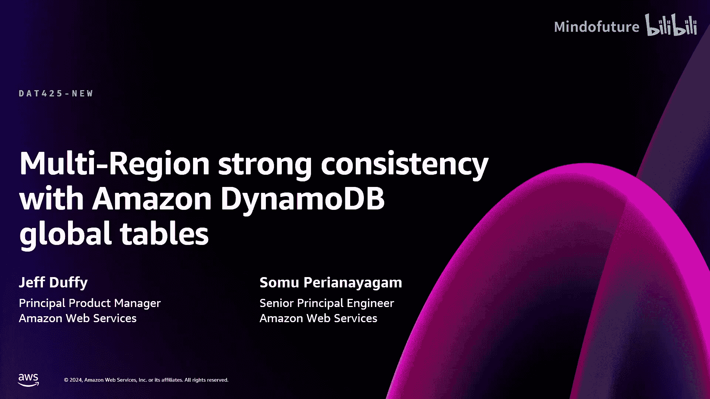

Hey everyone， my name is Jeff Duffy， and I am a product manager for Amazon Dynamo DB。

I'm going to be joined a little bit later by Sou， our engineer for Amazon Dynamo DB。

 and I'm here today to talk to you about an exciting new feature that we've just released in preview called Multiregion strongong consistency for Amazon Dynamo DB's global Tables feature。

😊。

And so I'm going to start by talking about how Amazon DynamoDV's consistency model works today and why this new feature gives you additional capabilities。

And then I'm going talk through some multi region strong consistency use cases and and where this might fit some some of your workload needs。

I'm going to do a really quick demo of showing you how to create an MRSE table in the console。

 And then Soma was going come and do a deep dive on how we built multireion strong consistency and give you a demo of how the behavior works compared to our eventually consistent global tables。

So dyna D B Global tables is a feature that provides multiregion multiactive replication。

 And so what that means is that you can have replica tables to or more constitute a global table in different AWS regions。

 and you can write to and read data from any replica in the global table that is any region。

 and we will replicate changes to all of the other replicas in the global table。

And this allows you to increase your availability target for your applications from4 nines from keeping your data in a single AWS region to five nines by having a global table with your data in two or more AWS regions。

Global tables will also let you store your data where it's used and where your users are so you can get some better performance by reading data closer to where the application is。

 and it's really easy to use as you're gonna to see in a moment， you can simply take a table。

 you can add replicas to it in any region that you like and will automatically take care of all of the replication for you。

😡，So the new feature that we're releasing is multiregion strong consistency。

 and we're releasing this in preview today， and this is going to let you build globally distributed applications that have a recovery point objective of zero。

 and we define recovery point objective for RPO as the amount of data that you're willing to not have access to should you need to shift application traffic from one AWS region to another because of some interruption。

😡，So let's take a look at how consistency works in dynamo DB today before this feature was released。

 And we're gonna to start by looking at the scope of a single AWS region。 And so in our example here。

 we've got a table in the US West2 region。 and we're gonna do a right to it。

 We're gonna change some data。 So we're gonna call the update item API and that data will change in that single region table。

 And then when I read the data with a get item call， that is by default eventually consistent。

 And what that means is that it is possible for you not to see the result of the change that you just made with the update item call。

 your data can be stale。 It is eventually consistent。Now。

 if that's not okay for your applications's needs， we can use strong consistency in this single region scope instead in order to make sure that you're seeing the latest changes。

 And so in this example here， again， my single region table in US West2。

 and I'll perform that update to the item。 And when I perform the get item call。

 I'm going pass a parameter called consistent read and set it to true。

 And what this does is that makes that read a strongly consistent read。

 and we support strongly consistent reads for our read APIs in general。

 And that means that you're always going get the latest version of the data。

 you know that you're gonna see the change that was made in update item。

So then what does that look like when we move from a single region to a multiregion scope？

 So in our example here， I now have a global table and that global table has replicas in the US West2 and the US East One regions and the replication between them is the default replication that we have today for global tables。

 which means it's eventually consistent。And so now。

 if I have some users on the West Coast to perform an update item called to the US West2 replica。

And then they perform a get item call in a strongly consistent manner。

 setting that consistent read parameter to true。 They know that they're always going to get the latest version of data as long as that data was updated in that US West to replica。

 But if somebody updated the same item over in our US East1 replica， then they could get still data。

 because our replication is eventually consistent， typically taking single digit seconds。

 depending on how far apart the regions are that the replication is occurring between。

And so the same is gonna be true for our users over on the East Coast， right。

 They're gonna do a get item。 They're gonna to do a strongly consistent read。

 And they'll know they'll always get the latest version of the data over there on the US East 1 replica。

 But again， if somebody changes the data， the same data in US West2。

 maybe they haven't seen the changes yet when they perform their strongly consistent read。

 And so this is fine for a lot of applications， we have a lot of customers that are building a lot of really cool stuff and eventual consistency is just fine for what their applications need。

 But what if it's not good enough。😊，And the answer is to look at multiregion strong consistency。

 which is the feature we' we're offering now in preview。

 And so the change here becomes the replication type。

 rather than replicating eventually consistent replication between the two regions。

 we perform strongly consistent replication。 And so again。

 our global table example here in the US West 2 and US East1 regions。

 But now it's configured for multiregion strong consistent。

 And so now when my users on the West Coast perform an update item called to that US West 2 replica。

 And then they do a get item call setting consistent read to true that strongly consistent read。

 they know that they have the latest version of the data， no matter where that data was updated。

 even if somebody updated the same item in US East 1， they're gonna to see the change immediately。

 And the same， of course， is going to be true in any replica and a strongly consistent global table。

 anybody at any time can do a strongly consistent read。 know within a multiregion scope。

 that data is always the latest version。Of data。 And so here is a comparison between the two modes for global tables on multiregion eventually consistent tables。

 which is， again， the default in our production offering today。 We're gonna tend to see lower。

 right and strongly consistent read latencies。 because our rights and reads are only operating on the replica in that local region。

 They don't have to consider changes that are made to any other region。

But the trade off there is that， again， their strongly consistent reads can return stale data。

And so we have to figure out what do we do if somebody updates the same piece of data in two different regions at the same time。

 How do we resolve the conflict that can result from that And， in multiregion eventual consistency。

 we use an approach called last writerer wins， which means from the timestamp wall clock。

 whatever the actually last accepted update was is the one that the rest of the global table eventually converges to。

And so what that's going mean is that a recovery point objective is typically going to be measured in those single digit seconds again。

 depending on how far apart those two regions are， it's basically how much time does it take me to take changes from one replica and replicate it to the replica that you're reading from for your failover target。

But with multiregion strong consistency， you know， one of the tradeoffs that we're going to have to make to get that strong consistency is that our rights and our strongly consistent read latencies are going to tend to be higher because we have to consider making sure that any change in any replica in any region is going to。

 to note that we're going to see that that data。 that version of that data。

But strongly consistent reads in a multi region， strongly consistent table will never return stale data。

 You always know you have the latest version of it。

So our conflict resolution has to work a little bit differently here because if we adopted a last writerder wins。

 then we could get out of sync with respect to what the true consistency of the data in the table was。

 and so we don't use that approach for multi-region strong consistency instead。

 what we do is that if you do a right to two regions at the same data at the same time。

The the latter right， the one that happens just a little bit later will detect that another region is modifying that item at that time。

 and it's going to return an error to you。 And so we've introduced a new exception in our API。

 It's called a replicated right conflictt exception and this is safely retriable if you try to do it right and you receive this exception。

 you know somebody else' is modifying the data。 You can go ahead and configure your application to retry again until it succeeds。

😡，And one of the major upsides then of course， is that our RPO is now zero right I never have to think about how long replication takes in data consistency when I'm building my high availability strategy because I just know the data is always going to be there and it's always going to be correct and one thing I'd like to call out dispel some confusion regardless of the mode of global tables that you're using eventually consistent reads are always eventually consistent。

 that doesn't change whether it's a single region table or a global table and it doesn't change whether you're using eventual or strong consistency in the global table。

😡，So let's look at a couple of use cases， right So the primary reason most customers adopt global tables is to increase their application availability。

 their business continuity profile。 And so what they'll do is to set up a global table and my example。

 I've got an application and it's primarily reading and writing to the replica in the US West2 region here。

 we of course replicate our data and eventually consistent passion over to US East1。

 and that user knows that they've got a copy of their data sitting somewhere else safe。

 should they need to go process data elsewhere。 And so in the event。

 their application fails and they say， oh no I need to go transfer all of my traffic over to the US East One region easily done right we can spin up our application。

 we can point to the data that's been replicated But again。

 RPpoO single digit seconds because it's taking time to replicate data over to that US East One region。

 And if there was an interruption in connectivity between these replicas。

 then there might be data waiting to be replicated back in West2 that you're just。

Not going to see in East one until that connectivity is recovered。But with strong consistency。

 you know， some applications can't tolerate that。 So， for instance。

 customers in the financial industry who are performing financial transactions can't tolerate the idea that should they have to shift traffic to a different region。

 some credit card charges might not show up， that's not acceptable。

 And and so with multiregion strong consistency， that's not a problem anymore。

 because what we're gonna be able to do is to say， hey。

 if my application fails and I shift traffic to US East1。 My RO is 0。

 I'm still getting everything that got changed in any region immediately when I read it。

I talked a minute ago about the other primary reason that customers use global tables。

 and that is data locality。 The idea that I want to get my data closer to my users so I can read and write to that data faster。

 And as you can imagine， because reads and writes and an eventually consistent global table are only operating in the local region first and then replicated to other regions。

 we have very good low latency profiles for reads and writes in that region。😊，But again。

 that trade off is data can be sta。 I can do a consistent read。

 and maybe something that changed in another region doesn't show up here yet。 And I。

 I don't always have the latest version of it。But again， with strong consistency now。

 that's not going to be the case with a multiregion， strongly consistent table。

 always getting the latest version of data when I perform a strongly consistent read。

 the tradeoff being that higher write and read latencies that I talked about compared to eventual consistency。

 And that doesn't mean that this is useless for getting data closer to your users。 In fact。

 I expect to see customers adopt this model when they can tolerate some eventually consistent rights。

 and they'll just do eventually consistent rights to the multi-region strongly consistent global table。

 and those are going to be lower latency。So some of the things I'd like you to consider when hopefully you'll give this a try and see if it is you know。

 appropriate for some of your workloads are these。 First of all， this feature is in a public preview。

 It is not appropriate for production use today。 Of course， once we become generally available。

 we hope that you will adopt it for your production workloads。 But again， today。

 please just kick the tires tested out。 See what you think。Replication consistency。

 it applies to the entire global table。 You configure it when you create the global table and you can't mix and match replicas within a global table。

 So if you have a multiregion， strongly consistent global table。

 that means every single replica in it participates in strongly consistent replication And you can't change after you create the global table。

 you cannot switch back and forth today。 there's kind of a multistep process where it's possible to go from a strongly consistent global table to a multireion eventually consistent by deleting all the replicas。

 leaving a regional single regionion table and then building a multiregion eventually consistent global table from that。

 But as of today， there's just no switch where you can go back and forth。

 And our preview as most preview are has a few limitations compared to where we plan the generally available product to be。

 And so one of those is that we support three regions for the preview US East。😊，One， USE2， US West2。

 and we require that multi regiongion strongly consistent global tables be deployed to all three of those regions when you create them。

And so now I'm just going to do a quick。Walk through。 Well， I was' gonna give you a live demo。

 but of course， it lo out so of you want to come up and get me into the machine， Awe。

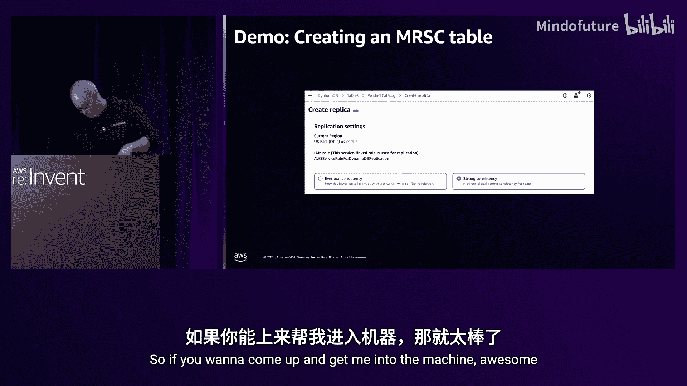

It's a lot of demos， right， That's why we do them。

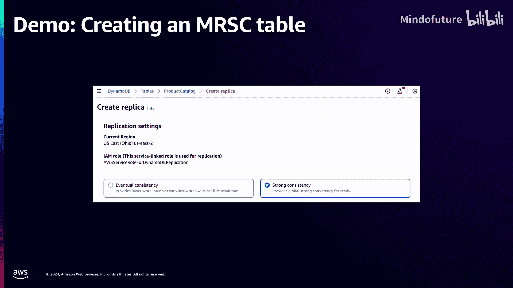

Cool， so here's the Dynamo console。 I have a table here called M SC demo。

 This is an empty single region table。 and I can prove that I'm not not fibbing by looking at the replicas in the global tables tab。

 No replicas， it's just a single region table。 And so I'm gonna create a multiregion global table by clicking on the create replicas。

 And now I'm gonna get choices but for the consistency mode for my global table that I want to configure。

 We'll go ahead and choose strong consistency。 And you'll notice that when I do that。😊。

I'm going to automatically choose the replication regions for you， because， as I said。

For the preview， we operate in three regions， and we need exactly three regions。

 So I'm not gonna make you choose。 I know what they're gonna be。

 depending on which region you're acting from。 And I'll go ahead and hit create。

 And this is in the background， I gonna go do its thing。

 And then because I don't want you to have to wait for that to actually create it。

 It takes a minute or two for us to go set up the replicas and start replication。

 I'll just go ahead and click on this pre preparedpared one that I had before。

 And you'll notice two important things。 First， I've got three replicas here in my multiregion。

 Str consistent global table。 And the other is that I now show the consistency level as strong for the global table。

 And that's how you can tell the difference between them。

 should you create a few and want to go play around with it and try it out。😊。

And so now I want to invite Sui up on the stage to talk to you in detail about how we created this feature。

 Thank you。

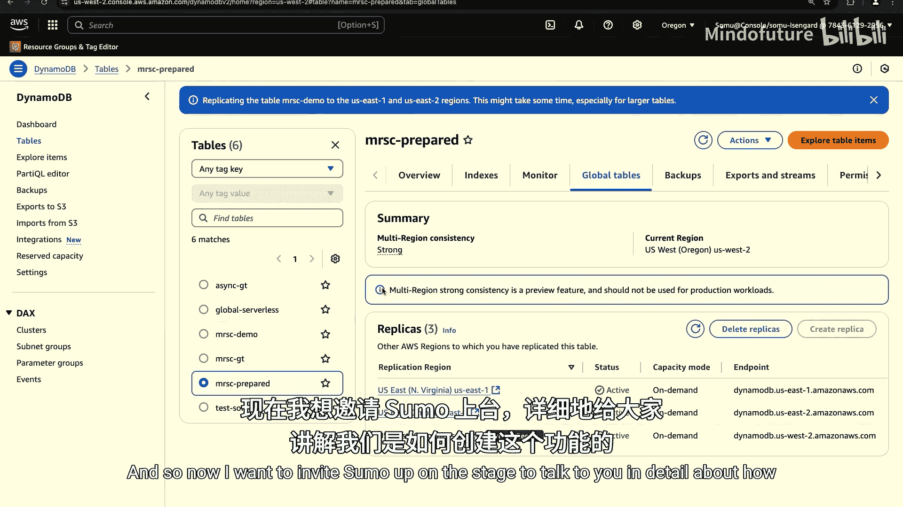

Thank you， Jeff。Thank you。 Thank you。 Thank you all of you for being here。 I know it's afternoon。

 I hope you all grab some coffee。 show of hands。 How many of you use dynamo today in production。😊。

Wow， that's a lot。 I， I can see still with the bright lights on。 That's good stuff。

 So I am here to talk to you today about。😊，The differences between asyous global tables and multi regionion strongly consistent global tables。

And I keep switching this term。 So it's eventually consistent global tables which I refer as asynchronous global tables。

 And for the multiregion strong consistency global tables， Ill refer to them as mercy global tables。

 There's a lot of words to say， I'm actually glad Jeff was able to get through that stuff。

 specifically， I want to talk to you guys about how the underlying replication engines differ。

 And how these two global tables behave in case of a regional service disruption or a network partition。

 because this is this is exactly why a lot of people deploy global tables。

 which is disaster recovery。 and on the day when a particular regional service disruption happens。

 you want to fail over to the new region and have high availability。

 I'm also going to talk about how we gain confidence in the protocol and the replication engines And also talk about how you can gain confidence in the in the replication engine。

 you can gain confidence your application will work in case of failures。 Before I get started。

 though， I have a quick。😊，Deも。

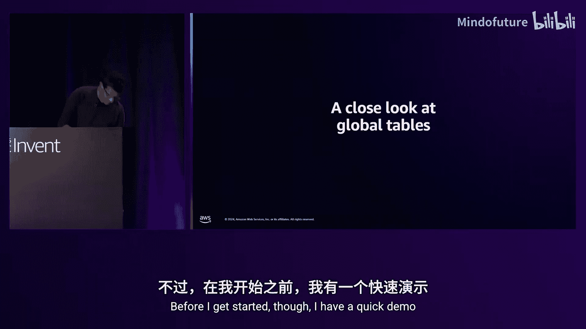

And let's see。Actually， now mind。 I think we gotta go through this one。

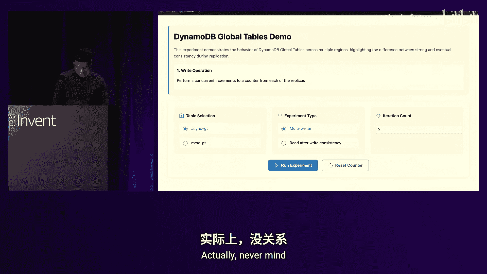

So before I get started， I wanted to do a quick demo for the demo。

 I'm going to use two identical global tables across US East 1， US East2 and US West 2。😊，They are。

 in fact， going have identical key schemas， and they have only one item each and each one of the global tables。

 And the purpose of this item is to just count the number of attendees at reinvent。

 right it is just a toy program。😊，The only difference between the two global tables。

 as Jeff mentioned， is one of them has multi region consistencyencies as to strong。

 The other one doesn't have one by default， it's eventually consistent， so。

And we're going to run through two experiments for this demo。

 One of them is going be a multiwriter experiment where we are going to write concurrently to the same item across from multiple regions and observe what the values are。

😊，And in this case， it's just going to be incrementing the counter。

 lets assume that everybody is checking into reinvent and we're gonna incrementing the counter and all three regions。

 And we're going to see what the difference is。😊，The second experiment is going to be to demonstrate how strongly consistent reads work for both these versions of global tables and how they differ in terms of strongly consistent reads。

 So we're going to write to only one of the replicas。

But we are going to issue a strongly consistent read and a eventually consistent read from the other to the other two replicas and see what the values are。

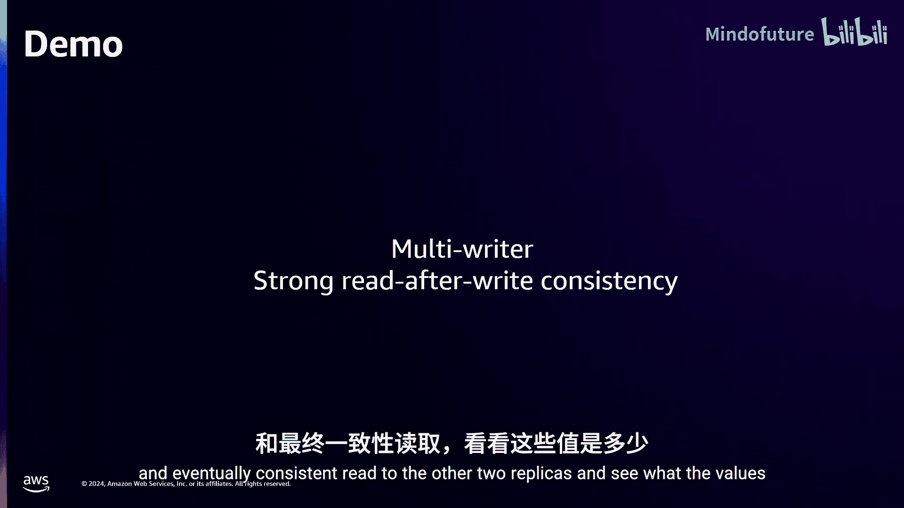

So this is my setup。It allows me to select the table。

 I want to kind of use and the experiment I want to run the iteration count is the number of rights I want to do or the number of increments I want to do。

 So I'm going to reset this counter to reset it to 0。

 and then I'm going to run the first experiment which is a multiwriter experiment with the asynchronous global table。

 which is the asynncch G T。😊，So right here， I have some。Latency analysis with5 vis is not much。

 But what it gives you is a rough， rough estimate of how quick it is to reach US West 2 from Vegass。

 it's the closest region available region。 And you can see the right latencies for US West2 is really。

 really low compared to the other two regions。😊。

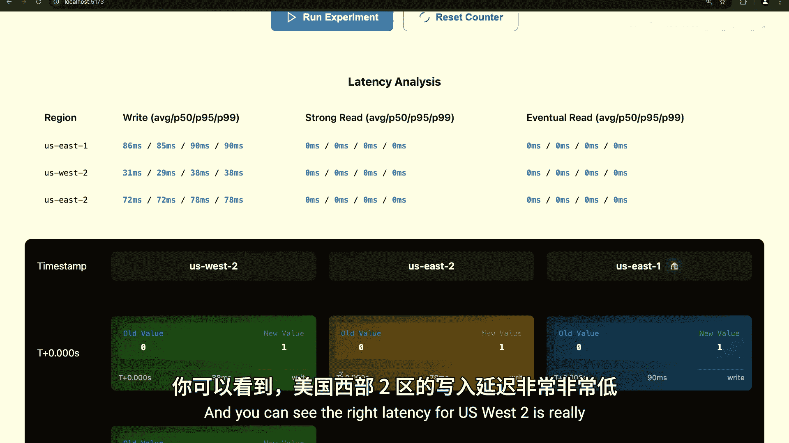

And you can see that each one of the regions and replicas have operated independently。

 and while updating the values five times each， they kind of keep updating the values from3 to 4。

 then you see US going from 2 to 3 and eventually they converge at4 to 5 which is basically everybody kind of increment their own values without seeing what the value on other replica was And this is how asynchronous global tables works。

 it is meant for high availability use case and really low latency。😊。

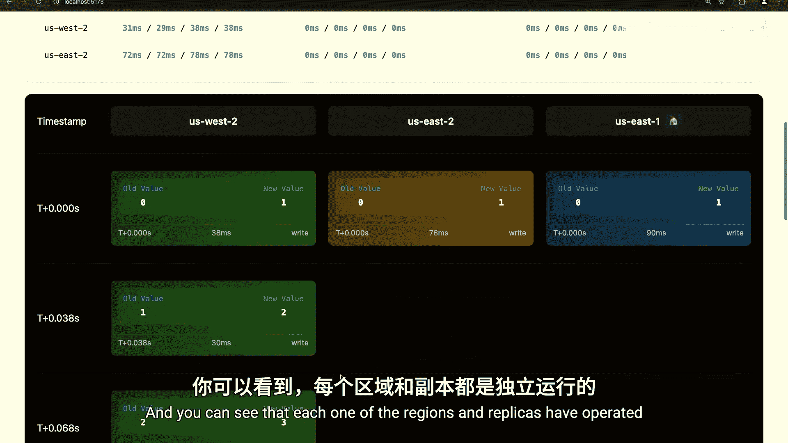

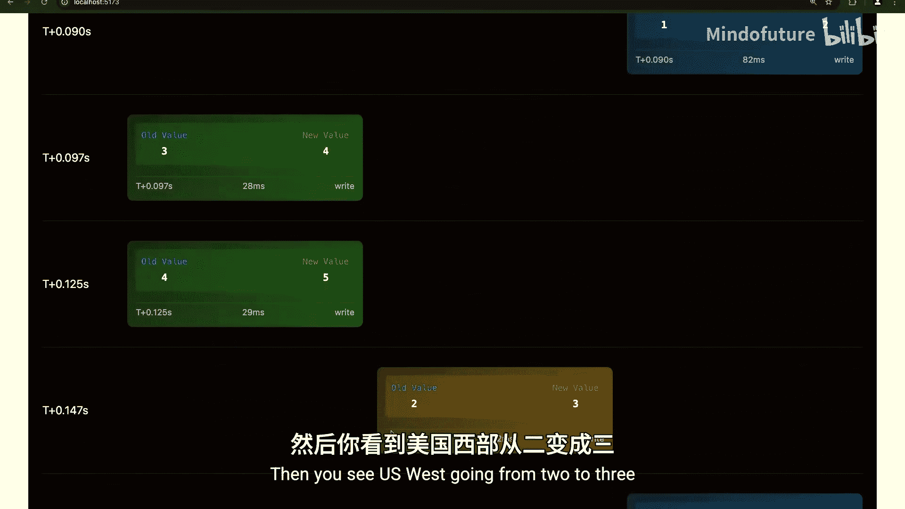

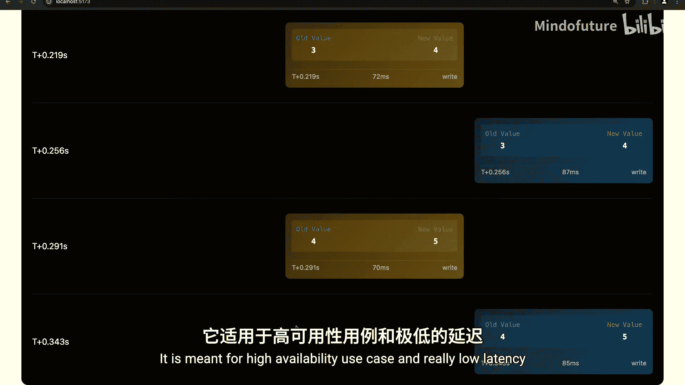

We got to read on the same experiment with the Mercy global table。😊。

We' going to reset the counters because I think I've been playing around with this for quite some time now。

😊，And。We're going see what the latency looks like。 So take this latency with the pinch of salt because it is running from my laptop。

 but the US West2 latency is definitely higher than the other two US West2 latency when we ran the asynchous global tables。

 And there's a reason for this。 And well revisit this reason later in the talk。😊。

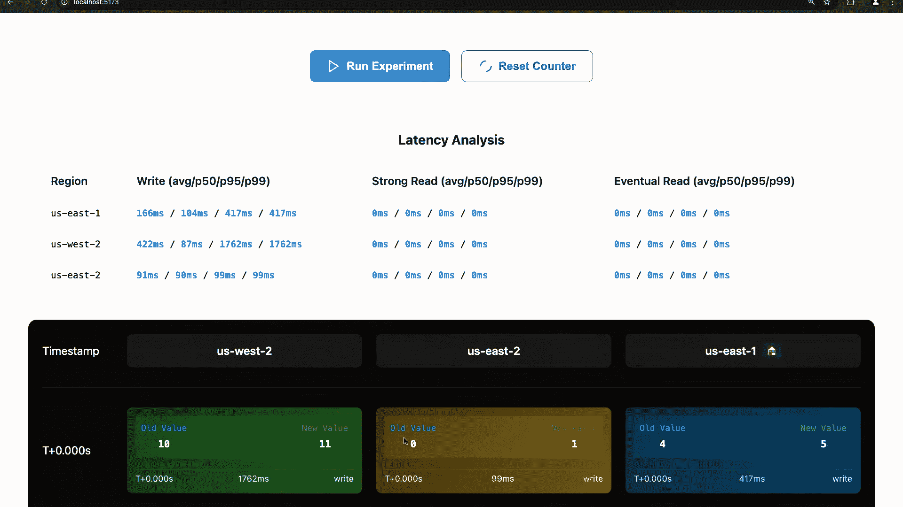

But you can see that the values which are getting incremented for the counter are globally consistent right you go from 0 to 1 in US E 2 and then go all the way up to5 to 6 And then US is1 increment set and then theres an increment which happens to us West2 and eventually land up with a value 15。

 So this is a globally consistent increment。 So this is how multiple writers can increment the counter。

 a key thing to notice here is in the latency is that US West2 had a latency of P100 ofboard a second or so。

 And this is because。😊。

Of something Jeff mentioned in his talk is that we throw when they are concurrent writers。

 we land up throwing replicated right conflict exceptions。

 And this can lead to the client retrying the concurrent right。😊。

The next experiment we're going to do is see how strongly considered reads work with asynchous global tables。

😊。

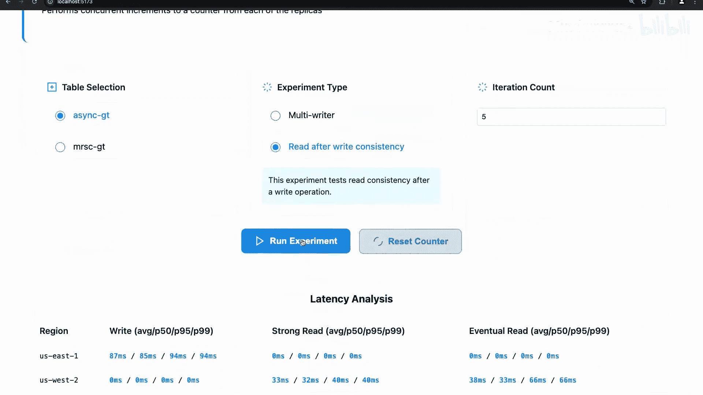

Here， we we just implemented the counter in US East1。

 US West 2 and US East2 were just observing the values。

 right the strongly they were doing a strongly consistent read and eventually consistent read。😊。

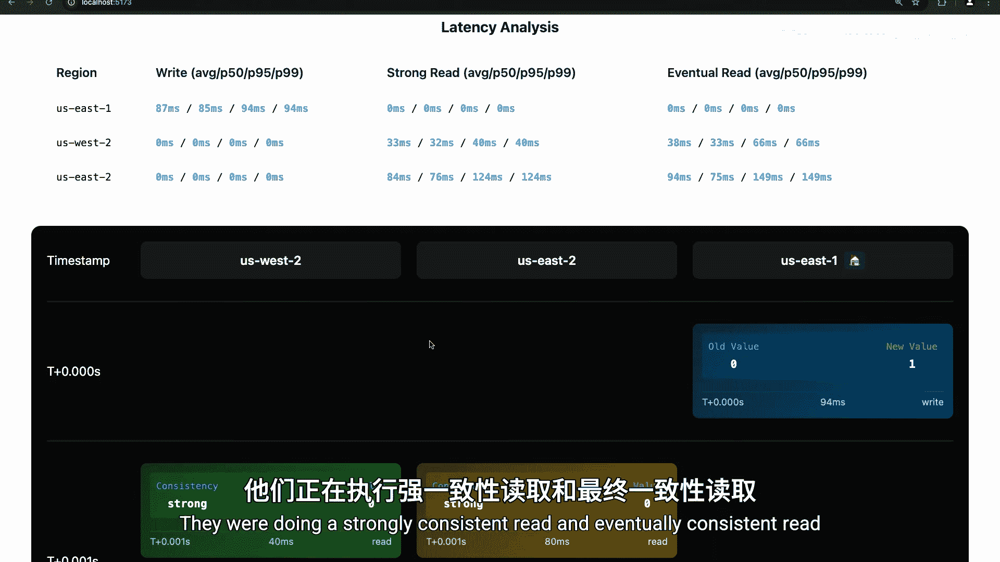

So US C one chugs along we increment the value and we are observing the value from the other two regions as you can see。

 even though US C1 is finished incrementing the values。

 the other two regions are still not observe it because sometimes replication can take a little bit of time before it reaches the other two regions and。

😊，I run this， I observed the reads for about 700 milliseconds from those those two regions。

 but its very rare that I get latest value， but you can see here that US E2 has got value2 from US least1 because the value got replicated but still。

😊，I think the values in USC2 are still 0 and 0， which basically means that the values are not got replicated yet or your strongly consistent reads in these regions are still looking at the local local values。

😊。

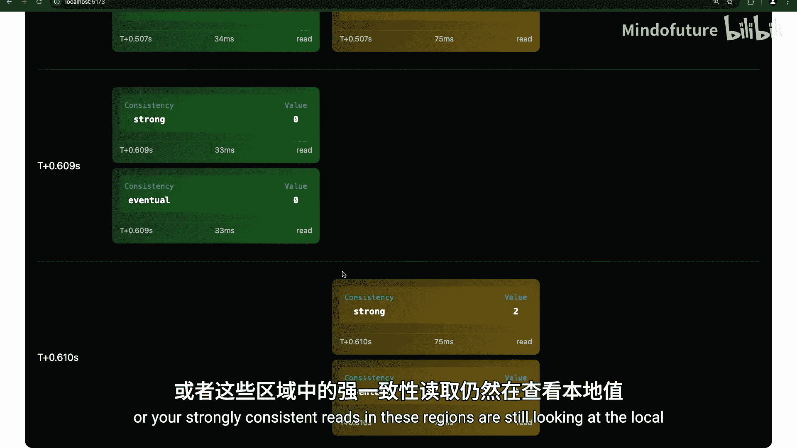

We' are going to run the same experiment again with the Mercy global table。😊。

You can see that rights are rights have very similar latencies to the Res in USs2。😊。

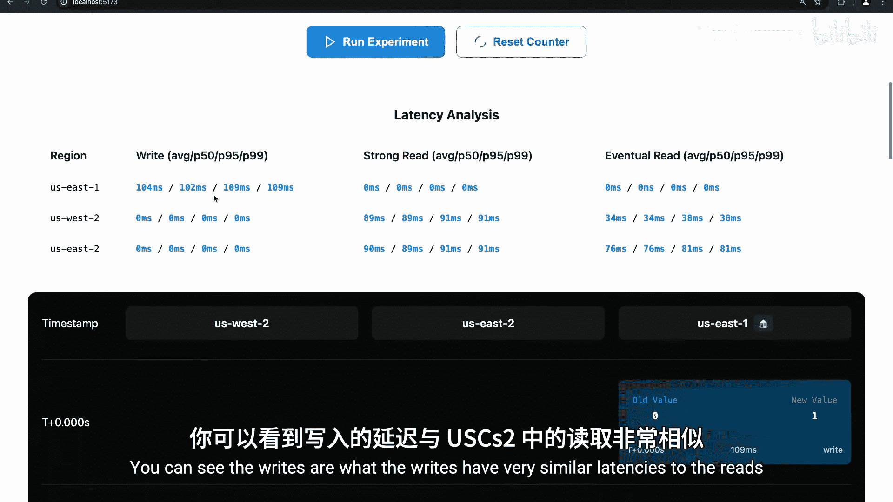

But as， as and when you C1 is increasing the values。

 you can see the strongly consistent reads in the other two regions start picking up the values of the globe of the counter。

😊，Right， and。And you can see when as the value increases all the weight of five。😊。

All the regions catch up to the value of five。 the strongly consistent reads observe the latest value of the right from the other regions I'll explain how all this works with Mer global tables in a bit。

😊。

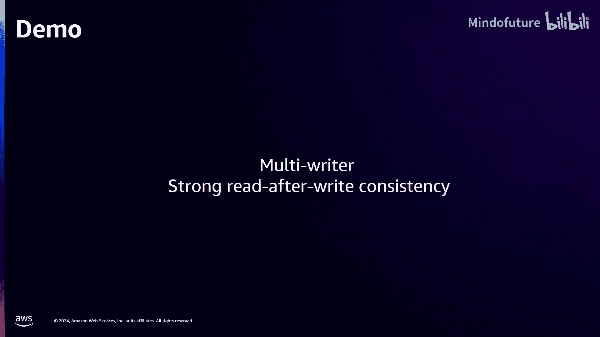

So a quick show of hands。 How many of you know how dynamo D regional replication works。That is good。

 So this is a good primer。 So I'm going to go through a quick primer of how dynamo D regional replication works because it's very relevant to how multi regiongion strong consistencyency global tables work。

 when a dyna dynamo D tables are scaled by partitioning them into continuousuous key ranges。

 And we call these partitions。 Each one of the partition is replicated into three different availability zones。

 And this is because we want high availability and high durability。

 and we use a version of multiaxs to replicate data between these three availability zones。

 So when a right comes in the right is authenticated， we do the admission control checks。

 And then we send the right to the leader replica of a partition hosting the particular key all that particular item。

😊，The leader replic generates a writer head log。Which contains the old image。

 the new image after applying the request， and then replicates it to the other replicas and the other availability zones。

And once。This is replicated。 And two of the three replicas reply。

 We send back the result to the customer saying， hey， your writer has successfully stood。😊。

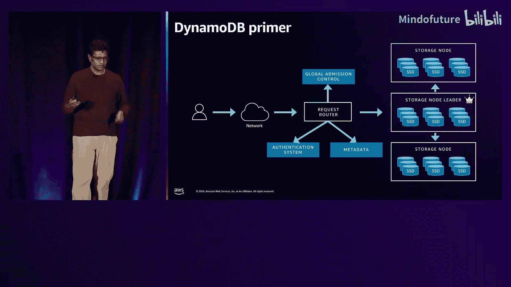

This writer had logged。😊，Big is the bread and butter of everything we build in dyable。

That includes things like backup presser and update streams。

And this is super important because these are two building blocks for asynchronous global table replication。

😊，So the asynchous global table replication engine does nothing but read reading the update streams of all the customer rights in a region source region and replicating that to the destination region。

In practice， when you have a global table with n replicas， like three replicas like in our example。

 you would have n-1 replication engines。 And the reason for this is we placed heavy emphasis on availability of the availability of the replication for global tables。

 And if we had a single replication engine， then failure of a single region could stall the whole replication pipeline for us。

 In fact， we go down to actually restarting the replication every five minutes from each one of the replication engines to ensure that even host level failures do not affect any availability of the replication across these regions。

😊，Now， replication is bidirectional across all these regions。

 And a key thing to remember with asynchronous global tables。😊。

And this is very relevant when we talk about the failure scenarios and how we handle is that the replication engine only replicates customer rights originating in a region because you have replicated rights going through the same channel as customer rights。

 You don't。 we don't replicate those replicated rights。 We just replicate only customer rights。😊，Now。

 this is a time series view of how the replication looks for a asynchous global table。

Here we have five regions R1 through R 5， because for asynch global tables。

 you can add as many regions as you want。 In fact， I see some of our internal services adding up to like number of regions we have。

 which is in the upper 20s。 But here we have for this example。

 I chose 5 to just show how the replication works。 So here we have region R1 through R 5。

 this right to region R1。 the right is。😊，I'll acknowledge back to the customer。

 And then the replication engine just picks it up。And then replicates it asynchronously to all the other regions。

 The the reason we it is the asynchronous part is important is it's not guaranteed all the rights reached all the regions at the same time。

The rightss can reach the regions at varying time。 And a big reason of this。

 for one of the big reasons is speed of light， The other reason can be that we are just recycling the lease and pick a new host is picking up the lease。

 So there can be gaps in how the replication works。😊，Now。

 this becomes very relevant when you do strongly consistent reads。

 If you're doing a strongly consistent read in a region where it happened。

 then you will see the latest value。😊，But if you do a strongly consistent read in a region where the write did not happen。

 then the version of the item you see depends on whether the replication has happened or not in our example here R2 will not see the latest version of the read item。

 but R3 will definitely see the latest version of the item because the replication is done。😊，Now。

 how do we handle right right conflicts， concurrent rights to the same item。In in all regions。

 So like， like I said before， each each one of the regions will accept the rights。

 There is no coordination between the regions。 They all operate independently。

And they will replicate it to the other region。And then we use the last rate wins conflict resolution to decide which one of the items should we keep and which one of the items should we overwrite but how do we do the last rate wins conflict resolution。

😊，When DynamodD receives a right request for a particular global table replica it stamps this right request with two pieces of metadata this is metadata is stored as an internal attribute which is not visible to external customers or external applications and the two pieces of metadata is what is the source region in which the right was written and a timestamp at which a timestamp of at which the leader replica received this right。

😊，And this timet is got from time S service。对。And we write the data to all three replicas regionally。

 and we write the same data to also the update streams。

 The replication engine being a dynamicnamo service is able to read this read this metadata and replicate it to the destination regions。

😊，And once the destination regions receive this right。

 they are able to compare the times stamps with the timestamps on the item locally stored。😊。

And then decide which one of the rights should be persisted。 if the times stampamp is lower。

 it's going to reject the right saying， hey， there is there is I already have a version of the item which is which has a greater timest。

 And if the times stamp is higher， then it is going to accept the right。😊。

But what happens if the timests are equal， if the timests are equal。

 that's when the source region plays a tie breaker part in in breaking the tie between the two rights。

Now， the。How do asynchronous global tables behave in case of failures。

 A big failure is regional failure where you have regional service disruption or there's something else going on with the region。

 Then in that case， the replicas in the other regions are still highly available。

 And this is this is the beauty of asynchronous global tables。

 all the regions operate independently The performance is equal to the low performance and the replication is outside the critical right path to the region。

😊，The region， which has failed， will recover once once it recovers from the failure， right。

 I will catch up to all the rights。In case of a region isolation。

 all regions are still open for reads and rights， including the region which is isolated。

 network isolated。 And this is because it does not depend on the replication still。However。

 the reeds in the region， which is isolated may serve str version of the items because it's not caught up to the rightss which have happened in the other two regions and vice versa。

A network partition in case of facing global tables again again behaves the same way network isolation works。

 But the slight difference in this case is that it's only the rights between the two regions which have network partitioned that are not read readable in the other two regions right once a network partition recovers。

 the rights are reconciled using the last right of events conflict resolution。😊，Now。

 a lot of applications fit the bill of asynchronous global tables because。It's highly available。

s it's one click addd of a replica and you have a replica another region。

 It fits a disaster recovery。 It works very well in terms of performance。

 but still there are applications out there which need to be able to read their own rights from any region and any region。

😊，So a lot of a lot of our customers went ahead and built design patterns around the stuff。

 such as single reader writer region。 while this works in most most cases。

 the downs of this approach is the latencies of the strongly consistent reads which are routed to the writer region are going to be dependent on where the application and application is and where the writer region is。

 It's also in case of regional failure the the application has to perform a failover。

 which which is a big thing。 So now you lost the whole whole advantage which asynchronous global table gave which is being multiactive in all regions。

😊，Even in that case on， on a failover， you're not guaranteed that you've got up to all the rights from the region。

 which failed。Some applications used quorum reads to kind of solve through the problem of not having a single writer region and having multiactive。

😊，But this kind of also has the same downsides as the previous approach where the latencies of the strongly consistent read are high and also。

In case of region failure， you wouldn't get the latest。Latest rights。

So we went ahead and build multireion strong consistency global tables to do the undifferiated heavyweight lifting of being able to read your own rights in even in case of regional failures。

😊，So what did we have to do to build multi strong consistency global tables。

 We have to ensure two things。 One is the rights are highly available。 But I mean highly available。

 I mean， they are highly available even in case of a single vision failure， which accepted the right。

😊，Two， your are able a strongly consistent read is correctly able to serve the latest right which has been accepted by Dynamo Db across any region。

😊，So how do we do this？We use the same building block。

 which across all database services for building multi regionion strongly consistent databases。

 So we use something called as a multi regionion journal。😊，And what is this multireion journal。

The multiregion Journal is just a set of logs across the regions。 that are global table spans。

 the Mercy global table spans。 All mercy global tables today are three regions specific。

 So the the multireion journal also spans three regions。😊，And this log is an up and only log。

When you write a log to this I am a journal， once it is accepted by two out of the three logs。

 a success is written back to the writer plus。😊，This commit call back is also issued to the other listeners in the other regions。

Okay。Now， when I， when we kind of do a right。The right is appended to the multi regiongion journal first the right request comes in。

 it is upended to the multi regiongion journal first and then once a multi regiongion journal says yes。

 its all success。 its been openended to the multi regiongion journal。

 we can of we can of apply to the local dynamo D table。😊，Not only that。

 the other two regions which are also listening to this particular multi regionion journal for all the right requests would pick up the right requests and apply it to their local dynamo D tables。

😊，Oh， got。What happens when you get concurrent rights。

 This is the most interesting interesting piece。 The multiregion journal being an up and only log would serialize two concurrent rights which happen to the global table。

 So two regions may have two rights which happen to the same item or different items。

 but they are both openended to the multiregion journal。

 and the multiregion journal are goes access a serialization serialization log for us to sequence these two rights。

😊，In our example here， the right to B came is shown to come a little bit later than right right to read A in region 1。

 But the right B gets upended to the log first。And then the right a。

 all the regions need to apply the rights in the order。

They they receive a commit call back from the multireion journal。

 So region R1 would have to apply the right which right which happened to a first before it can apply the right which happened to B。

 And this is necessary to guarantee correctness。Strongly consistent read。

In a region where the right happened is very easy to reason about。

 because that's where the right happens。 So strongly consistent reader is going to kind of return the latest version of the item。

A strongly consistent read in a region where the right did not happen is the one which is tricky to answer。

 It is like， how do I know there are no rights which are acknowledged in the other regions which the customers have got an acknowledgement for。

😊，We use a technique called heartbeating to the journal。 In this case。

 a region R 2 is going heartbeat to the journal saying that， hey。Do you have anything for me。

 Have I missed any rights which I have not seen so far。And as a part of the come called back。

 it's going to have to catch up to all the rights it did not see in between the last ri it it saw and the heartbeat。

😊，And this forces the this forces region are to to take all those right requests and apply them to the local dynamo D table。

😊，And then return the value of the strongly consistent read。

So now what we've done is not only have caught up region two to all the leaders rights。

 but weve also serialized a strongly consistent read with a right that might be happening。

 and we might return success to the customer before the strongly consistent read returns。😊。

We do use this heart beating technique， even in case of a strongly consistent read which happens in the region where the right happened。

 So you would see the strongly consistent reads taking a little bit longer because this heartbeat needs to at least be persisted in two of the three two of the three logs of the multiregion journal。

😊，How does this look on a big picture architecture How， how does the right request work。

For dynamo D B， when it comes in for a multi multi multi region strong consistency table。

When the right request comes， it's sent to a G T share processor。

The G T chart processor then reads the local dynamo D item。Take the operation。

 Converse it to an item potent and write request and then opens it to the multireion journal。😊。

The multiregion Journal then sends callbacks to all three G T shared processes in each of the regions。

 which are listening to the multireion Journal。Once the callback is received on the G T sh processes。

 they just take the right request and apply to a dynamod Db table。😊，I said item important rights。

 and this is a big part of dynamo multi region strongly consistent table。

 What does it mean for a G T shared processor to convert a right to an convert a right request to an item important request。

The right request is taken， and the current item is read and then converted into an conditional insert or delete based on what the previous version of the item is。

 Now， the read of the current item is the only consistent read from the local region。

So in our demo we increment at the counter。 So increment counter was the operation。😊。

The local value being read of the item is， in this case，5。And we again use timests to version items。

 even in mercy global tables。😊，So there is a timet there。

 This current item plus the increment counter is converted to a conditional insert。😊。

As a right request， I important right request。 Now。

 some of this might be sound familiar to some of you。

 It's like basically optimistic concurrency control。

 which is based on the previous version of the item。Now。

He kind of write this right request into the journal。And the beauty of this is that， one。

The item important request ensures that if the G T shared process crashes after applying the rights when it's reapplied。

 there is no effect。2， if the are two concurrent rights happening in two different regions。

 the right requests are serialized in the multireion journal and one only one of the item requests is going to succeed In this case。

 one of them is going return 200 because we saw an increment of increment from two different regions in our first experiment。

😊，The other one is going to return a replicated right conflict exception。😊，And when you do。

 when we throw a replicated right conflict exception， this is a retriable exception。

 So the SDK would automatically retry this exception for you and kind of rerive the concurrent in increment counter exception。

😊，Latencies in milliseconds。So regions are not equi distance。

 Take these latency numbers with a pinch of salt。 I grabbed them from what we had last time around。

 I've not looked at the latency numbers。😊，Definitely US C2 and E C one are closer together。

 So whenever youre doing a right to US C1 or US C2 since we need only two of three regions to actually process the right request in a log。

😊，The responses are going to be faster。The right request or a read request from US West2 is going to be having a higher latency。

 And this is what we saw in our demo as well。 It's because the right request has to kind of travel all the way to US East1 or US2 to be persisted in two or the three regions。

😊，So what happens in case of a region failure again， in case of a region failure。

 the healthy regions would still be able to accept reads。

 rights and serve strongly consistent reads and writes。The more important thing here is that。

In case of multiion strong consistency table， if one of the region which has failed is a region which is close to the other healthy region。

 you may see an increase in latency in your application。

 And this is something you want to account on for because now the rights have to travel to the fatherthest region to get acknowledged back。

In case of a region isolation。😊，The healthy regions will be able to still serve high reads and strongly consistent reads and rights。

😊，But the isolated region is not going to be able to take any rights or reads。

 And this is the difference between asynchronous global tables and multi regiongion strongly consistent global tables。

Network partition， the network partition is a very interesting failure scenario in case of mercy global tables。

 And there's the reason I say this is very interesting because the behavior is slightly different from the asynchronous global tables。

😊，And might differ from other other databases， as well。When there is a network partition。

To understand how how the network partition scenario works。

 we need to understand how multi regionion journal kind of happenss this log Instead steady state。

 if I'm right doing a right to US C one， then US C one generates a log and tries to replicate it to US C2 and US West2。

😊，Right， and as you can see from this diagram since USC2 is near the replication lot travels faster than US2 is farther away。

 it is driving slowly。😊，When there is a network partition between US East1 and US East 2。

US is1 can only depend on US West to accept its right right request。 It cannot act depend on US is2。

But US E S2 will transitly get the replication log from US West 2。 It takes a longer path。

 but it does get the replication log。 the right request log from US West2。😊，And this is why。

 in case of a network partition。😊，All three regions still remain highly available for rights and strongly consistent reads。

 And this is a big difference because we are a multiactive system。

 And in case of a network partition， the ability to have all three regions to be able to do reads and writes is a big advantage。

😊，Now。Again， like in case of an network isolation， youre going to probably have higher latencies to do the reads and write from US C2 and US C 2。

 But that's that's that's a fair trade off for having high availability of strongly consistent reads。

😊，So a big difference between how both these stables behave in case of failure scenarios。

 in case of regional failures。Asynchronous global tables remain very highly available in the healthy regions。

 and likewise， mostly global tables。 So there's not much。

 much difference there in case of network isolation。

 asynchronous global tables are highly available in all the on all the regions。

 except that the reads between the isolated region and the non isolated regions are are going to be fairly stale。

😊，The mercy global tables， on the other hand。😊，The isolated region is going to be highly unavailable for strongly consistent reads and writes。

In case of a network partition， however， the Mercy global table。

 all regions are going to be available for strongly consistent reads and writes。😊。

And asynchronous global tables， the rights won't propagate between the partition regions。

 And that's that's that's a big difference between both these versions of global tables。Now。

 a big emphasis on in AWs when we build distributed systems is that we build them correct。

 we can and we can assert the invariance of the system and test the correctness of the protocols and distributed systems are really。

 really hard。 When I joined AW is about 12 years back。

 then the best practice there was to start doing formal modeling of distributed systems and kind of prove the correctness of the system before we take it to production because these are systems which a lot of people。

 a lot of applications depend on their correctness for for for mostly global tables， we took。😊。

We started using this new model checking tool called pay model to model the state of the protocol and prove its correctness。

😊，Now， P P also provides a tool to check the correctness and the invariance of the system in production using the production logs at runtime。

 So that's called P observed。 So we use P observe also to do model checking of the entire protocol。😊。

Now， there is a lot to be said about formal， formal modeling。

 model checking and mathematical proof to prove correctness of systems。But however， at scale。

 systems behave differently。 They have different bottlenecks。

 and a big part of what we do at dnamo Dbi for global tables is to scale test the whole whole feature end to end to see where are the performance Where are the bottlenecks in the system and how does the system behave at high scale。

 This covers all the edge cases which formal modeling would not cover because formal modeling is at a smaller scale while scale testing would allow you to test what a production work look like。

😊，Likewise， we do a lot of chaos testing as well。 We kind of have packet drops。 We have node crashes。

 and a lot of this chaos testing discovers edge cases which were probably we forgot a model。😊。

Or we did not think about。 And this kind of helps us catch issues in testing before we kind of send it to production。

And these two are used extensively。For global tables， however。We still。

In spite of all the formal modeling and chaos and scale testing and all the things and testing。

 we kind of still do anti entropy between the replicas to ensure that that the replicas are constantly in convergence。

 And this is a key part of global tables， which happens in the background without any of the customers knowing about the stuff and also impacting their traffic。

 We always kind of ensure that the replicas are converging。😊，Now。

 how can you test what the impact would be to your application when there is a failure。

 So we've integrated with AW's fault injection service。To kind of introduce experiments。

 which would pass replication between global tables。

 And this is specifically for asynchronous global tables。

 And this would allow you to pass replication between two global tables and see how your applications react to the eventually consistent reads when there is replication pass between replicas。

😊，We will also be integrating for mostly global table。

 similar experiments so that you can test failures in when when there is a global table failure or there is a replication pipeline failure。

 how your applications would react to that。😊，So we have now two versions of global tables。

 one which support eventually consistent， which is eventually consistent and one which is strongly consistent。

 Each one of them have their own trade offs， applications such as。😊。

Checkpointing your video streams is very， well suited for like asynchronous global tables， because。😊。

You， you can fail over if this is a regional disruption or there a failure。

 you can fail over to a new region and offer to lose the last five minutes of checkpoints。

And the checkpoints are really fast right So it it's super easy to kind of use asynchronous global tables for that。

 And you don't need any universal ordering in such applications。

 But for applications such as let's say， a subscription application or somebody filling a prescription application where you need strongly consistent reads and you need universal ordering and the application is willing to make the tradeoff between latency and strong consistency。

 then Mer global tables is。😊，The feature which you should be using。That's it。 Thank you。

