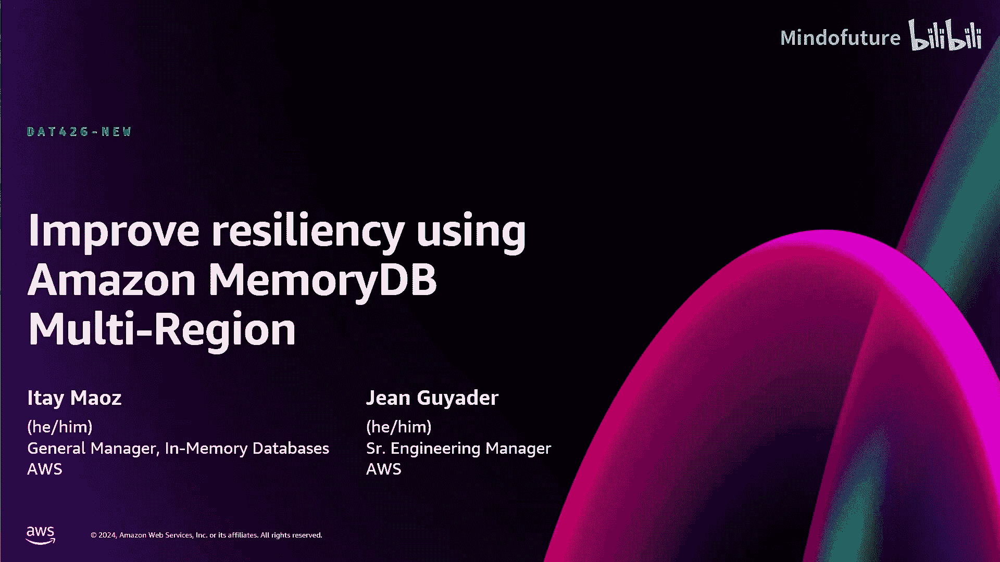
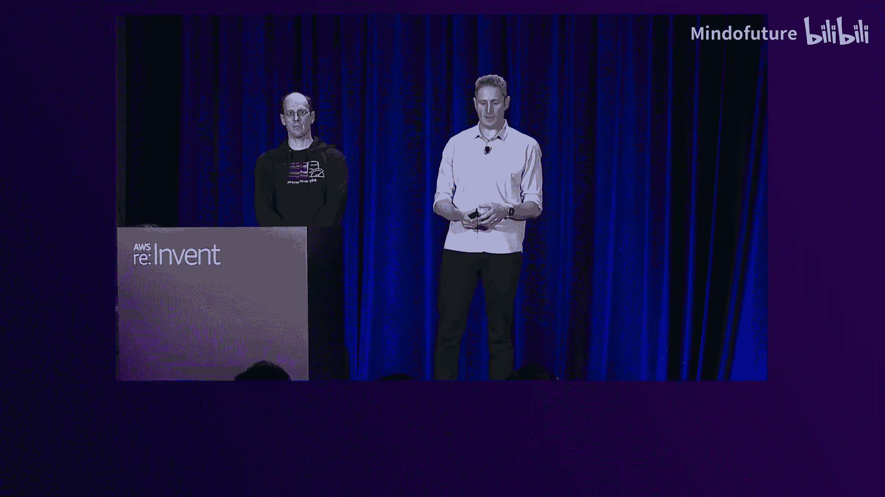
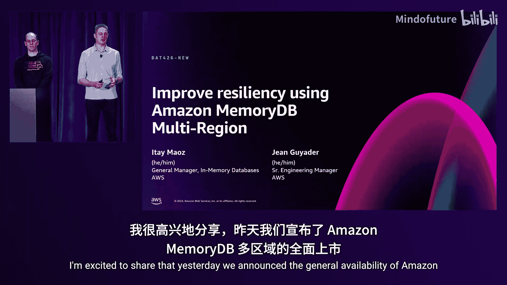
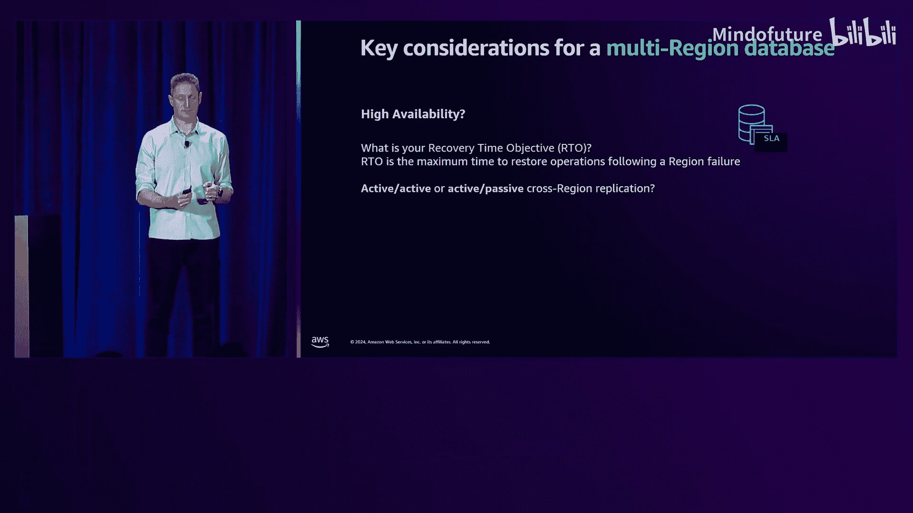
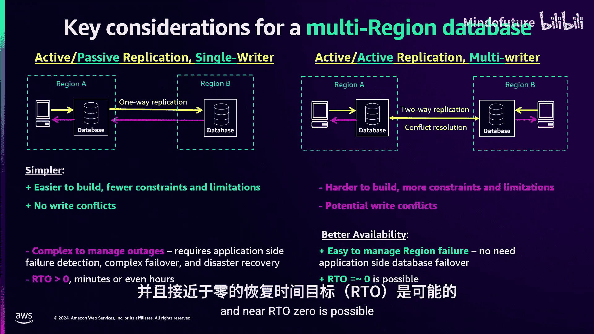
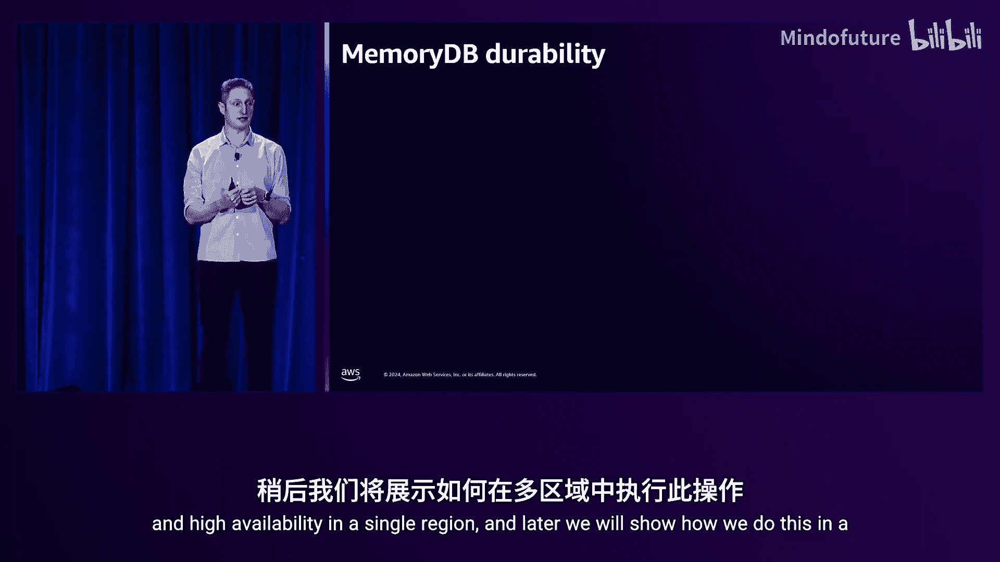
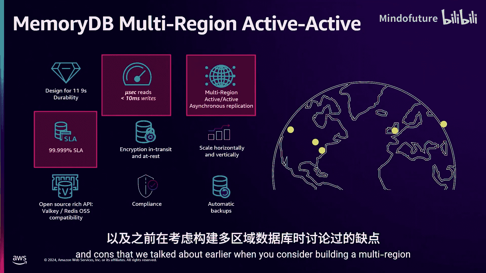
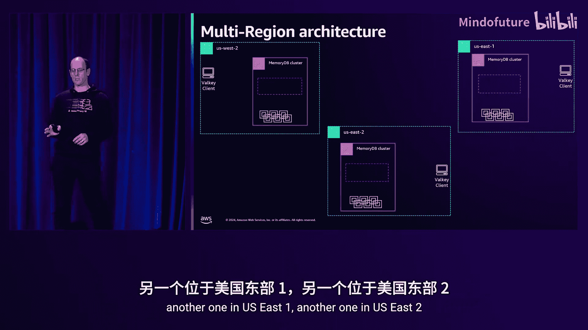
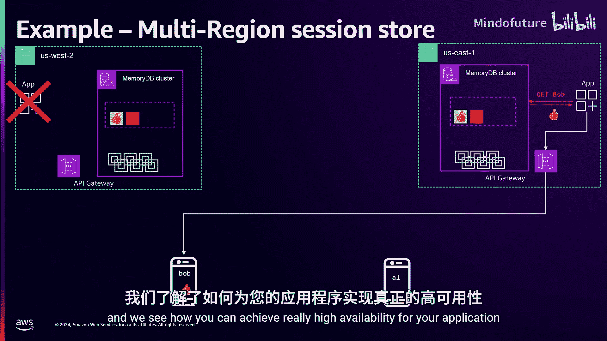
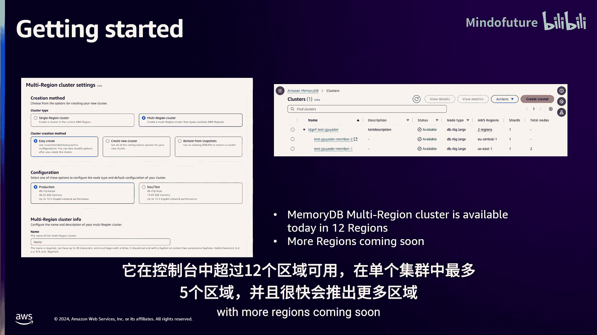

# 【AWS数据库峰会2024全集-•-中英】AWS-re：Invent-2024---Databases-p19-P19--NEW-LAUNCH--Improve-resiliency-using-Amazon-MemoryDB-Multi-Region-(DAT426-N--BV1VAR5Y6Es1_p19-

Hi everyone。

Thanks for joining。You're here because you're developing。A high performance multire application。

And you're looking for the right database to store your data。

I'm excited to share that yesterday we announced the general availability of Amazon Mem Db Multiregion。

😊。

In this session， we will show you。How Amazon memoryDB Multireion can help you build a multiregion application。

We'll dive deep into the underlying technology。Behind it。

 and we'll talk about key considerations you have when choosing a multi regionion database。

My name is E Ti I'm the general manager of In memorymory Datas with me is John。

 the head of Engineering for memorymDB。Before we start。

 please raise your hand if youre building a multiregion application。Cool， a lot of hands， cool。

 so we will show you how memory DB multi regiongion can help you build a high performance。

 large scale multiregion application with five9s of availability。

AWS has 108 availability zones across 34 regions and more regions are coming。

And every AWS region consists of multiple availability zones built for high availability and resilience。

And each availability zone has one or more discrete data centers with redundant power。

 networking and connectivity。And it and the availability zones are physically separated by meaningful distance。

So the question is， why do customers like you need to build multireg applications？

These are the two main reasons customers tell us that they need multireion applications。

The first reason is to increase resilience in the unlikely event of major disruption in a single region。

This could be disruptions in the region。This could be disruptions in the networking or connectivity to the regions。

And these customers， they have critical applications and they cannot tolerate such a risk。

 even though it has low probability。And some of our customers have regulations that they need to adhere to。

 for example， some of our customers in the health industry or in the financial industry。

 they have to run certain workloads in multiple regions for compliance reasons。

The second reason is companies that have global businesses。

 and they need to build their applications in multiple regions in order to provide low latency and a great customer experience for their own customers。

Think about global applications like gaming or retail。

 where you have global data like leaderboards or user sessions。For example。

 a global company that has a customer in the US， this customer can travel to Singapore and they would like to continue to using the app or the website。

And the cross region latencies between these two regions is very high， it's hundreds of milliseconds。

And without a multire application， what will happen is that the customer will have high latency and a bad customer experience。

Okay， so we need multire applications， why do we need the data layer to be multireion。

 can't we just do cross region calls instead？So in the case of increased resilience。

 you need the data for disaster recovery。And even a standby region needs the data because you will not have business continuity without having your business data。

And then in the case of global applications， like gaming or retail that have the global data。

 and they need the low latency。For example， to retrieve the customer session or to update a leaderboard。

 they need a low latency and the typical in regionion latencies are sub milliseconds where the typical cross region latencies are dozens or hundreds of milliseconds。

And if your application does multiple sequential calls to get the data。

 that means that you will have a very high latency and it will impact the customer experience if you don't have the data locally。

For a multire data layer， you can build your own custom solution and replicate data across regions or copy snapshots or maybe use some third party solutions。

But as you will see throughout the session。There are some hard problems to solve， like correctness。

 consistency， availability and performance。So alternatively。

 you can use a multiregion database that already solves these problems。

And we will show you later in the session how we solve some of these problems with memory DB。

So which multi region database should you choose？In the next few slides。

 I will show you what considerations you have when choosing a multiregion database。So first。

 let's cover consistency and durability。Think about your recovery point objective， your RPO。

What is the maximum data loss that you can tolerate in the unlikely event of a region failure？

And this leads to the next question， synchronous or asynchronous cross region replication。

So let's see how in cross region replication works。

The client will do a right request to the database in the local region。

 and a right request could be either an insert or an update if it's a relational database or it could be a set key value if it's a key value database like memoryDB。

Then the data is being replicated synchronously to the other region。It will be followed by an act。

 and then eventually you will get an act。And the key idea here is that theres more than one way to do this and there are algorithms like two face commits and others。

 but the key idea here is that the client will receive an act only after the data is durable in both regions。

And this is where you get strong consistency。Because you know that you get the AC after data is durable and consistent in both regions。

Let's see how asynchronous replication works。As before。

 the client will do a right request in a local region。But this time。

 the client receives an AC after the data is durable in a single region。

And then the data is replicated asynchronously to the other region。

So even if there is a problem with the replication， if there's the failure in the replication。

Since the data is durable in one region and the client received an ag。

 then it is considered as durable。In such failures， the database will retry later。

 and the database will retry later。This is why asynchronous replication have eventual consistency。

In some point in time， the data will eventually be consistent in both regions。

So let's compare the pros and cons of each one。The main advantage of synchronous replication is that you can achieve RPO zero。

 and we hear some customers asking for this kind of consistency。However。

 the major downside here is that a lot of customers don't need this RPO0 and they cannot tolerate the high right latencies。

With asynchronous replication， it is the opposite。The main downside is that RPpoO0 is not possible。

But the right latencies are substantially better with the order of a few milliseconds。

And usually the replication lag is also a few seconds。

 and many customers prefer the low right latencies over the zero RPO。

We see it's very common to see asynchronous replication， solutions like DynamodDB global tables。

 Aurora global database， Elasticache global Data store， and now memoryDB multiregion。

 they all have asynchronous crossreion replication。The next consideration is high availability。

And as we discussed earlier。One of the two primary reasons that customers build multireion applications is to have higher availability and business continuity in the case of a region failure。

So the next question you want to ask yourself is what is your recovery time objective， your RTO？

What is the maximum downtime that you can tolerate until you are able to restore your operations？

This leads to the next question。Should you choose a multire database that has active active or active passive？

So with active passive crossage replication， the data is only written in one region。

You have a single writer， and then it's been replicated to the other regions。With active， active。

The application writes simultaneously in multiple regions， and you have multiple writers。

There is a two way replication between the regions and the database needs to resolve the conflicts if there are any conflicts。

And please note that the decision， whether to use active active versus active passive。

 is orthogonal to the decision， whether to use synchronous or asynchronous replication。

 these are decoupled decisions。The main advantage of active passive。

Is that it is easier to build and has fewer constraints and limitations。For example。

 with active active。😊，You might not be able to fill your entire capacity in one region because you have the database needs to reserve capacity for rights in other regions。

Similarly， with active active。You have multiple writers and therefore there could be right conflicts。

 so the database needs to resolve these conflicts， and you need to understand what to expect in the application。

However， the major downside of active passive is the lower availability。In case of a region failure。

 which is why so many customers use multiregion applications in the first place。

You need to manage the disaster recovery if you have active passive。

You need to detect the region failure， and you need to do failover in the application side either manually or automatically。

 and you need to fail over the softer stack to the other region。And in practice。

 it is very hard to do and very hard to automate。And it's also apro。

 and typically it takes several minutes， if not much longer to do a region failover。

And that's impacting your recovery time objective。This is why so many customers prefer active active with active active managing the region failure on the application side is much easier because you don't need to do a database failover。

 the application continues to read andr in all the regions at the same time and near RTO0 is possible。

All right， so we talked about synchronous versus asynchronous， we talked about active。

 passive versus active active。Another consideration is the number of regions that a single database can support。

For disaster recovery， typically two regions are sufficient。

But for global applications with global data， they typically need the data to be available in all of the regions。

 and therefore the database needs to support multiple regions。

Similar to other use cases that you're familiar with。

 you care about other considerations across security， compliance， the data layer API。

 the ease of use， scalability and performance。So which database should you use for your multi regionion application？

AWS provides a wide range of purpose build databases built to meet modern application demands。

And with the explosion of cloud native applications that require different access patterns。

 data models， performance and scale。You can choose from a solid portfolio of purposepoable databases that fit your application needs。

Some of our databases offer multi region， course region replication。

So today we'll focus on memoryD B。Before we talk about memorym Db multi regiongion。

 we'll do a short overview of memory DB。So what is Amazon Meory DB？

It is the fastest durable database that AWS offers today with microseconds read latencies and low single digit millisecond write latencies。

A single node can support up to 450，000 read requests per second and 100，000。

A right request per second。It has a memory first architecture。

 so all of the data is in memory and the duability is achieved by a transactional log。

 so that's how you get the very low latencies and the high performance。

Memory DB is Valky and Redis open source compatible。

And before we move forward talking about memory DB。

 please raise your hand if you're familiar with Valki。All right， great to see a few hands。

 please raise your hand if you're familiar with Redis。Okay。

 everyone here is familiar withreis or almost everyone， so I kind of expected this answer。

So before we move forward。With Me DB， let me introduce Valki just for two slides。

 a couple of minutes， so you have contacts for the rest of this session。In March this year。

 Redis announced that future versions of Redis will no longer be under the open source license。

Almost immediately， the community of Avi developers fought the project and created Valky。

It is developed by some of the same people who previously developed Redis before the license change。

And some of the previous Redis maintainers became vacuum maintainers。

 and many developers in the community joined the effort。Besides the large community of contributors。

 it is supported by over 40 different corporates， including large cloud providers。

It is hosted by the Linux Foundation， so it is vendor neutral and it stays open source forever。

And the first version of Valki is the fork of the last open source version of Redis， which is 7。2。

 and it is fully compatible with it。And this is also the first version that we released our managed services。

 Elastic E and memoryDB。We launch Valky on both a of our managed services with substantial lower prices。

Both services provide an online upgrade in just a few clicks so you can have a simple drop in replacement。

And we launched Meory DB multi regiongion with Meory DB version 73 for Valki。

 and these lower prices make memory DB multi regiongion even more attractive to you。All right。

 so now let's go back to memory Db。So we talked about Valki and Readitis open source。

 so it is Valki and Reads open source compatible and you get the rich data structures and APIs like list and sets and hashes and sorted sets。

 and you benefit from the popular Valki and ReaditSo open source ecosystem and you can use client libraries in over 50 programming languages。

 and you essentially get the rich functionality of Valki with durability。

MemoryDB is designed for zero data loss， and one of the main innovations that we built in memoryoryDB is the multivaabilities on transactional log。

Every write is acknowledged after been written to at least three different copies in at least two different availability zones。

And it leverages the same underlying technology that is used by S3 and by Amazon。com ordering data。

In the next few slides， I will show you how memory D B achieves its durability。

And similar to other AWS databases， it is fully managed， it has high availability with four9s of SLA。

And other important traits across security， compliance and scalability。Under the hood。

 let's see how memoryDB achieves its durability and high availability in a single region。

 and later we will show how we do this in a multi regionion。

So here is a memory DB cluster， in fact it's one sh out of many in a memory DB cluster。

 and it will have one primary node and one or more replicas。

It will have the multi AZ transaction log。And when there is a right request。

 the client will send the right to the primary node。

Their primary node will go write the data in the transactional log。

 the transactional log will go replicate the data across at least three different copies and two different availability zones。

And then it will return an act to the primary node， which will return an act to the client。

At this point， the client knows that the data is durable。Asynchronously。

 the data is replicated to the replicas， and you need this for high availability。

So let's see what happens if there is a failure。So again， the client writes request to the primary。

 the primary node writes the data to the transaction log。

And then after it's been replicated in the transaction log， it returns an act to the primary。

 which returns an act to the client。Now let's see that the primary node fails。

What will happen is that the data will go and be replicated to the replicas。

And here is where we favor durability over availability。

 we want to make sure that the replica before it's promoted to a primary。

 it has all of the data and only after the replica fully catches up with the replication log and all of the data that exists in the transactional log only then it is been promoted to a primary。

And this is how we assure that there is no data loss。And typically。

 this takes less than a second and because we continuously replicate data to the replicas。

After the new primary is promoted， the client is being redirected to the new primary and sends the IO to the new primary。

As we said before， the data will continue to be replicated asynchronously to rid replicas。

 so in case there is another failure， we can do the fillover fast and catching up from the transaction log will be fast。

All right， so this is how we provide fast failover without losing data。

We see customers using memoryDB for many different workloads across different industries。

 and some of the common use cases include microservices， data stores， session stores， leaderboards。

 and message queuees， and customers benefit from memoryDB data structures。

 the low latencies and scalability。So let's move to the second part of this session。

So as I said when we started， I'm excited to share。

That yesterday we launched the general availability of Amazon memorymory DB Multiregion。

Amazon MemoryDB Multiregion is an active active asynchronous cross regionion replication database。

It is designed for 11 nights of durability。It has five nights of availability SLA。

And has enterprise gate security and compliance。It has microseconds， local reads。

 and low single dig millisecond local rides。It has the open source API of Valky and it can scale up to 500 nodes in a single cluster in every region。

And please note that this is not just a list of bullet points。

These are specific design and product choices。Based on our discussions with customers。

 we learned that they prioritize high availability and low latencies over strong consistency across regions。

So we decided to build a multi region， active active。Asynchronius Multiregion database。

And it has the pros and cons that we talked about earlier when you consider building a multiregion database。

So now I will hand it off to Jean to talk about these things and dive deep on memory DB multi regiongion。

Thanks you Dave。So let's take a look at the multi regionion， number DB multi regiong architecture。

 and the best way to do this is to take a deep dive I've added data flow between regions。

So let's pick an example with a three region cluster with one member in US West2。

 another one in US East1， another one in US East2。

We'll start by。Setting a command like sending a set command。

 which is the valueky command to set the value yellow to the key sun。As Eta mentioned earlier。

 the data will be written into memory then sent to the transactional log。

 once it's replicated across multiplepole availability zone。

 we receive the act back and then we can send the AC back to the clientan。

Memory Db multivi and replication is as synronous， what that means is we don't wait for the act to be sent all the way back to the clientan before we start replicating so the replications will happen asronously。

The multi easyZ transactional log is essential to the way we achieve multiviion replication。

 so each region will pull data from the other region transactional log and apply them locally。

To ensure durability， we won't return。To a dur ability， we won't return the a back。

So now that the data has being replicated across regions。Let's take a look at another example。

 so this is the key set， the key bag with the value red， it's free turn to the tractional log。

 then we send the act back。And then we send the act back to the clan。

 similarly because replication is as synchronous and we are active active。

 we able to write to the other region， there is no role like a region is a primary another one is secondary both and is we don only all the regions are active active。

Then we replicate the data between regions。This is happening synously in the background。

 we don't wait for the data to be replicated before we send the AC back to the client。

Here you probably noticed that the replication is bidirectional。

 it's happening across all the regions， what that means is USD1 will be reading data from US West2 and US West2 will be reading data from USD1。

So when riot happened in USD1。It'll be written back to the production log in US West too。But also。

 it means that US wass2。We end up seeing its own right into USD1 transaction log because everything happens in all the region at once thankfully we can use the key feature of our multi transactional log to filter data that we read back and we apply locally this avoid replication loops but also save on data transfer costs across region。

And because we active active， we can send the same data across the third region where we send another key。

And then the key is written back with the value to the transactional log and it gets replicated back to the other region as un。

 you've noticed here that I've drawn arrows that going the same way and at the same time the replication is really independent from regions to region and what that means is the regions will be independently pulling data from the transactional log and it won't be happening exactly at the same time we also ensure we write to every single transactional log in every region to ensure multiregion duability so that individual region can restore。

They data independently in case of a failure。So for the example we've seen。

 we're on different keys and now you're probably wondering what if we have two regions writing the same data at roughly the same time with different value？

So here we have two region， US Suis2 and US Swiss one。

They're both trying to update the same key sun with a different value。To take a look at this。

 we'll need to use a different view。Where we have here we have the same architecture but just the two regions in questions with the first region at the top and the second region at the bottom we'll use this view in the next few slides so I'll spend some time to explain the different details of it so in Nqua this represents the state of your database the quality prices means that the database do empty at time T0。

And then T1 will be a time that's in the future compared to T0。

Then this is the same example that we had before right。

 we had the command set setting the value red for the key sun that happens at T1 and shortly after in the other region we have the set command setting the value yellow on the key sun。

We'll do replications like we've seen in the previous slides。

Where the first regions will read the commands from the transactional log and try to apply them locally into its own transactional log。

As we do so， what we do is we compare the timest， the time when the command was issued versus when was the last time that key has been updated in our region。

I'll go a bit slowly so USD1 has the value red for the Key Sun that was updated time T1 and then when we replicated we received the command sun yellow that was executed at time T2 here we see that T2 is more recent than T1 and we favor。

The last。The last update we've ever newer data that have been updated。

 So what that means is when the regions process that data will change the value red to yellow because we favor。

The most recent data， this technique is called blast right or win。

We'll process the same thing in the other region。And then we compare T2 of the key locally。

 versus just the T1 from the command that's coming from the region。

 and here we don't need to do anything because T1 is older than T2 and the value we have in memory in this region is more recent。

So it stays the same and through the technique we can get the two regions to converge eventually with the same data。

To achieve last Read win， we needed to store metadata in memory in a fractional log。

 So let's work through an example to see which ones。So the same things are yellow。

 so we first need to record the Tt when the command the time when the command was processed。

 which we store in microseconds， we store that in memory as seen earlier。

 we use it to do the comparison， but we also need the times stamps in the protection log which include the command so in the log we don't include the value we include the command that represents the value。

And then we also need to include the region of origin。

 this is useful so later on we don't end up repiccating the rights that were issued by these regions when we read the data from other regions because remember this command will be read by other regions and also be made durable in their own local contractal log to ensure multi region durability。

Velkey is a lot more than the key value store the previous example was key value but it supports a lot many more data structures like hashes lists set that can be sorted here are the two most popular data types sorted set that we can use for Leboard it counts unique elements into a set and then hash maps or。

Key value pairs within a single key and is usuallyly used for session stores。

So let's see how we can make those data set multi region。

To do this we'll pick an example again with two regions and we'll use a set as an example。

 so two regions will be interacting with a set object here we'll use the S add command。

 which is the Velky command to add an element。to a set so here the set it's called object and the element we want to add to the set is bag for those complex data type having timests just at the key level is not enough every single element within this set is to have its own timests too so we can do the second level of conflicts resolution if they arise。

Then on a second time on the same object name but in a different region。

 we try to add the object chair at time T2。And then in the first region， we had the second object。

There's a second item in the set objects。So here we have two regions they haven't replicated yet。

 so if I were to query the members of the set in the first region I will get two elements in effort to query the members of the set in the second region。

 I'll get one element。But the goal here is really to end up with a set that has all the elements in both regions。

So we will replicate the commands， we'll read the commands from the second reason to the first regions。

 and then we apply。😊，Try to apply that commands to our own memory。

 but here there is really no conflict because there is no chair member in set called objects。

So we can safely add it without creating any conflict while keeping the attempts stamps for that items also for later on if we needed to do conflict resolution within the。

Same thing replications flows bad directionally， so in the second region。

We process both commands and it can also both safely be updated into our own set locally because they don't conflict with any other value in that set。

So thanks to this technique。We're able to have both set converging into both regions。

So this technique is called City of conflict3 replicated data types。

It allows for multiple regions to work and write on the same object。

 on the same key at the same time。The rides are propagated asously with T stamp formation here in our example with memoryDB。

 its microseconds。ConConcurrent rights emerge in a consistent way， so all the regions。

 even though they'll be processing update at different times。

 they'll all be converging to the same value at the end。

 and we use last Friday win to track conflicts at the key level but also at the sub key level。

And all of this is been analyzed with formal modeling technique using the P language。

To make sure to ensure correctness。Of of the algorithm that we use。

So now that we've seen data being added， let's see that data can be removed across all the regions。

 so we start with the same data at time Ts0 across two regions， a key K with the value through。

Then we set the key to a new value bar， a time T1， and then the second regions will delete that data。

 it will delete that key， and now we end up with an empty database。

We'll follow the same technique where we read the command from the remote transactional log and try to apply them locally。

 that command was processed at time T2。And then we compare the time of the command T2 with the timestamps of that key when that key was less updated in the first region。

 which is T1。T2 is newer than T1， so the correct thing to do here is just to delete that key。However。

Repplication flow with the other way too， remember。

Now we process the set K bar command at time T1 coming from the other regions。

 unfortunately fortunate our database is empty。So we have no way of attach the metadata。

 so the database is empty， okay， we applied the command。

And then we create that key with the value bar。However， this is a problem。

Because now both regions will be divergent forever。So we need to fix this。

And the way we fix this is we use a technique where we reproagate deleted commands we receive back to other regions。

 so now we actually can reprocess that command so that way all the regions will eventually converge and get to the same data。

 so I get the delete command， the one that I originally sent delete K at T T2。

 but now my database is no longer empty。And I can reprocess that command。

 we call it delete reproagation， and with this technique we're able to eventually converge and both regions have now the same data。

So now that we've seen how we read and write to the cluster。

 let's see how we can scale a multi region memory Db cluster。But before we do this。

 we have to look at。How we scared a local memory DB cluster。So here in its example。

 we have a three sh cluster with one primary each， the small colorful square represent data。

More accurately， think of each square as a group of data item with keys and the corresponding data associated with them。

In memory Db。Each group of keys is called a slot， so each one of those squares are called slot and it's a Valalky term。

 each keys will be uniquely mapped to a slot and each slot will be uniquely mapped。To a shard。

And then the primary and the replica within the shard will have the same data。

If you get close to the cluster capacity or you need more performance。

 either through with throughput or right throughput， way to scale the cluster。

The first options you have is to increase the number of replica。So here we start with one charge。

 one primary， one replica， you can add a second one or a third one。

This will allow you to scale the read capacity and the read throughput available for this cluster。

But not the how data you can store within that cluster or the right capacity because that's constrained by the primary。

The second options you can do to scale is to scale up the instance。

Or go for instance size that's bigger。So here you go from a small instance to a big good instance。

 this will allow you to store more data because you have a bigger instance。

 but it will not increase your read capacity or your write capacity。

The third and the last and the preferred options to scale is horizontal scaling or scale out。

 increasing the number of shards， we can start with one， add another one， and add a third one。

This is really the preferred and most the recommended options because not only lets you scale the capacity of the cluster because you now have more primaries。

 but you can also scale the read and the right capacity because you have more replicas but also more primaries。

So now let's take a look how we can do original scaling for memory Db multi region。

So we'll start with an example with two regions， US West2 and US East one。

They both have two shards and we want to add a third sh。

 adding a shard with memory DB multi regiongion a is a multireg operations because eventually we want all the regions to have the same topology。

However， they will apply those scaling operations independently and eventually converge to a state topology that's similar。

 so we'll have to see how we handle the situation。So let's work through adding the shard three in the first region。

 the shard is added， it's not empty， it has no slot， no data on it。So。

Scaling always on scaling works by moving slots， so here you've noticed we move we copied this white slot from sh 1 to shot 3。

But then because shd on USD one side， the slot white， it's still in shd1。

 so we're going to be getting updates for keys on that slot in this region， so we need to。

That will be received by Shaard one and they will be sent to be forwarded back to Shaard 3。

Then we continue， our scaling operations will move the green slot from shot2 to shot  three。

And then once the data is in Sha three， we can enable forwarding because we'll be receiving some updates from S two on the green slot as well that needs to be sent to S three now because the other regions already moved in the scaling process。

And now we don't need that data on too shot two anymore。

Now the second region proceed remember everything is happening at the same time。

 so here it looks very sequential， but really the operations are all happening at the same time。

We'll start by moving the white square again we want the topology to converge eventually。

 so the white slot moved from shot one to shot3。But because the white slot is already on Sha3。

 I don't need to do any if wording in this region， I can directly replicate the data and the updates from Sha3 to the other Sha three and similarly for the green slot we finish our scaling process by copying the last slot over。

And then replicating now across。Across the two region on Sha three。

 and now we finished our scaling process and both regions have the same topology。

So let's wrap everything up with an example。So we'll pick a multireion session store example。

In this example， we have two regions and two applications at the bottom。

They're represented by the mobile phone here。We have Bob， Bob lives on the West Coast。

 so naturally it will prefer connecting to the cluster on US West2 for lower latency and better performance。

So here Bob will try to create a session by logging in。We'll talk to the API gateway。

 it will talk to the application and the application like we've seen before。

 we write the data into memoryory DB， it goes into memory。Then we send the a back。

 then we send the a back to the client and gets all the way to the application on the mobile phone at the bottom。

 replication is a synous so we don't wait for data to be replicated before we send the act back to Bob。

Then the data is replicated， we pulled the data from the log。

 so US this one will read the command that were persisted in US West2 transactional log。

And we'll write them back。And do we get the act back？And now the session's been replicated。

 same thing， we have another user on the East Coast。

 that user would prefer connecting on the East Coast for better latency too。

Goes through the same process， we create the session。Right， the key。

 the keyest goes into the directional log， we get the acknowledgement back。

We send it back to Alice and now Alice is logged in with a 200 good to go。

Then we'll replicate the session to the other region。And。Now。

 Alice's sessions has been replicated to both regions。

 so now let's see what happened if there were a failure on the US West two regions。

I don't now first we'll see Bob needs to。Updated session with liking or or do interact with the running session。

 So now we。Bob writes to the Tra log with the new updates and then we get the a back。

And then we write to the gateway and we say，B， you updated your sessions。

 so now we can have a failure and then the value is replicated， we get the act back。😊。

So now the application fails， the session's been replicated。

And Bob needs to access that session data。So what we could do is Bob can now connect USD1 because the data has been replicated。

 but also it is an active active configuration so there's no failover involved。

 the data is available right away， you could just go to the API gateway in that region。

Goes through the application。Then you can get me the data for Bob in that regions because it's been replicated。

And then you get the ag back， and then you get the data back， the thumbs up back in the application。

 and you can send it back。To decline so here we've seen how data has been replicated across all the regions。

 data is durable across all regions， and we see how you can achieve really high availability for your application。

So next we'll see how you can get started， as Eai mentioned super happy we launched yesterday。

 it's available in the console over 12 regions， up to five regions in a single cluster with more regions coming soon。

And this is the end of our session， want to thank you for diving deep with us with memoryory DB active active architectureit and learn how to achieve low latency。

 high availability and resiliency for your customers。

Please take a few minutes to take the survey for this session and share your feedback。

 we use this feedback to improve our sessions over time not just for reinvent but also for other AWS events thank you。

