# 【AWS数据库峰会2024全集-•-中英】AWS-re：Invent-2024---Databases-p20-P20-Data-modeling-core-concepts-for-Amazon-DynamoDB-(DAT305)--BV1VAR5Y6Es1_p20-

Hi everyone， and thanks for spending your Monday morning with us I'm Jason Hunter。

 Pri solution architect with DynamodDB， and I'm here with Sean Hi everyone。

 my name is Sean Trever I'm a DynoDB Solutions architect I've been with AWS for 11 and a half years。

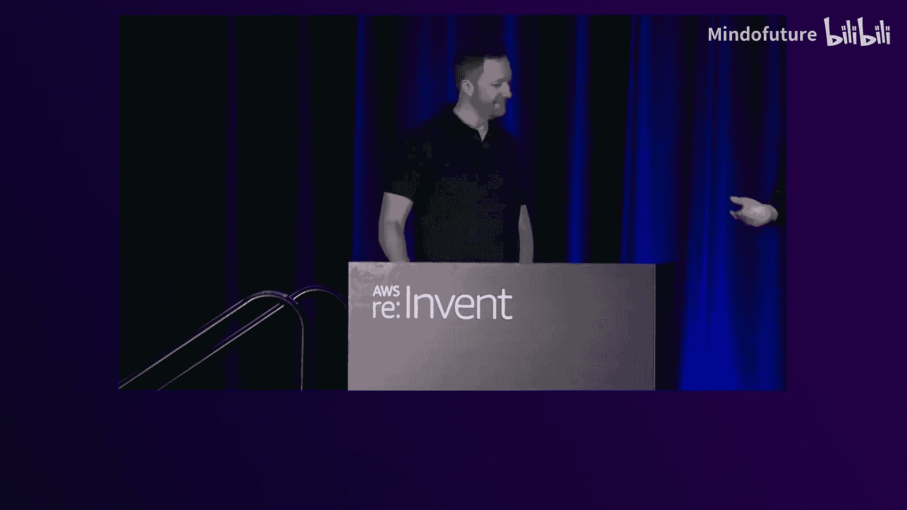

And that's what we look like。11 and a half years。 Yeah。

 I started to this premium support and then about 10 years ago。

 actually over 10 years ago came a Dynamo DB SE， which is an accreditation side of AWS。

 and then I've been a Dynamo D solutions architect for eight and half。

 so the longest tenure in Dynamo DBSA。Everywhere worldwide we go to him when we're stuck Yeah the book stops with Sean basically。

 we're here today to talk about core data modeling concepts with dynamodDB and to level set。

 I'd kind of like to know how many of you have done data modeling with dynamodDB already。

Wow that's amazing's about half right， so hopefully we'll still give you some good stuff。

 we're going to show you some of the more advanced techniques to help you scale when you really want to handle you know many thousands of requests per second。

 We're going to start with an analogy。And the hardest part of a talk like this is how do you get set up where someone who's new to Dynamo is going to not get lost as we get deep while someone who's familiar with Dynamo isn't going to think the first 15 minutes are boring。

 so here's my attempt， I'm going to try to explain how dynamoDB data modeling works like phone books。

Okay， a library full of phone books。I remember phone books。Keep mymic on。😀は。😊，Thanks。

 I remember phone books。 So here's the next question。 how many people remember what phone books are？

Awesome， represent。Back in the day before your phone had every number you'd need to contact。

 you'd pick up a book and it would have the city name on the side and inside would be sorted by last name typically the people that you might want to call and so I'd go to San Jose and I'd find Jason but it wouldn't find Jason I'd find Hunter his last name and then there's the phone number right so it would kind of look like this and I should credit by the way Alex Debri who made out there Alex does a lot with D Moon that it reminded him of a phone book。

And I wanted to take that analog。Am I losing sound， yeah， it's dropping out？I'm looking at you， man。

 am I good？All right， so in the phone book， there were the white pages up in front and that was the outside of the book was the city。

 so here we have Las Vegas， we're calling that the partition key in Dineyn Moodybe for those of you who've done Dynmon Moybee。

And then we have a sort key， which is going to be the name。 It can be sorted by whatever。

 But typically phonebooks did it by last name。 So we see Hunter comema Jason， JW。 Mi。

 Trevor come Sha and the Venetian。 and after that's the stuff you want， the payload。

 the phone number， the zip code， the entity type， whatever it is。 So if you remember， flip it open。

 So if you have something like this。 And this is a lot like how dynamo stores data。

 because it's very fast to find things But what can you do and what can't you do。

If you know the city， if you know the last name and the first name。

 you can find that person really quickly， you crack it open， you can find it right there。

 It's kind of like a binary search very fast。I can find all hunters。All shris。

 I could find all last name starts with H or HU， could I find all Jasons？No。

because it's not sorted by that， well， I can， but I'd have to look through the whole book。

 if you think about the physical book， you have to look through the whole thing。

Could I find by zip code， no， could I find whose phone number this is no， there's things you can do。

 things you can't do with this partition piece or key combination。Great。

 real white pages had this concern so they added yellow pages。

 you remember the back of the book was yellow， that was the commercial index and instead of by name it would be by type like a plumber。

Handyman， things like that。And so in the same book。

 the same partition key organization of Vegas here。

 you'd have an entity type of a casino and you'd have all the casinos or a hotel and you'd have all the hotels and then from there you can see like oh I like that casino。

 maybe I'll book my room there。And it's called a local secondary index because it's in the same buck。

 basically， and that's a lot how dynna wouldDB local secondary indexes work。

 it's the same partition key， but a different sort key， but kept together。There is。

 whatqueries can we do， can't we do， come of covered it。

And then there's another thing in Dynamo that has an analogy to phonebooks。

 which is a global secondary index under this， instead of the spine being the city and you look up Bila。

 I know what city the person is in， maybe you know something else， maybe you know the zip code。

And so here we have for this one zip code， not all the entries are in it。

 but I have a GSI partition key by zip code and a GSI sort key by name in this case。

 So now what can I do， what can't I do。If I know the zip code of the person。

 but not the city because sometimes zips and cities don't match exactly。

 I can find you knowing your zip code and it's in a different book though。

Right because the spine is different on this phone book in one it's the city and insides everything about that city on this one it's by zip code and so same idea with global secondary indexes in Dun Moy B。

 it's kind of a separate storage place， separate place where that data is held。Okay， so that's。

A good way to understand how dynamo works for retrievals， Partition keyword key。

 L S I G S I kind of stuff。 What about updates when it's time to change one of these entries。

You do those in the base table， you want it in the LSI， you want it in the GSI， but for simplicity。

 it's nicest if you just update it in one place， just update it in the base table and let the propagation happen to the other two。

Since you're kind of an expert crowd， you know that the LSI propagates immediately， right。

 it's one of its advantages because it's in the same book。The GSI propagates eventually quickly。

 but eventually， because it's in a different book， right。

 So LS I saying GSI separate and you update as the arrow shows it propagates with a little stream。

 typically you know a millisecond is kind of the typical， but for various reasons it could be longer。

All right， now that's how books work。 Let's think about how we store the books。

This picture that we're in the library， and we're going to go to the library to look up all of these phone books。

If I put all my books in one library， I have an issue。Audio is really questionable， isn't it？

If you have anything you can do about audio， let me know， I'm happy to hold something or whatnot。

But if there's a fire we're going to lose all our phone numbers。

 we don't want that if there's road construction， maybe we won't lose it。

 but we won't be able to go and access it so what we should do probably is we should keep multiple copies let's have three libraries。

Different zones of availability， one might call them。Across three physically separated libraries。

 All right， So now we're going to have three libraries。

 and I can go to any one of them to access my phone numbers。We're going to have to do an update。

 we have three copies， how do we handle that， we'll elect a leader copy of each book。

 we won't do a leader library because then all the rights would have to go to one library。

 we'll just do each book will choose elect its own leader across the libraries。

 it's for that book need to go to that location。Okay， now we need to actually put。

Books on shelves in a physical world， right， when Dynamo does this kind of lookup。

 there has to be a physicality on the back end。 So we're going to call these things shelves。

 or one might call them partitions。And in a library， we're going to have different organizations。

 so like the West W will be all the city organization and the east W will be by zip code。

Because remember， those are different books， and so we're going to have over here is one kind。

 over here is another kind。Each shelf is only going to be so big。

 So we're going to have to pick some number of shelves to start with。

And we'll start by default with four， let's say， which if you created an nondemand table and Dynamo is the default you're going to get as well。

 And we say four。 and in addition， there are four shelves on this bookshe。

 So keep an eye on them as they change and split。 This wast adobe illllustrator graphic。

 and I'm very proud of it。 time goes on。 It'll split and you'll see some changes。

 youve seen Sean's Adobe illustrator。All right， and I think this part's really interesting。

 how would I place the books onto these shelves because I have these cities and I have to make it easy to find them and I think the natural thing you're going to do is alphabetically right。

 that San Jose should be under the S area and Santa Clara should be under the S area and San Francisco should be under the S area and San Mao should be under the I think I figured out our problem。

It's not。 this is the lumpy organization。 If we do it alphabetically。 What else could we do。

 We would like it to be smooth， no matter what the partition key topology is。嗯。

If you can still hear me with this sound。What you do is you hash the names。

And you store based on the hash。 And because any variance in the input dramatically changes the output。

 you're going to get very nice even distribution on the hashes。 And so now with four shelves。

 you're going to have very close to even distribution across the floor。

 Even if your partition keys are very similar。 And you know， we'll have the librarian do that for us。

 And that's why we will call the city， the partition key or the hash key。Depending on where you look。

 right in the UI， it's a partition key and cloudform， it's a hash key。Now， each shelf is only so big。

So at some point， the shelf is going to get full。 If we keep adding more people， adding more cities。

 what do we do。The easiest thing to do is just split somewhere nice Adobe Illustrator expansion Yes very good And so you'll pick a point generally in the middle if it's expanding because of a size limit where it says I need more room and you just think of a physical library I'm just gonna to move my books to two shelves splitting at the midpoint and now I've got plenty of room to grow and notice how the ranges have adjusted the key space of Dynamo has done this and so this is what Dynamo does when a partition gets real big。

Oh， what if a city or like a zip code gets bigger than a shelf？Well， you know。

 New York and whatnot are very big cities， they did this already。

 they just make multiple books for that city， alphabetically by the sort key by the last name。

 and so you do the same thing you can split across the shelves the same city but in just different books。

And it will pick a sort key that's a good split point for you。And in fact。

 if we think about the physical world， each shelf only has so many so much space for patrons to visit if people are coming to read or write to that shelf at some point。

 it'll get a little bit heated and maybe too much traffic。 So what do we do？

We call Sean and say could you make the illustrator graphic expand again， yes， yes he can。

 and we split across shelves again， in this case not splitting because of size。

 but splitting because of the throughput that each shelf can support and you want more throughput and this expands it greatly。

And you can split down to an individual item。One phone book that is just this name。

Is how small dynamo can split things out So you can get the maximum per partition。

 read and write capacity to an individual item if you need to。 It will split like that for you。

 This actually makes， by the way， performance testing dynamo a bit tricky。

Because what you try the first minute is not the performance you're going to get after 10 minutes because it's going to expand It's kind of like testing how strong your bicep is by everyday testing。

 And you're like， my results are terrible。 I the number keeps going up。Exactly。

 you keep working it out， so if you work out your database， your database gets bigger， stronger。

 better。😊，So in review。Think of those shelves like the Dun Moybe Partitions replicated across three availability zones and every table when you're designing gets a partition key and an optional sort key。

 the sort key is not required， you could just have it be like the city is this number。

 but in our phonebook analogy we're using a sort key and you have an LSI which is kind of like the yellow pages and a GSI which is like a whole other wing of the library with a different lookup key and the rights always go to the base table and they propagate to the indexes。

Tables start with the number of partitions needed for your needs if you're in provision mode and you say you want 10000 rights we'll give you at least 10 partitions because that's what's needed to support that level of right nowadays we actually announced warm throughput if you know about that this is really cool stuff you can direct non-demand table to say how big you need it to be the readwr rate you want when you create it and so it'll be born with extra capacity based on your needs and that's kind of like saying how many shelves you want in your library。

And partitions have a desired size。 they don't like to get too big。

 They want to be small enough to be able to move between nodes without you ever noticing should we want so you know try to keep it around the 10 gig and not get much bigger than that and there is a limit 3000 read units 1000 right units on a partition is the limit today and so with reads。

 each read unit is 4KB eventually consistent is half that so you could do 60004KB eventually consistent reads to a shelf and 1000 rights。

 each write is a 1 KB chunk so you could do 10001kB updates to your phonebook。

And partitions do split when needed for either the size or the throughput needs。

 And so think about the partition key because a lot of what Sean's going to do next is about partition keys。

Right's amazing yep， he's not just an illustrator guy。

 So the partition key helps you assign to a partition。

 but it's not a singular assignment right that same Pk might be split across different places like where New York is on different shelves and also several partition keys will naturally coexist on the same partition。

 That's how these shelf start where you know a shelf is pretty long and has a lot of cities on it。😊。

Okay， and so that is hopefully for those of you who've done a lot of dynamodD B stuff， that was fun。

 And if not， hopefully now you're up to speed and ready for Sean's core data modeling concepts。Yeah。

 exciting。Hi everyone， I re introduceduce myself， I don't think you know my name by this point。

 so I've been a Dymo essayA for a long time， I'm based in Dallas and I'm super excited to come and talk about the core data modeling concepts for DynamoDB。

Okay， so I have the bulk of this presentation， I'm kind of excited。

 but Jason you can interrupt at any time whenever you like。

 and then hopefully we have some time for questions at the end from everyone out there and we'll probably have to take them though from the base of the stage before they kick us out。

So talking about PKs and SKs， it's well known that PK is partition key at this point of the presentation and SK are sort keys。

I want to clarify though if you make a table with a partition key and a sort key。

 you need to always include a sort key on the item and when you put those two together。

 a given PK and SK， those are the row selectors， uniquely identify the row so if you're brand new to Dynamo。

 never looked at dynamo D table in the eye， you need to know those two things。

 put them together and then you uniquely identify the row in Dynamo DB。

So in crafting this presentation， we had this idea that we would tell you about PKs and SKs。

 what are some good values for them and my approach was to be very literal its just like， hey。

 here's all the options like pKs limited to 2048 bytes So keys to 1024 bytes but Jason kind of crowded me back and pointed to well we should probably be given some opinions some more prescriptive guidance and so we're going to talk about some facts about partition keys based on some of these boundaries and sort keys as well so traditionally when we model data in dynamo Db。

 we're going to go with a string data type for our partition keys and sort keys This is what we're going to recommend because with those you include entity information which is things like the noun and it could be a person a group a role you can include those in the prefix of the key So we're going recommend that you go with that Also when you're choosing the values for your pKs and SKs。

 you could go with the UD， but it would be much better。

If you could have something like a unique identifier associated with a label。

 So we like decorated names like Cu I D， which tells you that in this case，1，2，3 is a customer I D。

 When you're looking in the management console， you want to know exactly what you're seeing。

When you're coming up with the names of these attributes。

 this is called the key schema and dynamo Db。 We're going to recommend that you go with PK and SK and that will lock it in across the whole table。

 And that's one of the things that you can't change after the table is made。

 Those are the attribute names that define the primary keys if your dynamo table。

 It also is gonna allow you to save on bytes， which is part of this presentation where we're gonna cover how to get the most out of every right unit maker items as small as possible by having short attribute names。

And as I mentioned， you know， you can't change these if you wanted to。

 this often require an export to the Dyna Mo DV table and a reimport。

 It's important to get those names right at the front。All right。

 let's talk about some sample different partition keys we're introducing terminology that you can use and hopefully kind of take back in conversations when get back into the office First we're going to talk about the primary key。

 the partition key that's more descriptive and so the entity type is labeled point to prefix the PK with that type and then we're going to know that like 89109 is a zip code and not something like the door code to the back of the MGM grand and this is the most traditional way。

 by the way that we construct our PKs。You can also include shards at the end of your PKs and so a common design pattern is what we just call right sharding can happen on the key for your base table or for your global secondary index we're going to do this by suffixing the key with a number from a set range and then we're going to choose that on right So we're going to say it's going to be01 or two we can do that randomly choosing a number between 0 and n or we could go with a calculated suffix to learn more about that。

 check out our documentation which talks about calculated suffixes and how to choose a good key。So。

We could also go with a multivalue key， so PKs can often be used to build collections。

 so we're collecting related data together and storing it。 In this case。

 we can store information about the MGM grand properties under this zip code。

And note that if we want to update property in dynamo， we're going to need to know the full PK value。

 So we're going need to know that a property is owned by MGM and in 8，9109。

 if we want to update that row， because in dynamo we require it in the quality statement on the partition key whenever you're  querying it。

 and of course， when you're updating it， you need to know what the PK value is。

Now let's talk about SOA keys and what those can look like once you identify your PK。

 you get to this point and items under a PK will need a unique SAR key or SK to identify them when I make sure that's emphasized。

So often in our S keys we include the type information and we call them sort because data is sorted by disk and Dynamo DB if you look at the API it's called actually a range key and I think sort key is probably a better name for it and when you include the type SK we can include the attribute type as a prefix and then this lets us do a query saying give me where the partition key is equal to like zip 89109 and this sort key SK begins with name HUN and I'll find probably Jason Hunter's information。

Unless you've。

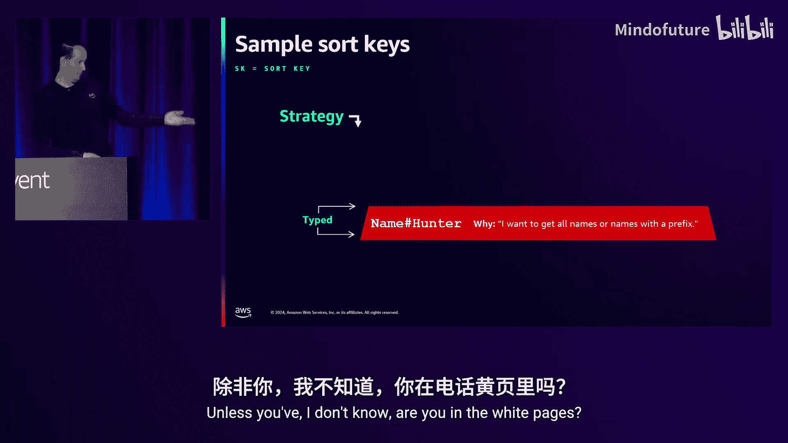

I don't know if you are you in the white pages I don't know I I haven't looked in2 years yeah it's been a lot of if you have different sort keys with name but some other attributes too then you can pull all the names in the zip code but all something else in that zip code and heaven them colive together under the same partition keys so you're kind of pregrouping them these are my names and these are my something else yeah you're creating a collection of information and it doesn't all have to be people it could be businesses。

 it could be properties。

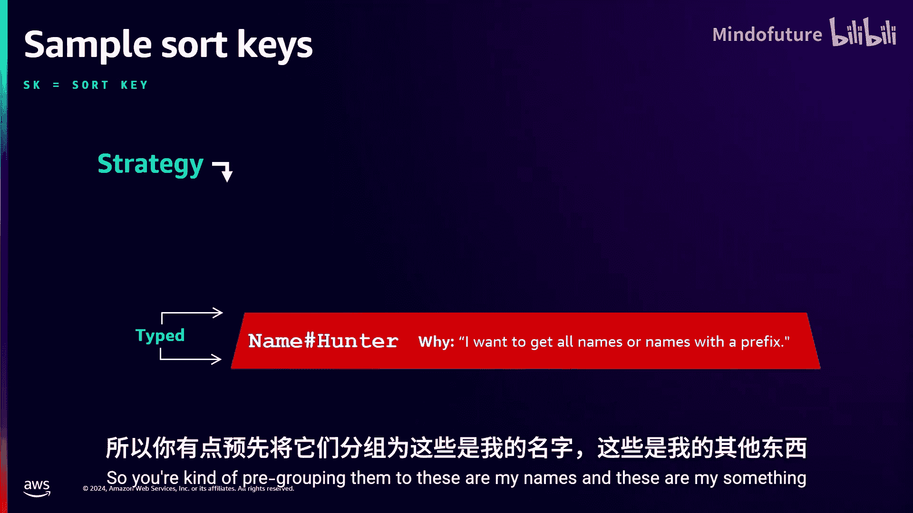

So keys， most common sort key value that I personally see is something like a timestamp。

 so it could be like this， which is the epoC value and the number second since Jan 1 1970。

 and that would be a timestamp。 and this is great for sorting data by disk so I can say give me data between two weeks ago and one week ago and Dynamo can retrieve that out of a partition from the service。

Another way that you can construct your short keys is you can create them hierarchically。

 and so often we need to sort this related data together and we have something that we know which is like a geography。

 So there's you know United States， then there's a state and then there's a metro area。

 and so you can write the， let's say inventory information under a key like this under Las Vegas Nevada。

And then you can store the same data as well under a less specific key such as USA Nevada。

 creating an aggregation on the state level， the hard part though。

 is maintaining those and keeping those up to date and making sure that the data is copied over。

So this is like three values in one， because I can say give me everything from the USA。

 everything from Nevada， everything from Las Vegas， all out of the same sorty，Yep。Okay。

 now let's step through a NosQL data model。 hopefully this was clear。

 this is kind of what we're building to is the core part of this presentation。

 We're going to employ everyone in this room。 You're hopefully be able to put yourselves in the shoes of we'll call it example Corp。

 And so your job is to think about building a database schema for a chat service。

 This could be something like a chat GBT。 So you want to find a data model。

 It has conversations and threads。 Each chat has information like the temperature， the max tokens。

 The model that's being used in the version。 So we want to of course。

 have the promise of the scalability being able to go to any level of throughput as well as the low latency。

 And if you need those two things， dynamod is a service。Here are some of the requirements。

 We want all the data to be stored based on the user so a user can have multiple threads。

 I may start a conversation on my mobile device， put the phone in my pocket。

 open up my laptop and want to view the most recent threads。

 and all these threads will have the metadata like some of the information I mentioned earlier。

 perhaps we want to know you know what the original system prompt was。And because this is AWS。

 we want to make sure we， we scale。 Yeah， we want to plan for scale from the start。

 especially if you're involved in a startup， you know， you want to aim for the top level。 Now。

 that being said， we need to really get this product out the door。

 So we're gonna to start with the most basic design and iterate from there。 And later on。

 we'll counter some problems and then suggest you a couple solutions for those。So initially。

 we want to store data under the user ID。 We're going to make that the PK。

 Now the So key should have a date， and that would be something like year month day。

 which is the ISO 8601 format and it just goes from the least specific to the most specific information。

It's gonna to give us a natural sort key so we can find threads by creation date for every user。Now。

 every thread will also have a unique thread I D because we expect that you'll have multiple chats inside the same day。

Now， to start， we are going to split out the metadata to its own item。

 and that's going to be the system prompt like I mentioned earlier。

 the model type and then settings such as temperature， Max tokens， top K， top P。Now。

 for each message in the thread conversation， we're going to be creating a new row。

 and it's going to have a user's message and a copy of the response。So in review。

 we know it's easy to get the latest threads because they're sorted by that create date。 However。

 if we only know the user， however， if we want to find something by thread I。

 it's actually quite complex because we've embedded it inside there。

 Perhaps you can think how we could query data out and find information by thread Id。

 we might use a global secondary index。So we don't have in the end。

 we don't have a straightforward way to get the data out。 We can get the metadata。

 And we're actually going to talk about maybe some ways that we can get the metadata back in dynamo。

 So let's look at how be modeled in nosl work or dynamo D B。嗯。A little small。

 I'll talk you through it， though。 So here's our PK。 It's gonna to be user with a user number like 1。

2，3，4，5，6。 and the PK is descriptive。 It includes the entity type at the very bottom。

 we can find that metadata row that I was mentioning。

 we break out that data that doesn't change very much。

 but it's just kind of common for the whole conversation。 In fact。

 it does someone element of it does change quite a bit we'll get there。

 And then the other type of data is every time there's a message in that thread in the conversation。

 it appears this a separate item。So one potential weakness is that there's potentially some large form responses that can be made and you can paste in a ton of text and so we need to think about how large and much how large should the atom be in dynamo DV One option is you could compress it so someone has a lot of information coming in you can run it through like G zipip and then store it as a binary data type or potentially you could put that data in S3 and then put an S3 UI in the dynamo DV item right now。

 though we're just getting started with this design。

 we want to make sure we kind of get it out the door。

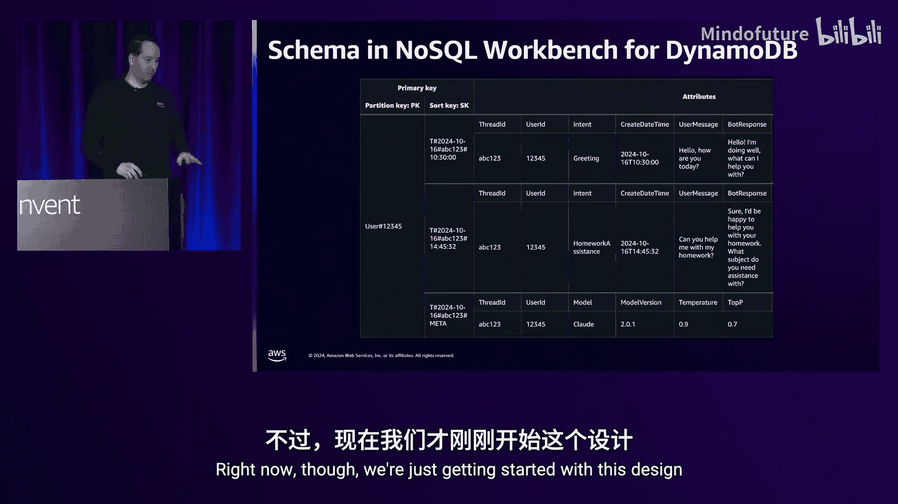

Some interesting things versus like a relational is how we did that user hash。

 that's because later on maybe we want something else in this table where the partition key isn't just a user。

 And so now we can tell that that's a user ID， but also later on if we wanted to put something else in this table we could with a different prefix and it's fairly common to reuse your tables that way and we did a T hash in the sort key because these are our threads。

 but maybe also for this user we're going to want to do something else their address or their preferences and we can put it in the same table under the same partition key why would I ever do that Sean why would I put different things for the same part about you in the same table instead of having n many table。

 Well it's going to lower a roundtri time， if I need to get all information about my user I can do one query without any sort key condition and then it'll get me all the data back another thing is that for access control if I wanted the mobile client for some reason to talk directly to dynamo I could give them access to user 1。

2，3，4，5 and then make it read only and now with their。

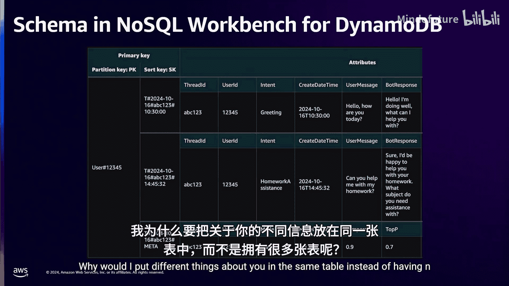

credentials， they can retrieve information directly from the service of dynamo Db and it may not be the primary path。

 but itd be a good backup option to retrieve data。 Yeah so we're doing some designs here that are future proofing us PkSk since we don't know in the future if we're going to keep using user I as the partition key。

 you can call it user ID and a lot of people do But if you call it Pk you've given yourself an out in the future and Sk2 we aren't calling it thread or anything it's like maybe in the future。

 I want it to do something else。

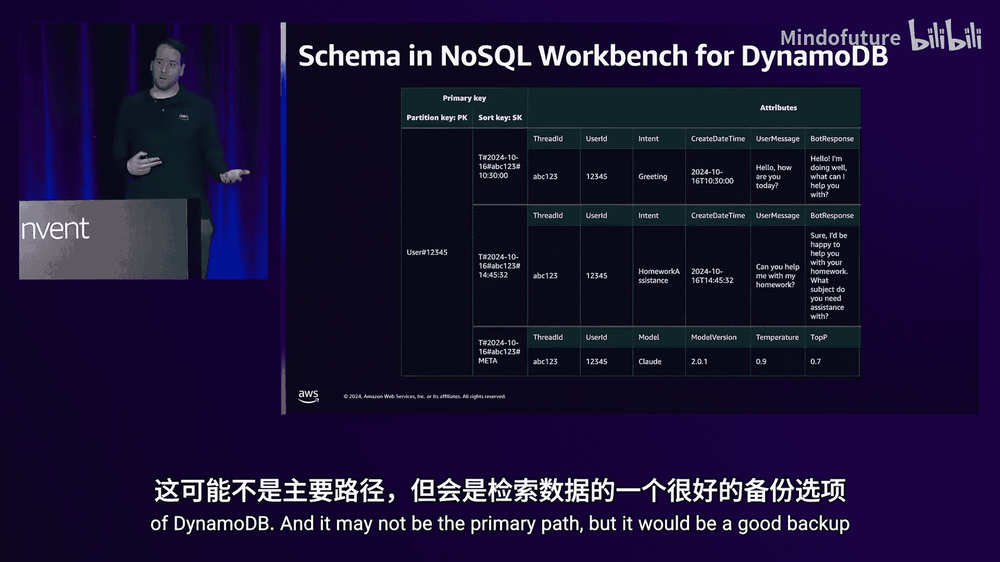

And then after that， you'll also notice that the。Attributes aren't the same across each item。

That's okay， every item is its own schema。So the meta down there has a model while the other ones are intent at that point。

 and that's just fine。

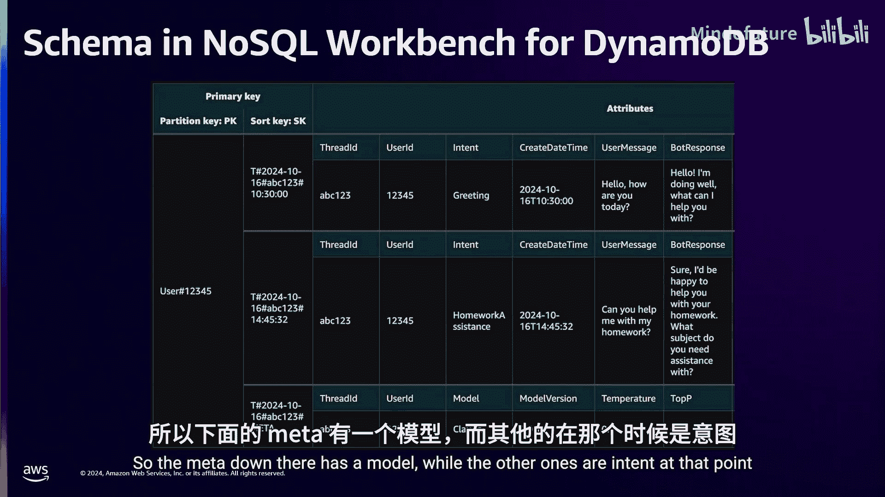

It's not relational anymore。

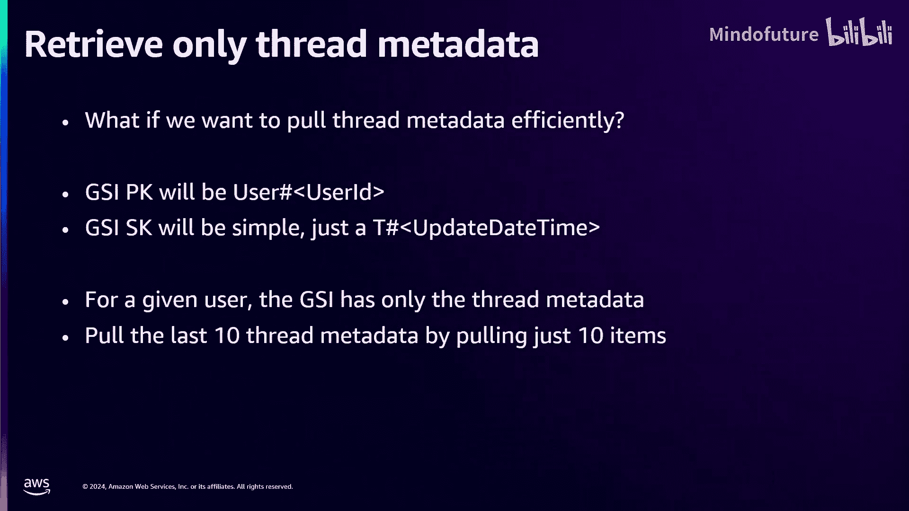

So we have this use case where we want to get just the thread metadata and that's the metadata item。

 And the idea is that whenever we add a new message。

 we're updating a timestamp which would be the update date time The common thing is I need the most recent chats that I have So how can we get that information back well。

 if we index the timestamp under a GSI using the user ideas to purchasing key and the so key would include the timestamp including the T hash。

 the T pound sign which probably say pound sign because we're talking about phone bookss and phone numbers but that's going to distinguish it for any other data for that user that might be in the GSI and then we can say give me these items with a limit of pen。

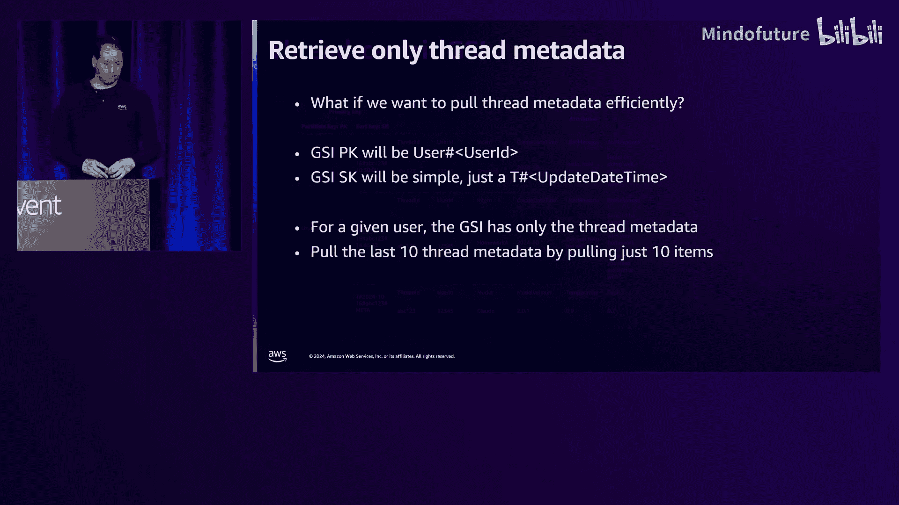

Why did you do a GSI if the partition keys the same？Sorry。

 was question why did you do a GSI if the partition key is the same。

 I thought LsI is were when the partition key was the same。

 the benefits of having a GSi is that youre decoupling the consumption of capacity from the base table。

 So if you have a lot of rights going to a dynamo table where you need an alternate sort key if you go the LSi option。

 you take your maximum throughput you cut in half or potentially even greater because you're having to consume capacity to update the local entry。

 So for example， with a dynamo table on a single partition key。

 you can normally write at 100 rights a second thousand1 kiloby changes。

 you'd be limited to just 500 with an LSi， but then if you are modifying the entry in LSi。

 you'd be limited to 333 repeating units for right because you have to delete the old entry and insert the new one。

 The point being that with LSs， you have these limitations and so we prefer going with GSIs。

 but we understand that there would be a compromise。

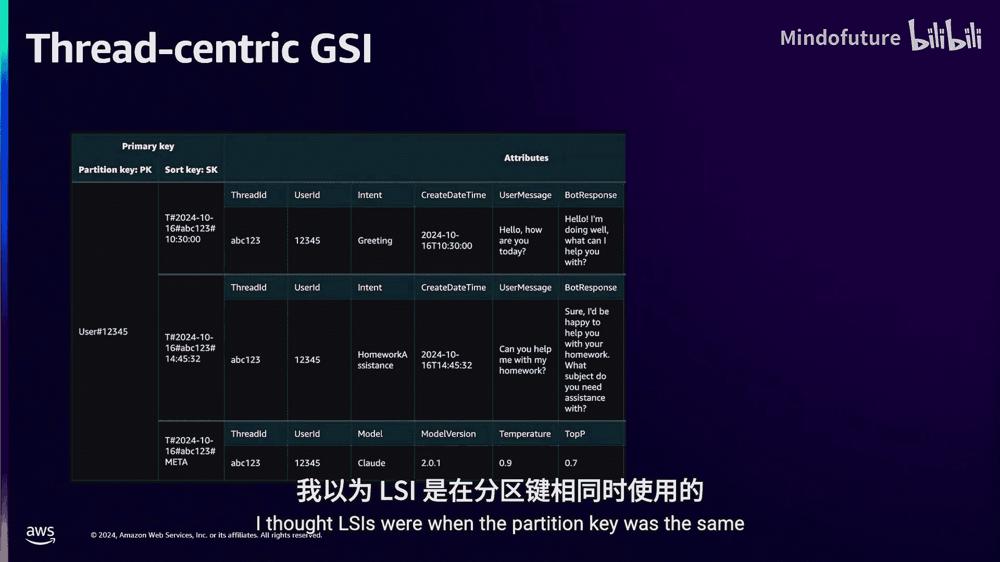

And so if you look at this design， we can come up with this GSI。

 the one thing to note about them though is that they're eventually consistent。

 so there's going to be some delay before the rights eventually make it to the GSI。

 we know that's on the order of milliseconds or tens of milliseconds。

So I like your index name GSI 1 PK GSI1 SK Yep， yeah'm very common in our designs。

 we'll go with GSI1 just because this is the first GSI and then we'll put PK and SK in the name there are certainly cases where you want to make something very custom but generally we want to make a GSI that we can overload which is what this strategy is called index overloading。

So talking about the GSIs， what are some of the other options that we could have gone with and the tradeoffs。

 I think there's a lot of value in thinking about this。

 Why did we go down this route and how else could you have solved this problem to get the most upto- dateate view of a user's threads to figure out where they should pick up Now。

 first of all， you could just say， eventual consistency is good enough for me Because GSs can be tens of milliseconds behind and how often do clients swap devices that I mentioned。

 like I mentioned earlier， going from mobile device to a web client。LSI conversation。

We lost your sound talked about okay， that's weird。 the LSIs we talked about those already。

 They do have their downsides。 And one of the things that was mentioned earlier about LsIs is that there's this kind of's there's a limit two of them and so often customers hear about the 10 gigte partition limit and they think it applies to LSI。

 if I can get in my soapbox for a minute， LSi collection limits are what is limited to 10 gig。

 So if you have the same partition key， but different So key。

 So for example if it was user ID so key was your thread metadata timestamp your create update time or your update time that whole collection for a given user is limited to 10 gigytes。

In addition， LSIs do change a little bit about how the table works underneath the surface。

 and you're welcome to ask about that later if we have some time， but in general。

 we our customers will have to go with GSIs if they've already created their dynamo table。

 you can't add an LSI after it's already launched。Now。

 what surprisingly a lot of customers do when they need to have these kinds of indexes。

 if they don't want to do LSIs or GSIs， they'll actually just do two rights and they'll block until the write completes。

So they'll do like a put item， put item and wait and as soon as they receive the response that the rights were durably written from Dynamo。

 they'll return the operation upstream to say， yes， success， we wrote the data。Now。

 there's an easier way to do that using our transactions API。 and that's a little more interesting。

 So you could use a transact right items call with our transaction right API。

 It's also known as acid transactions。 You can change up to 100 items at a time。

 All the operations will complete or fail and you also have item potency where you provide a client request token to us and they we'll make sure that you cannot repeat that operation within a ten window。

So if you go with the transaction rights you're going to pay twice and that's the downside so instead of paying one right unit it's going to be two once for each phase。

 so it's a little more expensive but you're going to have the read after write consistency and the peace of mind actually I think most of my customers would consider using four option4 a transaction rights and they're not even using the transaction get items call I don't know if you've seen that Jason I mean it's simple because it updates transactionally but you do pay a2 x because it's a transaction versus double rights so three is half the cost of four but four simpler。

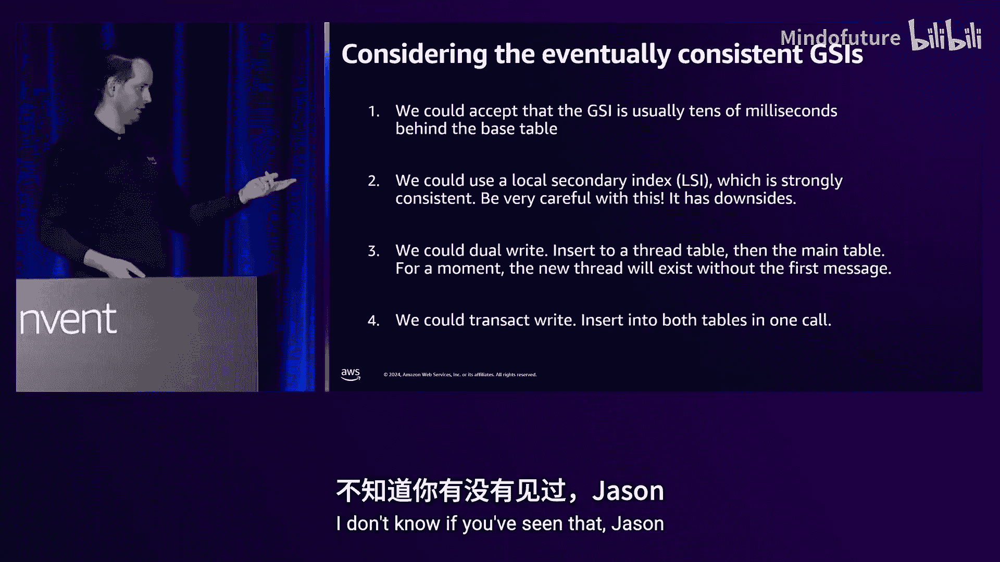

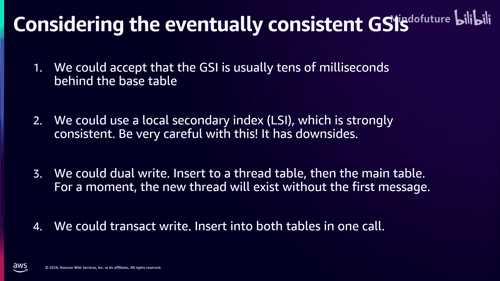

And I think a lot of times customers are calling Dynamo through Lada functions and it's possible that the batch could fail and the Lao would reprocess that and that Lada function would be called again。

 but with the transact APIs with the client request Que token there's eenponency so we'll make sure that the operation only runs one time。

 so really helps a lot with the development effort。Okay。

 so let's say we've thought through what are the tradeoffs。 We've gotten the product out the door。

 but then we start to hit some scaling problems。 Maybe someone starts looking at the bill。

 Maybe we want to make money and we need to turn on metering。

 What are some extra things that you can do to enable these extra things like shrinking our item size。

 getting the most out of every capacity unit and then also doing counting。

 which is can be kind of hard in Dynamo or D， but thankfully there's a blog that we're gonna talk about。

One of the most interesting things is about Dna out。 if you can get the item， let's say 33% smaller。

 you could potentially cut your costs by 33%。 And who wouldn't want to spend less on Dynamo DB。

So when you have data that's infrequently changed， we have situations where customers won't necessarily be aware of this。

 but if you just make a change to an item， you have to pay to rewrite the whole item。

 So if it's like an 8k item you make one byte of change。 It's eight right units to update it。

 I had a retail customer， not Amazon， but they had 80。

000 products in their catalog and each day they have 00800000 or 10 x the number of changes。

 they're mainly changing pricing information So it's interesting So if they were to shrink their item size down from 16 k down to let's say 10 k we have a significant reduction costs just on direct units。

And so what we're going do is look at our metadata attribute。 So if we take our model model version。

 we run it through a compression， we can maybe stimulate， we can try Gzip。

 we can try Lz4 and see what final item size can we get to And so in this example。

 let's say we got to 5。1 kilos。 That's a pretty good size。

 but that's still going to be you know6 wCs， but it's pretty good。 Now note that compression。

 if you make any changes like this， it's all going to be on the client side So you're not necessarily going to find a client from AWS to assist you with this。

 and when you store the data， you're going be putting it in as a binary data type and it's essentially going be a base64 encoded object So take whatever the representation is in your code compress it basic4 it。

 store it in a binary data type in dynamo Db。Furthering this design。

 as we try to cut down on the number of right units， considering what I mentioned earlier。

 how one small change has an impact where you have to rewrite the whole item。Potentially。

 we could split out the static and dynamic data。So we have this thing where every time you put a message in。

 you're updating the date time if you put that into a separate item now you can spend six right units approximately to update the metadata when you need to do it with's infrequent but only one right unit to update the static the dynamic information and with this way you can save quite a lot on right capacity units Yeah the main thing there is people I think think if I change a number then well that's less than 1 kB therefore I pay one right unit but if it's a big item if it's100 kB item and you change a number that's100 right units。

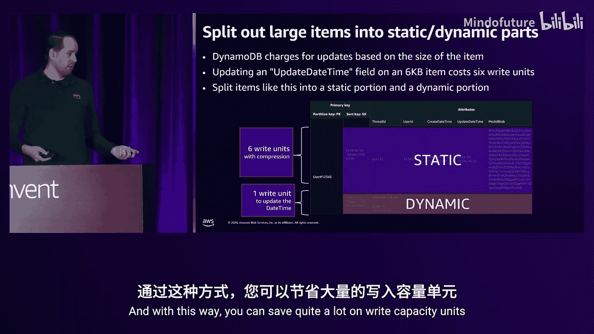

Or deleting an item it's the size of the before size if you update it's the bigger of the before after and so let's not do that let's move that dynamic thing that we change a lot out。

 only pay one right unit for it instead of many right units and that alone saves people really heavily。

 this has become a cost optimization talk but data modeling is about advanced cost optimization I think。

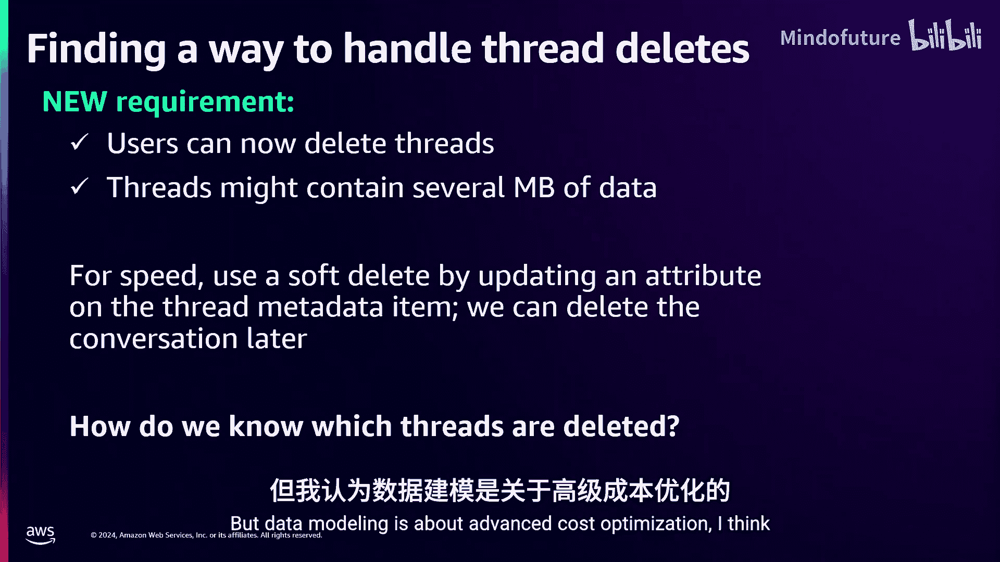

So there's a lot of laws that say people have the right to be forgotten。

 and I know that when I delete a thread， I want the peace of mind that it's deleted。 And so often。

 if I have an account that's been around for years， there will be megabytes。

 tens of megabytes of data in a database。 However， I want the certainty that I can do one right。

 make one change， one API call and ensure that my data will eventually be deleted。

 And so we have this new requirement that we users need to be able to delete their threads。

 but this might be extended amount of information， especially as time goes on。

So one way that we could go about this is using a soft delete。 And so instead of deleting the item。

 we just set an attribute and that could be on a thread or it could be on a user。

 Now this becomes a bit of a problem。 we need to find this needle in the haystack。

 So we have the design that we mentioned earlier and showed you。

 and now we need to find a single attributes that's been set and of course I want to have some ability to scale the system。

 how can we extract a view of that and the answer would be a global secondary index。

 This is the sweeper thread that runs periodically to find deleted threads and get rid of them for real So you don't want to scan the whole table to do that。

So you can create this GSI， we can have it scan the Dynamo table or we could have a query it。

 and I think query is much more efficient with the GSI。

 especially because we're probably going to use an overloaded index。GSI2。

 we're making this and it's the status of deleted。So on an item you would market S hash deleted on a GSI2PK to market as self deleted that'll make it pop up in the sparse GSI so I can immediately know all the deleted thread I'd use to go to really delete them。

 it's like raising a flag or like a sentinel value it shows up it appears over to this index and then now you know that it needs to be deleted。

But there's a scalability problem。May know， okay， okay， still can me。

What if I need to delete many per second， John， thank you for covering。 it's a great question。

 I think what we could do is do right sharding。 So if youre if you do right sharding。

 you're choosing a value from a set range， your're suffixing it to your partition key。

 And in this case， we get to do thread state and we could market is deleted and then include0，1 and2。

 And so what we're trying to overcome is that GSIs when you choose those primary keys。

 they are effectively underneath the dynamo Dv tables underneath the surface。😊。

So you see an index name but we see a table ID we see partitions and you don't see those you don't know about those there's Cloudwach metrics for GSIs so picking a highly unique key is very important so if you win with the last design you'd have potentially you know millions of rows that could be updated and marked as deleted and then they would all funnel down to the one partition on a GSI of deleted and with this case if we go with the shards now we can have in this case10 different shards and so instead of creating this funnel down to one area we spread out the rights and overcome some potential bottlenecks that we could have so like in the phone books if you want to track dead people you would have the book of the dead but if you only have the partition key which was like the book and the dead you could only have1 thousand deaths per second。

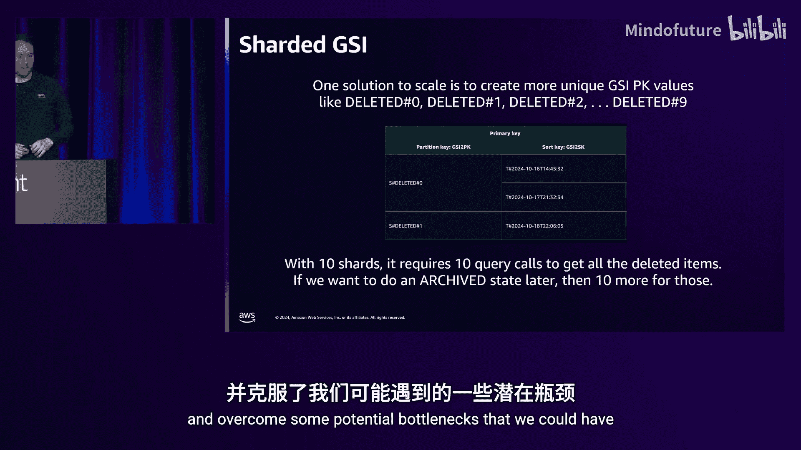

Yeah， and if you wanted 10000 per second。 Yeah， then you would have 10。 Yeah， Yeah， exactly。

s like like move on。 All right， okay， what are some other ways that we can go about this。

 A lot of times when we create design think， okay， our only desired state is deleted。

 But maybe we want to archive them。 We want to go to a softer version of it。

 even softer version of a delete。😊。

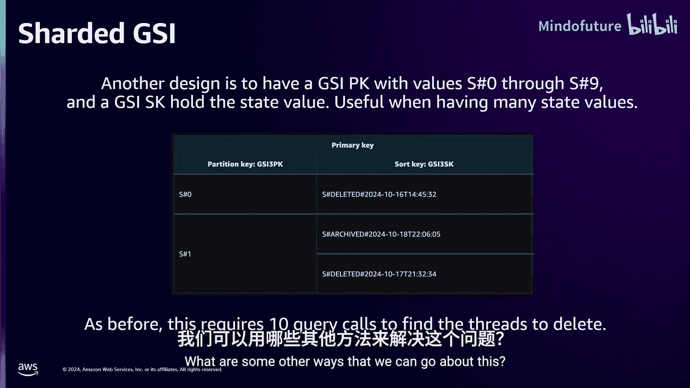

And so we really like giving you options。 So here is another way that you can construct this。

 And so we're not saying prescriptively， this is how you should design them to service put。

 We're giving you options。 So here， what you could do is you could go with instead of putting a thread state in the P K of the GS I。

 You could put it in the S K。 And so now you just have 0， S 1， you pick those values。😊。

Now now is a great time to actually talk about calculated suffixes。

 which is a bit of a weird problem to talk about， I guess if I don't have like a little graph showing you how it works。

 But the idea with calculated suffixes is that we're not going randomly pick between a set range because a lot of times they think when people hear random。

 they just think， oh， every time I update item on the base table。

 I'm gonna pick a new value for for the GSI shard key。

 But the that's not the case of calculated suffixes。

 the way you do those is you take something you know。

 such as a user I and then you come up the hashing function， hashing function that you make。

 which is in documentation。 weve explained how to do it。

 it's always going have the same deterministic output。 So for user ID1。

 they're probably always going be on S0， for example， and the user I2 user I2 could be on S1。

And so I just wanted to suspect concerns that as you modify your items on the base table that you're going to be you know spaming your items across the different partitions on the GSI。

 you can have a set shard number based on what you know and that's called a calculated suffix so check out our documentation for that this is still a 300 level presentation you're doing that to avoid rent amplification。

That's what we're we're trying to avoid the right amplification issue where if you update an item on the base table and then you change the GSI shard and you change it with each right。

 you'd be deleting an old entry and inserting a new one on the GSI so we want that shard value that we choose for the GSI to be the same for each DmodDB item right when you update it。

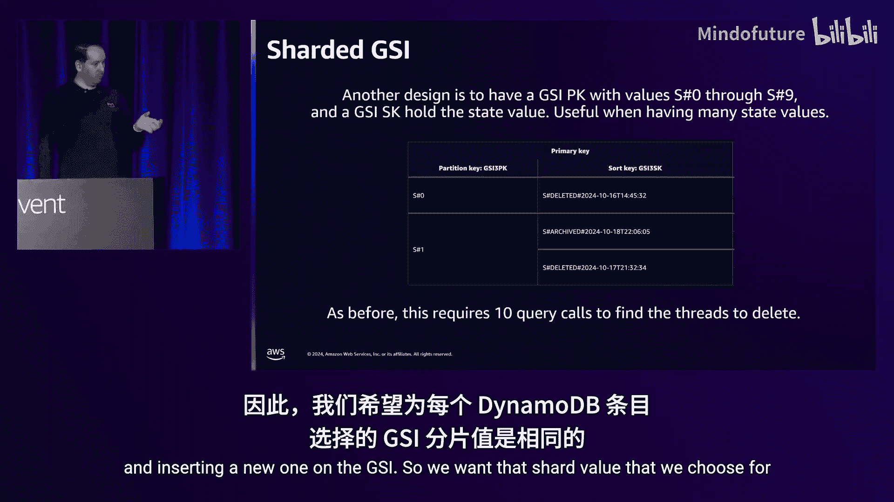

Change it the GSI sees it as the delete in an insert which is two rights， that's the amplification。

 and so if you can keep the GSI3 PK the same， then you write the same item and you don't amplify it that was 400 level。

Yeah。

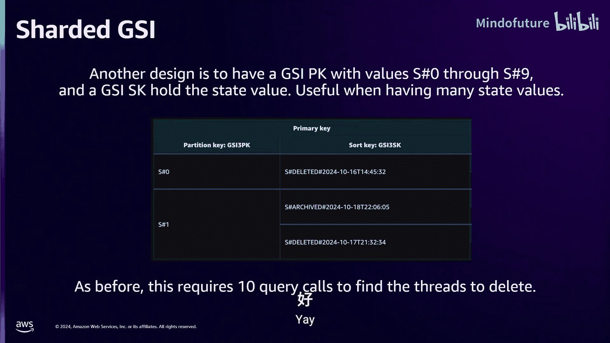

Wways wanted to for little talk okay and then just to be clear in order to figure out all of these things。

 all these items that need to be deleted all these threads。

 you're going to do a query10 different query calls in fact in parallel whichever is slowest iss going to slow down the whole operation when you fill up a query response maybe at that point you're like oh I need more shards then you just increase the maximum value so0 to 9 it's0 to20 whatever you need have a blog on that how to choose the right number of shards for your dynamo d table you see the sharding a lot because it does done what does a lot out of the box。

10 write is quite a lot。 but if you're saying but I want to be able to have a Gsi that watches for a certain flag in this case delete it or archived or anything and that one's going to be more than 1000 a second what do I do well just have more than one partition key so we'll have n many and you can read as blog and pick n but make n big enough and if you want to do 100000 a second a problem you have 100 shs at the expense that one。

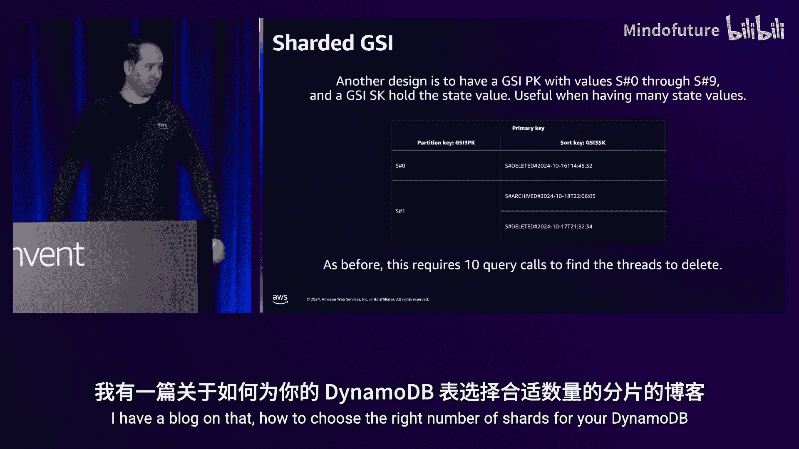

It's time to read， you do have to look in 100 places， but for this use case， you know， I'll read one。

 delete， I'll read next one， delete。 It's a background worker。 It works great。

 and there's really not a limit in how big you can go if you。

Picked like a relational database with an index， that'll just become a bottleneck without the ability to do a shard oftentimes。

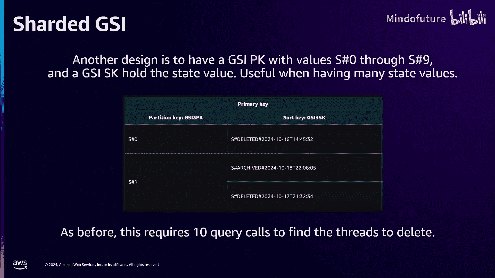

So what's a really hard problem with any database， I would argue it's counting and counting accurately。

 So I'm gonna show you neat to do counting and then to also make sure that you're deduplicating those counts as you go on to make sure you're not double counting anyways。

 I think it's kind of a novel way to do it in a dynamo Db table not a lot of people know about a slap with Jason and preparation for this and it sounded like it was a new idea to use so hopefully it's new to everyone here in the audience So here's the requirement we need to build able to count usage because it's time to make money So how can we be sure that we're billing for every interaction so we can track it in the metadata item。

 but I'd rather do it asynchronously hooking into the dynamo Db stream dymoD streams is our change to capture service which provides changes of your dynamo Db table for up to 24 hours。

Now， we want to try to do this counting pretty quick because perhaps we want to use the same data to prevent abuse because sometimes people will send like tens or hundreds of operations in a second to try to get past some of these filters so as fast as we can get this through。

 that would be best。 but perhaps if you have that requirement。

 you want to consider some kind of upstream TPS limits find another way to kind of rate limit whoever's calling your API so that it's not all dependent on the database。

So here's how it would look， we'd have a change。 I'd insert a message to thread。

 and I need to make sure that let's say I can only make you know 5000 of these on my let's say a corporate account in in a day and so whenever you make a change on Ddb table it's not when you do a put its when you do delete but when you actually modify the data。

 the operation has an effect such as changing a timestamp it gets put in the Dodedb stream then you can attach a Lada function to that if you don't know lambmbda has filters。

 which are great。 you say only invoke my lambda function。

 if we use this model So if you see like claw in the sort key it can make it appear and then go invoke the lambmbda function which is what I'm trying to say and so you can just do kind of account。

 and so if you do an increment atomic operation you can have a rough way to track operations but it kind of has limitations So let's talk about how。

We can have better accuracy。So in Dynamo on the API， and when you're doing these right operations。

 you can consider including method。ssage ID in a string set， so Dyno has this idea of string sets。

 it's a data type and it's a set of strings and you can only have one unique value for any given string in the string set and so if you do a right operation you can say conditionally add this string to the message ID string set so long as it does not contain the string set。

And so for small counting， if you're trying to， you know。

 make sure that you only process the message you know， hundreds， potentially thousands of times。

 especially if your message Is are very short， you can ensure that you're shrinking it down And you want to keep items as small as you as small as you can。

 really at the end of the day。 as you add message Is to this design and you start。

Apppending them to the string set the item will get large but we want to try to avoid that so this is a unique kind of novel idea and so you use the conditional update to add it。

 that's the key word to the string set and with a condition that it does it not contain is not contained in the string set anyway I thought that was pretty interesting and then we also have this blog written by Jason A。

co forward slash timemobecounts the challenge with with counting and dynamo is it doesn't want to do a big count for you it wants to be fast and so the idea is precount。

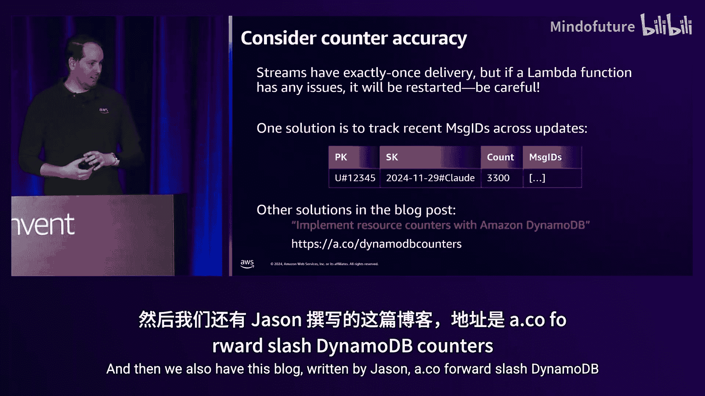

RightKeep count then it's how many times did this happen you just go ask。

 but that means we have to keep that counter， which means we have to watch the mutations have triggers fire and keep account updated。

 which works pretty well until you realize that lambmbdas going be invoked again if for any reason the lambmbda crashes and that's where this gets in where he's keeping track of what's recently happened with that message ID so that if you have the lambda double invote。

 you're not going to double count。It depends on how accurate your counters have to be。

 but this blog was， I think an exploration of seven ways to maintain accurate counters when you need increasing accuracy。

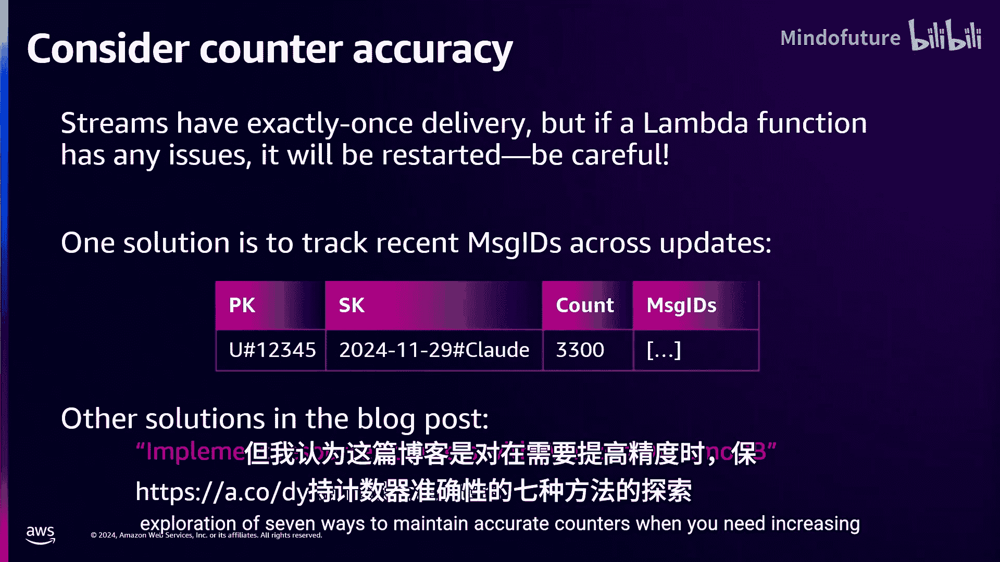

There's other ways you could do this。 You could use elasticache。

 you could pick your engine like you could use elastic cash Bke and you could track it in memory。

 It's one way to do it。 And so， yeah， I'm just showing you how you might do it in Dynamo because we're dynamo solutions architects。

 So we tend to be a little biased towards that database， so。

But we're gonna show you that we do think about other services here at AWS and we like to include them and we're going to talk about a new search requirement so one thing that Jason and I discovered we were talking about how a lot of client side searches work like let's say I'm trying to find you know where I mentioned what's something that's not Lambda or Dno pick an service reinvent okay sure I want to you know get help search that chat I had about my reinvent talk and how to get five stars on your rating and so but I'm like oh I forgot what it was and so a lot of these search is that what they do is their client side they're not going out to like elasticastic search or open search instead they're pointing down the metadata and then you're searching locally and this comes up a lot where customers have the need to search with alternate patterns and so with Dynna you could always add a global second index but one thing that you could do or try is integrating with open search。

So if Dynamo Db has the zero retail integration with the open search service。

 So if I needed to search for all the chats that I've had， I can put them into an index。

 Now I'm not an open search expert， but I do know that this data this gets your data from your dynamo Db table into Amazon Open search service uses a plug for the open search ingestion service。

 you can do many dynamo tables to many indexes， you can do just one to one。

 you can do one dynamo Db table to many indexes， the options are limited but very expansive。

 you have full access to data prepper。 So if you know about that you can combine attributes together So or even split them apart。

 So if you're using dynamo dbs single table design strategies and you have two values cancate name together you have the option to modify them with data prepper and then it uses a full export to begin。

 and so this is gonna allow you to hydrate the index。

And it's fully managed for you using the export to S3 service that we already offer。

 And then from there， it uses CDC Dia D streams to queue up the changes and send them over to the index。

 Yeah， we announced this last year。

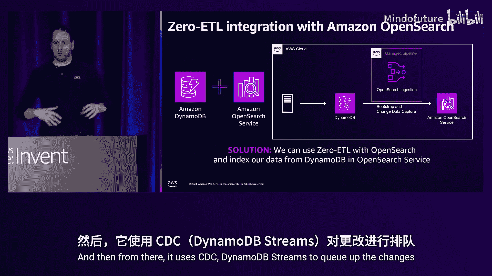

And just it's much simpler to do the integration now because you're not writing the Lambda code that copies it you just push a deploy button。

 you have a YaAmL that defines how you want it to be reshaped。

 and it's very powerful because it uses that data pre。

 and now you can do searches against your dynamo。don't you have a workshop that uses this integration。

 Yes， I should have plugged it。 When is it tomorrow at 1130。 What's the code。

 I don't remember do 48 DAT 408。ep， that's I do remember。 Yeah， it's good。

 it's it's based on our bedrock workshop。 we'll use this。 Yeah。

 we'll hook you and then we have dot 4，2，1， which is our builder sessions and also uses yourL integration。

 So。嗯。Cool， it's my slide again Yeah， it is all right。

 this one is kind of unrelated to data modeling。But I wanted to really spread the word on this because it's a way to save you a lot of money and I want to get you your money's worth from this talk。

 shall we say， and so if you know about Piter， which is point in time recovery for Dynamo。

 the idea is that you turn this on and it keeps a change log of all of your changes and if something goes wrong。

 if you delete an item accidentally overwrite an item accidentally。

 any sort of application level corruption， you can undo the damage because you've got that log and the classic way that you would always do this is you would do a restore before the damage。

And then you'd be able to have a copy of the table before it was you know corrupted。

 And then well you probably had some real good rights and then you'll figure out how to merge the two together to end up with the final version and so is there anything wrong with that。

 I mean， it's purely like cost to export the data as well the amount of data that。

if we're talking to data I have like four hours to get my service back up。

 that's a lot of queries to do to find just the data that changed right， the bigger your table。

 the more the cost because the a store is based per gigabyte。

 So here's what I want to just spread around。 spread this to people because it's a great way to say money。

 We added incremental export not too long ago with this， if you have cutter enabled。

 you can say show me the changes that happened during this time window。

It'll give you the before and the after view of how the item changed during that time window。

 you can go down to 15 minutes as big as a day， and you can therefore if you know that you did damage during a certain time period。

 say not restore the table before paying per gigabyte on the table。

 but you can say show me the changes that happen during the hour of problem paying by the gigabyte of log that gets processed which is tiny。

 tiny tiny so what am I going to save if it's a terabyte。Well。

 a restore recovery at 15 cents per gigabyte is 150， and it might take hours to restore the terabyte。

On an export， it'll be， say a gigabyte of changes and cost you 10 cents。

 is this a replacement for like dynamodb streams where you get a set of every change from the table。

 or is this a replacement for the Knesesis data streams integration with Dynamo where all the changes from your dynamod table go into Ksesis data stream then those can go into S3 do they all produce the same results。

 Basically， yes， So streams will be real time and you can apply it as you go。

 So zero t with open searcharch does that。 But if you wanted to do an equivalent zero t where you didn't mind it being a little bit more chunky then you could just do this in every 15 minutes。

 you get the latest update。 you apply it to the downstream consumer。

 That one's not really much more cost savings， I do kind of like the fact that I don't have to have a live stream all the time I can hit the button every day and do the next daily update。

 But for this use case。

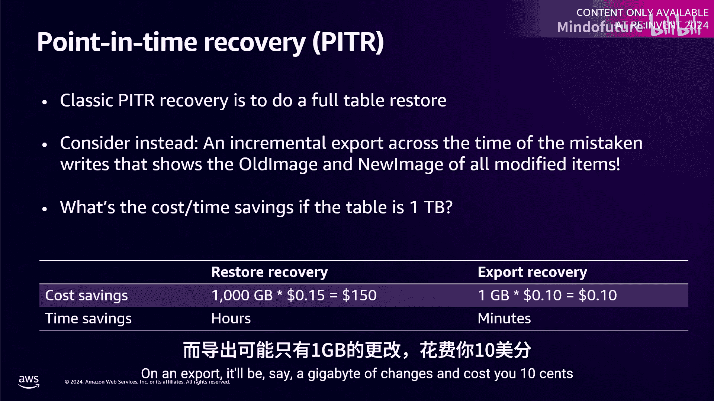

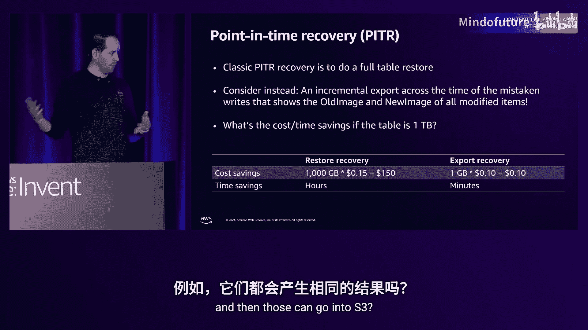

I think it makes Piter way more valuable so if you didn't have Piter。

 maybe consider Piter because there is a per gigabyte monthly cost to Piter， but now the recovery。

 if you had to 10 terabytes， 100 terabytes when your tables get bigger， it's linear with table size。

 now it's no longer linear with table sized under the damage so I just every talk I'm putting this in at the end because it's a great money saver all right we have three minutes for questions。

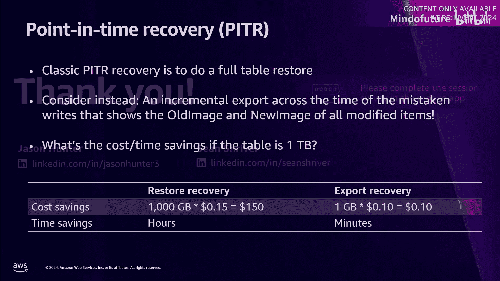

And please do fill out the survey。