# 【AWS数据库峰会2024全集-•-中英】AWS-re：Invent-2024---Databases-p21-P21-Advanced-data-modeling-with-Amazon-DynamoDB-(DAT404)--BV1VAR5Y6Es1_p21-

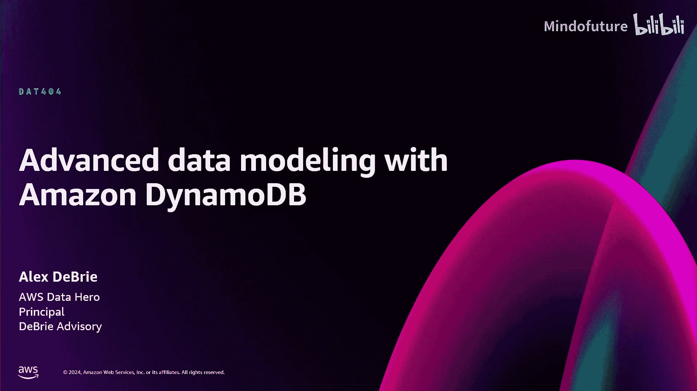

All right， let's get started， hey everyone， thank you for coming grateful to have you here。

 I'm Alex Debrie， I'm going to talk advanced data modeling with DynamodDB and this is actually my sixth year talking at Reinvent about data modeling with DynamoDB。

😊，I'm going to do something a little bit different this year where at past reinventts。

 what I'll do is I'll usually take like one large example and sort of walk through that step by step and say。

 hey， here are the things you need to consider， sort of point out some interesting concepts along the way and just say。

 hey， soup to nutss， how do you sort of attack a data modeling problem？

And the reason I want to do something different is because I've done that for five years so there's a lot of examples on that you can go check that out on YouTube there are also some other really good talks this year。

 including like a data modeling core concepts one that was great on the other day there's some architecture talks so go check out all those on certain things and what I sort of optimize for this year this is the agenda but I optimize for hey things I haven't talked about before So Dynamo DB streams I think is really interesting really useful for a lot of things we're gonna to see how that fits into your application or also like some higher level things that you should be thinking about as you're sort of designing or architecting a service we'll talk about napkin math for that and then also just like some areas I see people like overcomplicating or getting wrong so I want to get back to basics on some of that stuff or just see how to make it Dynamos that's what we're gonna to cover here today。

My name is Alex Debri， I'm an AWS data hero so I don't work for AWS but I just do a lot of work in the AWS community。

 especially around Dynamo and serverless and just AWS more generally。

 I'm the author of the Dnamo DB book which is just a comprehensive guide to data modeling with Dynamo DB if you want to check that out and I'm an independent consultant so if you need help with Dynamo serverless AWS any that Steph hit me up。

So let's start off with some background and I want to start off with a concept I heard about this here。

 it's kind of an older concept but it's this idea of mechanical sympathy and there's this F1 driver named Jackie Stetuwart that's talking about mechanical sympathy and saying。

Hey when you're driving your car to get the most out of it。

 you need to know sort of what's going on you need to know how the tires interact with the road or you need to know what's happening in your engine when you press down on that gas pedal。

And this applies to more than just race cars right in the AWS well architect protected framework。

 they talk about mechanical sympathy and they say，  heHe。

 it's when you use a tour a system with an understanding of how it works best。

And I think that's really important for Dynamo like with Dynamo。

 you need to know some of the practical stuff of like hey。

 how do I do one of many relationships or how do I do filtering or when should I use transactions。

 things like that， but you also need to know a little bit of the conceptual framework。

 some of the architecture around Dynamo DB and just understand the hints that Dynamo is giving you about how to use it well。

So。I want to build some mechanical sympathy to start and I want to talk about some key characteristics of Dynamo of course Dynamo is a NosQL database。

 but I think that's not the most interesting thing about it。

 the three things I sort of think about is hey number one。

 it's fully managed and proprietary to AWS so it's proprietary to AWS meaning you can't run it on another cloud。

 you can't run it on prem， you can't even run it on EC2 instances on AWS you can only get it as a fully managed service from AWS but because of that because it's this fully managed regionwide multitenant service。

 you get this fully managed experience that's better than anything you could sort of run yourself right。

This is a high levelvel architecture slide that Amrith Kumar。

 senior principal put up two years ago and you can just see there's a lot going on in a Dynamo D region。

 all these services working together and you have these load balancers going to request routers and metadata and auto admin and you talk about a lot of this in his talk and you to go check that out and then just this giant fleet of storage nodes and all these things sort of working together and when there are failures they're sort of picking that up and recovering from that so you have this really highly available system that you couldn get with just like a more single tenant thing so you get this really nice fully managed experience。

So that's sort of operationally， what's nice about Dynamo。

I would say from an applications perspective or as a user perspective。

 you know what I call their product Northstars consistent performance at any scale right and this doesn't mean you can do anything you want at any scale and you're going to get sort of fast request but what it does mean is hey if you have an operation like you're creating a user or fetching the most recent orders for a user updating record。

 anything like that， that's going to perform similarly when you have one mega data or 10 gigs of data or 10 terabytes of data or regardless of how many concurrent queries you have going on across your database right so is this is what they aim for I call this like their product Northstar or sort of like any feature they want to do or any implementations。

 it's got to fit within this they're not going to sort of break that promise to you and that should sort of inform how you think about Dynamo and what it can and can't do。

Then the last thing about it is Dynamo is really serverless friendly right so if you think about the consistent performance at any scale。

 I think a lot of like really huge customers started with Dynamo because of that sort of thing but then Lambda comes around and it's sort of hard to use a lot of other databases when you have this like hyperephemeral compute but Dynamo is really serverless friendly both around the connection model around how it's built just operationally all that sort of stuff so that's how I got into Dynamo that's how a lot of people I know got into Dynamo and it's kind of interesting for that so these are like three characteristics of Dynamo that are unique and I'd say like hey at least one of these things should appeal to you if you're using Dynamo like there are a lot of really good database options we saw DSQL get announced yesterday which is really cool as well you should be choosing one of these things should appeal to you if you want to use Dynamo or look for something else。

So going in a little further on that， let's look at that consistent performance at any scale that sort of product nor star and let's just look at some example data and how that sort of works out right so we have a table here that has some different users in it all those users are can to be called items they have different attributes the most important part about this table is going to be that primary key there on the left that username that's uniquely identifying every record in your table is that primary key it's going to be super important to how they can deliver that consistent performance at any scale。

So again， Dynamo is like sort of lots of different services working together under the scene so it's not like you have like this special node somewhere that has all your data in it。

 but rather when you create a table in dynamo DB behind the scenes they're going to create a couple different storage partitions for you right and these partitions are gonna be small 10 gigabytes or less So in this case let's imagine we have two partitions which actually I think you'll have minimum for but let's use two to make it easy when a request comes into dynamo Db let's say you want to create a new user it's going to hit that dynamo frontend that request route it's gonna to look up metadata for your table including hey what's the primary key what's the partition key value for this table then it's going to look at the value you pass in for that partition key。

 the username is's going to hash that and figure out to which partition that item belongs right so in this case orre creating this new user and maybe that goes to partition one。

And the great thing about this is how well it scales。

 how well it six scales literally as you scale horizontally so you can add a third partition or you can add six more partitions or 10 more partitions and no matter how big your table gets know you could have that 100 terabyte table that first step is still going be a constant time operation so very quickly you're going from 100 terabytes getting forwarded to 10 gigabytes or show and working within that and that's how they're able to deliver that consistent performance in any scale。

 so really splitting according to that partition key is huge so not only are they splitting according to that partition key but they're really going to push you to have all access through that primary key。

 they want you to use that primary key and especially that partition key as you're accessing your data。

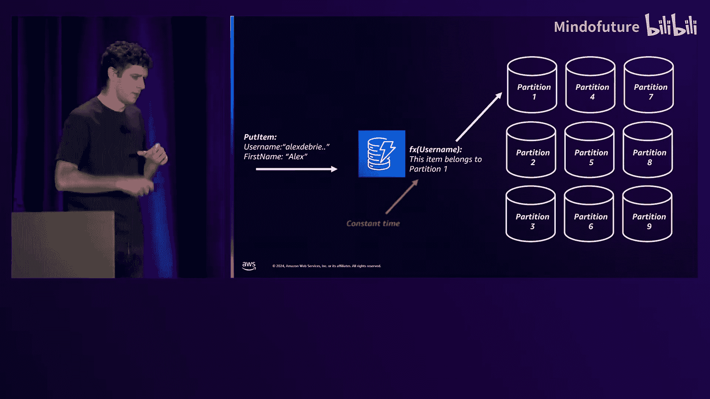

In this case in this example， this is a table with a simple primary key that has the primary key just has that one element。

 that partition key， so it's sort of just like this infinitely growing hashmap right you can do single item operations against it。

 but you can also have a table with a composite primary key and in this case you have two elements in your partition key in your primary key。

 excuse me， a partition key and a sort key。And again。

 that partition key is still doing most of that work of sort of assigning those records to those different partitions and you can think of this as like a group by right you're grouping your records according to some sort of partition key。

 you want to group records together that you're going to access together。

And then records that have the same partition key are going to be ordered according to that sort key why we call it the sort key right and in this case for the sort key I'm using a ULID which is just like a unique identifier that prefixes a timestamp at the beginning of episode it created that timestamp and now what I have is essentially ordering of these order records in my application so I can say hey。

 give me the records before this time or after this time。

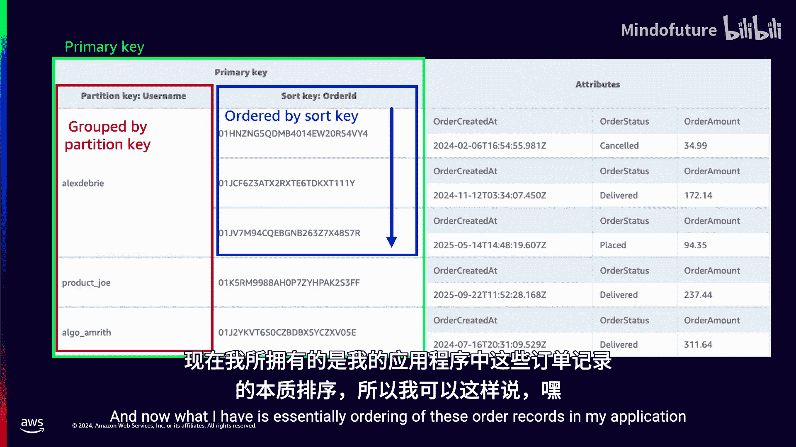

So that partitioning， both the partitioning and how the Dynamo DB API works with that partitioning I think is like the most important thing that you have to understand about Dynamo again the big thing here is items are going to be spread across your partitions mostly according to that partition key and then the Dynamo API is really telling you a lot about how you should be using that right and the Dynamo has like specific methods that you're going be calling rather than sending up like a textt like SQL and that they're going to sort of par and plan for you。

 but there are specific methods in Dynamo it's sort of telling you how to do efficient operations in Dynamo。

So I like to think about the Dynamo API into three different buckets。

 the first bucket is just single item actions which is all just like your basic crud of create Read to update delete in that case you're gonna to be operating on a single specific item and because of that you have to pass in the full primary key right it wants to be able to go directly to that partition that has this item and operate on it。

Further， all your right operations are going to be the single item actions。

 you can't do like an update where or batch update type thing where you have like just a partition key and saying update all these records with this partition key。

In addition to that， doing these sort of individual operations。

 sometimes you want to read multiple records， you want to read all the orders for your user。

 all the most recent sensor readings for an IOT device or something like that。

 and that's where the query operation comes in right if you have a table or an index with a composite primary key。

 then you can do these sort of fetch many operations and retrieve multiple records in a single request。

Again， the key here is you want to have that partition key。

 it wants to route it to a specific partition so we can find those records and give you that consistent performance at any scale so it's going to require that partition key in there。

 but you can also have conditions on your sort key right and because that sort key is ordered。

 you should have something like a timestamp or alphabetical ordering or something that's meaningful to your application so you can hey give me all the records after this time or before this time or between these two times things like that think about that sort key as you're doing your modeling。

And finally， the last bucket of operations is the scan operation。

 which is just a fetch all fetch everything across my table。

 and just like you don't want to do table scans in your relational database。

 you should use this pretty sparingly， you're not going to be using that widely。

All right so going back to our table， hey almost all access is through our primary key because they're splitting it according to that partition key and that's great in this case right most of the time when I'm accessing the users I want to fetch them by their username or something like that。

 but what if I have additional access patterns on my items right in this case。

 hey maybe I want to fetch all the users that belong to a specific team right now my users are not partitioned according to this。

 I don't want to scan across all these different partitions in my100 terabyte table how do I handle something like this。

And that's where secondary indexes come in， which essentially you go to your table。

 you set up a secondary index， and now it's going to make a copy of your data with this new primary key。

So you can set up a different partition key， a different sort key。

 in this case I might say the partition key is that team name， maybe the sort key is my username。

And now what I have here is my exact same data is just copied into what is a replica of my table organized according to this different primary key。

And now I can do that query operation based on that team name。

 get all the records that belong to a specific team name。

So secondary index is big part of how you're gonna to be modeling in Dynamo Db。

 I think the key part here is hey， this is a fully managed copy of your data。 copypy is the keyword。

 you can't do any rights to it。 you wouldn't write to a copy。

 You'd sort of write to the main record and have that flow down to your copy。

 So this enables additional readbased access patterns。

 but all your rights still need to go through that main primary key on your table。

 So be thinking about that as you're doing your modeling。

There were two kinds of secondary indexes I was going to go deeper into this and just sort of ran out of time。

 but I would just say the very quick TLDR on this is in most cases you want to use what's called a global secondary index。

 this is a lot more flexible， it's more what I would call the two-way door that Jeff Bezos talks about where you can sort of back out of this or change this if you want to。

 the big downside around global secondary indexes is they replicate asynchronously so you'll have a little bit of propagation delay when you do that right to when it gets to your secondary index。

The other type is called the local secondary index which。

That's going to write synchronously so you can get strongly consistent reads on that。

 but it's a lot less flexible and you can sort of back yourself into a corner。

 this is more of a one- way door using a local secondary index。

All right so with that background I think we've got a little bit of mechanical sympathy about Dynamo and I think there is some wisdom around what you do and don't need to know about Dynamo and where you need mechanical sympathy with Dynamo because sometimes they get questions from people about areas they just like don't actually need to know aren't going effective them like maybe it's cool trivia or interesting to think about but you actually don't need to know it to be an effective data modeler and that would be something like hey is it using Paxos or raft for consensus or。

You know， during the transaction， is it doing two phase commit or three phase commit。

 Can I choose one of those options， Or like even if you're used to operating a database like Postres or My C question something like that。

 How do I set my memory buffer configuration settings。

And I would say some of these things are interesting。

 some of these things they talk about in papers or talks or things like that。

 but this Dynamo is mostly a black box in terms of these sorts of things。

But there are certain things you need to know and have that conceptual framework for Dynamo like that are going to affect your modeling and the most important one is going to be。

 hey how Dynamo is partitioning your data and the importance of your primary key in that partition and how they can deliver that consistent performance at any scale。

And directly tied in with that is that API structure。

 make sure you understand the API structure of single item actions verse query verse scan。

 and you can actually write SQL against Dynamo using something called particle。Which is like fine。

 if you're up for that， but I would tell you make sure you understand the API structure first because like Dynamo is giving you hints about how you should be actually designing your table。

 how you should be using the thing， and if you just start throwing like SQL queries at it without understanding the API structure and that conceptual framework of Dynamo。

 you're going to write some inefficient queries and you're not going to get that consistent performance at any scale。

Another thing you need to know is secondary index just to enable those additional access patterns and then a sort of underrated thing is just thinking about dynamo billing and how it should affect your data modeling and we're going to go into that later。

 so these are like the big things you need to know there are a few other ones around limits and pagination and consistency model that are important as well。

 but these are the things you really have you need a conceptual understanding of with Dynamo to model well。

All right with that， let's go into some data modeling basics， and I want to run into some basics。

Partly just because I see a lot of people like making their models too complex or trying to get too fancy with it。

 And I think actually like getting back to basics is a good thing with dynamo Dynamo is like you know giving you some really core building box and use those well rather than trying to get too fancy the big thing I say about Dynamo is like hey the thing that one of the things that sets it apart from other databases is there's no query planner in dynamo So you know if you're using something like like Postgres or MysQl。

 there's a query planner， even Mongo which is like another NosQL database。

 that has a query planner where you're sort of issuing your query for it and based on that is gonna to like run some statistics or figure out how to most efficiently handle this particular thing but Dynamo is basically giving you direct access to these core data structures like a hashmap or Bre。

 something like that and relying on you to do it。 So given that。

Like you are the query planner and you need to think about that when you're doing your modeling。

 so the first thing I always say is like understand your needs and start gathering that data to be that query planner to do that effectively。

And so before you design your data model and do anything， I always say， hey。

 take some time to know and understand your domain and the big things here are going be like what are your constraints if you're creating users in your application。

 like you want to make sure that users you don't have two users with the same username or same email address or whatever that constraint is or if you have a team-based SAS application。

 how are you going to prevent people from adding more members than they have on their team plan or something like that。

 so think about those constraints because you're going to need to build that into your model。

Another thing to think about is just like what's your data distribution if you have like a one to many relationship。

 how many related items can there be for that sort of parent item is going to be pretty bounded like maybe 10 or could it be unbounded and you could have hundreds or thousands or millions。

 something like that and how is that going to affect things or also just like what is the distribution of your partition key。

 how evenly spread is your data going to be and how hot or different items or item collections going to be？

Also just think about how big your items are we're going to talk about billing later and see like。

 hey， this really affects things and you should think about that and plan for that as you're doing your data modeling so again。

 start to know this stuff so you can be an effective query planner。Once that happens。

 then you should actually plan out your queries right and that comes down to knowing your access patterns and you should know especially the first couple times you're doing a dynaud data model。

 you should explicitly list out your patterns， I always tell people have some sort of document that actually list out your access patterns and you walk through these and make sure hey you have the indexes。

 the conditions， all that sort of stuff you need so have your right access patterns listed out。

 have your read access patterns listed out， make sure you know how you're going to handle each of these things and we'll get into some of the more advanced stuff around that later。

Finally， last thing you know is what already talked about， the Dymo Db basics。

 right primary key API secondary index is that's what you're going to use to do this stuff。

Once you have that now you're going to design a table specifically for your needs right and the key here is like designing it for your needs。

 you don't want to have this sort of perfectly normalized table like you'd have in a relational database where you normalize。

 create your structure first， and then think about how to query it。

 but you're actually thinking about those access patterns first and designing it specifically for those needs。

And this is where again， I want to please just like use the basics。

 don't get too wild with this stuff， like a lot of your stuff should fall into you the core stuff。

 single item actions if we go back to those read access patterns， getting a user by their username。

 whatever， getting a quest by a user and ID， those things should be pretty straightforward in terms of how you handle those。

You'll sprinkle in some query operations for when you need to list multiple records right。

 so fetching all the users for a guild， getting all the quests for a user again。

 this should be pretty straightforward， simple stuff here。

You sprinkle in some secondary indexes for your additional read based patterns。

 use transactions where it makes sense right down about transactions is a feature you can do to operate on multiple records in a single request in an atomic way。

 can be good for certain situations， so sprinkle that in。

 but really think about these sort of things。And I guess the reason I say this is people get wound up a lot around like single table design and really making their tables too complex in certain ways。

 and I think with Dynamo， there is this tradeoff between flexibility and efficiency。

RightAnd so you can have this really highly optimized single table design。

 but it does limit your flexibility later on， and I think one thing you should ask yourself is like why are you using DynamoDB if you go back to some of those key characteristics。

 like what's important to you about it？If you're using it for predictable performance at a normal scale。

 some of the biggest customers of DynamoDV， they're not using a lot of the advanced features。

 they probably have a table with a simple primary key。

 they're mostly just doing individual key value operations， they're not using queries。

 they're not using secondary indexes and that's working great for them and they get some really nice characteristics out of that。

Whereas other folks， hey， maybe you're migrating a legacy application to Dynamo and you're just sick of the operational overhead of maintaining your traditional database。

 but you don't need a ton of flexibility， you know exactly what's happening。

 you have a lot of users but you're not changing things and in that case you might have a really complex looking data model like this one that's on the Dynamo website of how to model relational data where you have this complex single table design。

 it's really designed for your specific application。

 but you don't really need to worry that much about flexibility later on。

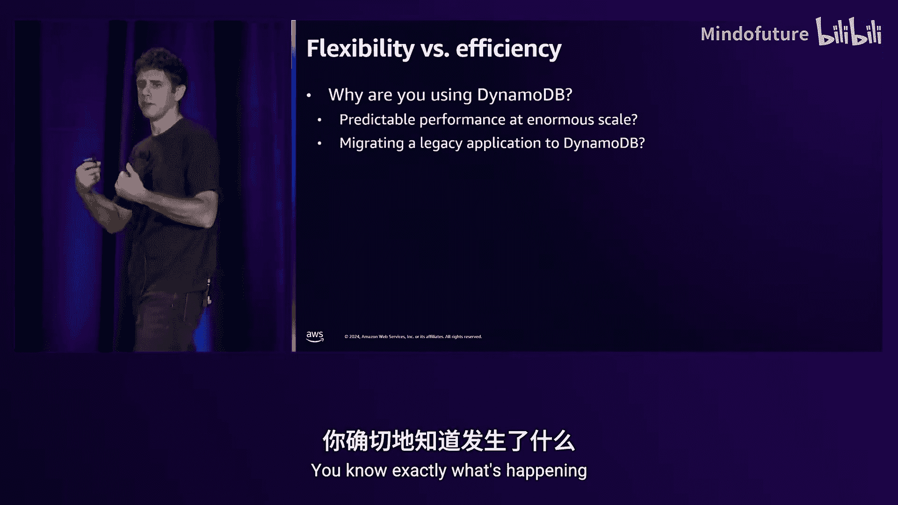

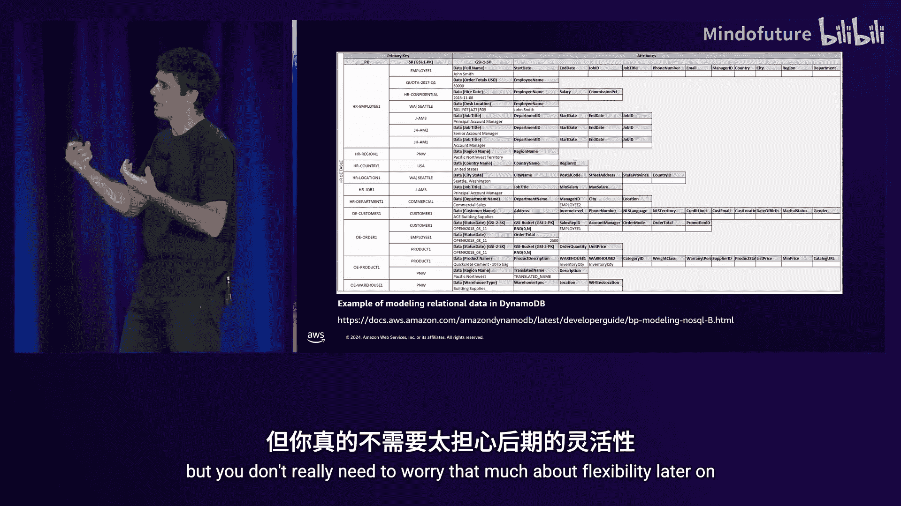

But on the other hand， there are like a ton of people that use Dynamo because it integrates really well with App syncync and GraphQL right and the thing about GraphQL is like the whole name of the game is flexibility right you want to be able to have at least some flexibility in your queries。

 so in that case you're probably going to have more of a normalized model than you would in these sort of like heavily denormalized single table design type operations。

Or somewhere in between that， maybe you like it because it's really easy to use in your serverless architecture。

And you want to get some of the benefits you definitely want to be modeling for your access patterns and things like that。

 but you don't need to go sort of full deororization on some of this stuff right so understand why you're using Dynamo。

 I think there are some tips for all modeling styles that you should think about the biggest one being design for your access patterns。

 make sure you're doing that don't just straight normalize your tables and then think about your queries but design for that first big things here would be like hey use meaningful primary keys in our relational database we have primary keys but they're often like auto incrementing integers。

 but in Dynamo you want to use something meaningful。

 what are you actually going to access on if it's a user maybe a username or an email address。

 whatever that unique identifier is for your user is a good one there。

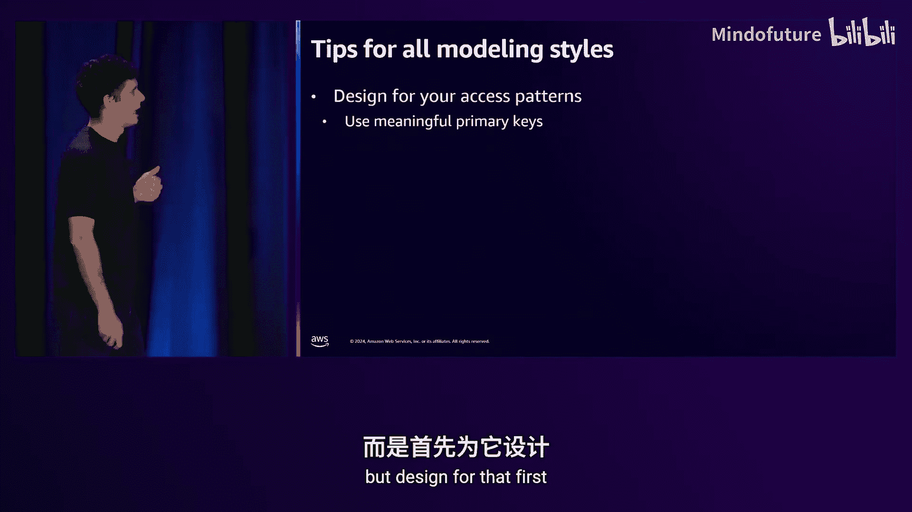

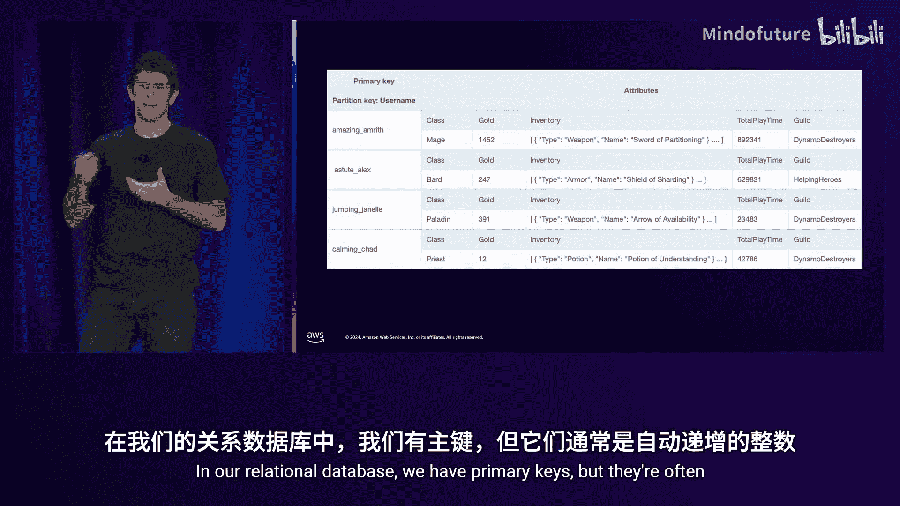

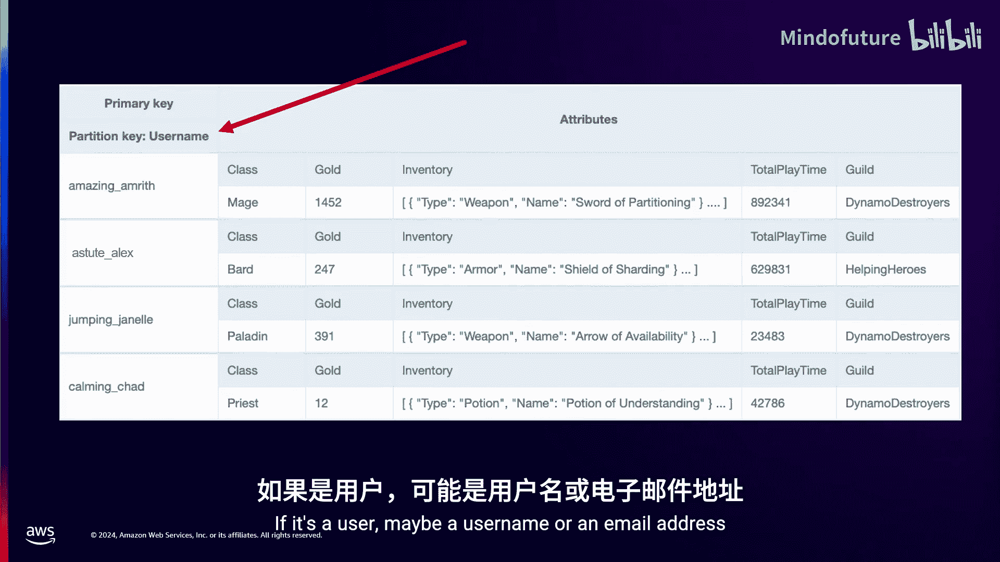

Another thing here is I would say don't needlessly overload your item collections and I see this problem a lot with folks where an item collection refers to like a set of records that has the same partition key so you can see here I have a bunch of records that have the same partition key of astute Alex this is in my online roleplay game or something like that but you can see we have a lot of different item types in here right we have this user record。

 we have the inventory， we have a whole bunch of quests we have some friendships。

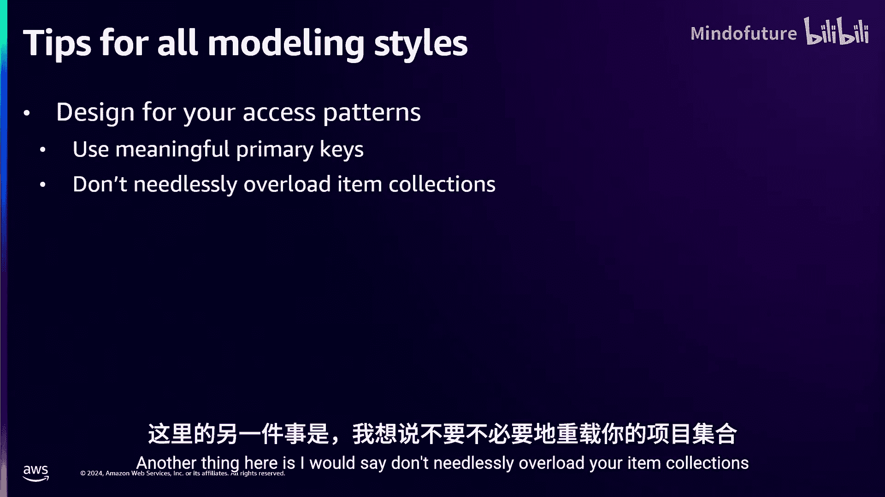

And people show me this and I say， okay， do you have an access pattern that says， hey， fetch a user。

 the user's inventory， the user's quest and the user's friendships， like no， no。

 we're not doing that。 we sort are just getting the quests or just the friendships or maybe the user in the inventory。

And the thing is like that partition key is used to like group items that you're going to fetch together。

 So if you don't have an access pattern where you're going to fetch all these together。

 don't place them together， right， have something。A little more split out like this where you have your quests are all grouped together in an item collection right your friendships are grouped together maybe you do want to get have like you're using an inventory group together in the same item collection because sometimes you'll fetch them separately。

 sometimes together that's okay but only put them together in the same item collection if you're actually going to fetch them together otherwise it's just going to be it's going to be harder for you to sort of write the queries on that sort of thing you're gonna get less spread across your partition keys if you don't do that。

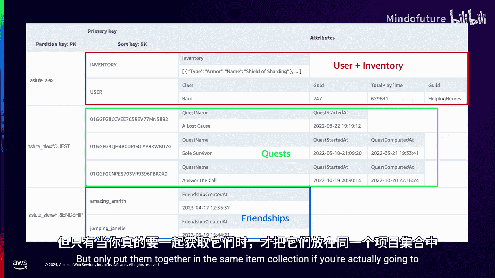

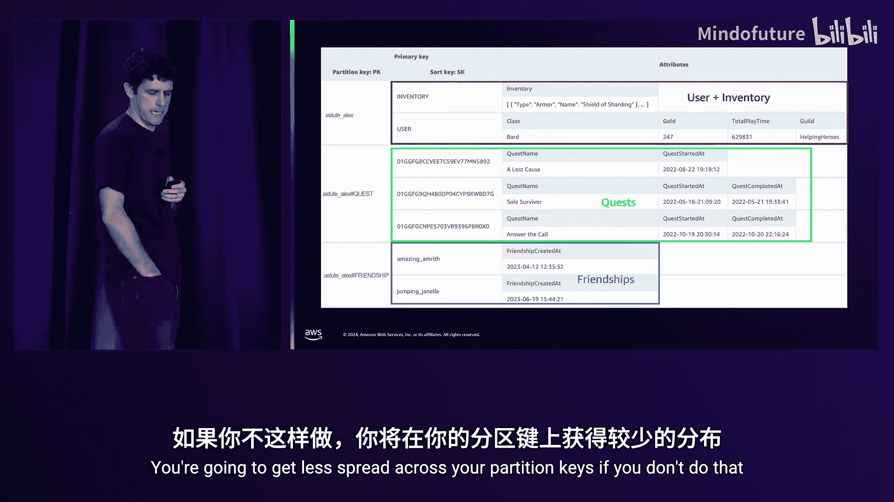

So again， designing for your access patterns are huge。The other thing I always say is hey。

 think about your rights early if you have conditions that you need to maintain again。

 that has to go through your primary key so if you have uniqueness requirements or just other conditions and things you want to maintain。

 think about those things first it's a lot easier to sort of sprinkle in write or read patterns as you need them rather than doing additional right patterns later on and the big thing here is like use conditional rights。

 these are super useful and what you want to do ideally is design it so if you have to do a right operation that has some conditions you can just express that in your condition expression rather than having to like go do a read from a secondary index。

 do some calculations and then do with a condition assert hasn't changed or something like that ideally you can just do a write directly to your table without having that multi back and forth to dynamo。

And then last thing is just like hey， flatten your hierarchies right if you're coming from a relational world。

 you have that like normalized model where you have like these relationships all the way down and these very hierarchical stuff and you want to denormalize where Put。

 you don't want to get too wild with this， but like make sure you're thinking about denormalization。

So just a little bit on denormalization， there're basically two different ways you want to be deormalizing one is in embedding right where maybe you have。

 I guess like in a normalizedized model， any attribute should be like a scalar value like a string or a boolean or an integer or something like that you shouldn't have a list or a map in there。

 but Dynamo it's pretty common to have complex objects as attributes So where should you do embedding again。

 don't get too wild with this， but I would say it works really well if you have like one to one or limited one to many relationships。

So if we look at those username again。We have like this user preferences bag right which is like this semistructured data of just like different settings that might affect the UI for this particular user。

 you know true like normalization which hey split that out in a separate table and refer it back but whenever we fetch that user we want their preferences to and we don't really need we don't need to operate on those preferences apart from that user so it's fine to put it on there so that's a good example。

 addresses， anything we have like a limited number of related items can work really well there。

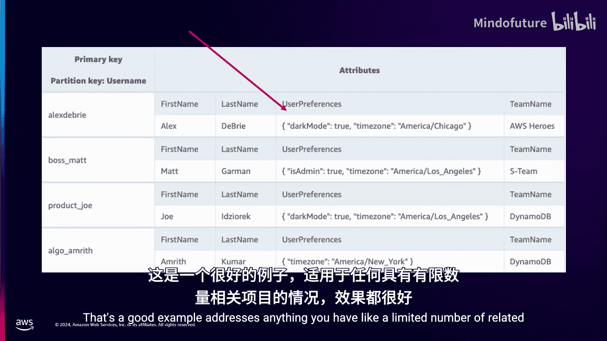

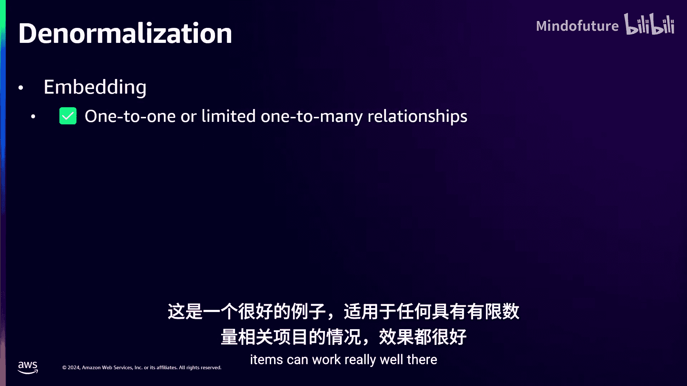

What you don't want to do is get into embedding these unbounded one to many relationships， right。

 So going back to that user， we had our orders table， maybe we just think， hey。

 what if we embedded all our orders on this user directly。

And that's not going be great right that's going to bloat your item size over time。

 you might run into Dynamos item size limit， you're also just going be paying for like reading and writing that item every time and it's hard for you to operate on that individual item itself right so that's where you want to use the query operation you want to use that idea of item collections to sort of group those orders together so you can fetch them all together when you need to but still giving you with the flexibility of working with small items and operating on an individual record。

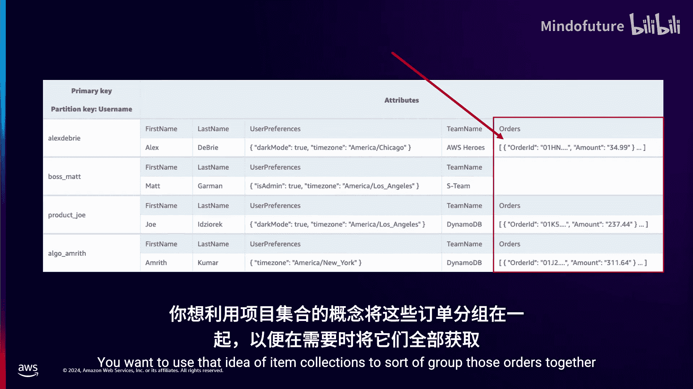

So the key tradeoff with embedding is just like trading off hey my larger item size versus potentially having to make more reads。

 if I split those user preferences out into a different table or different items altogether。

 then I have to do multiple reads to fetch the user and their preferences。

I'd say the more common sort of element of deormalization you're going to see is just duplication right and the key tradeoff here is like faster reads versus harder or more expensive rights so it often makes sense especially if you have hierarchical data to replicate some of parent data onto that child you can search by some of those parent attributes or you can just display them for that and I think the big thing is here is again trying to get those faster reads you don't have to read like down the tree and things like that if that data changes now you have more rights that you have to deal with it's going to be more expensive and you just have to maintain that sort of thing right so your ideal here is like ideally you can just duplicate immutable values you don't have to think about it。

I think this is one of those things like as you're designing a system too。

 you can sort of trade off and think about this sort of thing and say， hey。

 would it be okay to make this value immutable or at least somewhat hard for a user to change right and I think about。

GitHub username or GitHub organization chains like you can change those things。

 but it's like I think it's like a batch operation it takes a little while to do and it's like what they're doing is behind the scenes probably updating all this duplicated data that they have。

So a couple benefits around duplication number one is you're just reducing the number of reads altogether right if you're getting some nested record that you want to retrieve by some sort of parent attribute。

 you don't have to sort of go down the tree so it's faster and it's cheaper because you're doing fewer reads Another thing is like sometimes you can move reads from sequential to parallel like if you have sort of a join type thing going on where you have one many relationship。

 you need to get the parent， but you also want to get the related records。

 you don't have to fetch the parent first retrieve its ID and then go make a follow-up request to do that query now that you have its ID like if you've duplicated some of that parent identity down。

 you can make that request in parallel so it's not cheaper but it is faster right you're doing parallel rather than sequential reads。

All right， let me take a drink here。

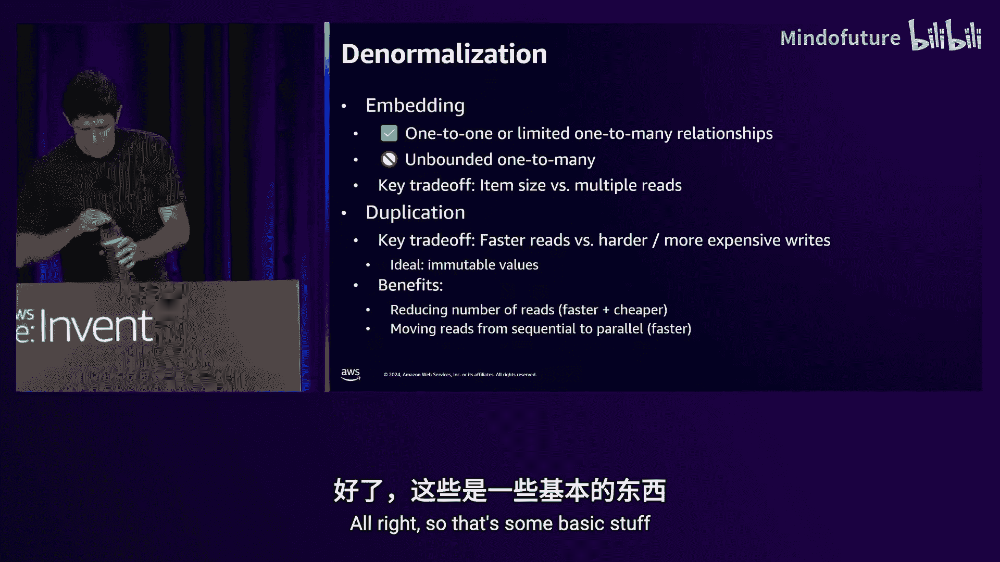

All right， so that's some basic stuff let's go into。

A little more advanced like things to be thinking about and one thing I really liked this year and just in the last couple of years is thinking about math and Dynamo and napkin math especially。

 I found this talk for the first time this year， this is from Simon Ekilson who's a really smart guy。

 he's working on turbo puffffer now which which is super cool， I check that out。

 but this is a talk he gave five years ago abouty if you're a senior engineer or if you're an architect that's like designing these systems。

You should be able to do some napkin math to understand things like performance where that's latency or throughput or just cost of your systems and seeing what's reasonable and being able to do this stuff rather than having to build the whole system to figure out what's sort of reasonable and I like how he approaches this stuff。

 I think this is really useful， he's also got like he had a newsletter around some of this stuff showing this in action。

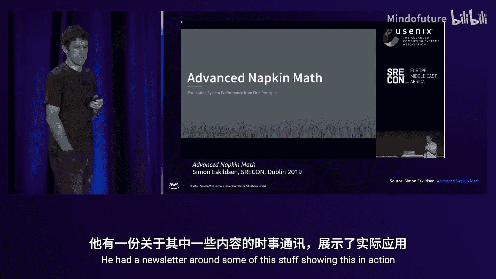

And I think Dynamo lends itself really well to doing nap in math and so I want to walk through a little bit of what that looks like and we'll see some of that in action when we get into the stream section but so one thing he talks about is just like knowing certain base rates around how these things are going to perform and so with Dynamo I think about just like performance base rates again because it gives you consistent performance at any scale。

 you should know some of these base rates just like off the top of your head so if you're thinking about clientside operations how long should that take if I have to make a request to Dynamo。

HeyIf you're doing a read operation of a reasonably sized item。

 probably five is milliseconds is a good guess， you can do some testing based on how much data you're pulling back。

If you're doing a right operation， you know maybe up to 20 milliseconds for something like that。

 if you're doing a transaction which requires some coordination and two phasese commit on some of that stuff up to 100 milliseconds or more for that but the good thing about this is again this is consistent performance at any scale。

 you should be able to use this as you're thinking about the number of requests you're making in your application。

And another thing I like about Dynamo is the limits are very like sort of clear and sharp and apparent to you right so there are some limits with Dynamo and one is around that query response so if you make a query request to Dymo to fetch a batch of records it's only going to give you a maximum of one megabyte of data back in that request and that helps with that consistent performance at any scale because you don't have this unbounded operation。

But that helps you to know like hey， if you're sort of doing the math on some of this stuff and you realize。

 hey there could be five megs of data that I need to go through。

 that's five sequential requests you have to make because now you have to make one request。

 get that pagination token back， make the second request。

 get that pagination token back and go through that right so just understanding what that's going to be as you sort of estimate this stuff out。

Or if you have hot items or hot partitions in your data。

 just understanding what the limits are and hey can this fit with whatever SLL I'm providing to my users and things like that。

 so a single dynamo partition can do 1000 right units and 3000 read units per second and can you fit in that or do you need to do some caching or do you need to do some right buffering or write sharding different things like that to help with that？

So that's really nice for performance based rates， I think it's also useful to understand like billing based rates as you're starting to do modeling with DynamoDB so just some billing background on Dynamo and how it works。

 if you're thinking about traditional database， you're going to get charged based on some sort of instance you provide which has a collection of CPU and memory。

 maybe IOs are included， maybe you're paying for those separately。

 but basically regardless of the number of operations you're doing。

 you're sort of paying for this basket of resources。

And I think that makes it hard to do some of that estimation that app and math that Simon talks about。

 but with Dynamo， you're paying for your operations directly right。

 you're going to get charge based on read capacity units， RCUs and write capacity units。

 so the actual operations you're doing against your Dynamo table。

So looking at dynamo base rates and what those are。

 what these capacity units are right there's a readed capacity unit allows you to read up to4 kilobytes of data for consuming that read capacity unit。

 you can actually cut that in half if you don't require a strongly consistent reads so in most cases I would say do that in that case。

 hey if you read up to four kilobytes of data you're only consuming half a readed capacity unit。

There are also right capacity units that allow you to write up to 1 kilobyte of data in your request right。

 so you can be thinking about as I'm sort of doing these operation。

 how many reads and write capacity units are going to be doing here。

It's also nice because you can use these base rates in pricing right The nice thing here that actually I did change my slides between when I made them and now because Dynamo just did this like big 50% price cut on demand billing which which is great so I had to change these slides but the new prices for this is hey 12 and a half cents per million RC so every million RCUs you're you're gonna to get charge 12 and a half cents for every million rights you're gonna to get charge 67 and a half cents and then for your storage you're gonna get charged 25 cents per gigabyte month caveats on this hey this is region specific so this is for USV1 if you're in a different region plug in some different numbers there this is also on demand numbers so this is like the most expensive that you should pay for these you know you can use provision capacity if you can drive high utilization for your table but make sure you're not spending any more than this because on demand is gonna be a lot simpler operationally she shouldn't be paying more if you're also managing it。

So I think having those performance and billing base rates at top of mind are super helpful for you。

 I think there are some interesting sort of like implications or notes as we're thinking about napkin math for this sort of thing and the first one I say is performance and billing are separate concerns so as you're sort of doing this napkin math both thinking about what's the throughput and latency on my application and what's the cost of my application you don't have to worry about sort of how those interact with each other right and if you think about if you think about databases generally like just as you have more concurrent queries or more data in your system or bigger reads or different things like that。

 what happens during your response time。Is usually you see some sort of curve like this right where at some point you're going to be saturating a key resource。

 whether that's CPU or memory or disk， whatever that is。

 and now your response time is really going to spike right and you're going to have much slower response times there。

Whereas with Dynamo， hey you still might hit the limits of your system。

 I'm not saying dynamos perfect on that sort of thing。

 but you hit the limits of your system what you're not gonna to see is a spike right at some point if you're exceeding the limits。

 either what you've provisioned or what dynamo can handle on a partition level you'll get throttled but the good thing about this is you still have that same response time back to you you'll just get error back saying hey try again next second when you have some more capacity available and if you read things like anything about tail latency or tail it scale。

 this is really hard to deal with having those really like long tail response times around that stuff both as like a client of a service but also like providing a service that has clients and dealing with that sort of stuff timeouts are tricky just all sorts of issues that can come out of this So the thing that I really like is you can estimate this performance stuff and do that without having to think have a provision enough to actually get these guarantees around that stuff there's separate concerns。

The second thing I'd say around this is Dynamo's pricing should affect how you build your applications and I think like AWS is doing its best when it's sort of teaching you how to use its things well and again helping you build that mechanical sympathy。

 and I think Dynamo does that in two areas with the API and sort of saying this is how you sort of get good performance out of it。

 but then also just like the way they bill you， they're showing you what's expensive and what you should be thinking about and trying to optimize for。

Right so we have these different base rates and especially those capacity units， RCUs and WCUs。

 but there' are all kinds of multipliers on these capacity units right when you do a single request it could take up more than one RCU and more than one WC in a single request right so what are those multipliers things like item size if you're writing a 10 kilobyte item you're going to get charged 10 right capacity units for that one for each kilobyte in that item or if you read an entire page of query results remember you can read a whole megabyte of data in a single request but that's going to cost you 250 read capacity units。

Or if you have secondary indexes， right， if you have your main table and three secondary indexes。

 you have to write to your main table， but also each of those secondary indexes。

 you're going to pay for the rights on those。Same if you're doing transactions， right。

 transactions involve multiple records in a single request， you'll pay for each of those。

 but you'll also pay like a multiplier costs on that to account for the two phase commit and sort of the coordination and communication going back and forth。

Same if you have global tables right you're writing in multiple regions you have to pay for all those consistent read all that stuff and again the thing I like about all this is like Dynamo is indicating to you what is expensive and how you should optimize for it right all these things are telling you something for larger items they require more resources and you need to get charged accordingly or secondary indexes require more rights and you can get charged for that transactions require coordination all this stuff so even I think this is super useful in dynamo but this also helps you if you go work with other database systems you just like get this sort of。

Sppicy sense of just like， oh， these things are expensive and not that I can't use them。

 but just be like a little bit more judicious about how you use them and realize， hey。

' that's taking real resources under the scenes。So given that， I always say， hey。

 mind your multipliers and think about this as you're actually doing your data modeling。

 and so what does that look like？You know， big thing is like review your item sizes carefully。

 I used to be more cavalier on this and now I sort of understand like this is actually a meaningful thing right so like remove your unused attributes don't just throw every attribute on there and call it a day。

 think about what you actually need。If you have large values on your records， compress those。

 or if they're really large and sort of blobby type stuff。

 put those on S3 so you're not sort of paying to read and write those every single time you manipulate that record。

Another big issue I see with a lot of people is just like， hey。

Limit your secondary indexes and think really hard about using those like do you really need a secondary index for a particular pattern？

Like writes are 20 times more than reads right because a write capacity unit costs five times more than a read capacity unit。

 but it's also only the fourth of the size of a read capacity unit。

 so it can be up to 20 times more expensive there， so you in some cases rather than writing to a secondary index if you have additional read patterns。

 sometimes it makes sense just to overread and overfe and pay that cost and that can be cheaper for you。

You can also use projections to limit the size of the items in the index so again these secondary indexes they're copies of your data but you can say hey。

 only project these attributes， don't project the full item into that and a few things that are nice about that is number one it's going to limit the size of those items so it's smaller rights。

 it's smaller reads when you're reading those records but also if you do a right operation on your main table that changes attributes that are not projected into that secondary index it's just going skip that right altogether so you can skip a lot of rights in those cases and you don't need to pay for that。

Another thing you should do is limit transactions like Dynamo has transactions they've been around for five years now super useful for a lot of things sometimes you need to transactionally write a lot of records in a single go and sort of a all or nothing type thing。

 but what I say is use these for low volume， high value type operations right low value because you don't want to have a lot of contention it's doing two- phase commit behind the scenes you don't want to be having these rejected because of transaction conflict errors but also because they are more expensive you're gonna be paying two times the actual operation costs for these so make sure it's actually worth it for that sort of thing but for high value operation that's a cost worth paying both in terms of your actual bill and in terms of the latency。

Global tables， really cool， you know we've seen we saw strongly consistent global tables come out this week which is awesome as well。

 but make sure you actually need those that you understand how you're going to be using that global table。

 whether it's in a fail over type situation or you want to just have active active in each one of those like it does add a lot of costs it's effectively going to double your right costs on that stuff so make sure you actually need that。

And then in most cases， most people， I would say， probably don't need to use consistent reads。

 Eventually， consistent reads are fine。 In most cases。

 that's going to save you 50% of your read costs there。All right， so that's map to math and again。

 just use these sort of things as you're modeling that's more of like you being that query planner thinking about these things and it should affect how you build your applications。

All right let's get into some practical stuff here around DynamoDB streams。

 again this is something I haven't covered， I think in previous years。

 but this is like one of the things I love most about Dynamo when I go use or look at other databases。

 I miss sort of how easy it is to work with Dynamo streams and change data capture so just in terms of what we're talking about with DymodDB streams。

If you have your table， you can enable what's called the Dynamo DV stream， it's not on by default。

 but you can choose to do that and when you enable that stream。

Every time there's a right operation in your table and insert， update， delete any of that。

 a record of that change is going to be put into your Dynamo D stream and then you can process that with a Lambda function or Kinisesis client library or just sort of your own APIs if you want to and you're basically just handle batches of records and operate on these sorts of things and this is really useful change data capture I think is really getting more popular and I love how Dynamo does it。

I want to talk about three use cases， four dynamo streams。

 and I would say two of these are more like architectural type use cases。

 and then one of them is more like a data modeling type use case， right？

So architectural use case one is just solving the dual right problem which comes up a lot。

 especially if you're in event- drivenrin applications right so with the dual right problem what we have is you have some sort of application that's writing to Dynamo。

 let's say an order comes in and you write that to Dynamo， but in addition to writing to Dynamo。

 you want to do something else with that right maybe you want to put a message in SQS or you want to publish something to Eventbridge。

 so you have a second thing happening within your compute and you're sort of writing to Dymo and you're also pushing events to Evenbridge。

And the problem here is you're writing two things in a way that's not transactional right。

 what happens if you're able to write to Dynamo， but then you can't publish to eventbri and especially if you're counting on that happen。

 if you're counting on that happening， what happens to that order is it just sort of like orphaned or what happens there you're not very resilient you know people try to do like retries or rollbacks or different things like that but it's kind of hard to do that sort of thing。

You know I'd say the two ways to really handle dual right are going to be the transactional outbox pattern or using change data capture and streams allows you to do change data capture right where you add this dynamo DB stream to your table and now when you're inserting that record that order record into your table it gets dropped into a stream you process that with Lambda and you push it out to a eventbridge right and the great thing about this is if eventbriages down or if there's some error logic in your computer or something like that。

 it's still durable， you can retry that you can recover from that it's not just sort of gone and now you have these two systems that are in an inconsistent state。

So it helps with the dual right problem， let's just talk about some high-level tips for processing dynamo streams and I had to cut this short as well so if you want to read more about this I got a post on my blog around just using dynamo streams well one thing I say is hey。

 especially if you're doing like an event driven or pushing events elsewhere like clean up your events before pushing them elsewhere if you're pushing them into a eventbri you might have multiple consumers from that stream and you don't want to have them consume from your dynamo D stream directly。

 you want to have some sort of intermediary for that for a couple reasons number one dynamo streams have a consumer stream limit so you can only have two consumers on your dynamo D stream so you don't want to have like a lot of consumers signing up and then getting your stream throttled but the bigger one too is also just like。

That event that comes through Dynamo streams is in like a pretty raw event format and you want to change it into some sort of domain event that makes more sense in your application right so like on the left here。

 this is something sort of like what you'll get in your Dynamo DB stream know it's going to have the item it's going have maybe the old version of the item and the new version sort of parse through that and Dynamos data types and all sorts of stuff there what you want to do again turn that into some domain event like user created user updated here。

 the updated fields， here's the whole user record， things like that just make it easier for your consumers there。

Another thing about using dynamoDV streams as well is hey。

 make sure you understand stream processing mechanics and the failure modes there because working with streams is different than working with like a traditional cu where if there's a failure you can just pick up another batch of records and retry that later maybe you have dead cues。

 things like that stream processing is a little different you're sort of processing these things in order if there's a record that you can't process you're just going be stuck there unless you shove it off somewhere else or skip it or something like that so make sure you understand those mechanics。

 fortunately I think Kafka and Kisesis are picking up in popularity enough that people we're starting to understand this better but like any of the tips that work for Kafka and kinesis are going to work here as well。

And the last thing is like consider your stream implementation carefully when you're choosing to enable a Dynamo DB stream。

 you can use sort of the native dynamo DB stream implementation。

 which is what I recommend in most cases like it's fully managed you're not paying for the stream itself you only pay for reads from it and if you're using Lambda。

 you don't even pay for the reads from that， it gives you really nice guarantees around ordering and duplicates and things like that。

 the big downside you get a maximum of two consumers。

 you can only process that with two consumers and things like global tables that takes up a consumer or if you're doing zero ETL that takes up a consumer。

 different things like that so you're really limited on consumers there。

If you decide you need more consumers， they do allow you to。

Go to native Amazon kinesis streams right and that's going to allow you to have more consumers。

5 to 20 consumers， something like that， but there's more management of that。

 there's more cost you're actually paying for the stream itself。

 a little bit weaker guarantees around ordering and duplicates and things like that so you just need to weigh those trade offs I would say dynamo DV streams in most cases unless you feel like you need multiple of those。

rightSo that's the first use case we have is solving the dual right problem。

 let's look at another sort of architectural use case for dynama streams。

And this is exporting to a secondary system。RightAnd we get back to that idea of mechanical sympathy and thinking about what Dynamo does well and what it doesn't do well and there are like very clear things that Dynamo is good at and what Dynamo is bad at and I think you don't want to like jam a square peg into a round hole here right so what is Dynamo good at。

Just like your classic OLTP workloads right where you have small reads and write。

 you want to make some amount of transactionality， conditional rights。

 you want to have low latency high availability， all your sort of core application type stuff。

But what Dynamo is not great at？Is anything flexible。

 anything sort of unknown where you need a little bit of flexibility there。

The three categories I always bring up are like aggregations and analytics。

 complex filtering or full text search。 and maybe you can query plan around some of those things。

 but in a lot of cases it's like， hey， that's gonna to be really hard to fit into Dynamo。

So in that case， for a lot of customers， depending on your size。

 I would say you're often augmenting Dynamo with some sort of other system which might be S3 and Athena if you just need basic analytics or redshift if you need basic analytics if you need sort of like more realtime stuff。

 complex filtering then open searcharch might be what you're looking for there。

 but Dynamo DB streamams is sort of the glue that can tie those together where anytime there's an update in your application。

 you can sort of copy it over to your secondary system。

So there are a couple complexities with syncing to this external system that are worth calling out number one is just like making that initial export right because in a lot of cases。

 maybe you start off doing something with Dynamo and now you find out hey I have this new use case I want to enable search or complex filtering or my PM wants some analytics on that stuff so I want to get into that external system but my stream doesn't have every record since the beginning of time it only has like the last 24 hours of data or if you haven't enable it doesn't have anything until you do enable it so how do I get this initial data out of dynamo into my external system that's where I think Dynamo stepped up their game in this part and giving you an option to just like export all your data to S3 right so they're making it easier to sort of get your data out both in this batch way with the export and then in a continuous way with the dynamo DV stream so this works together。

Really well， like if you're exporting with an external system。

 So in terms of like what that actually looks like architecturally， right。

 if you have your second system like open search or something like that， what you want to do。

Is enabled dynamo DB streams on your table， so at T0。

 you've sort of got every operation from that going forward。Once you've enabled that。

 then you go do your initial export to S3， so this is at T1 or some other time after T0。

Once that export is ready， you load it into your external system and then you start processing and consuming from your stream so you know you have your snapshot。

 you have every operation that's happened after your snapshot and that's going to keep you in sync there right so that initial export plus that dynamoDB streams makes this easier for you。

But even with that I'd say there's still complexities just like in maintaining that stream like the OLTP OAP impedance mismatch right where OLTP wants to do a ton of tiny little right site it wants to be doing updates and deletes and things like that where your OAPy type systems especially if you're looking at snowflake or Redshift or something like that it's like hey we want big batch ingestions。

 we don't want to do updates we don't want to do delete leads ideally it's append only so that's like kind of a little bit of stuff to manage there so you can the tools are there for you to sort of maintain this data pipeline but I would look for a manage option if you can like AWS is building out to manage ones like zero detail integration to open searcharch and redshift and。

Yeah， I used I used to do data pipelines。 I was like my first job。

 and they's just like no glory in it， right Like they're always going down。

 They're breaking for some reason。 And you know， when things are going well。

 no one's happy when they're mad when they're not going than they're mad。 So I would say。

 look for like a managed solution on this stuff。 And the great thing is like。😊。

Dynamos given those sort of like two primitives， right。

 the export and the stream to make it so whether it's zero retail in AWS。

 whether it's a third party system， they should be able to manage this for you pretty well。All right。

 last use case we have is around like hey triggers or stored procedures。

 this is more like a data modeling use case and when I compare dynamo stream to triggers and stored procedures。

 I get some funny looks because I think we usually don't use those as much anymore。

 at least as much as we used to for a couple reasons like，You know。

 stored procedures definitely usually you're like writing them in a different language like PsQL or PLSQL or whatever that is you're deploying them separately。

 there's not visibility or testing around that sort of thing but that sort of issue isn't really as a parent with DynamoDB streams right because you can be processing this with Lambda or Kisesis' client library you can use your same application code。

 your same business logic and be handling that you have testing and all your normal stuff there so I think this can be a really nice。

Pattern to be using here and I want to walk through like just data modeling one triggering use case and we'll use some of the things we've learned in this around array indexing right like sometimes you might have an array maybe you've denormalized some data and embedded an array on your items and you want to be able to query by items in that array but Dynamo doesn't offer array indexing natively you can't do secondary indexes on arrays in your application so。

What does this look like maybe we have some sort of issue tracking system like on GitHub or GR or something like that。

 a team will make a project。Those projects have issues， those issues might have different tags。

 just free form stuff you know release versionrgin or the type of issue that it is or just like the component that's affecting things like that and what we want to allow here is tag based search right so I want to be able to say。

 hey give me all the issues for feature plus off plus sprint 23 right and how am going to be able to do that。

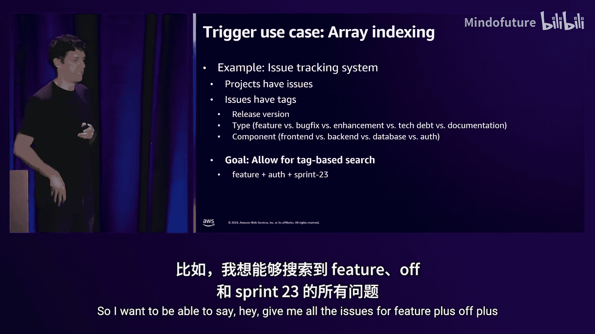

Maybe I have some data in my application that looks like this。

You can see over on the right there we have this tags attribute that has just like an array of tags for these particular items and how am I going to do this right because I'm not indexing by this so what is that going to look like if I want to have some consistent performance I think the first thing you can ask is can I brute force it do I need an additional index or can I do this because because I'm always going be searching within a given project maybe I can just fetch all the records within a project and sort of brute force that sort of thing right so let's do some napkin math on that let's say our issue item size is maybe one to five kilobytes？

And then in terms of the number of issues we have for a project， right。

 if we're searching for all the issues within this project， we have to know how many there are。

The median project is probably going to have， let's say，1000 tags。

 but you might know at the P95 have something like 10，000 or more for these really big projects。

 Linux or whatever you have there。So just doing some brute force calculations on that。

 you know the median may we're looking at two megabytes of data that we need to fetch。

 which means two requests， we can only fetch one megat at time。

 so it's going be two sequential requests we're going to say， hey。

 that's going to be 40 to 100 milliseconds to fetch those and we're going to consume 500 RCUs。

But at that P95 level， hey now we might need to be fetching 50 megabytes of data， that's 50 requests。

 that's 12 and a5 thousand0 RCUs， like that probably doesn't work for this。

 so brute forcing probably isn't something we want to do。

So that's where we can go look at DynamodDB streamams and hey。

 maybe we'll just reinex this data for us and we'll sort of build this given the building blocks they've given for us。

 so when these records comes through when an issue is created， updated， deleted。

 we'll go index these in a different table or just with different items there。

So what we have here is essentially just like an inverted index， right where？

We're sort of grouping these issues by that partition key。 We have that project tag。

 which is the project and the tag that they're tagged with。 We have a created at and then which。

 whatever issue it points to。And now if I say， hey。

 find me all the issues that have these particular tags for this given project。

 I have to go fetch all three of those item collections。

 so first I have to go fetch those feature ones， I have to go fetch those off ones and sprint ones。

 I can do this in parallel which is nice， so this is three different request but they're all happening in parallel and then once I have those result sets now I do like an intersection to figure out hey which issues have all three of those things。

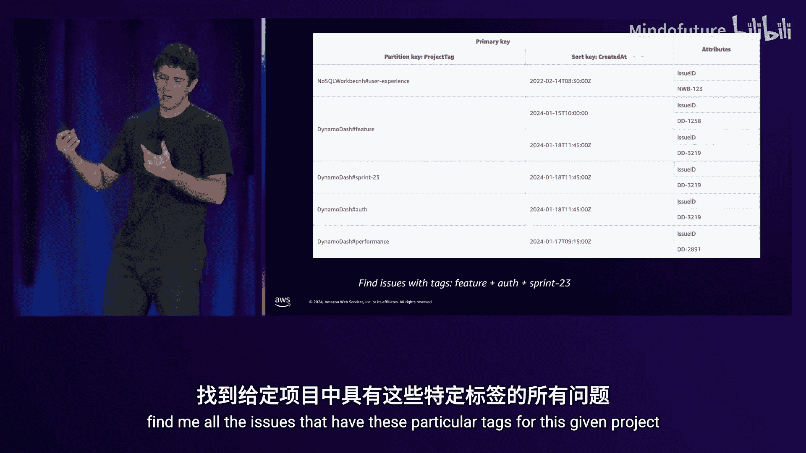

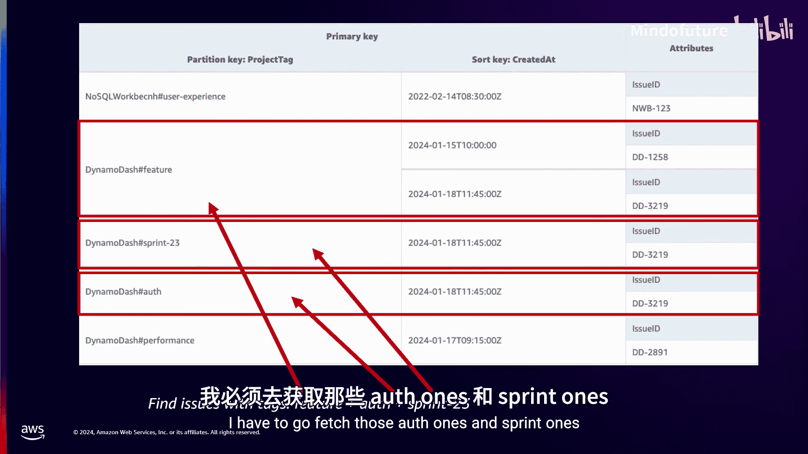

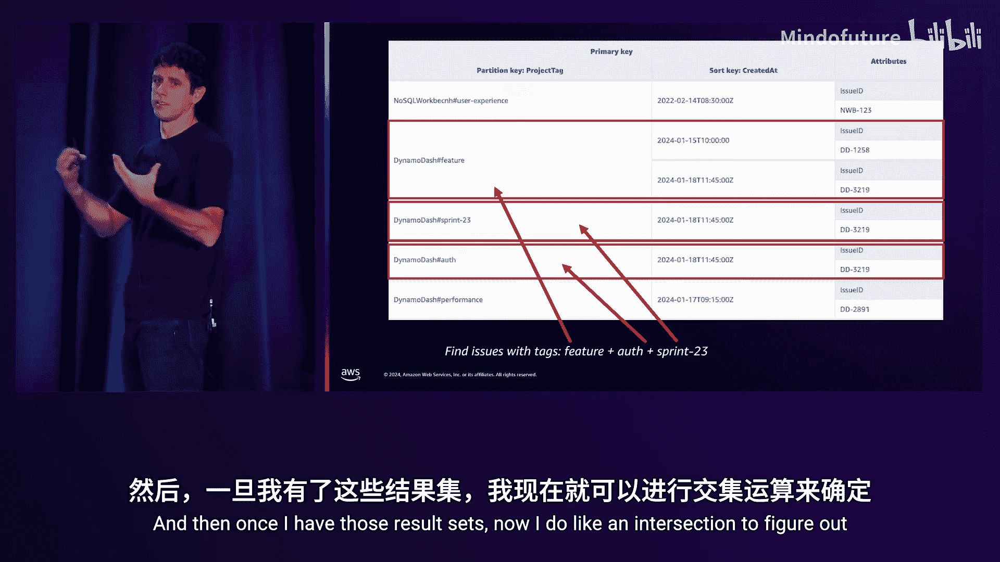

So just doing the napkin math on that， let's say generally there's going to be three tags per query。

Those issue item sizes it's just a pretty bare item we're not copying a lot of data there so it's maybe 200 bytes and then the number of issues that you have per unique tag。

 you know let's say at a median it's 10 you probably don't have a lot of like sprint 23 you can only put so many issues in that right。

 but you might have some related to larger feature areas that have 200 or maybe 500 issues that have that particular tag。

So given that now we can run those calculations again。Now our median is hey。

 it's two kilobytes we have to read， but for each tag with times three requests it's going to cost us three RCUs that's a lot cheaper right。

 same thing even at the P95 level we're looking at something like 30 RCUs so this is a lot cheaper operation because we've sort of indexed it that way and made it better。

But we can probably even do better and first， let's talk a little bit about denormalization and how we've applied that here。

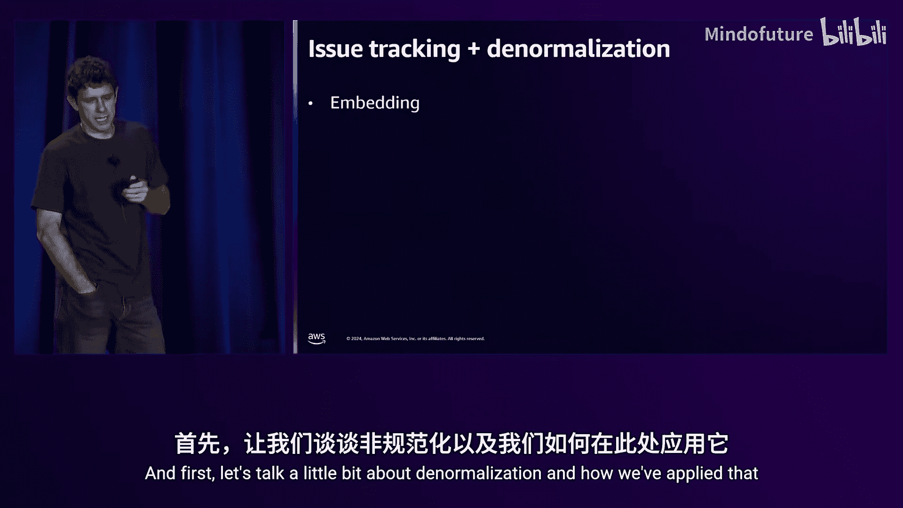

Right we've got some embedding on our data right if you look at the tags that we have on there。

 we don't have tags split out as a separate table because when we want to fetch that item。

 we also want to display all the tags in it， so we've just embedded this tag data on it。

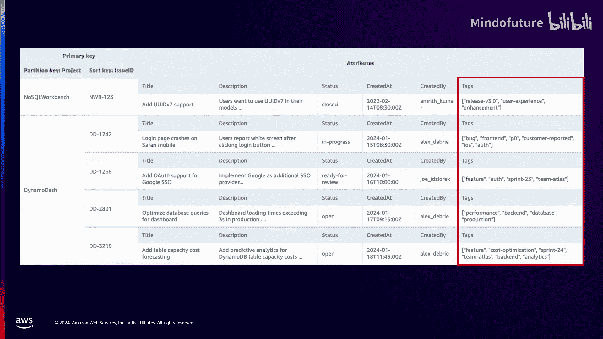

We're also doing some duplication in our items here right where like all these items。

 these issue tag items that we're creating， those are all just pure duplicates of our data there。

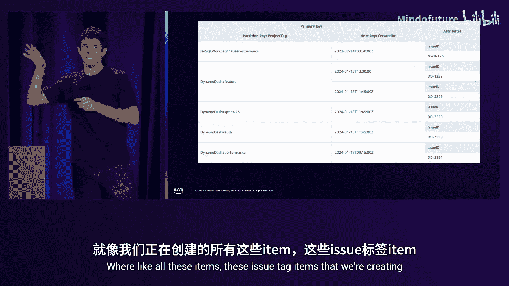

But the question might be。

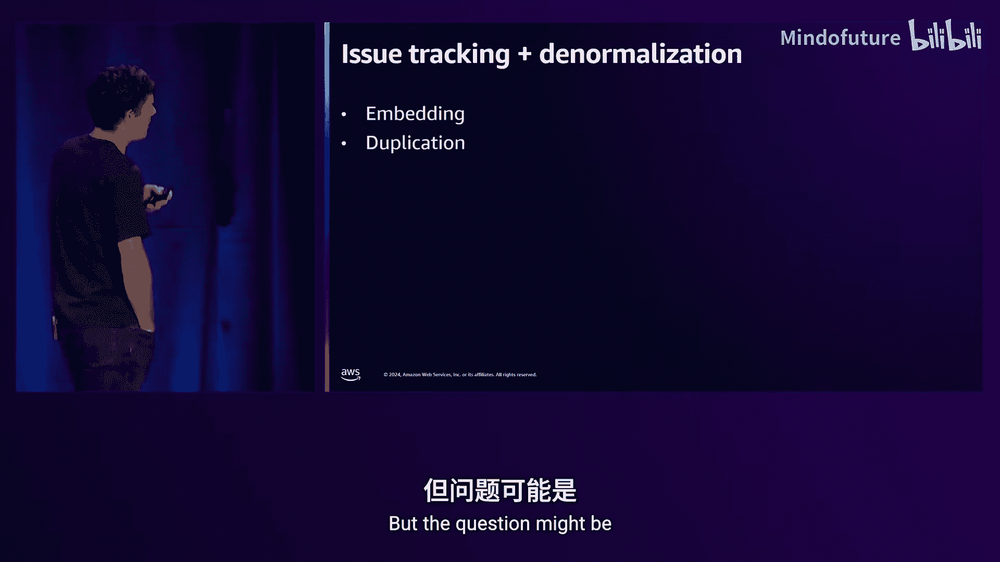

Hey， can we duplicate more， do we need to duplicate more data right。

 So these are like pretty bare items that we're duplicating there。

 may we duplicate the entire item into our issues by tag table。

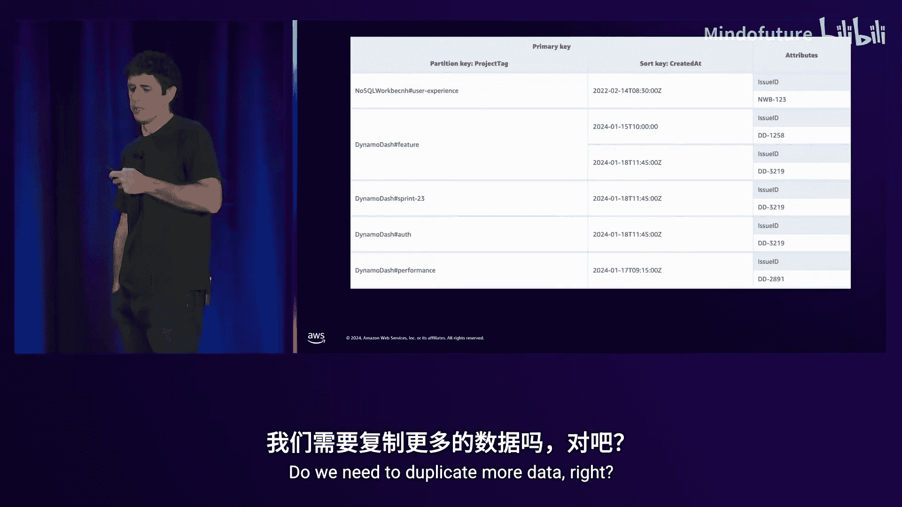

And now when I do that query， I can query it and I really only need to fetch one sort of like tag item collection if I want because I can look up hey maybe I'll just look up the features。

 the one for this project in one of those tags， I can look through for each one of those that tags array and filter out any one that doesn't have all the tags that I'm trying to match on so now I don't need to hit all those different item collections。

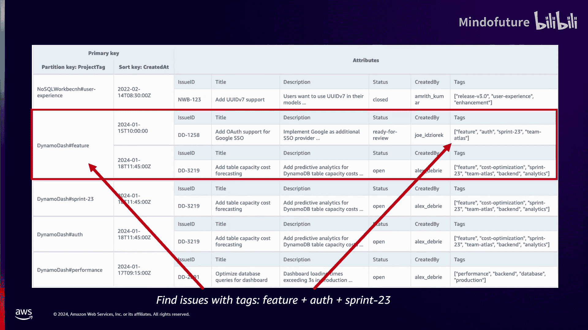

And I can just return that full issue item I don't have to。

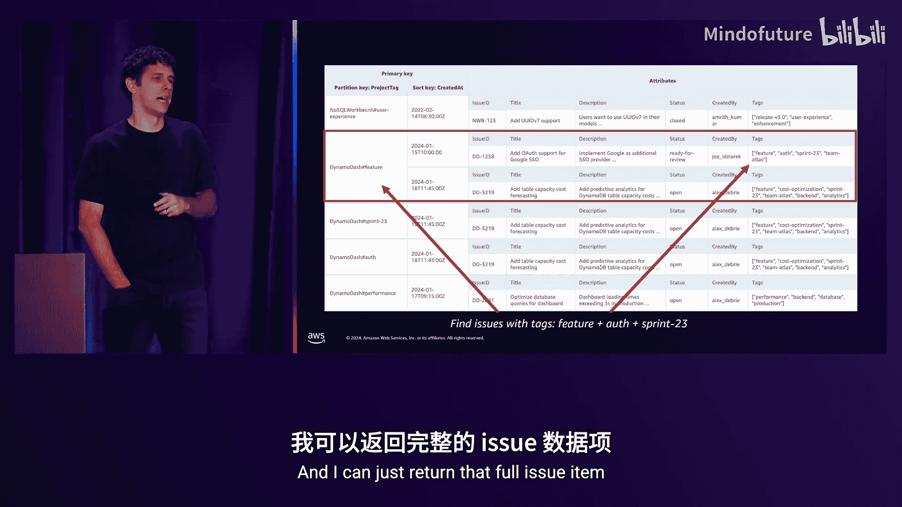

Do a a follow up read to like hydrate the full record there。

RightSo the trade off there is just like more duplication， like the benefits are going to be， hey。

 you have fewer reads that you need to do， lower latency on that stuff。

 but now need you're going to have a higher right cost and higher maintenance because whenever that issue changes or the tag change you need to affect more items there。

So just a couple other like that's one example of how you can do these sort of triggers and stored procedures。

 I think other use cases for these where you're like， hey。

 you're using Dynamo streams to affect your table and rein in your application。

 maintaining aggregations is a good one， tracking version histories。

 doing hierarchical work rollups are great too。So Dynamo streams。

 one of the things I love the most about Dynamo， really enables a lot of cool use cases there。

All right， we're getting close on time。All right， we're close here。

 so last thing I want to close out with is just like。

How do I make it Dynamo right because Dynamo has like some unique unique characteristics around what it can do and again if I'm approaching this application。

 how do I sort of think about this stuff and the big thing I say again。

 use those basics first right use those simple those single item actions。

 the query operation all that stuff， use these tips for all your data modeling styles and think about this stuff first and this should get you like 90% the way for a lot of your data models。

Where you get into like a more complex space where hey。

 it's something Dynamo doesn't support like array indexing or something like that Dynamo does give you some really nice building blocks to sort of build this and maintain this and be the query planner yourself if you want that's where we can see you can do that array indexing with streams or other types of rollups you want to do and the great thing about this is again you can do that math and math to say hey is this feasible what are the tradeoffs here and I can understand that pretty well and you can think about denormalization and sort of the tradeoffs there around that stuff。

you'll find a lot of times you'll find stuff where hey， the basics work well。

 I can use the building blocks to build some other things， but I can't do everything I want to do。

 something I really need to go to an external system and that's where you use that secondary system where it's necessary。

 whether that's open searcharch or Redshift or snowflake or whatever that is right and that's where you can use both the initial export of Dynamo plus Dynamo DB streams to get that out there。

But I would say don't jump to that too early is the last thing I would say like splitting and sorting are surprisingly powerful can be used for a lot of different things right we saw that that composite primary key。

 how you're grouping your data according to that partition key sorting within that and that can handle a lot of things right So big thing there is make sure you're grouping by high Carinality。

 using things like1 and ID user email device ID and again only putting records together in that same item collection if you're going access them together。

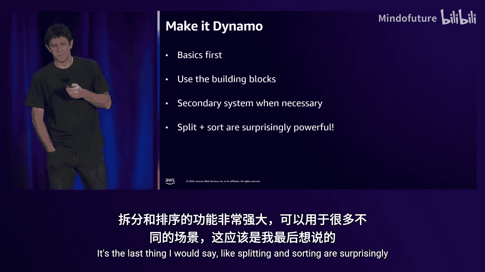

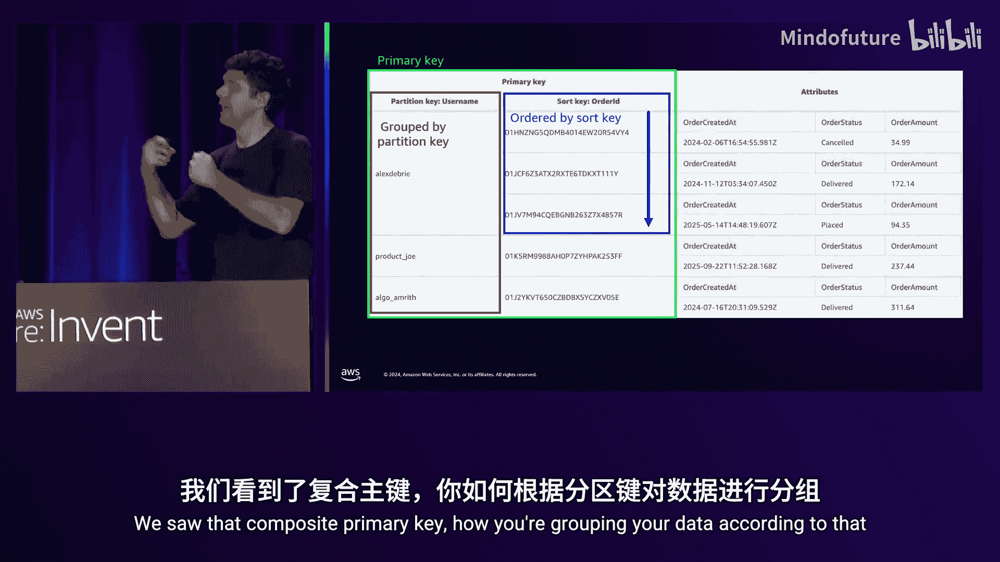

And then if you ever have multiple items within the same item collection。

 like sort by something meaningful， think of like， hey。

 how do I want these ordered if there's more than I can retrieve in a single result set。

 if I want to filter it down， so use something like a timestamp， a version ID。

 some sort of unique identifier that has a timetamp and all these are super useful and I think like this splitting and sorting can be used in like really interesting ways。

Just some like examples out there you can look at like geolookups。

 geohahing and where you can have like a partition key can be like a shorter geo hassh and the sort key can be a longer geo hassh。

 you can sort of use that to split items know somewhat geographically and then sort them to find closer things like that or Jason Hunter has this really cool talk on design patterns and dynamo Db where he has like this I lookup thing and if you know your sort of domain you can model this to handle a lot of things so splitting and sorting surprisingly and powerful there but yeah I love Dynamo。

 I think it can do a lot of things like again you have your choice of databases there are a lot of good ones out there but I think Dynamo is pretty powerful and you get some unique characteristics out of it So with that thanks for coming。

 I really appreciate it I'll be around out there you want to chat on anything。😊。

