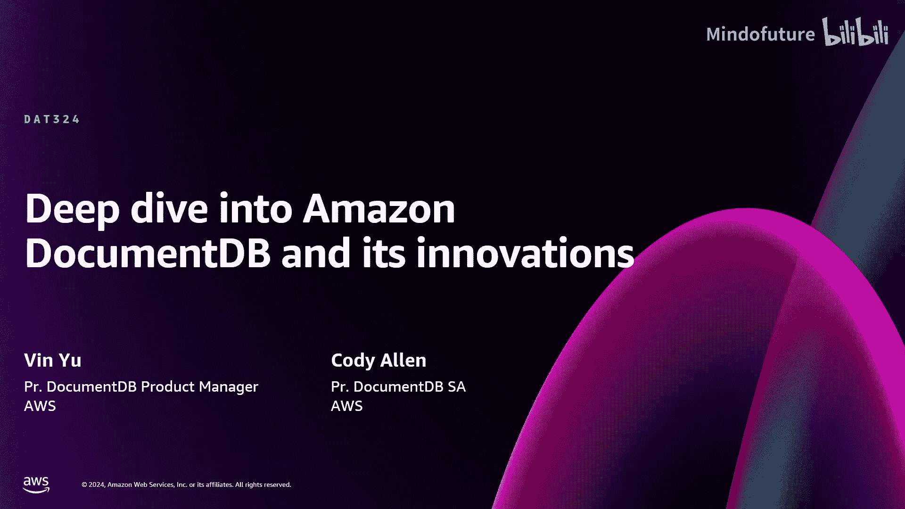
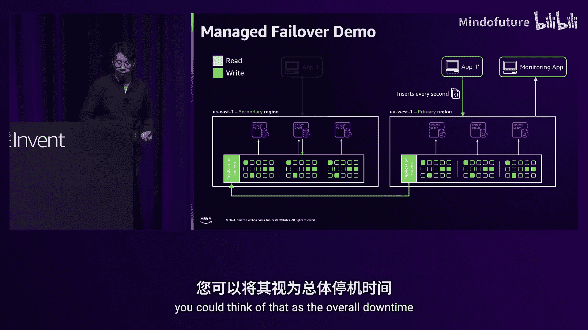
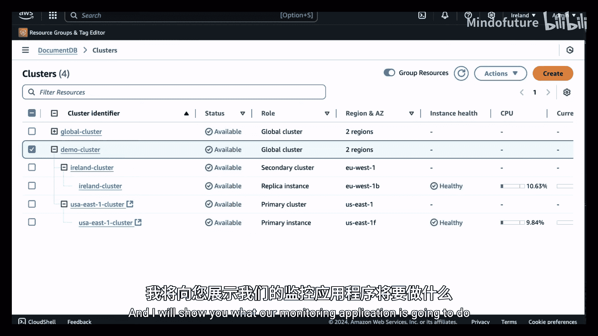
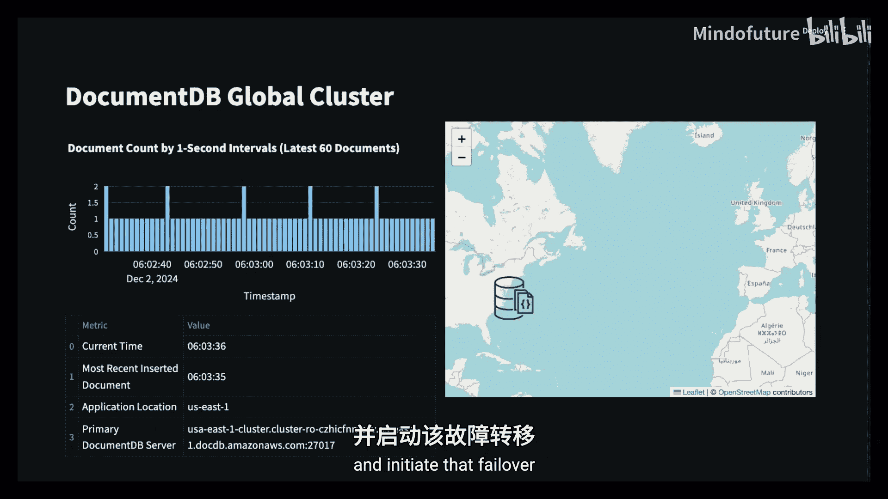
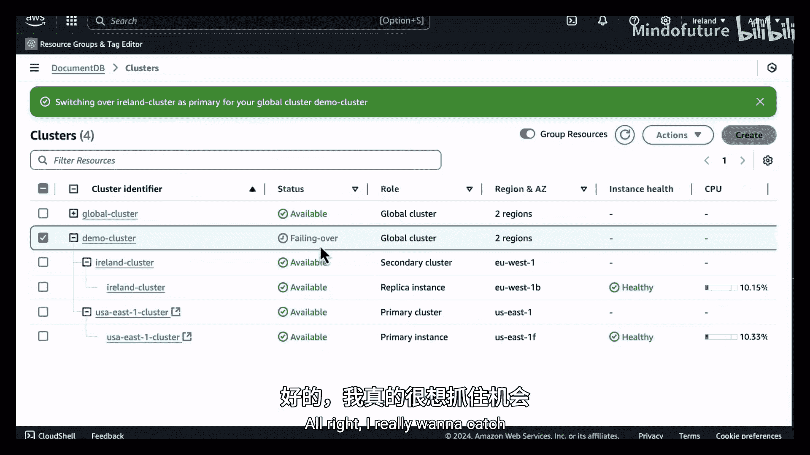
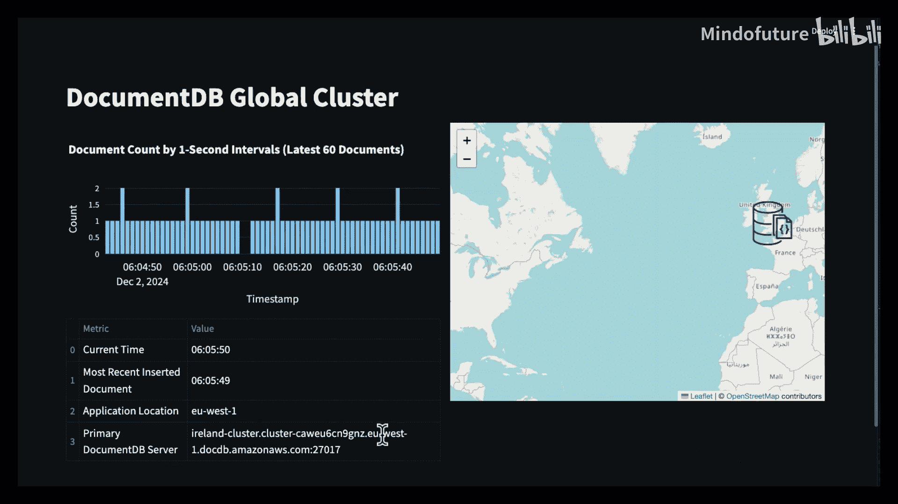
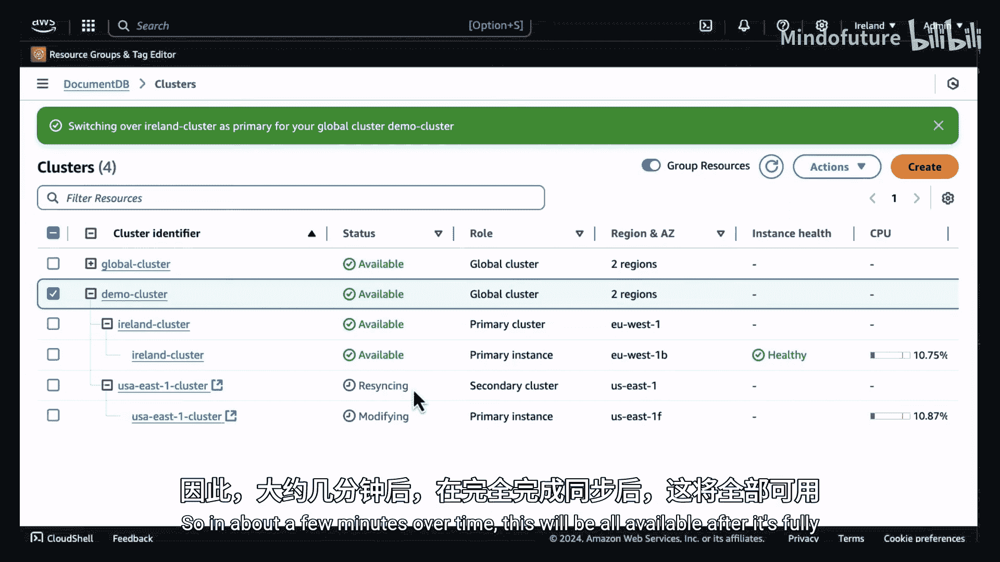
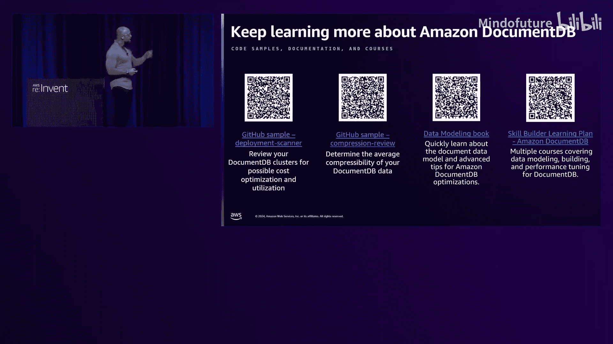
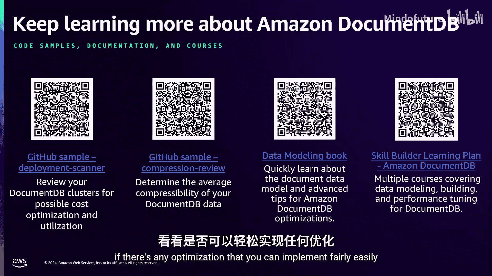
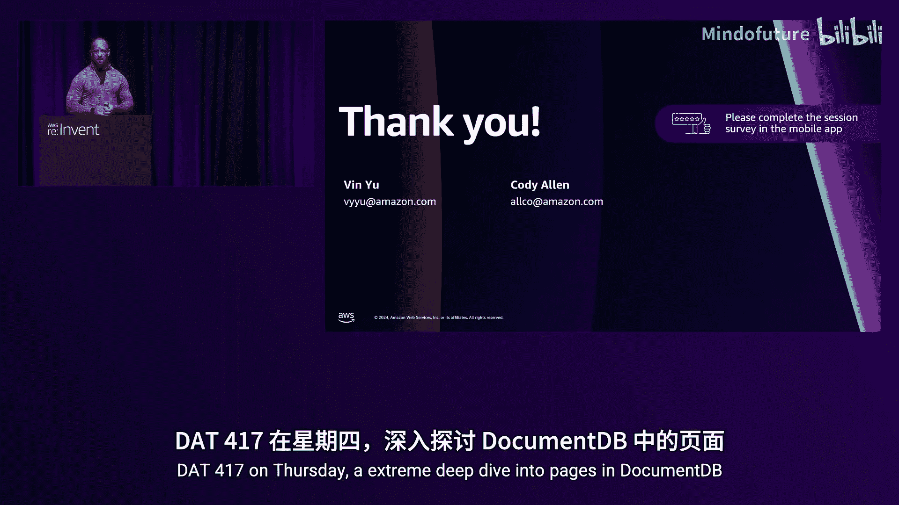

# 【AWS数据库峰会2024全集-•-中英】AWS-re：Invent-2024---Databases-p22-P22-Deep-dive-into-Amazon-DocumentDB-and-its-innovations-(DAT324)--BV1VAR5Y6Es1_p22-

Hi， everybody。 Thank you for joining us。 Hopefully， your reinvent is going great。

 Go ahead and put your headphones on now so that you can hear us。

 especially those folks in the back row。 Can I get a thumbs up if you can hear me。 Awesome。

 You want to test it。 Can you all hear me。😊，Sorry about Oh， I'm sorry that's a good thing。

 Not a bad thing。 Just to make sure you're in the right spot。 This is D A 3，2，4。

 We're gonna talk about deep diving into Amazon document DB and its innovations。

 Everybody here because it's a 300 level course 3，2，4。

 We're gonna assume that you know what document DB is。 You've had your hands on with it。

 You you're hopefully running a production workload on it。

 who's running a production workload on document Db。 That is fantastic perfect。

 So what's gonna happen is we're gonna skip the marketing page。 You guys know the marketing material。

 we're gonna go。😊，Basically straight into architecture and why we built it right because the magic with document DB is really the architecture and all all the components that make it up Now document DB has been around since January of 20 2019。

 it's one of the fastest growing database services on AWS who has been using document DB since let's say。

 last reenvent since 2023。Awesome， who's been using it for since 2022？

A couple more who's been using it since 2019。My man， that is awesome。 That's perfect。

 Before I was promoted to AWS employee， I was an AWS customer and we were one of the first customers that started using document D me and me and you back there。

 we were like the first ones。 I will tell you that since， you know， since its release。😊。

It's advancement。 all the features that we've created have come from our customers。

 We've always worked back with our customers to build the features they want in an enterprise document database。

Even though we've made some pretty substantial features and some pretty substantial releases in the past five years。

 I feel like this year， 2024 is probably our biggest year。

 So what we're gonna to do is we're going to start off going through what we've done this year。

 What are those big features in 2024 that we've focused on that。

 We've worked with customers on to release。 Then we're gonna kind of go over a few of those features。

 We're going deep dive into a couple of them。 We're gonna show you how you can navigate disaster recovery on document Db。

 We're going to talk about how these features can help you with cost and increase performance。

 And finally， we'll talk about some of the program programability features。

 Some of the APIs that we've released。 But I didn introduce ourselves。Can't see us。

 That's us Just bigger， I guess really handsome man on there。 I'm on there as well。

 My name is Cody Allen。 I'm a specialist solution architect。

 I've been with this team for about four years。 like I said I've been using it since it came out but with me。

 He needs no introduction， but I'll let him introduce him to Thanks Cody My name is V I'm one of the product managers leading document Db and I've been with the service for three and a half years and I'm based out of Seattle and I'm super excited to be here today to share with you all。

 Well we've launch over the last year。 A。 Thank you So to start things off。

 we'll talk about the service。 we'll look at the architecture Now if you've been using it for a while。

 this is familiar。 you know what this is。😊，The foundation of the service really is the separation of the compute on the top layer and that storage on the。

 the bottom layer。Because we have that distributed storage volume。

 that means that you don't have to rely on local storage to get that high availability reliability Now traditional database engines in order to have data durability。

 you have to write transactions on each instance， you have to write that transaction on each local storage of those instance now with document DB。

 the primary instance alone is going to send those right ahead logs to storage。

 that means that you don't have that additional communication。

Since that durability is handled on the storage layer。

 that means that you can have a document DB cluster with a single instance and still have durability and high availability on your storage layer。

 you don't have to make that trade off or that sacrifice to make that happen。

 task related to replication， any kind of log processing backups。

 all of that is handed off to that storage layer。Additionally。

 one thing that a lot of folks don't realize is that the each replica in your instance handles its own buffer cache。

 We do not dirty the buffer cache between instances。 So what that means is if I。

 let's say I updated document。嗯。When I update that document。

 that goes to the primary primary sends it to the distributeds towards layer。

 the primary is then going to send a write a ahead log to the secondary and say， hey。

 we just updated this document， make sure you update it。 Second looks at it and says， okay。

 if I have it， I'm going update my cache。 if I don't， cool， you made your update。 I don't care。

 I don't need it。 So we keep those caches independent from each other。Now。

 because I want to make sure that we cover what's new and go over all these features。

 we're going to talk a little bit more about that compute layer， the backup layer a little bit later。

 but the point is everything that we've done with document Db is purpose built for the cloud to help enterprise customers run their document database workloads。

 We have a lot of customers。 We have digital native customers like Rapy。

 we have large enterprise customers like Capital One， we have customers that go that cover gaming。

 financial industry。 Amazon com fulfillment by Amazon Amazon com that is running on document DB。

 So we have a broad range of customers。 I would encourage you to go check out that customers page you've never seen it before。

 We have some really good customer references， some new ones that we've added this year that kind of dive a little bit deeper into those。

But with that said， let's move on to the fun stuff and Vi's going to walk us through all of our new innovations for 2024。

Thanks， Cody。Awesome， so thanks for that quick refresher。 awesomewesome introduction there。

 So it's always really good to hear from our customers and their use case with document Db。😊。

But one thing that's really important to us as a service team is we actually get to work with you and get your feedback and that's actually what's really centered around a lot of the innovation that we launched this year。

So a lot of the features that we had Louise launched this here was actually in partnership with our customers。

 Now， I would recommend taking a picture of this slide because we're not going to have the time to go through every single feature here。

 It's going to take quite a bit of time。 However， if you just take a search on any of these features later on。

And after the session， of course， all right now， you can find more details through our documentation on each one of these features now going top down you'll see that we've made investments across performance and scale with features such as document compression and increasing our connection limits to cost optimization with IO optimized。

 which is going to provide you predictable IO pricing。

We've also launched features around AIML and high availability with global clusters。

 manage switchover and manage failover。Now， so for the remainder of the session。

 what we're going to do is really dive deep into several of these， the ones with the stars。

 and dive deep into those features to tell you how it works。

 how you can implement it in your environment。So the first feature I want to talk about is IM authentication and this is a feature that many of our customers have been asking for for a while because what we're starting to see is a lot of our customers centralize their authentication mechanisms across their AWS resources which include document DB so with IM authentication。

 what you would do is with your clients you would reach out to AWS IAM。

 specifically the security token service to get a token。

Then the clients would then use that token to authenticate against Do DB。

 Now one thing to note here is that the identities are created within your document DB cluster and they are managed within an external database。

 so this is something that you have to configure before you use IAM or else your document DB cluster won't know what to do with those tokens。

And we have step by step instructions on how you could achieve this through our docs as well。

You could also use IM authentication on top of existing R back ruless and users in your document DB cluster。

 so for example， let's say you have user one as access to Data1 and Data 2 your IM entities could be mapped on top of that so that when they're logging in with IM。

 they could also have access to database one and database2。Now as an admin。

 you will also have the ability to monitor your IM authentication request through CloudWatching。

 this is really important for anyone who is using IM is that you could have full control and visibility over your IAM request。

Okay， it's the second slide I have here is vector searched this big area this year we did launch HNSW now I'm not going to go into the use cases here because we did have a session this morning DATT320 supercharging app intelligence using GenAI。

 if you missed that session however do take a picture of this all our breakouts are recorded and you will have access to this after reinvent。

 but just as quick show hands who attended that session this morning。Okay， so few of you。

 you'll notice that Cody was the presenter there。But this is going to be an area that we're going to continue to invest in 2025 and beyond。

All right， so with that said， let's go into a next set of features with global cluster improvements。

 specifically manage failover and manage switchover。

Now if you're not familiar with global clusters it's just a really quick refresher because we're going to reference it a lot。

 Global clusters provides you the ability to scale Noscale to provide your cluster to be spanned across multiple AWS regions and it is going to provide you two benefits。

 one of them is disaster recovery because you have a copy of your data in another region in the event of a disaster what you could do is fail over to that secondary region and secondary is data locality because you have a copy of the data in another region you can query that data for very low rate latency。

So the two primary benefits， so how would you go about setting up a global cluster？

Let's say I have a document D cluster in North Virginia， US East1。

 and I have my application connected to it。What I would then do is go to the AWS console or CLI。

 and I would just simply add another region very easy， pretty much one click。

 but notice that the replication service is replicating data from the storage tier and this provides you actually a really good advantage because instead of having the instances do that compute of data replication and moving data between the two instances。

 this is happening on that storage tier so it frees up your application to use the database in its full and it's full。

You could also connect to that secondary instance， as I was mentioning earlier from your second application。

 Now， I also like to point to you that here you see there's about three instances per cluster。

 but it doesn't have to be that way。 In fact， what you could have is more or less instances。

 larger or smaller instances， depending on your business need。So you could have one instance。

 for example， you could have a smaller instance， for example， in fact。

 you can have even have zero instances and what we call this a headless secondary。Now， in fact。

 this will have what this will enable you to do is pretty much saving on a little bit of cost。

 but I do want to caution you caution you that if you're trying to have this set up for a failover type of scenario。

 you will have to spin up an instance beforehand。 and that takes about 7 to 10 minutes。

 So that's going to contribute to your overall。Failover process if you do not have an instance in your secondary region。

All right， let's go into one of the two new features that we have， which is managed failover。

And the benefit of managed failover is the primary objective of this feature is to allow you to promote a secondary to primary with no data loss。

 and that no data loss is going to be the key difference between one of the key differences between managed switchover and managed failover。

So and you would want to use mass switchover for controlled scenarios。

 and I'll talk about why controlled scenarios in a bit。First of all。

 you could use it for maintenance， for example， let's say you want to perform maintenance in a single region。

You could first switch over with no data loss， performable maintenance and switch back you could also do things like multireion follow the sun applications。

 let's say you have an application across multiple multiple time zones across multiple regions and you want low latency rights。

 you could use switch over for that type of use case and last but not least a very common scenario of switchover is paired up with managed to failover。

You could also use it as a zero day loss method to fail back after a failover。However。

 one of the things that I like to call out is that switching over can take several minutes。

 and I'll explain to you why right about now。 So here I have， again。

 I have my my two clusters set up for my global cluster。What happens when I hit switch over？

The moment I hit switch over， the first thing that's going to do is the rights on your global cluster are going to be disabled and the reason why we do this is that we this allows our clusters from primary region to be seeded over to our secondary regions。

 Now， once all the data has caught up。What we will then do is proceed with that promotion process。

So you can see here that I'm going to promote that US West2， which is in Oregon to the primary。

 and then I can continue to perform rights against that new region。All right。

 our second feature is managed failover， and the primary objective of this is to promote a secondary to primary。

 very similar， but the main objective here is to minimize cluster downtime。

So you really want to use this for business continuity events in an event， for example。

 where there's a complete service outage or there's something really went wrong in that region。

And one thing I like to call up with both switchover and failover is that the topology is maintained。

 and what I mean by that is say something word to go wrong with your cluster。

When that cluster comes back online， the Docu DB service will automatically add that back into the global cluster and do that seating for you so that you do not have to do that manual post cleanup of any sorts。

So let's take a look at how this works。Let's say I have my setup between North Virginia and Oregon。

And something were to go wrong， very super rare case of something going wrong in North Virginia and the cluster's down。

I want to hit failover。 And the moment I do this is that I want to be able to promote that secondary region to primary。

 One thing to note here is that the data that is being seated over。

If you have any ongoing transactions， it may be lost。 however， remember。

 the objective of failover is to minimize downtime and to maximize the upturn of the overall global cluster。

So let's say sometime later US East1 comes back online。

 however the cluster may not be in a healthy state， we don't know the state of that data。

 so what we are going to do is seed the data over from primary to our secondary cluster。

It's going to be and also applicationp1 can connect to that cluster in Oregon while the seeing is in process。

And then once that cluster has fully seated， the endpoints will be open and you can connect to it。

Alright， so with both switch over and failover， one thing I like to call out is that while we make it really easy to failover or switch over。

 there are different cluster endpoints that your application may need to connect to so let's say you are let's say you have a application and you are failing over switch over。

 one thing that you may have to go do is change that application connection string however。

 a very common workaround is to actually introduce a row 53 hostted zone and this is actually going to be a method for you to that actually helps you instead of having to change that make an application change or application application change。

You can actually just use your application and point it out， say my global。A globalbal my domain。

 instead。So here's an example， let's say I have app1 and the point of app one is to do both reads and writes。

 and my primary is currently in organ。So the entry in my row 53 is going to be pointed。

 is going to redirect all the traffic to Oregon cluster。And if I do a switch over failover。

 all I have to do is update that entry instead of making an application change。

 so I could just point my application traffic。Pointing to this secondary region。All right。

 let's get into a demo here， I want to actually show you how easy it is to actually initiate a managed failover。

 but before I do that I want to just show you my setup for my setup I have a cluster that's in US and I have a cluster that is in Ireland and both of this is part of the global cluster。

I also have an application and this application is simply just going to insert rights every single second。

 so you could think of this as a heartbeat。I also have a monitoring application that's going to monitor my global cluster as well as the application as well。

 and this is going to tell me things like who is currently the primary。

 where's the application that's doing the rights originating from？

Then I'm going to initiate a failover。And what this is going to do is have the application。

 I'm also going to fail over the application， by the way。

And the applications can do exactly the same thing in Ireland。

 This is going to insert every single second， acting as a heartbeat。So at any given point。

 if I see in our demo where docs are not being insert every single second。

 you could think of that as the overall downtime。

All right， with that said， let's go ahead and go to our demo。So here I am in the AWS console。

And I have a cluster called demo cluster disbands across two regions。

 my USAE One cluster is currently my primary cluster。My Ireland cluster is currently in EU1。

 serving as my secondary cluster。And so all right， so let's go over to the。

Go over to our monitoring application and I will show you what our monitoring application is going to do so there's a few elements on this page but I want to point your attention to that graph so that graph is actually showing the the number of documents being inserted over time and you can see that it is inserting every single second you could think of this as the heartbeat of our application。

And on the right side I have a map with an icon of a database document DB and is currently in the US hovering over North Virginia。

 that's the location of the primary， so later when I do a failover。

 that icon should go over to Ireland。On the top right。

 I also have the current time the most recent inserted document notice how it's approximately about one to two seconds behind as the page refreshes what we're going to see is。

This being updated， I also have a application location where the application is issuing the rights and I have the primary document DB server URL here you can see that。

It does state US E1 in the URL。All right， so I want to go back to the AWS console and let's go ahead and initiate that failover so here I'm in the console in order to fail over。

 I'm going to select that demo cluster。

Which is already selected， then I'm going to go under actions and click on switchover or failover。

And upon switching that， I'm going to have the option to either initiate a switchover or initiate a failover。

 I'm going to select failover。And one thing I like to note that， remember。

 the main goal of failover is to maximize the uptime of my global cluster。

 so there is the possibility of data loss， any ongoing transactions may be lost。

Im want to select my primary cluster as。Ireland cluster。

And then I want to just click on confirm to confirm that I want to allow for data loss in case there is an event of any ongoing transactions。

Okay， so you can see in the banner very top is the switching over Island cluster as the primary of my global cluster。

And you can look under the status of failing over as well。

 All right I really want to catch now I really want to go back to the monitoring application to show you this in action。

 all right， so notice how there's a little blip over there。

 what that indicates is that rights actually were not able to make it to the database at the point in time and it's approximately two bars which means that our failover the overall downtime was approximately just two seconds。

 so I was able to failover from US to Ireland across the ocean there with just pretty much two seconds of downtime。

You can see the icon is hovering over Ireland。I also want you could also look at the application location。

 which is currently in EUUS1 and the URL is also EUUS1。

 which indicates that the main primary is in Ireland。Okay， let's go back to the console。

 I just want to show you one more thing really quick about the status of the cluster the two clusters are in。

The global cluster。So you can see here that's still failing over。

 let's go click on refresh on the AWs console page。And this should refresh the status。

 You notice that here the Ireland cluster is currently now the primary cluster。

And the USA USAE1 cluster is in a reying state， that is the data is now being propagated back so in about a few minutes over time。

 this will be all available after it's fully finished sinking。

Okay， a few key takeaways， I'm not going to go over all these key takeaways。

 but feel free to take a picture of this， this is really just talking points and notes for you to bring back to your organization if you're thinking about implementing global clusters back in your organization。

 just a few tips and things to really consider。When if you're considering global clusters。

 we also have a lot of this information in our documentation as well。With that said。

 I want to pass it over to Cody who's going to deep dive into performance and cost to share a lot more over there。

Man， I thought I had something big to live up to。 Everybody was clapping for you in the other session。

 That was incredible。 And thank you。 Yeah， So let's let's switch gears。

 Let's talk about cost performance a little bit now。😊。

The great thing about JSON and the document data model is well it's flexible right Traitionly。

 what we do when we create new application， a new workload with a relational databases。

 we start with the relational database， right， we define the tables。 We define the keys。

 primary key in the foreign key。 We create our pure join tables， right。

 We have to build this relationship and the structure of these rigid relational database tables before we even touch the application and then we start touching the application。

 we realize that we need to change things well we have to go back to the database and do it first。😊。

Document database model， JsonN model allows us to change that around， right。

 We now start with the application。 The application is defining the database structure。

 It's defining what our collections， our namespaces look like。

 Our end user experience is the goal here。 We want to improve that。

 and we can do that by starting with the application now。

And as your application grows right as you have more users as you start to evolve。

 you're going find that well you need new fields， you have new fields that you want to capture。

 strings are going become a， those are going to turn it into embedded documents the entire structure of your data is going to change is going to grow as you evolve what you're going to find is as you move from development to production and later releases is that a different document model is going to be more performant。

 you're going to add more features to your application。

 your user experience is going to improve you're gonna to get betterqueries， better results。

And obviously， as you add more fields， well， your document size is going to grow and beyond that。

 beyond your document size growing。As you onboard new users， more people download your app。

 you do merger and acquisitions with other companies， you bring on legacy datas。

 Well you're gonna to get a lot more documents。 it's going to continue to grow。

 Now we talked about the storage layer earlier with document DB。

 but the entire service was designed to help you scale as needed。

 the storage layer takes care of that， the compute layer well you can increase the instance size。

 you can add more instances as your workload grows。

 And since you get native integration with cloud with Cloudwaatch。

 you can even set up orchestration with Cloudwatch alarms。

 Lambda event bridge to automatically scale that up and scale that down if you notice。

It's heterogeneous size。 You don't have to have instances that are all exactly the same size。

 You can have readers that are larger than your primary。

 You can have a primary that's larger than your readers。

 There's reasons why you wouldnt and wouldn't do that， but that's for a different conversation。

 that distributeded storage layer， that's going to grow for you。

 grows in 10 GB chunks as your storage grows。 And when you do things like drop name spaces or drop collections。

 drop databases。 It's actually going to shrink for you as well。 Now， this is fantastic， right。

 The ability to grow and scale is fantastic。 But we also want to be good stewards of our environment。

 right， the capability to scale is wonderful。 but we need to be efficient， right， We need to。

 we need to worry about cost。 We need to worry about our performance。😊，Now。

 there are design implementations that you can that you can do that will help out。

 So things like reducing your key size。 This is a big one。 Json's great because it's human readable。

 It's easy for us to parse， but it doesn't need to be， right， We don't need to read it。

 Our applications just need to read it。 Every character that we use in a document is space use on disk in space use in the indexes as well。

 And that can affect your working set， right， that can affect your cache。 So， for example。

 let's take this document that we saw earlier。 And we're going change it from this。Over to this。

 right， pretty， pretty simple changes there。 We just saved 67 bys by doing that。

 Our data stayed the same。 We just changed our key names。

 We moved from about 457 bytes down to about 385 saving us about 15% of savings on that one document。

 We're talking about bytes here。Now doesn't seem like much。

 but this can become very significant as your data layer or as your documents grow。

When you start scaling up to 5 billion documents， for example。

 this can equate to a saving of over 300 GB as you scale up to maybe over 20 billion documents。

 You're talking about over a terab of savings。 This is something that that we see pretty common。

 This is something that we see pretty often with customers is a majority of their document size is made up of that key。

 not of not of the field itself， but of the key。 and this is wasted space。 right。

 you don't need that。 We have customers that will。Move to this and even create an abstraction layer at the application layer that will define that。

 that will convert that for you。This is massive taking care of that savings if you joined us for our DATT 417 session earlier or yesterday。

 we talked about this a little bit， but we added another feature in 2023 that helps you out with this beyond making these document changes。

Sky， he's pretty important around here。 He's the CEO of Amazon。 He used to be the CEO of AWS。

 And when he was the CEO of AWS， he had a saying that there is no compression algorithm for experience。

 Now， what you might not know if he got cut off， his might got shut off before he could finish。

 The full quote was theres no compression algorithm for document Db。 But guess what we changed that。

 there is compression for document DB now。To understand compression on document DB。

 let's talk about how data is stored。Now we use8 kilobyte pages to store your documents。

In an ideal situation， let's say that you have2，4 kiloB documents。

 That means that they're going to fit nicely into a single page。

 If your application only needs one of those documents or if it needs two and those documents are in the same page。

 that means we have one IO。 We only have to do a single IO to get two documents。But what happens。

If your document is greater than 4 k， let's it's a little bit bigger， let's say it's 5 kB。

 Now document Db is going to store that 5 kB document in that page， but we have this unused space。

 right， we can't use it for anything else。 So essentially， it's wasted。

 That means that if I need to get two documents from document Db。

 I am guaranteed to do at least two IO。 And there's cost for that。 right。

 we have to pay for the performance。 If I have to go reach back to disk to pull that back。

 that's additional I O。 That's additional network traffic I have to do。 and I pay for IO。

 So there's a cost both in performance and billing。 And again。

We go really deep into this in our session， DAT 417。 we're having a repeat on Thursday。

 shameless plug。 come see us if you haven't seen it。

 we'll talk about how pages are stored and how compression can help。

 but you can imagine how this could affects really。

 really large workloads or let's say that you had documents that were 7 megabytes in size right we have a document size limit of 16 mebytes on document DBS JO file size limit。

 but even if you had documents that were 7 mebys that means that for a single document if it was perfectly fit into an 8 kilo and 8 kilobyte pages。

 you're going need 875 pages just for1，7 mebyte document。And that's where compression came in。

 We introduced compression in 2023 to help out with this。

 So in that case where you have a 7 mebyte document， if you had a  two to one compression ratio。

 guess what， you cut your IO by 50% just by enabling that。Now this is all straightforward so far。

 compression is good and big things compress better than small things。

But we're trying to squeeze the most performance and get the best cost out of document to be as possible。

 Now， when we released document compression in 2023。The default compression size was 2 kiloB。

 So that means that if you had a document that was over 2 kiloB， good， it compress for you。

 But if it was under if it was 1。5 or even if it was 1。9999 kiloB。

 it didn't compress that you had to be at least at that 2 kilo level。

 But now what we've introduced in with compression this year is the ability to set the compression threshold you can set it as low as 128 B or can set as high as 8 kiloB。

 So that means that if I have a 1。5 kilo document， and it compresses 3 to 1， I get it down to 500 B。

 that means that instead of fitting five of those into a page， I can now fit 16 of those into a page。

 that means that。I have S I O。 So if you consider， I have 1000 documents to get。

Instead of doing 200 IO when the documents were larger， now I'm doing 63 and again。

 that's lower cost， less IO threads， and less IO threads means lower CPU usage on your document DB instance。

 so you're going to see a performance increase on this as well。

To give you an idea of what this looks like， we ran a couple tests。In this first test。

 this was rate limited， so what we did is we ran some workloads with5 kiloby documents and one and a half kilobyte documents。

 we ran them compressed and uncompressed Now this first one。

 we set the amount of inserts per second it can do we made all the workloads run the exact same amount of inserts per second and we ran them for a capped period of time so essentially this means that all these workloads are inserting the same amount of documents。

What we can see here is that a huge drop in IO by doing this。

 We have a 30% drop in IO on those large documents。

 but we still have an 11% performance increase drop in IO on those smaller documents。

1 and half kilobyte。And we also see that performance increase。 We see that CPU usage go down。

 A lot of a misconception that we have is enabling compression will negatively affect CPU， right。

 because my compute layer has to do the compression of the documents and has to decompress them。

 But what you actually see with these rate limited workloads is that CPU goes down。

 The reason for that is that drop in right eyeops。 D in right eyeops means we have to dedicate less CPU threads to do those IO operations。

But there's a trade off here right this is great， but the other side of this is well。

 our second test and with this one， we essentially cranked these up to 11 right this is your cyber Monday deal。

 this is your surprise sneaker drop for Nike。This is basically throwing as much workload at this document DB instance as its network could handle。

Obviously， IO goes up。 IO goes up。 That means that we can handle more transactions。

 We have more inserts per second that are happening。

 but the other side of this is higher CPU usage and the higher CPU usage is happening because you have more IO threads。

 you have more IO threads that are handling all that。 Now， this is the anomaly， this is the outlier。

 most workloads rarely ever see this or they don't see it。

 but just understand that compressing is good for your normal day to day workload。

 But if you do have those spike events， you could see an increase on that CPU usage on those instances。

Now switching it over， let's talk a little bit about programability to recap。

 what we've talked about so far is well JSON's great because we can evolve our application we can change our schema simply by declaring it and compression is great because we can optimize that potential growth and use less space but sometimes we need more than this you know sometimes applications shouldn't just have a free for all to change things in the schemaless design whenever they want right we need to have some controls on this。

Especially in the financial industry。You need garbells， you need to protect your data。

 you want to allow new data types， but you still want to maintain integrity and security accountcount numbers need to be exactly10 digits。

 transactions cannot be zero or negative amounts because of regulation requirements。

 certain fields are required to be in your documents。There's also a need to prevent errors。

Catching data issues before they enter your collection and this is what customers shared with us when we introduced the JSON Schema validation in documentcument DB。

 this lets you set up rules that you have to follow。

 you have to abide by whenever those transactions go into document DB。Now。

 most workloads are performing that validation， not just at the database layer。

 but at the application layer。 So， for example。At the API layer， the API layer。

 you're making sure that your UI parameters are there。

 your query strings and your headers are present are properly formatted。

 you're making sure that your payload matches the JSON request method you're putting all of these controls in it at both layers best practice though is to do this at both layers。

 both of the application layer and at the database layer。From the API layer。

 you're able to catch these errors before they hit the database， which means less wasted resources。

 that database layer， that means that you can provide custom and immediate feedback and air handling to your customer now the database layer。

 while you're ensuring that data integrity right you're protecting the data regardless of where it's coming from。

 you're protecting against directed database access if anybody's doing Mongo shellll commands and you're ensuring consistency across multiple applications that might all be touching that at once。

Now， this is fantastic， but customers shared with us that this actually can cause speed bumps can cause hiccups in their development process。

 They they're constrained by these validation rules as they're trying to develop new features， right。

 It's preventing them from having an environment and development with the same as production because they want to add more fields。

 They don't wantan to be constrained by that。 So what we did to address this is we introduce that bypass document validation parameter for JSON schema validation。

😊，This allows you to skip those validation rules whenever you're inserting or updating documents into a collection that has those validation rules defined。

 for example。In events where you want to migrate a large amount of legacy data。

 which is what we're doing here， you can utilize that parameter to temporarily allow you to bypass that As you start working with customers to develop new features。

 you want to change your schema。 this makes it development process go a whole lot quicker or let's say that you have an emergency fix that you have to push through this new parameter allows you to bypass that。

Now。2024 has been a very， very busy year for us again。

 this is not the full list of features that we've come out with。

 these are just the ones that we wanted to highlight。We have a few features on the roadmap。

 by the way， that unfortunately， we're not able to make this list。 We， we wanted to。

 but they're close。might get in trouble with V for saying that。 but just a hint。

 There's some big things coming very， very soon for document Db。

 But everything that we've gone over today is possible because of you， because of our customers。

 we may， as a solution A tech， I sit down with you。 and I figure out how you're using it。

 what you need。 What are those features that are important to you。

 Then he sits down with our customers to figure out how we can work with our engineers to release these features to give you these extra capabilities。

 as we go into 2025。We're gonna keep this pace of innovation going。

 I think we're gonna to see even more releases in 2025 as a matter of fact， I know we are。

 We're going to see more releases in 2025 than we saw in 2024。 but as we do that。

 we want to continue working with you。 We want to continue building with you。

 We want to continue making these features that you led the JO Schema validation is a great example of that。

 because of our close partnership with a customer on that Jason schemechema validation。

 we were able to streamline that release and custom build it exactly how they need to。

 I think the production time was cut down by months by working with the customer on that。

 But with that said， we look forward to hearing from you。 What are your use cases。

 What are those features that you want。 What are those features that can help you innovate。

 save cost and increase your overall performance and workloads with document DB。

Some things to check out， take a picture or scan these， we have our document D deployment scanner。

This is a way to look at your clusters and see if there's any optimization that you can that you can implement fairly easily。

 We have a compression reviewer。 So if you have a document Db cluster that does not have compression enabled。

 do you want to have an idea of will compression make a difference。

 run that tool and these are simple Python scripts。 I think they're like 10020 line Python scripts。

 very very basic， very simple to run check them out and leave us feedback like if if there's anything you want to see in those scripts。

 let us know we did release a brand new data modeling ebook that's very specific。

 extremely specific to document Db that tells you how you can do data modeling and advanced tips for those optimizations that are specific to document DB and we've partnered with the training and certification team to create a course entire course guideline for document DB。

 it'll take you from an introduction all the way up to cost and performance tuning data modeling and really let you interact with that But with that being said。

 thank you so much for joining。

us，Please enjoy the rest of your reinvent D A T 4，1，7 on on Thursday。

 a extreme deep dive into pages and document D B。 And please remember to fill out that session。

 Thank you， everybody。 Appreciate it。😊。

