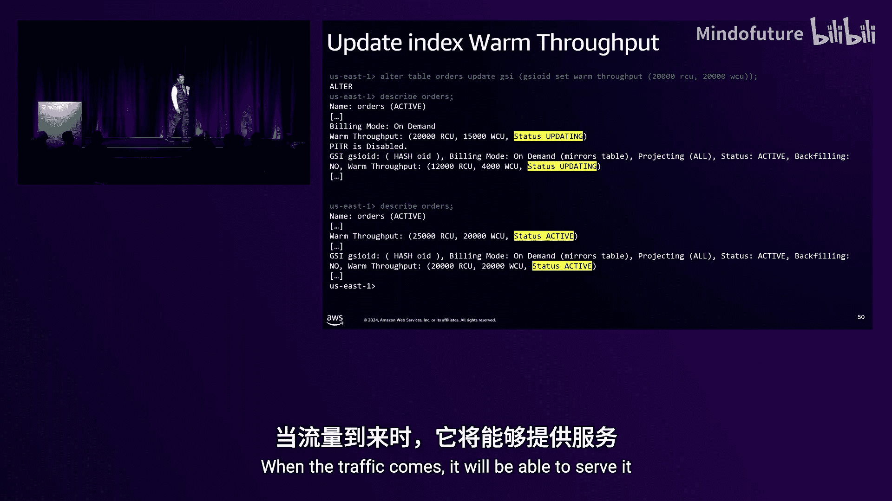
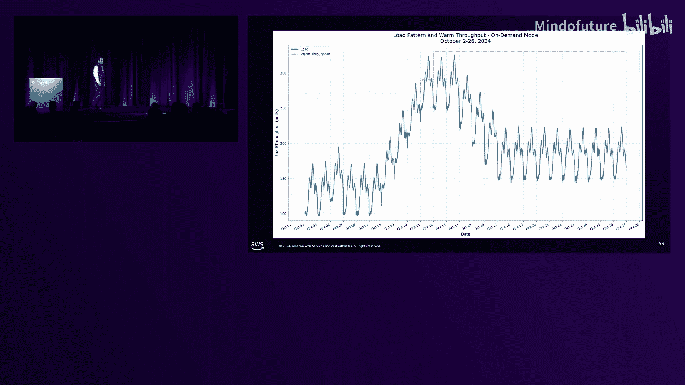
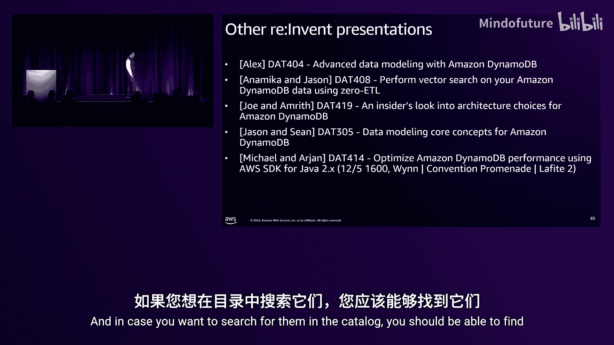

# 【AWS数据库峰会2024全集-•-中英】AWS-re：Invent-2024---Databases-p23-P23-Dive-deep-into-Amazon-DynamoDB-(DAT406)--BV1VAR5Y6Es1_p23-

So。

With that， let's get started。I'm sure all of you know this， building things at scale is hard。And。

Your customers。Demand exacting performance。Predictable performance and some of the applications which you build on Dynamo Db are truly impressive scale。

The thing， which。

We find is that。The applications you wrote are so complex。Dynamo Db is a tool。

 It is much easier for you to build these applications。 if you know how dynamo D B is built。But also。

 if we're able to tell you some of the things we learned along the way。

So the point of this talk is to share some of those learnings。 My name is Amrith。

 I'm a senior principal engineer with the Dynamo DB team。 I've been here about。Four years。

 four and a half years。嗯。And I've this entire time at AWS， I've been in the dynamo DV team。

So what we're going to be talking about is how we built that Mobi at scale。

 And we want to share with you some of the things we learned。

Because they will be applicable in the applications you're building。And hopefully。

 you don't make the same mistakes which read it along the way， so。There's another part of it。

Like every engineer， I'm really proud of the things which my team has built。

 So I would like to show those off as well。😊，The first part of this presentation is going to be a very quick。

The nickel tour of the Dynamo DB architecture， before we dive into three specific topics。

 the first one， MDS， which is an internal data store， which we use for partition lookup。

The second is we'll talk about things related to a new feature we launched。

Two weeks ago called warmm throught。And then we'll talk about synchronous global tables or strongly consistent global tables。

 okay。So dynamo D B， in addition to all the things in yellow up top。

The reason why people use dynamo D B is because you want to build applications which give you predictable response times at any scale。

 This is what your customers ask you for。 We're building the database。

 which does the exact same thing。 So I'm gonna repeat these three things over and over during the stock。

 Preictable low latency at any scale。That's what we're all about。 And building applications at scale。

 which give you predictable latency is hard。How we did it is what this talk is about。

 So if youve used dynamo D B for a while。You know that all data and dynamod D is stored in tables or indexes。

Throughout this talk， when I talk about tables， it equally applies to indexes。Internally。

 we store indexes just the same way we store tables。 So I'll keep it easy。

 I'll just talk about tables。 When you create a table， we ask you for a table name。

And we ask you how you want to distribute the data in that table。 We horizontally scale。

 So what's the distribution。 So here's an example。 I've got a users login。

A name and some other information。 whatever that information happens to be。

And I've determined that login。Is a primary key in the traditional relational database sense。

 it's unique and it's not nu。 So I say distribute the database on that。 Now。

 what we do internally is we use the login key to decide how we distribute it。Quick aside。

I've spent 35 years working with databases。Mostly building them for a brief period using them。

My finger type sQL a whole lot better than they type the AWS command line， so。

When I started working in this team。Not having a CI like the MySQL CI kind of put a cramp in my style。

 So I built this thing for myself。 It's a dynamo DB shell。 It gives you a SQLish kind of interface。

 It's open source。 You can download it。 You can use it。 It's available on Home Ro if you want to。

 So you'll see these things which look like SQL。Dynamo D B is not becoming a SQL database。 All right。

 This is just easy for me to show。 It's easy to read and say， I want to create a table。

 I want the primary key to be loggged。 That's it。 So if you want to use dynamo D B shell。

 there it is。When you create a table that way。And I'll show you some other cool things with Dnamo D Michel。

 I did tell you engineers like to show off， right。So I have a table。Sored by the login on the left。

Compute the hash。 Now， this is not the real AWS。 this is not the real dynamo D B hash。

 This is just a generic M D5。 sort the data by the hash。

And then we divide it into a couple of chunks。 Here， I said four partitions。So， that data。

These four partitions worth the data are stored on storage nodes。Storage notes are hosts。

 which we provision the dynamo DV service provisions， and we put your data on those storage notes。

Now， storing one copy of data is not really good。We continuously deploy software to hosts at the scale at which we operate。

 building things at scale is hard。At the scale at which we operate， hosts failed constantly。

 One copy of your data is never a good idea。 So we keep3。Right now， we keep three。

 number may change in the future。And we store the three in three different As。

N AZ is a fault containment zone。As never share fate。

So if you're building your application and you want high availability。

 that's a good concept for you to use as well。 Have your application distributed in multiple As。Now。

 having said that the data is in three A Zs。We take care of the replication for you。

 You don't have to do any of this。 You created a table。You said what the primary key was。

 the rest is ours。Okay。Having decided that we're going to replicate all of this data。

 we do one further thing。One of each， one replica in each partition is defined to be a leader。

A leader is that replica， which will serve rights。And that is the replica。

 which will serve strongly consistent reads。 The leader will always have the most recent information。

When you do a right， the leader will serve the right。

 and the right is acknowledged as long as one other。One other A Z acknowledges the right。

The third one， yeah， may take a couple of milliseconds。Sorry。So now that we've done that。

We said we have a partition。A partition， we try to keep a partition about 10 gig in size。

And the reason why we chose this particular size is there's a lot of operations we do on tables。

 and we want to do them in parallel。What are the three things dynamo Db is about predictable。

 low latency at any scale？You have a table which is a terabyte， somebody else has got a table。

 which is 200 terabytes。If we have it all in one partition。

 doing any operation to recover that table could take variable amount of time。

 We want predictable amounts of time。10 gigabtes is a nice chunk。If a partition or a replica fails。

All we're doing is recovering 10 gig worth of data， simple。So。

You load data into a partition or into a table， and one of the partitions starts to reach that 10 gig size。

 We split the partition all done for you。 You don't have to bother about it。A partition。

Is effectively a contiguous range of key hashes。We want to split this partition。

 We just rule line somewhere in the middle and we said， okay， now you have two partitions。

So you had P 0，1，2， and 3。 Now you have 4 and 5 and three ceases to exist。 So this。Cess to exist。

 And now you have P4 and P5。Okay。Everybody with me so far。All right。So dynamo Db is serverless。

 which means you don't have to provision any servers。 We do that for you。

 So heres we have tens of thousands of servers in each region to serve dynamo DB。

 and here is one partition of one table。Three replicas， one in each J no。

Here's the part where I want you to look to the person to your right。And the person to your left。

Do you by any chance know them。No， you probably want to。

 because this infrastructure is shared by everybody in Dynamo DB。 So if the two of you use Dynamo DB。

 your partitions and replicas are probably sharing a host somewhere。

And since this is common infrastructure。We don't want any individual tenant to monoppolize that host。

 So on a perpeition basis， we have some limits。Right now。

 the limits are you can't do more than 3000 reads per second or 1000 reads per second。

 I could change。If your partition goes over 10 gig， we'll split it。

If you consistently drive traffic over 3000 and 1000， we could split it， split for size。

 split for heat， all done for you。 You don't have to do any of this。

So be nice to the person next to you because they might share a storage node with you。So， that's the。

Infrastructure， we operate for you on the storage side now。We want predictable。

 low latency at any scale。 We can't have your applications directly connecting to all these storage node。

So the way in which actually works is your application。Which typically talks us through the SDK。

 some of you use a low level API， but we'll just talk you use the SDK。

You resolve the regional endpoint for dynamo Db in whatever region you happen to be operating。

That will connect you。To one of several load balancers。

 we have tens of thousands of load balancers in every every region。 Also。

 we have those divided into As。Behind the load balancer is a fleet of request routeors。

 So when you make a connection from your application。

Your SSL termination is going to be on a request router somewhere。

When you send a request to Dynamo DB， the first thing we do is we authenticate。

 make sure your SigV4 signature is correct。Make sure that the operation you're trying to perform is one which has been authorized。

Do you have access to the table which you're attempting to read or write from。

 or the index is a case maybe？Earlier this year we launched resource policy resource based policies for those of you who've used DynamoDB for a while。

 we only supported identity based policies in the past resource based policies are verified on each and every request now。

We have over a million customers。Some customers send over a billion requests an hour。

Some of of those customers are in this room。Each and every request needs to be authenticated。

 authorized。We then need to make sure that whatever it is you're doing is within the limits which you've set for that table。

 if it's a provision mode table， are you overdriving that table。

 Do you have account level limits which you don't want to go over。 We have to do that。

Once we're done with all of that， we determine where your data is stored。

And we forward your request to a storage node。 so it started here。

Your application came to a load balancer request router down to a storage note。

 That's where your data actually is。No。Whether you like it or not。

 every item in dynamo D B is encrypted。If you provide us a key， we will use your key。 Otherwise。

 we have key。There is no data which is stored in dynamo Db， which is not encrypted。

So your request made its way to a storage node where again。

Since you share the storage node with the person to your left or the person to your right。

 we make sure that you're not over drivingriving that particular storage node。And we respond。

 But we do this hundreds of millions of times a second。

That's one of the things which we've noticed that people do with。Applications at scale。

A shopping cart application does the same thing over and over again。 it puts stuff in a cart。

 takes them out of a cart。When you check out， it does the same thing。 If you're uploading pictures。

 your application does the same thing over and over again。And that's what we optimize for。

 And that's the thing， which gives you predictability。Okay。So。We talked about。

Your request making its way to a load bouncer and then to a request router。

 And I've colored these arrows red and green for a reason。When you make this request。

A request can be sent to any load balancer to any request router， because all the request routers。

They're stateless。But。A request router has to send your request to a specific storage node because that's where your data actually is。

So the thing with the request router has to do is authenticate， authorize。

 make sure you're within your limits， make sure that resource policies are complied with and all that。

 and then it's got to figure out where your data is。Hundreds of millions of times a second。

So one of the things which we haven't talked a lot about in in our documentation and so on is how we actually go about doing that。

 So that's going to be the first part of this presentation， so。

Let's quickly recap what we've done so far。We're all about giving you predictable。

 low latency at any scale。We do this through horizontal partitioning。

We have to make sure that you comply with whatever rate limits there are on the shared infrastructure and whatever you've set for your table as provision mode limits or as on demand table limits。

But at all time。We ensure security， durability and availability。 As far as we're concerned。

 those are non negotiable。We will make sure your data is secured。

We will make sure that when you write the data， it is stored securely onto two storage nodes before we say yes。

And we will make sure that your data is always available to you。I said。

 I've been in the dynamo DB team for a little over four years。

 Dynamo DB has been around for a little over 12。In this entire period of time。

The total number of planned down times we've had is0。

Our intention is to have the app the database up and running 100% of the time。

 because that's what your customers demand of you and the applications you're building。So secure。

 durable， available， predictable latency at any scale。 That's what we're about。

Let's switch gears and say， you're a request router。You received a request。

 You need to send that request to a storage node。 Now， how do you go about doing that。

 So let's take a specific example of this。Here it says get item or put item and。Here。

 the partition key was Jorgeor。The second one is Richard。Now， I told you that a partition。

Is a contiguous range of key hashes。 So what's the first thing we do， We compute the key hash。

So what is the hash of Jorge， Well， it's this big D，9，9， whatever string。

And we know that for the table， this is the login table。After the split， there is now P 0，1，2，4。

 and 5。And the number we're looking for D 9，9， whatever is down here。

I've dry run this presentation a couple of times， and I know that this entire description took a couple of seconds。

We need to give you predictable responses in single digit milliseconds。

We need to do this lookup hundreds of millions of times a second。But。

We've got to do that in tens of microseconds。Predictably。

Because if we can't do this intensive microseconds。

 there's no way we can get you your data in a single digit millisecond， so。

The first part of this talk is going to be M D S， which is a system we built to do exactly this。

 So to give you an idea of the scale at which we're operating。The traffic we serve today。

There's hundreds of tables over 200  TBte apiece。 We have a million customers。

Some of them drive half a billion R sorry， half a million R。And。

There are tens of thousands of storage nodes。 There's tens of thousands of request routers in every single region。

And these are on tables， which are being continuously created。Deleted， split。

And we'll talk about moves in a second。How are you going to keep track of where this data is and。

Produce an answer in tens of microseconds。 So clearly， we have some kind of metadata store。

 So let's see if this works， so。You got here all the request routers on the left。

Youve got all the storage nodes on the right。You know， little disks there。

 that's where your actual data is stored。And there's some partition metadata。

 which is in a database of its own。And this partition metadata database has discs and has persistence。

 and creating and dropping tables comes through the control plane so we'll talk about that。

Does this work？Does anybody see problems with this？Remember。

 you're serving hundreds of millions of requests a second here。The request comes in。

 It's authenticated， authorized。Where's Jorge。 Oh， let's go read it here。

If you get 100 million requests per second， this is serving 100 million requests per second。Okay。

 the database do you think this is gonna be。 Well， this is gonna be bigger than dynamod D B itself。

That's a little bit of a problem。So clearly， this doesn't work。 oh， by the way。

Tables are being created and dropped continuously。 Partitions are being split。

 These are going to go and try and update that table。Well。

 what happens when you try to update a table， you have to hold some kind of lock in that。

 you try to hold a lock here then the requester is going to be locked out so you're going to have unpredictable latency clearly this doesn't work。

So it has all kinds of problems。 So smart engineers look at this and say， this is easy。

 Let's just put a cash in front of it。哎。Thats the first thing every engineer says。

 put a cash in front of。Does this work？Not if you think it works。

 shake your head if you think it doesn't。I can't see too well。 Okay。

 I see some people shaking their heads。 Well， this doesn't work either for a couple of reasons。

 So you make a request that comes to the request router。 It's not in the cache。 Well。

 you're going to go over here。So this thing is going to have to serve that。

 but you have the same problem with this thread， the storage node it's trying to lock and all this stuff。

But once you get it in cash， that's great。You have a connection。 It's connection。

 Your connection endpoint is to a request router。 You're going to keep making requests to the same request router。

 You're going to keep looking up something in the login table， if not Joge， somebody else。

So the cache is going to say where all the partitions are。

Then along comes one of our engineers and says， I wanted to deploy software to this request router。

Takes it down for about 20 seconds。Now the cash is gone。Every time we do software deployments。

 we're going to go back here and try and read it。So now you have unpredictable latencies。

What happens if for some reason an in entire， A happens to go away。Network， isolate。

All your traffic has to fail over to another place。 Yeah， another bunch of problems。

 This whole system is kind of。On on a hairy edge。 So this didn't work either。 So we designed this。

 We drew it on a whiteboard and said， yeah， no。So then we said we have to make it a little bit more complicated。

So we came up with this design now here。The storage nodes have disks。

Notice that there's this thing in the middle， which is called MDS， has no disks。

It's a completely in memoryory data structure。And。MD S is a parallel database unto itself。

There are hundreds of nodes which have partition metadata。

 and they're all almost identical within a couple of microseconds of each other。

And we did a couple of other things。 And if you look at the previous slide。

We talked about the storage nodes updating the partition metadata whenever they did a split or a move。

Yeah， we don't want all that， so。We added this new component called a partition publisher。

And I'm going to ask you the question， does this work， but please don't say it doesn't。

 because this is what you're actually running today。 If you think it doesn't work， let me know after。

 because we have to talk about that。 So the architecture looks something like this。

 MDS has no storage。 It's all in memory。 Hreds of nodes。 almost synchronized data。

 almost not exactly。A partition publisher。Whose job is to continuously pull all the storage nodes。

 Okay， storage node， what do you have， I got these partitions for this table。

 these key ranges and so on。What happens when we split， We'll see that in more detail。

 but there's only a polling operation here。One of the things which is synchronous， however， is。

person comes along， creates a table。Okay， you make the create table API call， you pull the status。

 you wait for it to be created。 It's now active。 What's the first thing you're probably going to do。

Try and write an item to that table。 So a request shows up at a request router。

 If Md S doesn't know about it。Okay， we got a problem。 So the control plane will explicitly publish。

And that starts the process for。So we have a cache。We have storage nodes。 We have polling。

I think we're kind of at the point where this might work so let's take a look at it some more。

 so let's talk about new table creation， we said person comes to the control plane makes a create table call as part of the create table call we have this published to MDS step where we will write it to all the hundreds of MDS nodes。

Therefore， partition metadata is available。In parallel。

 we go and tell the storage nodes which are going to host partitions for that table。

ThisThis is the table you're going to be hosting partitions for， great。

Nothing is put into these caches at this point。换。A storage node decides it wants to do a partition split or。

Again。Building at scale is hard。 We've got tens of thousands of storage nodes。

If you created a table in Dynamo Db。At say， the beginning of this year， 2024。

There is a very good chance。That the partitions for that table are not on the same storage nodes where they started off。

The host has probably been retired。The partitions probably split。It's probably been moved。

 for whatever reason。Moves happen continuously。So a partition is being split or moved。

One of the storage node talks to another storage node and says， okay。

Were part of the split or move operation。 So now the partitions moved。 Well。

 nobody's updating M D S in the process。At some point， the partition publisher will come along。

It will do a poll， and it'll figure out what's going on。At this point。

We've got a situation where Mds has a view of the data。Which is potentially stale。

The storage node are the ones which really know what they have。

 So the storage notes got some number of partitions on it。 That's the eventual system of record。

So this is an eventually consistent copy on top of which we've got a cache。

But in order to distinguish between the partition before the move and after the move。

 put version numbers on that。So we create a table， the version number is probably one。

 you move a partition。 The new partition here has probably got a version of two。When it was here。

 it was version 1。 Now， it's version 2。Okay， let's see how that works。So we start with a request。

Request Rogers says， get me the item for Joge。 And oh， by the way。I looked in my cash。

And I have the version of data from the last request， which was at version 20。Good。So it goes over。

 versions 20 says Joge has to be here。What it didn't know was since it got this data。

 the partition had moved。So the storage node knows I don't have that data anymore。 It says。

 I'm sorry。 I don't have it。I'm at version 21， and maybe the place you need to go is here。O。

The request router updates its local cache。Notice， nobody has touched M D S yet。

The request router updates its local cache， goes to the news storage， nodeden says。

Could I have Jorge， please， Im at version 21。 St node replies with data。 Your request is served over。

Now， this request router goes and tells MS。You'll probably want to go get versionion 21。

The MS will tell the partition publisher， which will go get the data。

 this eventually consistent data set will get updated。O。

So the way this all hangs together is something like this。You've got a control plane。

When you create a table， it pushes data to MDS because when you create a table。

 the very first thing which comes after， which might be before the partition publisher goes and does anything is to to write to the table。

 So MDS needs to know the table exists。 So we do that。Beyond that， MD S has no persistent storage。

Partition publisher scans all the storage nodes in the region continuously。And publishes it to M D S。

 So that is the eventual， that is the systemic record。 That's the authoritative store。

 The storage node knows what it has。Partition publisher reads it eventually consistently to MDS。

 and you've got versioning， and you've got an eventually consistent cache。

Most of the time your request gets Sers out of this cache。

 the first time you make a request to a table， which nobody knows about。

 maybe it'll take a little bit longer。 That's the tail latency you see。

But we've built this complete set of eventually consistent stores because we want to avoid things like locking。

And we've built versioning into it to make sure that if there is stale data。

 we can detect it and we can do something about it。So I've gone through this kind of quickly。

If you're like me and you want to get into the weeds on this。

 we actually published a paper about this at ACM last year， that' a cure code for the paper。

 and it goes into a lot of detail about this so。This is the basic architecture for MDS。

But I did tell you that building at scale is hard。 and you want predictability。

 So there's a couple more things which we talk about now。嗯。

When you want predictable latency from a database。A strongly suggested pattern is to hedge your request。

Make two connections to the database。 make two requests， and use the first set of results。

So if you make a request。And the distribution of response times is some normal some bell curve。

 and you happen to be one of those， or you happen to serve the request。

 which is in that P 99 or higher latency By sending two requests。

 The odds that both of them will be slow is pretty low。So you want predictable response times。

 make two requests。 and this is in normal pattern it's called hedging。 We didn't invent this。

 This was invented by the folks at Google。The paper is by， I think it's called Talit scale。

 I don't remember the year it was published， but Deanan Barras。

 I believe it was Deanan Barroso wrote this paper。Useful pattern for you to use when you're building your applications。

 make hedge requests。One of the things we've seen some customers do。

When they want predictable low latencies is they go play with timeouts。Very dangerous thing to do。

 Happy to talk to you about why hedge instead， it's much safer。Allright。Another thing we want to do。

 And this is a pattern we use。In many， many places in Dynamo D B is constant work。

You want your system to always be running in the same steady state or as close to the steady state as possible。

 Consider the case of a cache system。 So I highlight a day request router in a cache。

Let's assume this cache has got a very good cache it ratio。

If your me system behind it only serves the cash misses。

And something happens and you deploy software in Mai or something like that and a whole bunch of caches get stale。

This MDA system will get overloaded and follow。 You never want something like that。So what we do。

You make a request。Request writer looks in its cache。 Does a cache look up。Has a cash hit。

It uses the value， which is in its cache。 It serves your request。 It goes to that storage node。

 gets the data， whatever。But then it makes two requests to two MS servers。Always。 And every time。

So if the front door traffic on the request route is hundreds of millions of requests per second。

MMD S is normally serving to hundreds of millions of requests per second at its normal CPU utilization。

So let's assume that all these caches were to fail。Mem S wouldn't bat an eyelid。

 It'll keep serving traffic。We did say secure， durable and available。

 This is how you build availability。 This might seem like overkill。

 but this is the cost of building a highly available system。When you build a cache。

Think about hedging and think about constant work。That's something which we learned。

And we've talked about partition metadata caches， but we also use caches for authentication and authorization information。

If you've used our resource policy implementation， you will know that when you change a resource policy。

It may take some number of minutes for the new policy to take effect。You know why。

 Because the control plan cannot publish the tens of thousands of request orders synchronously。

There's a T， T L on those caches。 It ages out in a couple of minutes， with new policies are loaded。

When possible at scale， build systems which can embrace eventual consistency。 If you build systems。

 which are synchronous， becomes really hard。So we've got caches from multiple things， permissions。

 and we use TTL to expire that data。So at at the beginning of the presentation， I said。

 I'll tell you how we built it， but。There are also takeaways for you for the applications which you build。

Wherever you can。Try to keep your caches eventually consistent and where possible。

 embrace it and use it to your advantage。 if it's not possible， then build synchronous caching。

It's much harder， and it introduces variability and performance。 Recogni that， and try and avoid it。

But。Knowing that request routers do a lot of caching。A good thing for you to do。Sorry。

I have to add this。Engineers think adding caches is easy， very dangerous， careful with it。嗯。If。

You have long lived connections to request routers， as you do。 There's a benefit。

 You don't do TL S authentic。 You don't do TL S handshakes every time。

 but you also get the benefit of the caches we have on the request router。

Even if you're building an application which is using Lambdas。

 try and use a pattern which will keep a long lip connection to dynamo D。

It's a significant benefit to you。 There's a lot of times when you get， you know。

 calls from customers and。They say the latency is unacceptable。

 and we go and debug it and they make a connection， They send a request， they close a connection。

Which means not only are you doing a TL S handshake every time。

 but your request may into a completely different request router。

 which has no caches for your tables。Try to use long lived connections wherever you can。

If you want predictable latencies。Consider hedging。And wherever you build systems at scale。

 try to keep the constant work。Systems which are not running at constant load。

 have unpredictable failure patterns。Something which we've learned， so hopefully this will help you。

So are we're doing on time， okay， pretty good。So。One of the things which I spend a lot of my time doing is speaking with customers。

And。Since we have a limit on the amount of traffic we allow per partition。

 one of the things which customers have come to us and said is， customers have asked this many times。

If a partition can do 1000 write and 3000 reads， which are the numbers today。

I want to know how many partitions there are because I want to know what traffic my system can actually serve。

And the reason for that is。Let's assume you're building an application which is a photo sharing site。

Can you guess which day of the year is going to have the most most photo sharing？New you safe。

Imagine you're building an application which serves doorbells。

Guess what day you have the most traffic。Anybody shout it out。Halloween。

So you know that there is going to be unpredictable traffic in your application。

 But as an application developer， as an operator。One of the things you're concerned about is when I have my spike in traffic。

 will dynamo DV be able to serve it。So customers have come to us and said。

 tell us how many partitions we have， but that's not really the right question to be asking。 It is。

 what traffic can my table serve。The way in which we told you to solve this problem was this really hokey thing。

 which requires a colored flowchar and all of this stuff。

Is there a table provision mode on demand mode， Let's assume it's on demand mode。

Then the first thing you have to do is switch it to provision mode。

Then you have to set whatever the throughput is that you want to have。Now。

 you can do that only one to the table or the index at any point in time。 you can't do them both。

And then， when you're done。You have to lower the provision capacity to whatever you think it should be。

 and then rever it to on demand。So all this is messy stuff。嗯。Customers have tried to do this。

 They've tried to do this for a table because their you know。

 Halloween is coming up or New Year's Eves coming up。 And then auto scaling tried to kick in。

 and auto scaling got stuck。 and bad things happened。This whole thing was hokey，Earlier this year。

 earlier this month or no， last month， November， we launched a new capability called warmm throughput。

 If you haven't looked at it， I strongly suggest you do。It consists of two things。An API to tell you。

What traffic your table can serve， Table or index can serve instantaneously。And the second。

 allow you to set that threshold。In the old days， you had to do this by actually raising the provision throughput。

 You don't have to do that anymore。 You can just raise the warm throughput。 We'll see how that works。

Under the covers， we do the same thing。 It's horizontal scaling。 It's partitioning。

 But we gave you a couple of changes to the API。 First。

 describe table will tell you what the warm throughput is。

You can change the warm throughput with update table or you can set it when you're creating the table。

So let's take some examples here now。This is the reason I like。The sellish syntax。

 describe customers。And it gives you an output which says your warm throughput for the table is 12。

000 RCUs， 4，000 WCUs。 thank you very much， and the table is active。Now， it turns out。That。

Create table has support for this。 Update table has support for this。

 And here's what those things look like。One of the things which， again。

 sorry for the commercial here for Dynamo D B Shell， When I started using Dynamo D B。

I had a hard time remembering the syntax for the API calls。So I made this little thing。

 which was explained。Stick， explain and some command up front。

 and it'll tell you what the API call us。So explain， create table。Primary key。

 something with a warm throughput of something and oh， by the way， create a GSI for me as well。

And all that is going to do is's not going actually create the table for you。

 It's going to tell you what you would have to do in the API。 And， oh， by the way。

 that's the API for you。Of course， you can actually create the table。In this particular example。

 I did not specify warm throughput for the index。 You can do that as well。

So now let's remove the explain and actually create the or。 We created a table。I can alter a table。

 and I can set the warm through again。That's the API call you would make。

 So that's the explain up top。 This is actually executing it below。 It's going to do the al， but。

Unlike update table， which tries to do the update， the update table， like for a provision mode table。

 which tries to do it as quickly as possible， one throughput might take a little bit of time。

So here I'm raising it from 12，000 to 20，000， and maybe it takes 20 minutes。

But the status will be updating。At this point， the index has a worm throughput。

 but the index is not the worm throughput is not being changed， so the index status is active。

Notice the difference here， updating， active。For those of you who remember what it was like with。

Making a change to a table and an index， the provision capacity you could do one at a time。

Here you can do both。 So you've got here a table。Describe the table。

The billing mode for the table is being updated or the one throughput for the table is being updated。

 The index is not being updated。 I can go ahead and make a change to both。

I can update both the warm throughput and the index at the same time。

And you can do this in parallel with auto scaling， doing whatever it wants to do on a provision mode table as well。

So the way in which we anticipate people would use this is like many of our customers building applications at scale。

 you've got a capacity planning system which says for Halloween。

 I expect to have a traffic of so many doorbell rings。

 or I expect for New Year's E to have so many photographs uploaded。😊。

Which means you know how many requests per second your table is going to take。

Just make the call whenever you want。Pick the call two weeks in advance。

You're not actually raising the capacity on the table。

 You're only raising the warm throughput on the table。So if you were running in provision mode。

You're not raising your provision capacity or just raising the warm throughput。

If you're running in on demand mode， you still pay only for the requests you're actually making to the table。

 All this is doing is in the background， go do a bunch of splits。

Because then when Halloween comes along and everybody starts pressing their doorbells。

 the table is just gonna sail right along and do what it wants because you've already updated the worm through。

Good so far。It's a whole lot easier than asking how many partitions you have in trying to multiply and do math。

 right， That's the reason we did this。 Okay， so。A couple of minutes， I told you 20 minutes later。

We check again now they're both active with the new capacities。The tables been scaled up。

When the traffic comes， it will be able to serve it。

So。Try to show this graphically。 So Zoom we have this。This is a low generator， which we have。

 which tries to simulate。Traffic for testing， and here I had to generate traffic with three peaks per day。

 variable peaks and so on。And then， I went and。Dre these orange lines。

 which are supposed to represent auto scaling kicking in。Auto scaling kicking in on a timed schedule。

The table was provisioned。And the warm throughput was set at some 200 units。

A user came along and said， you know what， I'm going raise it to 300， profound an operation。

 raised it or is that。350 raised it to 350。 The warm throughput remains at 350。

 You keep doing your other scaling changes here。 No problem。

They are completely independent operations。This is auto scaling， doing its thing。

 The blue is the traffic。And this is one trut。Now， this is the same thing with an on demand table。

 It started off in this particular case with a warm throughput of about 270。 I think。

 was this illustration。This is an on demand table， there's no auto scalinging involved。

What are you paying for， You're paying only for the requests you actually make。But。

The traffic spiked。The traffic went over the warm throughput number。

 What does Dynamo DP do at that point， it splits。But it took a little bit of time for it to do the splits。

 and the one throughput went up， went up again and it stayed there。

You could have done this manually ahead of the spike。And you would not have had any throtling here。

 You would not have had any tail latency noticeably changed here。

You could have done this step earlier。Let's assume this is your Halloween traffic。

You could have done the warm throughput rays here， go up。Your table is ready whenever you need it。

So wherever possible， we would like you。To move away from the old way of doing things。

 and by the way， if you're using cloud formation or you're using， well。

 I know if you're using cloud formation， warm throughput support is already available。

 We're working with the terraform folks to get it in。

Specify warm throughput when you create your table。

 specifyify warm throughput when you're updating the tables。Autommate it wherever you can。

 And the best thing is if you're using it for provision mode tables。

 you can do concurrent updates and do not interfere with auto scaling。

Let me know if that seems to make sense。Allright。We'll probably I'll stick around after the presentation if you have questions。

 we can talk about them。And for those of you who watch the。Keynote this morning。

We announced support for multi regionion strong consistency in global tables。

Instead of talking about T T L， I figured more people would want to know how this worked， so。

Let's start by talking about global tables。 We've had global tables for a while。

 We launched global tables in 2017， but this was asynchronous global tables。In 2019。

 we launched a second version of asynchronouss Global tables， G T version 2。And。

You can have as many replicas of your table as you want。You can have it one in every region。

 if you want it。It's active active。 You can make rights in any region。

We did conflict resolution based on the last writer。

So if you had a table with replicas in three regions and you made two rights， one in region1。

 one in region 2， the later of the two rights is the one which would survive。

One of the consequences of this architecture。Is that。Within the region。

You have strong read after write guarantees。 You do a consistent read in the same region where you did the right。

 You will get it。 but there is no。Read after write guarantees across regions。And the second。

Since replication is eventually consistent， it is possible that you do a right in region1。

And before that right makes its way over to the other regions， Region1 gets isolated。 Now。

 your data is in one region in one region only。It's possible。 Network isolation happens。

In that circumstance， if your application has to switch over to another region。

Your recovery point objective is greater than0。This class of noble tables is what we've had for a while。

Try and show human pictures。Here I have five regions， region 1，2，3， 4，5。

 I do it right in the first region。Once the right is done， it's a regional right。

 which means it's written in two AZs。The third A Z is eventually consistently written。

 but then there's a replication。To the other regions。So what happens if I do it right？

And then I do an eventually consistent read in the same region。啊。😮，This is a regional right。

 So it went to two AZs。It's possible that this EC read goes to the third， A。

And if it happens to go to the third A Z within a couple of milliseconds of this right。

 maybe you'll get old data。If you want strong。Read after write consistency guarantees you must do a consistent read。

In region， this is how asynchronous global tables has always worked。Now， suppose you do a right。

Before the replication， you do a consistent read here。 the data hasn't made it so way over。

 So there's no way you're gonna see it。After the replication has happened。

 you do a consistent read here。 Yes， you will get that data。 It's a consistent read。

The replication will guarantee a consistent read。 This eventually consistent read here may not。

Give you the latest data， because what is replication doing， It's doing a regional rate。

Which means this right is written into two availability zones。

 If your eventually consistent read goes to the third one， if you're not going to get it。And O。

 you did the replication before the right， you do an E C read。 You're not going to get the data。

 This is async global tables， as it exists today。And there's more examples in the previous examples。

 I I assumed that we were doing。A right to a particular item。And we were reading the same item。

 the same primary key。Now， let's take a slightly different example here。

I'm writing to a particular partition key。a particular primary key。

 And here I'm writing to the same primary key in another region。And time progresses to the right。

 This happens a little bit after that。So first thing which is going to happen is this right is a regional right。

 It's going to get replicated。This right is a regional right。 It's going to get replicated。

 Since this was a later right， it is the one which is eventually going to survive eventually。

But there's a brief period of time where this right。Will be replicated。 The second one is not。

While the state of the system will eventually converge。During the period of convergence。

 EC C Readed and C Reed may give you old data， new data。In some cases。

 this is good enough for applications， but。There's a lot of applications which said we want strong consistency across regions。

So。Announced this morning。Multi regionion strong consistency for global tables。

 And here's a comparison of what it is。The rights are asynchronously replicated in both cases， yes。

That is not a typo。The rights are asynchronously replicated。But。

While the eventual state is deterministic， you now have。Universal right ordering at the key level。

And you have global read after write consistency。Consider the case where you are an application。

 you have an application where you want to generate unique sequence numbers。Globally。Well。

 strongly consistent global tables will give you the ability to do that。

Two regions will never generate the same sequence number。And you will have dense sequence numbers。

 if you so desire。You can do that。So。Multi region strong consistency is a mouthful MRSC is a little bit easier to pronounce。

 I'm just gonna call it mercy。If you built applications with asynchronous global tables。

 you'll realize it's really merciful to have this one。 So Mer global tables。And here's how it works。

One thing to remember。Eventually， consistent asynchronous global tables。

 you can have as many replicas as you want。Mercy Global tables。 at this point。

 you can have three regional copies，3。We're going change that。 Not at this point， it is three。

And the way in which we implemented it。We added this new construct at the bottom。 It's a multire log。

 You'll hear it as MRJ or multi regionion journal。If you're going to the presentations about DSSQL。

 you'll hear about the same construct。This multi region log is a multi region strictly ordered aend only log。

So the way in which we use it。You do it right in the first region。That right。Is first published。

To the journal。When the journal sends callbacks to the regions。The call back here triggers your 200。

So you do it right。The first thing we do is try to send it to the journal。

The journal callback triggers your 200。 and at the same time。

 the callback will go to the other regions。You， I said the rights are sent asynchronously。

 This is that asynchronous behavior。The right goes from the originating region to the log to the three regions。

O。And you get your 200 there， and you're off the races。That's the asynchronous nature。

 which you should remember， okay。So what actually happens within the journal？

We have journal in multiple regions， the same three regions。

 as soon as the data is in tools to regions。The log will say， okay。

 the write is now durably recorded in two regions。Let's assume that before this right to the third region happens。

One of these regions goes offline。 The data isn't another reason。

This is the reason we can give you A RPRPO0 on single region isolation。

So data is durably written in two regions， the callback happens， the third one is eventually written。

And you get your 200 over there。 Now， this is a regular regional right。

 What's a regional right right to two A Zs。 As soon it's done in two A Zs， It's good。

So what's that look like， the right starts in the second A Z of region1。Britten to the log。

The callback comes here， it's written to two A Zs， and then you get your 200 and then lazily to the third。

O。I did say that you have global read after write consistency， so we have to still deal with that。

So now let's talk first about E C reads。I do a write to a table。

It's a strongly consistent global table， and then I do an EC read。

Is it guaranteed that I will get the latest data， No， this is a regional right。

 You may go to the third A C， which doesn't have the data yet so。That could give you stale data。

At this point， you might wonder what's the point in this hole？Log。

I told you it gives you strictly in ordered rights。 So let's assumem that。

Rightites were sent to the log in the order， A， B C。

What we guarantee is that the callbacks in the regions is going to be in exactly the same order。

 A followed by A， then B， then C。The amount of time between them may be different。

 but the order is guaranteed to be the same。It's a aend only。Strongly ordered log。

 That's what this thing gives you。So how are we going to use that。To give you。Strong cross region。

 read after write consistency。 Well， let's introduce a new concept。That little thing there。

 the heartbeat。 So I do it right。It goes to the log， there are callbacks。 you get a 200， you're done。

When you do a consistent read。In order to serve this consistent read。

 the region needs to know that it's completely cut up。 So it sends a heartbeat over to the lock。

 A heartbeat is a message which is not durably persisted here， but it does generate a callback。

So when the consistent read heartbeat is received here。The region knows it's got everything。

So it can serve the 200 year。This is where the strong ordering is a value because it's guaranteed that this right。

Will be before the heartbeat。 The right is before the heartbeat。Okay。

 so let's start with a slightly more difficult example。 I do a right。 The right goes over to the log。

There are callbacks。So the right is done in all three regions。Okay， this is easy。

In a different region， for the same key。There's another right。That region generates a log。

The order is A then B。 Therefore， the callbacks must be in the same region， in the same order。

 But before the callbacks happen。Somebody up here。Does a consistent read。

The callbacks for this are not yet done。 There's a consistent read。 So in order。You have a right。

 a second right， and a consistent read。So how is the journal going to help us？You got the right here。

 You got the second right。They're guaranteed to be in order。

 the callbacks are guaranteed to be in order。The consistent read generates a heartbeat。

 which is not persisted in the log， but when the heartbeat response shows up。

 the region knows it's caught up， It can serve the consistent read。Therefore。

 it is guaranteed that this consistently read here。Will include right to B。

Strong read after write guarantees across regions。O。So。After that， another right comes along， same。

That right goes into the log。 And you notice the order in which the rights happened in the log is exactly the order in which they will be manifested in each region。

 The timing might be slightly different。They're asynchronous， but we guarantee strong。

Cross region read after red guarantees with heartbeats。

Earlier in the presentation I told you where possible do things asynchronously。

 if you want predictable latency at any scale， do things asynchronously， this is asynchronous rights。

 but the guarantee is the ordering。 that's the thing which gives you the strong read after write guarantees okay。

One more exam 1， I think this is the last of。The examples， you do a right。

 you do a consistent read in a different region。Again。

 the heartbeat guarantees that the region is caught up and therefore it can serve the consistent read。

 therefore， this consistent read is guaranteed to include everything before that point in time。

 which means this right is reflected。The right is reflected here。If I do a consistent read here。

Before the right。Again， we generate a heartbeat。 The ordering guarantee here says the done will be before the heartbeat。

 Therefore， this consistent read has this right， even though it was not written to the region。

The order you have things recorded in the log is the order in which you have them in each region。So。

We built multi regionion strong consistency based on multiregion journal。

 This is a new internal construct， which we use。 It is an appendon log。

 which provides strict ordering。Now， the place where we expect。

That customers are going to use this is where they want the strong multireion consistency guarantees。

At this point， you will have three replicas。For these tables。

When you do a right in any region and you receive success。

 it is guaranteed that your data is durably recorded in two regions， maybe in the log in two regions。

 but it is durably in two regions。 it will asynchronously be written to your tables。

 But if one of the regions were isolated。Your RPO guarantee is still zero。

So those of you who are building applications with financial transactions。

 you might want to use this for some parts of your application。

 and you get strong consistency guarantees。Guaranteed globally if you do a consistent read。

Strong read after write consistency globally。So， that's。At a very high level。

 the way we built strongly consistent global tables， there is another session。

 I believe the number is D A 425。 if you want to hear。

The whole hour about strongly consistent global tables and how we expect people are going to use it。

 you should go to that session。So we do these presentations。

 like I said every year to share with you some of our learnings。 and hopefully。

Help you build applications which can leverage the same predictable low latency guarantees。

 which we provide。 These are some presentations from past years。

The first one is one which I watched before I joined AWS， and these are presentations。

 which I have done this one with Alex in this one last year。

There are other presentations about dynamo D B， which you might also find interesting。 Here's a。

 here's a list of the ones that this reinvent。And。In case you want to search for them in the catalog。

 you should be able to find them。

So thank you all very much for coming here。 I know that you have a choice of many sessions you could possibly have attended。

 So thank you for being here。 and please take a minute to fill the feedback。

