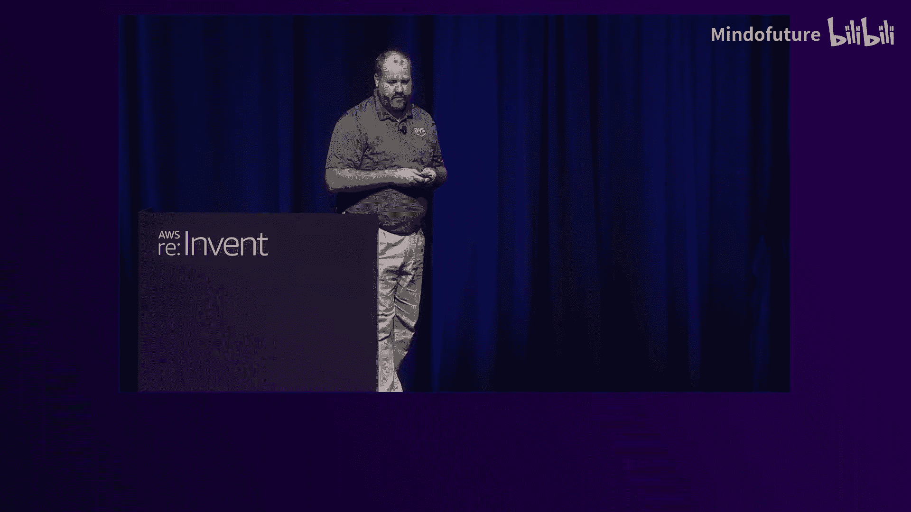
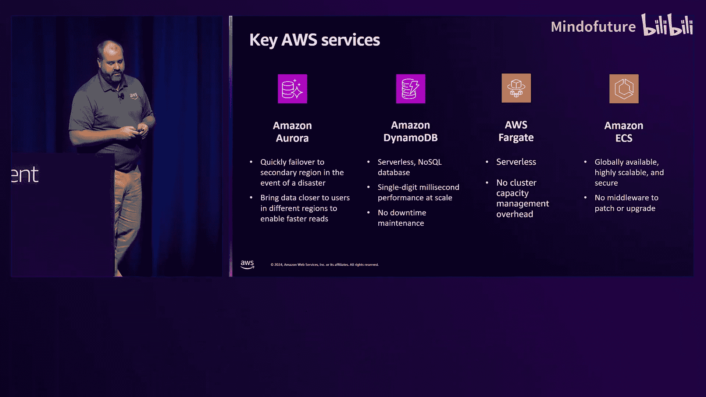
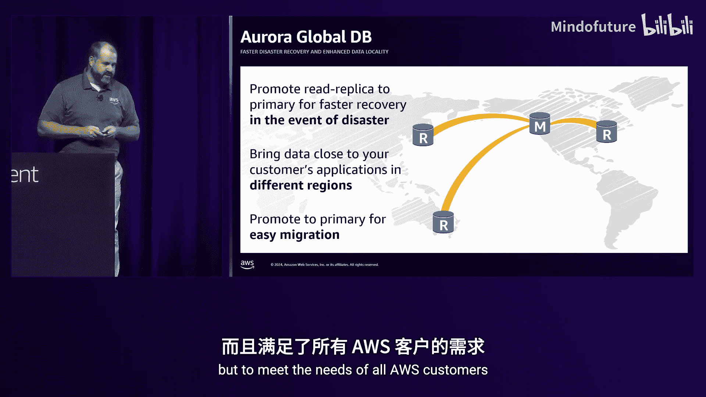
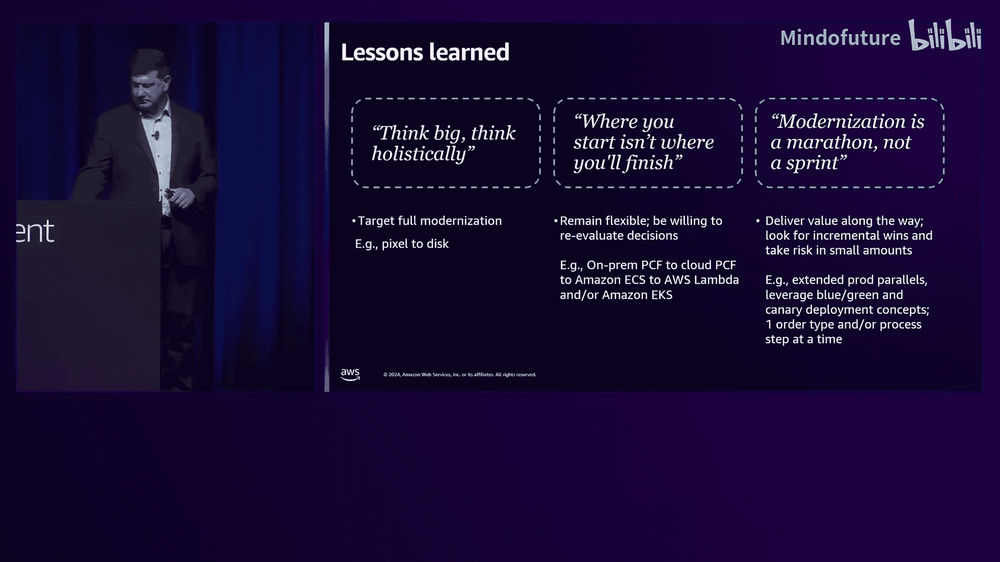
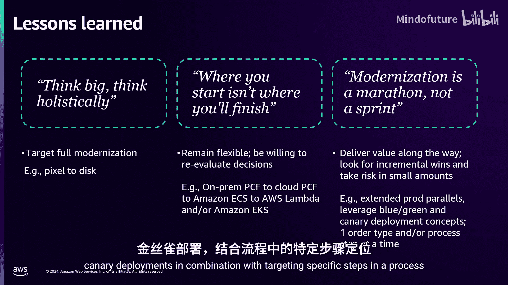
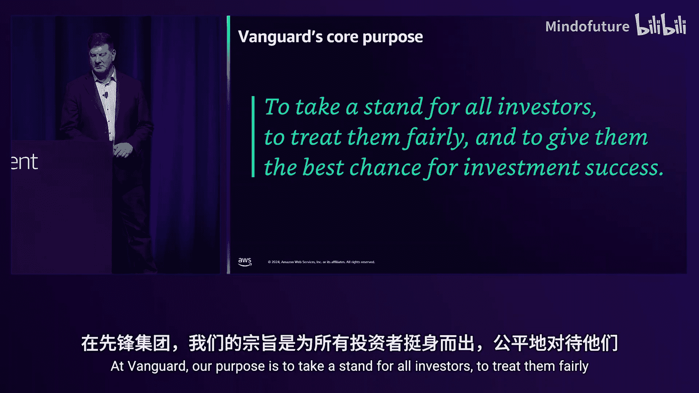
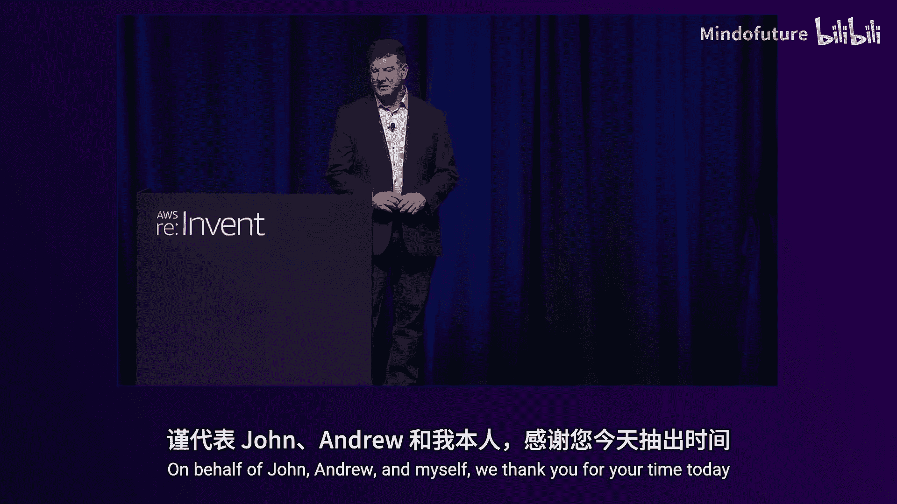
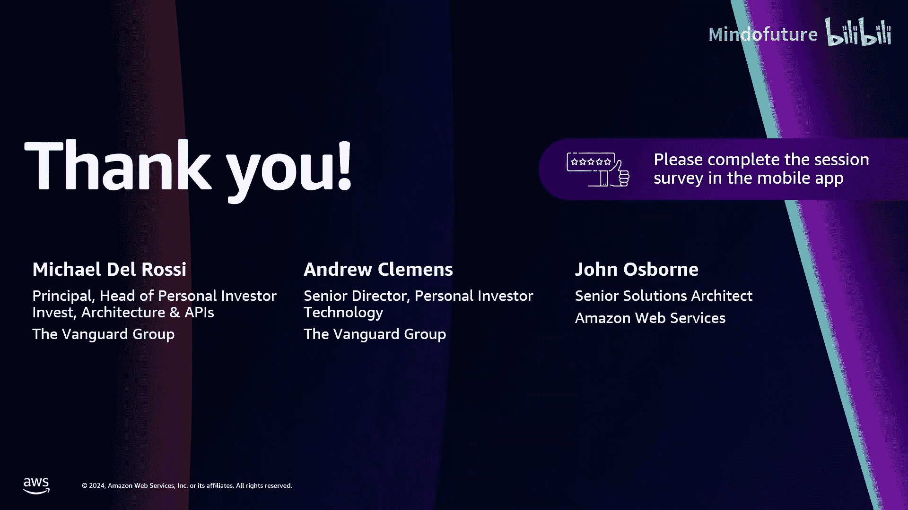

# 【AWS数据库峰会2024全集-•-中英】AWS-re：Invent-2024---Databases-p24-P24-How-Vanguard-rebuilt-its-mission-critical-trading-application-on-AWS-(FSI322--BV1VAR5Y6Es1_p24-

Hello， everyone， welcome。And thank you for joining today， I'm excited to share how Vanguard。

 one of the world's largest investment firms， leverage AWS to rebuild and modernize their mission critical trading platform。

My name is John Osborne。 I'm a senior solutions architect here at AWS。

 and I'll be joined in this session by Vanguards Andrew Clemens and Mike Dlrossi to tell you about this journey still underway。

Which involves technology decisions and trade offs likely relevant to you in this room as you look at mission critical applications in your I T portfolio。

 Many of us have been presented with a situation much like Vanguard will discuss here today。

There is an application in your business。 It sits on legacy infrastructure that is aging year by year。

 It's getting more and more expensive to maintain it， to license it。

 to retain staff that has key experiences to keep it going， much less improve it for your customers。

And most importantly， it's absolutely critical that it works day in and day out for your customers。

Even if you've joined us today。From outside the financial services space。

 the lessons learned and key trade offs that Vanguard considered will likely be relevant。To you。

 while in your case， the specific context of your business might lead you to a differing path。

 The very question Vanguard asked here might be the same for you。 So let's dive in。

You know， many of us at reinvent are what I would call frequent flyers。

 You've come before and you've come back a second time， a third time， or a fourth time。

 If you are a frequent flyer， you might remember on a previous episode of Reinvent in 2019。

 Vanguard's Jeff Dowes joined us on stage here to tell the keynote of Vanguard's early steps towards cloud adoption。

 Jeff's presentation outlined Vanguard's first steps in the cloud。

He spoke about adopting cloud based analytics and AIML services。

 such as EMR and SageMaker and further spoke about Vanguards decision to migrate their on premises platform as a service solution to AWS。

 And later， the standardization on ECS Fargate to gain additional security capabilities and cost optimization。

Jeff drove home the point with how Vanguard increased agility。

Decrease their costs and increase customer satisfaction across their core products。

I heard Jeff's keynotes here in Las Vegas live at the Venetian。

 Even prior to joining AW S as an employee。 There were many in the room that were fruiting flyers at Reinvent AWS nerds who have been coming regularly since 2012 working in spaces far outside financial services。

 And Jeff's keynote and the Vanguard logo on the big screen were a reminder if the financial services space can securely deliver services to on the cloud to their customers。

 My industry at the time， ad tech。 While we certainly can do it， too。If you haven't seen it。

 I'd recommend firing up YouTube later today and watching Jeff's eight minute presentation。

But more importantly， than the keynote itself。The story did not end there for Vanguard in 2019。

Those achievements were very real， but they were the start of an ongoing and still continuing vanguard monetization within AWS。

Vanguard understood even then， modernization was not a destination。But an ongoing journey。

An aggressive goal was set。Be modernized to ultimately 100%。

 And now Vanguard was challenged to bring the cloud to their most core applications。

 the most mission critical and the most important ones to their customers like the application Andrew and Mike will tell you about today。

Jeff mentioned the adoption of ECS Fargate shown here as managed Services in 2020。

As the container platform for vanguards emerging personal advice。

 the division with net new application development。

Now Vanguard was challenged to truly realize the value of cloud and reduce the reliance on legacy systems。

 those systems themselves would need to be decomposed。

Broken into the bounded context and modernized the cloud environments。

Banguard has continued to modernize the most mission critical applications that has driven the business for decades。

 including their trading platform， which drives Vanguard's retail investment division。

And here we see。The challenge that Vanguard faced architecturally。A tightly coupled monolithic。

Mainframe application with a dependency on two legacy databases。

An overnight batch load between the order management system database shown here is ODB。

And the Enterpri TV were pushed to their limits。As the scale required of this trading platform increased。

Month then。Horder in。Y end。All were events that put strains on scalability。

This architecture challenged Vanguard's ability to scale。To be resilience a failure。

 to deliver highly performant trade execution during peak trading hours。Beyond all this。

 the system had a quarterly release schedule to production。The unit of change， therefore。

 to be released， was large。Increasing deployment risk。

 but also impacting the ability to bring new client experiences quickly to customers and limiting the ability to experiment on the front end。

At this point， while the names of the components in the slide may be different from your system。

 the fundamentals that I've just described are probably not unlike one or more systems you have in your I T portfolio。

And even on this slide， while complex， some system boundaries are seen。

 which could be the breaking off point for a component based modernization strategy。

Such as the microservices portion of order management or order validation。

Like Amazon had done itself with an API first mandate。

Would Vanguard just pick up that portion and have it be the start of their modernization。

 Well I'll let Andrew dive into that。To guide the modernization。

 Vanguard focused on five goals and outcomes to achieve。First。

 the cloud based modernized system would improve vanguard's ability to take on more trading volume。

 handle incidental peaks in a seamless fashion。 While the next memetop trading event occurred。

 it was crucial that the elasticity of the cloud could be used to scale past the inherent limits of the existing monolithic system。

 Secondly， with trade volumes increasing and the criticality of vanguard trading platform。

 raising the bar on system availability was paramount。

 A focus on the resilience aspects of the design was required to meet a higher bar for system availability than the existing platform。

Third。And a focus on improving investor experience would require Vanguard to get more features to market in a faster time frame。

 all the while， not sacrificing resiliency。😊，Banguard meant meaning this outcome in incrementally improving experience would lead to fourth。

Higher customer satisfaction for Vanguard customers。

Bringing new and better experience to Vanguard investors is the core to this in all modernization work at Vanguard。

 The investor is the center and focal point for everything Vanguard does。

 Just as many of you have come to understand Amazon's focus on customer obsession。

Vanguard's mission to give investors the best chance for investment success Su required that this modernization make it simpler and easier for investors。

To use Vanguard's platform。 And finally， driving down cost to drive up returns to investors has been a core vanguard exception。

Focus since inception。The， the effort would be no different for this。

 lowering the total cost of ownership。On an ongoing basis。

 while more trading volume transitioned to the cloud with table stakes。Now。

 while I chose the number of these outcomes，1 through 5 on the slide， I can tell you。

 this was just the style choice when developing the presentation。

 All five of these outcomes were critical and and expected。

 None was more important or less important than the other。

 So how did Vanguard get to the finish line on these outcomes。 I'm sorry to give you a cliffhanger。

 But when Mike joined the shortly， he'll take you through that。

Andrew and Mike will also take you through the design and decision making choices on the A S platform。

 But I wanted to take a moment before they do to highlight a few that are central in their architecture。

First。Baanguard understood AWS's decision guidance。

About choosing the right fit for purpose data store for the workload。

When decoupling the bounded context of the mainframe。

 Vanguard identified workloads that would require the complex query capabilities that would need a relational database。

To meet these needs， Vanguard selected Amazon Aurora。Pogres。

 the resiliency goals required relational database solution that could span reads across multiple AW S regions and allow quick fail failover between regions and the event of a disaster or system degradation。

Also， portions of the data architecture that could be expressed and migrated as no SQL key value lookups were identified to migrate to Amazon DynamodD B。

Here， teams could benefit from the decreased operational overhead of dynamos manage no sQL experience without having to manage the patching and maintenance work as compared to Aurora。

In the compute area。Banguard had standardized container platforms around E C。

 S and also the serverless container runtime Fargate after adopting the cloud。 As I said。

 Jeff Dows told reinvent audiences this in 2019。But this application， would it bring more needs。

 which would require perhaps a different compute technology， Maybe E K S might be a better fit。

Andrew dive into that one for you to give you some， some answers on that front。But in the end。

 ECS and Fargate were the proven platform within Vanguard。

 which would allow teams to focus on meeting their modernization goals without having to worry about patching。

 container orchestration and management。The resilience goals were paramount。

 especially within the data layer。 to meet these goals。

 Vanguard identified the key need to support access across multiple AW S regions and drove technology decisions also for improvements in AW S services to help them do that。

 I'll tell you about a few。

To support their goals in the relational database environment， Vanguard required。

Aurora global database。In the event of a failure in region。

 the failover capability of aurora global database would enable a survivable system that could transition to other vanguard regions of operation。

 but initially this was painful， a decision to fail over left Vanguard operations and application teams in a state where they would need to take several steps after the failover to rebuild their global database topology and regain their DR capabilities。

Knowing the time required to rebuild after the fellover imparted ambiguity to the decision to fail over in the first place。

Simply put。How impactful would an inreion event have to be before Vanguard would take be willing to take undergo the effort and time required to fail over。

To mitigate these concerns， Benguard worked closely with our Amazon Aurora team and was an early adopter of Aurora's improved failover and switchover capabilities。

These capabilities fail over and switch over within Amazon Aurora global database are available to all AWS customers today。

 If you're in this room with a need for high availability and high reliability with low RTO and RPO requirements。

 these capabilities will be very， very important to you。😊，But the improvements required went further。

If Vanguard choose to either switch over or fail over。

 their applications would need to be cognizant to the changes in Aurora's writerer endpoint。

While they could update the endpoint by injecting configuration， Vanguard drove 4。

 and the Amazon Aurora team recently delivered a global rider endpoint capability。 Now。

 in the event of a switch over or fail over。😊，Amazon Aurora customers can take advantage of this capability。

To avoid having to change the endpoint in their global application。

These efforts were examples of Vanguard's ongoing collaboration with AWS that drive service improvements to not only meet their needs。

But to meet the needs of all AWS customers。

Amazon Dynamo D B Global Ts was required， as well。Application teams while caring for multireion consistency on rights。

Could meet increased scalability by allowing dynamo to be on demand mode to bring additional read and write capacity as required。

While also not sacrificing on resiliency。Rightites can be done from any region which Vanguard supports and it can be globally distributed to take trades from around the world。

For a global mission critical trading application， one might suspect a decision for a relational database。

But as Mike will explained to you in just a few minutes。

 Vanguard identified that they would be positioned to take advantage of dynamo B's extreme scale and reduce operational burden。

 In today's architecture， Vanguard has taken a multi region active passive approach to begin。

 But will prove resilience availability even further and has a vision and an ongoing path to get the multi region active active。

 Did this end。Global consistency in dynamo D B is crucial。

 and Vanguard continues to work with AW S to build an active active globally consistent architecture。

 partially enabled by the announcement today of dynamo B， RO 0。😊，So at this key， these key services。

 Vanguard began the modernization journey on their trading platform。 Now。

 to tell the story of how this was done， I'd like to invite Andrew Clemens to the stage。Okay。

 thank you， John。So the first of three audience participations， can you hear me？All right。

 one for one， we're off rolling。All right， before we get into the modernization journey。

 we're first going to look at Vanguard by the numbers。

Banguard is a global asset and wealth manager with over 50 million clients worldwide。

That have entrusted us with $9。9 trillion of their hard earned earned assets。

We see over  one to $2 billion a day come into the complex。And with just a small market uptick。

 that'll have a surpassing $10 trillion assets under management。Now， as you may know。

 Vanguard is not a brick and mortar。We do not have a shop in every town across the country。

We are heavily dependent on our technology。Our clients interact with us over 99% through our digital channels。

 We have truly depended on our technology to help us scale。Alright。

 audience participation number two。 first question。 Who in the audience is a Vanguard investor。

 Me you have a Vanguard mutual fund or ETF in your investment portfolio。 Show hands。Amazing。

 lots of hands。 W was all of you， But thank you for all those hands that went up。 Okay。

 you were part of the 50 million and the 9。9 trillion。😊。

Doesn't matter us where you hold those assets。 You are a vanguard investor by investing in our products。

All right， second question， Who comes directly to Vanguard co。

 Who logs into Vanguard do com to either self manager portfolio or use one of our advisory services。

 Show hands。Quite a few。 but as expected less， you would be a subset of the 50 million in the 9。

9 trillion。 So why is that question important。Well today we're here to talk about the brokerage trading platform that directly serves the clients that come to Vanguard to manage their portfolios。

So as the statement goes， we'll got you here， won't get you there。And while we are incredibly proud。

 as far as how our technology has enabled us to scale our business， we know that's not enough。😊。

The brokerage industry continues to evolve， and Vanguard continues to launch offers to give our clients the best chance for investment success。

So let's start to take a look at what some of those changes are and what some of the new offers are。

To start， we have to go back to 2010。 This is when Vanguard made a pivotal decision that was going to shape our business for decades to come。

Now， leading into 2010， we had two very different account types。

One specifically for Vanguard mutual funds only called a transfer agency or T A account。

 The other a traditionalal brokerage account。The vast majority of our clients that were coming to us in that time frame were Vanguard mutual fund holders。

 That was it。All of our clients over here in TA very little in the brokerage account site。

But we knew that for the future， we needed a seamless account type that was going to allow our clients to hold Vanguard mutual funds。

 Vanguard E TFs and other investment products and interact across all of them。

We were heading in the direction of brokerage， we knew that we had to commit to being a brokerage operation。

So。What did that set us up for， Well， we knew the rise of ETFs were coming。 And sure enough， in 2013。

 ETFs started to take off。 Vanguard was ready。 We had the account type that was going to allow us to have that seamless interaction。

Jump forward to 2019， one by one， players across the entire industry started to drop commission fees on trades。

Prior to 2019， called about  five to6 billion shares traded per day across the entire industry。

2019 and beyond， about 10 to 11 billion shares trade per day。

So a 2x multiplier felt by everybody in the industry， lots more trading is happening。

2020 was an important year。 when we committed to our enterprise technology strategy。

This was a complex wide modernization effort。 It was going to impact every business line。

 every division， internal systems， external systems。Vanguard was preparing for the future。

 We were taking our systems to the cloud。Same time in 2020， we are still scaling our vice offer。

We're launching our Robbo advisory offer， and we're starting to ramp up our tax loss harvesting。

Why do we talk about tax loss harvesting？ It's a great feature for one。

It's going to in a down market scenario， it's going to sell you out of one position。

You're going to buy into another position that enables two things。 One。

 you're never out of the market。And two， there's going to be great tax efficiencies gained by reaping the losses from the cell。

So as you can imagine， as we're scaling to hundreds of thousands of advised clients and millions of advised positions。

Down market scenarios poses huge volumes to the trade platform。

 Another situation that we had to be ready for。2021 saw roaring Kitty and the Me stock crazs hit the industry calling havoc。

 causing havoc for days， weeks and months。And while meanme stocks is just one example of something that can cause sharp spikes in the ecosystem。

 it's not the only thing。 We saw the same thing with election and post election。

We have to be ready for these sharp spikes in volume。Lastly， direct indexing。

 another offer that at scale will pose tremendous volumes into our platforms。

So over the last 15 years， we have seen a 100 x increase in brokerage trading platforms。

 brokerage trading volume on our platforms。We look 15 years and beyond。

 we have to be ready for another  100 x multiplier。

So with Vanguard's growth context and changing landscape in mind。

 let's start to see what our modernization strategy was。

So we are embarking on a transformative journey to modernize the entirety。

Of the brokerage trading platform。As you heard John mention， we were legacy。Onprem monolith。

Serve us well， served us well for what two decades。But we knew we had to do better。

So let's call this the flamingo effect。 right， We had to move it forward。

So we needed to go from this monolithic architecture to a three tier architecture that's comprised of a front end client experience。

 APIs and data。For our self directed clients， they're going to reap the benefits of the entire stack。

They're going to come to our site， they're going to see a modern intuitive front end that will be leveraging cloud APIs and cloud data。

For advisory clients， they will still benefit from the same cloud APIs and cloud data。

 So a consistent approach to make sure that all of our clients have their trades。

Performed and executed in， in a perfect means。The new system， it'll be robust， it'll be scalable。

 It's going to be comprised of over 100 distributed systems。We'll do 80 million trades a year。

 it's on the rise， we'll do one billion， one billion in daily notional value。

And as we prepare for greater volumes in 2025 and beyond， our cloud platforms will need to scale。

 they'll need to be ready for the demands of our clients each and every day。

So this is a significant undertaking to go from this monolithic system to this highly distributed system。

And there was no universe in which we could say we're going to go modernize in the closet for five years。

 seen a little while with this bright， new， shiny trade platform。

We were going to have to find ways to deliver value incrementally。So again。

 given the complexity and scale。It was not feasible to modernize overnight。

And weight of strategy crafted to deliver value as early and as often as possible。

We knew this was going to be a multiy effort， and we plan to maximize value for both our Vanguard business and our clients little by little year over year。

So what was the approach？We need to find seams in the infrastructure that would allow us to decouple between the application layers。

So that we could operate at different velocities。At the highest level。

 the trade platform needs to do three things。 You have to be able to submit a trade。 You have to get。

Data to run rules on the trade， and you have to submit and route the trade。

So think about those three areas and think about the seams in between each of those areas。

 Those were critical areas where we could inject some abstraction letters and again。

 allow the modernization across these three tiers to operate independently。

 It would be too hard to couple them all together at the same time。

So our initial modernization journey began with the front end。

 Let's modify the thing that the client is going to see， touch and feel first and foremost。

We started on the equityquity and ETF trade ticket。We had forecasted that ETF would be on the rise。

 our clients were becoming more and more have higher propensity for ETF products。

So we made the data driven decision to start with the ETF ticket。However。

 the the teams did not have it easy。 They were building the front end。

 They needed a bunch of APIs that just weren't there。 The APIs were not present in the early days。

 We had to build those up。So as the front end team is building and modernizing。

We're starting to build our first abstraction layer at the trade validation API， again。

 a very important abstraction layer that would allow for the front end to have a future proof endpoint that they could call and behind the scenes were initially calling legacy。

Okay so now we got the front end， it's out the door， but we have legacy services。

 it's time to attack the APIs and we had to get after many， many APIs。

 many business processes that had to be taken from the legacy and built in the cloud you can see a few up there。

 orders， securities， funds available， cancel change， tax cost basis， the list goes on and on。

 we had to build these out into the APIs。So ETF tickets launched， well。

 let's now get our ETF rule validation to marry up with it。

So after building about another 20 additional endpoints。

 we can now start to toggle from legacy to cloud APIs。So at this moment。

 we are now going from Pixel all the way from the front end。

To submitting to an onprem database in the cloud。That is that is a significant chunk of our value stream that we are now reaping the benefits in the cloud。

😊，So where did that leave us？System of availability was up。

Our P 95 latencies were dropping lower and lower， and our advancements in observability and telemetry had our ability to detect issues at near real time。

So not only were clients benefiting from purpose built front ends。

They were also now benefiting from higher system availability and system health。

So where did this leave us？It time to time to attack the database。At this point。

 our cloud engineering had matured greatly。Our practices。

Our techniques in methodically getting from legacy to cloud had matured and strengthened。

And all of that would be critically important as we now begin to make cloud first reads and writeites on the database。

So we spent some time there。We make that huge leap to Cloud first Reads and writeites。

 and not only do we have the value that I've talked about with the CX and the APIs。

 but now we're reading and writing from the cloud and we're continuing to shrink our onprem footprint。

All right， so we've covered why we modernize the case for change。 We've covered how we've done it。

 incremental delivery of value。Now， let's go deep on what was built。Okay。

 so last question of audience participation。Who's ready for the 195 step by step。

 every piece of the way run through the trade component platform， who's right for it？Alright。

 catch me afterwards。 We're not doing that。 We just， we just don't have enough time。But no。

 there are dozens of teams back at Vanguard。That have built all of this。

 have incredible acumen and expertise that could walk you through this precisely。We have leaders。

 both engineering product that have brought this to life。

 These teams were hungry to get after modernization and take this to the cloud。

And I'm incredibly proud to represent their work with you today。😊，First thing we're gonna do is just。

 again， high level walk through the the life cycle。We need to get an order in。

We need to do the rule validations， in the OMS。We need to store it。

 We need to route it to the street。We got to execute it， get the trade conference back。

We have to make database updates when needed。And at that point， we're done。 We're completed。

 and our clients have access to it。 So that's the highest level。

 But now we're going to start to walk through it step by step。We'll start on the Cx。

We initially built RCX with static ECS web apps。And we soon realized the benefits of serverless Us。

So we implemented Cloud Fron to pull the assets from S3 buckets。

This led to faster rendering and closer to the edge experiences。This enabled georouting。

And our active， active multi region resiliency pattern。Lastly。

 it unlocked modern modern experimentation， so up until this point。

 any time we were launching modern， we were comparing modern to legacy， see if the CSSAT went up。

 see if the journey completion rate went up At this point。

 now we can do modern modern experimentation。 this was much faster。

 we were AB testing with modern experiences to truly see if our Cxs were intuitive and meeting the client where they needed to be。

Next up， right next to it is the Cloud Trade API。Critical component for it that serves the entire CX。

The API is an ECS， no JS backend for front end application。

serveerves as the consistent consumer API layer for both web and mobile。 So just think about it。

 Anything across our digital platform that needs to get trade data or needs to submit a trade is all coming to this same endpoint。

 critically important for us。It's written in TypeScrip。

 which is the same language as our front end application。

This allows teams to contribute more easily to both the web apps and the backend data needs。Lastly。

 this API is highly tuned， it's doing over 8 million requests per day。All right。

 so in addition to the user initiated trades， we also have several batch applications and we'll dive into two。

First is advice， we talked a little bit about the advice in the portfolio rebalancing。

On a daily basis， our advice business is sending us a batch of trades that need to execute on the behalf of our advised clients to make sure that their portfolios are in line with their investment strategies。

The second one is for our self-direct clients who come to our digital channels and tell us they want to execute something weekly。

 biweekly， monthly， they want to send us cash。 they want us to buy into a Vanguard mutual fund or buy into an ETF。

So some critical components of these batches to prong。 One is good thing。 We control the timing。

 we know when these are going to execute。 And so we make sure that we are properly scaled for all downstream APIs。

 These are big volumes。 These are big baskets of orders that are coming through our way。

The other resiliency pattern that was super critical for us is a circuit breaker。

So the second that we start to detect， failure starting to pop up， we shut down。

We never want to be in an environment where we're sending thousands of failures to our backend business operations to clean up。

 So critical resiliency pattern force us。Moving on， this is this is， again。

 where we have the sea in the infrastructure， where we have transaction producers needing to call to get their rules validated。

 And this is where little by little， we started to go from legacy to the APIs。

This component is an E S app， and it is the traffic controller that dictates everything that happens downstream。

Are we calling legacy are we calling cloud， are we calling different permutations of cloud as we launch things like fractional shares。

 it could be different paths through our rule validations。As far as advancements in this space。

 this app was initially built hardwired to our legacy databases。Again。

 we just didn't have the APIs at they' ready for us to hook into。

So gradually as the API economy started to take off。

 we were able to now build some data orchestration services。

 multithread all of these downstream calls latency and the performance started to get better and better。

All right， so let's say we're through the rules， right， We can accept it。 We can take the trade。

We need to store。 This is where the complex pieces of the architecture start to come in。Postgress。

 Dynamo， Kafka， TCP， IP connections to the street。So trade comes in。

 hits Aurora in an entered status。 simultaneously， we're going to put a message out to Kafka。

The routing destination service。 That's the listener。 That's the consumer of this message。

The routing destination service is critical piece for us。

 It's got a dynamo database that the business can configure that allows us to stamp the trade with the right market center So it picks up an entered trade。

 it's going to run some rules on it and it's going to figure out which of our market center partners we're going to send it to。

 It'll stamp it with the destination It'll get another Kafka message out into the bus。

This is where the backend execution management system is now the listener。 It's gonna listen。

 It's gonna find it。It's going to get that stamp trade。

 and it's going to figure out which market center it needs to route to。

It's going to take the Kafka message。 It's going to translate it into an industry standard。

 fixed message。It's going to store that fixed message in a dynamo database。

 and then it's going to send an outbound to the market centers。

Our routing services are using Singleton， TCP， IP sockets， one for each market center。

 and we're one by one converting these from our legacy lines to the cloud lines。

The market center is going to immediately respond back with a fixed message。

 This indicates the new status of the trade。 It's going to be routed， acknowledged， partially filled。

 executed， rejected just a couple the primary statuses。Inbound message comes in。

 stored it in the database， now we're going to get another Kafka message back onto the bus。Now。

 our O and Aurora database needs to be listening， needs to be able to take in that message and do usually two things。

 And This is where our multi domainoma database comes in that Mike's going to talk to us about。

We have an executed message。 We need to update the status of the order。

 and we need to update the share quantity of the position that just executed。

We do this with a single commit， ensuring that we have consistent execution at the same time across those domains。

So at this point， the life cycle of the trade is complete。Days in the database。

 our API sitting on top of it can get to the data and our clients are on our web。

 they're on our digital channels， and they're looking for their trade details that they can now get。

So let's go deep on just a couple of those items。The Aurora Postgres databases are trade engine。

 RDMS S， and it's comprised of the four pillars of trade。Accounts， positions， orders， securities。

 Again， Mike's going to talk about the multi domain database。

 It's just critical for fast and consistent processing。

An ECS app sits on top of the database that handles all reads and writes。For our trade engine Db。

Dynamo DB， we talked about a little bit， it snoring our fixed messages。

Due to the limited access patterns and the key value paired database characteristics and its high performance standards。

 it was the ideal selection for this storage。Kafka。

' it's our messaging bus that sits in this critical area for our E M S。 but there's more to it。

First on the technical front， we had to pick a messaging protocol， and we evaluated Avro。

 Json and Protobuff， and we landed on Protobuff since it's highly optimized for high throughput and low latency。

 These are two critical nonfunctional requirements for a trade engine。Now。

 Kafka doesn't just play a role for。The heartbeat between the O and the MS。So just think about it as。

 as we're not getting more messages out there and available。

 we can have our digital channels be listening to these messages。For example。

 client places a limit order 10 days ago。That limit order triggers today。Well。

 our front ends can be listening for those messages。

 And rather than our clients having to keep come back to check if they're limited or executed。

 we can send them a message， We have that ability to improve our client experiences through the use of the Kafka platform。

Okay， that was a lot。呃，欧志标。hundredundreds， hundreds of。

 of whiteboarding sessions and countless debates on how to bring all this to life。

So let's pull the curtain bit back and， and we'll get a little bit into those debates。

So as I mentioned， countless options to consider， and we're going start to go deep on the database。

 the compute and messaging。 And now Mike Delrosi is going to come up and talk to us a little bit about those decisions and those debates。

Thank you， Andrew。With a large technology transformation。

 you can imagine we had a few debates along the way。

 No topic was generated more debate or more passion than our discussions on our trade engine database。

Which database， how much data will include， will it scale， How do we protect it。First off。

 we are a polyglot database environment， we use both Dynamo and Postgres extensively across our portfolio with great success。

Depending on your use case。One may make more sense than the other。In this case。

 we selected Aurora Postgres for our primary database。

Let me share a few of the key aspects of how we thought through this decision。First。

 we needed to decide which database technology used Dynamo or Postgres。

 This was really a decision between no SQL or relational database as both platforms have attractive characteristics。

Dynamo is a performance， scalable and cost efficient platform with global tables making multireion deployments fairly straightforward。

However， to achieve the proper performance， you need to model your data。And indexes appropriately。

If your needs change in the future around what data you want to store or how you want to access it。

Making updates。Or adding indexes is a complicated endeavor。Typically requiring extended o windows。

And complicated rollbacks Other considerations with the database choices is not just the relational or the complexity of your data changes or not。

 if your data is going to change， you should and you're not sure what your different access patterns are。

 then a relational database may make more sense for you。

But being a mission critical application for us， resiliency is critically important。

So multire deployments， like I mentioned， is fairly straightforward。With dynamo。

 but you can achieve the same thing with Aurora Postgres as well。

 it's just more complicated to design， implement and test。

The next factor you should take into consideration is cost。

 We found dynamo to be more cost effective than Postgres in at Vanguard。 however。

 both are more cost less than our legacy platforms we're migrating from。

 So this wasn't a big factor for us in our decision making process。All right。

 once we chose Aurora Postgres， the next decision we didn needed to make was how we wanted to run it。

We were excited when Aurora version 2， serverless version 2 was announced in 2022。

 we came back from reevenvent and began experimenting with it with mixed results。

 Some of our databases performed better。Others， we saw performance degradation。So with this。

 we ultimately decided to run provision instances because we could achieve with three year commitments in running on graviton processors。

 the same cost point or roughly the same， and it also took out of the equation the need to get our auto scaling tuned properly for market surges。

And then the last decision on the database was how many， how many distinct databases did we need。

 As Andrew mentioned， we had four main data domains， accounts， positions， orders and securities。

We could implement each one as their own database， but this would have made it much more complicated to code all the data to join it together in the API layer versus letting the database do that for you。

 So while we generally， as we've modernized our portfolio。

 we've taken our monolith and broken it down into its APIs and associated data into bounded context。

 This is a case where we made an exception and said， no。

 we want to keep these together into into one database with a series of As around it。

 which is more a miniservice type of pattern if you will。

 versus typically where we're using a traditional microservices pattern。All right。Alright。

 so now we' talked about the database。 Let's move into the compute tier。

The discussions here were less controversial， but computes are an evolving space。

 contingly evolving space。 We started our journey。Years ago。

 we we were using pivotal cloud foundry in our data centers before moving to the cloud。

As we embrace the cloud， we want for leverage AWS to do as much of the heavy lifting as possible to maximize the value。

With this shift， with this， we shifted to E S to host our our modernize microservices A along the way。

 Eca was introduced at Vanguard and and。It was introduced。

 and we enabled it a vanguard at the time when we were starting to modernize the trading platform。

 EcaS was still relatively new。 while we were excited about the capabilitieser Kubernetes offered。

 We had limited experience operating it。😊，So we didn't want to blaze the trail with our trading platform on EKS。

 and we found that it was also a straightforward migration path。

 a relatively straightforward migration path to move from ES to EKS in the future。

 if we decided we wanted to do that， This is a decision that we periodically re-evaluate and there's always question are should we move the EKS at this point。

 we haven't yet still possible in the future， but we also look at which capabilities make more sense to run in Lambda versus in an ES or a Docker container。

So when it comes to making a decision between EKS and ECS。

A few things you should consider are the upfront design to get your cluster， grouped properly。

 the additional support required to run a Kubernetes cluster and the additional complexity of essentially running a multi tenant environment。

ECS's simplicity is quite attractive， and a single tenant nature reduces the risk of one application impacting another。

EcaS is clearly more robust and for your more complex systems， it can make sense the leverage。

 but you should feel strongly about the need for those extra capabilities as。

Additional complexities and responsibilities that come with it。Okay， once we decided to。On ECS。

 so we next had to decide how we wanted to deploy ECS。

 if we want to leverage Fargate or run it on EC2 instances。EC2。

 running on EC2 gives you more access to configurations and more hardware options。

 but honestly we did not find that we needed that those that access or those additional hardware capabilities Fargate met our needs。

And so this， again， we wanted to maximize AWS to do as much of the heavy lifting as possible。

 So that's why we continue to run on fargate。Okay。Moving into the last area or messaging platform。

Kafka kesis or event bridge。 is another area of debate across our enterprise。

We have critical applications using kinesis and Evenbri in our environment， However。

 in our situation we went with Kafka， this was a little bit of a reverse of Kubernetes where， yes。

 Kafka was new to us， but we felt like we needed those additional capabilities of the extra additional Mes protocols。

 the scalability， the performance for our trading platform。And in either case， we felt like we had。

Strong managed service options available to us。 and we ultimately went with a third party supporting our Kafka instances。

With this Kafka we have it deployed multireion， so again it's in line with our multi region architecture。

All right。Closing out on the， on the technical decisions。

 I want to shift into the benefits our transformation as provided。

John shared earlier the expected outcomes when we began our journey。Improve scalability， resiliency。

 agility， customer satisfaction， and reduced TCO。I'm happy to share that we're realizing these outcomes and they continue to grow as we make further progress on our modernization journey。

Let's go into a little deeper in each of these areas。Client satisfaction。

We are all faced with growing client expectations of not just being compared to other financial services。

Companies， but being compared against digital natives across industries。As we modernized。

 we didn't just rebuild the existing application， but we took the opportunity to rethink the experiences and challenge ourselves。

On what capabilities and rules were still needed。We recently sured 80% of our portfolio of our application portfolio being modernized。

With this， we've experienced growing external recognition for our brokerage platform。

We were recognized in March by sealant。With the Web Wealth Management Innovation Award， internally。

 we measure client satisfaction in multiple ways across all measures。

We are seeing meaningful increases that correlate to our progress and modernization。

While we're excited about the improvements。 We know that there's more work to be done in this and this will be continued area of focus for us。

Another great benefit has been our increase to get value at the door。

The impact of moving to a product team structure， leveraging Devec Al practices。

 and modern cloud technologies has been tremendous。In the early days。

 we were making good progress with the modernization of our equity and ETF trading。

But as our API platform matured and we got additional capabilities and we got better at developing in the cloud。

 we just picked up pace。As you can see， the time to modernize mutual fund trading and add new capabilities such as dollar based trading and automated investment in ETFs experience meaningful improvements。

We're also experiencing similar benefits when building out completely new offer suchors or cash plus offer。

 If you're not familiar with cash plus， it is a high yield cash account thats FBIC insured take a look at it。

 if you ever get a chance it's a great product。 But to bring that to market。

 it took less than 12 months。 and it involved over 80 teams at varying levels of work to do it。

 So again， that was a completely new capability that just having this environment and building this investment modernization is paying off。

So the agility we've gained as we were able to experiment with new capabilities and add me improve existing capabilities at a raple pace is truly exciting。

 I'm excited to see where we go in the future with us。All right。

 moving on to resiliency and productivity。This is an area where we've seen some of our greatest winds。

We are intentionally showing these data points together， as traditionally。

You would have thought these would move up and down together before Dev Sack ops and the cloud。

I grew up with the project management concept of the three leg stool， cost quality and timing。

 where you could software two， but not all three。Having worked in our data centers earlier in my career。

 we had plenty of evidence to show that incidents went up as change activity went up。

We've seen a 70% decrease in major incidents， as at the same time we've seen a 5X improvement in our deployment。

 software deployments。So these are complete opposite。

And this comes through the use of modern technologies， adoption of resiliency best practices。

 a robust CICD pipeline， and the owner's mindset of our product teams。

And this has caused me to unlearn things from earlier in my career。

Let's zoom out and share some of the reflections on our overall modernization journey。First。

 think big。Yes， you want to deliver things incrementally。But set out to fully modernize your stacks。

 as one of the leaders of my team likes to say， we're modernizing from the pixels down to the disc。

To unlock the full benefits， you'll need to think holistically and rethinks how you've done things historically。

Soly lifting and shifting your current stack to the cloud or putting on a new front end won't do it。

Next， remain flexible。Things change rapidly in the cloud。

Be willing to reevaluate decisions and make pivots along the way。I shared earlier。

 we started with PCF in our data centers。To the cloud and then ECS and now leveraging Lambda in some cases that may move the EAS into the future。

Make the decision best decision you can at the time to make progress。

Don't get overly wedted into a decision and be willing to change。Lastly， modernization is a marathon。

 not a spread。 This is especially true when dealing with mission critical applications。However。

 there is always a risk of being compared to a road or bridge project。

 so you need to and losing support along the way with this in mind。

 youll want to incrementally deliver value and take on risk in small amounts。

All right， so to do this， you can leverage a extendeded pro parallel testing。

Techniques such as blue green deployments， canary deployments。

 in combination with targeting specific steps in a process or certain transaction types。

This will allow you to build confidence along the way。So think big， be flexible， be deliberate。

But most importantly， have an unwavering belief that it can be done。All， so where are we going next？

But before I talk about that， I just want to take a moment to thank our teams。

 our crew teams in Pennsylvania， North Carolina， and Arizona to helped make this possible。

 as well as our partner teams in Germany and India。 Thank you for the incredible work。All right。

 so what is next as we move forward， we'll be focused on increasing level of personalization in the trade journey。

 enhancing the client experience through the use of generative AI。

And then we'll be looking to expand our cash offer and then completing the internal crew experience as well With this。

 we believe we can be true to Vanguard's mission and help our clients achieve better investment outcomes。

I want to close。With Vanguardth's missions， as it drives us day in and day out。At Vanguard。

Our purpose is to take a stand for all investors to treat them fairly and give them the best chance for investment success。

On behalf of John， Andrew and myself， we thank you for your time today and hope you can benefit from the experiences we've shared。

对。

