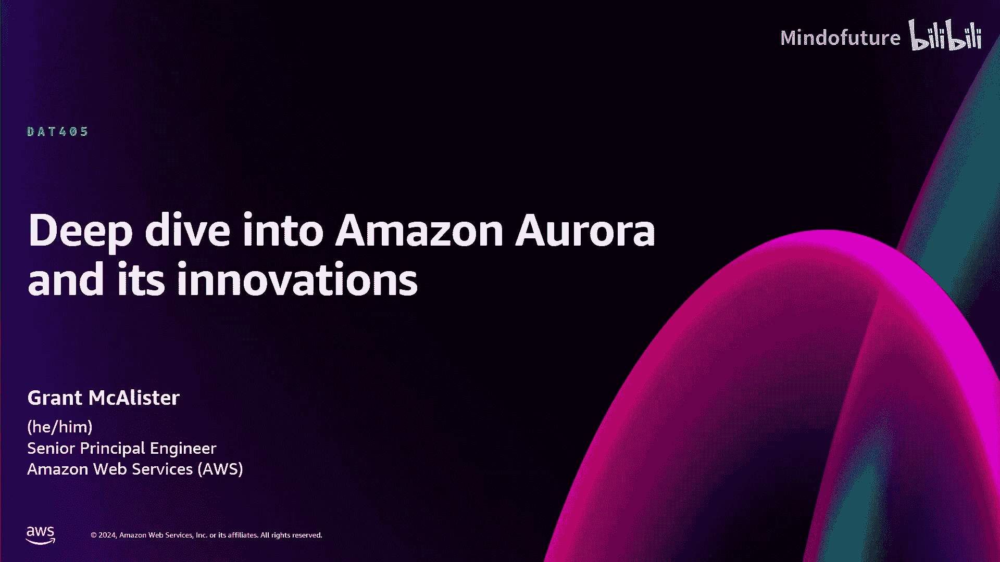
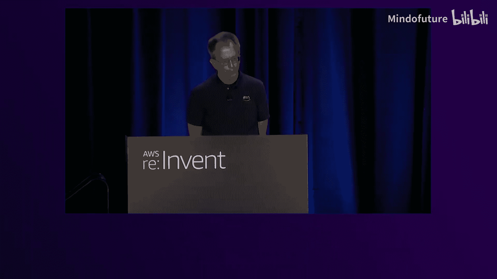
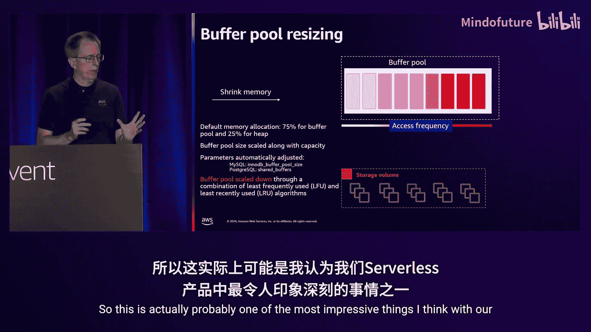
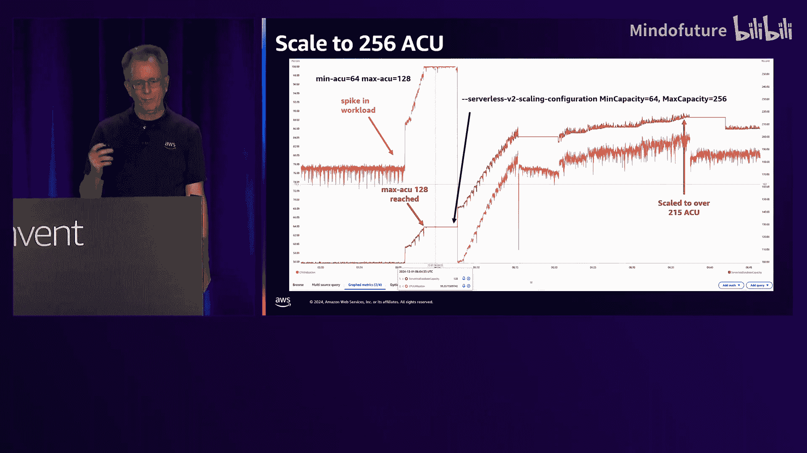
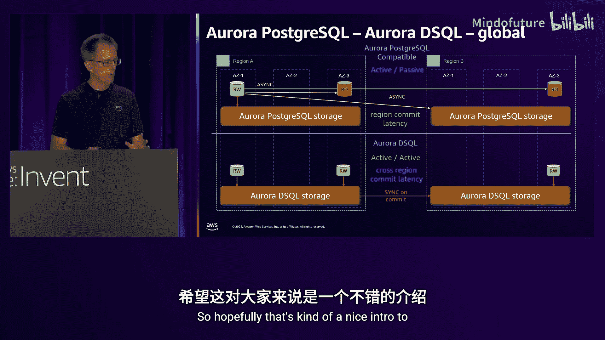
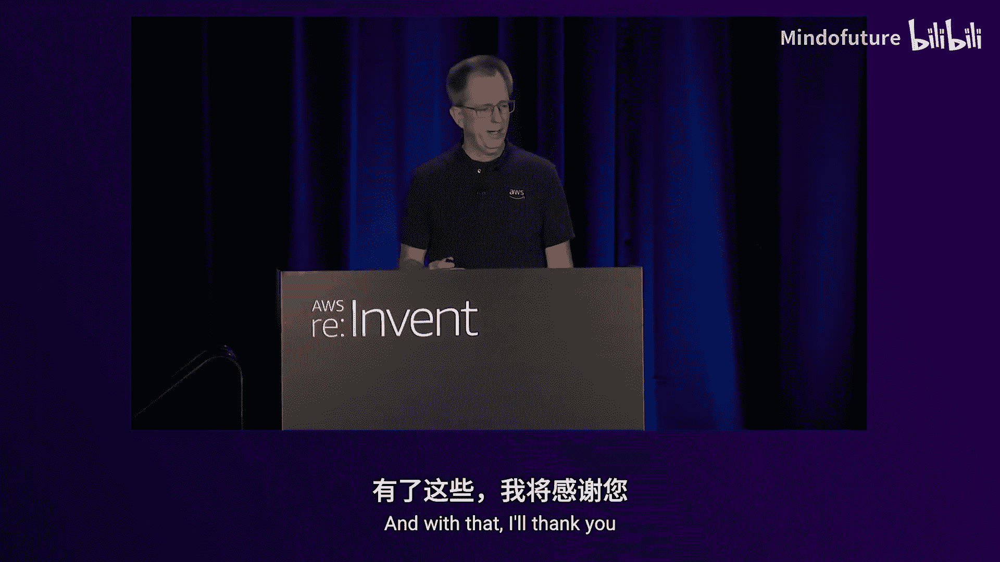

# 【AWS数据库峰会2024全集-•-中英】AWS-re：Invent-2024---Databases-p25-P25-Deep-dive-into-Amazon-Aurora-and-its-innovations-(DAT405)--BV1VAR5Y6Es1_p25-

Good afternoon， everyone。

Welcome to Dt 405。We're going to be diving into Amazon Aurora today and its innovations。

 How many people know that it's the 10th anniversary of Amazon Aurora？Yeah。

 it's been quite the journey since we pitched it almost like 13 years ago， helping to build it。

 so today we're going to dive in and look at the technology and how it can help you hopefully with your database needs。

So what is Amazon Aurora well it's a purpose built cloud native database。

 so it's fully MySQL and fully Postgres compatible separately not all at the same time because that would be odd and we've built a lot of really enterprise level features into it that go really great with the open source software that you come in love in the MySQL and Postgres space so it has all these great features I'm not going to walk through each one of them because you've probably seen this slide before。

 but it does have great performance scalability， availability， durability。

 it's obviously secure and it's fully managed like the rest of the RDS universe。

But let's dive into the architecture。So what makes aurora different Well。

 the first thing is the storage， so I'm showing here one region with three availability zones and that blue box is when you create a cluster。

 you get this volume of storage right and those。Yellow boxes are what we think of as storage servers。

 now I'm showing nine there， but in a typical region there could be thousands or tens of thousands of these。

So。Once you have that， you can have a database instance。

 and the first one is going to be your readwrite database instance。

 and that's what your applications are most normally going to connect to。

And this is one where the first major differences from a regular database is is we only write log records。

 and in this case I'm showing six rights， and each of those is to a different chunk or segment。

And those are 10 gig chunks and they're spread across two in each availability zone and we need four of six of these to complete before we're going to act the log right back and you get your commit message as a customer right so that's how we get the durability in region。

Now the other thing that we do that is kind of different is we don't do checkpoints。

 we don't do full page rightss in Postgres， we don't do a doubler buffer in MySQL。

 and we don't have to archive any logs because we're not doing any backups up at the Readrite note。

 so this means less work for it， more efficiency， more scalability。

 especially when it comes to writing。So all good things。

But we read blocks and I'll get into how that works in a bit。

 but this makes it really simple for the database to understand so we didn't have to change any of that Now we're typically going to read from the local A。

 there's a copy in each one， so we're going to read from the closest one because that's going to be fastest and we don't have to do any quorum reads because we know from the basically sequence number where we are and we know that we have the latest copy。

So we read those blocks pretty normal， right？What happens if we have a problem Well we can do repair if we missed a write so in this case we'll do a repair of that missed right from another one of the chunks in the same or another availability zone so all this repairs and checking is all happening behind the scenes you don't have to do anything if a whole storage server fails。

 same thing we're going to replicate that chunk from another copy and put it into a new storage server so this happens all automatically。

Now another fundamental difference with Aurora is if you normally wanted a read replica in Postgres or MySQL。

 you'd have to have another volume in EBS and you'd have to spin up a database here we get to use the clustered storage and we just attach to it。

 but to keep our memory in sync what we do is we send these in or update messages across from the read writeite node to the read only node。

 now these are asynchronous so that means there is a bit of lag you might see like 30 milliseconds in some cases difference on those things but it's usually pretty quick。

And you can have up to 15 of these read only nodes and you can mix and match where you want them。

 which AZs， and you can actually choose which types they are。

 so I'm showing graviton on the one side， Intel in the middle and serverless on the far side so you don't have to pick just one type and one size。

 you can pick all kinds of different combinations。And the storage grows and shrinks as you need it。

 and you're only paying for what you use， so this's again a fundamental difference from most file system based databases where you actually have to kind of allocate a whole bunch of space up front。

 so that's kind of nice。In the case of a failure， what we're going to do is we're going to fail over to one of the read only nodes in a different AZ typically。

Your application needs to know where the new writer is normally it would contact the it would look at the Cname for that database and it would resolve that via routeute 53 and you're gonna get that update that takes a little time to propagate so instead what we've done is we actually have a whole bunch of different rappers that allow you to integrate with both JDBC I think there's no JS and Python today for both MySQL and Postgress as well as an ODBC one for MySQL and these rappers know where the writer is so you don't have to wait for that DNS propagation means faster fail over less outage time so that's a really nice thing that a lot of our customers are using now。

So with these features we get to be able to innovate in different ways and one of them is local write forwarding so here I'm showing you know simplified version of that region and I have a readWrite application and a read only application running but at some point we'd really like to scale and we don't want to have to recode everything so you know making that application read only is tough。

 of course if we want to make it readWrite the challenge is it's not going to be able to write because that's a read only node right hence the name。

But what we can do is we can enable local right forwarding。

 And now this is available for both MysqL and Postgres。 Now， we just released the Postgre version。

And now you can actually write to that instance， and it's going to forward that right back to the readWrite note。

 so it's not multiwriter。And then that right is going to get replicated back and you're going to be able to see it。

Now the thing that is important here is what the visibility of that is。

 so we have a lot of different settings， so I ran this little just test where I do an update。

 a select and a select and you can see the times on the writer are two milliseconds for the update and like a half millisecond for the select。

 right？The default visibility mode is session。And what we're going to do is when we do that update。

 it's going to take about three milliseconds， so it's going to take a little longer than it would on the right because it has to be forwarded and in this cr across an AZ so that takes like a half millisecond at least extra。

But you'll notice that this first select took 30 milliseconds。

 and the reason for that is that we actually have to wait for our right to get back to us and be replicated because we want to read our rights and that's what the session level of visibility is giving you。

 you get to read your own rights。But the next select is very fast， right。

 And the reason for that is is because we haven't made any changes。 So reading our rights。

 we know we're up to date， right， so that's good。Now we have a kind of more kind of fun mode which is the eventual consistency mode because that's sort of the performance。

 no seatbel mode if you want to kind of make an analogy where the update is the same speed。

 but you notice that first select is just you the normal speed and that's because you're not going to see your rights。

 you're not going to wait for them， and if you're not reading the thing you just wrote fine。

 if you are that's probably not going to be good for your data right so you can use this one but you have to be very careful。

And then the other one that's kind of interesting for some use cases is the global consistency and here what you'll notice is that all my times for all my operations are the same and that's because what's happening is every time I execute a statement we're waiting until the time that we started that statement like at time T we have to wait for that all the data that's been changed since T to be replicated back to us so you're going to see complete global visibility of everything now I wouldn't recommend doing a ton of this right because you're going to be at the mercy of the replication but if there's some things where you're just like I absolutely have to know the right answer to the question global is kind of interesting and these are session setable so you can switch back and forth in the middle of a session so you have a lot of control here to use these so this is a really nice feature。

And those are the versions it's available for。Now we have a really nice feature that we get from this storage system and it's called global database so we have a region A。

 we'd like to have some kind of DR so what we can do is we can just create a secondary database cluster and what we're gonna to set up is storage and another volume in that region and behind the scenes that replication and server agent you don't actually have to manage those those are all just hidden and those are going help replicate the data between these two things but you'll notice that we don't have any instances。

 we don't need that because this is storagebased replication so when we do our rights。

 they're going to flow through Now remember those chunks that I talked about those 10 gig chunks the nice thing about that means that we can replicate in parallel we don't have to do a single stream so we're not bottlenecked by single stream so when you have a high write workload we can still handle it so right comes in it gets replicated out to sort of the normal places plus the replication server which then goes to the agent which then goes to storage and at that point you're good right from your boss's perspective you have DR now。

It's probably going to take a while to spin up， and I have a whole otherher talk on that。

 but this is the basic setup。But you can add read only nodes and you can have one or many。

 and the replication agent is now going to update those read only nodes just like they do in regions so you can use them for reading and of course you can have multiples of them and you can have your application over there doing Read only and that right forwarding I talked about。

 you can also do it here。So the storage can also do repair itself directly。

 so it can actually send changes directly over if one of them gets lost。

 so we don't have to worry about any network kind of issues。So。

This is a nice setup right but sometimes it's challenging because you have to have your application know where which region is the primary so we've just introduced global endpoint for a global database so in each region you have a seaname for your cluster that's how you resolve it and they're different and you can see here the subdomains or actually like they'd actually be a real region name but just for this or region A and region B right and that means you'd have to make changes to your application if you want to switch from one region to another which is kind of painful during an emergency right so we've introduced this global one and to really make sure you knew it was global we put the name in twice。

Which I really liked when I saw that I was like okay and partially it's because the name needs to have it but it also needs to be a different subdomain but there was just you know nice for the feature so how this works is routeute 53 is doing the resolution so right now region A's primary so when you do a resolution of that name it's going to point to the C name in region A and in the case of us doing a switch over where we're gonna to switch from one region to the other we're going to do all the normal things for switch over which is to verify that everything's okay and then we're going to switch。

Once we've done that， you know we're all up and running， read write node in region B。

 so now if you ask that same resolution， it's going to point to region B so you don't have to do anything and this is actually done with some really cool technology so we don't actually have to use the routeute 503 control plane so this is super highly available this switching。

Now。呃。You're good， but guess what we gotta go back and set up region A。

 we do that automatically for you at the end of a switch over and in the case of you know everything's replicating normally。

 but let's say now there's a problem in Reg B you can do a failover if you want and that's the failover global cluster command with dash allow data loss and this is because we want you to make sure that you know that there's going to be a difference because during an emergency these won't be synchronized because obviously Reg B is not available so two different commands for how you switch or failover。

 we change the naming a while back because I didn't like the original names they were confusing so this is my other talk that I gave with one of my colleagues on Monday but hopefully they'll go up on YouTube soon that covers more resiliency on the global basis if you're interested in that that's D 304。

So let's dive into the internals of Aurora storage。

 so what I'm showing here is the Aurora storage node。A lot of different pieces。

 we'll walk through that。 So we have a readwrite instance like we showed before。

 and the thing I didn't have on this before is the storage demon。

 We actually have this demon that runs on the host。

 and this is what communicates from the engine down to the storage。So when we have a right come in。

 goes through the storage demon goes into this incoming queue， that incoming queue is in memory。

 so we can't act yet， we have to wait for it to move to the hot log and then from the hot log which is on disk。

 we can now move it， we can now act it back to the storage demon back to the engine and your commit will come back right so we get another right come in C。

 it comes into the incoming queue， goes to the hot log great， we get our act back。

But we notice that we missed B so this is where our repair comes in。

 the peer node can actually send us the B change and now that we have the complete sequence。

 we're going to go put this in the update queue and we're going merge it into the data blocks。

 so this is where we coalesce so this is how we go from logs to blocks and now when you go do a read guess what you're just reading a block back so both those logs and the data blocks are backed up continuously from storage so no load on the server to S3 for both snapshot and point in time recovery。

Now the thing we've been changing a bit is we have a new IO type that I'll cover in more detail。

 but as part of that we wanted to start making some performance improvements。

 and so we do that on the IO optimizeized storage Cu。

And the first one we did originally was some changes to the storage demon about how it behaves。

 how it batches， so this gets us improvements in latency， lower CPU， all goodness， right。

 but this is only really set up for when you're doing a lot of IO。

 which is why we still have the difference between it and the standard IO。

Now more recently with Postgres 17 which is in preview which I'll talk about a bit more。

 we're making some bigger changes so what we're done is this now queue is no longer an incoming queue it's a durable queue so when a right comes in D coming in comes to that durable queue we can immediately act it back and as you can imagine there's less stuff that we have to do so that means lower latency which I'll show you and lower less jitter。

 so all goodness so this is a really nice improvement that we're going to be launching hopefully next year but is in preview now。

So let's talk about the Postgres updates that we've had over the last year。

 support for Postgres 16 last January， we' just launched our 7I and RAG support for families。

 we now allow our query plan management that's our plan stability feature to run on replicas so replicas can have their stable plans too。

 I don't know why they didn't before but how they do we've done a lot of improvements for logical replication to really get the performance better as well as caching。

 we've updated to a newer version of PG vector for generative AI and we've added support for a couple new Postgress extensions and of course as I was saying。

 Postgres 17 is in preview which is really nice because one of the things about having a preview means that we're very close to having in production。

So let's look sort of generalally at kind of the improvements that we've gotten with these new R7i and RHG So this is a cis benchch read only workload I kind of call this the CPU benchmark right because you're not doing any rights you're just reading cache data so vertical axis is queries per second you want it higher so the blue line or blue green line is an R 524X so this was the biggest box a number of years ago that we had right and now the new R 7i 48 Excel so twice as much memory and guess what we're now getting two times the scalability onreads so anyone that says hey scalability on relational databases is dead nore still getting bigger boxes we're still getting more scale it's great but what's even better is the R7G the graviton instance is now available in a 48 Excel and we get 2。

7 times better performance so almost 3x scale from where we were a number of years ago so this is really nice。

On the MySQL side， we've also been busy， we're up to 308， so it's 8039 compatibility。

MyiceSQL also gets the R7I and RHG support， as I mentioned。

 they have that advanced MySQL ODBC driver for faster switchovers and then we've done parallel export test3 as well as enhanced bin log that I've talked about previously。

So Aurora serverless is kind of where we think the future is around some manageability to help you make running instances easier。

 So when I talk about serverless it's what we call serverless V2 because I'm trying to stop saying V2 because we're slowly deprecating V1 and I'll get into why that's been a slow process but we're getting there so whatever Aurora serverless it scales in place so there's no switching there's no and it happens in seconds we can add CPU in memory second by second you're charged on a second by second basis and there's no impact when we're scaling up or down so this is really seamless so I'm just showing a lambmbda connecting to an Amazon aurora instance that's sort of the high level when you have an individual lambmbda fire up it's going to talk to your instance doesn't need a lot of RA or memory but as you add more Lambdas。

Use more memory， more CPU and if you have some big reporting job come in， maybe it uses a lot right。

 but then guess what we scale back down so this really scales with your workload during the day or over the weeks or whatever。

Now one of the keys to this， like scalability of CPU is not that hard。

 moving memory around is much more difficult so I was very excited with the work the team did here on buffer pool resizing so we monitor the buffer pool and as reads come in we know what's getting hot。

 what's not we see the access frequency so when more blocks need to be pulled in we can actually expand the buffer pool。

 make room for more blocks this happens automatically so you don't have to worry about setting how big your instance is to make sure you're cached right every time you get more space now if you stop accessing data for a while guess what we're going to evict those pages and we're going shrink that memory so now you're back to a smaller footprint right lower cost。

So this is actually probably one of the most impressive things I think with our serverless offering。

So one of the missing things for serverless V2 over serverless V1 was it didn't have scale to zero Now we have scale to0 on serverless V2 to demonstrate that I was running a nice workload herem sorry about the busy lines it was a little crazy with the colors but you can see I'm running a workload and the blue line is connections so here my connections go to zero I stopped my benchmark running and then I've got my timeout set to five minutes which is the minimum for scale to  zero so about like five and a bit minutes later we go down to zero As right so it's parked essentially and then a few minutes later。

 guess what I start my benchmark back up again and we scale up now the thing to note is when you scale back up you're starting from 0。

5 As so it did take like a couple of minutes to get back to four as but for my testing perspective this is probably fine right now you will notice here I went to zero connections but it wasn't for five minutes right it was just for a couple of minutes。

So this is configurable， so if you think 10 minutes or 20 minutes is the right time because guess what when you scale to zero your cash goes away right so if you're actively doing something you don't want your cash to go to get away。

 you might set that to a longer time if you're more worried about cost， set it to five minutes。

The other one that we needed to do was to scale larger。

 we now scale to 256 ACUs so double amount of memory and CPU。

 so I'm showing a configuration with 64 in ACU max 128 the orange line is CPU so I see a spike here I was running at 70% I'm going up to 100 I hit 128 ACUs this is bad right my performance is not great so I run the command set max to 256 and we start scaling and we scaled up and in this case my workload pushed us up to about 215 ACUs that took a few minutes but you know you can now do this online's not a big deal and so that capability is available。

And the last hopefully missing feature was the support of our data API。

 so showing that same Lada talking to Aurora seems simple， but。

You have to load drivers into Lambda to talk to your database right that was kind of painful。

 you have to manage your connections because if too many Lambdas fire up。

 you could overrun your database so the load and everything had to be handled Now you can just enable the HTB endpoint。

And we're going to put that data API in and allow you to do HTTB connections and then we're going to manage the connection pooling for you to your database and there's some configuration there that you can tweak。

 but in general it just means it's a lot easier， so I think with this hopefully these are the last features that differentiated sort of V1 from V2 and we can move on to just only calling it serverless。

So we've been working a lot on manageability and when I say patching here I mean sort of upgrades of minor versions。

 there's a feature that we I don't know possibly named poorly called zero downtime patching because zero is a hard thing but the intent of this was to mean no disruption it didn't mean that there wasn't some blip but no actual downtime so we have our application connected to our Postgres database and we're running version 163 right so we want to upgrade to 164 what we're gonna to do is we're gonna look for a pause point so for about a second what we're gonna to start doing is holding new transactions from coming in and waiting for ones to finish ones don't finish we' actually kill those transactions and move forward but if you have shortrunning transactions like less than a second which hopefully you do because that's generally good this won't be a problem right so we have that pause point after that we basically inside the instance hand off all those connections to another process which I've named the connection holder doesn't actually have a name。

And at that point， we actually take the session state from the instance and move that out of the instance。

And then we stop it and we start a new one with 164。

 right then we rehydrate that session information， and we hand back the connections。Binggo。

You're done， right？ So how long do people think that's going to take。Well。

 it used to take quite a while。 Now it takes a lot less。

 This is a benchmark I'm running again ci bench readwrite this time。

 it's on a 4xl so decent size instance we're doing what you know 35000 QPS almost so I end up doing that patch and it's three seconds of zero Qps right so we're done that minor version upgrade in three seconds but the thing you'll notice is zero connections were dropped because my transaction size is small。

 so all you would have seen is at the end of that three seconds is a spike in latency that would have reported as hey。

 my one thing took three and a half seconds to run but then you're back to normal and you can actually you get that information that line that you see at the bottom that ends up in your event stream so you know exactly how many connections and how long the thing took so you know this will vary a little bit depending on your workload but we really worked to get this down and we're gonna to try to get this even smaller next year I'm hoping for one second so that's the goal。

The other area for manageability around upgrades is blue greeneen deployments。

So what do I mean by that， so this is for database blue green deployments。If you had， for example。

 Aurora MySQL and you had a version 57 of MySQL and you want to go to8do right well that's kind of going take a long downtime to do so you want that to be quicker so you can do a bluegr deployment you start by doing a create blue greeneen deployment as the command and what that's going to do is create basically a green version and make the original one blue and you can see that the target has the name of MySQL cluster green dash you know some number this is how you can tell the difference apart right now you'll see it you can do this with aurora Postgres as well so it doesn't not just MySQL we support both of those。

Now you'll notice that the starting version is the same right so when we start both of these are identical but as part of the command you can tell us that you want to do like a minor version or a major version upgrade and we'll do that on your behalf so those can be automated if you're doing a schema change or a parameter change or some other manual change you can use this as well。

 you just don't have to give us any changes that you want to do during it。

So the first thing we do is we upgrade the database to 30 on the green side， right。

 so that's in preparation。But now we need to get these caught up。

 So we start replicating between them。 So we catch those up。 And once they're basically close。

 we make this available for you to do the switch over command。 So you do the switch over command。

And you see switch over in progress， and then we're going to verify they're in sync。

 we're going to stop all the rights。We're going to let the last replication traffic drain。

 and then we're actually going to do the switch over， and you'll see switchover complete。

And at that point you're on the new cluster and you'll notice that the names have all changed so your ANs and stuff are all actually all rearranged so all your automation still works。

 you didn't have to go in and monkey with any renaming or doing anything so this is I mean you could do all this yourself but it's many many steps so this is just automating a whole bunch of things that were possible just to make it easier right now once this is done you can delete your bluegreen deployment This does not delete any clusters all it does is disassociate the two things and this is because you may want to do customer verification because let's say a plan has changed on that MySQL like that would never happen when you made your version upgrade so I don't even know why you do this but。

Assuming it might， you still want to do that once you're done and you've made sure everything's working。

 you can just delete that original cluster and you're back to just your normal setup So we're adding more and more support for blue greeneen with other things so you know if it's not working today。

 tell us the feedback， love to hear it。But it's definitely something we want to do。

 Postgres does have some restrictions because this is used the logical replication。

 you can't do DDL during this， you can't have lobs。

 and you are required to have primary keys and a few other things。You know， if it works for you。

 it is really nice。The other area around manageability is zero ETL。

And what zero ETL is is a way to help you move data from Aurora in this case， to Redshift。

 So normally you might use DMS， you might use a lot of different techniques。

Now you can just you can add a zero ETL integration。

And what this is going to do is set up a replication channel that's all managed by us。

It replicates your data and you can select which tables you want into your redshift cluster。

 and the cool thing about this is the leg is only five to 10 seconds。

Once once it's up and running so you can actually build like realtime dashboards that are looking at your OTP system but running it from Redshift。

 that's like pretty powerful right now this is all automated， as I said。

 like we do the initial seatding， we do the replication we do all the monitoring you can run analytics while this ingestion is running and you have all the normal cloudwatch metrics you'd expect from aurora and redshift to be able to monitor this but one of the cool features is you can actually put multiple databases into one redshift cluster right so here I'm showing two MysQL ones。

 but guess what you can put a Postgres1 in so isn't that kind of cool like you can be  querying both of these things in redshift that came from two different engines which I think is kind of remarkable and there's a whole ecosystem that we're building around zero ETL I'm just talking about the the ones here。

 but you know there's a lot of other things we're doing in that space。

One of the nice things with Aurora again being the storage layers we can actually do things more efficiently in this case。

 so at the storage layer we're going to use parallel direct export in this case from MySQL to load that seed data so that's going to mean a faster load for us over to Redshift and then we're going to use enhanced bin log that I talked about earlier to do the CDC streaming directly from storage so you're not doing this from that readrite node you're not putting extra load on it。

 so this means the zero retail isn't really affecting your primary use case of your OTB system。

And now you have good analytics in Redshift if you want to see more。

 there's another talk that dives into more0 ETL Dt 331， check that out。

So I talked about the new storage types a little bit IO optimized。

 but let's talk about why we introduced that so let's go to our standard one that's the original the OG storage type as it were。

 and I want to talk about why we thought we wanted to do something that was more predictable from pricing and if you do a select from your application it goes to cash you don't pay anything for IO because it came from memory right but if you read a block 8k or 16k depending on My SQL or Postgres。

 you're going to pay that fraction of a penny and if you do a right up to 4K。In a log。

 it's the same price now notice that there's six copies。

 but you only pay for like the one logical right， but if you wrote a smaller thing， let's say1 k。

 you still say pay the same price。This is where the confusing part came in If you write 41K log records instead of 14K1 you end up paying four times the price so what this meant was as your workload changed your costs changed and so that if you're doing a lot of writing this could affect your bill a lot right so that wasn't great and we really wanted to fix that so we delivered I optimized。

And this is really trying to get predictable pricing。For all workloads。

 as well as improving the price performance for IO heavy ones。

 so it's just a selection in the console or in the CLI， you can pick either one， right？

And it's at the cluster level that's important， like you don't get this on an instant basis because it's about the storage。

 you can switch back and forth once a month， so if you need to try it and you don't like it or vice versa。

 you can do that。This is typical where your IO spend if you look at your bill and you say look my IO costs are more than 25%。

 then you should really check this out， we've had customers like it says 40% there。

 but I've had some customers I talk to you today 70% savings on their Aurora bill that do a lot of IO right and it's basically available on all the instance types I'm not going to read all those and you can get additional discounts if you're using reserve instances。

And it's available on all the new versions， basically。

So how does this look like in detail for pricing， the standard one is our normal on demandd for computer orI。

 you pay as you go basically for storage and IO right IO optimized you're paying a premium on the compute and storage but you're no longer paying anything on the IO and I know that looks like it's a big lift but again if you're spending a lot on your IO cost。

 that relationship can be dominated by the IO so back to my same example， guess what。

 I don't have to walk through it all because they're all zeros right there's no cost you're not paying for IO anymore。

But the other thing that we really wanted to do as I said is to have a mechanism to improve performance for heavy IO customers。

 so that's what we've been doing with IO optimized as well。

 these latest changes that I talked about with Postgres 17 with the durable Q I want to demonstrate the performance so this I'm going to show you this is hammer Db so new orders per minute on the vertical axis higher better these are all 16 extra larges but there's some generational difference so the first one in green is an R5 so an older generation this is running version 12 so going away version of Postgress and it's the standard IO setup。

So that's the curve we get。 Not bad。 We're still scaling， right？

 This is what happens if you go to the six I， right， So slightly newer， slightly faster processor。

 version 14， a little bit better version， but not a lot of performance difference， but IO optimized。

 We saw 1。9。Times improvement in throughput on this benchmark by going to I optimized， essentially。

 right， so really nice game。Now if we go to the7I， which is our newest version of Intel。

Still on version 16， so not with the newest changes， IO optimized。

 we pick up another 10% and then another 10% with these changes that we've done around the durable queue。

 So in total what we're talking about is 2。3 times the scaling that we've get now on throughput just generationally from you know a few years ago right so that's like great improvement for someone that does a lot of writing。

But as impressive as this is， the latency improvements are way more impressive to me at least。

 so this is suspch right only， so we're just doing rights。

 so the only measure is how good a rights latency on the vertical axis。

 so now we want to be lower is better。Greenline is the 24 XL， the R5， the largest we had at the time。

 and standard IO back when we had that as the default。

Now we have a 48 Excel bigger version 17 of Postgress with this IO optimizeized with the new durable Q and what we see is a 3x improvement in latency at the low end and a 6。

4 times improvement and you can see that curve now on that bottom is very flat like we always scaled well we can get more throughput but you ate latency to do it now you don't have to make that trade off right you're basically getting the best of both worlds you get all the scale at low latency so this is going to be a really nice improvement will'll probably move it backwards like it's starting in 17 but it'll probably be available in other versions later but this is our first release candidate。

So and that of course translates into throughput， as you can see with this lower latency。

 these larger systems we're now up to a 5x improvement from previous generations on throughput that we're getting with right only workloads。

 so if you do a lot of writing， this is a nice improvement。So what about reads， well。

 we've been working on those as well， so we have a new feature called optimizeized Reads。And。

One of the pieces of it is for temporary objects， so this is spill like know if you do a sort and you need to too much for RA。

 you spill it to disk， that would typically go to EBS where we allocate twice the storage of memory and you get read back so it's all temporary right so this works okay。

But we've introduced these new instance types， the D， so an R6 GD and an R6 ID。

 say that quickly 10 times。And these allow us to have NVME storage on the system now。

 so instead of doing that spilled to EBS， what we're going to do for standard IO。

 we allocate six times the memory in NVME that now you can spill to so if you need more sort space。

 you can have it， you can also get increased speed。

 should really fix this animation to make it faster。Now for IO optimized。

 we only allocate 2 x of the memory size in the NVME for temporary storage。

 so the question is what's going on there， right what are we using the rest of it for。

 that's where we do a tiered cache so。Why do we have it want to tiered cache because in Postgres if you read a block if it's in memory。

 shared buffers， it's just going to get read， no problem right comes back， it's quick。

 but if it's not in cache then it's going to have to come from storage that's going to take longer right now this might be okay for your application might not especially if you read a lot。

This can slow things down so now what we can do is we have the space for temporary objects。

 now we have 4 x of the memory in the NVME as a cache for blocks。

We take a little bit of the RA in shared buffers to use for metadata。

But now when you do a read it works fairly similarly except where we check in the metadata to see if it's in the tiered cache。

 if it's not， then we're going go read it from storage and put it into memory now notice we don't read through the cache right we don't change the read characteristics of the system at all so at some point you stop reading that block you no longer need it right and it's going to age out of the system so it's going to get cold and you notice we now have a one over there to indicate that we have this block in the metadata it's in tiered cache so when we ask for the next read it's going to say yep I've got it and boom。

 it's in cache it's very quick right so now it's both in memory and in cache。Which is fine。

 but where most most systems fail or have problems is when you do an update to these kind of things because that gets expensive right but for us because we don't have to checkpoint blocks。

 all we have to do is when we get an update is we just invalid the metadata we don't even have to update the cache we just won't ever go look at it right so the next time it gets evicted we'll get a new copy that's it so this works very well and it's got some really good performance characteristics I will say at the moment we use random eviction so this works best if the working set size of your data fits in the tiered cache we are going to work on other eviction strategies but we haven't got there yet。

So when you think about heat you want to think about working set size so if you have this table it's got a whole bunch of orders from all different kinds of years。

 it's 800 gig but probably only like the last couple years are frequently used right so you know maybe the working set size is 80 to 100 gig on this inventory table it's per airport code and so each of them is going to have different heat so this one might have more heat right so you kind of have to understand how much heat and whether you can fit into the tiered cache。

So let's look at how this looks when you're running sort of a benchmark so this is cis Bench point。

 select read only and this is a uniform distribution for cis benchch so this is not the typical one。

 but it's going to read like every it's going to touch every block right over time so for extra large and the workload is 85 gig to start with that's the blue line so the vertical axis is the number of blocks that are happening at each latency there so that first blue line that's memory right。

So we're in memory and everything's good， our latency is great。

 So whether you're running regular or a tiered cache at this point， it's all coming from memory。

 you wouldn't even notice， right， latency is great 0。23 milliseconds on average。😊。

But let's say we quadrupleled the size of our working set right， we got a lot more data now。

 we're at 340 gig still touching everything right what we see now is that we' get a lot more latency at that bottom end because some of this is coming from storage and so our latency actually jumps up by quite a bit。

4 x higher right this might be okay for your application but it might not and the typical solution for this would be to guess what buy a much bigger box with a lot more RA which sounds like a good deal for us but in general we're trying to help the customers out so if you go even larger you get the same thing happening except for more and more doesn't fit in RA that boxed by the Ram is getting smaller and we're getting more stuff out on storage and we're now 5。

5 times higher so this point you're probably going to notice this in your application right。

So now let's add the tiered cache。 So what we see is that pink line。

 we see that first second that second spike。 and that's the NVmeE。

 So we're seeing some stuff come from memory and a whole bunch of stuff come from cash Now 34 gig fits in the tiered cache at this size of an instance right so nothing's coming from storage So we're seeing only a slight increase in latency So you can see that like 1。

5 a lot of times your application will probably be fine with this。

 and you can handle four times the amount of data for only a slight increase in cost over the base instance class。

 Now you will notice if I double that again now I'm bigger than the working set size is bigger than the amount of tiered cache。

 we have I have less performance right I'm now getting in the sort of like 3x higher。

 but this is uniform and uniform is not necessarily normal most people don't read all the data in their tables right if we look at a case where I run suspch with a preto distribution where I'm only touching some of the blocks right I get much。

Better performance at a tiered cache and I can have a very large database like 680 gig where pretty much all of it is coming from either the shared buffers or the tiered cache a little bit randomly here and there is going to come from storage but I end up only at 1。

4 times higher now to give you a real use case we ran some of our PG vector tests with tiered cash and what we saw was by enabling that we got up to9x reduction in time to do some of this vector work so this can really pay off by not having to either buy a bigger box or wait is long so definitely if you do a lot of reading this is a feature to check out。

Now the other feature that we announced last year at Reinvent and GA just before this reinvent just before。

 is our Aurora limitless database。So what is limitless data but's all about。

 well a lot of folks know that to scale out， a lot of times you need to use sharding right。

 and that is something I agree with。You start with one database and over time as your usage grows。

 you do sharding and you start splitting into multiple shards， but guess what。

 like as you get a lot of shards， that's a lot of stuff right and so for me really scale means manage sharding and that's what we're doing with limitless database。

 we're trying to make sharding easy。So one of the challenges resharding。

 so if you have an instance and you do the initial sharding and you think，M， four sounds good。

Because why would pick a number be wrong， right？So that works for a while。 But guess what。

 Like you get a hotspot in that data。 You got one bigger customer。

 They end up using up a lot of space， right now you've got a problem。 Gu what。

 Now you're back to resharding again。 So this is going to be a constant thing over time， right。

 if you keep growing the data。The other one is consistency， so sharding is nice。

 but let's say you want to add a column now you got to add a column to four databases right and you got to make sure your application is okay with the timing on that and what happens if you miss one like that would be bad with four it's not bad。

 but you can imagine if you add 100 of these that would be much more challenging。

If you want to query。What are the open orders right now。

 those are going to run it all slightly different times， right？If you try to do a backup again。

 all at slightly different times。 So someone says， give me your rest of midnight， you'll be like。

 well， I can give you a restoretor at sort of midnight。 It's not really the same answer。

 right that you're used to。 So that's not great。So with limitless database we're trying to solve these problems and it's still in your normal aurora cluster and this slide's a little different because we've made some changes since we did preview。

 we've gotten rid of the regular instances in the cluster and now you just have the limitless shard group so as part of the limitless shard group you have this thing called the distributed transaction router layer which has multiple things in it and that's what you connect to so you have a Cname for that just like your normal Cname for your cluster points you now to this router layer and that's where we do as it says all the routing and the transaction。

And then we have a data access shard layer and this is where we store all the data makes sense right so we've been able to scale this to more than 2 million T。

 this is kind of an old number that we have we do automated resharding so like if you have a hot shard boom。

 we can resard it or you can do it yourself， you can just say I want to split。

We have serverless capacity， so we're using all the stuff that all that technology you've seen was serverless so that as these things grow and shrink during the day。

 you don't have to reshard them， they'll just grow and shrink。

 so unless they get bigger than 256 ACUs， we don't need to reshaharrk， right？

The other thing is when you have consistent query， DDLs and backups right， so if you do a DDL。

 it's going to go to all the routers but not just all the routers to all the shards。

 so it's happening all at once in a nice distributed transaction so you don't have to worry about inconsistencies from an application deployment perspective。

All the backups are consistent， so if you say I want to backup at midnight， restore that backup。

 all of them are from that case， if you had any distributed transactions they're going to be perfectly how they were at the time of when the backup was taken。

So how do we do this Well we do this with clocks so as you may have seen with like some of the other stuff we've gotten now much better clocks and we're able to do use clocks to get synchronization so I start a transaction over here and I'm selecting from a PG bench table for the Postre folks and I just selected one BID right to get the value。

What happens is the router assigns a time when that statement comes in of T100。

And then because of the snap technology， we can go run on the shard at T100。

 so we're using the visibility sort of back in time now to run that at that exact time。

 so we get the correct answer of 704。Over transaction 2， we're selecting from the same table。

 but a different BID 801， we're doing this for updates， so we're locking。

 we have all the normal semantics， this one's going to run at 103 because that's what we get on the router。

 that's what it's going to run it on the snapshot。We' get an answer of1 here。

Let's do the update here， so we're updating that balance now from1 to 1001 right and we do the commit so at this point we need to use we need to talk to the shard。

 we set a commit point of T110 and then we have to wait for that to be durable and we have to wait for that time to basically pass which is usually a tiny bit lag and then it's committed。

So that's all good。 Now， if another transaction comes in and runs that query on that same BID。

What we're going to see is it's going to get a time of 125 right which is after 110 so our answer is going to be correctly 1001 not one。

 but over here on transaction1 notice we never did our commit we never ended our transaction right so we're still in the original transaction scope so if we do this select it's going to run at T100 right so it's actually going to get the correct answer which is one because it's read visibility is supposed to be back in time so we use this clock for not only these queries but for how we do backups and everything else and that's how we get the consistency so it's a really nice system。

it solves a lot of the problems。And there's a nice talk from one of my colleagues that 420 that you can see more details full talk on limitless。

Now， most of you probably had didn't hear this announcement right that we announced a new memory of the Aurora family called Aurora DSequL that Matt nicely announced this morning for me just so I could do this talk。

 no。This is why my talk is after his so that we could talk about this now。😊，Like any family。

There's a lot of similarities between them which is why it's in the aurora family but it's also gonna to be differences and what I wanted to do is know I don't have an hour to talk about this and there's a whole session which I'll link to but I wanted to give you guys kind of sort of a snapshot of how you might compare and contrast the sort of aurora Postgres with aurora DsQL so you can kind of see some of the differences in tradeoffs because there are some there's some definitely advantages and there's some things that you need to think about so on the left I have aurora Postgres and I'm just going to refer to that as APG for now because it's too long to say and and DsQL on the other side so you'll notice the first thing is it says Postgres compatible not fully Postgres compatible for DsQL and what that means is that you're going to still get the same answers like if you run the same query it's got the same semantics all those things as Postgress it talks the Postgres dialect has the Postgres commands but it doesn't necessarily have all the features and it doesn't we'll get into how it does concurrency and some of thes。

StSo there are some differences there and that's by the nature because it's a distributed database right so we've made some tradeoffs there so if you need full Postgres compatibility if you're picking up an application that runs on Postgres today or Postgres APG is probably going to be your better answer。

 but there's a lot of advantage to DSQL that we'll get to。They're both disaggregated databases。

 they both have separation from their compute and storage right so this is a commonality of the family for Aurora In this case。

 Aurora stores its logs and blocks together， DSQL has a separate log store。

So if we haveite readwrite from an application come in now we have a container there for APG right and that could be a serverless instance。

 it could be a vision instance could be very sized whatever on DSQL what you're getting is a firecraer container that's going to fire up when the connection comes in so it really is serverless like boom it didn't exist before your connection now exists so these are much smaller more granular serverless。

But both of them write logs to this log storage and this log storage again is across the region right so it's durable across the region in HAs8。

 so this is the same common pattern， so latency here is probably going to be similar probably maybe a little higher for DSQL because it's got some other stuff it's doing for the distributed nature。

 but in general， very similar characteristics。Now， one of the things with Aurora Postgres is it's single writer。

 if you have another connection come in， another A Z， whatever。

 it's got to go to the read writerite note because we only have one。

 so even with the right forwarding，It's still one writer。So but you do have implicit。

 explicit locking you can do select for update， you can just do an update and you get locking on that row that's not the same with DSQL DsQL is a true multiwriterder system so we can write anywhere like I'm showing a different AZ but this going to happen in the same easyZ it could happen in AZ3 it's true multiwriterder but it's optimistic concurrency control so when you do your commit。

So the first one wins and the other one gets an error right so you can't lock rows。

 this also affects that the transaction size is limited currently in the preview it's 10。

000 rows and five minutes， so it changes the characteristics a bit。

 but it is true multiwriterder and so the scaling is different you're no longer constrained to the scale of one instance even as big and as good of scale as we're getting with Aurora Postgres。

So we have read only nodes as we've talked about for APG and those all have caches in them right so we have our shared buffers and those exist so this is why we have to do asynchronous and validation between them because we have to keep the caches in sync so when we do a read if we read from the read only node this would be the same from the readr。

 we're going to read from the data from the cache if we can if not we'll go to the storage right？

This is fundamentally a little bit different on DSQL， there is no cache， there's a block store。

 there's blocks in EAZ， and when we do a read we're going to read directly from storage every time the advantage to this is that we don't have any cache coherency between these nodes right because you don't have to worry it's in the storage。

But as you can imagine， doing that read from storage can take quite a while。

 so the team has built pushdowns so that we've optimized how read works。

 So you're not making many round trips like you would in a classic database。

 so you actually get quite good read performance even though it's coming from storage and of course it's know it's MVme storage like it's very fast storage so。

So the other thing， of course， is that because we're doing Async on Aora Postgress。

 read only it's eventually consistent reads unless you've turned on the right forwarding and you're asking for consistency versus inDSQL because you're reading from storage。

 everything is consistent right so it's got a nice advantage there。Now again。

 as you fire up more connections in DSQL， you just get more of these containers firing up one for each of the connections right so in serverless as we talked about after five minutes。

 if I'm not using this instance anymore， it will go away and it can come back， right？In DsQL。

 as soon as you're done those connections， boom， they're gone right so it really is you're paying for the workload。

 that's it right so there's nothing running if you're not running something of course the one other difference is this is in preview so we're still going to want your feedback so everything I'm saying here take with quotes because you know it may change we value your customer feedback and we'll make changes as we go。

Now， the other area that these are similar is that they both have a global presence。

They can both support the global nature of most people's businesses。

 so Aurora Postgres is our normal memory volumes in both locations and when we do a right we're going to do that asynchronous both to the storage and to all the nodes right so this is an active passive system so you have to do failover。

Between them， and that's the same as in regionion for Aurora。

 right you're failing over from a readwrite because there's only one writer。

 so the same thing is true with global database， right？But because it's async。

 you're getting region level commit latency， you're not paying for a cross region right。

 so that's an advantage， but you do have stuff like your active passive。Now， conversely with DSQL。

 same again， you've got storage in both locations。And true multiwriter。

 so you can write in either region any either of the regionss multiple As。

 this is truly active active right So if you need that capability。

 this is where you it really shines。 Now you notice that I say sync on commit。

 So this is that optimization that Matt talked about in his presentation is that we're not doing every round trip on every right。

 every update。 we're only doing this at the commit time。 So that means you're paying across region。

 but only on that one thing。 So your cross regiongion。

 your latency for commits is a across region one。 So it's going to depend on how far apart your regions are。

 But like if you can imagine US West to US East you might be you're probably sub00 milliseconds。

 if you're between the two east regions， you're probably very quick right so you can see how you can use this to build things where you really want an RPO of zero across regions。

 So hopefully that's kind of a nice intro to。

👏To this。 That's the deep dive session 4，2，4。 That was the title had changed。

 So this is the updated title with DsQL。 So you can check that out if you want more information。

 the deep dive into more of it。 And with that， I'll thank you。

 And please remember to fill out the session， I really do value the feedback， thanks。

