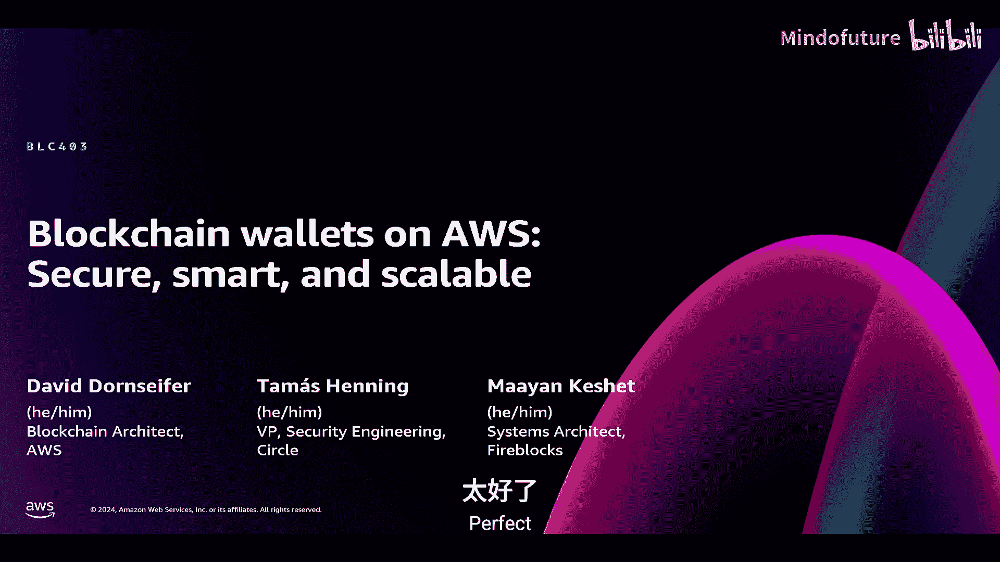
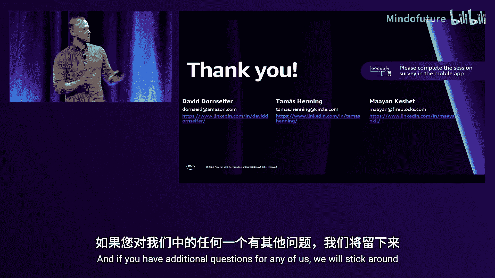
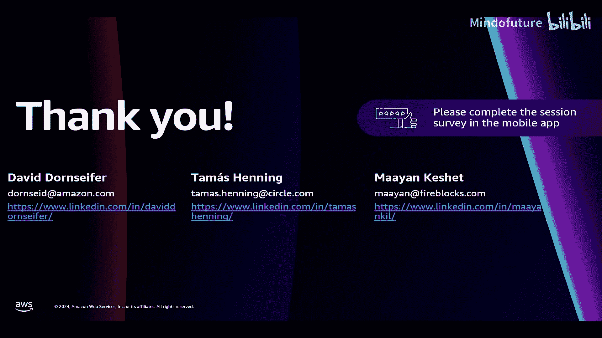

# 【AWS数据库峰会2024全集-•-中英】AWS-re：Invent-2024---Databases-p26-P26-Blockchain-wallets-on-AWS---Secure,-smart,-and-scalable-(BLC403)--BV1VAR5Y6Es1_p26-

Perfect。

Yeah， all right， welcome everyone。Yeah， all right， welcome everyone to our session BLC for03 today。

 my name is David Donzeer， I'm a blockchain architect with AWS and today I have the pleasure to have with me on stage Thomasmas Hening VP security Engine from Circle and Mayancat system architect from Fireblocks and today we have the pleasure to talk about like blockchainlockin wallets on AWS secure smart and Scalable。

So let's look at the agenda for today， what we will do is we will start with different blockchain or different types of blockchain wallets。

 we will actually talk about how these differentiate and the different use cases that these are being used with。

 we will then look at how we can implement some of these using AWS key management services or core services basically we will then have my Tas。

Talk about like smart wallets， basically provided by circle and how they can solve certain UX related issues with blockchain wallets。

I will then give an introduction or like a deep dive into AWS nittro enclaves and explain why confidential compute and by nittro enclaves are in general like a good combination or can be used in a blockchain space。

And later， we will then listen to Mayan and some of their learnings on how fire blockslocks actually built like MPC and MPC wallets using AWS nitrine clay。

So this is a pe of gender today， let's get started with these。So first of all。

Let's just so that we get all on the same page， what are what are the schematics of a blockchain wallet。

Like if we look into the first， the first， the upper line， basically the wallet。

 we see there is a private key。 The private key determines the public key。

 and this is usually for EVM， for example， for a serum， it is converted into a public address。Now。

 if we look at the blockchain layer。Or the blockchain in the ledger itself。

 we see that there are different assets like native assets， for serum， for example。

 will be Easter or certainly a C20 tokens。What happens is these things。

 these tokens or like the native assets， These are just pointing to the public address。

 So we have this pointer thing。Now， the private key is important if we want to change something on this association。

 So what happens is the private key is being used for the signature。

 the signature is then being validated on the ledger。

 we see if this particular public address is valid。

 if there is sufficient sufficient amount of assets。

 and then this particular transaction gets executed。 and then we can actually， yeah， the assets。

 the transaction gets executed and the assets will be sent away or the owner is gonna change。

The important aspect about this schematics is really the core principle of a blockchain wallet it is the private key。

 there is not much more， I mean there is more metadata for example。

 but it is really like the core aspect is about protecting the private key because with this particular private key。

If someone gets hold on it or if someone is able to create a signature。

 it is possible to basically drain the entire wallet or scent like fraudent transactions。No。

What different types of blockchain wallets are there。

 So we have differentiate these blockchain wallets basically on the user basis。

 So let's first of all， talk about the retail users。And there is a very popular type。

 it's a so calledled custodial wallet type。And the implementation or the general implementation will basically be third party companies such as financeinance or coininbase are managing your keys。

 and they provide all the sophisticated security， fully managed recoverability and all these things。

 So just out of curiosity， Who of you in the audience has like a custodial wallet。Okay， a lot。

 so yes， you're familiar with that principle the good part here is like security is a very important aspect。

 so usually MFA， so multifactor authentication is enforced and where do we see these use cases。

What are general use cases on custodial wallets， it would be staking， it would be trading。

 it would be investment and also sometimes just play around because these things are actually， yeah。

 the custo or the custody， the company basically manages all this heavy lifting for you。Now。

On the other side of the spectrum of blockchain wallets。

 basically we see non custodial wallets and non custodial wallets basically got really popular in form of like browser plugins。

 for example， Me maskask or like dedicated hardware security devices such as ledger or even like multi signature wallets。

 smart contract wallets， such as Sa dot global。And non custodial wallets are actually about optimizing user control and ownership。

It comes with the drawback that you are as the end user。

 you are responsible of like managing the key， managing recoverability。

 And if you're losing your keys， you might have also lost your funds。

 So just curious who of you as femla with this concept and maybe even has like an Bs up。 Yeah， okay。

 so it's actually the majority。 So everyone crypton native users usually start with these type of wallets and then get a bit more femla。

And again， what do we use these things for， usually trading investment。

 or in case of like safe or global， it would be something like a Doo Treasury management。

 So Doos are decentralized autonomous organizations。

 And these usually require quorum to do some changes to their。To to their funds， for example。

And last but not least， there's a new type of wallet which got like fairly popular over the last two to three years。

 I would say， particularly also with the upcoming getting the new L2 L3 networks。

 so smart wallets or also count abstraction wallets， or you can also call them program wallets。

So what are these type of wallets。 So circle， for example。

 and this is what Tamaas will actually dive deep on。

 These wallets are being managed by a company or can be managed by a company。

 And this a smart contract that can be customized。 and it allows you to solve a lot of this U X so user experience related issues that are associated with。

Fully like a non custodial wallet， so you have social lockins and other things that can actually be optimized。

On the security side。You have also MFA and the beauty of this blockchain or of this smart contract based nature is that you can now customize these things and then use it。

 for example， for gaming and all this other thing。All right。

 now let's look at like institutional grade wallets。 On the institutional side。

 we usually differentiate between the three different ones， like it's salt wallets。

 it's warm wallets and cold wallets。And hot wallets， the idea here is like。

 it is a wallet that is basically connected to the Internet。 or more specifically， it is。

It is a wallet that has programmatic access。We have security in these wallets so if we have for example。

 an HSM the key cannot be extracted， however， if someone is able to manipulate or get your program your wallet to sign a transaction then you cannot do anything about it。

 These wallets are super efficient super fast and an online HSM would be like an example implementation and certain use cases。

 for example， like oops like like staking like settlement or online custody。

 these require like constant programmatic access to your key so you really need to have like this interface。

Now。It's like a different version of these hot wallets is called the warm wallets。

 They have like they check all the same boxes。 However， to make a transaction here。

 we need to have like an additional approval， for example， a human。There the principle is really。

 okay I need to approve it with biometrics or my app。

 and we also see this in context of more advanced crypto algorithms。

 usually something in the MPC TSS part， so where different parties are involved and we are not using a single scheme crypto type。

Tamamaas will actually elaborate on death and dive deep on death and how warm bullets are actually being built at fire blockslocks later。

And one of the use cases that we see where this is being used and where this is actually quite popular is。

 for example， trading like companies that move like。

Big amounts of like digital assets on a daily basis there you will require like a really advanced security setup for your keys。

And last but not least we have cold wallets， cold wallets is basically the oldest standard wallet that we have seen。

 usually these are fully offline， so they are different from the warm wallets and the hot wallets that there is usually no programmatic excess on purpose。

It requires a human to do like a signature， or to do。

Like changes to some of the private keys or other things。

 they deliver like a super high degree of security because of physical separation， for example。

 and no programmatic access and a standard use implementation would be like an online offline HSM。

 so you have a dedicated hardware security device that is not connected to the internet that maybe even like stored in a separate safe。

And that is just accessible by the chief crypto officer。

And the standard use case here would be like offline custody is just think about like a pension fund that is maintaining like or has like custody of several hundreds or thousand bit。

 So this is a solution that you will probably choose or could choose for that。

Now let's just summarize what are the core building blocks that are required for a blockchain wallet so we have seen there are different types of blockchain wallet。

 The most important one is actually we have a key management like a secure and robust key management service that could be AWSK as it could be cloud HSM or it could actually also be secrets manager depending on your use case Now what you also want to do is you want to apply a fine granular access management that could be done with AWS IM or even Cloudre for audit purposes。

And that's something that I will all also like elaborate on later。

 but like all these wallets kind of use or kind of require like an efficient compute layer。

 some are serverless that could be like with a combination with Lambda or EC2 or even nitro enclaves。

Amazon CloudWatch is an advanced monitoring and logging system that can be combined with that。

 and then last but not least， for example， for trading use cases。

 certain wallets require ultra low latency access to certain APIs that could be done with cluster placement groups。

 for example， for the EC2 instance， or enhanced networking。All right。

 now let's look at like two different implementations on how to build these wallets。

So this is a standard or like a relatively simple wallet， it's a hot wallet based on KMS and Lambda。

It is as I said it's fully serverless like we can process requests via like API Gateway。

 La reaches is auto to came as a signature is being created， it's a fairly simple scheme。

 the beauty here is we do actually have like import key import for example， key import support。

 we have FPS 140 levels2 compliance and we are able to build like EVM compatible blockchain wallets that way。

Now， another wallet that we could actually build， fairly simple would be like a cold wallet。

What I mentioned before like a cold wallet is program like it's an offline wallet。

 so what we could do is we could use cloud HSM in a dedicated private subnet without any internet access and basically manage our keys。

Since that it is or yeah， like cloud HSM is a single tenant hardware security device that delivers Fps 1。

40 L3， so highest compliance level， and it does like key import and export support and。That could。

 for example， be accessed by the cloud opera or like the chief script opera officer via an E C2 instance。

All right。Now I will hand over to Tamaas。Yeah。Awesome thank you so let me introduce Cir for a quick second so we were founded in 2013 and we are the Asrs of USDC and the URC。

 which is of course the largest regulated IA complianceliant stable coin with about $16 trillion in transacted volume。

One of the big things that we offer is like enterprise grade stable coins。

 but also infrastructure to help incorporate blockchain into your business itself。

So what do we actually offer， we offer full stack platform building enterprise grades applications for whatever you need。

 so I want to start from the very， very bottom the services that we offer we offer across 15 chains。

 EVM and non EVM chains and on top of these we have built USDC we have also built URC。

 we've built our cross chain transfer protocol， which is the first mint and burn bridge across multiple chains。

 reducing quite a lot of the security risks associated with risk with bridges。

But let's talk a little bit about the Web3 services。

 this is where we've built a programmable wallets offering and I'm going to be talking quite a bit around that in depth because we're here to talk about how you're going to embed secure wallets into your applications。

 but we also offer services for a smart contract platform， which is smart contract deployment。

 we offer gas station， which offers you the ability to abstract away everything that you have to do with blockchain fees。

 E， etca on those wallets that you might not have， plus we also offer compliance engine。

Moving into this， one of the big things that we have found as we talk to quite a lot of developers that are trying to enter into the Web3 ecosystem is。

We wanted to offer them and they need a lot of flexibility。

 both from a crypto native individual who knows how to manage whatever they're doing to a Web2 developer。

 a native Web2 developer who doesn't know how to deal with private keys and whatnot。

 so we went on a world where we've built as much flexibility into the systems as possible。

Allow us to allowing the developers to develop what they want to go and develop。

So what did we what did we go ahead and do Well， we've actually went in with multiple UX offerings and across the board。

 and I'm going to start with the left。Deev controlled wallets these are the actual wallets where you as a developer have the absolute utmost control around what happens within the wallets themselves。

 you control the EOA， you control the an end user wallet or the smart contract account yourself。

 you yourself can sign any particular transaction you want in any particular model that you want yourself。

And you are abstracting away from your end user， the concept of a blockchain for the end user。

 you could actually build an application and experience where it's just another USD or ER or whatever denomination transfer。

 Everything happening seamlessly below the ground。 They don't have to know that they're dealing with blockchain at all。

Going into the middle this is where users will actually have a lot more control with their keys themselves this is utilizing ourmpC technology so multiparty computation to sign things and these also work with end user wallets but also with small contract wallets here the user will have to effectively sign a transaction on their mobile device they will have to proactively。

Issue in their pin code or whatever authentication method that you've chosen。

 but your that particular device will also be partaking in the NPC calculations。

This allows for customizability for the APIUI user experience。

 while also preserving control in the user's hand as they the way they want it without even the developer being able to get into the middle of it。

On the right side， let's talk a little bit about modular wallets This is an open beta that we launched recently。

 which allows for implementation of modular small contract wallet。

It's extremely configurable in every single step of the way you can bring your own keys。

 you can use developer keys， you can use user control keys。

 it allows you to set up the walls however you want it。

But the cool side of it is it's absolutely extensible with ERC 6900 to adding new functionality。

 limit functionality， however you want to do it。So how do we get this done。

 how do we leverage JWS today， and again I'm going to start from the left。On the left side。

 this is where we've set up our API gateway， this is where we have everything coming in and routing through our systems。

On the top you will see all the different systems and platforms that we actually built in order to enable this functionality。

 but below that is effectively how we communicate with all the different blockchains and the complexities that come with effectuating transactions and monitoring transactions。

 blockchain states and recognizing transactions across different chains。And on the right。

 this is where the magic happens， this is where we utilize KMS， this is where we run our MPC servers。

 this is where we run our ledger servers that actually reconciles everything that happens within the blockchain to our internal state of the world that we know about。

Here we do utilize extensively AWSKMS in order to actually secure all the keys and all the different secrets that is required to run this entire ecosystem。

But this is also a world where if one of our customers decides， hey。

 I would love to run my own NPC nodes myself， this is where we would actually interconnect with our customers NPC servers to allow for like full NPC sharding control for our customers。

From a key management perspective， this is the world of key management that we actually offer。

One on the left side being single sg。Where it's one approver with a single unique key。

 this is pretty much your standard EOA transaction。

 this is one key that can rule the world right on the NPC side。

 we offer the very typical threshold signatures with NPC compute。

We've recently launched support for pass keys， and very。

 very soon we're going to be launching multi S opportunity where multiple unique keys are going to be able to reach threshold to be able to effectuate policies and transactions to happen。

That's roughly it。Back to you， awesome。Thank you very much， Thomasas。嗯。

So let's now talk about the requirements。For advanced crypto wallets。

 And you might have seen it in the previous architecture that Taas showed。 namely。

 I want to talk about AW's nittro enclaves and why these are actually well suited for advanced blockchain rule clothess。

 But first of all， let's see what are nittro enclaves。

From a high level approach or for taking a high level here。

 AW's nitro enclaves are about bringing an additional level of isolation and protection to your EC2 instance。

Today， everyone。And everyone actually on the EC C2 instance can access like the encrypted data or like the the plane text。

 basically the data in use on your EC C2 instance。 So basically the。

The root user or like the administrator in E C2 instance。

 has potential access to this data that is being processed。Now with AW's nittro inclaves。

 we are able to carve out a dedicated memory area， dedicated CPUs。

 and move the confidential compute over there。Now we have an enclave。

 basically a dedicated virtual machine， which has a very restricted， secure local channel。

 namely a Vi connection to the EC2 parent instance。Now， using that principle。

 not even like an operator like the root user on the on the Linux box of the parent instance。

 is able to access the data。Being processed inside the nittro enclave。

So what is a nitro enclave and what is it， what is it not， So a nittro enclave is an isolated。

 hardened and highly constrained virtual machine。It is a lightweight Linux operating system。

 It has its own independent kernel and the beauty of the enclave and also of the other features。

That it can run its own encryption keys。What it is it is not a container。

 there is no persistent storagech associated with the enclave。

 so everything inside the enclave is ephemeral。Because it runs the main memory of the EC2 instance。

Also， no route user， no administrator， operator， or whoever is able to access this particular enclave。

Even from the E to instance， so you cannot go in and do a memory dump period to CPU registers or anything it's completely isolated。

And last but not least， there is no external networking per default， so it is very。

 very restricted and you just have a socket basically for your EC2 parent instance。

So in addition to these isolation features that we just talked about。

 there is another interesting feature， it's basically called cryptographic attestation。

What does cryptographic attestation mean， cryptographic attestation means the enclave is able to prove its identity。

So how does that work？So inside a nittro enclave， you can create so calledled attestation documents。

Atestation documents is it's like a fixed schema。 you can actually at different optional data fields。

 but per default。 you have different measurements included in such an attestation document。

 measurements basically hash values over the state or hash values that have been taken when the enclave was created。

 So it's in hash value， for example， over the entire enclave。 And that is basically the identity。

 because if something would change in the state， if something would change in the kernel configuration。

 these things would also be different。So using this together with， for example。

 some public or some optional data field such a public key。

We can then sign the transaction or sign the sattestation document inside the enclave。

 This is being signed by the Nitro hypervisor， and this document can then be validated against the public。

AWS root certificate。And by validating it， we know that this document has been created inside and enclave。

 it has been signed by the hypervisor， and we know exactly what the state of this thing is like the different PCR values。

No。What we can do with this particular identity attestation or with this attestation feature is we can combine it with certain policies on K。

That gives us the opportunity to basically define。Came as actions like came as decrypt on asymmetrical key and associated with the hash value with the identity of an enclave。

And this is a very powerful feature， so we can ensure that just certain enclaves are able to run decrypt on certain keys。

And that is basically one of the really popular things and popular applications also in the blockchain space because that gives us a very powerful yeah。

 because we can now ensure that just the enclave is able to run decrypt and that only the plain text。

 for example， the plain text of a private key is just exposed to the inside of an enclave and this cannot be read by anyone like like an operator ro operator or anyone else。

Now let's summarize what are the key features and benefits。

 so we have like very strong isolation and security。 There is no networking access per default。

 We have a secure local channel， the socket basically vSock from the EC2 parent instance。

We have flexibility， so we can run it on X86， we can run it on arm。We can decide how many CPUs。

 how much memory we want to have associated with this enclave。

 and we can have make use of cryptographic at a station。

 basically to prove the remote proof the identity of an enclave and the best of it all。

 it comes with no additional costs。 So it can be turned on on any EC C2 instance。That's it。

Now let's piece it all together， let's see like how we can actually leverage a nitro enclave for a simple blockchain wallet。

So what we see here is there's this nittro enclave， it is at the core of the VPC basically。

The use case is such that we have， for example， an encrypted blockchain private key。

 These keys would be encrypted using Ks。And they could be stored in AWS secretcrs manager。

But since that they are encrypted， we could also use dynamo， We could use S3。

 whatever you would like to store these things。 It is really like we have the encrypted keys stored outside。

 These keys are then being downloaded into the AWS nitro enclave。

 The nitro enclave proves its identity towards K S using cryptographic attestationation。

 and we are then。Getting the planex private key inside the AWs nittro enclave。

Now the beauty of this enclave is that since that it is fully software defined。

 we can actually we are not limited by certain supported elliptic curves on certain HSMs。

 for example， we can now run the cryptographic operation that we want to do， we can do BLS。

 we can you see whatever we would like and then basically return the sign transact。Ju the user。

And as I mentioned before， we have full flexibility in terms of architecture so it's compatible with Grviton。

 you can run it on X86 and all these other。And that basically gives us a very cost efficient solution for like large scale key management operations。

 for example。All right， and now I will pass it over to myan to see like how firebs is used in our rain cliffs right Thank you David。

All right， so hello everyone。😊，My name is Mayan， I'm from Fablockox and we'll deep dive into our use cases with Nitro and confidential computing。

So let me tell you a bit about firebs。We are a provider of blockchain infrastructure and wallet infrastructure to institutional。

You know， big names like Bank of the Oak Mellon， A and Z。And。You know。

 I could walk you through all of those numbers， but there is a bigger story here so there is a lot of opportunity in the blockchain space and you know this is。

 after all a blockchain session and many of you said that they have blockchain wallets so I'm sure you are all excited about it know as we are and institutional see it as well but and you know maybe theyre excited about tokens or CBDCs。

 cargo credits， trading， whatever， there is a lot of things that can be done in prepto。😊。

But the clippto world can also be scary。And。And we are there to help them。And， you know。

 sometimes when we add， you know， with these volumes。

 sometimes when we add a new blockchain into fair blocks， integrate with it。

 then suddenly 25% of that volume of of all of the chain goes through far blocks。 And that's。

 you know， you know， an immense responsibility， both for our customers。 I mean。

 to us for towards towards the customers and also towards the ecosystem。 and。On the one sense。

 it's very humbling because again， we have all of this responsibility。

But there is also lots of engineering pride in the solutions that we found for those problems。

 and I would like to share some of those solutions with you。嗯。So， first of all。

 let's talk a bit about the transaction flow。 What happens when you start a transaction。

 So let's say David wants to send me， I don't know，1 bitcoin。

 So it goes to our to our Web U I or to the API or something like that， creates a transaction。

goeses to the policy engine。 Every customer can set their own rules in the policy so they can say I don't want this and that user to transfer more than 1 million a day or I don't want to send money to this and those addresses。

 No， standard stuff in the financial world。Then it goes through sterilization。 So， you know。

 Bitcoinco Eterium， of all of those protocols， every one of them has a very different bits and bytes protocol right。

 so you need to sterilize the transaction to to those bits and bytes。

Then0 you go to the signing stage， right， So yeah， it's crypto。

 You need to sign it somehow with a private key， and we'll talk a bit bit more later about it。

 And we broadcast it to the rest of the network。And。

We have identified several phases or several parts of that flow that are very critical and those are usually the areas where we focus on using confidential computing。

 so for example， policy engine if an attacker successfully attacks the policy engine。

 they can ignore the rules， not good。😊，If they somehow compromise the sterilization phase。

 then I know I wanted to send someone to the audience in someone in the audience1 bitcon。

 and David change it to his address。Also not good。 or maybe we will change it to 100 million Bitcoincoin or something。

 I don't know。And then0 for similar reasons the signing stage is very critical right because if suddenly you sign a transaction that you didn't intend to do then it's a problem so all of those are very critical and today we focus on the signature part or the signing part。

😊，All right， so as we said， the signature part is very critical and in the crypto world is so much so that we have this saying that not your keys。

 not your crypto right probably or not your kids not your wallet， many of you probably heard it。😊。

And there are different solutions to this problem we've mentioned multiC earlier， MPC。

 and we go into NPC。All right， so what is NPC or multipart computation？As the name suggests。

 there are multiple parties or cosigns， as we call them。

 each cosder independently generates a set of random bits and bytes all independently from each other。

😊，嗯。10 together those shards represent some logical key。

 but it's important to note that the logical key is not saved anywhere， right。

 we will see how it all comes together to sign a transaction。

 but its very it's very powerful stuff because there is no single place where an attacker can go and still that private key。

 It's all virtual。 It's all logical。So when we want to send a a transaction。

 all of those cosigners need to communicate together in order to send the transactions and if for some reason one of them suspects foul play。

 then they can just not sign it and that's it mathematically there is nothing else that can be done if one of the says that they suspect something it's safe。

 no agreement， no signature again， very powerful stuff when we are dealing with crypto where cryptography is so important。

And you know another bonus of NPC is that it's blockchain agnostic。

 meaning that usually when you talk about multisign or other schemes。

 it's very dependent on the protocol so Bitcoin has their own way of doing multisigio as the one way of doing it so this gives us the ability to first on board new blockchains rapidly because we can use that。

😊，And we can also use the same tried and run validated infrastructure that we have for MPC for all of the blockchains that we add。

And。In this schema， which we it's usually our setup up。

 we have two cos that are in fire blocks and 1 one customer coer that is hosted by the in the workspace of the customer all right。

 so and we'll go a bit more about we secure data the customer coer that is at the customer。Alright。

All right， so this is the Coana architecture。 Now it's an architecture diagram， so a lots to take in。

😊，But me let me guide you to it。So first of all， the customer need to set up a few thingss。

 they need to set up an Amazon S3 bucket because as we said， by default。

 there is no persistence in Nitro， they also need to set up an EC2 instance with Nitro enabled。😊。

They need to set up an AWSKMSSK， which we will use for aestation later on。

And then they installed the image that we provide them on that is a two instance and once the cosigner starts up it goes to the S3 bucket there there will be an encrypted database with the MPC sh。

 those random bits and bytes that I mentioned earlier and these are encrypted using the KMS key that the。

😊，Customer set up。And。Once we start enlave and fetch this encrypted database。Our image。

 the image that we supplied to the customer goes through the station with KMS through the process that David mentioned earlier and if successful。

 it is able to decrypt the database and you know if it's not successful then that's it。

 it cannot do anything with that charity doesn't know it and again that's very powerful stuff because if for some reason。

😊，You installed the wrong image。 for some reason， the image ismal phone。

 someone tried to change the code， something like that。

 then they have no access to that to that charge， to that part of the private key。

 and they can participate in any kind of signing。 But let's say everything went well。

 the coigner can now go to the network， go to fiveb services and fetch transactions to sign and participate in all of these NP communication that we talked about earlier。

 Now there is a lot more to it and for full deep dive into the architecture。

 We have a great blog post for you that encourage you to read if you're interested。

 you can find it in that QR code。 It's in on NWs blog。 you can also Google AWs blog Night go5b。

 I'm sure youll find it， but but it's there。😊，All right，ll give you second。Okay。

So at Firebs we have experience with many different confidential computing frameworks。

 and it was very interesting for us when doing things with Niro to see what key takeaways we can take from that。

😊，嗯。So first of all， VM isolation is more flexible。

 what do we mean by that So in Nitro the isolation level is on the level of all of the enclave。

 all of the enclave is a machine that is isolated and then you can write code with it that is trusted that you can trust that was not changed in some other frameworks there is what's called in process isolation。

 Basically you inside your own project， your own code you need to divide areas into trusted and untrusted parts of the code now never mind all of this the practical implications are that in other frameworks usually there is a very tight coupling when developing with the SD of the vendor that。

😊，of that framework and in practice at least in our experience。

 the first classes decays are usually only in C+ and rust because those things come from the systems engineering engineeringering background usually and there are a lot of personnel and velocity considerations development velocity considerations here right because you know maybe you have a few systems engineers that are proficient in C+ and rust but a lot more nodejS engineers for example that would also like to contribute to projects that could utilize confidential computing and make the well system secure so that for us was a very big bonus and takeaway。

😊，Now， other key takeaways where it's still important to。

To mitigate supply chain attacks in this model， you know， we talked a lot about。

How to start enclaves in a secure way， to do auto to execute our code in a secure way。 but of course。

 if you somehow insert there some NPM packet from 10 years ago that is compromised and they downloading malicious code into the enclave it's not good right so you need to have some sort of package allow list for the enclaves that will go into for the packages that will go into the enclave another thing is that we have and also customers have pipelines。

 the scan images such packages of vulnerabilities and there are many projects now in the market for stuff like that and usually do they work with Docker images or stuff like that。

 but we created the utility that is extracting similar images the EAF EIF enlave image format is basically the format that ittro workss with and it's a very nice to work with so we have also created this utility that we have integrated into our pipelines and our customers also use it and。

😊，it and then again more trust in the images that we build and bring them。So again， very。

 very powerful stuff。All right。So。Again， we talked to you a lot about running secure code and。

And all that， but is that enough is now all of our systems secure。

 So system security is only as strong as it's this trustworthy element。

 or in other world it's only as good as the weakest link， right。😊，And if we look at attacks。

 and successful attacks on software projects in the last few years。

 many of them are focusing on the CICD part of the software engineering project。

So we wanted to see what we can do with that。 And night was securing Clas were a good building blocks for us in that area。

😊，So you know when you build a project that you intend it to be secure and trusted。

 there are three questions you need to ask where do we build it in fabrics， for example。

 one of the ways that we can build such services are offline machines right they're secure they're offline the key are there。

 nobody can access them。But it's very hard to use them， right， I mean。

 it's very hard to develop a project and make changes every day or something like that。

 or if there is some new security vulnerability that you want to fix and。😊。

It's hard to rapidly develop things in that way。 So that's one way。

Then what do we build right if an attacker successfully goes into your Git repository？😊。

Put some malicious code there just the moment before you click build。 Then again， it's a problem。

 It's sort of a game over because they can do nothing whatever they want。嗯。And because again。

 remember， in security， there is no mathematics， right。

 you always try to create more and more layers of defense。 I mean， are mathematics。

 but you know what I mean。And10 with what secrets， right。

 where exactly do you keep the secrets that we sign the image with the the keys that we later be used for attestation that in thetestation process it will say。

 yeah， this image was created by firebs。 I trust this image。 Where do we save those keys。

 So in the offline machine it iss easy。 You save it in the offline machine。😊，All right。

 so we made a solution with natural security enclaves where we create a builder image。

 now this builder image we create it in the offline machine right and we verify it in the same old way but now we trust this image。

 this new builder image and the offline machine basically serves as a route of trust for that because we trust the offline machine so we trust the output of that machine。

😊，And we take this image， this builder image and start to build images using that and。

When the enclave starts of the builder image， the builder enclave。

 it then receives a signed committee to build， so let's say there are a group of people that usually in your organization can decide on what to deploy they need to sign the specific ash that they want to build。

😊，We will get that， fetch that， verify that it's the exact code that you want to build。

Then we at testest that。 so we at test the image， the builder image see that everything is okay。

 It's not some kind of a malicious builder。And proceed building and signing it using the keys that we received as part of that testestation。

So we build the CIF， we sign it， 10 we published the artifacts and that's it normal。

 we don't need to build enc anymore so we tear it down and that's actually has been a very nice interesting thing that we did with nitrous see wavess because it enable us to elevate the root of rust that we have in offfront machines to a much more rapid and let's say modern and online building process which can really improve our data velocity。

😊，So that' has been a very interesting thing for us。Right。

 so that's have been the the things that I want to talk to you about。 It was very interesting to me。

 I hope it has been very interesting to you。 And let's go back to David。😊，All right， Thanks a lot。

I am。Let's now actually see what we cover today。So today we started with like the general introduction of what our blockchain wallets we differentiated between different use cases。

 we looked into like different types of blockchain wallets for institutional， for retail users。

And we explained like how blockchain wallets in general can securely be built on AWS。

So the first architecture that we presented was like a KMS based thought wallet。

The CAS again we have like direct key import opportunities or like functionality。

 we do not have key export on KS KS cannot run non EVM compatible keys because EVM it's really about like the EC or the EP curve。

 elliptic curve that will be supported and namely it's the SECCCP 256K1 curve that you would need for EVM or。

For other chains， then you do not have the support。However。Since that CAS is like an programmable。

 accessible， like an internet， basically an accessible wallet or like key management solution。

 we can use it for smart wallet support， as you have heard from Tamaas。It's taking support。

 you do not have that because BLS signatures are not being supported。

 so that basically tells us okay from a complexity perspective。

 we can use it in a fully serverless fashion， for example with Lana。

 complexity is fairly low to implementing KMS based。

 however KMS you're being charged per key so it is a bit more on the pricey side。

Cloud HSM on the other side supports key import， key export。And still we do not with cloud HSM。

 we do not have like non EVM compatible signatures because of the EVM or the elliptic curve。 However。

 we can do smart wallets with it。 Cloud HSM is can be accessed or can directly programmatically being accessed if you would like to do it。

So that basically gives us like a little bit higher or a little bit more effort on the implementation side because cloud HSM。

 given that it is a single tenant， hardware security device。

 requires a special VPC setup in a private VPC at access points on the cost perspective， again。

 since said it is a dedicated single tenant HSM it is。Really， yeah， it's more pricey。

 but it gives you like Fps14 Fps1， 4D level 3 compliance， so basically the highest compliance levels。

We then actually talked about or dive deep into AWS nitro enclaves and also how nitro enlaves can be used for different types of blockchain wallets。

Nro enclaves itself， since that they are completely defined in software， we have key import。

 we have key export， we even have like non EVM compatible chains because you can now define your for example。

 crypto algorithms like engoling or rust， you then basically audit your code。

 you can move it into the enclave and then basically know that you have secure enclave processing。

It is。Very popular with like smart wallets as well because you can run any type of custom workloads in there。

 Staking support。 BlS would basically be elliptic curved that you would need。

 We have that in there as well。 and that basically gives us then like it's three on the complexity side because again。

 it is a fully software defined solution， you would need to build up your own software and as you listen to myan。

 you need to make sure that the software has been audited and basically yeah it' being developed in a concrete way。

 However， it is a cost efficient solution。 There are no additional charges with AWS nitro enc clays besides the E2 instance itself。

And last but not least。AWS nittro enclaves can also be used in conjunction with EKS。

 so we can leverage Kubernetes together with AWS nittro enclaves that gives us like all the same features。

 so we import basically gives us all the same features on the enclaved side。

 however you can also leverage the horizontal scaling， so scale in scale out from EKS。

So now if we look on the complexity side， we need to handle a bit more complexity because we all know Kubernetes is not that easy。

 so there's a bit of Kubernetes management over it。

 but you could actually leverage the features here namely scale and scale out in a dynamic fashion and also on the cost perspective we are actually a bit more a bit more expensive because we need to cater for EKS as well。

All right。Now that actually concludes our session today。

 and if you have additional questions for any of us， we will stick around， let so just approach us。

 Thank you very much。

