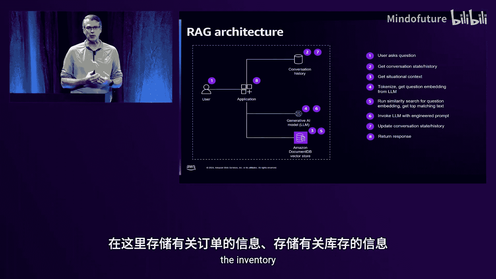
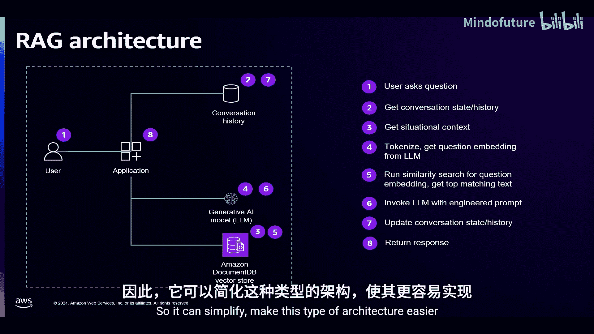
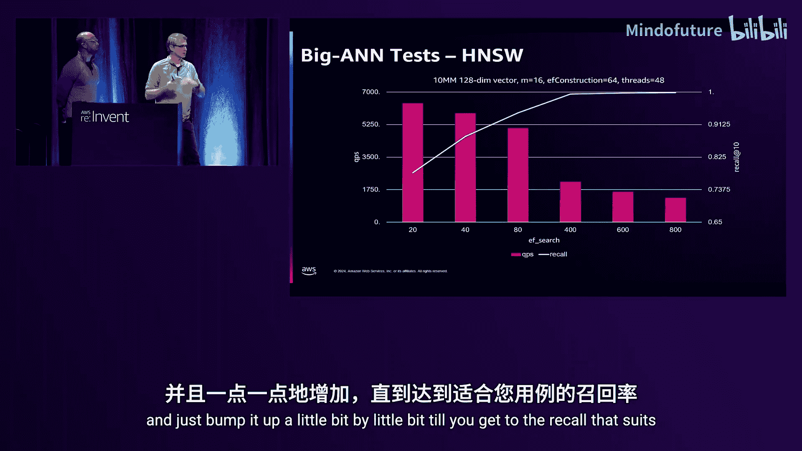
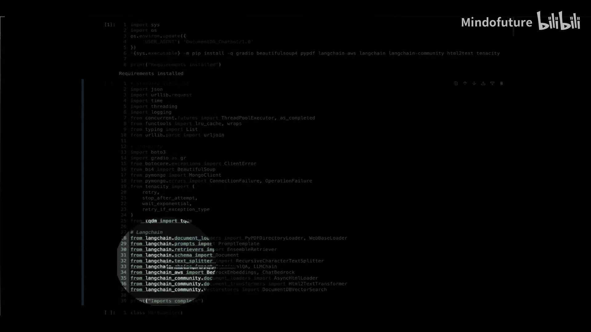
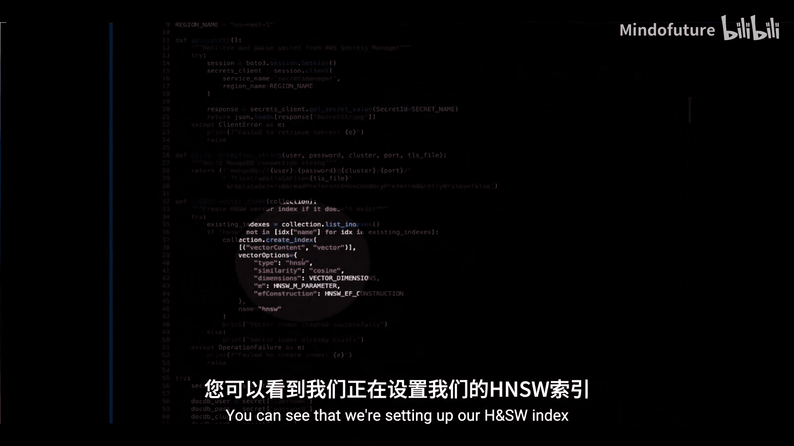
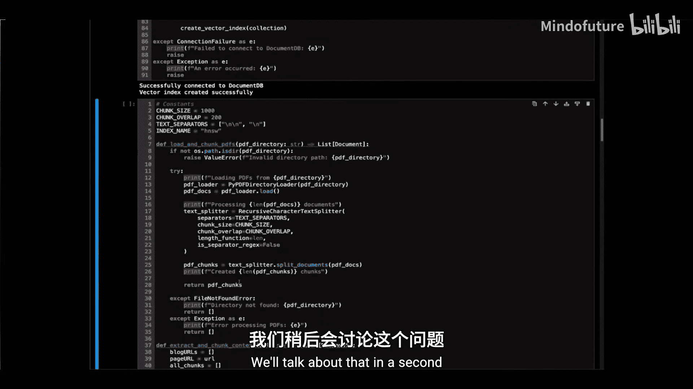
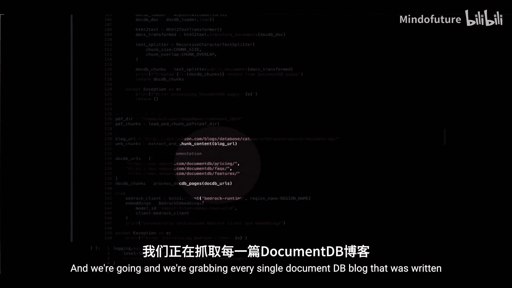
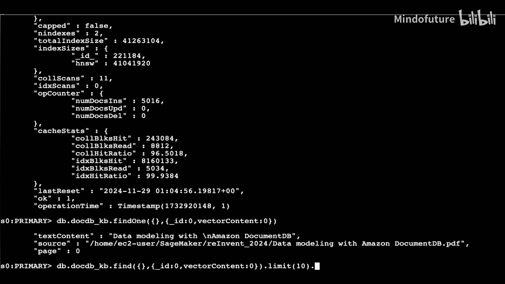
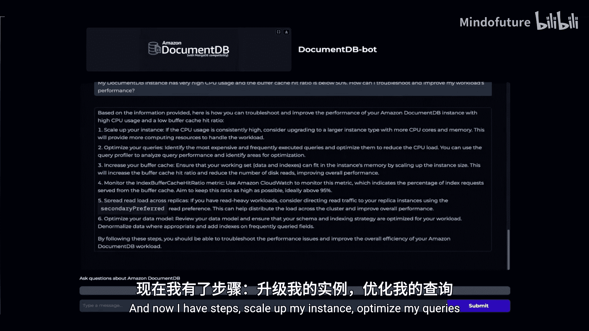
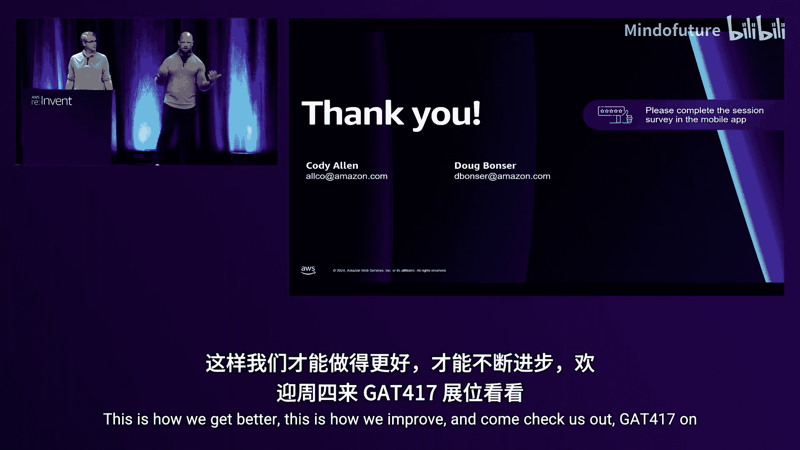

# 【AWS数据库峰会2024全集-•-中英】AWS-re：Invent-2024---Databases-p27-P27-Supercharge-app-intelligence-using-gen-AI-with-Amazon-DocumentDB-(DAT320)--BV1VAR5Y6Es1_p27-

All right。Hi everybody， welcome to Reinvent 2024 I think this is a point where you can put your headphones on we don't have any microphones except for this one which I think is going directly into your headphones can everybody hear me okay we're good way in the back too perfect right you can hear me okay too all right。

 sweet。Just to make sure you're in the right spot， this is DATT320。

 we're going to talk about supercharging app intelligence using GAI with Amazon documentcument DB GAI。

 who has already been to 12 GAI sessions at Reinventt this year？That's right， right。

 I feel like we should have a drinking game every every time I say Jen I you drink。Water。

11 30 in the morning， and people are crazy。So today what we're going to talk about is a little bit different than maybe some of the Gen AI sessions that you've gone to。

 we're going to talk about GenAI on documentcu DB we're going to start off we're going to set the foundation on vector search。

 what are the key words， what are the key components of that。

 and then we're going to go into access patterns， especially access patterns that we're seeing document DB customers use。

Then we're going to talk about vector search specifically on Amazon documentcu D。

 we're going to talk about how it works， how we set it up， really the way that it works。

 because this is going to become very important when we talk about creating modern search operations and then best practices for it again。

Heavily focused on the database side of GAI we're going to touch lightly on LLMs and options that you can use but very very deeply focused on this this is a 300 level course so we're going to assume that you are familiar with document DB you don't need an introduction to it。

 you know what a document database is you to JO model is。If you can't see us way in the back。

 this is what we look like， I'm sorry potentially， I'm Cody Allen。

 I'm a principal document EB solution architect， I've been with a team for about four years now based out of Dallas。

 Texas and with me is Doug Boer and everything else is the same。

Special changeable or interchangeable Dallas， Texas been with a team about four years is that called high availability for essays failover who's the primary who's a secondary we'll into that later？

So let's start off talking about vector search now the concept behind vector search sure you're aware is to。

Build， search， manage， span， use vector embeddings on a database。

 Now you're going to perform a vector search on top of those embeddings to give you a contextually relevant answers。

 It's gonna be different than a binary search where you're doing a text search looking for a phrase。

 You're looking for context。 You're looking for a recall or relevance。

 There's a lot of options for databases that you can use。

 We've announced vectors on open searcharch on dynamo Db。 there's a P cone。

 there's thirdpart tools you can use。 we have vector embeddings on document Db Now it's really important to choose the right vector database that meets your use case。

 you want it to be secure。 you want it to have the most contextly relevant results and you want to be close to your data。

 These are all big important factors to consider。 Now the whole purpose is well。

Retve those items that are contextually relevant to your data。V databases， vector search。

 vector embeddings， we're going to start a new drinking game every time I say the word vector you drink your water。

 but let's start off with vector embeddings， that's really the key thing that we need to focus on for this talk。

嗯。You start with your data。Your domain specific data and you're going to break that into different elements and those elements are going to hold meaning on their own that's called tokenization Now those elements。

 they can be words， they can be paragraphs， they can be sentences， they can be entire documents。

 really it's up to you what makes sense for your use case。

 but now that you have all of those different pieces， all those elements。

 you're going to pass them through a large language model。

In a process that is called tokenization and that is going to turn those elements into essentially really really big arrays of numbers you'll have different options based on your LLMs you can have some that are as few as 200 numbers and you have some that are over 4000 numbers again this really depends on your use case。

Those numbers exist in this multidimensional space， right where？

Items that are similar are going to be somewhat closer to each other and what that means is that to find a semantically similar result。

 it's just a mathematical function to find the distance between two elements。

 but again the whole thing， the whole process here is to choose the right options that meets your use case and。

Create those embeddings。 Thats， that's what it all comes down to。

So just to make sure that you caught all that， there's a lot of pictures on that， a lot of words。

 where does it start Does anybody remember where this whole process starts？

I could say that one more time。Ebedding。But those embeddings come from your data Everything here starts with your data that's what makes us so significant。

 That's what's gonna be the difference between having a generic generative AI app AI app like something like a chat G to one that knows your business and that knows your customers right everybody here has access to the same LLms the same foundational models I think we just announce a couple earlier controller is called something like real and text in I love reinvent it's a lot of fun。

 we always learn about new things， but most often everybody here learns about our services before we do a lot of times no more than we do Yeah a lot of time customers will say hey we tell me more about that new service AWS theluga well that's not real right it's real is it what？

Nova， see， that's exactly what I'm talking about， Nova， that's awesome but。Having your model。

 having your data going through those models is really what makes the difference。

 But the great thing is， is you don't have to train your own model。

 right That's why we have all those out there， but。

You use your operational data to fine tune these models through a process called RaG， rettrievval。

 augmented generation。So as an example， let's say that you run a shoe store right and you create a chatbot to help people out you have somebody come to the chatbot and they say hey。

 I need to return my shoes for a full refund well this is where your operational data store comes in first the agent is going go do a fact lookup they're going go look at your orders table to find the order information for this person they're gonna go look at the inventory table to find well do I have any more of that shoe and inventory and what are some other shoes right？

Next， the agent is going to do a vector similarity search against your table that holds policy documents right。

 maybe you have policies that say if an order was made greater than 30 days ago there's a 10% restocking fee or maybe if it was made within two weeks and they're returning it。

 they can return the shoe for a full refund or we can replace it and the shoe that we would replace it with is out of inventory so maybe we look up shoes that have a similar heeldrop or similar width or size right you're doing a similarity search against your data。

 that knowledge repository to be able to make a decision for this customer to return their shoes。

That is a high level concept of rag， so Doug's going to walk us through an example architecture so we can understand how those pieces fit together a little bit better。

All right， thanks， Cody。So let's take a closer look at what this might look like。

 this retrieval augmented generation or rag architecture。Sos in the context of Cody。

 Cody loves sneakers， in case he hasn't said so anybody a sneakerhead here？Yes， my people。 All right。

 A。 go over to Caesars。 There's some really good shoe stores over there。

 Nike has some pretty good dunks。 So even someone special，30% off。 but I'd digress。 go ahead。

 no problem。 So Cody got some sneakers and for some reason， he might want to return them。 All。

 So in this the context of this architecture， just kind of go over the flow of what this might look like。

 So Cody here， he interacts with a Gen Ai application。 typically by posing a question。

 So maybe he's asking， he can I return these sneakers。

 they don't fit quite right or they're not the right color。 They're just not what I was expecting。

So what will happen in this type of architecture， first of all this application it's going to access a data store for any conversation history。

 if maybe Cody's interacted with the agent before or earlier in the conversation if this is maybe some sort of multistep conversation that goes on over a period of time。

 we'll be keeping track of that。In this conversation history， so Cody interacts with the agent。

 agent goes， what's the history of the conversation here， pick up some information from that。

The next step there is the agent will reach out to these other repositories and this is what Cody called the fact to look up earlier。

 it's looking up the facts about maybe the shoe that Cody mentioned or Cody's order or the return policy or the inventory for that current item or similar items lots of different things that could be looking up。

 but the point is this application is going to be going to your other enterprise repositories to pull information relevant to this conversation that Cody's having with the agent。

So now at that point the agent is going to take what Cody entered into say the prompt and while I mentioned prompt so typically you might not want to take exactly what Cody entered as is so a lot of times these chat applications we have templates。

 some predefined templates that could be used and it will take information that in this case Cody put in the chat。

 put them in the right place in the template to try and get a more consistent or a better response back instead of just literally sending whatever somebody decides to type into the application so at this point use the template。

 taking what Cody's typed into the application。Taken information from the conversation history。

 taking the information from the fact to look up from the other enterprise repositories。

And at this point， it formats all of that into。And sends a request to the large language model to basically tokenize all of this information I have about what Cody wants to do。

 all right， I know the shoes， I know when he ordered it， I know it's in stock。

 I know the return policy， I know what's been going on。So we take that， the application takes that。

 sends it to the large language model to tokenize it， to get that vector back。And then at that point。

 the application will then call your vector database where your vectors are stored。

To get those results that are most similar to that vector。

 So you're looking for information related to this particular shoe and the size。Basically。

 whatever happens to be in those vectors that you've tokenized through your large language model。

So it's going to return the most relevant results back to the application along with the associated documents in the vector store。

Then the application will then take that response。Again。

 go to the LLM to the large language model to format a response。

 so basically okay I have everything from Cody's question to the chat history to the fact lookup to the similar information from my vector database。

 we'll go ahead， go to the LLM one more time to tokenize that to generate the response that ultimately gets sent back to Cody。

And before we send that back， we'll update the conversation history。

 so if he comes back later today or tomorrow or something。

 we know what we've already talked about with Cody。Now at that point。

 the application is going to send it all back to codedy you so there's a number of right。

ystems and things that come into play here with the conversation history， enterprise repositories。

 the large language models and your vector database now we are specifically talking about document DB right vector search vector indexes on document DB so。

Using document Db in this type of architecture can simplify it。 right。

 so your vector store document Db can store vectors， and document Db can also。

Get that other information that was previously in other systems。

 using document DB maybe as your OLAP。System here for storing the information about the orders。

 storing information about the inventory。 so you can have everything in one place。

 So you can just do your vector lookup on document DB。

 and you have all of the associated information that you need in document Db as well。

 So it can simplify， make this type of architecture easier。

Has anybody done any work with RaG systems， just curious？Oh， I probably don't count you I sorry。

 what a you， that's awesome that is good， that is good all right cool。All right so。

Now we're going to shift focus on document D for a little bit。

 so got the intro as to vector to search if you're not familiar with it and a typical rag architecture。

I want to focused a little bit on document DB and some of the capabilities and why documentment DB is a good choice for your vector store if you're not already using document DB。

One one reason why you may want to do that， as you see on the slide here reduce the need for data sync and movement。

 if you saw on that previous slide we're going to other operational data stores。

 we're going to the vector store， we're calling different systems。

 we got data to sync between the two with a database like document DB。

 you have your operational data in document DB。And your vectors embeddings are in there as well。

 stored in the relevant documents in the database。So don't need to synchronize data between multiple systems。

 it's all in one system， so it simplifies it， makes it faster and once you update it and document DB。

 it's available you don't have to wait for it to sync to some other system。

Second reason to consider it is using familiar tools that meet your requirements。

 so there's two aspects to that， one is the database itself say for example。

 you're already using document DB but you're not using it as a vector store or vector search use cases。

 but you know document DB you know how to work with it。

 your operations team know how to manage it and it's working for you。

 you know how it works and everybody's familiar with it。

So instead of introducing potentially another system to store vectors in that folks may have to come up speed on。

 store them and document DB， so there's that aspect of it， the other aspect is from coding。

Continue to use the APIs that you're already familiar with again。

 go back to the example if you're already using document DB， you're familiar with the APIs。

 how to access data， how to insert and update it query it。

You don't have to learn another API to interact with a different vector database。Thirdly。

 faster experience to end users and a lot of that comes down to the。

Just reducing the number of systems that you're interacting with throughout the process of this chat while Cody's trying to wait to see if he can return to sneakers and get a replacement。

All right。We want to be able to get them an answer as quickly as possible。

 so that's going to help get that faster， less systems to interact with。And lastly， the。

Avoid additional licensing and management。 So touched on that a little bit with the， again。

 if you're already familiar with like document DB， you're familiar with how it operates。

 bringing in another database， not only do you have to become familiar with how that operates may have a different licensing requirements。

 things like that。 So now effectively dealing with with two different。

Two different entities for two different databases， whereas you could just deal with a single one。

Now。Real briefly， we said we weren't going to talk too much about what documentcu DB is。

 but just to want to give a little bit of a level set here。Yes。

 the focus is on vector search and using document DB to store vectors。

But if you're not familiar with document DB， so a couple key points。

 as you see here it is fast and scalable， so the architecture， it's a cloud native architecture。

 you separate the compute from the storage so it can scale independently。

 your storage can scale all the way up to 128 tabytes automatically with no interaction on your part right so as you add more and more data。

 you have more and more vectors， and the storage is just going to grow to accommodate that and that the compute layer。

You manage that， it is instance based at this time。

 so you do need to manage the instances and size of those instances。

 but you can have as few as one instance all the way up to 16， regardless of how much data you have。

So on the one hand， a way to look at it， you can have a full 28 Tabbyte data set with just a single small instance。

 now probably wouldn't want to do that for a production environment because your response times might not be what you want。

 but you can do things like that because of the separation of storage and compute。

It is a fully managed service， so all of the undifferentiated heavy lifting that you might have to do with other databases。

 we take care of that AWS takes care of that for you with document DB。It is enterprise readyy。

 enterprise grade4 nines of availability， highly durable data within a cluster。

 data replicated automatically for you across three availability zones in the region where your cluster is deployed so again you don't have to worry about maintaining multiple replicas and all of that handled for you by the database and then lastly going beyond the single region we do have global clusters for multiregion workloads so you can have from two or sorry one secondary region to five secondary regions within a global cluster configuration if you want to either。

Reduce read latencies for local reads， as one use case for global clusters。

 another is for DR type of use cases， if you need high availability to ensure that if something happens in this region。

 I can fail over to another region。And then lastly。Document DB is Mongo Db compatible。

 it's in the name。Sorry， what MongoDB compatibleible means is we don't support 100% of everything that Mongo supports in terms of APIs and operators。

 but we do clearly document what we do support。So for what we do support。

You can expect to get the same results back from documentcument DB and you can use the same drivers and tools with documentcu DB because of that compatibility。

just I'm not sure if we asked this before， how many folks are already using document DBU？

Awesome all right's also good we have a lot of folks that are new to it。Glad to see you here。

All right， so now that we know a little bit more about document DB and some of the capabilities that make it a good choice for these types of enterprise applications。

 focused just a little bit here。 a few moments on。To some specific JenAI type of use cases that document DB is certainly a good fit for。

 first is semantic search so for more intuitive searching， smarter product catalogs。

 recommendation engines，Anomaly detection， we see this a lot in financial industries and so it's certainly a good fit for those types of use cases and then lastly the retrieval augmented generation or chatbots like I walked through the architecture earlier there。

These are good fit for document DB and at this point we're going to dive into some more of these。

 but on the right hand side there you see a couple statistics we do currently support two different types of indexes on document DB。

 the hierarchical， navigable small worlds。I said it HNSW。

And IVA flat I'm impressed I can never say it right the first time so that's I was taking a chance there。

 the distance metrics and Cody is going to go into more what that means。

 but you've got different options for the distance to determine how similar one vector is to another different tuning parameters that we're going to dive into in terms of creating the indexes and querying and then we do currently support 2000 dimensions。

 so can't go beyond 2000 dimensions in a vector at this point， but anything up to 2000 supported。

All right， so with that。I'll turn it back to Cody。 Awe， I like our slide notes。

 Our slide notes just says Cody bold letters。 in case we forget So what we're gonna do is we're going to dive deeper into the engine into document DB。

 So we saw this earlier what I want to do is talk about what document Db handles and that's that vectorization right holding those tokens users might have saw on Doug slide a second ago we support two indexing methods IVF flat and H andSW。

 So what I want to do is I want to start off by talking about these IVF flat we released that at around reinvent last year 2023 H and SW came shortly beyond that。

 but let's start off with IVF flat IVF flat is inverted file with flat compression What happens here。

I when you create an IVF flat index you're going to split all of your documents into different lists you're going to specify the list whenever you create the index you'll see that in a second and what happens is you get this centroid that gets kind of placed in the center of those lists well how many lists does it create well you specify you tell it how many lists you want there's some tradeoffs we're going to talk about some tradeoffs later。

 some best practices around this but。If you have a million documents and you have one list。

Probably not very good， the performance is probably going to be bad every time you see that if you have a million documents and you have a million list。

Why not just have a regular index it's kind of pointless right so you have to kind of judge and gauge what that right value is again Doug will talk about that a little bit later。

 but what happens is when your query comes in， your query gets compared to those centroids to find the one that's closest to it and it starts there to find out well what is the most relevant document I want。

Or what are the most relevant， what are the documents that have the closest value to what I'm looking for？

And that's a key element here right again vector searches are not binary where they match or they don't right you know you're looking for which ones have a very high recall value。

 what's close to it so we have this value here k。It's the funniest。

Prammeter value I've ever seen like K， clearly everybody knows what K means， right。

 you can tell by the name。Well that's a number of results return because we're not binary because it's not a select star from table where name equals Cody right it's show me where the query is close to results and so you have to tell it in your query you have to say I want these results。

 I want these two results I want these three results Of course you have to tilt the path that's well what is the field that holds my embedding and then the similarity we have different distance metrics to use Euclideion this is a really good one for recommendation engine this is essentially telling you。

What the distance is between the end of these vectors， we have cosine。

 cosine is going to tell you the angle difference between two items and then we have dot product and dot product is kind of like a mix between the two of them each one has their own use case。

 but for recommendation engines Euclide' is going to be。Really， really popular。

 we're going to see that in our demo later， by the way。嗯。

Probe probebe is one that's extremely important here whenever you when you're running your query。

 probe is going to tell you， well， how many lists do I want to consider when I'm looking for my answers now。

 here in this example， we're confining our query to look at just one one list and I'm ignore any other neighbors。

But you have to be cautious when using this type of index and when you use these kind of values。

 because if your data grows a lot。As you're adding more documents。

 updating documents to leading documents， well you've created that index and that index isn't changing。

 Those lists stay the same。 And as you insert documents， you remove documents。

 those new documents I get inserted， they have to live within those lists that you originally created right。

 So if you had this document that was。Contextualally relevant before。Your lists are still the same。

 you might have other documents that match better， like they're even closer but remember you're confining to one list so you're missing those those three documents might be a better choice。

 you've inserted a lot， you're going to miss them because you're just looking at that one list you have to expand that list right or you have to reindex but we'll talk about that more in just a second。

The other index that we have is H andSW， which means。Hiererarchical， navigable， small world。

 Thank you。 I didn't have to say it。 what Doug said。

Essential what you're doing here is you're organizing these vectors into a graph。

He differentiator here is rights。Are iterative， that means that training is not required like it is on IVF flat。

In other words， I don't have to build my index after the fact。

 I can pre build my index and that's going to become important as we talk about this later。

Query comes in， it's compared to the highest layer of the graph and it moves down until it has enough neighbors to figure out what the answer is。

Really big values here， just like K， we have this fantastically named variable called M。

Any ideas what M means？Yeah， I didn't know either is telling you。How many of my？

How many links I'm going to make between my documents， so as I'm building my index。

 how many different of the white lines am I making between those documents so that they have that connection that it can traverse。

EF search。Is telling me how many neighbors I'm choosing to build my edges to kind of build this network Think of it this way。

On your street you you have your neighbors， you have neighbors on either side of you。

 you have a neighbor across the street and somebody comes to your house and they say。

 hey I'm looking for John Smith， do you know where John Smith's house is well I know that that person's not John Smith I know that these people aren't John Smith so I say I don't know but hey ask my neighbor next to me they might know so they go to my neighbor and they say hey do you know John Smith I don't ask person next me right they have to traverse those houses because we're all very antisocial neighbors。

 we don't know who each other is beyond our next row neighbors and they take them a while right。Now。

If I'm a social butterfly and I know everybody on my street， I have 20 houses on my street。

 and I know what every person is， they come to me and they say。

 hey do you know where John Smiths looking， yes， I do， 13 houses that way。

 He has the blue truck and the driveway， that's John Smith。The trade off here， as you can imagine。

 is。It takes a lot of memory for me to remember 20 neighbors and who lives where right and as I'm getting older。

 I have kids that are getting older I'm finding my memories going away so it's harder for me to remember these things。

 but that's the difference here， that's what EF search is doing。When you query this。

 this H andSW index， you have this EF search value and this is kind of the opposite of that。

 it's similar， but it's opposite。 This is saying how many of those neighbors' houses am I going to go to to find John Smith。

 So think of it this way。 if my EF construction value is low， I only know the people。

leftft and right to me and the person across from me。

 I better have a high EF search value to offset that because I'm probably going to have to go to a lot of houses to figure out that value。

However， if I'm a social butterfly， I have a very high EF construction value。

 I know a lot of my neighbors， my EF search value can probably go way down because I'm going to find it a lot quicker。

 I'm going to use all these links。On one side it's when we create the index EF construction on the other side。

 it's EF search when we're searching so think about that context。

 do I want to put all the work on that onetime index build or do I want to put all the extra work on every single query that goes into it again。

 we'll talk about these tradeoffs a little bit more when Doug goes over the best practices but。

This is great。 we have two different index types we've kind of gone over the highs and lows。

 which which one do I pick right we have reasons for each well this one IVF flat it's smaller。

 that's fantastic H andSW uses more memory， but it might be better for our queries。

 especially if have fast moving data。Generally。You're going to get better indexing。

 faster indexing with IVF flat， whereas H andSW is going to be considered easier to manage， right？

HNSW is generally what the better choice to give you that better query performance。

 especially when you consider that trade off between speed and recall。

But if you have relatively static data， remember the example I gave you earlier was we're looking at our policy document。

 our chatbot how to go read a policy document。Policy documents probably don't change very often。

 so it's not a big ask to reinex when it does。 So if you have relatively static data。

IvyA flat can be a fantastic choice。If you need exact nearest neighbor search。

 exact is a keyword here。😡，Don't use vector index if you need exact， just use a regular index。

 recall value。I guess recall value technically could be 100% if your query exactly match a document for an answer。

 but that's probably not the case， so don't use a vector index if you need exact match if you need very。

 very fast indexing， IVF flat is a great choice， whereas if you need that easy management。

 you have very busy data， a lot of updates， a lot of delete。

 a lot of inserts or that high performance with recall rates， H andSW is a great choice。

Fast indexing， we didn't talk about that， well what's the difference in indexing speed？

Kind of give you an example here。It was a test we ran to show you， we have our data。

 we have our embeddings， and we're going to create an index on this。

 create an index HNSW and an index for IVF Fl。Clearly， and I promise you IVF flat is on there。

 you can barely see it at the bottom of the green， clearly IVF flat is a lot quicker than H andSW。

Multi threaded。 that's， that's key here。 Now， we ran this on an8 x large instance。

 an8 x large instance。I you're able to specify multiple workers in documentcuD to create an index。

 can you can use up to 50% of the number of VCPUs as workers create an index and the Aex large instance has how many VCPUs。

I'm going to say 32。 let's go with that because I don't know without looking at our product base。

 We'll say 32。 so that means that I can create 16 threads to create that index。 Obviously。

 it's going to go a lot faster。 But what if we accommodate for that。

 like what if we say on an individual thread level， how much faster is it， Well。

 even on an individual thread level， IVF flat is significantly faster than H and SW。

 So there is a tradeoff here。However。Remember， IvyA flat。

We have to have data or we should have data before we create that index， whereas with H andSW。

 it doesn't have to be pretrained， we can create the index first and then insert the data。

 so how big of a difference does that make？Well， obviously。

Creating the index first is a much better idea， right？If we in the first set in the first test。

 what we did is we said we're going to insert the data and then create the index on top of it in the second situation we said。

 create the index first and then insert the data on top of that， how might have said that backwards。

 but regardless you get the point clearly creating that index first is better。

 even though index builds on H andSW indexes are single threaded。Inserts aren't。

You can multi threadread inserts and take advantage of HSW， it will handle those， but with that said。

We'll move over to best practices because there was a lot of important information。

 a lot of variables to consider there so Doug all right， thanks Cody， I'm sorry。Pro you forward。

 I spoiled it。 That's all right， Yeah， you gave away the surprise。 All right。

 The surprise is that vector embeddings use space， as you can imagine。Now。

Y this is maybe not something you might necessarily think about at first but it certainly can have implications。

 you may want to have the max number of dimensions in your vector for the most。

 I't say the best the best results， the best search results。

 but the tradeoff is the more dimensions you have， the more space that embedding is going to take and again we're embedding these vectors in our JSON documents in document DB。

So you see an example there。On the top left， the embedding is in the field called embedding。

 and there we see the beginning of this array of all the dimensions。

Now just a quick formula there that you can use to kind of just get a quick estimate of how much space this will add to each of your documents so that it's your key length。

 right the name of your key in this case it's embedding， which is9 plus one， so 10。

 and then for each dimension it's 13 bytes。So pretty simple math。100 dimensions， about 1。3 k。

 so on and so on up to 1800， 23。2 k。Now， again， it's a trade off。

 you don't want to just go to the maximum because a more is better。

More is going to create larger documents and that has its own implications。

 so we're not going to go into all that right here today。

 but I think let see at least one or two people that were at our DAT 417 yesterday and it's coming up again Thursday。

 Thursday DAT417 we're going to really dive deep into document sizes if you want to hear more about that but。

That's all I'm going to say about that for now， but just know the more dimensions in your embeddings。

 the larger your documents， and it's a trade off， bigger documents。

Can lead to slower performance in some cases。All right， so think about， how many。

Dimensions you need in your embeddings would be the first thing， first key takeaway。

 don't just use the max。The second is there's a lot of stuff on here。

So I'm going to try to make this simpler， but ultimately it comes down to。What is your goal。

 All right， Do you need。Searchches that are optimized for the lowest latency， lowest resource usage。

 do you need searches that are optimized for the absolute best possible recall。

 I need this to be like as close to 100% as possible。 or you just need a balanced。All right。

 a balanced mix of these two。So if we start with H andSW and start in the middle， they're balanced。

 So these are default values。 If you don't specify M or EF construction when you create your index。

 these are the values that will be used So 16 for M so 16 connections and 64 for EF construction。

 meaning we。Consider 64 neighbors in this index。Now for H andSW if。Balance doesn't work well。

 So before going any further， with start with balance， start with the defaults。

 if that gives you what you need great， there's no need know to go higher or lower you could probably stick with that。

 but if it isn't giving you what you need right it's consuming more resources than you thought So then you want to go up to the top row。

 So I optimize for memory and latency so you want to reduce the M value you want to reduce the number of neighbors like Cody。

 I'm getting older。 unfortunately， and memory doesn't work as well as I used to so I don't remember who all my neighbors are I can remember maybe three。

 I can't remember 30 so my M value is lower So you want to reduce your M value a little bit I want to reduce your construction value a little bit。

 basically you're keeping track of less information。

 it's going to consume less resources it's quicker to scan those indexes。And then for EF search。

 when you go to query this， execute a query against this。

 you'll want to bring your EF search down as well。Start with a balanced if it's used more memory。

 more resources than you expected， maybe you can start bringing those other values down。Now。

 if you start with a balanced and。You're more worried about recall and you're not getting the results you expect the inverse right just increase those numbers right we want to keep track of more neighbors right we want more connections and when we're searching we want to consider more of those to get a better recall。

Okay， so that's。HNSW IVA flat is a little interesting to be honest。

 I had to look at this for quite a while to get it straight in my head。

Let's start with balanced so there's no default values per se you do have to provide a value when you create the index。

 but the recommendation is if you have a data set that's a million documents or less。

Your list's value should be the square root of the number of your documents so basically how many groups in that slide that code you had that had I think five or six different lists of the documents。

 that's what this lists value is。If you have less than sorry， more than a million。

 the number of docs divided by 1 K。 so a little bit different math。

 depending on how many documents you have。 But that's a good starting point for。

Lists value in creating an IVF flat index。Quering is the number of probes。

 think of that as how many of these lists am I going to consider when I am querying。

 so for that balanced approach， good starting point。

Probes should be the square root of the number of your lists if you wound up with 64 lists， well。

 eight probes is a good starting point。Okay now okay depending on which way you need to go。

 do you need to get more better recall lower latency， lower memory usage。

 all so if you need to reduce memory usage， get lower latency。

 increase the number of lists when you create the index。At first， like I said。

 it seemed a little counterin intuitiveitive to me， but if you increase the number of lists。

 each of these lists actually have fewer items in them， so there's less to scan。

 less to maintain in each of these lists。Increase the number of lists and when you query。

 reduce the number of probes so I've got more smaller lists and I'm going to search fewer of those effectively searching through less through fewer embeddings to try to get my match again recall may suffer。

 but in this scenario you're trying to reduce your resource utilization。

 your memory reduce your latency。Now， on the other hand， if I need better recall， well。

 reduce the number of lists。 So now I have more items in each list。

 but increase the number of probes。 So more lists of more items is a good way to think of it。

 I'm going have better recall， because I've got more。

That I can search through to try to find what I'm looking for。Okay。So。

If you didn't take a picture of that。I'll give you a second to take a picture。All right， so again。

 start with the balanced values。 It's really easy with HNSW because those are the defaults with IVF flat。

 You've got to do a little bit of math。So what does this look like in terms of performance the charts and graphs that Cody was showing the different metrics there was for index builds。

 so this is performance， this is actually queryering all right we've got the indexes now we want to do some lookups on these vectors。

Now if you look at the top。We've got 10 million documents， 128 dimensions in our vector。

 so not terribly huge in this case we've got 3000 lists so it's a good way to think of that that 10 million documents is broken up into 3000 groups。

And this is the largest DocDB instance we have with 96- oh， sorry it's not because this is double。

 so 96， 96， I know， this is threads， not workers。So stand corrected so this would be like a 24 XL which has 96 VCPs。

 so we use the big an tests， the approximate nearest neighbor。

 it's like benchmarking so really the purpose here is not to show you how we compare to other vector databases。

 but to。Help visualize the impact of these different values。 All right， And ultimately。

 there's a point of diminishing returns。 As you see here on this slide。

On the bottom we have the number of probes when we start with fewer number of probes。

 we can have much higher queries per second， but our recall in this case is what is that 8 85% or so。

 maybe that's okay for you use case， maybe not， so in this case。

 okay we bump up the number of probes to 40 our queries per second go down because we've got more to scan。

 we're utilizing more resources。Quries per second go down， but our recall call goes up。

 And as we go across to the right。 So the other thing to keep in mind， it's not going by 20。

 It's kind of logarithmic sort of goes by 20 then 40 then。I don't know 320。

 but the point is when you get to around 400 probes。

 anything after that increasing the probes doesn't really give you any better recall so and again that's for just the specific workload。

 but you can see that after a point。Now， you can increase the number of probes。

 but you may not get any better recall and you're actually getting lower performance so you'll definitely want to test this out。

So that's IVA flat。And HNSW， similar across the bottom is EF search。

 basically how many of those neighbors do we want to consider when we're searching when it's 20 queries per second is great。

But as we go and increase the EF search， we can see the recall increasing getting up to close to 100% around I don't know I'll say maybe like 300 for the EF search but again after that point yeah maybe it goes up a little bit but can you afford to take the hit in the queries per second to get that little bit better recall so again just something to keep in mind start with the defaults bumping up EF search or lists probably don't want to go to the maximum right away and just bump it up a little bit by a little bit so you get to the recall that suits your use case。

Okay。And with that。Oh yeah， it back to you demo time I've learned that at Reinvent。

 it's probably a bad idea to do live demos we have。

Tens of thousands of people on the wfi that I'm sharing with you as well。

 So we're gonna go through a video video that are recorded of a solution。

 and what I want to show you is really the art of the possible。

 What you can do with this kind of using some of what we talked about here。

 So we're gonna look at an interactive Python notebook that is setting up a rag architecture。

 What we're doing here is we're just importing all of our L chain libraries。

 you can see that we're setting up our H andSW index， again， precreating this here cosine similarity。

 We're gonna chunk our data up。 We're gonna create chunks of 10 doc or 100 bytes overlap by 200。

 we'll talk about that in a second。 What are we chunking well。

For this example， we're chunking the public material for document DB。

 we're looking at our developer guide， the PDF version of our developer guide。

 we're looking at our ebook， our data modeling ebook that we just created。

 we're going and grabbing all the public pricing pages， the FAQ pages。

 our customer pages and we're going and we're grabbing every single document DB blog that was written。

And we're chunking that up， this is our large language model that we're passing it through to create our embeddings and we're chunking that up into thousand text chunks。

 some are going to be less or smaller than that because we're going to delimit it by paragraphs and certain characters I'll show you an example of the collection here in just one a second and that's our domain specific data right that is our data that we're using that we're using a large language model to help us out with that。

Here what we're doing is we're creating our chat bot to interact with and we talked a little bit about prompt templates earlier。

 there are probably five sessions here at Reinvent about Pro templates， Pro templatelate is deep。

 it can in it can go very， very deep， but you can see we're telling it to be professional if you have code samples out you formatted correctly。

This is our document DB collection， so once we have all that data and we're inserting it into the collection。

 we're keeping it in this docDBKB namespace， here's our H andSW index。

 the only index we have other than this underscore ID。

 you can see our average object size we talked about that earlier was about 13 kilobytes。

And if we won' go and take a look at one of those records I'm not going to include the vector in it because I don't want to show you 1024 numbers that wouldn't fit on the screen。

 but just kind of give you an example of what this looks like。

 here's a piece of data so it took just that piece of content。That's where it came from。

This data modeling ebook that's the page。 you can see it's really small。

 that's not 1000 characters well we're using certain delimiters in there we were using paragraph endingnings and sentence endings so to look at what we'll do is we'll look at a couple other ones。

 show you some ones that will have bigger sections of text。

And this guy typed slow whoever did this demo， okay。

 we should probably make that pretty because that's kind of hard to see。

So if were can to add a dot pretty to that。There you go， that gives you an example。

 so we have this text content from the developer guide。

 we can see this one came from that developer guide on page 112 but this is our domain specific information。

 this is what we're using for our RAG application。All right， so what is our RAG application。

 What are we doing Well we just created a document Db chatbot。 We can ask questions about it。

 we can say， okay well we'll start off what are the supported regions for document DB So that query is getting embedded and it's gonna be compared to our data in document Db to return data And I remember we've taken all the public data and we're just helping it out with that LLM we're helping it out with this chatbot to give us these answers。

 what is the maximum number of allowed collections and it knows that we're talking about document Db。

 I didn't have to tell it， says well， you can have 100000 per cluster right This is great。

 write me a query to create a partial filtered index I have never in my life written a Mongodb statement correctly the first time like I have been defeated by bracket so many times I got tell you how many times I use this to write me queries。

 It's fantastic。 I don't have to think about closing my brackets。

And so what it's doing here is I gave it some directions。 There we go。 I just copy that。

 and I can paste that into my my shell。 What are the benefits of。

Compressing documents smaller than 2 kilobytes on document DB DATT 417。

 come to that session on Thursday if you didn't come to it， we'll talk about why。

 but I can also ask my chatbot here， you have reduced storage costs improved performance。

Another great feature that we have with this is you can troubleshoot with it now we can say you know my document DB instance has very high CPUU usage。

 this buffer cash hit ratio it should be about 100%， it's at 50%。What does this mean。

 what do I do how can I troubleshoot this and how can I improve performance on my document DB workload so now I'm just a user。

 I just have this running。I don't want to go parse through these huge development guides and look through all this public material and read all these blogs。

 I just ask it a question using again my domain specific data and now I have steps scale at my instance。

 optimize my queries， increase my buffer cash hit ratio and I got deeper into that at any point I can ask it to。

Go deeper into item2 Well how do I increase my buffer cash ratio right chat histories in here we're keeping a record of the past。

 I think，10 history values to consider when we're when' when we're answering them。

 But that that's another variable。 And I think that that's kind of what I want to end on。

 That's what I want to talk about here is。In documentment DB alone。There's a lot of variables， right。

 there's EF search， there's EF construction， there's M， who remembers what M is。Exactly， yeah。

 I have to look it up to。 We have K values， how many items we want to return。

 we have list on top of that。We have to choose our LLM model。

 what was the name of the new one we had？Thank you， Nova。

 We have to consider what is the LOM that we want to use。

 What is the chatbot agent that we want to use， How big are our chunks， How much overlap do we want。

 right， There are。It's an overwhelming amount of variables that you have to consider when you're making these generative AI solutions。

 chatbots like this， right and I think that that's what I see a lot with customers is it's information overload。

 you just don't know where to start。😡，My recommendation is just start。

 just create something if you don't know where to start。We have help so these first two links here。

 we have a GitHub repository that actually has some interactive Python notebooks that you can use to build something very。

 very similar to what I just showed you it's going be slightly different a little bit simpler but go check those out。

 plug in your domain to specific data， learn those code samples and see what they're doing and start adding your variables to it。

 change the model change the LLM change the chatbot aging。

 change the number of vectors like play around with it and see how it affects things and it's very interesting because I was song to Doug about this when I was creating that demo when I was writing that code for the video we just showed。

I was using one model and getting dramatically incorrect answers or incomplete answers and all I did was I changed the model。

 that was it， I didn't change anything else， I just change the model。And I got all of these answers。

 So it's crazy how much the model can affect us as well。 that data modeling ebook。

 the one that I use to support this to give us our answers。

 you can check that out that's on our public page skill builder if you haven't checked that out if you're getting if you're kind of introducing yourself orre getting familiar with document DB we work with the training and certification team。

 we've written several courses all the way from introduction to document Db up to performance tuning and how to write schemas and data modeling。

 so go check those out a lot of information here。 but I want to stress this。

 if you don't know where to start or this looks cool and you just don't know what to do and there's too many variables to choose from start there。

And I'm going to try to make or I'm not going to try to the sample I just made you the document you be bought。

 I will make that available publicly out in our Gitthub as well。 It's not there yet。

 but I'll make it there。 With that being said， thank you all so much for joining us。

 Please thank you thanks。T you fill out that survey。

 let us know how we did with this is how we get better。

 this is how we improve and come check us out GATT 417 on Thursday。 Thank you all so much。

 appreciate it， take care。

