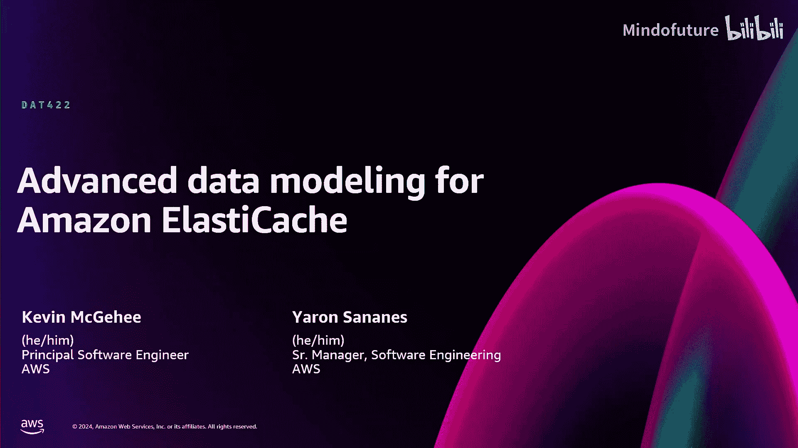
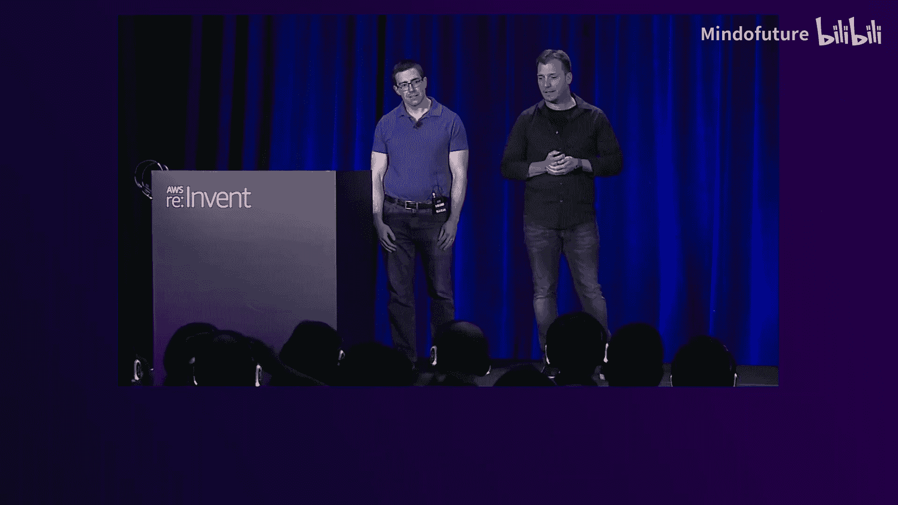
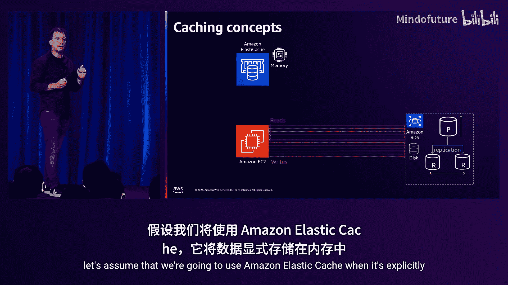
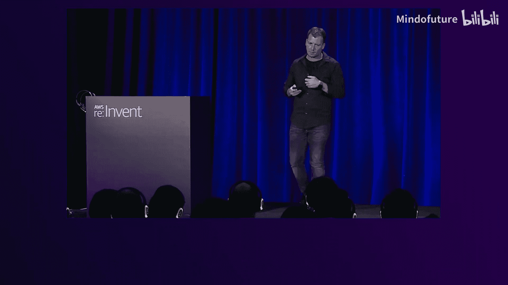
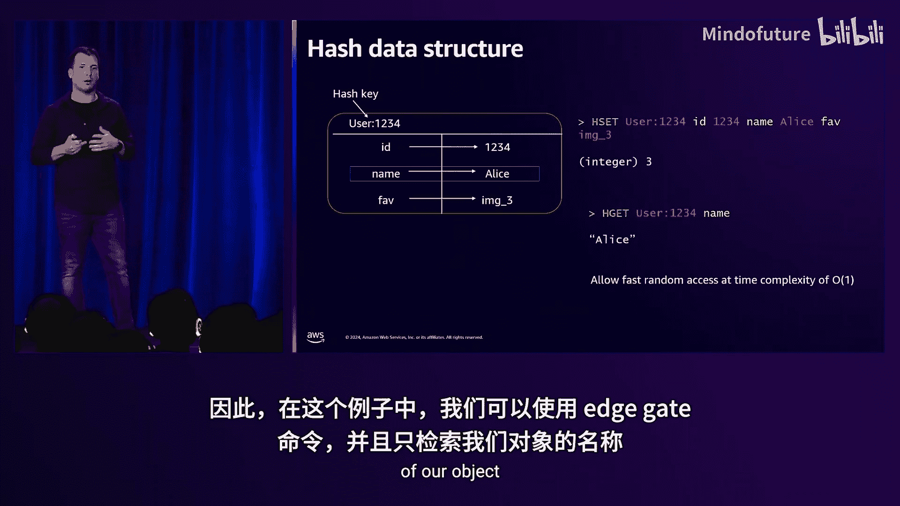
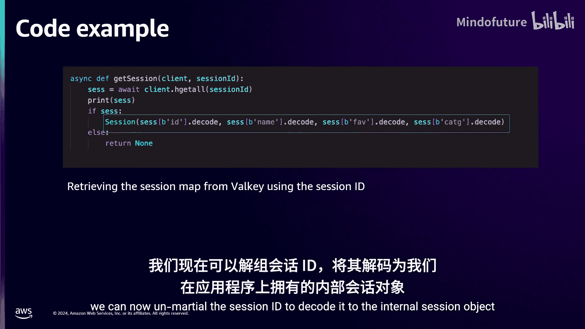
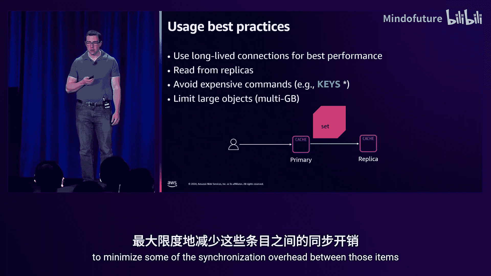

# 【AWS数据库峰会2024全集-•-中英】AWS-re：Invent-2024---Databases-p28-P28-Advanced-data-modeling-for-Amazon-ElastiCache-(DAT422)--BV1VAR5Y6Es1_p28-

Hello， everyone。

Thank you for joining our session today。We are going to talk about very interesting topics。

 so I'm very excited about that。

My name is Yaon and I'm Se engineering manager。And here with me Kevin McGay。

 a principal software engineer。We are both from El Air and AWS steam。

So a moment before I dive into the agenda of today。

You' are in the right room if you are interested in accelerating your application performance。

And lowering your scaling cost。You might be software engineer， DevOs or CTO。

 and you want the best to understand how to leverage the advanced data structures that ElasticA can provide you while serving millions requests per second and all that with microseconds response time。

So if that is true， you are in the right place。So what we're going to talk about today。

 I'm going to introduce you Elastic Ca and Valky and then we're going to explore together some advanced use cases and we're going to finish with best practices and operational overview。

So Amazon Elastic Air is a fully managed service that makes it easier to deploy， operates。

 and scale your inmemory data store on the cloud， it provides significant improvements of performance to your application by allowing microseconds response time。

We today support three open source engine。First one is Redis open source。

 second is MamkeshD and last that was announced this year is Valki Open source I will speak a bit about it in the next few slides we support multiple core of features you can see that we support multiAZ phoneSLA we have a lot of security aspect and compliance aspect and we have a very good integration with other AWS services that makes you more easy to work on the cloud。

Now customers use a lot of and different use cases when they are using elastic cash。

 so from the first glance you will see that there is not much comment between them which is actually true。

 but thanks to the rich API and the data structure that Valky and Redis open source providers are capable to provide all these use cases and to do that very effectively and fast。

So let's talk about Valky， Valky this year， Amazon Elastic C and memory and DB announced the support of the third open source called Valki。

😊，Malkey is a high performance， key value data store。And it's a community replacement for this。

It's built by the existing Redis Open source contributors and it's a drop in replacement for Redis Open source 702。

It's losted by the Linux Foundation， which promise you that it will be open source and stay open source for good。

Valki leads the way in terms of performance reliability and efficiency we theS WS team contribute to the open source community to major contribution。

 the first one is the performance aspect we contribute the new tradinging model that unlock the 1 million requests per second now it's available also on the open source version。

 we also contribute the efficiency， the efficiency architecture that help to reduce up to 20% of the memory usage。

Now that's enough with the introduction， let's start with the real fun things that we want to talk and for that I want to build with you together an example application。

We're going to tie all the use cases to that applications that we're going to build together。

So for that， let's imagine that you are a system architect， software engineer or DevOps engineer。

 and you've just been hired to a new cool startup。As like every new startup。

 we have a small investment in the beginning， but still we want to choose and to build the infrastructure flexible and scalable enough so we can scale our infrastructure according to the incoming workloads and additional customers that will join our marketplace。

 so today we will follow the January of this startup to learn how you might choose the use case。

 the right use case when you work with elastic cash。I want to start filled with a caching concept。

And to show you how you can improve your performance， but not only that。

 how you can reduce your infrastructure cost， and later we will see how we can go even more advanced on the cashching side。

So let's assume that our application is running on E2。

 and we choose Amazon LDs to store the data persistently。

Now we know that Amazon used the disk to store the data and there are some additional latency when we want to fetch the items from the disk itself。

 but up to some level of workloads this can work perfectly and as long as we add in more and more workloads。

 we have the option to scale up the RDS size， we can choose a bigger size of the instance that use RDS。

 we can also have the option to scale out add more replicas so we can scale the RETroput on the RDS。

But at some point we might reach to some upper bound and we need to think how we can increase our infrastructure even more when the workloads kicks in and for that let's assume that we're going to use Amazon Elastic cache when it's explicitly store the data on the memory and memory is 20 times faster compared to the disk now it's not that RDS does not have ca in layer it does have ca in layer store the block of the data page of the data on the cache but on some complicated SQL queries that requires some for example join for multiple different tables it might need to run course all these pages and to fetch some data from the disk and this could cost us some additional latency while in Amazon Elasticache we can store only the results set and fetchy directly from the cache and to achieve the microseconds response time。

So once we populate the item into the cache， we can immediately start to read the data from the cache and at that moment we can improve our query response time and achieve the sub millisecond latency and relieve some pressure from the backend。

 we can also optimize our cost by allowing the backend to scale down。

Now I want to review with you a few caching strategies and let's choose together which one of them is most suitable to our marketplace startup。

Let's start with the first one it's called lazy loading it's very simple the ID goes like that first we're read the data from the cache if the item is on the cache we are all good probably we finish the query by microseconds this upon time。

😊，If the item is not on the cache we need to read it from the source in our example it's RDS in that case it depend on the complexity of the query we might end up with between one to 10 plus milliseconds。

😊，Once we achieve the item we can now update the item into the cache。

 so for the next time it will be there when we need the item。The second approach is also simple。

 called right through。😮，We are first updating the item into the source。

 into the database and right after that we are updating the data into the cache so we actually kind of duplicate the items on the source to be identical to the cache。

 vice Visa。So we go across them， we have some crs and pros choosing each of them。

 but for our marketplace， I want to focus on how to combine these two and to create different strategy。

And for that， I want to use the lazy loading for rid the data from the cache。

 and I'm going to use the write through approach to update the item on the cache to be invalid when it requires to be invalid。

So let's see how it works。 First， we are reading the data from the cache。

Then we are reading the data from the database itself， now I'm choosing DynamoDV to do that。

And right after that， I'm going to update the item on the cache。

Now let's assume that we are going to change this item or different item on the source itself and I want to make sure that the item is not sta on the cache so for that I'm using DynamodDB it's called the triggered feature that I'm going to trigger a Lada function that as iniously going to mark my cache as invalid and to delete this item from the cache so as you can see I'm combined these two approaches and create something that is very unique to our need。

Now， in some of the cases， we want to re cash hot items before they get expired。So to solve that。

 we can create a background task that update the cache before the expiry happens。In this example。

 you can see that I'm using the multi command， multi commands allow us to cu multiple different commands and to execute them all in once on the server side as one transaction and to keep the autocy of the multiple commands。

😊，In this example I'm first fetching the item from the cache。

 then right after that I'm checking the expiry using the TTL command and once I'm executed on the cash in。

 I'm receiving the value and the seconds before expiration。😊。

So in this example you can see that how clients get slowly lessening the expiry until the last client will cross the five seconds threshold。

 right after that is going to pre the data from the database and to repopulate it into the source。😊。

Now， we might want to avoid also form a problem called tenderine head problem。

The tender problem occurs when multiple processes outreads。

Attempt to proceed simultaneously often resulting in high contention or resource strain and eventually causing to bottleneck。

 and this is something that we want to avoid。So let's assume that we have a very hot item on the cash that's going to be expired very soon。

 so what we're going to do what we going to happen。

the clients going to connect to the cash to retrieve this hot item that already expired and they will receive a cash meet miss on the same time。

 what's actually going to happen is that theyre all going to refer to the RDS。

 put more pressure on the RDS and eventually impact our latency and the performance。😊。

So we can build a synchronization mechanism like a burial。😊，That allow only one client。

To make the request and to repulate the item into the cash so once this client particular client fetch the item from the source。

 all the other clients will wait until they finish once you finish to fetch the data and to update it into the cache。

Then we can all the clients can read it from the cache as well and to enjoy from the cache sheet and the microseds response time。

Let's understand even more how you can implement that and for that aspect I'm going to show you only two clients。

 so let's see one by one how it actually works。The first client was a bit faster and he tried to fetch the item from the cache but the item is not on the cash anymore。

 he will receive a nail。Now the second client try to fetch the same item。

 even receive a nail as well because the item is not on the cash。The first client。

 as I mentioned it was a bit faster going to acquire a lock and it will succeed。

The lock defined on the cache itself。Right after that it' is going to query to refresh the item from the database。

Now the second client tries to acquire the same lock。

 but it' going to fail because the lock is already acquired by the first client。So what you will do。

 you will wait check periodically when the lock is going to be free。

Once the first client finish to fetch the item from the database。

 it can update the item into the cache and free the log what would eventually free the other client to wait and to retrieve the item from the cache。

 this is the way we create the synchronization using elastic cash like a barrier and make sure that we're avoiding the tendering health problem。

So I show you different example of caching specifically using RDS and elasticC。

But it's important for you to know that we are not bounded only to RDS， we can also cache S3 objects。

Because and to improve their performance and to save cost because we don't need to do the IO to the air3。

 we can directly go to elastic E。Elastic cash used Val key and Valki is a binary safe so you can serialize almost everything on Valki and redis open source so everything that you can serialized。

 you can store the data as cash on elastic cash and enjoy from high performance and reduce your cost。

😊，Let's see even more advanced use case of caching， it's called client at caching。

 usually customers use it for even much more lower latency。

 maybe it's sometimes because of the concency of using the local cash on the application itself。😊。

So the I is very simple， we are fetching the item from the cache once we receive the data。

 we store it on the local cache and from that point we don't need to talk with the remote cache anymore until the item is going to be sta so how we define if the item is still we have to approach。

The first one is time to leave expiry so once is the expiry time is elapsed。

 the item is not valid anymore， the second approach is to subscribe to a channel and once we get a key update we get the key notification and we can mark this item as invalid。

Vki has two different approaches of implementing clients at Cain and specifically for invalidation。

 the default mode say that server going to remember all the mapping between the clients and the keys that they updated。

😊，And for that， he will be able to update only the specific client with the changes on his keys that he interested in。

 but the problem here is that we are consuming a memory on the server side。

The second approach is broadcast mode now the client is subscribed to a prefix and once a key with the same prefix that match that prefix is updated。

 then we will get an notification message。😊，So let's dive even mode and see how it's actually implemented。

You can see here that I have a client application and a connection pool that we always recommend to use。

 the reason that we recommend to use a connection pool is because TCP connection is comply exp operation compared to typical Vky command。

 for example， handling set and get command is in order of magnitude faster if we are using an existing connection。

😊，So we're going to take our connection pool and to split it to two segments。

 the first one will be connection zero we use as the invalidation connection。

It will consolidate all the invalid for all the other connection。

And connection 1 to9 will use as the data connection， all the data will go through that connections。

So Connect Ze will subscribe to the invalid channel。

And all the other connections will use the reddirect tracking to connection zero and every time that will update one of the keys。

 we will receive it on the invalidation message and we can update the local caching。😊，Okay。

 so I understand how to improve the performance using cash in and to reduce the cost。

 so now let's see why we need to use a session store for our marketplace。😊，So for our marketplace。

 we need to store session for every connected client and the idea is to include in the session。

 the shopping card， user preference， authentication。

 and other things that we think that it's important to use on the session。😊。

Our challenge is to have a low latency and high concurrency data store to process fast moving and thermal session data。

😊，And to be more concrete， we're going to use the session store to create personalization。

 so each of the client will have a different look and feel when they are connecting to our website。

So the clients connecting to the backend through the load balance cell。

 which balance the connection across the backend server。

 so we can see that each microservice contained a list of user sessions。

 but we eventually we saw all the session on the elastic cash because here here as distributed memory or distributed cash in。

So when a server is either removed or added， all the session remains valid on the distributedive caching on elastic cash。

😊，Which provide us a seamless experience for our customers and allow us to run our microservice environment in a stateless model。

😊，It's very common to use a hash data structure to store the session data。

So the way that we use hash data， we first have the hash key that is the identifier of the hash。

 and we have keys and values respectively。the ID is mapped to the value itself and to build that we can use the H set command with the ID of the hash。

 and then we can have a list of key value pair of the hash itself。

Now the hash is very flexible and allow us to enjoy from a constant time to achieve only a single value to use the random accent to achieve a single value from the hash。

 so in this example we can use the edgegate command and to retrieve only the name of our object。😊。

Let's see how it works in the code。😊，First， we are connecting to our El servervo。

Then to create the session we use Python clients， so for that we're going to use dictionary map where we generating the hash data using key value。

And we're going to generate this session Id。We're going to store the session ID on Valky and for that。

 we're going to use the Het command that we use the session ID and the dictionary that we just told。

And to retrieve the data， we're going to use the E git all command with the session I that we just generated。

Now， for that， we can now unmarshal the session ID to decode it to the internal session object that we have on our application。

Okay， let's see how we can add some machine learning capabilities to our marketplace。

And for that to be most concrete， we're going to build machine learning based recommendation for our users so they can see what pictures we are recommending for them specifically。

I'm not going to talk about the model itself， but I'm going to show you how elastic cache can be integrated as part of the machine learning infrastructure。

So for that， we got unique need to understand what is featurestore。

 feature store is one of the most important pieces of the machine learning infrastructure。

It's provided a singular source of available feature for training and inluencing use cases we have two types of features though。

The first。offline that you training model and bed scoring。

 and the second one is for extremely fast feature calculation。

In this diagram you can see the architecture that we choose to build the machine learning infrastructure。

 and we use fet as the central processing system that we are used to register the feature definition。

 which can be later used for training and online online inferenceferencing。

We're going to use Amazon RDS as the offline feature store and elastic cash as the online feature store to save features in ultrafa response time for online inferencing and making realtime prediction using credit scoring model。

To define it it's very simple， we're going to use the feature store at Yael and as you can see I'm defining the Valky as the engine for the online feature store and we're providing the elastic cache endpoint to access this feature store and for offline feature store we're going to use the archive。

 we're going to provide the admin credential and that's it。😊，Same as the feature store。

 same as the session store we are going to use here also the hash data structure because of the random access because of the flexibility and the hash key will be the feature name。

 the hash value will be the feature value。😊，That's it。

 Let's go now for the Ritime analytics and I want to call to Kevinvin to continue。

 Hope that you enjoyed the first part of the session。Thank you， Your own。

So I want to talk through a couple of examples of how you can leverage ElasticCash and the Vki API to power some real time analytics use cases for our example application here。

The first question we want to answer with respect to our Night sky marketplace is which of the photos are most viewed。

 and for that we want to use something like a leaderboard。

So in this example we see four different images on our leaderboard。

 each of which has a score associated with it， which is the number of views that they have。

 and within the Valky we can represent this using the sorted set data structure。

So what exactly is a sorted set？It's a combination internally within the Valalci engine of two different data structures that you will have learned about from your Intro CS classes。

The first is the hash mapping what's called a user to a score。

 in this case our users are the images that we're storing for the views and the score itself is the number of views that it has had。

But to maintain the sortded order， we need another data structure and in this case it's implemented using a skip list that maintains the sortded order by score。

 so you see the different pairs of images and view counts there from lowest score to highest score what's interesting is that this skip list is doubly linked so that you can iterate it both forwards and backwards to get things from highest to lowest or lowest to highest score。

The combination of these two data structures allow you to do log n operations for both reads and writes on the data structure。

So let's see how you would actually use it in practice so within the Velki API a lot of the commands are prefixed with a letter set of letters that indicate what data structure it operates on with leaderboards with sorted sets。

 the Z prefix the Z letter means that it's operating on sorted set so to add items to asorted set you use the ZAd command and here we're calling it a leaderboard views and we're adding image1 with 31。

And as soon as we do that， it creates this sorted set with the skip list shown below just one entry。

And we can do that repeatedly for those four example entries they saw before。And every time we do it。

 it updates the data structure in real time so that it could be queried as we add new entries to it。

So that's an example， that's not exactly what you'd want to do in the application itself where you likely have these images already populated and you want to increment view counts as new views come in。

And there's another command to do that where you can use do Z anchor by。

 which will increment an existing value or a new value within the sorted set。

 so here if I do a z anchor by image one with 10 count， 10 views， then instead of going now at 31。

 it'll change to 41。And so it returns back the new updated value and then also adjusts the position within the sorted set。

So there's a number of different ways that you can actually query this data structure。

The one that we'll use here is leveraging the Z range command and it has a variety of different options that you can use we're here just going to display the entire leader board from the highest score to lowest score。

 so it has a set of bounds that you can provide here we're just doing from infinity to zero so there's no bounds in terms of starter stop and we're querying this sort of set by score rather than by the actual user or image ID here and we're also doing in reverse order using that doubly linked property I talked about earlier so we're going from the tail to the head。

So if we do this， we'll get back all of the key value pairs within our sorted set。

 so we see image 4 is the most viewed。Picture with 56 views。

 and then image 3 is the least viewed with 18。This allows you to do real time analytics and update and read with microsecond latency within the Valci engine。

So let's talk through another example of real-time analytics that you can implement using the Balkey API and that is unique users for each photo。

 so instead of just the total view count， you want to see of your user base。

 how many unique views or even unique likes， their sentiment analysis there would be。

So each user here is mapped to a given image in this example。

So the naive way to do this the most obvious one is just to store all of these different user IDs in a set。

 so in this example you'd have a set of four items。

The downside of this approach is that its the space complexity scales linearly with the number of users that have viewed it。

 so you have O ofN at space and there are various ways that you can try and compress this data。

 but it still is ultimately O of N in terms of space complexity which for an in-memory data store you would like to be able to save your space and so the Valalki engine implements a solution to this。

With a data structure called a hyperlog log。And this is a probabilistic data structure that will give you approximate set cardinality。

 so you're trading off accuracy for size， the specific implementation here is bounds the total size to 12 kilobytes and no matter how many users you add into it。

 get it will be maxed out at 12 kilobytes of memory， but it maintains a less than 1% error rate。

 so it might not be as exact as an exact set count。

 but in a lot of cases this can work close enough and trade off those two dimensions。

It also allows for constant time operations， so it's very fast to manipulate。

So let's see it in action here。Just like the Z prefix was used for the sort of set commands。

 you can PF is the prefix for hyperlo log commands here。

 so you can use the PF addd command to add a set of users to a given hyperlo log here。

 we're just calling it viewers image1。And we'll get back either a one or zero based on whether the data structure was modified。

 whether things were actually added to it。 So we added three from empty。

 Now there's it sells us that we've added it。If we then use the PF count command。

 we can get an estimate of the number of unique viewers。

 in this case we get back three because there's no error yet。And if we try and add a duplicate to it。

will' get back a zero because the data structure was not updated and PF count would still return the three from before。

 so let's see how this works at scale。So I ran an experiment here to add 10。

000 numbers to both a set and a hyperlo log within the Valalky engine to compare both the accuracy and the size。

So with the set itself。We get back 10，000， which is the exact number of elements we added。

 but the downside is that the memory usage here was close to 420 kilobytes。

 and of course that will grow the more items that you add to it。

With the hyperlog log on the other hand， I do the PF count。

 I see it underestimates the value of the users by about 13 here。

 which is within the 1% error rate of the data structure。

But if we were actually to look at the memory usage of it。

We'll see it is just about that 12 kilobyte boundary that we saw before。

 so over 30 times less than the memory usage of the actual set。

So this is a good way to both estimate unique viewers without using the large space that a set can grow to with a large number of users。

So let's move on from realtime analytics to talk about some of the geospatial capabilities of the Valalky engine and how you can leverage that in this example application。

So let's say we want to answer questions and be able to display to users in our marketplace what night sky photos were taken near them from their given location。

So in this case we have a map here of Las Vegas and us roughly on the Las Vegas Strip and what you can do in Valki is to take that latitude and longitude and use something called the geo hassh algorithm。

 so with a given latitude and longitude we can encode it into a 52 bit integer。

And that integer can then be used in combination with that sorted set data structure that we saw earlier to leverage it as a score。

And then this allows for things like bounding box and radius querying on top of the sortded set。

 so it becomes its own data structure， a geoet。And just like the sorted set。

 it allows for login operations in terms of adding or querying the set。

So let's give some examples of how you would do this， let's say you have two images taken。

 one up here by the strip and one down by the Las Vegas airport。

We can use the geoAd command to add the latitude longitude pairs for each of those images into our geoet。

And get back a one saying that they've been stored。

Let's say that I'm trying to access this website over here from Treasure Island and trying to query which things were close to me。

With that I can use the georadius command， so I can feed in my latitude and longitude to the command and give a bound for it。

 so in this case5 kilometer radius。And with that， both of those images are within five kilometers。

 and so I can get both of them back here optionally I could add more parameters to get back exactly how far they are for me。

 but here we're just showing the simple version。And let's say I want to do a smaller bound here。

 so I want to do a one kilometer bound， even make it more tight。With that。

 I just get back image three。So in addition to doing ra space commands。

 you can determine the distance of objects within the geo set。

 so let's say we want to see the different how far away image 3 and image 2 are from each other。

With that， I can use geoDist and pass in just the references。

 the object I image2 and image3 and get back that result here in meters。

And it'll tell me that they're about 4。5 kilometers from each other。

So there's a variety of powerful commands that you can use to query different geospatial data within Bki。

I want to walk through another example of how you can leverage it for rate limiting。

So the concept of rate limiter is fairly simple where let's say you have a distributed application and you want to be able to limit the downstream calls to any resource in this case let's say we have a weather forecast functionality in our night sky marketplace and we want to be able to limit the downstream calls to it on a per user basis。

 we could do it on each of our applications but in a distributed application then that there's no way to synchronize the rate limiting functionality between them and so for that we can use Amazon Elasticash sort of like we saw for the session store use case of being able to have them all synchronized on the backend。

So we'll walk through a simple and then a more advanced use case for rate limiting。

The simple one leverages the simple string data type that we saw before。

 but uses it for numeric operations， so in addition to doing sets and gets on binary safe data。

 you can actually manipulate a string as a number。In an0 of1 time。

 so let's say I use this In command on my key， which I'm calling number。When if it doesn't exist。

 it'll increment it by one， it'll create this key called with a value of one。

 and then I can continue to call increment on it and it'll increase the value each time and return to me that new value。

So we can use this capability to build a pretty simple rate limiter。

We'll also leverage something called Lewis scripting which is another capability that Valki supports。

 so Lewis scripting is a scripting language and you can actually run scripts on a Valalky server within elastic cache that allows for atomic operations。

 sort of like the multiexec case we saw before that your own talked about but allows you to do more complex logic on the server side。

So what we want to do is our general rate limiting algorithm is to start our counter at zero empty。

 we'll count up to a predeeffined limit in this case three。

 and then we'll use basically the TTL value to delete the item and we'll deny more requests until the TTLs expired which at which point the counter will reset and we'll continue to be able to make calls at that point。

So in a general animation sense， we see requests being made， first time the request is made。

 the TTL gets set off。As soon as we've made three， no more requests are allowed until it gets reset。

 and then we can make further requests， which will then reset the TTL again。

So what does the script look like to actually build this， walk through it as it's fairly simple。

 can fit on one screen in this time。First， we set our limits here， which are just hard coded。

 which in this case we'll be able to make four calls in a 10 second time period。

We can take in an argument to our script， so we'll take in a per user key and we'll then get that key。

 or if it doesn't exist， we'll start out with a default value of 0。If it's zero。

 we have to actually set it to be able to kick in the expire time。

 so we'll set the current value of0 and allow the TTL to start working。And then we will。

 if we're below our limit， we'll call increment and return one saying that the call is authorized and if we're above the limit or reached the limit already。

 then we basically return zero and successive calls will continue to return zero and do nothing until a background process within Valalky reaps that key and then the process can reset basically from empty。

So that works a- so let's talk about how to actually invoke this script within the Valalki API。

For that we can we have two point parts， we have to first load the script and then invoke it。

 so to actually load the script， you can use the script load functionality and then pass in that entire script as an argument。

As a string argument here。And we'll get back a shot ID。

 which is a unique identifier of the script itself。

We can then use this identifier within the client to evaluate the script。

 so we do a Valal Shah with the script ID and can pass it those arguments we talked about before。

 in this case just a single argument which is the key that we're operating on。

And various frameworks and clients will abstract this in different ways so that you don't actually have to manipulate the Shas directly。

 but this is the general process that you would use to invoke scripts。

So let's look and in this case we get back a one saying that the first call is authorized。

So let's look at a slightly more advanced version of rate limiting。

 which is with a token bucket algorithm， which some of you may be more familiar with。In this case。

 we have a fixed capacity bucket where tokens are added or refilled at a specific rate。

 and then requests will actually consume those tokens and remove them from the bucket。

So in this example we still have user specific buckets， but we have more variables here。

 we have both capacity， we have refill rate and current number of tokens and so instead of a simple counter we'll use a hash data structure to store all of the information associated with the specific token bucket。

 so in this case we have to maintain the current number of tokens and then the last update time in milliseconds since epoC which we can use each time a call is made to determine how many tokens to refill on the bucket。

So let's walk through what that script actually looks like in a couple different parts。

So we'll start out rather than hard coding our variables as we saw before。

 we'll take them in as arguments to the script， so we'll be able to get those passed in from the client as well as our key。

We'll then retrieve all of that metadata from the data store using HM Gett and also get the current time。

 which is a function of Valki。We then have to go through the function to refill the bucket。

 so if it already exists， we'll calculate the number of tokens to add to the bucket based on the difference of the last refill time and our current time。

And we'll cap it to bucket size if we have more than that。Otherwise。

 it's at the first time that we've made the call， then we start out with the bucket sized tokens。

Then we'll determine if the call is allowed， so in this case rather than counting up we'll count down。

 so if we have at least one token， then we will allow the call and subtract it。

We'll then update our state using H set to update both the last update time as well as the current tokens。

And at the end we're still using an expiry here， not because of correctness like we were using it for in the simple algorithm where we were requiring it to be expired to maintain continuing calls。

 but here it's just a memory optimization because after the if you haven't called for a while we want to reap that state and it can start over again from scratch so it's a memory optimization technique and we'll still return the allowed value。

Now I want to spend some time on the best practices and operational overview of working with ElasticAash and Valki to give some tips and tricks when implementing these advanced data structures。

So the first thing to remember is that caches are not persistent or not a replacement for a database。

 so when you're looking at ElC it's best to use it for ephemeral data and what I mean by that is that although we have a four nines availability SLA on multieseZ caches。

 the system will prioritize availability that is being able to continue to accept reads and rights over the consistency of the data。

So what this means for how it's implemented is that replication between a primary and a replica is asynchronous。

So a single node failure of a primary can cause tail end data loss in the system。

So if you have a user that's writing to a replicated setup with a primary and a replica。

 they could set a key on the primary and get back an OK。

 but asynchronously that primary will send the result to the replica， so if that fails。

 if the primary were to fail before that happens， then that data is lost。

 even though it's acknowledged。On the client side。So there's a couple different ways to handle that。

The best practice is to basically plan for this loss of data and be able to accommodate it。

One way is just to tolerate loss， which for a simple cache you can do just by repopulating from the database in the event that that items missed or for something like a rate limiter。

 maybe it's okay to miss a single update and just make one extra call when failure happens but for something more complex。

 it may require you building some way to detect the loss and rebuild or repair it for example。

 if you're not able to tolerate loss of data in a cache rehydrating asynchronously can be more complex。

 and for these use cases if it becomes more of a burden than it's worth。

 then I would encourage you to consider Amazon memory DB。

 which is another AWS service that my team supports that offers a Valalky compatible API but the difference is that it is durable and consistent so it uses a multi-esezy transaction log behind the scenes in order to ensure durability。

In terms of how to remove items and keep a stable size in the cache。

 there's a variety of different ways to ensure the data size remains below a certain threshold。

 the first is with explicit deletes or overwrites as a way to of course manage data set size。

The other is with time to live， which we covered briefly， I'll go into a little bit more detail。

And the last is eviction。So let's dive a little bit more into the TTL options you have。

 so it's the most common way that our customers manage their cash size by setting time to live。

 which automatically causes items to expire。TTLs in Valalci are explicitly assigned to an item。

 so there's no global or default TTL you have to do it on an individual per item basis。

And you can set it either relatively with the expire command or with a fixed time using an expire at command。

One best practice when working with TTLs is to add a random jitter to it。

 what you want to try to avoid is that a number of different items all expire at the same time because it can cause a thundering herd problem like your own talked about earlier。

 except it's harder to manage that because it's across a variety of different keys as opposed to on a single key where the strategy we showed earlier can help leverage。

 so to avoid this adding some jitter to have large expirations happen over time。

caused fewer problems。Let's talk a little bit about eviction。

 so eviction is a way that you can automatically remove items from your cache when memory is full。

When a storage size has been reached basically， so there's different ection or two different eviction pools that you can have based off your eviction policy。

 you can either evict items from the set of all items in the server or volatile items。

 which is those that are set with a TTL and in most cases those that are set with a TTL are more okay to remove perhaps before the TTL has been invoked。

 and so it would be the first choice for things to remove on eviction。

And within those there's three different algorithms you can use， there's least recently use。

 which removes things that are least recently used。

 there's least frequently used where it keeps track of the frequency。

 the number of calls to a given item， or there's just based off of the expire time itself。

 which you can use to order evictions。So one of the common questions we get when customers come to us is how should I size my cache。

 what should I think about it in terms of putting in from a database and the answer is that there's really a no one size fits all answer to this question because it depends a lot on your use case and it's really an iterative process to find which cash size works the best for any given application in general there's a tradeoff between the cost basically the size that you've had and the cash hit rate。

 so for pure caching workloads you're going to get diminishing returns after a certain threshold as you continue to scale out where it might be better just to keep a smaller size and have perhaps slightly lower hit rate overall。

 but for ones where you're using it more persistently like for the sorted set leaderboard example we saw before then it's really dependent on the number of images you have in your database。

That is harder to optimize on， so it depends on how you're actually leveraging it and how many different combinations of workloads you're putting on a single data store。

In general， one best practice here is to leverage auto scaling which can kind of figure out some of this for you。

 so we have two different modes within Elasticacheash one is elasticasticash serverless。

 which can then autoscale under the hood， you don't have to do anything for it and you're charged only for the data storage size that you store at any given point in time as well as the requests that you make so it's completely serverless it does allow you to set cost control bounds so say I don't really want to store more than this number of gigabytes of data you're able to do that and and eviction will start kicking in at that time period once it's scaled up to that size with the node-based installation of elasticache you can leverage application auto scaling which allows you to set different triggers based on metrics that we publish so things like CPU utilization or data storage size and you can automatically scale out or up based off of response to that。

So just a few usage best practices before we end and open it up to questions。

So as your own talked about before， one thing we want to emphasize is that though you get microsecond response times。

 one common pitfall is to do。Repeated connections to the cache and the connection handshake itself can be relatively expensive。

 it involves TCP handshake， perhaps TLS and O， and so using longli connections either through a connection pool or otherwise sharing connections across invocations of the application will give you the best performance overall。

Reading from replicas is another way to both improve throughput and latency。

 so with any primary you can have up to five replicas within El cache and you could use it to not only scale throughput which will scale then linearly across all of those nodes but you can get better latency because you can go to a node that's in your specific availability zone。

 so the primary might be located in a different availability zone。

 replicas can be within the same one and that can cut off perhaps a millisecond at most of between your with your calls。

Another thing as I've talked about is to understand the computational complexity of any command that you're operating on。

 so things like keystar is linear with the number of keys in the data storage which can become quite large。

 the things we talked about before log n can still scale relative to the number of items within given set or list or hash for instance。

 and so in addition to that limiting large multi gigabyte objects is another best practice so for example if you had millions of items in your leader board for sorted set then perhaps it would be better to split it up across multiple sorted sets to be able to make more efficient use of multiple servers as well as to minimize some of the synchronization overhead between those items。

And with that， I'd like to thank you for coming out。

