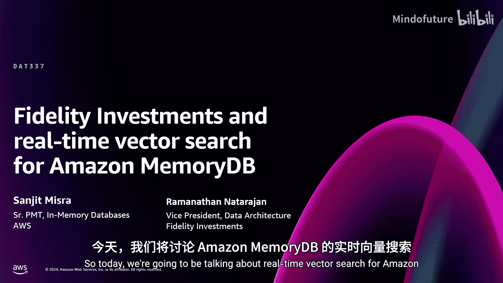
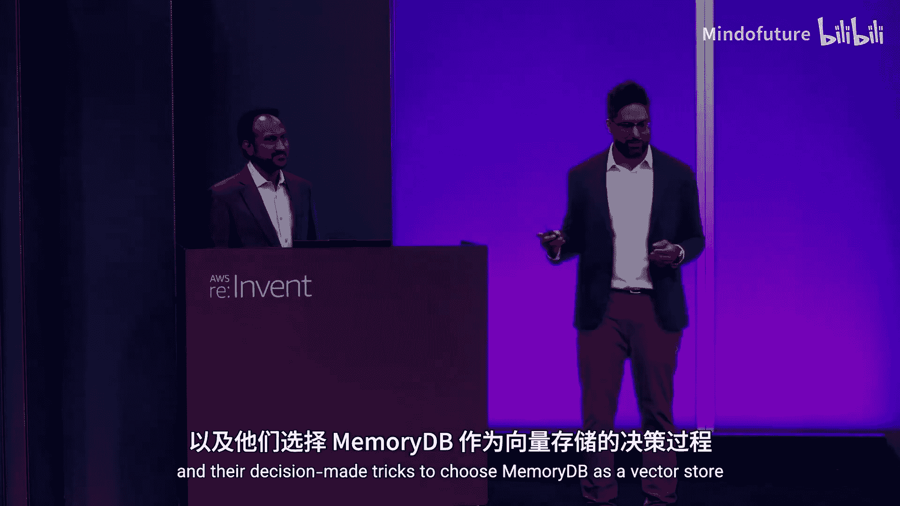
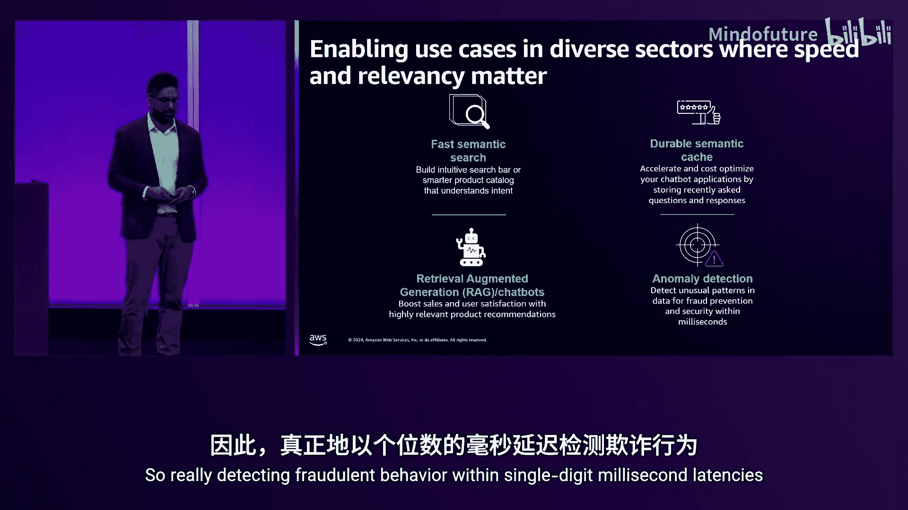
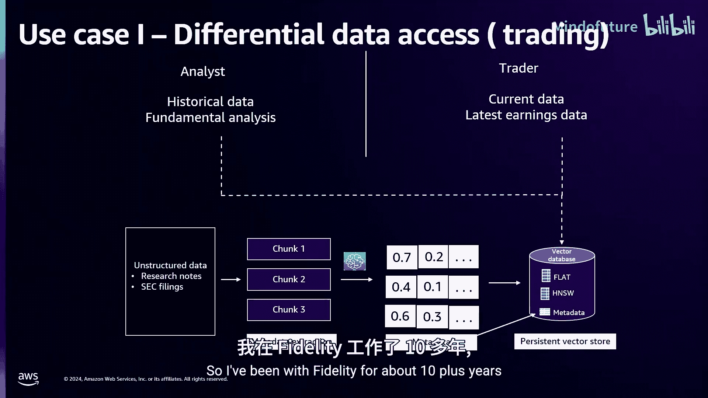
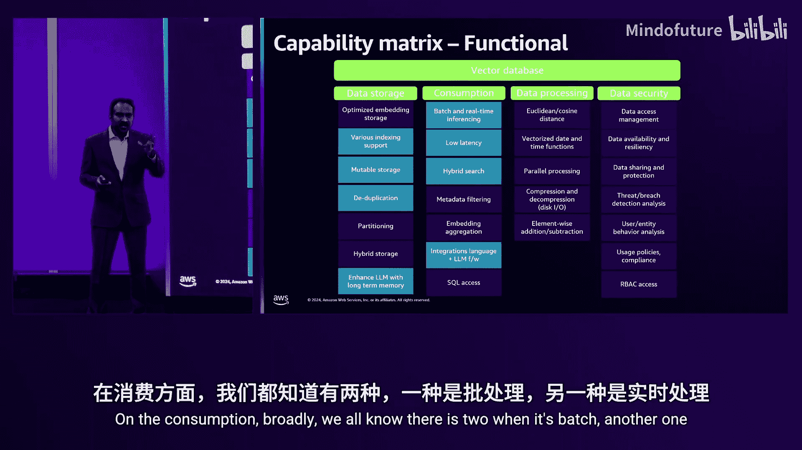
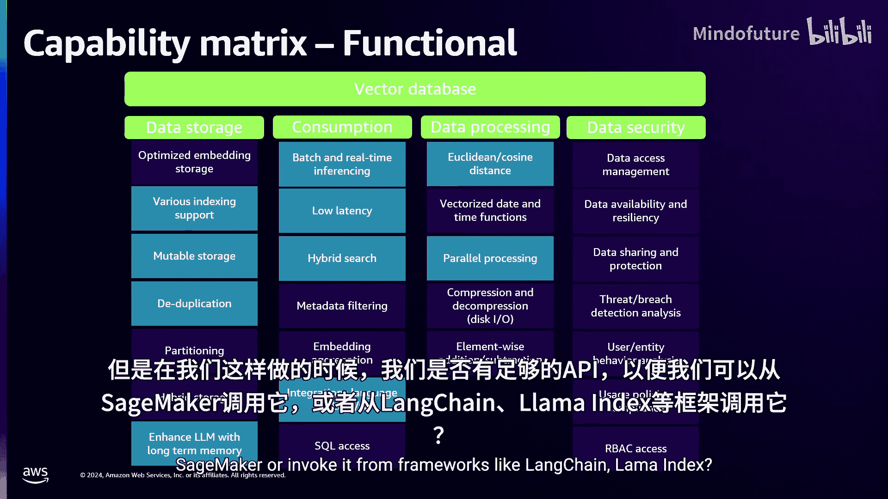
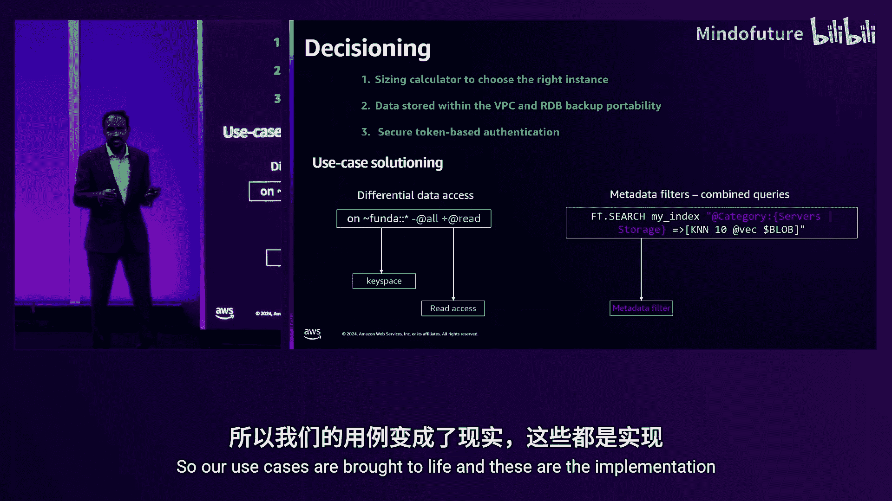
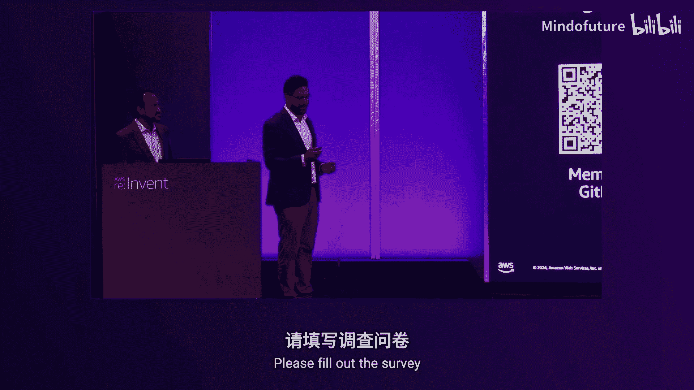
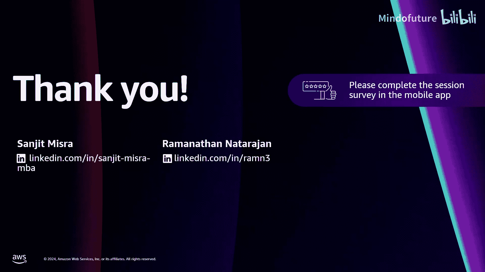

# 【AWS数据库峰会2024全集-•-中英】AWS-re：Invent-2024---Databases-p29-P29-Fidelity-Investments-and-real-time-vector-search-for-Amazon-MemoryDB-(DAT337--BV1VAR5Y6Es1_p29-

Hey everyone， thanks for joining us today， so today we're going to be talking about Realtime vector search for Amazon Me DB we'll give you a quick overview of memoryory DB and the vector search capabilities enabled on it and then finally I'm joined here today by Ra Narojan who's joining us from Fidelity in India he's a VP of data architecture and they'll walk us through their use cases and their decision matrix to choose memoryory DB as a vector Store。

So one quote I want to read to you really quickly is this great quote from Swwami everyone has access to the same models。

 so data is what distinguishes generic AI from generative AI that understands the business and the customers a key point to really take away here is that your proprietary data is really what differentiates your generative AI applications and vector search really enables you to actually take advantage of that proprietary data and feed that into your LLMs or your generative AI applications。

So to give you a quick overview of memoryory Db。So memory DV is AWS's fastest database。

 it's fully managed it's durable through multiAZ transaction log and it provides four nines of durability we also prioritize open source compatibility and it's compatible with Redis OSS and also Valki so what is Valki if many of you aren't familiar so Redis in March changed their license their open source licensing and Valki was a fork generated by the Linux Foundation that has amiss like a permissible open source license and it's also drop in replacement for Redis OSS 7。

2 there's 40 plus organizations and over a million container poles。

So what we've done is really enabled vector search for memory DB on both the Valkey and the Redis OSS engines。

So memoryory DB， as I noted， is the fastest vector search offering on AWS amongst popular vector databases at the highest levels of recall。

 many customers trust memory DB for generative AI applications。

It allows you to store millions of vectors and provide P99 single digit millisecond vector search queries and updates and various crud operations。

 and we're also integrated into link chain so you can use our inmemory driver to quickly spin up your applications。

And lastly， Ve search Re DV obviously enables many different use cases。

 enables fast semantic search such as Amazon ads using it to serve ads to you on Amazon。com。

 it provides durable semantic cash and capabilities really cash off prior LLM inferences such that in subsequent semantically similar questions。

 you can actually serve the answer from the vector store without hitting the LLM again。

 and incurring that performance and costs。And finally then additionally。

 retrieval augmented generation， so really using your proprietary data to provide context to your LLMs to provide a more specific answer to your users。

And then finally， anomaly detection， certainly detecting fraudulent behavior within single digit millisecond latencies。

So with that I'm going to hand it off to Ram who will actually step us through their fidelities use cases and their decision matrix in how they decided on using memory DB as a vector store。

 so hand it off to Ron， thank you。Thank you， Sunjuk， for that excellent context setting。

So。So Im RA working as an architect with about 20 plus years of experience and specialized in the intersection of AI and data。

😊，So have been with fidelity for about 10 plus years。

And our company is in the business of providing financial independence to our end customers。

So today I'm excited to share our journey towards discovering the immense potential of vector databases。

And our exploration was primarily driven by certain precise use cases。

Which we found we couldn't effectively address using conventional databases。So with that and context。

 I would like to share one of the use cases that we have with financial markets。

So we have market participants that is analyst T trader。

So analysts would be more focused on historical data and he would be doing more of fundamental analysis comprising of economic data on the other hand a trader is more interested in doing engaged in the act of trading and interested in the current data which is more towards the latest earning data。

So， we know their roles are different， so let's look at a high level design how this could be a solution。

So you would have the unstructured data coming in， which could be the research node typed in by the analyst。

 or it could be the SEC filings which is coming in like the 10k filings and the data which is pertaining to the earnings data。

So all of these are PDF documents。 What we do is we apply an appropriate chunking strategy depending upon your business use case。

And once it is sh， once it is converted into meaningful sentences。

What we do is we run it through an embedding model and that embedding model would generate vectors。

So when you think of a vector with 768 dimensions all you can imagine it as an array of numbers array of comma separated values and you can assume the length of that array is about 768 so this is on pure computer engineering terms so these vectors gets persistently stored into a vector database and what we do is while we push this data into the vector database we also do the metadata extraction so this would be the company name the stock symbol and it could also be more of metadata like what is the report date what is the report name so these metadata gets flowed into the vector database and it stored alongside the vectors。

So we index both the vectors as well as the metadata for the faster search。

So going back to our use case， right， we spoke about having information barriers between the analysts and the traders。

And we also need to make sure that users with appropriate entitlements are only able to access the data。

So it's very clear that we have to embed in better search a capability for role based access control。

So with that in context， let's go to the next use case。

So our next use case is on self help incident management。So。

I think most of us would be familiar with this， so this empowers individuals to perform。

teechnical or arrival at solutions for their technical issues and how is it done。

 it is done by leveraging a pre- builtil knowledge base and why is it done。

 its because you can reduce the dependency on your IT support and also accelerate the I resolution。

 problem resolution。So quick look at how the design looks right so you would have incident descriptions。

 you have service request descriptions and what we do is we kind of take those descriptions and resolutions。

😊，Ar at chunking strategy which is packaging them into meaningful sentences and what we do is we run run these chunks through an embedding models and these embedding models will generate vectors like previous case and it gets persistently stored in a vector database。

And what we also do is you would have some amount of metadata that is carried upon and these metadata would be pertaining to the incident severity。

 it could be pertaining to the category of the incident。

 whether it is a batch of failure or a data management。

And these vectors get into the vector database metadata and the vectors get indexed for faster search let us assume a user is coming in and typing a question which is server is unreachable and we want we are getting a time or error。

So what happens is while the user filters in the Web UI you would be giving good amount of metadata like the categories on servers and storage。

 the application is going to be a data warehousing application and the assignment group is going to be Uni engineering so let's say we have built a vector database with about 5000 IM tickets。

You are going to query a finite set of them which is about like 500 of them and this is going to filter out and arrive at a finite set and what we are going to do is the incoming English like query which the user is typing。

Gets converted into a vector， and we go and find out a matching vector in these500 finite set and arrive at the top three matches。

 and this could be used。😊，Either for downstream search use cases or probably know it could be fed into an LLM。

So we can go on， but at a broader pattern。What we found holistically is。

Across cutting across various business units， what we found was。

There are concurrent users who want to perform a low latency search。And while they do that。

 they want to make sure that the roll based access control is implemented。

And it's very highly unlikely that they are doing a pure play vector search there is always some sort of metadata associated with it and these metta could be with something related to a text attribute which is like a product 401k or a student debt or it could be a numeric filter which could be a con balance greater than 10。

000 or something of that sort。So。This was the requirement broadly from the data scientist。

 but there were requirements from the data engineers too， right。

So the ML engineers what they had in mind is the vector database has to be coloc with the models and we all know that AI is going to be in cloud so one of the requirements that we got as architects is make sure that the vector store is portable and the reason they ask for it is one is to have better resiliency patterns so that you are not building crosscloud dependencies。

And the second thing is the ingress and egress， which goes inside the cloud， right？

So that being said， the final one what we got was on the velocity。

 which is faster time to production， teams want to reduce their effort on SisOs and get more into put their effort more into looking into business requirements。

So that is something where they were looking for a managed service。So we looked into the use cases。

 we looked into the patterns。So capability metrics， right？

At fidelity what we do is before getting into the choice of tool or before getting into the solution we build a capability matrix which keeps us very fungible so we can port it to another vector database or probably into another cloud so we build a capability matrix so lets see how that looks right so。

嗯。On the data storage， which is a functional requirement youd have。Three main capabilities。

 one a capability for storing vector data types， again indexing the vectors。

 the third performing credit operations on the vector， which would be create update and D。

 not just on the persistent storage， but also in memory at cache level。

On the consumption broadly we all know there is two when it's batch， another one is real time。

 that is the way we consume。

But while we do that， do we have enough API so that you know we could invoke it from SageMaker or invoke it from frameworks like Langchain。

 Lama indexex。

On the data processing。If you look at it， we do vector operations， which would be like auditions。

 subtractions。Or we would be trying to find the closest vectors。

Using Euclidean distance or Poine distance。But why we do this。

 what we had in mind is how much we could parallelize what is the number of gun currencyencies that we could achieve。

Moving on into data security， Sanez already touched upon in the memory D capabilities。

 So one of them， what we found was。Encryption at rest and encryption at transit。

 The second thing is role based access control， which we spoke about。Third thing is。

Are we having our data in a single tenanted instance or is it going to be multi tenanted within ourVPC just dedicated to fidelity or is it going to be shared across multiple tenants？

So looking into the non functional requirements， So the first thing is on cloud operations， right。

The thing that we have in mind is multicloud， which we started off and the second main thing which we found is on monitoring and alerting。

So when we start building a vector database we don't want to be building the ferferls around the vector database which could be something related to you know monitoring the CPU。

 monitoring the memory network number of concurrent users authentication so should we be building all these are is there a vector database managed service which could give us all these monitoring and alerting out of the box？

So， on metrics and KPI let's keep it simple so once we decide the application tier rating we want to be very clear on the SLA and SLO adhereance so that is about the metrics and KPI nonfunction you have a lot of them but let's focus on operations and support。

So。much how much of an effort it would be if we want to upgrade from version 7。1 to 7。

2 right how much of an effort that our infrastructure teams is to put into the second thing is let's say the application footprint is increasing。

How are we going to do or how much of a heavy lift it is going to be when we want to go from a 4x large to an8x large so these are the things that we had in mind when we built the vector databases。

So moving on from the tech architecture， so nothing is。Complete without the architecture。

 justifying my presence here。 So we looked into the use cases。 We looked into the patterns。

 We arrived at a capability matrix。 Let's see whether architecture has a unique view on this。

So one of the things what we had in mind is when we chose the indexing。

 we want to be very clear that we don't want to buy in into custom indexing。

 we want to go for an index which is has good amount of industry literature anybody can go and it is flexible and configurable and we want to make sure that it is very very very highly available reason for that is。

Let's say we shift to another vector database or we go to another cloud。

 we have good amount of literature available on the net to go through and configure the index。So。

Another thing to mention about is the non lossy compression right so when you take a vector we saw it as kma separated values so let's say the floating point values are 32 we can do an compaction and bring it down to floating point 16 so what it would do is it would reduce our storage footprint but what we lose on the processes we are losing the accuracy so what we want to do is we want to go for some sort of a non-la sea compression wherein we don't lose the accuracy but at the same time our storage footprint is less。

And looking into data integration or in data ingesion so what we found was there are multiple utilities and libraries which these ML frameworks provides to ingest vectors into the vector database but what we found primarily was does the vector database provide something out of the box to ingest vectors parallel so that was on the data insion？

Out of the box absorbability and we spoke about the monitoring and observities there are about 42 metrics which we found in memory D for Red out of the box and on the scaling we already spoke about right vertical scaling and how do we do upgrades and all of that。

😊，So。I would like to take a quick pause right so when we do the performance benchmarking what we assumed in mind is let's say all of us in this room are given three vectors A B and C and we are asked to find the closest vectors using cosine distance all of us would arrive at the same result because it is pure play mathematics right。

😊，So that's what we had in mind。 So what we did was we took an industry data set where the ground truth is known。

And we evaluated across various vector database that is available and what we found is these are the results that is displayed on the screen for Amazon memory D for Reders。

😊，We found that we were able to get to a 99 person recall。

And we were able to do that in less than 25 milliseconds latency。

And there are about 790 concurrent users looking at it。So what we heard as a requirement is。

We are okay with 97% recall， but is there a way we could bring the latency to single digit so we were able to get to single digit latency by compromising a little bit on recall。

😊，So net we were able to balance the speed and quality and the second thing we spoke about was the non lossy compression so on non lossy compression what we found was there is a very specific data type which is hash data type in memory D for Reders。

What it helps us to do is the storage footprint is about one fourth of the original one。

 but what we get is the same accuracy and same recall。So。

How did we arrive at our decision of choosing this for our use cases right so we want to give a quick summary。

Three things which we had in mind right so one of them is when we did the sizing calculator we put in the vectors。

 we put in the dimensions it came out with a recommended instance which is very handy and data is within the fidelities VPC and we were also able to back up that using a very specific RDB format and this allows us to restore it in other clouds or probably into Azure。

And then there is also a secure token based authentication。

 so we have user ID and password based authentication so what we found was industry moving away from it so we were able to get into more of a token based authentication。

So we hope we have reached a safe harbor in our decisioning and we want to say how their tech objectives is driving the business outcomes right so one of them what we spoke about is information barriers between the analyst and the traders so we were able to define key space and we were able to say that funda Col Star star right when we create a user and Red we create user with this access string so it restricts the access to that particular analyst user so that traders are not able to access that on the other one we also found about metadata filters on querying the incident management we were able to use servers and storage as a filter and get to a very finite set So our use cases are brought to live and these are the implementation with this thanks to AWS for hosting us tonight and thanks to fidility India for flying me here and I'm really honored to present before this learn and。

😊。

Aing audiences I would like to hand it over to Sanjit for the closing node。

 So thanks everyone for joining Here are some great links at Github with some of these memory D APIs that spin up your own kind of vector search capabilities Sammantic caching blog and also our in memoryory driver with Li chain kind of build up your generative AI applications。

 So thank you everyone please fill out the survey。 We really appreciate your feedback So thank you。😊。

