# 【AWS数据库峰会2024全集-•-中英】AWS-re：Invent-2024---Databases-p30-P30-Accelerate-migrations-using-AWS-DMS-Schema-Conversion-with-gen-AI-(DAT347-NE--BV1VAR5Y6Es1_p30-

All right， so。

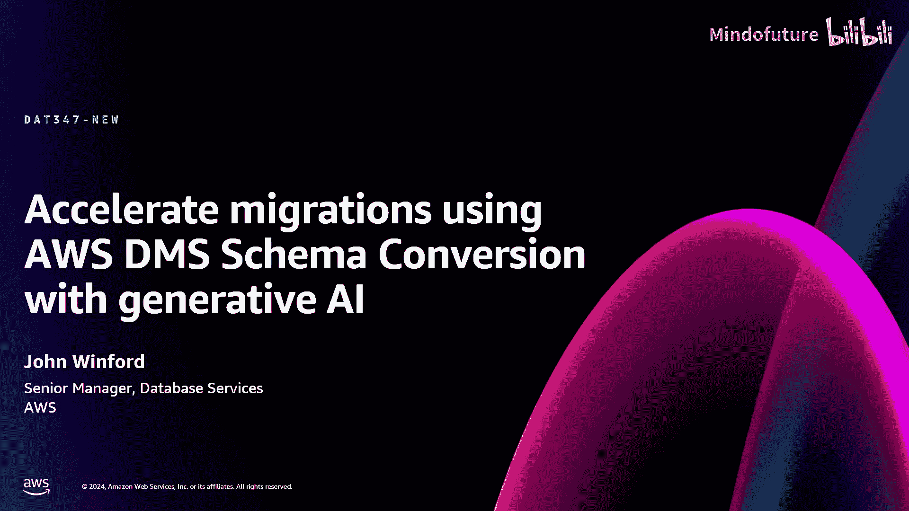

At this point， this is where they usually suggest we try to get some audience engagement。

 I could ask a big survey and you know how many of you are doing migrations and all that kind of stuff。

 but let's start off easy because it is a Monday morning has anybody heard of this little thing called generative AI？

Yeah， okay， few hands， few hands。 That's that's what this session' is all about。 You know。

 I figured there might be a few of you。 This is what we're gonna talk about today。

 but in the context of database migrations。 said earlier。 My name is John。

 I lead product for the database migration service。

 I've been with the service since it launched way back and reinvent 2015。 So I've seen a few things。

 But， you know， enough about me， let's jump right into it and try to make up a bit of time here。😊。

All right， so the agenda， what are we going to cover？😊，Well it's up on the screen I can read it off。

 you know， it is a 300 level session I'm well aware of that。

 but we're still gonna to spend a few minutes just making sure everyone knows what DMS is how it works spend a few seconds on the basics of migrations just to understand the context of what it is that we'll be talking about today dive into the DMS schema conversion product that's gonna be most of where we spend our time and specifically how AI fits in how it all connects together and you know give you a bit of background about how we got to where we are and where we're gonna to go in the future now the one thing that's not showing on on this agenda slide is that there's demos demos are cool I know everyone rather see the product rather than PowerPoint so I've got two demos today I'm going give a bit of a disclaimer upfront with the demos I was really tossing enough do I do them live or do I do a recording I've done the recording purely because as you'll see there's a lot of moving parts in there and as we've seen this morning already technical issues can happen so I'd rather just have a。

Oh I know it's going to work and I can talk to it and what have you The only other thing is because this is a silent session asking questions at the end is a little bit hard in fact they encourage us not to do it but I will be hanging around afterwards out in the hall if anybody has any questions or I can direct some of the hard ones to my colleague Mike who's in the front row here so you know either way the two of us will be able to help you get answers to your questions。

All right， so as I said， I know it's a 300 level session I'm just gonna do a few seconds of basics intro and make sure everyone knows where we are So what are we trying to do today what are the use cases we're looking to solve assuming everyone's interest in migrations that's the most common one so this is scenarios where you're trying to migrate your business critical application maybe you're moving a data warehouse the cloud to something like Amazon Redshift it could be something as simple is you're doing an upgrade from minor version to the next version along and sometimes people use DS when they want to do an upgrade without any downtime at all so it's been been used that way other people have used it to consolidate so you've got lots of different databases out there and maybe suck it all together if you've got a sharded system and now you can move into something like aurora which has much higher storage capacity than a traditional database you can do that or the other thing that people do is split it out so microservices is of course。

Those buzz words today， so if you've got things in a big monolithic database and you want to take。

 I don't know， your inventory system over there and your HR system over there or what have you。

 you know， you can use DMS to do that as well。Replication is a pretty common use case。

 I know the product has migration， the name DMS， but the little backsstore I tend to tell fairly often is that when we name the product way back when we actually wanted to call the data replication service or DRS but you know Andy said no it's a migration product we want people to migrate to the cloud so we'll call that but just know that it does do replication and it has right from the start and the other big use case that people do with DMS is modernizing。

 you know you're going from a legacy database to something cloud native or open source or maybe you're going from something that was licensed to unlicensed。

 you know there's some options there， basically DMS gives you that option to break free as you go to the cloud or between systems that are already in the cloud。

So DMS focuses on migrating your data from one database to another。

 It doesn't really matter if it's homogeneous that is like to like or heterogeneous going from one database type to another so you can just as easily use DMS to go from SQL server to SQL server as you can to go from SQL Ser to aurora and obviously we're going to be spending a bit of time talking about that heterogeneous use case today as I mentioned one of the strong use cases of DMs is the ability to do it while the database is still going it is a heterogeneous logical replication product。

 a bit of a mouthful there， but what that means is we are capable of going between database types and doing it all while the database is running so you can be using your database during the migration if you want and we will replicate the transactions across from source to target and have minimal impact to your business users while you're doing it and best of all。

 it's pretty affordable compared to most of the other solutions that are out there in the marketplace today。

All right， so this is the confidence booster slide。You are not the first person to do this。

 many others have done it before and done it successfully。

 in fact this number is much higher now but we have officially approved statistics processes and this is the last number that was mentioned but trust me many more customers have used DMS than you can see on the slide right here。

All right， continuing on。Supported sources and targets。

There is a lot DMS can move from pretty much anything to anything else。

 there are some limitations in there with respect to the database source and target engine types that we support say schema conversion with。

 but DMS is pretty flexible moving data from one to another in the data warehouse space it's done with accommodation of two products。

 either DMS or our schema conversion tool which allows us some offline exports from things like say Natia to Redshift as an example。

All right， so how does this all work it's very nice to see marketing slides。

 I'm not a marketing person， let's get into some of the details as to how these migrations happen and where generative AI can actually help you out。

So。If we think about it， migrations kind of like a pipeline， you've got to connect things together。

 A goes to B， and maybe there's some you know movements in there and some transformations and what have you。

 So if we think about the key components of a database you've got the database structure and that's like the definition。

 you've got X number of tables and those tables all have different columns and the columns have different data types and what have you and then there's some programmatic code in there too。

 you've got your stored procedures， you've got your functions and whatever else right so that that's what defines what the database looks like and how it operates。

 and then you've got the data that's inside the database right so these are the things you need to think of when you're doing the migration。

 So first off， are you doing a homogeneous database and that is that schema that we' were talking about earlier is going to look exactly the same on the target or are you doing a heterogeneous migration。

 So you're taking that original schema and you're transforming it into something else on the target。

And then once you've decided that what type of migration are you doing。

 are you doing an online migration， that is your database is still in operation while things are being moved from the source to the target or are you doing an offline migration。

 which is you kick everyone off the system and you have it to yourself while you move it and look I'm going to be pretty frank and transparent here。

 even though DMS does support online migration， you're replicating information from the source to the target while it's happening and that does work for everyone's sake simple as best right so if you can take that outage。

 take the outage， move the data come back on， but either way works。

 that's just something to consider when you're planning your migration exactly what the types are that you're doing and you what sort of impact you want to have to your business users。

All right， so today we're going to spend some time specifically on the heterogeneous use case。

 that means we're going to need to convert the database schema now。

 thankfully much of this process can be automated with DMS schema conversion。

DMS allows customers to conduct assessments as well as conversions and the idea is you can understand how much work or how little work it'll be to do that conversion before you actually get going and it's all done as part of an integrated workflow you can convert your database in the same place you migrate the data in there so you don't have to flip between you 27 different applications to get it done we're trying to make it as simple and seamless as possible。

Now how it works is DMS schema conversion goes in there and uses the metadata of your source database to understand how easy or hard it's going be to convert at this point we're just doing a read only you know we're just looking at things。

 doing analysis there's no commitment to this point it just lets you do some of some sort of prework if you will to see whether it's possible and all of this is being done from an AWS service it's running on the console up in the cloud behind the scenes in case anyone anyone's interesting you know we're using fargate clusters and hosting everything there your credentials are securely stored in AWS secrets managers so it's all encrypted with the keys that you're comfortable with and what have you and all we're doing is we're reading that metadata in doing an analysis inside the cloud and what we call a migration project to see how easier hard the conversion is going to be and when you decide to proceed you know we use that same process and essentially just take the results and apply to the target database。

I'll show you a demo of that today， of course。All right。

 now some of you that have been doing migrations for a few years may have come across the schema conversion tool。

 so the schema conversion tool we launched with the service way back when。And honestly。

 from our perspective right now， we look at SCT as the legacy product right DMS schema conversion is the future SCT is what we had up until this point now。

For anybody that's in software development， you know that it's not quite so easy as snapping your fingers and everything's all converted or migrated day one。

 it's the same with us， so with SCT， we currently support more sources and targets for database schema conversion than we do in DMS schema conversion。

We're getting there， we're migrating it across， but if you're using。

Say a less common migration path earlier I think I mentioned Green plum to Redshift。

 we don't have that yet in DMS schema conversion， it's only an SCT。But DMS schema conversion。

 we've got the big relational sources and targets， you want to go from SQL server to Postgress or Aurora and MySQL or what have you that's in DMS schema conversion and that's also specifically where the generative AI capabilities are and again I'll talk more about that a bit later。

The other thing to highlight between the two， SCT is a desktop tool。

 which is really weird for a company called Amazon Web Services。

 but essentially it's reliant on you downloading a tool。

 getting approved by your IT application security team which if it's anything like our team。

 you don't want to have to do but it is what it is and it's reliant on your source or your compute power that you have wherever you install SCT。

 whether it's a server or your laptop， what have you with DMS S schema conversion。

 it's all on us it's all in the cloud， you're using our compute resources and one of the beauties about SC is that it's free。

 there are no charges to use DMS schema conversion and on top of that is we get into the generative AI stuff。

 there's no charge for the generative AI capabilities of DMSS either。The only costs。

 and this is just me， you know， doing a bit of。Covering myself so to speak， is， you know。

 it uses some S3 storage。 maybe there's some networking stuff in there。 So yeah。

 it'll cost you something but pennies。 So there's no。

 no direct charges from DMS for DMMSS schema conversion。All right。

 so let's dive in and take a closer look at DMS，S and how it works。

So I got to stand next to my laptop for this one because there's some animation in this slide and things aren't working today like this thing。

Basically SC converts the objects in your source database from a source to target。

 it iterates through your schema as it's going and the idea being that it's going to build a what we call an abstract syntax tree and if you see AST on the screen that's what it's all about。

I'm not showing all the components on this， I'm not showing we have an orchestrator that kind of handles everything as well as a loader that suck information in。

 but let's get started and see how achema conversion works by default。So first。

 we read in the source code， so this is your source schema。Once that's done。

 we then send things off to our parser and the parser essentially goes through and pars all of the code objects。

 for instance， your stored procedures， looks for any text that kind of thing and then builds the abstract syntax tree I was mentioning earlier so you've got your source tree which essentially has a。

Well it's an abstracted version of your source code and I'll show you what I mean by that in a minute。

 but obviously we name things pretty straightforwardly。

 then we go to a resolver and what the resolver is doing is it's resolving references to local variables and other objects So if you've got a stored procedure that's referring to an inventory table well it's going to check that that inventory table is there and likewise if that stored procedure is then calling in a function to do something it's going to check that that function is there just so you know it can connect the dots because the last thing you want to do is have SC build a schema for you。

That doesn't work， you you can't apply it to your target because source your target database is going to go。

 oh， what's this thing， it's not there。So once you've got all that。

Then we go and we let me see where we are we've got the resolver and then we have a resolved abstract syntax tree looks like that and once that's done。

 we then send it to a converter which converts that resolved source app to abstract syntax tree into a target abstract syntax tree you can basically see we're doing the same thing in reverse and that once that's done。

 we then go and send it to the printer and what does that printer do。

 it takes it from that abstract format converts it into a format that your target database can understand so that when you hit apply it can be written to the target database so that at a high level is how SC works and then it just loops around and goes every single object and you know essentially comes up with a converted schema now。

That's the standard method and the standard method today。

 which is similar to what we did even with SCT， is essentially and I am abstracting somewhat。

 we have a whole collection of rules right it says。

 well if you had the length function in your source database maybe it's the lens function in the target database。

 but oh of course a lot more complicated than that。

Now I said I'll tell you or show you an example of what this abstract syntax tree looks like。

You know， you'll never see this， but I know a lot of people in this room are tech people like I am。

 so it's kind of interesting to know how the thing works。 On the left we have a SQL server well。

 the start。To the right， you can see what？It's very。Ah，All right。

 I'm going to wave the guy at the back。All right， is that better？All right。

 I will if I behave like a robot in my motion for the rest of the session。

 you know why all right so yeah we've got the source in the target tree and as you can see it's very verbose so we've got our procedure。

 the test AIML too and you can see if you look down that result in tree。

 we got just about as far as the declare statement for the variable I really wanted to show a full example but when I created a full example。

 while we would have been scrolling through pages of code here and it just wouldn't have made for very interesting idea。

 but it gives you idea about how we take information from a source language put into something that's essentially language agnostic and then can write it back out to a target。

😊。

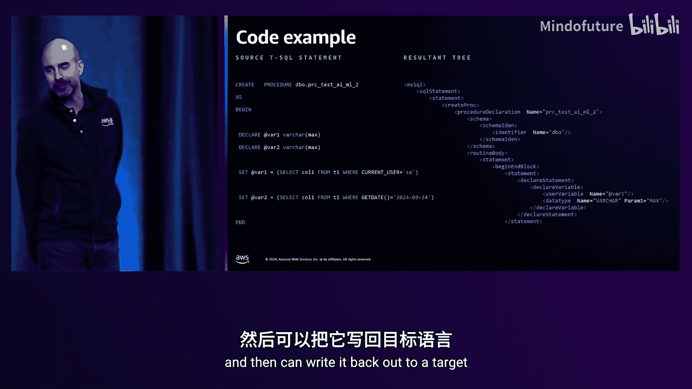

All right， I said I'd do demos， I am doing demos so here here's the first one let's look at how schema conversion works today and in particular things that don't work exactly the way we want so because now I'm using my own laptop things are going to be a little bumpy so give me a second here。

I am going to do。This。Hopefully I run now， yeah， that's what I'd expect， go to my demo。

Make that a bit bigger。All right now as I said， I wanted to do this live。

 but obviously with everything that's happened today it's probably good that I'm not。

 let's go through and see how things work。 So here's an example we are going be converting today from a SQL server system to an aurora Postgres system I've got a demo database I've got called AIML I'm just showing you we've got some tables in here the tables have some data of course again you know just to prove that there's no smoke and mirrors going on and we've got some programmatic code we've got views we've got functions and we've got procedures Now if nobody's seen this before this product I'm using is called D Beaaver is's just a database agnostic query tool so the idea being is we can connect to different database types without switching between applications。

But you can see we've got some， you know。Not the most complex procedures on earth。

 but you know there's there's some meat to them。 they're not just select star from table。

 And now we're gonna go and connect to the Aurora Postgres target database and all I'm doing here is showing you that it's a empty database again。

 no smoke and mirrors So let's go in and start trying to convert that database schema with DMsSc So to do that I'm in the DMms console the first thing I want to show you here is it's just some precreated stuff I did all these are are my endpoints my source SQL database。

 my target aurora database and now what you have to do with DMs schema conversion is create an instance profile and all this is is like the generic network security settings。

 what VPC I want to use I want to have you and then once that's done I go and create a migration project So the project just give it a name say which instance profile I wanted to use that was all those security settings I'm going in from my source SQL server。

Which is the secret that I'm using to read from that SQL server。

 what's the IM that I'm using to read that secret and then same for the target。

Choose that data provider you saw earlier。I have my S3 bucket and actually' just gonna to pause it here so everyone's aware what's happening an S3 bucket because we're doing everything in the cloud。

 DMS schema conversion has to store those settings。

 those projects somewhere and all this is doing is say hey where do you want to save your projects because you can't save it on your local desktop you're just save it in an S3 bucket So all we're doing here is we're saying which S3 bucket do we want to save all of our projects and you'll see in a second we're also going to define the IIM rule that has access to that bucket？

So we go in here and I've just prefixed my IM rolls for DMS with DMS。

 and then I create my migration project。So you can see we've got a little info box up the top， yep。

 it's being created and then you can go in and click on it to actually launch the migration project。

All the same settings you just saw before you switch the schema conversion tab and then you hit launch schema conversion and it's at this point where it'll take a few minutes because it's going in reading in all the metadata from your source database and then creating it up here in a web console and you know for anyone that's used。

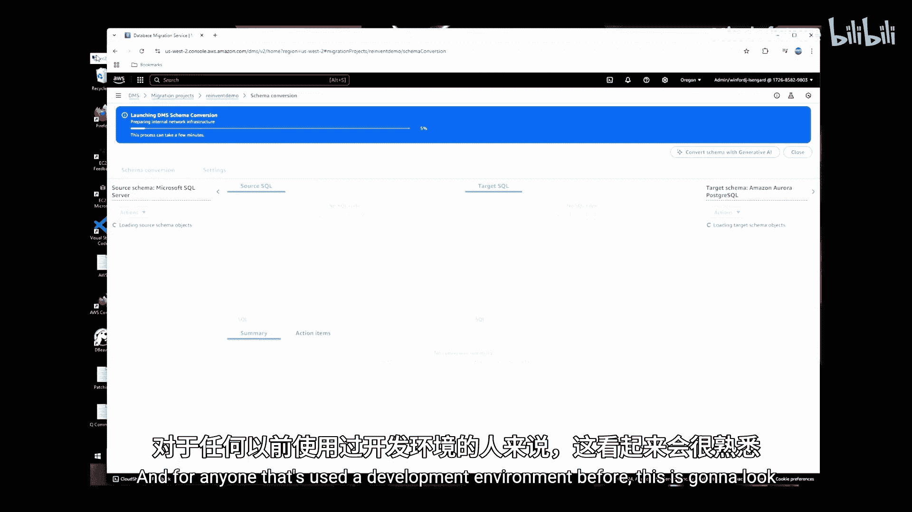

Develop environment before， this is going to look pretty familiar， you know， a sourcecing target。

 I'm just going to flip back to something else though while that's loading because it does take a few minutes。

And what we've got here is the application side of things。So what am I doing？

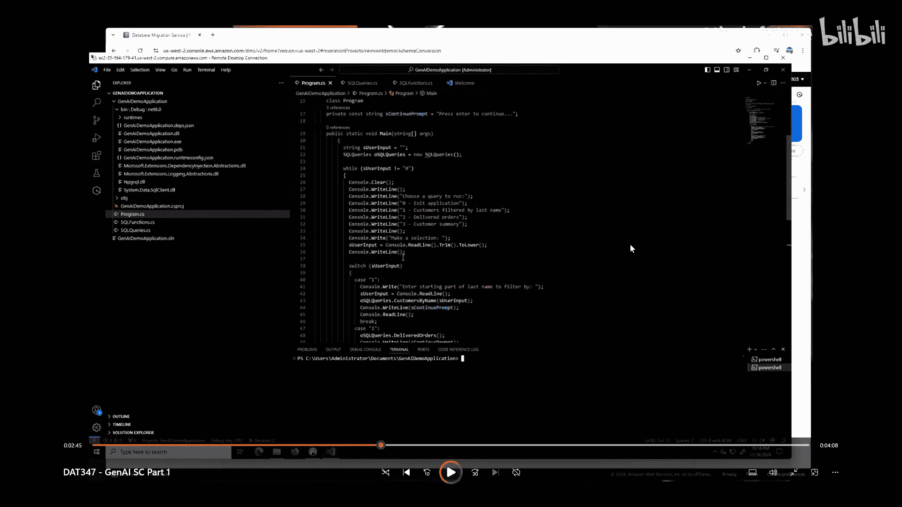

Nobody creates databases just for fun， if you do。Well， I'm not going to make any comments about that。

 but the idea behind having a database is of course you're going to have applications that use that database。

 you're probably also going have reports， you might have ETL jobs， all that kind of stuff。

 but let's focus on the main thing which is an app。Now。

 if you're doing a heterogeneous database migration。Well。

 I sure hope you own the application code that uses that database because if your database for argument's sake runs on SQL Ser because that's the example I'm doing today and your application vendor。

Only support SQL Server， what you can't convert the database。

But if you own the app code or your vendors。Database agnostic， then of course。

 you can convert the database。The example I'm showing here is， hey， here's some app code I own。

Let's convert that app from SQL server to Aurora Postgres。 So just a bit of a demo。 again。

 this is a very easy app that I just wrote up in C sharpp。 I'm just going to show you how it works。

 the idea being you know it's a console app right I've got some SQL functions right So in here I've got some basic like things to make it easy to select SQL and anybody that's written any C sharpharp before a databases is going know execute reader and you know what have you。

 So I'm just right here is on the screen we've got you know a customer query。

 and you can see it's just SQL statements in there that are being executed by the the SQL reader。😊。

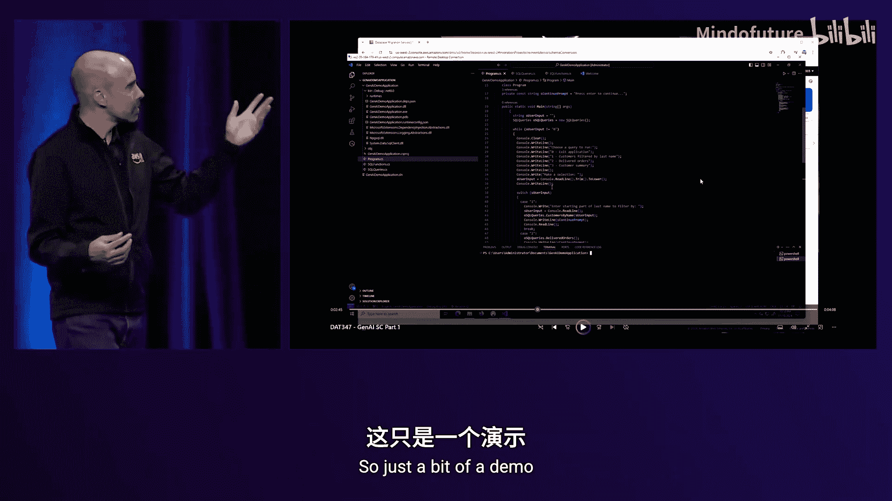

To get stuff from the database， so I'm going to compile the project， we're building it up here。

 and now I'm going to run it。And you'll be able to see again this。

Emo program will go and query a few things。 So I'm going to get some customers。

 I'm kind of partial to W， you know， last name， we're reading a couple of customers from that database and then maybe let's look at some of the names that are filtered and delivered orders。

 So all this is doing is reading from that sourceSQL database that we looked at in Dbavver earlier。😊。

All， so that's about it for the demo just showing you that it works from that source database。

 let's flip back to the schema conversion， as I said it takes a couple minutes to load。

 should be just about done now。

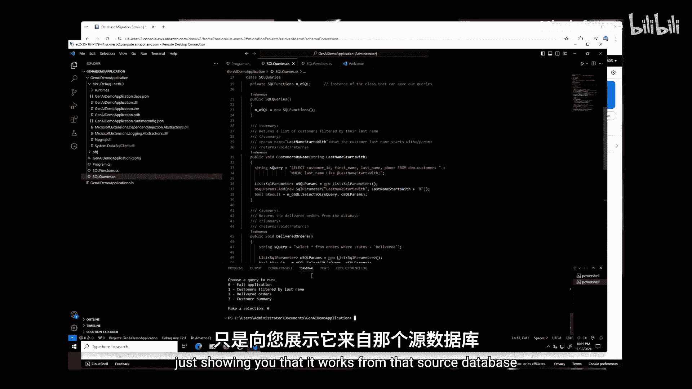

And what we'll see， we've got the source on the left， which is SQL Ser。

 and on the right is our target being Aurora Postgres。

 it's pulling all of the information in and we should see those schema objects， yep。

 just there on the left。That's that same SQL server we were looking at before and what I can do now is I can browse down the source SQL server tree and in particular I'm going to look at the demo database there's a few different databases on this server so I need to make sure I go in and select only the one that I'm interested in converting because otherwise SC will happily go and try to convert every database that you've got on your source system which is。

Quite likely not your intended purpose。So we'll go in。

Filter in by databases the first time it does it， it takes a few seconds。

 what it's doing iss just parsing it all in and it'll be faster from that point forward。

 I'llselect the databases I'm not interested in and start drilling into my demo AIML system which we saw earlier。

And in particular， we're just going to look at a single schema from that system， which is， of course。

 DBO。Standard DB owner schema and see that in here we have those same tables that we saw earlier when I showed you the schema inside D Beaaver and of course the same views。

 procedures and so on so again just showing up all the same stuff is there。And really。

 what the idea is at this point is you're going to go and run an assessment report。

 see how easy or hard it is to convert that database。Again， this takes a few seconds to run。

 Obviously， the more complex your database schema is， the longer it'll take。

 Most database schemas only take a few minutes to run。

 although I will let you know we've had some customers with some absolutely crazy mammoth schemas that have taken overnight to run。

 So it does happen。 but you can see right now， I don't have a whole lot of my database code that's converted properly。

 the objects converted like the tables but the code hasn't。 And you know full disclaimer guys。

 obviously this is a demo database I made for this example。 So your mileage may vary。

 but I'm going to export this to Pdf， And the idea being is you can take that assessment report and share it amongst other database engineers or maybe your management to show easy or hard it's going to be to convert。

And that PDF file is stored in the S3 buckets， so we're just navigating over to that right now。

And we're going to download it and open it up。And here is the results of the schema conversion and as you can see the tables converted pretty well but the code did not the procedures and what heavy you that didn't convert super well。

 but I want to highlight that some of them were candidates for conversion with generative AI so the assessor report now shows that in here as I said you can scroll through have a look in detail we're not going to spend a lot of time on that today。

 but that's the general idea of how a standard schema conversion would work without the generative AI aspect。

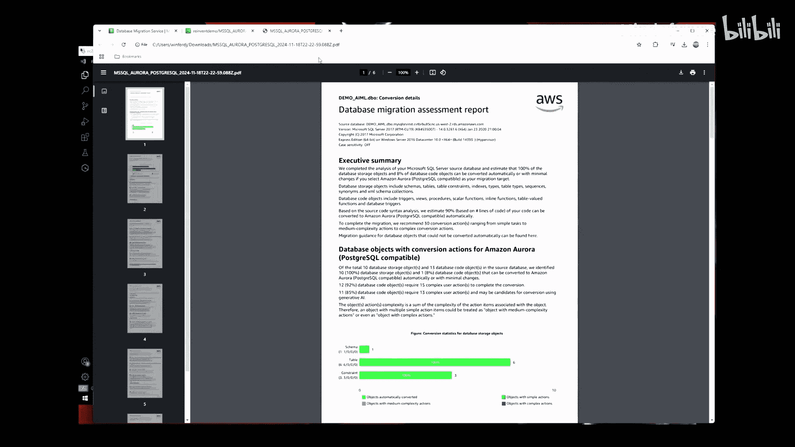

So that was demo one， let me get things going。For the second one。All right， so far， so good。Okay。

All right， got to have a quote somewhere in here， right， so here's the idea。We。

GenerI is cool is basically the net out of it。 it's making a lot easier。

 allowing us to do a lot more than we could before。 it's not the be all and end all right。

 it's not going to solve all of your solutions， but asan Goodfeelow said。

 he's one of those founders in the GenI space， it can go a long ways to helping make things easier for us。

Okay， so what's coming？No， like okay， it looks like the robots are coming。

 that's not it it's not coming to take over all the world。

 This isn't some skynet thing or anything like that。

 but you generative AI is is definitely coming to make things easier for us。

 It has nothing to do with waves of robots， at least not now full disclaimer The idea is as we can make generative we can use generative AI to make database modernization easier specifically schema conversion better and more efficient than we could before。

That's the big launch for us is that we have now enabled DMS schema conversion with generative AI。

 so let's get into some of the details as to exactly how this works。All right。

 we didn't dive in completely without direction。 We did a number of pilots in。

2023 to see what was going to work best。 So we looked at a few things specifically。

 let's go into each of the pilots we looked at。So。We were maybe a little aspirational。

We were thinking， okay， first， maybe we just go and try to convert the entire thing。

 throw the entire schema at generative AI and see how it works。Well， there was a problem first off。

 that takes a long time generative AI models right now are not the fastest things on earth。

 and if you send a giant schema at Gen AI， you're going to be waiting a long time to get a response and it will probably be very costly there was also issues with consistency right so。

Everyone's heard of hallucination， I would assume by now with generative AI like， you know。

 you wouldn't necessarily get the same result there as you got over here and then it might end up going down the wrong path we just found for something that was as。

 shall we say rigid as a database schema， throwing the entire schema or generative AI just wasn't going to give you the good results。

The next pilot we looked at was using AI to determine the appropriate data types of the parameters in the storage objects。

So the idea is we looked at the invocation statements， the table data。

 DML and identifiers to sort of see is there a better way we can do this。

 and what I mean by that is you know part of，Although things like storage are cheap is cheap these days。

 part of what leads to inefficiency and the performance the way a database operates is if you're over alllocating。

 you know if you all you're really doing is storing in a column a one digit number and you've put it as like。

 you know，Giant double with 27 digits of precision or what have you like it's just going to slow things down。

 So the idea being is as part of that migration。 let's just see。

 did you really need to use Varchar 255 you could make it a varchar 10 on the target database and you know really compress optimize and make the thing work better and like it worked that pilot did work。

 The results were good but honestly it wasn't。Worth the potential knock on effects if the data types weren't converted successfully。

 and you know， maybe if generative AI got it wrong， you don't want it。 you don't want， for example。

The database maybe convert properly， but your application that uses that database is expecting something totally different and it fails over。

 so it just really wasn't worth it in the end。The other one， the next pilot， pilot three。

 I thought was kind of cool， but to be honest， I think it was。Overly optimistic。

 the idea being is we wanted to understand the intent。The idea being is。

Genny I would look at your source stored procedure and go， a。

 I see that source stored procedure is trying to get the top 10 customers from this table。Well。

 then GenAI go create a procedure on the target database in a different language that tries to get the top 10 customers。

Sounds good in theory， except。I don't know， you can't really truly understand。What。😮。

The objective is of a given function or procedure and what the intent the developer who wrote it was really trying to do。

 So we just it sounds good in concept in reality， it didn't really give us what we wanted。

Then the next thing was， maybe we use LLMs to work on performance， try not converting just the code。

 but optimize and improve the performance where it's possible。We did find that that worked。

 we got some performance improvements with things like subqueries changing to joins， adding indexes。

 but it wasn't really enough to justify focusing on this in the short term， we may come back to it。

Well that gives you an idea of the things we looked at。So how do we all pull it together。

 where did we decide that GI can fit in？So you remember this， we saw it earlier？Well。

 we found it was better to focus on the fundamentals of DMS schema conversion and use generative AI to fill the gaps。

In particular。Go in。After that conversion process。Chuck in GenAI。So basically。

 things that didn't convert with our rules based engine， then try to convert those with GenAI。

In a nutshell， that's what we're doing， building on top of what we had rather than swapping it out completely。

So there's more to it， though， than just sending things to an L L M。

 sitting back and open for the best。 You know， it wouldn't be a proper service。

 a proper product if we did just that。You need to understand the context。

know is this in context of converting database schema or are we talking about you what the weather is outside right and LLM doesn't know。

 it's just an LLM so we need to set the context there。Ofuscation now。Full transparency here。

 We're using Amazon bedrock behind the scenes。 Amazon bedrock is very secure。 It respects your。

 your data， your P I。 It's not using the information you send bedrock to make bedrock better。But。😡。

We still， for an extra level of security and comfort for yourself。

 we obfuscate everything we send to bedrock。And you'll see what I mean by that in a little bit。

Of course， the LLM comes into play。And then once we've got that converted result。

 we have to deobfuscate it to put it back in a format that you can understand and are comfortable with。

 do some sanity checking to make sure the result actually look about right because again。

 LLMs are not perfect and then embed that result inside the abstract syntax tree。

 which we then write back in the target language to your target database。

Now I talked about obfuscation， just wanted to give you an example of what that might look like。

On the left is an example select statement that we're going to throw at the LLM On the right is what the LLM actually receives。

 So you can see here， we've gone and we've taken your schema names and your table names and。

Ofiscateated that out。 Hence why you've got things like column variable and table rather than the actual names。

 And I want to point out that we've even taken it as far as。Ofuscateating out the values。

 you can see the rhomems at the bottom， the two and the three。

 we've now sent them as numeric literal one， numeric literal to the target LLM so again。

Removing as much of your PII and IP as possible before sending into the LOM。

 even though like I mentioned it's not really needed because bedrock is secure and we don't use it。

 but again， giving you that extra level of comfort that we're not doing anything with your data you wouldn't expect。

It's looking pretty good， but something's still not quite right。

 something's missing from that solution。So what do we do？嗯。As I mentioned。

 we could just pass something to the OM， but it would lack context。

What we're doing with the behind the scenes is we're using a rag now if you haven't heard that phrase before a rag stands for retrieval。

 augmented generation， and it wasn't just somebody trying to come up with a big long name for something it does make sense The idea behind a rag is we're trying to improve the efficacy of our LLM by leveraging custom data。

So to build up the information we're going to use， we actually first use bedrock to understand what the SQL is trying to do。

 setting the context if you will。We query a knowledge base that we've built。

And continue expand upon to get similar conversion examples。 So we take that context and we go， okay。

 this is like。A procedure in SQL server， Okay， now let's go query our knowledge base and get some other examples of procedures in SQL Ser all right and then。

We go and query a second knowledge base where we have a whole whack of conversion rules embedded in there。

 just to again， make sure that the LLM is going to convert things the way we think they should be converted。

And then we take that in conjunction with that obfuscated sQel that I showed earlier。

We mash it all together and we send it to bedrock， so we have a giant rag。

And then your SQL statement that we send to bedrock。

 so you can argue maybe the efficiency isn't quite there。

 but it's really good to make sure that we point bedrock in the right direction rather than just assuming that the big wide internet knows how to convert properly because we all know there's good and bad stuff out there。

So when it comes back， we do a sanity check， we defuscate， and then we display the results。

So that is kind of the secret sauce， if you will， behind the scenes is to the way DMS schema conversion does things。

And more of a standard architectural diagram is this。So。We've got data conversion on the top。

 and this is where DMS comes in。We've got this thing right at the start called Fleet Advisor we haven't talked about today。

 but it can go find a whole slew of databases on your source network if you want。

 and give you a sort of a high level recommendation as to what you should migrate them to。

DMSS schema conversion is in the middle。Anytime you're going to do a heterogeneous migration that is going from one database engine type to another。

 you're going to use DMS schema conversion to convert the schema。And then you use DMmS。

 the core replication engine to migrate the data to your target database。

 you can see the new thing that we added in there is the call out to Amazon Brock。

So that's the new tech we've added for reinvent this year， and I haven't talked about it。

 but behind the scenes we're using today Claude 3。5 in case we're interested Clas a 3。5。

We don't publicly document that because we're continually evolve when we've tried all different models with the MSSC and we'll continue to use the newer。

 better models as time goes on right the GI space is moving very quickly。

 Don't expect us to stay with one model behind the scenes。

 we're going to always use what is going to give you the better result。

Faster and for less cost right so that's morere reason today。

 The other thing we haven't talked about much is Amazon Q developer agent。

So DMMSS works in tandem with Q we send the project file that we talked about earlier。

 the thing that's stored in S3 as context to Q developer agent so that when you need to go convert your application code。

 it knows how the database schema was converted so that the same conversions are done well in the app code so I've got an example about this coming up so we can go through both the database conversion as well as the app code conversion。

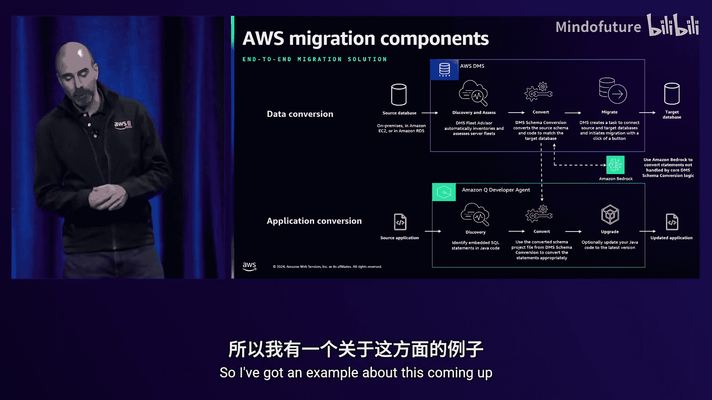

All right。So time for the second demo。All right， looking good。All right。

 so we're back at the same spot we left off last time。Now instead。

 we're going go in to DMmaschema conversion and I'm going to go to the settings tab and you can enable Gen AI。

 Gen AI is not turned on by default if your company policy doesn't like generative AI you don't have to use it right so you go on you enable it and you got to remember herey and apply at the end I tend to forget that and now geneative AI is turned on by default with schema conversion because you've set that setting right now what we're going to do is we're going to go and try to convert the same schema again。

 I'm going you can do it multiple ways as you can see the settings now on by default。

 but whatever and now we're going。Convert it with generative AI。

And it's going to do everything I was mentioning earlier。

 we're going to go and try to convert using rules and for things that don't convert properly。

 we're going to send that off to the generative AI model and in particular， as I said right now。

 CloudS at 3。5 running on Amazon bedrock。And we'll get the results back in a few minutes。As I said。

 generative AI does take a little bit to run right now in case anyone's wondering。

This is available everywhere that bedrock is available， so we've got US West， East and Central。

 and it'll be in all every region where bedrock becomes available。

 we'll get there as soon as it's there， basically we're just dependent on them。

So the conversion is happening。Just about done。I don't know what it is with progress bars。

 They always like to sit at 99%。 I don't know if anyone's noticed that。

 It just seems to be how it works。 Allright， so now you can see that conversion ratio we jumped way up from I think 11% to 85%。

 So it's done some good work here in particular if we jump in we can see what the results were。

 so I'll just minimize this down。😊，Show you how a table looks right so there's the source table on the left that's in SQL code on the right is Postgres code but where it gets more interesting is of course in other things like in the view is now I'm going to pause this here just so everyone can see how this works so。

Here's the source view on the left， again that was SQL Ser。

 the target View on the right is in Postgres。And if something's been converted with generative AI。

 you can see in the comments， we've got these little upside down carrots and it's basically saying。

 hey between the upside down carrots and the right ways up carrots。

 that's the bit that we converted with Gen AI so you can check it out and make sure you're happy with the results and if you're not for whatever reason you don't like the results。

 Theres a little pencil mark in the top right corner of the window。

 you can go in and edit the results manually or of course you can just export the schema and then edit it in the a query tool of your choice。

 you don't need to do it inside DMS schema conversion and you'll see those same carrots。

As we go through some other examples here。So I'll continue on。Jump into a procedure。

So this procedure here。a second， it's also got some generative AI conversions。

 you got those same carrots in there that was done by throwing it at bedrock and we've got a couple others we'll just flip through again so you can see it's pretty embedded。

 it goes through， highlights what it did， you can check it。

 make sure everything looks right and you can see there's some fairly complicated results it'll generate。

Obviously quite different when you go from one language to another。And yeah。

'll just give it another example， this one， nothing was done right。

 so this is what a standard conversion looks like， no changes has happened。

When you're happy with it and again。In real life， you're probably going to review things a little bit more。

 but I'm going to apply this result now to the target database。It might take a couple minutes。

Go through and now it's right into the target， you can just as easily on that action menu there。

 you could have exported it as like bunch of SQL files that you could then apply at your leisure。

 but I've just done it directly from the console。And while that's going。Actually， no。

 so we'll flip over here。 The application of the schema is pretty quick。

 but I'll do a refresh and you'll see that now we have。😊，A new schema， demo， AI， ML DBO。

 with all of those same tables， and of course， views， functions。

 what have you now in the targetrget Aurora database。

Right so it's all there now this is just the schema part if you think back to that earlier slide where I had that pipeline we've now got the schema but there's no data so empty tables so we now need to move the data across with DMS because it's completely。

Empty and really not too useful today。So this session is not about how to actually do the database migration。

 so I'm going to make this part pretty quick。But we'll flip across to the DMS console here and as I said it's all in the same console so we just flip back to the start and we're going to go to migrate the data。

 I've already got a replication instance up and running。

 I've got a bunch of endpoints to find you know we've got the same sort of things before and I'm just going to go and I've already pre-created the tasks just to save some time。

Go in and we can take a look at it。嗯。I've turned off a few things just to make it run a little bit faster。

You can see we've got all the task settings in there。

 what have you standard logging and we will kick this thing off all the mapping rules， yeah。

 this is the one point to look at。You know， I needed to change the schema name from the source of the target。

 not necessarily required， depends on how you did your naming。

 just making sure that everything is moved across as we want。

 and then we're just going to go and kick off this migration。so I've done it once before。

 so I'm just going to head restart and the migration will begin and you can see right there the task start says starting so we're going to start moving the data from SQL server across Aurora Postgress。

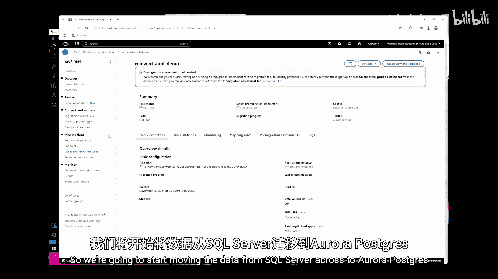

But now let's flip over to the application code while that's running。

 so we've converted the database schema code， but we haven't done the app code yet。

 so to do the app code I just want to point out a few things in in my application I've got these helper functions like a select SQL function that goes in queries from the database I actually kind of to make things easier I've pre-written a select Postgres SQL function but you can see it's really exactly the same the only difference is I'm using a different library instead of system data I'm using a library called NPpGsQL've just got a different connection string to look to the Postgres database and there's that different library it's freely available for anyone to use and essentially have've taken my same helper functions and just written them using the PGSQL library and the functions in PGSQL are identical to the system data functions so it's pretty easy to do。

All right， so all I'm going to do is I'm going to do a search replace and I'm going to replace my select SQL with select Postgres SQL pretty straightforward。

Do that letter rip。Everything updates。But now you can see we've got a few errors because you know the parameters are different data types。

 right， it's a SQL parameter， not an NPG SQL parameter。

 Now I could go through and manually fix all this， do a few more search places， but。

That seems like a lot of work these days to do that， especially if you've got a big， big program。

 there's probably a better way to do that。Well， I'll tell you the better way to do that。

Is if I go in to highlight all of my application code here。

So I'll go just from where the problems start， so this customer by name feature。

 I'll go highlight that right down to the bottom and you can see。

Down here I've got this little add in Amazon Q inside Viual Studio。 So I'm going to say， well Q。

 can you help make this conversion easier for me， I've already converted my database。

 I now need to convert some stuff in my app。 as you can see I just made this I had copy and pasted but I'm telling it to please replace any system data。

 SQL clients C sharpp functions， variable types and whatever with equivalent NPG SQL and it goes yeah。

 I can do that for you。 Here's the results。So it's got all my code in here。

 but now it's taken things that were。SQL Ser Ih， if you will， and convert it to Postgres。

 so I'm going to copy it and just replace what I've got。Before。right up to the top。

 make sure I've yeah， got the exact same stuff， all looks good， highlight it， paste。

We've got some new code， I missed a bracket at the end， you know， these things happen。

But there we go， there's no more issues there is there。

 the SQL code looks like it should work just fine， so now I'm going to build it。Let's see what I did。

Oh yeah， I was worried about this， remember the schema name changed。

 so I just need to change a few things here to make sure that's going to work。And build it。

Looking pretty good so far， no errors。Yeahep。

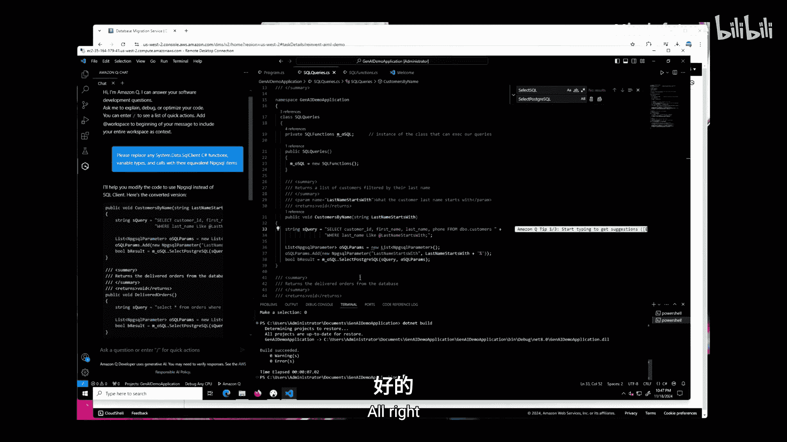

All right。But before I run the program， let's see if the database migration finished， well mostly。

 I've got one error。So we've got everything finished except my ticket table。

 the ticket table didn't load for some reason。

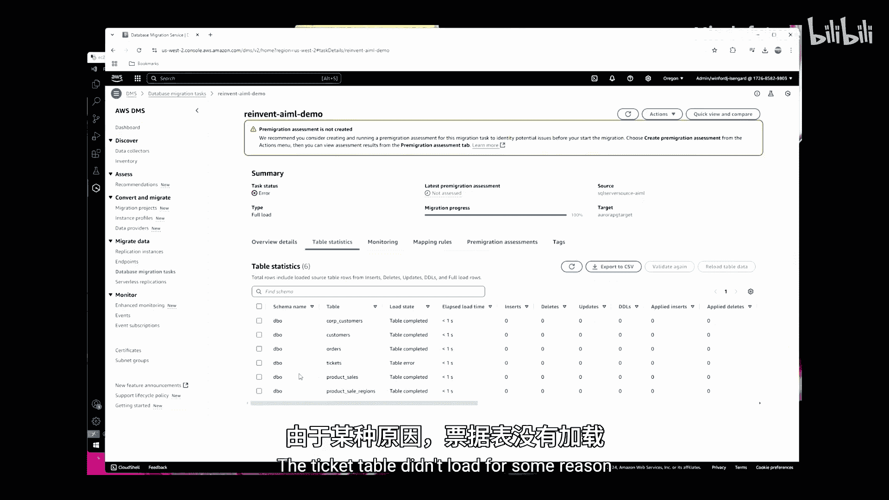

嗯。Well， we could start debugging that as to why that didn't load， but I kind of know。

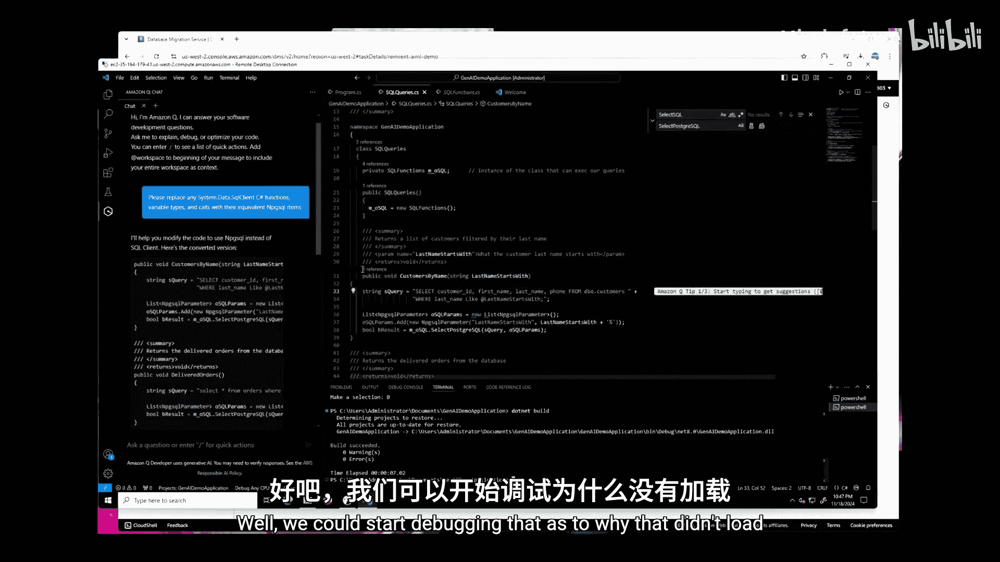

The ticket table didn't load because。There is a constraint on there。So if I go and take a look。

 you can see that I've got a constraint。So really sometimes when you're loading data you've got to disable your foreign key constraints and your triggers and that sort of stuff and I didn't do it here because again that's not the point of this session。

 but okay I take a table didn't load let's not worry about that now。

 but you can see my other tables did load so now we've got some data in there DMS moved that across from the source of target so now that's some data I should be able to run my application。

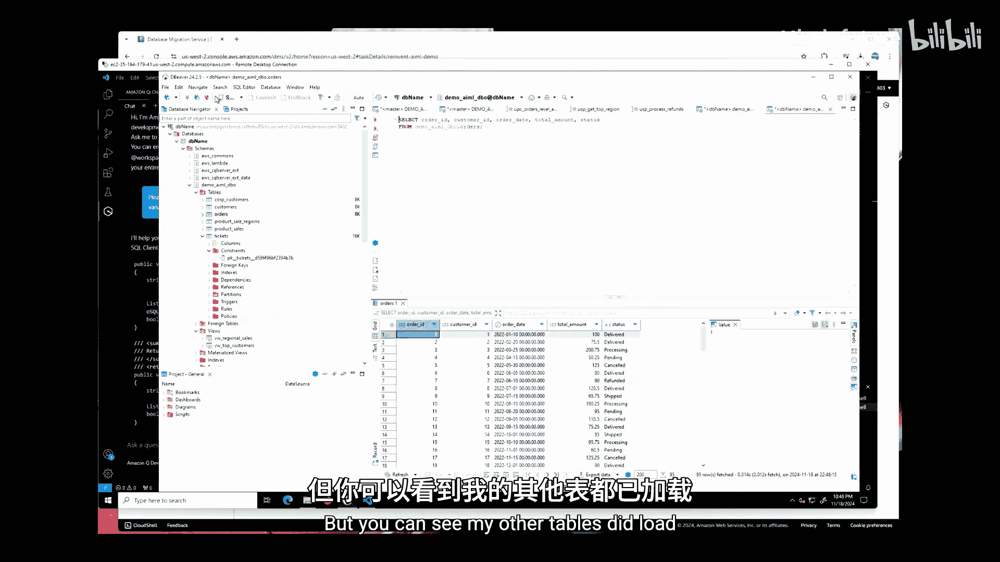

Oh yeah。 this is the the。啊。The schema name I needed to update。Just fix that。Go in and run it。

Building it， looking okay。Running it。Let's try to run it again， filtering the last name。

 going with W again， look， same records are there。

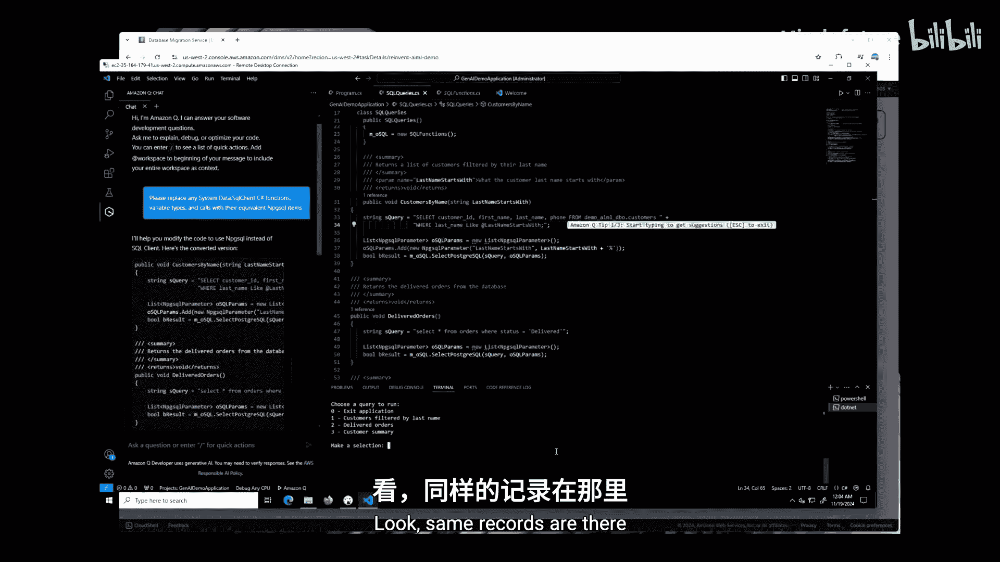

And if we go and we look yep， there we go， the application worked。

 so now we've done it right we've converted our schema from SQL Ser to Aurora。

 we have converted our application， we have migrated the data in a nutshell。

 that's how you do a heterogeneous database migration。Let's just switch back to the PowerPoint。

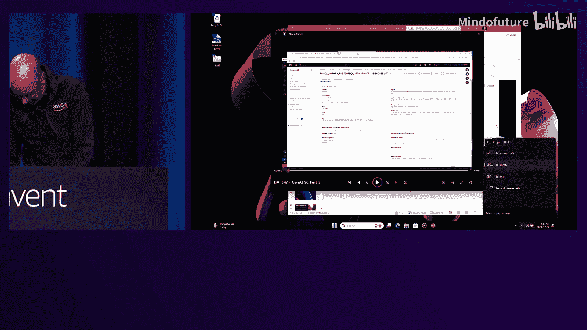

All right。So what's next， are we done？Now， we're not done。 guys。

 this is this was a scramble to get ready for reinvent。 Let me tell you。

 we we just deployed this sucker yesterday。 Now to be fair we could we couldn't launch until reinvent。

 So it was done a little bit before。 but， you know， not much。 This was， this was a real。

 real rundown to the wire。 So there's a lot more we can do to make database schema conversions and database migrations in general easier。

 So what's coming up next。😊，Well， it's a public forum， so I can't really talk about roadmap。

 but you can probably take a good guess about some of the things we're going to do， right？

We need to test things you remember I mentioned when we get the results back from bedrock。

 we do a sanity check。It's just that it's a sanity check Did you send a select statement Did I get a select statement back cool right no we need to do more right。

 you you need to do more as far as validating that exactly how it worked on the source is how it works on the target So there there's some more work we can do there for testing。

More endpoints we've launched right now。 We support Oracle and SQL server conversions to aora Postreess。

 Prety sure you can guess we're going to add more conversions than just that， right。

 So I don't think that's letting any cat out of bag。 And， of course， model evolution。

 I mentioned that we've launched with closon a 3。5。 That's going keep on changing。

 We're going keep updating to new models， we're going keep on improving our rags to get better conversions。

 We're going make this as good as possible and keep on refining it as time goes on。 As we all know。

 it's early days in the generative AI space。 So there's's a lot more to come。 And of course。

 we're going increase our scope。 right now， what you'll notice， again， disclaimer。 you know。

 I was doing a demo there。 right， I was using a demo database that a database engineer and our team created。

😊，You know， it's maybe not going to be representative of your experiences right。

 so we're going to expand the things that we try to convert with generative AI right now we do not。

Try to convert everything。That doesn't convert automatically we just try to convert things we know we're going to have some success with so there's more we can do more things we can work on converting with generative AI with the MS schema conversion so we're going to work on that too so a lot more to come keep watching this space but honestly get in there give it a shot and as I said it's free so no harm no foul work on a test database work on something you think is going to be of interest to you just give that a shot。

So yeah with that that's it thank you very much for everyone for attending sorry for those technical glitches at the start I'll be hanging around at the end if anyone has any questions but as I said。

 hopefully this is of interest to you go away give it a try。

 be interested to hear any feedback through either your account teams or any of the other channels but I think this is some pretty cool technology and hopefully it makes your migrations a lot more seamless than they ever have been before so thanks again and have a great reinvent everyone。

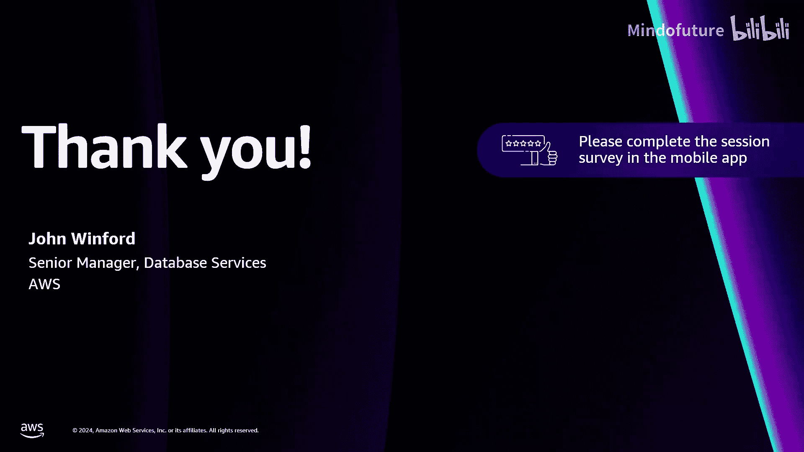