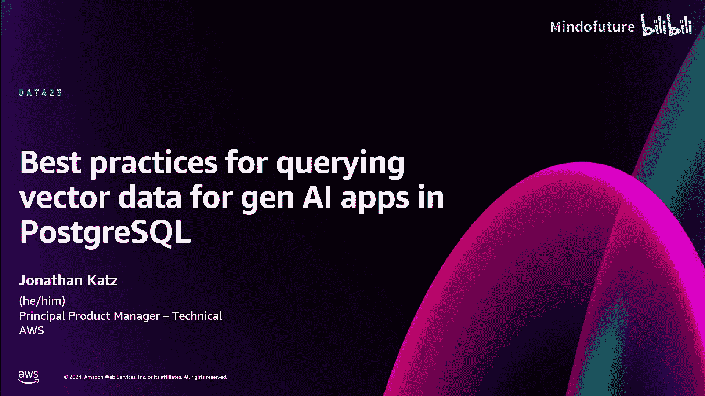
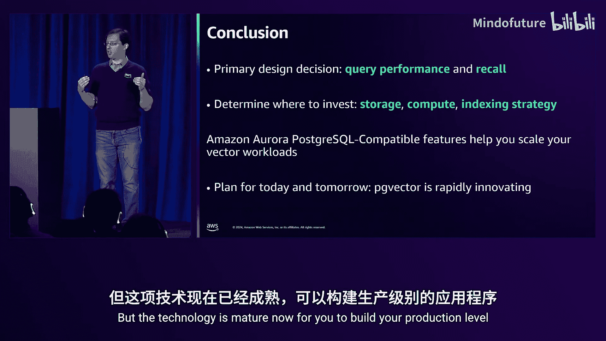

# 【AWS数据库峰会2024全集-•-中英】AWS-re：Invent-2024---Databases-p31-P31-Best-practices-for-querying-vector-data-for-gen-AI-apps-in-PostgreSQL-(DAT42--BV1VAR5Y6Es1_p31-

rightGood afternoon everyone， Welcome to best practices recording vector data for Gene App in Postgres。

 I'm Jonathan Katz， very excited to be presenting here today。 This is my first live silent session。

 so bear with me through any of the challenges that may occur but before I dive in I want to just emphasize that this is an L 400 talk so we're basically get maybe just short of peachgy vector internals but we're going dive deep and we're going use the insights in terms of diving deep in terms of how peachy vector and Postgres works in order to understand what are the best decisions you can make for your applications so there will be a gentle ramp up and we're going go through a lot of data and charts and I'm going do my best to explain them to you today the nice thing is that this will be recorded so if there's things that you want to follow up on later those will be available and I'm happy to answer questions after the talk because this is probably gonna take the full 60 minutes。

So why does this even matter why do we even care about searching for vectors in our database and it comes to this example where we have a question comes in that might require some personalization give me some information about my order and the amazing thing with these foundation models and these generative AI models is that we can give these rich personalized responses but we need to have a way to be able to take the data that exists in our databases and tie that into the personalized responses that' coming from the foundation model because the foundation model is probably not trained on the data that's existing your private data sources So an effective technique that's been developed to be able to deal with this is called retrieve augmented generation or rag and the idea behind Rag is that it gives the ability for us to bring in that context we need to be able to give that personalized response so typically a foundation model is just trained on publicly available information So we've asked something specific say how much of these blue shoes costs it's not going to know but if you bring in。

say your product catalog， your pricing catalog， and all that information。

 you're able to then have the foundation model deliver how much those blue shoes cost。

 and that's the key。But we need to be able to get we need to have a way to be able to take that data from our database and bring that into the foundation model。

 and there's different kinds of information out there。

 but information that's in an unstructured format， say raw text that hasn't been labeled or images or video needs to be represented in a way that we can search over it Now that's not necessarily new we've been searching over text data for years。

 that's the whole thing of full text search。 but if we're able to take a mathematical structures such as a vector and effectively wrap that around the text data。

 it gives us a way to be able to compare it through performing distance computations。

 and again that opens up other kinds of searches too like comparing text to images。

 text to video images to video because we have a common language effectively through the mathematical representation of the vector to be able to do that。

 So where do vector embeddings fit into RA。The first part is ingestion where you have some kind of unstructured data。

 it could be PDF documents。 you likely need to prep it to be able to be used in something called an embedding model。

 the embedding model is what takes the unstructured data and turns it into the vector and then you're going to store it somewhere in this case today in an Amazon aurora database So that's the ingestion workflow and then comes the fun part which is exposing it to your application and that's the agent workflow and the agentic workflow。

 a user comes in and asks how much of these blue shoes cost we have to take that question and that turn it itself into a vector to be able to get that context so then we can query the database and find the most most similar results to that and then from there we take that question and the context we put into the foundation model and turn that into a response Now talking about the whole ragg workflow in details is the subject of a different talk because today we're really going to be focused on was the the database here specifically aurora But if you happen to catch that 319 later we're going to talk all about。

The fun of the Re augmented generation workflow and where your data fits in。

Now vectors can be challenging and this is actually what personally drew me to this topic。 First off。

 we need to be able to generate the vector embeddings and that can take some time know generating。

 you know let's say even it takes 100 milliseconds and I have a million vectors， well。

 this is why we're going need to store them somewhere because a million tenths 100 is a very big number。

 I guess 100 million。A lot of the modern embeddings are fairly large as well if you take a 5000 dimensional vector that's a 6 kilobyte payload and that doesn't seem like much if you think about data you store in a relational database。

 your average row size is probably less than a kilobyte so in some ways we may be having some data inflation here and you might say well Jonathan can't we compress that we've been doing compression for years but the challenge is that you can't really compress random floating point numbers like there's not really patterns available to be able to do that we have techniques to be able to reduce it down but those techniques are you're going to lose some information when you try to do that。

And finally there's the query time， so recall that we said we're doing these distance operations。

 which means we have to compare every single dimension in a vector Now there might be some embedding models that say。

 well you can only compare you only have to compare the first 256 but still 256 comparisons you have to make and if you're doing that over a million vectors in a data that's going to take a lot of time so we need some ways to speed it up and the gist of this talk is that there's really no shortcuts there is a technique that lets us do this called approximate nearest neighbor search where instead of having to compare a query vector to every vector in the data set we can approximate it we can compare it to a subset of overall vectors。

And what's nice is that if you're comparing， say only 5000 vectors compared to a million vectors like that 5000 operation will be a lot faster that's a tautology there。

 but it adds a new variable， which we call recall and recall is the percentage of expected results so what does that mean if I'm to do an exact nearest neighbor search meaning I going take my query vector and compare it to every vector in the data set I would expect it to return these 10 vectors but my approximate nearest neighbor search might not do that。

 it might only return8 of the expected 10 so that gives us an 80% recall。This is a critical measure。

 like this is something where I need to hold on as we go throughout this talk because we can't do any comparisons of vector search without understanding what the recall is and this translates into the applications that you're building because this is gonna be the measurement of your search quality and that's what the name of the game is like how good are my searches and my search is good enough to be able to satisfy the business requirements for my application。

So one thing， some just some general takeaways before we really dive in is what actually impacts you choose how you're going to store your vectors and search over them。

 the first thing is cost。NowCo may not be the deciding factor。

 but it's going to be an overall factor in terms of how you build your generative AI application because the database is one piece of the puzzle and you might actually want to spend more in your database in this case if it reduces your overall cost to the foundation model which ultimately will be your biggest cost。

 but something you have to keep in mind as you're trying to decide all of this。

 because the thing that's ultimately going to drive it is what embedding model you using and which foundation model or models are you're using because that's the generative AI portion of a generative AI application and those decisions do ultimately impact how you search over your data and in many ways the quality of the search which we'll see later。

Then how easy it is to develop because a lot of times you're rapidly prototyping these applications and you want to work with something that you're familiar with。

 unfortunately vector search is a feature， so there's many opportunities to be able to develop with systems that you're very comfortable with。

And finally this query performance and data ingestion， which I kind of coupled together。

 but query performance it's what's your target latency。

 and maybe you need the fastest latency at the best recall levels for the Pitico application you're working on。

 and that's fine， or maybe you can trade off on latency because you're more costsensitive in some way and likewise。

 are you ingesting your data once in building a vector index are you continuously adding data to it because that does impact decisions that you make around what vectors sorry what indexing method you choose。

So I like to think about this in terms of a triangle。And your triangle is anchored by recall。

 probably should made a boat and had the boat anchored by recall。

 but recall is ultimately going to drive everything around the decisions because say you're indexing the say you choose to have an index on it well typically when you build an index you think about how big is the index and how long does it take to build it and this is gonna to be particularly acute for vector searches now the more time what we're going to see is the more time we spend building the index。

 the better recall we're going to get， but there's a tradeoff it's going take longer to index the data。

Likewise is the query performance and typically  query performance that we think about throughput。

 how many queries can I send per second， which is ways that we can cheat on throughput by scaling out the system and there's latency which is how long does it take to return that information some less ways to cheat there though but I could have like the best throughput and the best latency numbers and have a recall of zero which I've personally done in my test and this is why I keep saying everything's saying good on recall so if there's only one thing you take away from this talk today it's no matter what you do you ultimately have to measure it by recall and as we go through this presentation there's sometimes times where I don't include recall and I will mention that and I will explain why I don't in why it matters。

So。What ultimately impacts your performance metrics and I'm not gonna to spend time going through every single one of these I want to have it up here。

 but the takeaway is one we're actually going to explore all these things in depth throughout the talk。

 but they're all in tension with each other， for example。

 while quantization might reduce the overall size of your index。

 it's going to have an impact on recall and possibly search time if you need to be able to do more searches to be able to get the recall target that you want So all these things matter and as you make your design decisions。

 you're going to have to weigh each of these steps to determine what ultimately do I want to get out of my application。

Now before we dive into Postgres specifically， we do have vector search across many different services at AWS。

 I'm not going to read through every which one， but this gets into the ease of ease of development of familiarity if you're familiar with these systems。

 you already have data in them， right choose it and start building out your application on that。

 but if you're choosing to use Amazon Aurora or Amazon RDS with Postgres today。Well。

 we're about to dive in。So Postgres as a vector store now we kind of think of Postgs as a relational database traditionally and well it is like you know it's been around a very long time。

 I'm actually about the same age as the original the Berkeley Project and you know Postgres has also has a very long open source history like it's almost 30 years old。

And because of this， you know because of Postgres's open source nature。

 there's been a lot of interesting things that I've developed。

 and I'd like to emphasize really the extensibility of it。

 Postgres is defined as an object of relational database management system but I think of it as an extensible database system because we can add capabilities without having to either get them in the upstream database or for the database and create a brand new product。

 and we've seen this today like for example， with geospatial search。

 PostgIS is used everywhere in terms of mapping applications。

 and it's just an extension living alongside Postgres， and that's very powerful。

 and this kind of extends to vector searches， in part because if you think about geospatial searches。

 you're dealing with three or four dimensionmensional vectors or twodimensal vectors and the tiny vectors and there's actually some very efficient methods for doing exact searches over them。

 but with vector searches for Postgres， a lot of it we did need to invent some new things alongside in an extension。

 but the convenience of is that。A lot of you， the tooling you have for Postgres already works。

 So effectively， you're just adding a vector data type and taking your tooling and mapping into that。

Likewise， you probably have data in a Postgres database you want to be able to tie into using with your application。

Now， one thing I want to hit on a little bit more in depth is that final point， why acid。

 asset basically gives us some transactional guarantees in terms of how our data is stored。

 and that's actually very important from an end user standpoint if you require it because for one thing。

 if you look at the ACI， there's guarantees in terms of how your data is visible that you know once it's committed it's there and the next session that reads it has immediate access to the data and particularly if you're updating data in real time。

 that's a very important concept。I love highlighting the last bit though， durability， acronym。

 every letter in asset's important， but durability guarantee that your data is stored。

 that's a very powerful concept that you know if your data is written to storage。

 it's there permanently， you don't need to worry about it。

That's probably the most important property of acid here and arguably in general。

 but why do we care about for vectors because vectors are your data and you're using it within your operational system to be able to solve a result or get a result。

So let's switch into By vector。So PG vector is this extension that brings a vector data type to Postgres。

 and in addition to the vector data type， it brings all the operations you need to be able to perform these searches。

 the comparison operations， the indexing methods and more open source it's under active development。

 I'm proud to say AWS is the second largest contributor to PG vector。

 and it's something that we feel strongly about because it does help enable you to do vector searches within Postgres for all the reasons we just explained。

But why use PG vector？Well， vector search itself particularly in databases is rapidly evolving and last year people were using PG vector because it was there。

 it's an extension， it's Postgres compatible， it works with existing applications。

 but we've seen these workloads scale up and scale out in many ways as gendered AI is further adopted and we're able to build more complex applications so a lot of the roadmap has been focused on making PG vector scale。

 adding new indexing methods， being able to support more complicated workflows such as filtering。

 again all of which we're going to explore today， but a lot of this has come from direct feedback both in the open source community and talking to customers like yourselves to be able to understand what can we do to be able to help support these workloads。

So what's happened over the course of the year？Or actually the course of two years I'm not going to be through all this all these one by one。

 but the first part was just， all right we got to get PG vector to par with what we see out out in the world in terms of all the different vector search solutions and then focus on like the finer points which is really can we store smaller amounts of information and be able to deal with more complex search patterns such as wear clauses and joins。

 while still being able to deliver accurate， highly relevant， efficient results。

 is again in ongoing development， I would say folks are already running PG vector in production but these are the types of things that we look at。

 which is making it both as easy as possible and performant to run these workloads in Postgres。Now。

 the gist of this talk is going to be about approximate nearest neighbor search because we can understand how to do exact nearest neighbor search。

 it's searching across all the different data， and ultimately you're going to be bound by the size of your data set。

 the number of cores you have， and the amount of time you want to spend to be able to compute that。

But Peache vector offers two approximate nearest neighbor search methods。 There's IVF flat。

 which is graph based N HNSW sorry IVF flat， which is cluster based and HNSW， which is graph based。

Each them each of them have their tradeoffs， IVF flat tends to be a little bit smaller。

 it's faster to build， but it might be harder to hit your recall target and in order to hit your recall target you might be having much slower queries with HNSW tends to just be overall easier to manage most of the rest of this talk will be focused on HNSW because this is become probably if not the most popular method one of the most popular methods just in general for vector search。

Now， here is a quick cheat sheet。If you know which vector search method do you choose if you need exact nearest neighbors you don't use in well you don't use a vector index there's a little bit of a misnomer there because you might use some other kind of index like a Bre index。

 a gene index etctera if you know you can filter your data down but if you need to search over the entire data set you can't use the approximate nearest neighbor index if you need fast indexing IVA flat and basically we probably have a very static data set it clusters very well and in that case if you only need to visit say like one or two centers。

 IVF flat will also be very fast research but pretty much for most other things you're going to end up using H andSW in some way shape or form。

With exception with filtering and filtering is going to be the topic we spend a lot of time on today because it's going to be all about selectivity。

If you have data that's highly selective， meaning your filters eliminate most of the rows。

 you might not want to use an HNSW index， you might want to use a traditional index which will do this operation very effectively。

 but if you have low selectivity you'll probably want to use an HNSW index because it will be overall faster and the goal today as we go through this talk is to prove that out to basically show that by based upon your selectivity。

 you should be able to choose the right index to be able to oneme your recall target。

 but also meet your performance targets as well。And this is going to get into the gist of it。

 looking at graphs and charts for what are the best strategies for PG vector today？

So we're going to do a journey today roughly in this order and as a not approximate nearest neighbor search。

 we will go out of order briefly here， but the big thing is that everything's good start around storage。

Now， why do I say that？One thing I actually came up as an app developer and I never really thought about pages and page sizes became actually until I started talking about PG vector。

 but this is the fundamental storage unit and Postgres 8 kilobytes now why this is important is because we're going to see that this is the storage unit that we're bound to when we're indexing data and PG vector。

 and no matter what effectively our data needs to fit into8 kilobytes。

 but this is going to lead into a very interesting situation where we might end up with wasted storage in our indexes。

So here's an example of how many vectors that can fit onto a single index page and we can see that when vectors are small。

 we can get more of them onto a single index page， but as they get larger。

 we might only have one on an index page and there's gonna be overhead to that and what's funny。

 not funny but what's interesting is that at the 1000 dimension mark or the 1024 dimension mark we can only get a single vector onto an index page which means that we're wasting almost like 4 kilobytes of space now what this is going to do is that this could actually end up impacting your storage capacity but the thing to keep in mind is that you might not necessarily be as efficiently utilizing the storage it may not necessarily impact your application overall。

 but is something it's something that you do need to be aware of。Now。

 what's interesting is you might say， well Jonathan。

 I've heard that you can resize pages like the overall Postgress page size。

 and that is a compile time flag which most people just keep it at a kilobytes。

 but index pages are not reizable， which is going to lead into an issue。

 particularly if you're dealing with floating point numbers。

 you know there's a little bit of a pun there on the real data type。

So once we get to much larger vectors， those actually can't be fully indexed， at least not right now。

 there might be techniques that we can use to store the original vector at least in an index page。

 but for those these days we'll have to quantize them， which we'll look at a bit later。

But youve probably said， hey， you know Jonathan， I've actually stored data in my vector index before or so I've stored like large data in my tables before that like large text blobs and there's a system to do that called To。

 so ToOSt stands for ToOSt is a system that lets you store oversized data。

 so the idea is that once beyond a certain threshold Postgres is able to store that data in basically in a separate table as we're going to see it and there's a few different ways of doing that。

The reason we're actually going to look at these three different storage types is that these are all going to play a factor in terms of how we store the data on our table and they have performance ramifications。

 so plain basically says store the vector in line with the rest of my data in the table and then it's basically all there in one place external and extended。

 say store the vector in the toast table which after two kilobytes and size it's going to do by default unless you adjust that threshold。

Now， since PG vector is 06， PG vectors defaulted to using external。

 which basically means store it in that separate table and don't compress it。

 otherwise we're wasting cycles trying to compress something that we can't compress。Now。

 let's just visualize that real quick and explain why this matters。

So with plane storage in your table， all the data stored altogether together。

 whereas with extended external， we're storing the vector in a different page。

 which is effectively in a different table。Now the reason toast was invented was basically we were dealing with data that was not in the hot path with vectors where know we need to search over the vector like that's the key thing we're searching over。

 but for something like text or other large data where we're not necessarily looking at that we're not doing the comparison operation on it。

 it's not on the critical path like it makes sense to store it out of line。

 but this is going to have ramifications because even though you might still need to use toast for your data。

 we need to understand that there's going to be performance tradeoffs for it in particular。

 let's look an example in terms of QPS。So in this example， I took 5。

000 vectors performed a cosine distance against them， you of all different dimensions。

 and we're going to see that after 512 dimensions， performance is going to drop way off if my data is stored in the external format because what's happening is Postgres is having to take the data and say。

 okay， well， it's in this table over here I have to pull into memory and then do this comparison。

And that's a big penalty。 Now when we're searching the index。

 we're not going to see that as much because effectively index pages are stored in a plane format。

 all the vectors are in line， but if you're computing an index or doing an exact nearest neighbor search。

 you could end up seeing that and that could be that could be why like oh why is it taking so long to index oh it's constantly going back and forth between toast So if you know your data is going to be in the hot path you might want to keep your vector in plane storage the tradeoff to that is you need to make sure that the entire row fits within a single page and that might be possible but again you have to check what your data is there。

Now， this also has an effect on quarry planning。 And again， we're going to look at。

 we're going to look at exact nearest neighbors。 So here's plan0 million。

Of 120 dimensional vectors and we can see that we get six parallel workers cool here's that same query plan for 500 dimensions and we can see we get four parallel workers which makes sense right no like why is that less like it should be more there's more these are larger vectors it's going to take more computation time and the challenge and it's also like it's more data too So the challenge is that you know the reason we're getting that underestim is that if you look at the plain case we can see all the data in the single page and it looks like well that's one full page but with toast。

 the challenge is that we're going to accumulate a lot more data on individual pages which means it's going to look like it's smaller。

Now fortunately there's a technique where if you set this parameter mean parallel table scan size and what's ultimately is going to happen is that Postgres is going to then estimate better that oh。

 we actually need 11 parallel workers to be able to complete this query， so again this is important。

 like these are the things that as an app developer， I might not necessarily have thought of。

But it's good to have these parameters， so if you're just looking at distortoring data in general。

 here's the guidance that if your vector is going to be on the hot path。

 you want to be able to use storage plane if it's on the hot path you can definitely use the others。

 and ultimately toast is not going to be available for indexing。

So now we're going to get into best practices for HSWBuild in storage parameters。

 and I'm going to start here。So with H andSW， storage our storage strategy is going to matter as well and it's first going to start from these build parameters now the most important parameter is M。

 which you probably will not need to modify， but we're going to see what happens when we do modify it in the cases that we will。

And then there's EF construction。If construction is effectively your search radius as you go through the index。

Now notice I say the recommendation is 64 or 256。So we're going to see why so 64 is the default and the default is actually pretty good。

 you can eke out a little bit more recall 256， but we're going to see that there's some query performance tradeoffs and we're going to have to see if those are acceptable because again like all these are going to be intention now when I give the presentation last year I did recommend 256 so the reason I put in the asterisks as well as I'm walking that back slightly because now that we have some more data we're going to see what those tradeoffs are。

The other parameter that's important is EF search， which is the search parameter when you're going through the query。

 that's the overall search radius that you're looking over at the bottom layer， which again。

 we're going to explore this in depth。Now E search was often you basically increased EF search increased your recall。

 but with the filtering case， it was often increased in order to handle overfiltering or not returning enough results。

 but we're going to see that how with the recent changes in PC vector。

 that calculus has changed and we have some more parameters that we can tune for filtering。

So what happens when we query an HNSW index Well start at the top you come into the top layer。

 the H for HISW stands were hierarchical， you find your closest vector， the top layer， you're like。

 okay cool you go down， you find your closest vector at the next layer you go down and there might be several layers right but so then at the bottom layer you find your most nearest set of vectors by traversing the graph and you ultimately converge on your closest set。

And it's very efficient， it kind of feels like you're going down a tree and in many ways it is because a graph is a superet of a tree。

But we're going to find that what's going on with our HNSW index。

 the decisions we make in terms of how we build and how we search over it will ultimately impact the search time。

So what's actually happening when we search it？So first is that we're maintaining a list of vectors that have already been visited so we don't visit them again and do a costly computation。

 and by we， this is Pey vector， we don't need to worry about this ourselves。

Then as you're going through we're maintaining an ordered list of candidate vectors。

 so these are effectively vectors that are closest to the query vector so what's cool is as you're going down the different layers of the graph up until the bottom layer。

 EF search is one you're basically trying to search like a very small radius to try to find what the best possible outcome is and at the bottom layer you're gonna spend a lot of time doing like the full search based upon what your EF search value is。

This actually matters because we're going to see that what portion of the upper layers of the graph can we index in memory。

 a big thing with indexing is locality or temporal locality。

 which is the hot portions for your index stay in memory and maybe the leaf portions or less frequently accessed portions。

 you go to disk but you're not searchinging over a lot of it。

But we're going to see that with H and SW， you're going to spend a lot of time searching the effectively the leaf portion。

 which is layer 0。 So let's take M equals 16， which is the default。

 So about 6% of your index is going to reside in reside in the upper layers。

 which means that you basically are' only have roughly 6% of the index where you can get that very strong locality unless you're fitting the entire index in memory。

The reason that matters is that the more of the index we keep in memory， the faster the search is。

 particularly because we're going to see the search is actually very exhaustive。

Now you might say like well fine then maybe I should make m equals 2 and keep as much of the index and memory as possible。

 but remember EF search is only one at the top the top layer。

 so you're probably not visiting the best candidate vectors as you get to the bound portion of the graph。

 so you get placed in a portion of the graph that's actually less than ideal for the search and you get bad recall。

 which is why we typically start with m equals 16 with the PG vector and work from there。

So we can also see that， how does M actually impact the search。

 and this is actually maybe my favorite slide in the entire presentation。

Here's five different data sets with five different embedding models of actually five different sizes。

 and taking all the P vector defaults， we can see that roughly we're searching the same number of vectors at EF construction equals 40。

And that's really cool， that's actually something that's very powerful in the HNSW algorithm itself is that it roughly scales。

 it scales， basically scales in terms of your build parameter M。

 not necessarily your data set size and granted that as your data increases。

 you will have to search more vectors at these particular sizes。

 but that's actually something to keep in mind as you're doing this kind of selection。

 that M is actually going to be the biggest hammer in terms of how many vectors you have to search。😊。

And this is the slide that shows that so here's two different data sets。

 one data set on the left side， one data set on the right and the two comms in between our m equals 16 and m equals 64 and we see that as we modify M we're scanning more vectors and again if we're scanning more vectors we're probably getting better quality results but the tradeoff is going to be in query performance because remember it takes about if we're scanning like 5000 vectors we saw it's going to take between one and four milliseconds so the more vectors we have to scan。

 the more time it's going to take to complete those queries now。

the other thing to keep in mind as well as you probably see， well。

 wait a second on the 500 dimensional data set， taking like I'm scanning 2。

300 vectors but on the 768 is 3000 vectors， and that gets back to choice of embedding model。

 the embedding model is going to impact the ultimate convergence of how quickly you're able to get all that information。

And again， that's important because you need to understand the embedding model and its characteristics as you're choosing these build parameters because you might end up choosing an index build parameter that ends up taking more time and you might not necessarily be getting the result that you want。

Now to index all this information， the index build speed matters because the more time we spend indexing the better quality index we can build now we see eventually we hit like some kind of diminishing return and it does depend on your implementation。

 so this is PG vector specific， but we kind of max out around EF construction equals 256。

The thing to keep in mind though is if we look at the index build time。

 if we're just using a serial worker to build the index。

 we're talking about in terms of hours if we increase EF construction。Now。

 we might not have hours to wait。But if we use parallel builds。

 we can see that we're getting the same kind of recall， but it's taking minutes。And this is again。

 where you have to decide am I bulkloading my vectors or am I iteratively adding my vectors because based upon that。

 I might have to modify either the ingestion method I'm using。

 which will look at a few of those in a few slides。

 or I need to understand what resources drive available on my machine。

 because it'll make a lot more sense if I can do a parallel build and be able to get my data ready in minutes instead of hours。

Finally， the other thing is what happens if how does EV construction impact query performance and this is where I wanted to walk back a recommendation I made last year about like。

 oh yeah， EV Construct 256 we're getting the best recall in the best index bill time。

 but we actually have a little bit of a drop off on QPS and I ran this test on a bunch of different data sets I'm showing this one with the just 961。

And the trap off isn't terrible， you， it's roughly 10%。

 but are you able to afford that 10% to be able to get that better recall because Eve construction is the easiest way to increase the recall of your overall data set。

 but it ultimately is going to impact that query performance。A little bit。

 so you have to decide that if that works for you。All right。

 so last but not least before we get into ingesting the data。

 the other thing is how does M actually impact index build time and search quality？M is going to。

Definitely improve your recall。 Well definitely is a strong term with high probability M is going to improve your recall。

 but you know adultamine is going to have an impact on how long it takes to build the index。

 And again， this is where you know parallel index builds。 So we're doing it in minutes。

 but if you don't have a 64 core machine that's building the index。

 know ultimately that's going to creep up。M equals 16 is a great place to start with because it's going to give you a pretty good quality index and your ultimate query time is going to be fast。

 but keep in mind as you increase M ultimately your query time will be slower because you have to scan that many more vectors these are the tradeoffs you have to decide what makes the most sense for your application but this hopefully gives you the information where you're able to make that decision。

So。Now we're going to talk about ingestion。 So in what we just saw with index building。

 we basically had all the data at the table and we built an index， but quite frequently。

 your either streaming data in， your customers are adding data in。

 we need to understand how to ingest the data。So if you're able to bulkload。

 I'd say bulkload and build the index， that's going to be the best performance。

 but if you're iterating the data in， if you have the index precomputd。

 we need to find the correct method that's able to help us do that。

And here's a case where all these methods we're just doing serial ingestion， we have one worker。

 one client ingesting a bunch of vectors and we can see there's a huge difference in methods now bulk inserts seem to be the way to go and eventually at least with this data set there's a diminishing return。

 like if I was inserting 1000 vectors in bulk every single time that basically was the magic number。

 but we also see that if I'm just doing like a serial insert like it's taking a long time and if you're like。

 oh hey， this is taking forever that could be why。The other interesting one is copy versus copy binary。

 so copy is a Postgres command that helps you to rapidly ingest data。

 something that you learn early on， but we're going to see that there's actually challenges which just using copy without the binary format because it actually becomes an expensive operation。

So this is copy and what happens if you're just using copy is that you'll take a binary formatted vector。

 convert it to a text representation， send it over the wire。

 Postgres gets it and converts it back to the binary format。

That's expensive because particularly if your vector is 500 dimensions。

 you're basically converting from 1500 floats to 1500 text values back to 1500 floats。

 and I've literally seen my machine crying like trying to do that with copy binary。

 you're barely doing any work there and I've seen like in some cases like 34 x faster ingestion speed just by using that method so if you're bulkloading data。

 you're doing a serial insert， you already have your vector index。

 you have two options so bulk inserts and copy copy of the binary format。

It gets more interesting as you add concurrency， let's say you have multiple ingestion jobs what's interesting is some of you start to get like some diminishing returns insert actually starts to look pretty fast without doing a bulk insert you probably still don't want to do it because it does take more time but concurrency kind of masks some of the issues that you might have with like serial load。

 but that said the other methods do hold up and in fact copy itself well two fun things one copy without the binary format。

 regular copy seems to look pretty fast at that point。

 but also we don't get that much faster with the copy of the binary format once we get beyond one or two of the workers so some things to keep in mind when you're ingeesting。

But the final bit， again， just to prove the point that if you can build your index all at once。

 do that。You can't be to create index of parallel builds。

 particularly with PG vectors memory improvements， starting with a version 06 and then with 08。

 it's pretty fast。 So if you can bulk index build， do that， if not。

 you have a bunch of different methods you can use。So summarize。

 what are the best practices with HSW？Start with the defaults。

 I actually have been seeing some issues in the PG vector repo where folks don't use the defaults and we're actually working to drill in on those more。

 but it might end up into some issues that if you don't have enough information to troubleshoot like around a query performance。

 you might not know what to do， but the defaults are pretty good， if you need to boost recall。

 again jump up to EF construction equals 256。In general。

 if you're able to use plane storage on your table data， that's going to maximize your performance。

And with ingestion， make sure you use the appropriate ingestion technique。

 bulk inserts or copy of the binary format that's going to help you go very fast。Finally。

 quantization is a technique that can help you to reduce your overall storage。

 which we're going to touch on real quick before we get into filtering。

So what's quantization quantization is effectively another transformation of your vector if you have a 4 byte floating point vector and you say quantize it to a2 byte floating point vector that's a type of scale of quantization and you can keep going down the list all the way down to binary quantization where you're taking a 32 bit value and turning it into one bit and that's a very extreme form because you're losing a lot of information there now these are very effective storage techniques。

 but they have tradeoffs。First thing I'll note is that。

Posgres has this concept of expression index where if you have an immutable function。

 you can basically use that function to map data into an index and that's pretty cool because for scalar quantization。

 all we're doing here is we're basically taking our4 byte floating point vector and mapping it to a 2 byte floating point vector that's pretty cool like to actually implement this NP PG vector did not take all that much work。

Same thing with binary quantization， there's a function in PG vector that does the work。

 but with binary quantization we're losing a lot of information so ultimately you're gonna need to run some kind of query like this to be able to use the index search to efficiently look over the data and then ultimately rerank it now coming as an app developer it might look a bit scary you could also do this with a commontable expression I got used to writing subqueries like this。

 but the main takeaway is that you will need to do some re-ranking if you're using binary quantization unless you're embedding model a binary embedding model and in which case you don't need to do this and you're going to have some very fast searches。

So what's the ultimate impact so here's a test over a particular data set 5 million 1500 dimensional vectors we definitely so left hand column is the original vector。

 then two by floating point vector and then binary quantized vector and we can definitely see the size difference。

And we can see the index build time difference。 It takes a lot less time to be able to build a binary quantized vector。

But we see the impact on recall。Definitely binary the binary quantized vector is faster but at the same level EF search it has much worse recall and eventually we can be able to improve recall remember EF search is one of our levers and again the binary quantized vector doing that search will be faster again what is your recall trade off is this going to be good enough。

 you got a faster search smaller index you'll be able to keep more in memory but it's be about your search quality at the end of the day。

 so you have to decide is this tradeoff makes sense for you。

So the thing with quantization is that the takeaway is it's going to involve information loss。

 you need to make sure that your team is okay with that and you need to test。

 you need to make sure that you're getting the results that are most relevant The other thing is as you add more data that's quantized to your index。

 you're going to get values that look a lot very similar。

 particularly binary quantized values where you're going to have like similar bit strings。

 which means you'll have to search over more of the index to be able to get better results。

When I was originally testing binary quantization with PG vector。

 I used the just 960 data set and that particular function in it。

 and I was getting like the fastest results I'd ever seen from PG vector and I went to look at my recall and it was zero。

 so this is why it' very important to understand what is going to be the impact of these methods on your search quality。

And now the fun topic filtering。This is the part I'm most excited for， why。

 because it's a simple query， like we've you've probably run this a million times in your database。

 but it has a really interesting impact with approximate nearest neighbor search。So what happens？

If you have a where clause in your query， like Postgres is going to make a choice。

 the query plan is going to decide， well， maybe I'm not going to use the index。

 I'm going to use something else， or I'm going to use the index， but I don't get enough results back。

 which is the overfiltering problem， which is incredibly frustrating or you might get a post filter。

 which could be okay， but depending on your selectivity that could end up being very。

 very slow because you're basically searching through the table and trying to filter all the results based on those values。

Now。How do we decide our filtering strategy This is gonna to be very important with the latest release of PG vectors 08 because this is you have so many more options to choose from first is your query patterns how many your queries are filtered queries versus unfiltered where you have to search for the entire vector index if you know that you're never going to be running a filter okay easy use an approximate nearest neighbor index if you know your filters are highly selective don't use an approximate nearest neighbor index it'll make it much easier。

Because that's really going to be the key here， selectivity。I never ever。

 ever thought about selectivity until I came to the DBA side of things as an app developer， I'm like。

 oh， index makes things faster， but index makes things faster because the data I was dealing with was very highly selective。

 it was filtering most of the rows down。And that's going to be ultimately the key。

 How many vectors are we going to be comparing。 And this is going to go back to that slide we saw a lot earlier。

 which is。We know that 5，000 of these distance operations on the R7 I for these size vectors take this much time。

This is a good benchmark because we see that a lot of the queries involving。

 let's say HSW scans will probably be within the bounds of 5，000 computations。

Now the QPS here like this is actually gonna to be our upper bound on all of these vectors so in this here we're using a table scan so we know that in our table scan。

 if I'm comparing 5000 vectors like my upper bounds could be like 5000queries per second or sorry or 500 queries per second or whatever it is and that's gonna be important as we're looking at the different filters because if we know like this is as fast as we can get then we can decide like how are we going to use an approximate nearest neighbor index or we going to use an iterative scan or we going to use a B tree。

Now， before PG vector 08， you really had two methods to be able to do efficient filtering。

When it's creating a partial index where you put a warehouse clause on your index。

 or you could partition。And again， these techniques work。

 I've worked with customers who are doing this at a billion scale in production。

 but it involves more management and maintenance and you really need to thoroughly understand your data set and how it works。

But since Pey vector is 08， which was recently released。There is more。

There's two changes in that ultimately impact filtering first is how the Postgs query planner estimates an HNSW scan before this release it was underestimating how much time it would take to scan an HNSW index and all those charts that we saw earlier were actually the data that helped drive getting a much better estimation for how long it would take because if we determined an HNSW index scans could take too long。

 let's do another kind of scan。But there are definitely times where we have low selectivity or a filter it's going to eliminate some rows。

 but not all the rows not to a very small size where it does make sense to use an HNSW index and do a post filter。

 so we need to be able to solve that overfiltering problem and this is where the HNSW Edative scan parameter comes in。

So if you select this parameter， basically if you're going through an HSW index and you exceed your EF search and you stop and satisfied the limit。

 it's going to keep scanning。And that's really important because it's going to be able to return enough results to satisfy your filters as long as you're able to meet that Mexicancan tuple size。

So let's make it less abstract， so here's a data set which has four filters involved in it。

 I believe it's 5 million rows and they each have different levels of selectivity。So here's a query。

 here's code and here's the query to perform my nearest neighbor search where we have different levels of select activity。

 so 10% selectivity means that 500，000 rows here match the filter， 1%， 50，000。1%， 5000 etc cetera。

 et cetera。This is probably something you've seen if you tried to run these filters。

 is that if you're highly selective， you run this query and you don't get enough roseback or you get no roseback and that's a very bad experience now。

You up until then up until this release， really you the one toggle that you had was that you can increase EF search up to the max which is 1000。

 but the problem is that while it will solve the case of low selectivity to a degree。

 it's still not great， you could still end up with overfiltering and if you have high selectivity。

 forget it， you're not going get enough roseback and on top of that your performance is going to be very slow。

But we have a new tool。We have this iterative scan feature where the scans will keep going through to be able to solve the problem。

And what's nice is that not only do we get enough roseback。

 we're actually getting better performance than what we would have with E of search equals 1。

000 because here we're using EF search equals 40。However， if you're highly selective。

 meaning you're not returning enough rows， the iterative scan not only will underperform。

 you're still not going to get enough rows back because you're probably meeting the max Tupple scan you at that point。

 which is 20，000 tuples， but keep in mind you probably have about 500 vectors that match that particular filter。

So this is where a be tree comes in。 Let's say we compared the iterative scan method to the be tree method。

 And's， you know and what makes sense is that if we if we have low selectivity and iterative scan will be much faster。

 but if we have high selectivity， a be tree is gonna to be faster。 it's gonna be like super fast。

 Like， that's getting like faster results than what we were getting with some of the examples before。

😊，And that's really cool because if you know that you have high selectivity。

 a B tree is going to work and it going to be able to get the results back that you need now notice that in the case of 0。

1% selectivity， we weren't always getting 10 rows back and that was probably a little quirk where the queryrry planner saw that the HNSW index was probably the better one to choose and based upon that cost it was going to through and choosing that and this is why I say vector search is an evolving topic that I'm sure we're going to continue to get those cost estimates better。

Now finally， multi filters， multi filters are fun， and something that comes up quite often。

 like where a equals 1 and B equals 2。So here's a test where we did a multi filterter with these two levels of selectivity。

 we tried three different ways of doing it， first dataative scan method。

 then a Bre multicollum index which is the first example。

 and then just putting all the data in a JSON column。

So the results are interesting first is that we're able to satisfy we're able to get all the rows back。

 so again， that's your upper bound on your recall if you get 10 rows back。

 your recall should you could max that 100%。But the performance numbers are also interesting because one we're able to get good query performance with with the multi column index and while the JSON numbers weren't as good。

 the thing I want to point out with putting these filters in JSON is if you don't have welldefined filters like you don't know if you're going always search like A and B。

 it could be any number of like100 or 50 or whatever filters。

 JSON using the Postgres JSON type is a good catch all for that and you can still get decent query performance。

 but it likely won't be as good as a B tree。Now， finally， this isn't like an either or statement。

 the nice thing is that you can have all of these all at once。

 you might not want to have all of them all at once because there's index maintenance cost for that。

But you can keep them all together。 and in general。

 these other indexing methods are going to be a lot cheaper to maintain than HNSW because they're infinitely smaller。

So finally， best practices in filtering as someone who's been staring at vector search for a lot over the past two years。

 here I'm telling you that if you don't need to use a vector index， don't use a vector index。

 use one of the other indexes。If you have a mix of selectivity， you can mix and match。

 you can have an HNSW index alongside a Bre index， and Postgres will make the intelligent choice in terms of the one that's going to make the most sense to satisfy the query。

And finally， you know there's still the old hammers of partitioning and partial indexes。

 if you know that you have you're able to segment your data， the data is slowly selective。

 it might be still better to put those into the particular partitions and then further refine it from there。

Now we wasre starting to reach the end of the session。

 so I want to talk a little bit about some of the Amazon Aurora features that I can help benefit vector search。

So first， if you're not familiar with Amazon Aurora。

 Amazon Aurora is our commercial database that provides MySQL and Postgs compatibility and offers all the features that you would expect that you need to be able to manage your database workloads。

 I like to think of it as going back to my app developer roots。

 I don't want to think about managing the database。

 I just want to be able to build things and have it automatically scale with me and meet all my different security and compliance properties。

Now some of these features specifically benefit vector workloads first feature Amazon Aurora optimized reads。

 which basically lets you use the local NVmeE， which serves as effectively a tiered cache。

 so if I have data that is clean or if data and memory has been modified and it gets evicted for whatever reason。

 instead of having to retrieve that page again from storage。

 that page will actually go to the tiered cache that's residing on the aurora instance。

 and the benefit is that when you try to recall that page again。

 you don't have to go all the way down to storage， you only have to go to the local NVmeE。

 which well see in an upcoming slide has some performance benefits particularly for highly concurrent workloads。

 it also helps you scale that workload on your same instance size further。

There's also higher memory instances in Aurora being able to use like for example。

 the RS70s and RS7Is so you can keep more of your vector data and memory。

 and as we've seen vector data， particularly the index vector data can be fairly large。

 and if your workload does exceed a single instance size there's Amazon Aurora Postgres limit lists。

 which will automatically automatically shard your data across multiple instances。

there's also the builder features that if you want to be able to simply connect your data。

 whether it's your data resing your Amazon Aurora database to embedding models in Amazon Brock or vice versa。

 you have an external data source that you're transforming into vectors and putting into your Aurora database。

 there are these features for that and finally just general compatibility because Amazon Auroras Postg is compatibleat。

 a lot of builder tools already work with it。So let's make the opt we optimize read slide or the optimize reads feature more tangible。

So this is a workload where we had a billion vectors and we were running it on purposely smaller instances to make sure they couldn't fit into memory and we took a Amazon Aurora standard IO instance and an Amazon Aurora optimized IO with optimized reads instance and we kept increasing the concurrency and trying to see which one performed better and turned out that the optimized reads instance was  NX faster。

 particularly when we were really like thing the memory and trying to call things constantly in and out of memory。

 and again that's where that having that NVME layer helps because instead of having to go all the way across the network to retrieve the page I is evicted from memory。

 we only had to go to the localized NVME。And just a quick call out to Amazon Aurora limit list。

 again， if your workload is exceeding the available resources on your system。

 say you're writing too much or it doesn't fit all in one instance。

 you can use limitless to be able to store the vectors across multiple instances。

So Amazon bedrock knowledge bases， this is the way that you can automate your pipeline where if you have vectors。

 say in an S3， not vectors， if you have documents or other data in an S3 bucket that you want to search over for the benefit of RAG。

 you can tie into a knowledge base， which is automatically managing that pipeline F data and inserting into Aurora database。

And then you can connect it up with Amazon bedrock agents where the will the agents where you define your workflow and ultimately how you tie it into your application and will automatically query the database so that way everything is fully managed。

Now， let's look a little bit ahead like what's coming next in terms of PG vector。Well。

 as I mentioned filtering is the hot topic， you can probably tell I'm very excited to talk about that and all that data where was data that has been just shared for the first time today。

 but there's more to do on filtering one of the big areas is prefiltering which is the idea that you can store your data you need to filter alongside your vector in index and then efficiently go through that This is an area that's still being actively research I'd say in general I don't know if there's like there's some techniques that seem promising。

 I don't think there's a winner yet and one of the PG vector promises is similar to Postgres we don't want to change the underlying data format and cause you to have to like do a costly reind and operation like that So part of it's waiting to see like what are the techniques that emerge that will be the most effective and then we'll support one of those there's more dimension data types likely coming there's patches open for both one byte floating point vectors and one by white byte integer vectors if those are useful please influence the open issues。

Streaming IO Sting IO is a Postgres 17 feature that lets you literally like stream IO basically load IO and bulk from your disk we've been doing some early tests on it to see if it could benefit PG vector definitely on the IVF flat method where when you're reading from diskIS there's like a lot of streaming blocks that you need to read in。

 it could also work well with HNSW but you likely would see more benefit for IVF flat。

As well as additional quantitization techniques， statistical quantization looks promising and its supporting parallel query as needed。

So this was a fairly long intensive talk。 Thank you for bearing with me through it。 as I said。

 it's a lot of graphs and charts， but hopefully the graphs and charts help give you the information you need to make the appropriate decisions around your application I know there are some three under levelvel talks that will tie all these pieces together but this is the one where we really dive in and we understand how it works from a Postgred standpoint you should hopefully have strategies now to help make the decisions you need in terms of how do I store this data。

 how do I index this data。 what ultimately the design decisions tradeoffs I need to make and it's gonna come down to this at the end of the day first thing is' recall。

 I should put recall first on the slide but it's recall and query performance because that's ultimately what you're delivering to your users your users are going to see the quality of the searches and they're going to see how quickly they come back。

And once you understand what those targets are， then you know where to invest like you have to make investments in infrastructure and as much as you're making investments in your schema design。

 your application design， etc ce， there's features Amazon Aurora offered that will help you scale and simply build your workloads and as I said at the as I think I said at the beginning of the talk I gave a similar talk last year and I pretty much rewrote the entire thing like some of the slides are similar。

 but this also means that you got a plan for today and plan for tomorrow vector search in general is getting more stable on the database in the database space as a whole but there will be more innovations like there's more algorithms being developed I think pre-filing is going to be an area that's going to be very exciting over the next over the next year。

But the technology is mature now for you to build your production level applications。

 and the goal of this talk was to give you the tools you need to make those decisions。 so with that。

 thank you very much and thank you for attending today。

