# 【AWS数据库峰会2024全集-•-中英】AWS-re：Invent-2024---Databases-p32-P32-Invent-2024-Transform-your-data-with-Oracle-DatabaseAWS,-featuring-State-Str--BV1VAR5Y6Es1_p32-

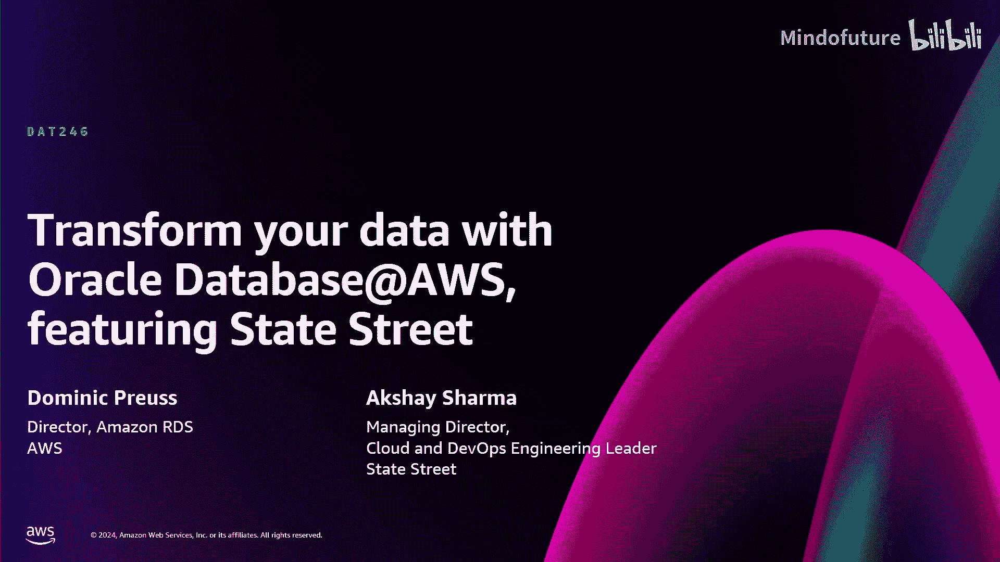

Perfect good afternoon everyone， welcome to the end of day one at AWS Reinvent 2024。

 thank you for making the trek over to learn a little bit more about Oracle databasease at AWS。

 my name is Dominic Priceyce， I'm one of the directors for RDS， and I'll be taking you through。

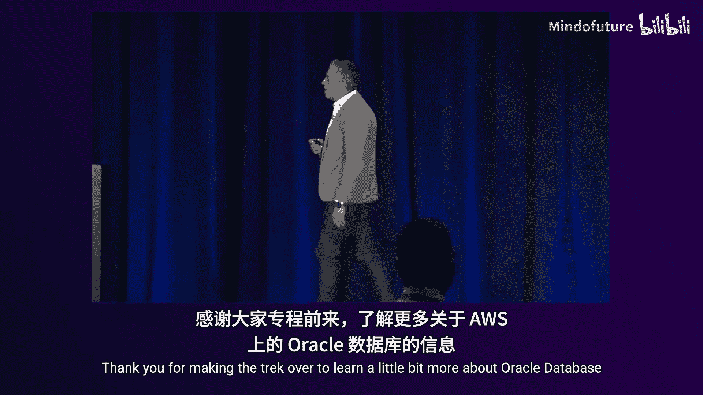

So what are we going to do today we're going to start by going through an introduction to Oracle DataCWS this is an announcement that we made back at Oracle CloudWld in September and now today we can actually talk about what's actually happening so we'll take you an introduction through that。

I'll bring on Asha Sharma from State Street to talk a little bit about what they're planning to do with Oracle databasebase at AWS。

 then any good session has a demo so we'll go through a demo of what this looks like in action and then we'll have some time at the end and I'll oxate some questions I promise you he's never heard these questions before so it's going to be completely off the cuff and we'll end with that discussion。

All right， topic number one， generative AI， Every conversation starts with generative AI。

 but the dirty little secret is that any strategy for generative AI starts with a strong and comprehensive data strategy。

 you can't do anything in generative AI unless you have your data in a place thats secure is organized and you can leverage it to do your geneative AI。

 whether it be building new models or doing things adjacent。So again。

 you have to have that foundation， the data foundation to be able to take advantage of generative AI。

 you need something that's comprehensive， so you need to have access to all of your data。

 you need to be integrated， you need to be able to access all of the data so even if you have all the data in one platform or one cloud provider it has to be integrated so who can get access to it to take advantage of it and it's got to be governed。

 we all know how important data is and that you have to have a governance model on top of it to make sure who's got access to it。

 who can view it and it's being secure。So obviously almost every enterprise customer has Oracle somewhere in their fleet and so AWS we've now been for over 14 years working with RDS for Oracle to help customers move their Oracle workloads on AWS over the years we've extended the possibilities to make it easier for these customers to lift and ship these Oracle workloads into AWS so we originally started with AWS Amazon RDS for Oracle over 14 years ago we recently added RDS custom for Oracle so if you have some requirements that require you to have more control over your Oracle environment and you're willing to take on a shared responsibility model we've got RDSCustom for Oracle to help it。

Help you take advantage of many of the things that RD S provides， but still have more flexibility。

And then many folks are still running selfmanage on EC2， so bringing their oracle workloads。

 bringing their DBAs and all of their automation and whatever scripts they might have built on premise and putting them on EC2。

But there was a big hole in the offering。 We didn't have a good answer for customers that were running Exita workloads on premise。

 So we worked together and started this strategic agreement with Oracle to launch Oracle database at AWS。

So let's spend some time talking about what we announced back in September and that what is now live in limited preview today as part of AWBS reinvent。

😡，So what is Oracle databasease A AWS Fundmently， it is OCI infrastructure。

Hardware sitting inside of an AWBS data center， remotely managed and controlled by OCI。

 so these are OCI services on dedicated hardware and infrastructure inside of an AWS data center that we can then offer to customers。

😡，Why is this important？Today， if you were trying to run your Oracle workloads in OCI and your applications in EC2。

 the latency was too great between the two to split up those workloads。

 so with this solution we now have low latency connection from the OCI infrastructure sitting in the AWS data center to the rest of AWS specifically EC2。

 so what this allows you to do is to run your ebusiness suite or your custom application or your peopleoft on EC2 connected to a database running on OCI managed infrastructure inside of an AWS data center。

To do this， customers really need sub millisecond latency between the two。

 And so this solution provides that。The other thing is that customers that are spending money on the solution need to make sure that it lines up with the rest of the things that they're doing on AWS。

 so what we've done is we've integrated this through the AWS marketplace。

 so what this means is that you pay through AWS marketplace and that get you two benefits， one。

 if you're a customer that has a committed spend to AWS in exchange for discounts。

 this spend will count against that committed spend。😡，On the other side。

 you will get credit with the Oracle Support rewardwards Program to use that to get credit against your annual software support costs that you have with Oracle。

 so this allows you to double dip into both programs by going through the AWBS marketplace。😡。

And so what this will do it again， today we launched an limited preview。

 we will be launching GA next year， but it lets you to migrate。

 lift and shift those Oracle Oracle Exadata workloads onto the OCI infrastructure。

 specifically Oracle Exated database or Oracle autonomous database on dedicated infrastructure within an AWBS data center。

😡，So why does this matter so one is today if you wanted to migrate your exadata workloads from on premiseise onto AWS。

 there's a lot of work that needs to be done to decompose the databases， get them on RDS。

 get them onto EC2， you can't just pick up and lift and shift your exadata workloads。

 so what this does is makes it as easy as possible to lift and shift those exadata workloads into the AWS cloud。

😡，The second thing it allows you to do is to unify your data because your data sitting in these Oracle databases is inside the AWS data center。

 you can easily unify it with all of your other data。

 so what this looks like is just another set of VMs and another set of databases in your VPC just like any other resource in AWS so what that allows you to do is to combine that with your analytics data。

 your other Oracle databases， your other databases to get a unified view of all of your data for things like generative AI or to get the most value out of your data。

😡，And the last thing we did is we simplified it and so to make this as easy as possible for AWS customers to consume。

 we've wrapped an experience around it to make it feel like an AWS offering。

 so there is integration in the AWS console which you'll see later。

 we've already talked about the integration with AWS marketplace。

 we've created AWS APIs that use your AWS credentials to do provisioning to set up the service。

 and so we've made this feel very similar and comfortable to AWS customers while still leveraging all of the power from OCI and all of the benefits that you get from the exit infrastructure。

😡，So let's talk a little bit about integration so because we wanted this to feel as integrated and as part of the AWS offerings as we could。

 we've made it very easy to bring these workloads over and first of all for Oracle real applicationplication clusters or Oracle RA for customers that want to run Oracle Ra。

 which is an option in Enterprise Ed， this is the supported way to run Oracle Ra workloads on AWS so if you want to run those workloads。

 you want you want support from Oracle and the most in the official way to do this。

 this is the way that we will support those Oracle RaC workloads on AWS。We're also going to support。

The way we're going to do autonomous database， so if you want the advanced management features of autonomous database。

 we'll be adding autonomous database on dedicated infrastructure on top of the Oracle Exadata infrastructure so you can get all of the management benefits of autonomous on top of that infrastructure。

And then to make sure that it lines up with all your resiliency and all the other things that you want to do in AWS。

 when you are taking backups from these databases， the default will be that they will land in AWSS3 so they will be inside the AWS ecosystem or the AWS a set of services。

 customers can choose to backup up in OCI or whatever their preferred backup destination is。

 but AWSS3 is a default option to make it easy to feel fully integrated in AWS。And again。

 the reason that we want to get and help customers get this data off of on premisemise into AWS is so that they can unify it into a single place into AWS so they can make the most benefits out of this。

 but the way that we needed to do this was we needed this low latency connection So what we've done we spent a ton of time with the Oracle engineering team to basically figure out how to get this Oracle hardware into AWS data centers and to connect it with a low latency physical connection that gets it back into the AWS network。

We also want to make it very easy to get this data into your downstream analytics workload。

 so we're working on zero ETL integration， so the Oracle database at AWBS will be a source for zero ETL so basically zero ET means one click integration to be able to get your data from your database。

 downstream into your analytics， whether that be iceberg and has three tables。

 whether that be Redshift， whatever that happens to be。

 will help you get that data downstream into your analytics so you can take advantage of it when you're building your gene AI models or whatever you're building。

And again， because it's a firstclass citizen in the Amazon VPC， you can use things like EC2， EKS。

 you can use any of our compute options， Lambda to speak directly to these Oracle databases that are on the exitated infrastructure that's being managed by OCI。

 so whether you want to be EC2 or you want to use any of our compute solutions because it's fully integrated and we'll talk about how the network integrates。

 you can leverage it from all of your various compute options。😡，And again， how do we simplify this。

 So this is really important for us at AWS is customer obsessed one we really wanted to make sure that this option was available to customers。

 but two we wanted it to be as easy as possible to use so we've got a unified experience between the OCI offering and AWS。

 and so there's integration in the AWS console we've done the integration with AWS marketplace。

 we've done things like CloudWtch metrics。 So all of your metrics show up in CloudWatch。

 So if you have monitoring solutions that are based on data in Cloudwatch。

 all of that data will be available there for you and so it allows you to basically pull these workloads and these databases into your existing infrastructure in your existing operations。

One of the things that I don't know if people really realize is that we spent a lot of time building AWS APIs that use your AWS credentials that are basically wrappers on top of those CI APIs。

 so to set all of this up， you'll actually call AWS，😡。

AWBS API is with your AWS credentials and will handle the fact that it maps to a different OCI tendency in the background and make those API calls in your behalf。

So as we talked about， we announced this at Oracle CloudWorld a few months ago。

 and that was a pre announcementcement today we are doing the limited preview so today you can get Oracle Exated database service running on Oracle。

Infrastructure sitting in an AWS data center in one region which is US East1 and in one of our availability zones so that's currently in limited preview've since we took the announcement we've been taking a lot of interest from customers if you have interest in this please talk to your account teams or your representatives as we're trying to figure out how we're going to get various customers into the preview and then the plan is for general availability in 2025 so this will be the Oracle Exated database service Oracle autonomous database for dedicated two regions。

 two US regions and two AZs in each region to basically build the platinum architecture for HR for H and DR we need one region with two AZs and for high availability and another region for DR and so we'll have that at general availability we'll also have zero ETL the S3 backups and restore and then we'll be working on more regions。

2025Right now， we're working on these two regions， but at the same time。

 we're evaluating all the other regions based on what customers are asking for and the best places to land additional OCI hardware。

 and so we'll be working on an overall regional rollout plan as we get to general availability。

So a lot of folks ask about architecturally how does this work。

 I think the important designation here is that this is not Oracle OCI。

 Oracle hardware running on AWS， this is running OCI infrastructure in AWS and so the way that we've achieved this is that within an AWS region。

😡，You can see we've got the application VPC so this is where you would normally be running your application again this could be a businesss suite。

 this could be peopleoft， this could be your custom application and then what we've done is in part of the AWS region we have landed Oracle Exadata infrastructure in the region so there's a data hall that actually has OCI hardware and that hardware is then remotely managed by an OCI parent region so all of the control plane and all of the management and everything is done by normal OCI but we have this child region that's sitting inside of an AWS data center and that's the infrastructure that customers get to take advantage of。

So all of the wonderful things that are happening in OCI， you get to take advantage of。

 and the customer infrastructure sits inside of the AWBS data center。

And then what we've done is we've done a number of tricky things on the network side to make it easy to connect to these and we'll take you through what that looks like。

 but at the end of the day， your application that's sitting in the VPC is just going to see these VMs on Exadata and databases as just another endpoint on the VPC。

😡，The way that we're doing this is we've created this concept of an ODB， an Oracle database network。

 so this is the network overlay that we use that we actually peer your AWS VPC to to create this connection。

😡，The infrastructure is sitting inside of the AWS data center and the way that you。

 once you provision your exitator， you set up your set of VM clusters and we'll go through that process as part of the demo。

😡，Obviously during the limited preview， one region in1 AZ is not sufficient for production workload。

 so the way that we're going to support HA and disaster recovery。

 high availability and disaster recovery at GA is through this pattern。

 so we're going to have for high availability there will be two AZs each with the exedated clusters so customer will have database and exated cluster one and AZ1 that'll have a second one that'll be connected via data guard across in another AZ for the region and then we'll have a second region that will be in the same country for disaster recovery where we'll be doing crossregion replication for disaster recovery。

So this is what the recommended architecture will look like at GA， so two AZs in a single region。

 and then a second region for disaster recovery。Another thing that was very important is that customers often have many VPCs。

 so they need to be able to connect multiple VPCs to the Oracle database network。

 so what we've done is you can actually peer multiple VPCs to the Oracle database so that you can have a set of EC2 VMs in one VPC。

 you can have your EKS and another customers are able to separate their logically separate their resources like VPC。

 but have multiple of those peered to the Oracle database network。

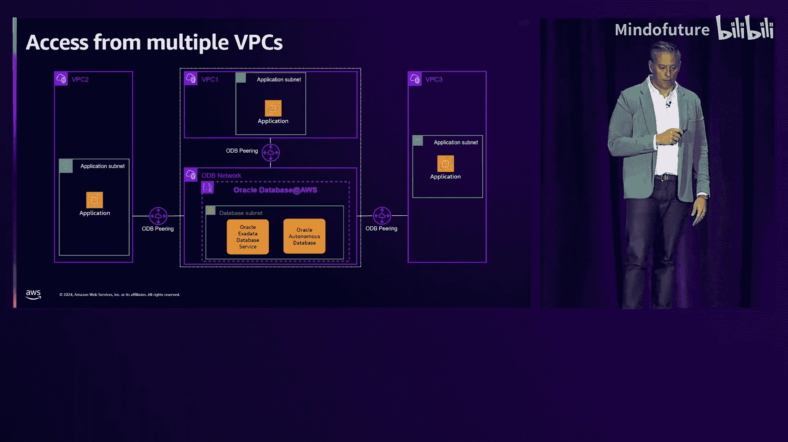

All right， so I've talked a little bit about kind of how we've implemented this and all the work we've been doing with the OCI team over the last several months。

 what I'm going to do is actually bring up a customer to talk a little bit about how they're thinking about this to get you the customer' perspective so with that I'm going to bring up Oxy Sharma who's the managing director at State Street to talk a little bit about what they're planning to do with Oracle databasease。

Thank youだ。

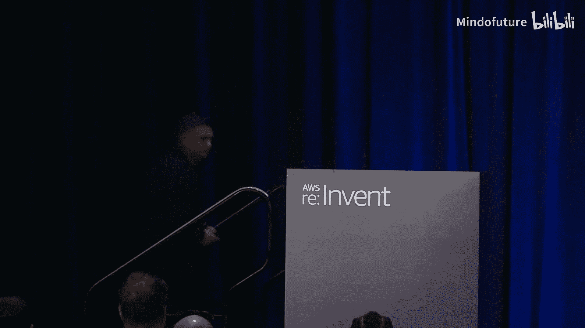

Thank you， Doniick。Good evening and good afternoon to all of you。What we're going to do today is。

First， let's do a little introduction to State Street as a bank。

And then we'll delve a little bit into our strategy and how this offering fits nicely into our strategy。

State Street is a 2 30 year old bank and people often talk to me and say。

 we don't see State Street branches and we don't see those branches because we serve institutional investors in our clients and institutional clients like pension funds。

 retirement， plans， sovereign wealth funds， etc cea， et cetera。Interestingly。

We are are one of the biggest global custodians out in the market。

 and we are also the fourth largest asset manager in the world。😊。

We are proud to have launched the first。ETF， if you invest in SpyY。

 we were the folks who launched ETs driven through the aspiration of the investors because they want they demanded passive investment strategies and index base。

Investment strategies。And so from a state sheet perspective， if you look at it。

 we have three business lines。 first business line is investment servicing。

 which is our core business where we do fund accounting， custody， performance analytics。

 and we do also provide a lot of platforms for institutional investors。😊。

Our second line of business is markets and financing。

 which allows us to provide liquidity to our customers and last but not the least。

 we also have an investment management arm， which is the asset manager wing。

 which is where the ETF SPPY was born。😊，We are also a GCP。

 a GCP stands for globally globally systemically important financial institution and what does it mean to be a GCP what it means is we are too critical to fail we are in the category of those banks in the states which are too big to fail。

😊，What that also means is that draws heightened regulatory attention on us。

Which includes a lot of focus on operational resiliency， as well as risk excellence。With that。

Some numbers。We do。Have 4 almost 45 trillion worth of assets under custod administration and almost four and a5 trillion under management and that what that means for us is every day our systems run almost 11。

5% of the world's asset all our all our systems collectively， we service almost 11。

5% of the world's assets and that speaks and indicates to the scale of data we manage and govern every day to dominate point earlier。

Data management is key if we are not able to manage data really well。

 we can't leverage the opportunities and the possibilities we have with artificial intelligence and Geni and so on and so forth。

 So so having a solid data foundation built on the data we have is very。

 very important and paramount to us。😊，Our technology strategy is focused around  four key pillars。

Platform modernization， providing digital client experience best in- class digital experience to our customers。

 automation efficiency。 we almost have driven AI in the fabric of the organization。

 we from a back office perspective have a lot of pressure on our margins because a low margin business right and hence use using data effectively and putting AI on top weaving that into the fabric to drive down costs is very。

 very important to us。 So AI has to be used not only from the perspective of driving our top line。

 but also our bottom line， which is very， very important to us。😊，呃。Our annual I T budget。

 roughly is about 2。5 billion。Out of which we have a big 400 plus people AI center for Excel。

 which is very， very important。 and we are not doing AI。Now， we've been doing AI for about。

7 to 8 years。 And we've doing traditional AI。 But now we are moving towards leveraging GenI with all the data which sits with us to be able to drive insights for our customers。

 market investors， as well as。😊，We are now looking to。Drive more insight。Front to back。

 And when I say front to back， if you look at the investment lifecycl。

 we want to drive insights from the front office， the middle office in the back office with a unified experience to our clients。

 And that's our service offering， which we call Al。😊，Moving on。How does this whole。

Offering fit into our strategy。Our platform platform modernization strategy is very cloud centric。

 So our goal is to drive significant reduction in our data centers worldwide。 right。

 And to that effect， we have。😊，We have fostered。Relationships with the three hyperkiers。AWS。

 Azure and Oracle right and what we intend to do is over a period of time undertake a journey where we move towards data central S IT and what that means for us is we create regions which are in this star formation where we link all the three cloud providers to each other through low latency。

😊，Networks， and then。There are workloads we have which are not cloud friendly。

 and those workloads essentially go in and set in a colo。As I said， we are a 2，30 year old bank。

 And what that means is we have almost about 2000 applications which have evolved and grown over a period of。

The history， right？ So obviously， not all those workloads are cloud friendly。

 We can't take all of them to the cloud on day1， although the intent is to。

Go to the cloud over a period of time。 And hence， if you look at this chart here。

 what you see here is on the AWS side， you have AWS native。 you have VMC。

 And now you see the Oracle AWS box， which is。😊，Very。

 very important to us because if you looked at this chart last year。

 you would not see Oracle at AWS or oracleite Azure in those boxes。😊。

We were relying purely on Oracle Clouded customer， which is Oracle's offering to have excccerita sit in the colo。

😊，To drive migration of assets from our data center into into the co。

 And what that meant for us was a lot of for assets because they are dependent upon accera。

 They all go into the colo。 So we're actually not doing the cloud。😊。

And since we are not doing to the cloud we are actually not going to the cloud and we are actually moving more workloads to the colo。

 what that means for us is we are not able to leverage all the advancements which are coming out in the cloud right And so it was very。

 very important for us to have this partnership。😊，Done with both AWS and Azure because there are two full service cloud providers that helps us to drive the benefit of leveraging all the good services and advancements which are happening in the cloud natively。

 whether it is AWS or Azure。😊，So what does multi cloudud mean to us。

 I'm not going to hit on this slide in full， but by large。

 what it means to us is we always multi source， obviously， from a concentration this perspective。

 we always multi source。Our application architecture is always single cloud core。

 And what that means is an application with all its modules usually goes and sits in one cloud。

 and it's not split across multiple clouds。😊，Our intention is always to have one application go to one cloud end to end。

 Bar a few scenarios where we may have to interoperate with any other cloud for。For。

 for reasons of data gravity or integrity or integration。

We also intend to leverage cloud native capabilities as much as possible。

 because that's where the value comes from。And also， we want to provide。A very。

 very rich experience to our developers， which is very， very important。 And when。

 and when I say rich experience to our developers， what I mean by that is a couple of things。😊。

We believe that that going to the cloud is should be more self serviceice for the developers。

 We should treat developers as first class citizens。

 meaning they should be able to self serviceice themselves onto the cloud with certain guards。😊，We。

 we， we don't want to live in the world in the traditional world where， you know。

 somebody provisions a V M for a developer。 We want to live in a world where developers are able to self serviceice their own needs within guardrails。

And accomplish what they want to accomplish， right， And so that's what we mean by you know。

 consistent consistent experience to our developers。 What that also means is。😊。

If developers are talking to AWS or Azure。Their experience in terms of provisioning and the operating model is consistent right we use seraform for provisioning in both our clouds and that provides our developers a consistent way to consume the clouds。

😊，Now， let's get to this offering。Today， in our onpre state， we have Oracle and open systems。

 We have Oracle Ods， a lot of them。 And we also have Oracle and Xer。😊，As I said。

 we have almost about 2000 applications and those applications have grown over a period of time。

 lot of them are custom applications lost， lot of them are cos products right and lot of them are not cloud friendly。

 like I said。😊，Now， usually in our business， some of our most critical applications。

Are dependent upon xccera。And because they are dependent on xccelator。

 what happens is you have a lot of satellite applications around those big monster applications which gravitate towards being part of that ecosystem。

 so example if I take a functional domain accounting and if I have if I have application X which is using xccelerator。

😊，Lgely what happens is there are probably 20 applications around it。

Which form part of that accounting ecosystem。 And the reason I'm mentioning that is because。

If you move one of those applications onto the cloud。

 the rest of the 20 have to move along it because of data gravity right so we do have this estate today。

 but in the target state， we want to encourage our developers to use more cloud native data source which are fit for purpose which probably were not there when those applications were originally built the whole concept of column databases key stores you know databases for unstructured content weren't even there when the original applications were written right so we do want developers to start looking at more cloud native data source for sure on the other hand as I said it's not always it's all it's sometimes costprobative to rewrite applications which are already built on excera and so it's very difficult for us to move them to the cloud in short burst of time right and hence。

😊，We want to we want to provide options to our developers。With Xer available in both Aws。

 Azure and clouded customer。 And what that gives us is the advantage where。😊。

If an application goes to AWS， they have accelerated natively available in AWS。

 If an application goes to Azure。Xer is available there。 it is there also。

 And if they intend to go to the colo， X is also available there。😊，Now， one of the reasons。

 like I said， our applications intend to go to the Kolo is because we have a huge dependency on the mainframe。

 And obviously， the mainframe is not。Cloud friendly， right So the mainframe goes to the co。

 lot of our applications which actually have data gravity or integration points into the mainframe have to go to the co right and so。

😊，This now allows us to leverage X and move our applications faster whether maybe in the cloud or in the column and last but not the least our migration strategy is also dependent upon certain modernization levels we have established and one of the modernization levels is lift and optimize。

😊，Because we want to move applications quickly to the cloud， right， We may not rewrite them。

 We may not rearchit them， but we may lift them and optimize them to an extent that they could go to a cloud using strategies like VMC。

Right， so if we do that， we also intend to offer to our developers Oracle on AWS as an option so that can accelerate the move to the cloud。

 And over a period of time， then they can obviously you know， rewrite。😊。

To more cloud native technologies and leverage the power of the cloud。As I said。

 we are a GCP bank and our control environment is very。

 very important to us What I like about this offering is also the fact that we can now drive Oracle within AWS Azure and clouded customer through a single control plane which is in the OCI Ter So if I as a customer have a existing OI Ter。

😊，Then。I could use that as a single control point。To drive behavior across all the three clouds where et is available。

 right。This this chat also allude to the fact that the control plane which sits in the OCAT is responsible for account management。

 the database lifecycle management， replication， wing， etc ce。

 while the data plane exists within the cloud natively which is great because now backups provisioning etca can happen within the respective cloud right but the control point still sits back in the OT。

😊，What we have also observed is Oracleles multicloud offering doesn't have too many variations。😊。

So it's pretty consistent， consistent。 What I mean by that is。If you look at network topology。

Identity or the security model。 There are minor variations which do exist， right， but by and large。

 the offering is very consistent across all the three clouds。 You have the control plane。

 then you have the data plane。 You have clearly defined functions which are performed in the control plane and the rest of them are performed in the data plane。

😊，So what does this offering give us and how does this enable our modernization strategy？First。

 it accelerates our move to AWS， which is very， very important。

 we want to get out of our data centers into the cloud as fast as possible and the fact that this offering wasn't there earlier。

😊，Was innovative to our progress。 So this actually helps us accelerate our journey to the cloud。😊，2。

 it allows us to leverage our existing investments on Xerator， right。

 Rewriting applications which are mission critical， which leverage accerator is cost probative。😊。

So it allows us to leverage our existing investments， which we have made on Xccera as it is。

To it now， since the data is moving to the cloud， it establishes us to。

To create a solid foundation to innovate upon if the data is not in the cloud。

 how do I innovate right So the fact that now I can move more applications into the cloud allows me to establish that solid data foundation within the cloud and also simplifies the architecture operational complexity of our architecture。

 If you look at the chart I showed you with the triangle operating that environment and attaining operational rhythm on that is extremely extremely complex。

 And the fact that now we can take the app。😊，And the database， both natively into the cloud。

 reduces the architectural complexity exponentially for us， right， which is a huge benefit to us。😊。

Now， since we can move the data to the cloud， we can establish a solid data foundation。😊。

What next we get to innovate， We get to use all the advancements AWS is doing on the cloud。

 whether it may be SageMake or bedrock or new GI models。

 I can now apply those models to the data which has been moved to AWS which is huge for us right and with that I can now start to offer more product and services to my customers right and eventually leading to more business growth top line and driving more efficiency to our bottom line。

😊，What do we expect from this offering right here are some of the key capabilities which are extremely important and we should be looking forward to first。

 as this service is launched， we intend to be a preview pilot customer to this service。😊。

We would be looking at bunch of things highlighted and outlined here。 First， service availability。

 It's very， very important that this service is available within the regions that we reside。😊，Right。

 second。Are we going to get multi easy features， right？ The initial preview is single easy。

 but eventually for us to go into production， we need at least one region which is multiese right Se third。

 we look at the skus being available。😊，We use excellence today， and we hope to。

Get a pary on x 9 Ss within the AWS environment。We obviously will look for multicloud feature parity and consistency because we want to drive consistent experience for our developers。

😊，We look for security aspects， key management， TDE。Privillleged access management， et cetera。

We also intend to see how how natively this service is integrated with other AWS services like Dominic was eudding earlier in his comments that you know you have0 ETL migration available you can do one click migration into a variety of different data stores within AWS can I apply AI models to this directly so and so forth so we look to see what all other services are natively integrated and naturally integrated into the service。

😊，We obviously， you know。Service availability is one aspect of it。

 but we also need to look at migration and replication support that we have。

 whether it is Golden Gate， ZDM， so on and so forth。😊，The other aspect is。As Dominic said earlier。

You can consume this service through AWS marketplace and what that means is if I start consuming through the marketplace。

 I start to burn down my commit on AWS which is which is neat。

 so we do expect that behavior because that's the same behavior the service has on Microsoft Azure。😊。

Last but not the least， support， support is very， very important。

 Every time we have a third party service come into the cloud。

 we we need to look for a unified support experience because then it becomes a game of it is you and it is me and it is somebody else。

 right？ So we are looking to see if how do we get a unified support experience because this service is not native。

😊，Is not a native AWS service， right， So support experience is extremely extremely important to us。

Future plans。 What do we intend to do， as I said， number one。

We want to pilot this service as soon as as early as Q1 which is not far too out and then eventually when the service goes G we want to fully curate the service and expose it to our development community through around Q4 of 2025 because I'm assuming the service goes G around Q2 Q3 end of Q2 Q3 is what I'm hearing but if we get to that stage we want to provide a fully curated service where we can start to move production loads into this service around Q4 of next year so hopefully when they come to revent next year。

😊，We would have moved at least piloted and moved at least a workload on that would be my aspiration。

 Let's see where we go with that。2 we want to accelerate migration of applications to AWS obviously to drive modernization and like I said our intent is to go towards a data centralized IT kind of a scenario right and that really helps us on our data center exit migration program。

😊，3， we want to establish a solid data foundation to leverage plethora of services AWS provides。

 including GI to drive innovation， new products， new services for our customers。

 And eventually as the offering evolves and matures。

 we want to get to the point of exploring autonomous database services。

 which absolutely we want to we want to move towards over a period of time。😊，WithWith that now。

 I think the plan is to have a demo。

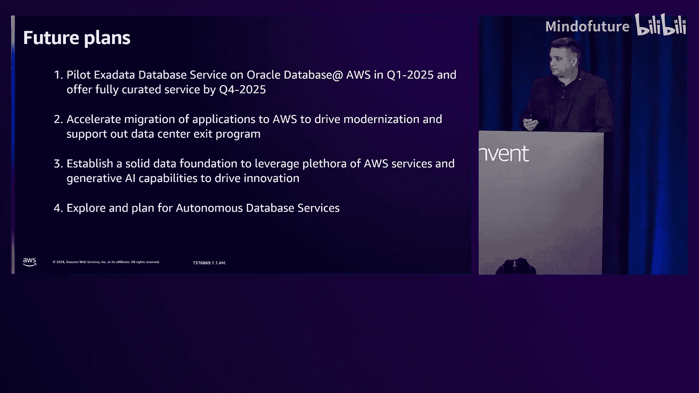

Dominic， over to you。Thank you， Okshaake。All right。

 so any good session at NWUSS at Reinvent has a demo so we'll take you through what is this actually going to look like and what does this look like today again a couple months ago when we announced this at Oracle CloudWorld。

 it was really just an agreement there really wasn't as much technical work done as we would have liked and so we've been working really hard for the last couple of months to be able to make this available today as part of reinvent so this is what is currently available。

 so what you can see today， if I get it going。Here we go so you can see the Oracle databasease at AWS is in the AWS console when you click on it it'll take you to this page。

 you can see here access is denied because you can't use it until you have private pricing so you click on the button says request private pricing and you'll go into the Oracle F soll go in and specify your region you'll fill out all of your information and request information。

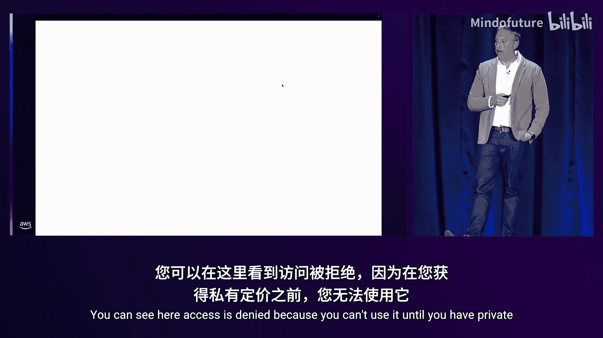

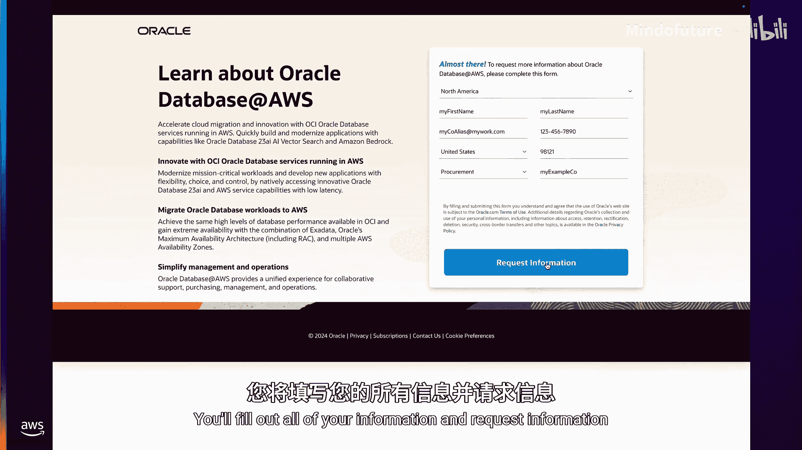

So obviously you can do it through the form， you can contact your Oracle sales rep however you're used to operating with with your Oracle counterparts once you have a private offer that's been approved by Oracle。

 you'll get an email that says that your private offer is available you'll click through into the AWS marketplace and you'll choose your private offer。

 you'll see all of the。

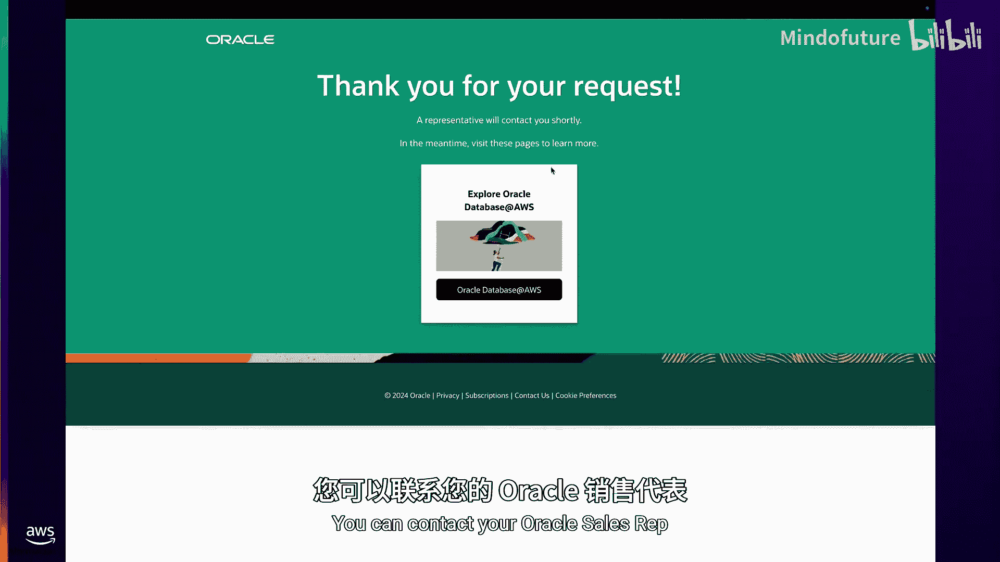

Specifics of the offer。 and you can confirm and pay out。 So here we've got $0。

 but it's whatever you've set forth with your Oracle team。Once this is already， you'll come back。

 the next thing you need to do is actually tell us what your Oracle tendencyancy is。

 and so you'll do this to go so go back。嗯。好。So you have to go back twice to set it off again。

There we go。Let's see if I can zoom forward a little bit on this。

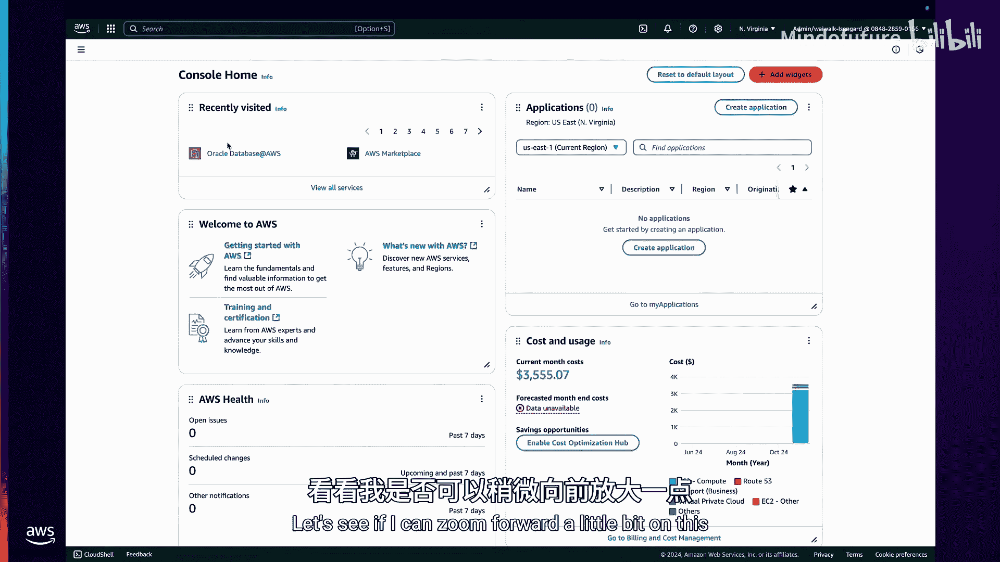

All right， we'll let it run this time。Always the risk of running a video so once you have received the email that you've got your private offer。

 you've accepted that private offer in the AWS marketplace。

 you'll know that you'll then be able to then go to the dashboard and actually start to provision your exit hardware。

 so again， we'll specify the region。Lo constant information。

Once you've had that conversation with your Oracle team。

 you'll be able to get the details of your private offer， you'll get notified by email。

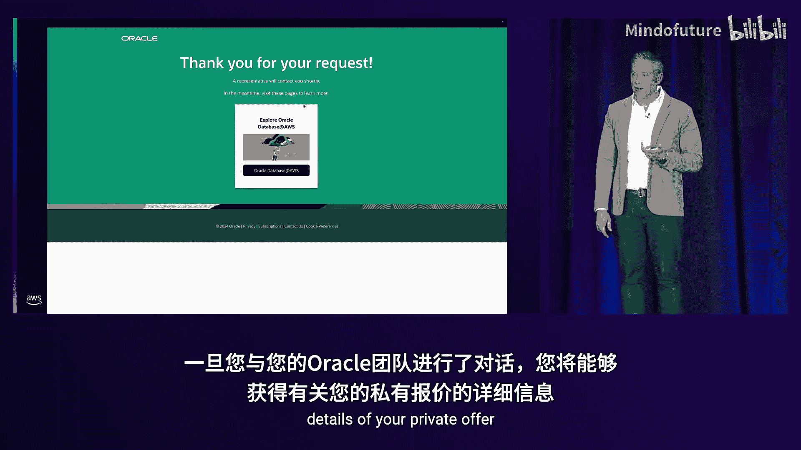

This is what the email will look like。Go to the marketplace。

 You'll see the details of your private offer。You'll see the dates， you'll see the amounts。

You'll commit to the amount and create the contract。

 and this is all just standard ABS marketplace flows。

So now what you'll need to do is go and connect your AW S marketplaceplace account with your O C I tenancy。

 So what you'll need to do is come here and specify your account name。Go through and log in。

And basically what we're doing is we're creating a mapping between your OCI tenancy and your AWS marketplaceplace account。

 so what this allows us to do is when we're making all of the API calls where we know how to map between the AWS account and the Oracle account。

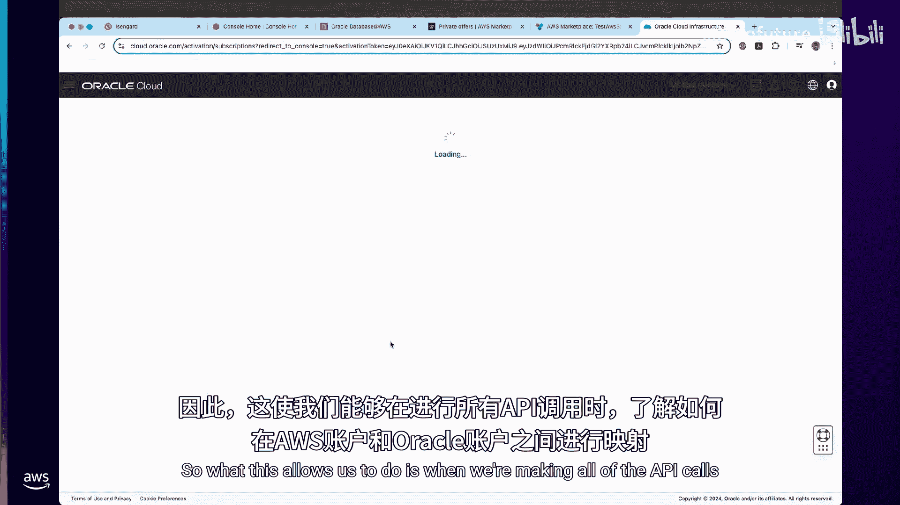

So you can see here you've got your ODB ten。You'll add the subscription。So now once it's all set。

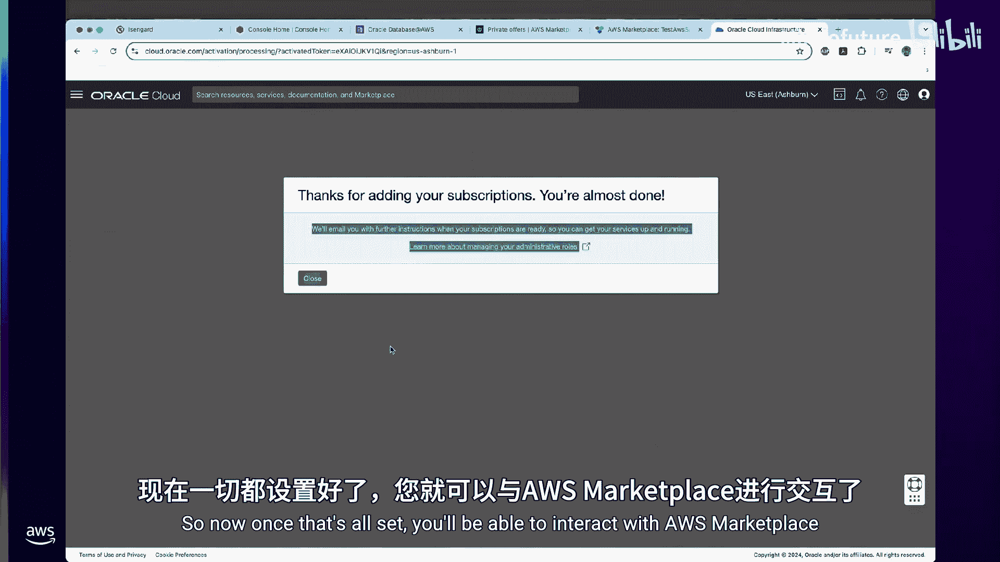

You'll be able to interact with the AWS marketplaceplace。

So we're going back to the AWMS Marketplace and now the dashboard link is live because we've got our private offer and this is where we can go to actually provision our infrastructure。

 So the first thing we'll need to do is to create that ODB network that we talked about before。

Give it a name， choose an availability zone， you need to provide us the seats for both the client and the backup so that we know kind of what IP space we're operating inside of。

 you'll choose the VPC that you want to peer it to and you'll give it a domain prefix。

Create the ODB network。Now， we can see all the details of that network。

 So this is what binds our network connection from the infrastructure to our VPC。

 So now if we want to go set up our exitada infrastructure， we'll go in and give it a name。

 We'll specify how big it is， the number of database servers， the number of stored servers。

We'll give it an email address so that we know how to get notified of maintenance events that are happening with the infrastructure。

And then we'll create our infrastructure， our exit infrastructure。

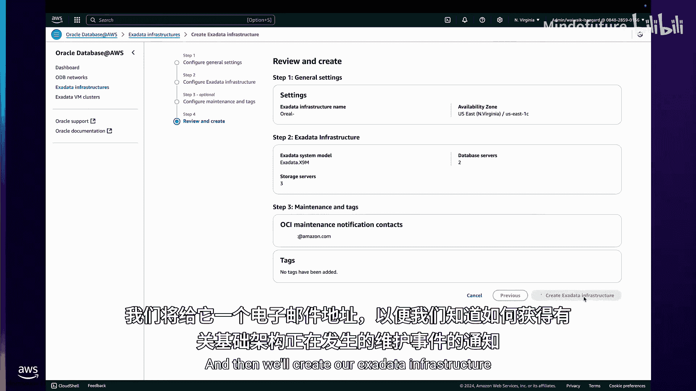

So again， this is happening in the AWBS console， it's calling AWS APIs。

 which are then calling OCI APIs underneath the hood。

 but you can see this is the exitada infrastructure that we've provisioned via the AWS console So now we'll go to set up our VM cluster these is the cluster of VMs that will actually be running our databases。

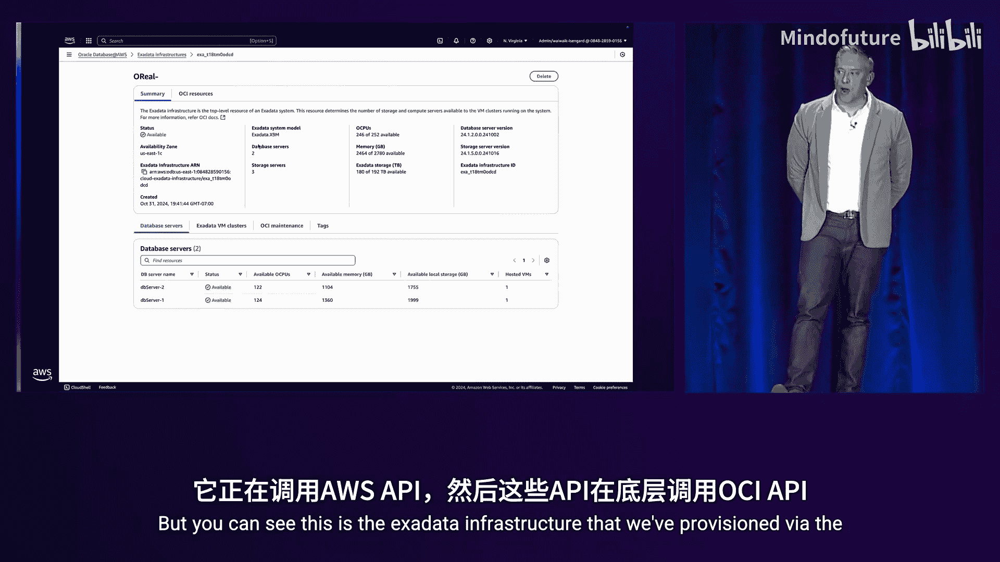

Specify the time zone license options。We'll give it a name， we'll pick a version。

These are database servers。How many VMs are we going to be configuring？

Which ODB network are we going to use naming？We also have to take care of our SSH pairs。

Set some options and now where we've created the VM cluster。So we've now provisioned an Xadata box。

 we've provisioned a number of VMs on the box， and we can see those VMs have been created and all the information about them。

We're going to grab the scanned DNS name because we're going to need this to connect to our Oracle databases or our Oracle VMs。

We can also see that all of the stats from the VMs are already being pushed into CloudWatch。

 so all of the metrics from the VMs are available in CloudWatch。

 so any of the tooling that you've built on top of CloudWatch metrics is going to continue to work just as if this was an AWS service。

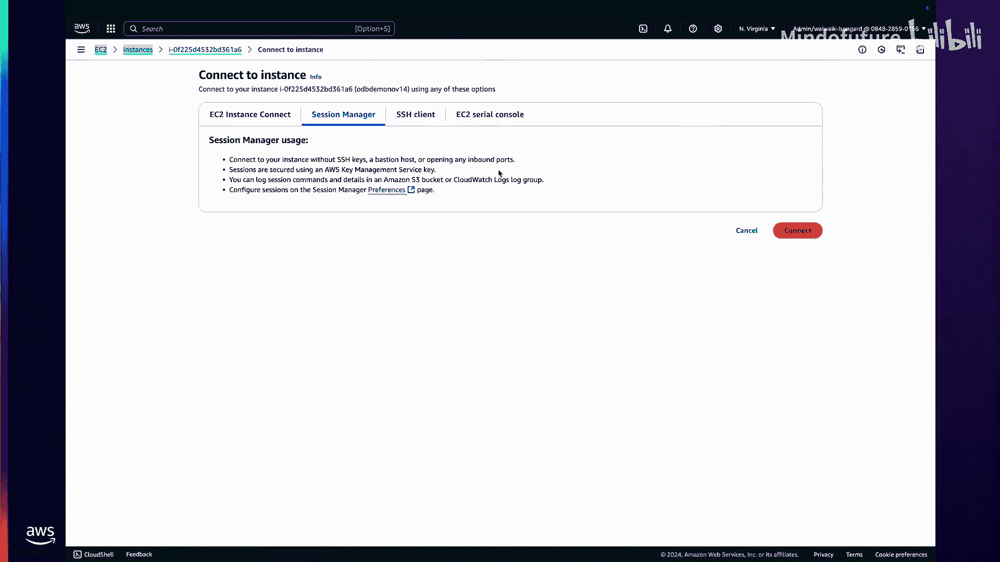

We can go ahead and connect to our instances。So first thing we're going to do is connect to VM an EC2 instance。

And the first thing were need do is going to ping RVMs using the DNS。

So we can see that we can ping it so we have a network connection。

 this is way more exciting than you realize and how much of work it was just to be able to create that ping。

Now we can go ahead and SSH into the VMs。So we now SSH into one of our VMs。

 we now have all of our Oracle database tools which we've pre-installed。

 but now we can start to provision databases， so we're SSH from an EC2 VM into a VM on OCI and we are running our database create tools in the VM。

So we've created our container database and now we're creating pluggable databases。 Again。

 these are just the standard OCI tools that have been installed on the Oracle VM。

We're creating our PDBs。Obviously， in actuality， this takes a little bit longer。

 but we've sped it up for the demo。And now we can actually ping the databases。

So we're able to SQL+ into those databases that have been installed using the scanned DNS。

 and now we are in the databases with a SQL prompt。

So we now have Oracle databases running on Oracle VMs in OCI。

 connected through the network through to ODB to a VM in EC2。

And so now you're ready to go to start connecting your applications in that VPC to your Oracle databases and you're up and running。

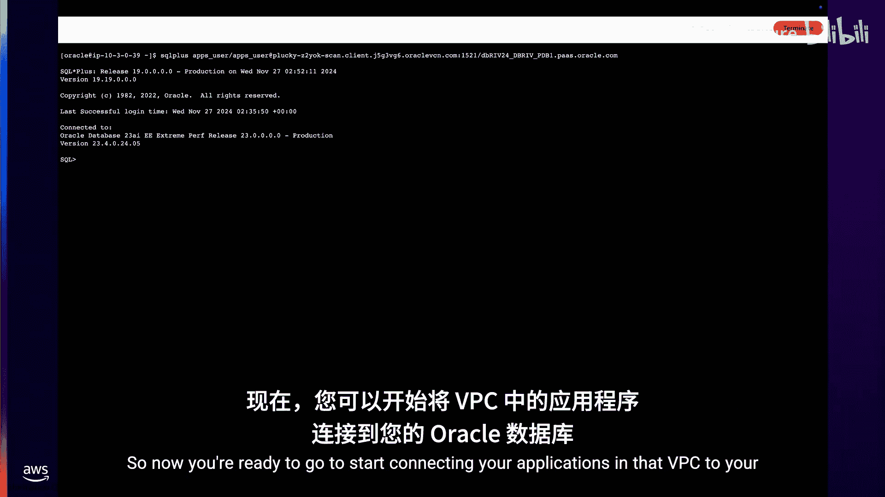

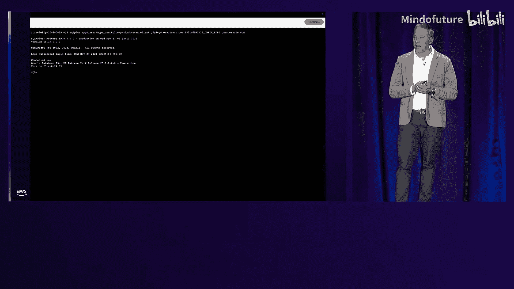

Now that was many， many months of work and lots of physical as well as software development。

 both between us and the OCI team。 So we're incredibly excited that we've made it this far。

 we're really excited to give us to customers to see how they're going to start to use it and all the great things they're going to build So the last thing we're going to do is we're going to bring Osha back up here and we're going to ask him a couple questions。

 put him on the spot。😊，All right， so you've seen the demo。

And you might have seen a little bit of it before。 but that's the first time you've seen the end end demo。

 Yes， so as a potential customer。What are you excited about？I think I'm really really excited。

 like I said， we service almost 11。5% of the world's assets right our developers are readyring to get their hands on this just so we can innovate on top of with all the technologies you're bringing in of So I'm really excited that one we are able to move accelerate our journey to the cloud we can move faster to the cloud and then once we are on the cloud。

 then we can innovate the fast in what's really pushing that you talked about how important it is to get to the cloud what are the strategic drivers that are really pushing that migration of the cloud Yeah there are a couple of them first being risk reduction and resiliency we want to leverage all the resient resiliency capabilities and security capabilities in the cloud one2 obviously like I said。

 we want to be more cloudcentric go towards data center less I it helps datacent exit program right and third。

 obviously we want to modernize and innovate we can't do that if we are not able to move to the cloud at the pace and agility we want to achieve。

😊，We can't do that in our current setup。So those are the drivers of why this is important to us。

 Great， And you showed us a bunch of stats。 You're obviously one of the most important banks in the world as other banks and other financial institutions are thinking about this。

 like what are the things they need to be thinking about。Yeah。

 I think as far as journey to the cloud is concerned。From a financial services perspective。

 I think the first thing people need to think about is。

How for a highly regulated bank like us what is important is how do you establish and baseline a cloud control framework and how are you able to demonstrate operational effectiveness of those controls which are implemented in the environment because people are worried to get to the cloud that's number one number two cloud does not reduce your risks it just increases the if it does not increase it has a different set of risks which come in right so what we need to ensure is we how do you manage those risks rather than getting worried about those risks right that's very very important。

😊，I also say that education and competency building is extremely important and I say education is not education to the technologists。

 but also a lot of the other functional groups in the organization may be security may be procurement may be legal may be third party risk management right and training to those guys is equally important so we need to educate them so they become partners to get to the cloud right again。

 a couple of other things which are paramount to me is if you intend to get to the cloud automate the heck out of it hyper automation is the concept right so you auto automate through the lifecycl you automate the provisioning process the testing process policy as code continuous compliance。

😊，You have to automate the heck out of it。 It's extremely extremely important right Those are some of the things which are very。

 very important from a financial services perspective and maybe other verticals too I guess。

 but establishing the control environment taking a riskbased approach how do you demonstrate effectiveness of those controls is extremely paramount Great and we talked about your timeline Q1 we're gonna be evaluating like as you go to the evaluation like what are you thinking about what are the things you're gonna to be looking at as you evaluate Yeah。

 the very first thing you got to look at is latency for our applications Some of these applications which are so mission critical to us were written probably two decades back right and obviously they are very chatty in nature。

 So first thing you need to do is。😊，Run those applications and see the throughput and the and the performance right That's paramount。

 once we look at that and we we clear that check mark， the next two things。

 obviously is I like to look for resiliency capabilities in general and also the amount of automation capabilities in there last but not the least cost right。

😊，is this cost thing you cost is equally important because yes we have clouded customer。

 we have you know we have a commit with OCI， how does that cost profile transfer into AWS or for the matter Azure is equally important right but。

😊，You know， first thing is。Performance and latency。 great。 And so last question。

As other companies are considering this journey to the cloud and are starting to go down a similar path。

 like what advice do you have for them？So getting to the cloud opens up endless possibilities。

 obviously， and it comes with a very different risk profile right So in my mind， I always say。😊。

Cloud is like a data center。 virtual data center where are too many where you have too many dials and knobs to tune and configure。

 right and it takes time for you to get there right So a couple of things first start small。😊。

Start small itrate， refine， right， educate your teams invest in competency building。

 like I said earlier。Autommate the heck out of it， right。

 And there is tremendous opportunity for you to innovate on the cloud。😊，Great， so thank you so much。

 first of all， thank you so much for taking the time to do this。

 I really appreciate it's a round of applause for Ace， please for coming up here。😊。

I absolutely want to thank everyone at AWS that's worked incredibly hard on this。

 I also want to thank our partners at OCI。 we've worked very closely with them for the last couple of months to be able to build this and it's been truly a team effort and so very excited for everything we've been able to achieve and all the things and very excited to get this in customers hands and see what they can do with it。

 So with that I say have a great afternoon， enjoy the best of reinvent Thank you very much。

 Thank you。😊。

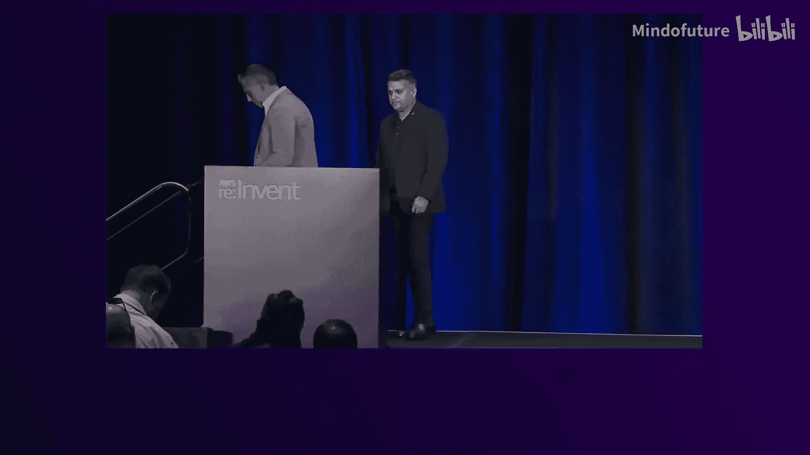