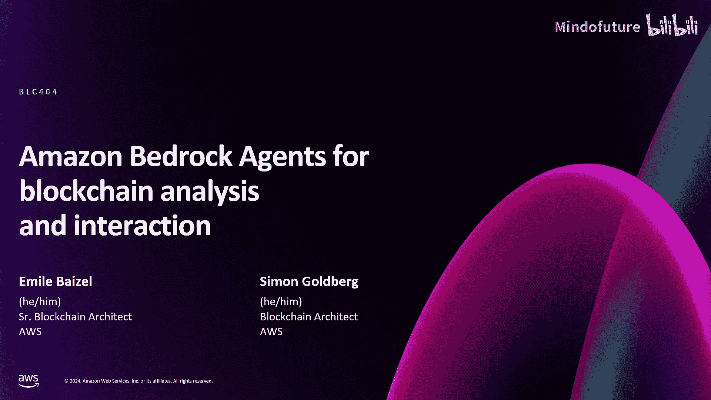
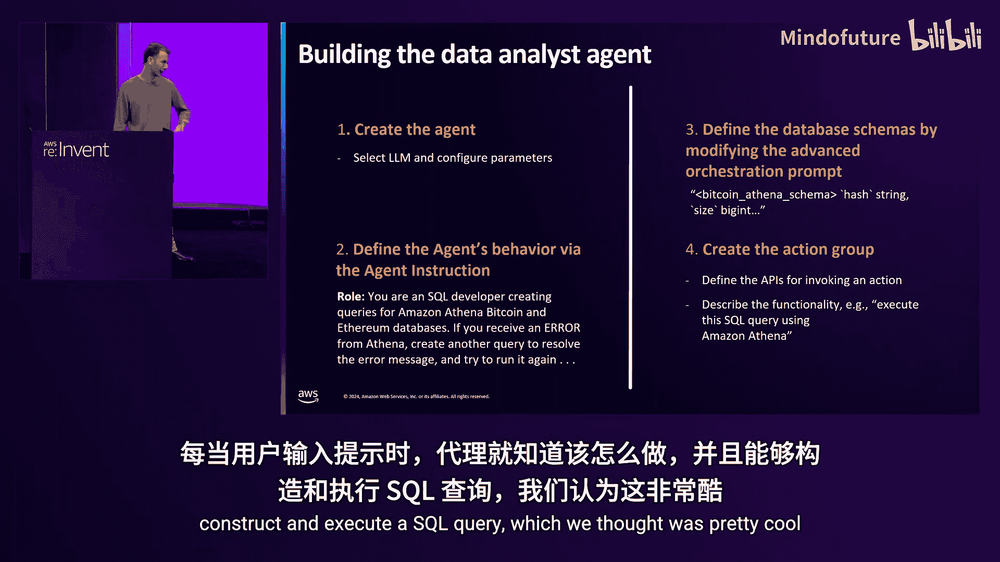
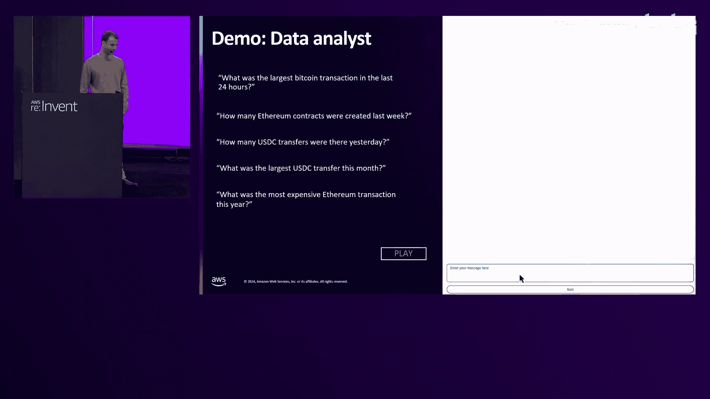
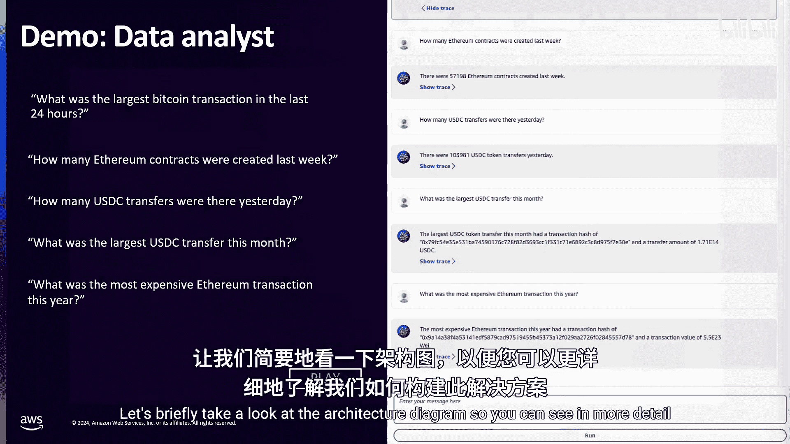
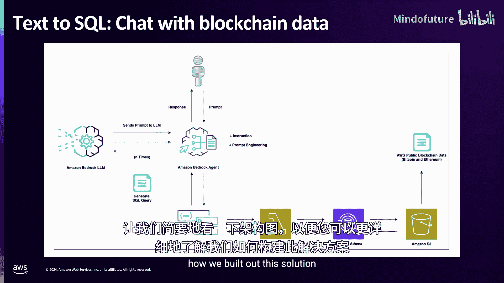
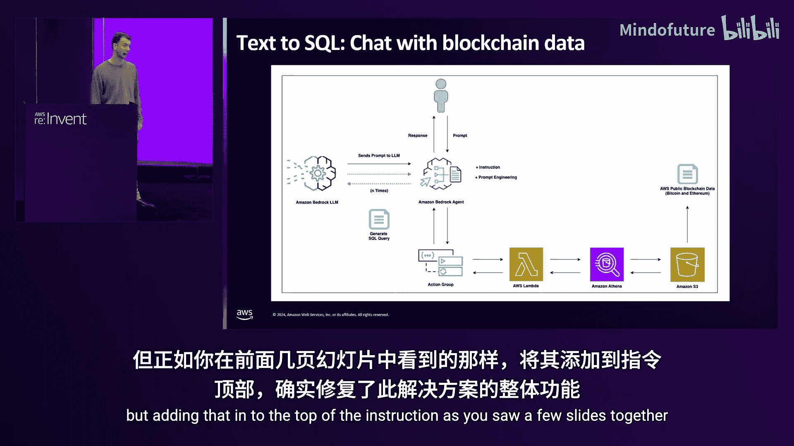
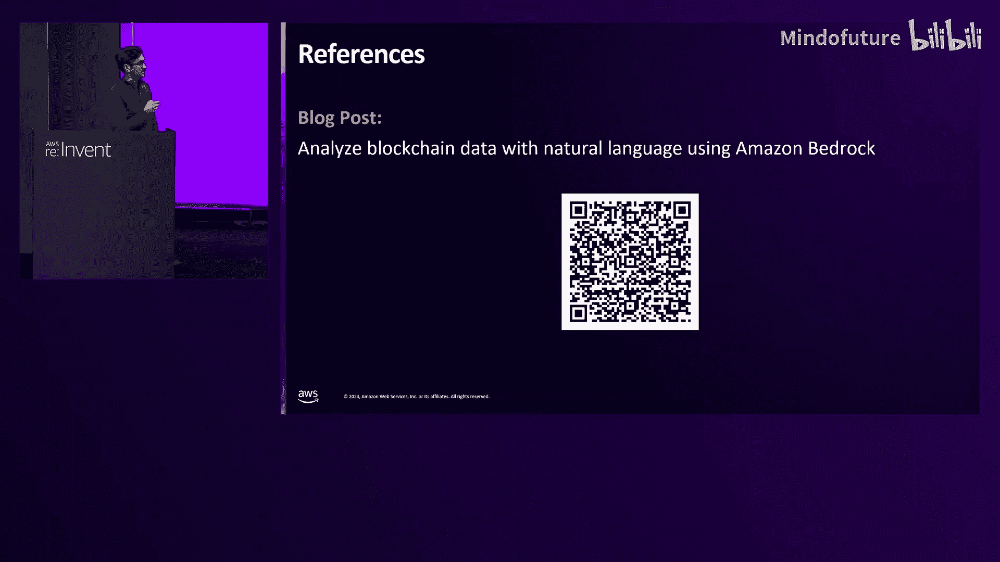
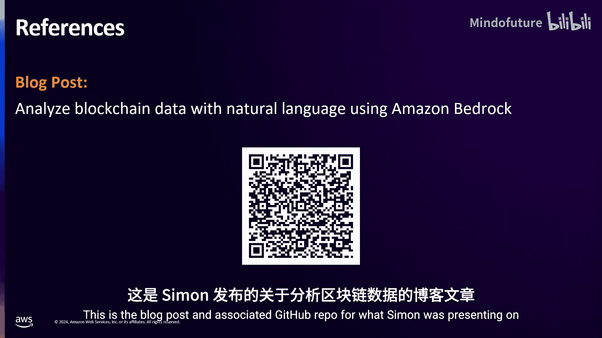

# 【AWS数据库峰会2024全集-•-中英】AWS-re：Invent-2024---Databases-p33-P33-Amazon-Bedrock-Agents-for-blockchain-analysis-and-interaction-(BLC404)--BV1VAR5Y6Es1_p33-

Thank you， Anu， hello everyone。

Blockchains present very novel opportunities for new applications。

 such as decentralized finance and for enabling cross borderorder micropayments。 However。

 working with blockchains also presents unique challenges。

 both from a technical standpoint and from other standpoint。

 such as managing your cryptocurrency wallet private keys。

Analyzing blockchain data can be cumbersome because of all the different data structures and things like that。

AndBut with the advent of large language models and generative AI agents。

 we can now start to address some of these challenges and that's what we're going to do in this talk。

 My name is Emil Basil， I'm a senior Web3 architect at AWS based out of New Hampshire。

 let's get started。So today we're going to be talking about two use cases。

The first use case is using bedrock agents to analyze blockchain data。

And the second use case is using bedrock agents as a decentralized finance assistant and using that to interact and transact on the blockchain。

 but to kick things off， I'll pass it over to my colleague Simon。

 who will walk us through the first use case on analyzing blockchain data Thank you very much Amil。

My name is Simon Goldberg and I'm a Web3 specialist solutions architect based out of Atlantic。

 Georgia， and as Amil said， we will first discuss bedrock agents for blockchain analysis。

Amil and I built a solution that allows for text toSQL queries on the AWS public blockchain data sets for both Bitcoin and Ethereum back in 2022。

 these data sets were released under the Open Data program。

 allowing for analysts to issue SQL queries using services such as Amazon Athena or Amazon RedSshift in order to glan insightsights。

One of the key benefits of these data sets is the ability to aggregate data across multiple different blockchain networks。

 such as Bitcoin and Ethereum。However， processing and analyzing this data still requires a comprehensive understanding of data schemas and the ability to construct appropriate SQL queries。

With generative AI， you can now extend this analysis capability to support natural language queries。

And this ultimately enables users who may not be familiar with SQL to gain similar insights from blockchain data。

Let's discuss how the text dissQL bedrock agent works for this use case。

 It is really quite simple in order to execute the agent you first enter a prompt into a chat box such as。

 what is the largest Bitcoin transaction of all time。Based on this prompt。

 the agent generates and executes a SQL query using Amazon Athena and then returns a formatted response back to the user。

You may be wondering how the agent understands the task at hand that it needs to accomplish。

 Let's discuss the process of how Emil and I built this agent。

When we were building the data analyst agent， we essentially had to go through four main stepss and we really see this as a repeatable deployment pattern。

The first step is creating your bedrock agent and selecting the appropriate large language model and configuring various parameters。

 In this use case， we were utilizing the cloudanthropic Haiku model due to their not being that much context embedded into the actual agent itself。

After you create the agent， you can define the agent's behavior via the agent instruction。

 which is a prompt associated with the agent。We have a little excerpt of the instruction here。

 and I'll read it out loud real quick。 It says you are a SQL developer creating queries for Amazon Athena。

 Bitcoin and Ethereum databases。 If you receive an error from Athena。

 create another query to resolve the error message and try to run it again。

The actual agent instruction is much more comprehensive than this short excerpt right here。

 but at the end of this presentation， we have a QR code that links to an open source repository in case you want to see the full instruction。

We found out that agent instruction has a limited amount of characters。

 and if you really want to be sure that agent is going to do what you want it to do。

 bedrock provides advanced prompts to add additional context。In the advanced prompt。

 we overrode the orchestration prompt， which is embedded in the agent。

 There's a couple of different advanced prompts。 but you can really put extra context in here。

 And in this situation。We embedded the actual schemas for both our Bitcoin and Ethereum databases。

 for example， on Bitcoin， we have a schema representing blocks and transactions and on Ethereum we have six different tables。

One example that Bitcoin doesn't have is toing transfers and smart contracts， for example。

After modifying the advanced orchestration in prompt， we created an action group， an action group。

Is essentiallyly how the agent can can connect to backend functionality。And in this situation。

 the action group was defining APIs for invoking a very specific action。And in this case。

 it was taking in an SQL query as input。And it passes it to an associated Lambda function with the action group。

 and once the Lada finishes running， it returns the response from the SQL query back to the agent such that it can be formatted in a human readable format。

We briefly described the functionality here as well。 It was very simple。

 We just wrote execute this SQL query using Amazon Athena。 And whenever the user enters in a prompt。

 the agent knows what to do and is able to construct and execute a SQL query。

 which we thought was pretty cool。😊。

Let's now take a look of a demo of this agent ina。 You can see various prompts in the response that was returned here。

For example， you can ask what the largest Bitcoin transaction was in the last 24 hours or how many Ethereum contracts were created last week or how many USDC transfers were there yesterday。

 or what was the largest USDC transfer this month。You can even ask interesting questions like what was the most expensive Ethereum transaction this year。

 and in each of these prompts， the AJ understands the user's intent。

Construction appropriate SQL query。 And then it gets executed on Amazon Athena and return back to the agent。

Let's briefly take a look at the architecture diagram so you can see in more detail how we built out this solution。

As you can see in the top middle， you have a user who enters the prompt into the chat box。

Such as what was the largest Bitcoin transaction ever？

The agent takes the prompt and understands the user's intent and based on the question that is asked and knows what box in the query。

 For example， if I ask a question about smart contracts。

 the agent automatically will utilize the Ethereum。

Blockchain due to Bitcoin not having native smarter contracts support。

Once the bedrock agent understands the user's intent。

 it can generate a SQL query which gets passed to that action group。

 which is associated with a very simple AWS Lambda function。

Where it parsees out the generated query from the input and executes it on Amazon Athena。

Which is brought on our AWS public blockchain data sets and Amazon S3。

 we currently support Bitcoin and Ethereum， but we have five new chain coming out this week so that this solution can be extended to that as well。

In the case of there being an error， the error handling technique。

 we implemented where that error sorry， the agent takes in the error message and like really understands what went wrong。

 Like based on that error message， it can try again to construct another query。

 And we found that to be a really useful mechanism for recovering from failures。

 And it was a very like naive approach as well。 But it was super fantastic as Amil and I had to manually edit the agent instruction before。

 But adding that end to the top of the instruction， as you saw a few slides ago， like really fixed。😊。

The overall functionality of this solution。Well， now discuss a couple key learnings we learn from building out this bedrock agent for Texas SQL。

We interestingly found out that LLMs are inherently aware of many popular tokens and smart contracts。

 for example， when you pass in a popular token by name such as the stablecoin USDC the autonomously knows the associated smart contract address without the user having to specify it We also found that agents can automatically convert he decimal values and Bitcoin blocks to readable text which we thought was pretty cool。

And going back to that error handling technique， I'm just going to reemphasize that once again because we found it to be the most effective way to handle errors and exceptions when querying blockchain data and preventing failures。

 One last learning is that when running a query， you have to scan a lot of data and there's an associated cost with that。

 for example， when getting a bitco balance， you have to scan 1。15 terabytes of data。And last year。

 we launched a service called Amazon Man Exp B Query。

 which has index data with millisecond latency and associated cost of $7 per million requests。

Which can be a much more cost efficient solution， depending on the use case。 And with that。

 I'll pass this back to a meal so we can take a look at Asians that interact with the blockchain。

 Thank you。Thank you， Simon。So now we'll look at how we can interact with blockchain using a bedrock agent。

 and I want to start us off with a quote from Brian Armstrong CEO of Coinbase， I'll read the quote。

Says LLMs should have crypto wallets。 Let's help AI agents get work done on your behalf and participate in the economy。

 So we drew inspiration from this quote， and we set out to build a bedrock agent that can help us being a decentralized finance assistant。

 And we chose Dfi because Dfi is a very large ecosystem within blockchains over $100 billion within their continually growing。

But the question is。What did we want to do with the SteF assistant。

 And we kind of narrowed it down to three areas where we wanted to help us with。

The first is we wanted to help us do research。So research oncha decentralized finance opportunities so find out from oncha。

 what are the lending rates， how much can I get to if I want to deposit some assets。

 how much do I have to pay if I want to borrow those assets。

 suggest some trading and investment strategies and also gather data from off chain so being able to do oncha and off chain market research so that'll help inform a trading decision。

But then we want the DI system to actually trade on our behalf。

 so we want to enable it securely to manage our crypto wallet， so if we say， hey。

 we want to actually conduct this transaction， it can go and manage our wallet private key for us on our behalf and execute a transaction。

And the last thing we want to have it do is protect the user。

 So there's a lot of threats within decentralized finance。 A lot of protocols come under fire。

 come under attack。And we want to make sure that the user is not interacting with a protocol that's under any active threat at any moment。

 and I'm going to be walking through each of these three things and how we built the agent to address each of these。

To start things off， just to give you a context of what this agent interaction looks like。

 this is a tech space interface。 We use Streamlit。And the reason we use Streamlate is there are several reasons。

 but the main one really is it allows a user to authenticate。

 and that's something which is going to be very important， as we'll see in a few slides from now。

So let's start with research。 so on the left here， we're asking questions such as what are the current lending rates on chain。

 how much liquidity is in the USDC stablecoin pool。

And the way this query gets processed is the prompt goes into the agent。

 which is that green box there。And we've equipped the agent with several action groups。

 And in this case， we have an action group called a lending rate。

 And this action group is a Lambda function。 We've equipped it with a SDK that can connect to the blockchain and query that data directly from the blockchain。

And on the back end， we use Amazon Man's blockchain for the RPC access to the Ethereum network。

So let's see what the prompts are in the responses。

 so these are some of the questions which you ask what are the current lending rates and it returns USDC is 7。

6 die Stcoin 6。02 and it goes on down the list， how much liquidity is in the pool at the time we created this。

 it was one and a half billion dollars， more questions you can ask about it。

 how much has been borrowed， all these things which can help inform our trading decisions here。

 the borrowing rate， the loan to value to make sure we're in a healthy position， all of these things。

So that's the research。 Now， let's move over to the trading。

 So say we found an investment opportunity that sounds great。 We want to invest。😊，First。

 we want to find out maybe what our balance is。 so we ask the agent， hey。

 how much USDC do I have in my wallet， what is my USDC balance？We get the response wed say， okay。

 great， I want to deposit $5 of USDC into the USDC lending market。 Again， it's the same agent。

 but now it has another action group called the Wall management Group， It's a Lada function。

And what this lambda function does is it constructs an Ethereum transaction。

And it sends it to KMS to sign that transaction and we use KMS because KMS is where we are storing our Ethereum wallet。

 So KMS natively supports the ellipctic curve cryptography that that Ethereum uses but if we wanted to support a different blockchains。

 for example， sallana， which uses a signature scheme that's not natively supported by KMS。

 or if we wanted to do this at scale and to build a more costeffective solution we could introduce a different wallet structure。

 for example， using AWS Nitro enclaves， which are confidential computing environments carved out inside of an E C2 instance that are protected from even operator access to to that environment and within the enclave。

 we will generate the private keys， we will sign transactions。

 but the keys never leave the enclave we encrypt the key with KMS and we store it in lowco storage like dynamodB or secrets manager or something else like that。

 for our solution we use KMS。Now， if you're wondering， you might be wondering， well。

 how does the agent know which user？To get the wallet for， right？

 And that's where this feature of session attributes comes into place。 So session attributes。

 you can think of it as key value pairs， which we pass in to every invocation request to the agent。

 and these key value pairs propagate all the way down to the action group itself。

 and specifically in this case， the user authenticating with Amazon Cognito。

 we put some custom attributes in cognito on the user that says this user has this wallet Id or AWs Km key Id。

 So once a user authenticates， they get a Json Web token， that's a JWt on the end there。

 And we pass that along via the session attributes。

 So by the time the request reaches the action group， the Lambda function knows who the user is。

 what the key values are for their session attributes。 And importantly， what their wallet Id is。

 So it knows which Km key to go in request a signature from there。Oh so walking through the prompts。

 what is my USDC balance， you currently hold $10 of USDC。

We say we want to deposit $5 of USCC into the USD lending market。

 it confirms exactly what it is that we want to do。And we say yes， and then it says， okay。

 I will prepare that transactions。So the last area that we want to look at is protection。

 so how do we protect the user here？So in the right here we've introduced a Amazon bedrock knowledge base。

 and this knowledge base is an up to date repository of all the known security threats that have been announced on decentralized finance protocols。

 and we're continually monitoring this data， pulling it down and adding it to the knowledge base here。

And we've connected it to our agent with an instruction that says。

 use this knowledge base to understand if there's any active security threats。

 And we've appended the instruction to the agent to say， before trading on a protocol。

 find out if there's been active threats。 If so， do not trade on that。So the question is。

 how do we get data into the knowledge base？So what we're doing in the top right。

 we have offchain data sources。 these can be anything from financial news sources。

 it could be the telegram or discord groups of the Dfi protocols which we're interfacing with and we have a Fargate cluster that's continually monitoring these data sources and dropping that information into an S3 bucket and we have an open search serverless database for converting all of the data that we put in S3 into vector embeddings。

 which the knowledge basease can then use。 So that's how we get offcha data into our knowledge basease。

 and that's how we can help protect the user with an example here。

 we want to just I left out the name of the lending protocol but deposit $5 into the lending protocol。

Two days ago， there was a security breach， therefore， I will not deposit。

 but we can override this if we want， right so say， for example。

 we know that that's not an actual threat or it's not an active threat anymore。

 We can ask it more about it。 It tells us more about the information。

 And then we can say I'm aware of this。 Please continue。

 So there's a lot of ways you can use that to protect the user。

 but also not have it block the user from continuing on that if they would like。

My favorite leadership principle at Amazon is thinking big because it always forces me to think beyond just the problem that I'm working on。

 so some ways that we could expand what we've built here is looking at multi-party wallets。

 So instead of having just one key in KMS， you could imagine you have a key that's split up into three。

 three different shards， you have different parties holding different shards and you bring them together。

Per to peer payments， so not doing deffi at all， but just being able to say， hey， pay Simon $5。

 it knows what Simon's wallet address is， things like that， LLM powered gaming assistant。

 several other things there。Lastly， I'll leave you with this， this is the blog post。

 an associatedsociated GitHub repo for what Simon was presenting on analyzing blockchain data if you're interested in learning more about that。

And with that， thank you all for your time and please complete the session survey in the mobile app。

 thank you。