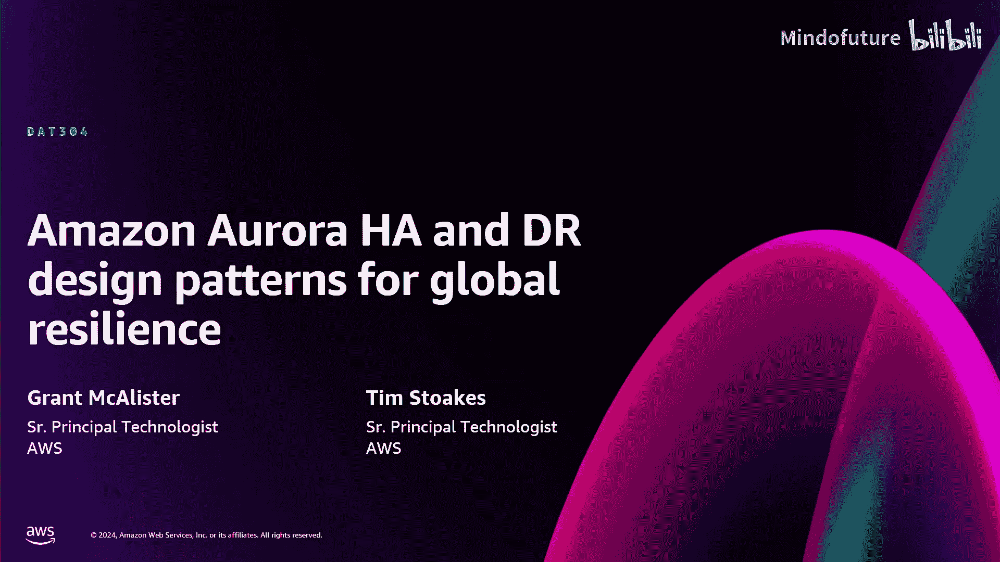
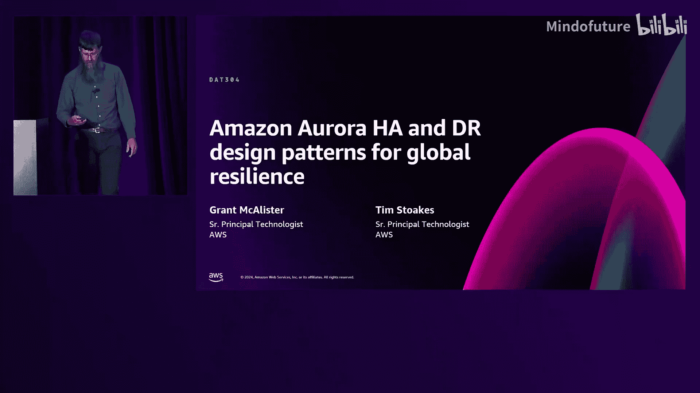
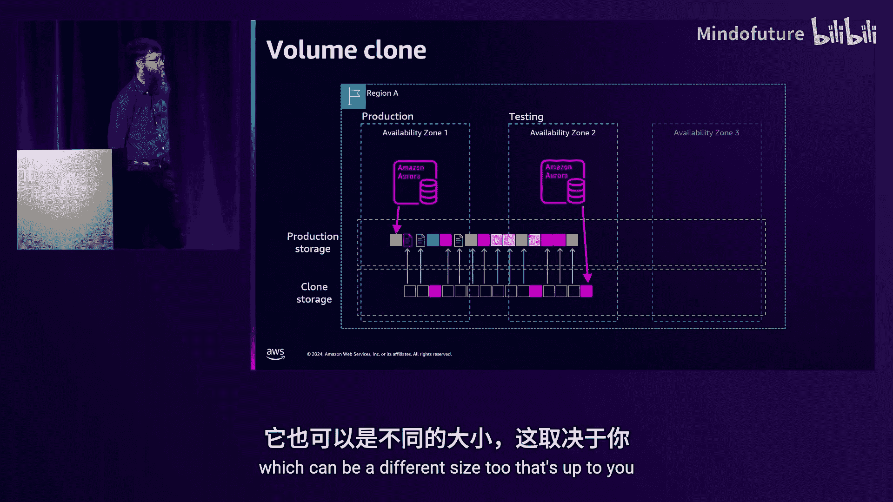
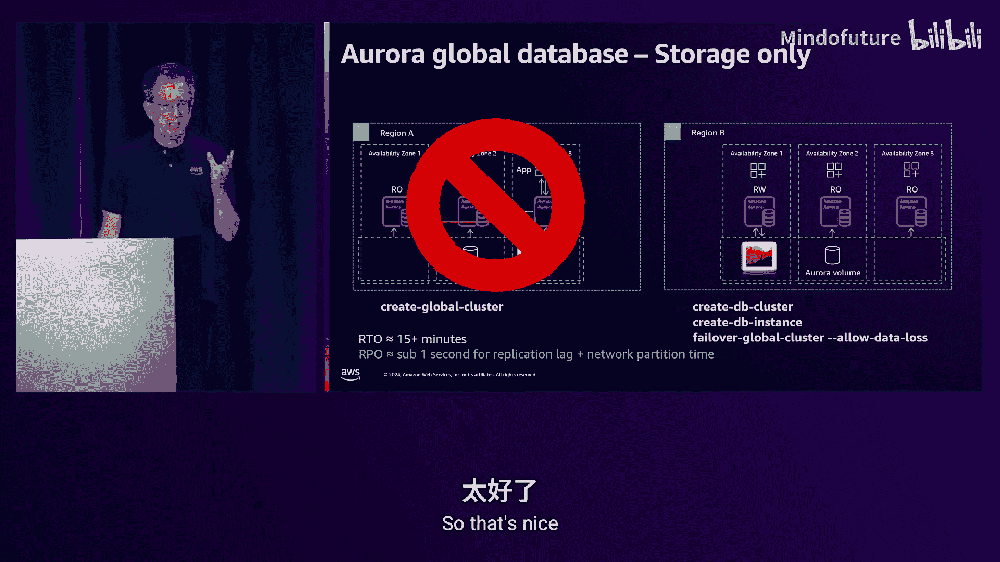
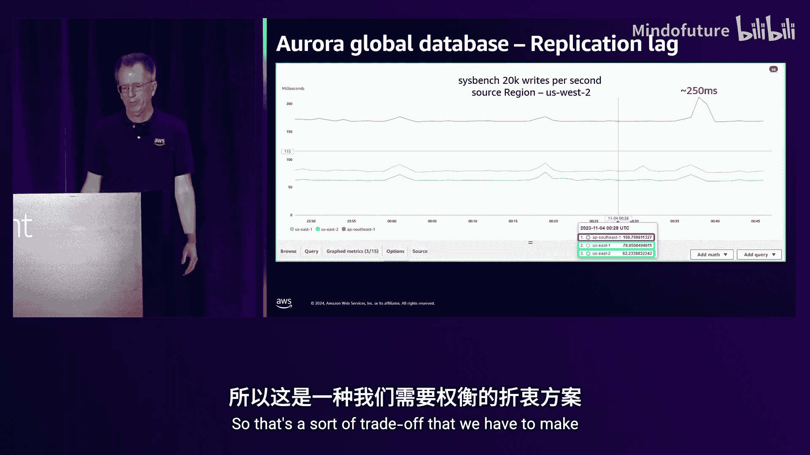
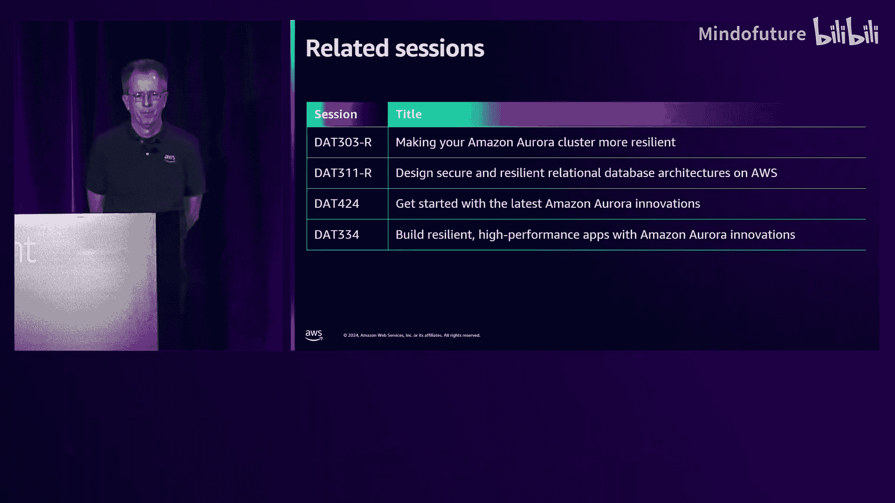

# 【AWS数据库峰会2024全集-•-中英】AWS-re：Invent-2024---Databases-p34-P34-Amazon-Aurora-HA-and-DR-design-patterns-for-global-resilience-(DAT304)--BV1VAR5Y6Es1_p34-

Oh I can start cool early 20 seconds。 All right， Hi folks， welcomee to D 304。😊。

My name is Tim， so who here knows other than reinvent？

What they're going to be doing at work every day。Right every day is the same， it's really boring。

 Everything happens exactly how it's supposed to happen， it's no natural disasters。

 there's no customer escalations， no maintenance windows and all that kind of stuff， anybody。

Hands up。You can't see， I can see there's nobody who said that。

 which is good otherwise I think I might call you a liar， it never happens that way。

 it's a myth right？And so it's best to be prepared for that kind of thing。

 you have to build a resilient system。We're going to talk today about some design patterns that we can use in Aurora for high availability and disaster recovery to build resilience into your database based systems。

My name is Tim Stokes， shortly I'll be joined by Grant McAllister。

 we're both senior principal technologist at AWS。And we work on Aurora， so let's get started。

My clicker doesn't work。 All right， Now works It's cool。 All right。

 We've got that one out of the way。

So first， let's define precisely what we mean by resilience so we can know we're talking about the same thing。

 And if you leave the room， then why know where you're left。

 So resilience is the ability of a workload to recover from infrastructure changes。

 service disruptions， dynamically acquire new resources or release them in response to demand and to mitigate disruptions such as misconfiguration or transient network issues。

 things like that。 That's what it means to be resilient。This is supported by two pillars。

 availability and disaster recovery。There's no one solution to any of this right。

 there's a whole landscape of choices that you can make， these trade offs between failure modes。

 performance， cost and complexity of how we run it。So these trade offs， I can't make them for you。

 they're made by you， the customer with the tools that we can give you from Aurora and the rest of AWS。

 so we'll discuss today some of these patterns that exist at various points along the space and how you might choose to use if they're appropriate for you。

First， let's explore these pillars a little bit more。So firstly。

 availability availability is the proportion of time that a workload is available to use。

 this is usually expressed as a historical measure over a period of time， like we might say。

 four nights， four nights in a year， something like that， four nines in a month。

Adding redundancy to a system is a really good way of adding availability to a system and it avoids the impact of a single point of failure It's availability next one is disaster recovery we should also consider this in any resilient strategy。

These are techniques and strategies used to recover your workload in the case of a disaster event so this focuses on one time recovery measures right recovery objectives in response to natural disasters。

 large technical failures， things like that so here we use recovery time objective RTO to measure what we're doing here the maximum acceptable time between a single impacting event and when we can resume service again that's RTO and then there's also the recovery point objective RPO that's the maximum amount of data that you can lose normally we measure as an amount of time though after a disaster or service outage right so we might say that we had some asynchronous network lag of 10 seconds so the maximum thing that we could possibly lose is 10 seconds that will be our RPO right so now we're speaking a common language we can dive into some of these solutions right。

So since all of you sitting out there I'm sure have hundreds of different ways that you use Aurora right so you're going to have such different HA and DR needs so we're going to explore this with an example and hopefully you can see your face reflected in some of this example imagine that you're a DBA right maybe that's not too hard you've been hired as a DBA for this hot new startup right this startup runs a web store and it sells pictures of the sunrise。

There's a joke there if you can spot it， see me have to get a sticker you have a small amount of a investment funding because you're a startup so you're choosing Aurora because it can start small with you and it can support this unicorn growth in selling pictures of the guy that we're going to get right so today we'll follow the journey of this startup as we go through its growth phases and see how it changes how it thinks about its HA and DR needs。

Alright， so first step， the minimal configuration of aurora。

It gives your database durability across three availability zones。And availability in one。

 we call this a single A Z pattern。So there's one database instance in one availability zone。

 which balances your cost of performance。This instance is where your query processing' is done where your buffer pool lives or your familiar database terminology happens there and so you can scale performance by increasing the size of that instance。

Or even using a serverless instance that does it for you automatically。

There's no data stored there though， this is where it's bit different。

 this is where Aurora stores your data down the bottom there in this aurora volume in this big box that crosses all the three AZs。

 we call this Aurora storage， we'll talk more about it。

This might not look super important for H A and DR， but it really is。

 it's the basis for a whole bunch of stuff that we do。

 So we're going to just drill into it a little bit more so that we can understand how these other features work。

If that one database instance becomes unavailable for any reason。

 then your database becomes unavailable， but it's not a durability question at all that storage is still down there holding the durability for your data。

Allright， so let's dive into this storage a little bit more。

Rora storage at the bottom that green box。 we're going fill it in。

 That's a multi tenant storage fleet spread across three availability zones in one AWS region。

It's made up from a large number of special purpose storage nodes here。

 I've just got six because I can't draw that well， but there's lots of them。

 These are responsible for storing your data。 That's simple。 Okay， but they also carry out repairs。

 They also do heat management。 They also offload a whole bunch of other stuff that Aurora is doing for you。

 It's all happening down there in that storage fleet。So here we can see those little small boxes。

 that means the storage nodes already contain some data from some other volumes already。

 remember it's a multi tenant storage fleet。So because these availability zones are physically isolated。

 there's three of them that means that barring any natural disaster is very unlikely that more than one of those availability zones becomes unavailable at any time so Aurora first encrypted data with your key if you like and writes it down to the storage notes。

 it makes six copies of the data， spreads them out across the three AZs。

 but you only pay for one of those copies。For any new right Qorrum of four of those copies has to be written to durable St before Aurora says that the right is good and we can move on to the next one。

So this means that aurora can handle three storage node outages， so that's a whole availability zone。

 plus one more before dealing with any durability issues， right？It's pretty impressive。

 you didn't have to do anything to do。 that。 comes out of the box。Okay。

 so what exactly is this data that we're storing here， right。

 This is where aurora is a little bit different again。

Thero volume is divided into 10 gigabyte chunks， we call them protection groups or PGs。

Storage features like repair and heat management， they work in these units of PGs。

So traditional databases， generally， they write a log of the things that they're going to be doing。

 and then they write the things that they're going to be doing。Well。

 Aurora just writes those logs and doesn't write the pages at all。

RightAnd it writes them in a special aurora log format to aurora storage now the storage understands that format。

 so it understands how to turn those log records into database pages and it does that in response to if it needs to do space reclamation or it needs to read them back again into the engine。

 this job's pretty easy if you don't want to read your data back but we need you to read your data so we need to apply those log records and read them back。

So this is a secret to Auror's performance because we're doing it in parallel across all those storage nodes。

 but it also underpins a bunch of HA and DR features which we're going to talk about。Okay。

 so dawn pictures， remember we're selling Da pictures， they're doing great， we're deploying the app。

 we're doing it frequently and smoothly， databases growing。

 storing lots of those log records until one day。😊，application developers， unfortunately。

 they release a bad build and you ship some black and white pictures or something like that， right。

But don't worry about it because we have continuous incremental backup built into Aurora here right each PG and Aurora storage is continuously writing those log records of database pages to S3 continuously the storage is doing it。

 not the headn， not your database instance， so there's no impact on your performance here。

 right we're doing it behind the scenes。Excuse me。You can set your backup retention to between one and 35 days。

 you can choose to restore at any point in time between that earliest restorable time you see at the beginning that's set by you with your retention period and your latest restore time your latest restore time is normally within about five minutes of。

Of now for any active database， right。So what you can do is you can choose the time using maybe some application logs that you've got something like that。

 and then you can say。Aurora， please restore me a point at this LRT point and then we'll restore it back。

 we'll make a new volume， we'll make a new instance， you can check it over。

 you can run your application against it， you can decide whether you pick the right time point。

 things like that we're not changing your original instance or volume while we do this okay。

Once you're satisfied， you can bring it back online as your primary database if that's what you want to do。

Okay。But what are we doing when we're doing a restore we're drilling to this a little bit more So remember we stored all those older database pages and log records to S3。

 It's all been saved in there and so what you're going to do is you're going to tell me the restore point you're going to use point in time restore PiITR in order to do this through the RDS console for example it's a console screenshot down the bottom so that's telling you when the LRT point is you can find a point in there so here we can decide that time seven is the one that we want that's what you've decided to tell me okay so then what we're going to do is we're going to restore the latest copy of all of the pages before that point right。

And this is going to happen in parallel across all of those storage node that we saw before， right。

And then we're going to take all the log records that came after that point up until time seven in this case。

 and we're going to apply them to the page， we're going to redo those instructions。At that point。

 those database pages are a crash consistent point from the database engines point of view。

 than the database engine takes over。And does its normal recovery。

Which is only really fast because it's only talking about。

A few seconds of time normally there rather than many hours。

 perhaps between your last checkpoint for a normal database engine okay？

So it's a bit different from My SQL and Postgres， the way that does that last little step。

 but all the aurora things underneath are the same。

Okay so like any good DBA you learned from this event right and you how to talk to your developers and you said。

 hey， we need to do something a bit different here。

 we need a different way of doing testing Now we can't test in production obviously we've tried that didn't work too well。

 we can't but we want to test on production like data and with production like a workload and performance and everything else otherwise we can't do good testing。

So what we're going to do here， rather than just duplicate everything， which takes a lot of effort。

 takes a lot of money， is to use aurora clones。 So here we've got the setup。

 we've got our production instance and our production storage in our volume with some log records and pages。

Then we're going to make a new clone down the bottom there。

 you can see it looks a little bit different。 It's kind of hollowed out to what I'm trying to show you。

 right， There's no actual log records and pages at the bottom there。 There is a new instance。

 There's just a whole bunch of pointers up to the volume。So now write when we read from the volume。

 the clone volume， we just follow that redirected pointer and read from the original thing if we haven't changed it yet。

Storage is doing this for you。 There's no separate indirection or anything there。

 So there's no change in your performance。When we want to write to a log record。

 we break that little indirect and we write you a new copy inside the clone volume。

And then we can read it back again directly， no problem。😊。

If we wanted to write to the original volume， same thing happens just in reverse first。

 we copy out the old copy into the clone volume so that you can keep that copy for your clone and we break the indirect pointer and we write your new data into the production storage there。

If we expanded one or the other volumes， that's completely fine。

 we can just write to new space inside each of those volumes， right。

So what's happening here is you're only paying for the changes in the data。

 So here we've only got a few boxes down the bottom that have been filled in。

 you're only paying for the storage size of those few boxes and the snack and cloned instance that you're using。

 which can be a different size to that's up to you that's the magic clones。

So in the Dawn Picture startup， right， your CTO， he hears a quote from Vernervogel's a CTO at Amazon that really resonates with him。

 you might have seen it on a tshirt or something， it says everything fails all the time。

And this is true so you can talk to use the CTO， you talk to your CTO and say I'm happy with this 3 AZ durability story that we've been talking about right but I think we need to lift our game on our availability story Aurora gives us an SLA of four9s if we're doing this inside one region and we want to try and hit that so that's about 52 minutes of downtime a year if you do your maths。

So let's see how we can do that。To do this we have to engage more than one availability zone here we've got two So what we've done is we've just created a second instance in Se days in this case we're trying to do it for availability and the same aurora volume we're not duplicating any data we're not synchronizing any data all the data is still in the same aurora storage place we bring up that standby you can see there I've got RG16 X they're both the same size that's not required but what we've done is we've chosen to do it this way such that when the primary has a failover event standby can take the same amount of load because it's the same size。

So there's no discussion here about RPO， that recovery point objective。

 this is what we'd call RPO zero because it's just one piece of share storage。Okay。

 whilst this is happening or before the fail over， the primary is keeping the standby up to date with any new transactions。

 right？Normally that fail overtakes between about 30 seconds， so we can do with that。

We're back to operationeration again。So as we grow a bit more。

 then you might need some more read transaction throughput too。

So you're already using a pretty big instance there， it's not the maximum RHG。

 it could go a bit bigger， but we say， I need some additional read through。

So what we can do is that second instance that we already added as。As a failover target before。

 it's also a replica without you doing anything else， right， It's also a replica。

's also able to handle read only queries if you only ask it， okay。Like I said。

 the writer is keeping the replica up to date with any new transactions within a few milliseconds normally so there's a little bit of lag that you'll have to deal with if you're trying to do readdo your transactions there。

But otherwise it's completely hands off for you so what's happening is we're reading we point our application at their replica and you ask it to do read on queries so here you can see thats 70% that's me trying to say that they're both running at about 70% load of the maximum load that they can do right。

So that's a bit of a problem though， because when the primary fails。

 if we imagine that the load stays constant， you've now got 140% of an instance being used now an RHG is pretty good。

 but it can't go up above 100% right so we've got a bit of an overload problem here。

So the red replica has helped， but they've left us with a different problem。Alright。

 so how can we do deal with this。 All we can do is we can just keep on stamping out this pattern。

 We can keep on adding replicas here。 I've got three， but you can do some more here。

 You can make them different sizes。 And if we just pay attention to that number there，70%，70%。

And then if we have a failover， then now we don't go above 100%。

 right so we're not having that overload problem。Okay。

 so because we've chosen in this case that you put them in three availability zones。

 we could actually make availability zone one and two unavailable and we'd still have some service。

 AZ3 would still be up， we'd be back to the overload problems so we'd have reduced performance。

 but we'd still be up okay。So agi load continues to grow right even this is maybe not good enough。

 you maybe need some more performance headroom so you can continue to add up to 15 of these replicas in a region。

 they could be different sizes， they could be serverless even where the sizing happens automatically for you if we see I've got the original couple of 16 XLs there and then I've made some smaller ones as well and8 Xs so that's good for read replica traffic。

But like we said before， we don't really want to fail over to those smaller ones。

 right So what we do is we tell Aurora through this idea of a fail over tier。

 said this is the order in which I want you to choose instances when you fail over。

 So things in tier 0， the lower number are going to be chosen more readily then things with higher numbers。

 And if there's any choice in between， itll choose the one which has the size of the outgoing right and we'll try and match the size as well。

 So we don't have that overload problem okay。All right now we've added all these replicas that's great。

 but your application needs to be able to talk to them。

 needs to know which ones to talk to at that time if you're doing rights。

 we need to send the rights to the writer， but the application has to even know which one is the writer because changes when fail happens right so here Aurora gives you the concept of endpoints we've got the writer endpoint or the cluster endpoint and we have a reader。

 the writer endpoint obviously points to the one that's the writer at that point in time through the DNS and the reader points to the set of using round Robbin DNS or the ones that can accept reads。

All right， so rather than hardcode this in your application。

 the IP addresses use the DNS names and DNS will deal with it for you。

 so this increases your availability by reducing the time it takes your application to discover this new topology change when a failover happens or when a replica is added or something like that when auto scan kicks in。

Okay， you could even configure a custom endpoint for yourself to maybe arbitrarily groups endpoints together。

 maybe we'll say these are the ones that I want to handle on my front end traffic and these ones handle on my back end traffic。

 something like that。All right。Cool， so we've got all of these the fleet is growing like crazy right you've got this front end application fleet and it's a pool of EC2 instances and it's running PhP。

😊，No judgment。Another pool of staffs running Java on the back end right so each of these services is making connections into your aurora endpoints here we'll just talk about the writer side it happens the same thing on the redeside it just makes the slide too busy so this brings resilience challenges too because all those connections they use horsepower right they have to have a socket slot they reconnect all the time they have to authenticate and northize they do TL layerss they do all those kind of things and even when they're idle they consume resources too I'm sure you're aware so we want to try and get control of that connection management right。

So what we can do is we can limit。And we can pull。 there are the two techniques that we have in our toolbox。

 right。By limiting connections， you avoid the oversscription problem。

 but you might limit your performance to and by pooling。

You can start to restore some of that performance back again by reusing connections， right？

So many driver packages like JDPC for JVM， if you use that。

 they already deal with some level of pooling for you。

 but one of the challenges is it's not aware of what's going on in a clustered system behind the scenes like what Aurora has。

 it's only aware of single node databases。So we'll talk about how we can deal with that。

So if you were to try and do with this yourself， on the end of each of all these connections。

 you'd have to have specific logic which talks about， hey， when the failover happens。

 I'll get an error back from my writer， now I'll need to recognize a specific error and I'll need to do some specific action like reconnect properly and redo my transactions。

 things like that。So and you also have to deal with the fact this is not instantaneous right DNS normally takes 30 seconds or so to flow things around the world depending what your setup is so we're going to have to do with this what we do is we give you this AWS advanced JDBC wrappper driver。

It's aware of what's going on inside the database cluster topology， right。

 It knows that those nodes are there。 It knows their jobs。And it knows when this changes。

 it knows this much faster than the DNS tells us。This is not using some AWS secret。

 this is an open source thing you can get to it if you like。

 and what it's able to do is it's able to handle this failover within up to 66% faster so that's within about six seconds maybe even quicker depending how you can figure this plugin。

We've recently announced。There's a GitHub link there if you want the QR code I'll put that up there so you can take picture。

 but we've recently announced a new fail over2 plugin in here as well which makes this even faster。

 so I encourage you to have a look at that if you've been using this before it's different。

 it's quicker and also it's not just about JDBC， everything I've said here also works for Python works for no JS and we have a MySQL ODBC driver there as well。

Cameras town， I can't call。Next one， we can do is ID S proxy。 This， This gives us a bit more。

Control over what's happening in a more stateless fleet like the PhP thing we had at the front there remember we don't have a lot of state to put connection management things into so with just a few clickiques you can set up IDDS proxy in there in the console we don't have to go and configure anything just say turn proxy on。

 you just have to configure your application to go and talk to the proxy endpoint instead of that reader and writer endpoint that we had already the cluster endpoints。

Proxy still gives you the idea of the reader and writer endpoints just at its level so with proxy you don't have this complex configuration anymore right we just take it all out into a proxy layer and we have these pooled connections coming at the back of the proxy so now we'll just focus on the reader's side we just write last time so our applications is making many connections in the front we' got some different colors to show us what's going on and we can see that the yellow transaction yellow sessions running at the minute through this one backend pool connection of course you normally have more than one but my drawing's not that good so yellow one goes through no problem。

Okay now your blue one's gone through。 It had to wait It was queued up because we had a maximum limit of one so the blue ones executing and then the blue ones done something in this case。

 a prepared statement that's caused pinning So pinning means that this pool connection in the back there can't be used by some other statement that comes after it some other session that comes after it it's mutated its internal state。

 maybe it's done some locking functions maybe it's called a prepared statement called it a store procedure a few other things it's made it pinned if you're worried about what's going on with pinning or you're looking for some visibility we can see that cloudwatch metric up the top there that tells us how much is going on It's in your best interest to avoid pinning as much as you can by telling your application to avoid doing these things too much okay。

So what happens when failover happens is that the front end application。

 the connections will not hang up。 they won't even notice that the failover has happened。

If the session was not pinned。 So here we can see the purple ones now executing。

 the yellow one did not see a disconnect。 purple one did not see a disconnect。

 the blue one did because it was pinned， did something with pinning。Okay。All right。

So business is great selling Da pictures who you right your startup has raised some big amount of investment and it's time to go global so for the DBA this is a little bit challenging and remembering what Verner said before everything fails all the time you decide that your data has got to be durable across even the unlikely event of a full AWS regional outage。

😊，So。Now I'll let Grant tell you about that this is Grant Mcalister who'll talk about global resilience。

Thanks。👏I've got a crap。Thank you， Tim。So as your business grows and it expands。

 one of the things you have to think about is global resilience。

Our regions are very durable and very highly available。

 but I don't know how many people remember Sandy when it was coming to hit the East Coast。

 there was a lot of people very worried about the US East One data center now as it turns out it was just fine but those are the kind of events that could be worse and you really want to think about you know protecting your business so as our business has gotten bigger our leadership says we need to think about this。

So the first method that we consider is cross region backups。

 so I'm showing the same sort of setup that Tim had in region A or primary region。

And we'd really like to have some protection in region B。

So the easiest way to do this is we can take a backup of our database。

By just running the create DB cluster snapshot command and that's going to store it in S3 as part of the service。

Then what we can do is we can do a snapshot copy with a copy Db cluster snapshot command now it's in the second region。

So the interesting thing about this is this is actually asynchronous replication when you think about it。

 right， now， it's kind of weird or asynchronous replication because it's。

If you're doing it every hour， for example， that's the lag， right， that once an hour you do this。

 Now， you could choose a different timing。 You can do it every 10 minutes。 You can do it every day。

 but you can choose。Now， got that backup done great。Let's say one of the picture sales comes in。

 we got that in region A。Ope， Reg A has a problem。Well that's the challenge right it was the backup was taken without that picture we don't have it so our RPO。

 basically the amount of data that we could lose with this kind of solution is somewhere probably within the 10 to 70 minute range and the reason why I give you that is let's say the snapshot takes 10 minutes and if you're super luckyucky you've just taken the snapshot right before you have the problem if you're unlucky like IUGM the snapshot happened you know 59 minutes ago plus the copy time which means I've lost more than an hour worth of data。

And that's bad。 and that's why I've kind of labeled that as sort of yellow like this works。

 but you know if you're doing hour at least， there's definitely a lot of RPO。

 but the good news is we do actually have a copy of our database in the second region so we haven't lost all of our data。

 So now what we can do is we can restore that Db cluster。And then we can create D B instances。

So this all works， you're back up and running。Minus a little bit of data。

So the RTO is going to be around， let's say 60 minutes for this because you've got to do restore。

 you've got to create your instances， you've got to get your apps back and running。

 so again in yellow because this works， and maybe it's fine for the business as it starts。

 but as we grow， maybe not。So there's another kind of failure I want to talk about because as Tim was saying。

 things do fail and the classic failure we think of is the whole region going down。

But that's actually not the worst thing that can happen。

 The worst thing that can happen is a network partition。 So what do I mean by that。

 What I mean is that。From your perspective， outside of the region， like where you're living。

 you try to get to that region， you can't see it。 Reg B can't see region A。

 but everything inside region A is still going along， right， So the process that ships pictures out。

 guess what。 It runs。 It sends the copy of the picture to the you know。

 to delivery service that's went away。 So it's not just that you missed。

The data of the sale of the picture in region A， you've also missed the shipment， right。

 because that network partition time means that you're also unavailable。

So this is just something we'll explore as we go through this。Now this all looks super complicated。

 but we have a nice service called AWS backup that integrates with Aurora and simplifies this whole kind of orchestration and makes this much easier。

So。The next step in our sort of journey as a business is to really think about reducing both our RPO and RTO。

 and what we're going to look at is our global database offering from Aurora。

So we start with a storage only offering。And what that means is in our region。

We're going to have another region， region B that we're going to do work in。

 so the createate Global cluster command， you can either run this before you create any clusters or you can add an existing cluster to it by doing createate Global cluster and referencing the original region's cluster。

And then you just do a create Db cluster in the second region。

And now you're going to have storage in that region。

 and this is one of the special things about Aurora is it's storage based replication。

 so we don't need instances in the second region。What we do behind the scenes is we set up a replication server and agent。

 and then we start replicating from the current system to that server。

 then over to the agent and then into the storage， and again this is asynchronous。

 but the difference is the replication leg is usually in milliseconds， not seconds， minutes or hours。

So when your picture comes in boom is going to be in both regions within a couple milliseconds right when I say a couple milliseconds。

 I mean probably a couple hundred milliseconds depending on your regions。

 so the RPO is definitely typically sub1 second and again still plus the network partition time。

Another really nice thing about global databases， you can do local backups in each region。

 so you can be protected in not just the running system， but if something else happens。

 like someone drops a table， you can have independent copies there。So Reg A now having an issue。

So that's not good， but we can easily fire up database instances in the second region。

And then we can do a failover global cluster， now this is important the dash dash allow data loss。

 right？This is because this is asynchronous replication and region A and region B are not necessarily going to be in sync。

 there will be a couple milliseconds of difference。

 so you have to know that you're actually going to possibly have a divergence here。

But once you do that， we have a readWr node， you can fire up your applications and you're running again。

 so this means your RTO is around 15 minutes， you know maybe a little last depends on your scripting and the reason is because you had to start those instances you had to start your applications。

 it's not really all set up， but it's pretty good right？So。

You know， that's nice。The thing you have to think about when doing resilience is you have to pick where your destination is going to be so we have a lot of different regions around the world。

 and here I'm showing my source being in West2， I。e。 you know Oregon。

 and then my destinations being AP Southeast one and the two US East regions。

And we can see from the latency that we're kind of in the like 170 sub 200 millisecond range to AP P Southeast because it's a long ways from the west coast of the US。

 right？And we see spikes up to maybe 250 milliseconds， Not too bad。

If we choose one of the US East regions much closer right just hopping across the US sort of in the 60 to 70 millisecond range and you'll notice that East one and East two are fairly similar because they're roughly located in the same regions so now if you pick the too farest regions that we have in the world you're going to have obviously the highest latency if you pick the ones that are closest that's better but of course then you know how much resilience you're doing gets smaller right so that's a sort of tradeoff that we have to make。

Now， the next step up for our business is to go to a symmetrical configuration。

 So what do I mean by that。 So we have our region A， and now for region B。

 what we're going to do is make an exact same copy。

 So we're going run the same database instances over there。 They're running and read only mode。

And we're going to start all the replication， so they're actually up to date。

 just like the local read only nodes。And you can have your applications running as well there。

 and I'll talk a little more about that So in the case of failover。

Or failure now we can just do the failover command we don't have to create the instances because they were there right so this improves our time quite a bit。

 so now we're talking about an RTO of less than two minutes and we're working on speeding this up every year so it's going to continue to get better as we do more optimizations。

So let's talk about that network partition again， so if we have a network partition in this kind of setup。

 what you'll notice is at the moment we basically have two read write notes because we've done a failover。

 but we haven't been able to isolate that region yet。But as soon as that region is back unisolated。

 we will change that node to read only， but that means there could be transactions taken during that time。

 and it's something you have to understand as part of this asynchronous workflow。

so when we're done failing over and we're back running， we're not resilient right。

 because we only are in region B now， so what we have to do is get region A set back up again。

So the first thing we're going to do as part of the service that we do automatically is we take a backup of the region A cluster and the region is because the region A cluster may have data again that wasn't replicated to region B so we want to make sure that you can go and restore that and look through it。

 do some data diving to figure out if you do have differences once that's done we're going to set up the replication server and agent going the opposite direction this time and then we have to synchronize because again region A's data is different than region B it's probably ahead of region B once we synchronize then we're back replicating and you're back to your resilient setup and this happens all automatically you don't have to do anything as soon as that region's back healthy we do this。

So switchover is another method to move from one region to another now this is a nondata loss one typically used if you just want to move from region A to B so in the case of like that Sandy you might be like this storm is forecasted I want to move ahead of time you can use switchover it's also a good way to test your DR set up by switching and just making sure everything is how you think it is so the command is switch over global cluster notice no data loss on the settings here。

And what we're going to do is we're going to immediately make the read。

r node read only so that we stop taking any new transactions。Then we wait for the replication。

 and we verify that all the data is in sync。 So now these two regions are exactly the same。

And then we promote region B。 So， and you can see that region A is read only。 Reg B is read write。

 So we've now basically switched regions。 But again， we're not resilient because we have to。

Get region A back to being part of the global cluster。

 So we can just set up the replication agent and server and start replication because these regions matched。

 We don't have to do any synchronization。We've also improved our switch over time quite a bit。 again。

 that was one of the things that the teams been working on this year， which is really good。Now。

 one of the other things for resilience is making sure your application can actually figure out where to talk to the live database。

 right， So in this kind of global nature， each of the databases has a different endpoint。

 So this is the C name for Region A's cluster。And that's vened by R 53 R DNS service。

And of course Reg B has a different one and you can actually see that the subdomain here is region A and one side region B and the other and that's you know they can have different other names。

 but they're going to be different right so how do you know what to use and before we didn't have global endpoints so you actually had to configure your application to switch this on fail over or switch over but now you can do describe global cluster on your cluster and what you'll see is this new endpoint there that have in purple and you can see that we have we really wanted to make sure that you knew is global because we put global in the name twice quite sure why we did that but it's in a different domain which is subdomain which is part of it but we also for our naming standards we added it as well so that's the key。

Region A is currently our primary region。 So if you ask for a resolution on that global name。

 it's going to point to Reg A's sea name。So if we do a switch over or fail over。Again。

 what we're going to do is we're going to make this read only， region A。

And then we're going to promote region B all good right And at that point。

 the resolution happens differently。 What it's going to do is it's now going to resolve to the C name for region B。

 And the good thing about this system is we don't actually have to use the control plane for Route 53。

 We have these health reporters， this is all very highly available。

 So this is sort of guaranteed to work no matter what's going on。

So this simplifies your resilience from a global perspective for your application。

 So it's much easier to get your application developers to make sure that their settings are correct when。

 when you need to do this。The other area that you can work on to really help resilience on your application and database is read resiliency。

 so I have the symmetrical configuration again， and in this case what I'm going to do is I'm going to change part of my application to be able to function read only so this might be the listing for our pictures right doesn't need to be able to write anything so you just can show what's for sale。

So now we have that now running across both regions。

 this will give you better latency because possibly you're closer to your customers。

 and now when a failure happens，Those read only nodes can keep running while we're doing a failover or switch over。

 so this allows you much better availability than you'd get if you were just running a readWrite because you don't have that couple of minutes while you're doing a switch over or failover。

Now， if you do this setup， you can also do write forwarding now because the challenge about doing a read only application is sometimes there's some little bits of code that need to write something and that's kind of painful to tear out of that application。

So instead， what you can do is turn on right forwarding。Now， normally if you didn't have this。

 you would have to have a VPN tunnel back to your application in region A。

 you'd have to send those right requests， a lot of complex stuff that's very fragile。Instead。

 what we're going to do is enable global right forwarding。

This allows us to virtually look like we're able to write now to that cluster and we're going to just forward the right back to region A so we're not multi writerder。

 this is still a single writer system， right？So there's no magic here。

 it's just forwarding things backward， just simplifying the process。

 And then what we have to do is we have to wait for those things to get replicated back for us to see them。

And that's kind of crucial。You know， for your application to be able to read what you just got from a consistency basis。

 so let's talk a little bit more about the consistency。

So we have a bunch of settings on this right forwarding feature that's important for resilience。

Around session， read visibility， so。You can set that this is I'm showing the APG1。

 there's also one for the MysQL and the default is session level and what session level means is read my own rights。

 So if I do an update。It's going to get forwarded over。

 and I have to wait for that to come back and I get 195 milliseconds。 So not bad。

 This is across pretty wide range， US East and US West。

But my select has to wait for that propagation of my right to make it sure that I'm there right so that I can read my own right。

 so this is going to take 76 milliseconds， so it takes a while for that replication to go across the country。

But the good news is， I'm reading my rights。 so I'm not gonna to have any problem with my application getting freaked out by seeing data that it shouldn't。

 right。😊，The next select， because we haven't done any changes。

 only takes one millisecond because we can read locally and we don't have to wait because we are reading our rights because we haven't made any more changes。

So this works pretty well， but you can see obviously that first select takes a bit of time。

 you have to be aware of that。Now， if you don't like that speed。

 you can go faster with eventual consistency， but that can be challenging as well。 So our update。

Same thing goes， takes 195 milliseconds。Our select takes1 millisecond。 That's great， right。

 We're all happy performance， but my previous rights is not visible。 So， you know。

 my application developers might be unhappy if I set this in the database。😊，Now。

 the other option is global read visibility。 And that's kind of as scary as it sounds。

 And I marked it in red because you really have to be careful about this one。 It does give you full。

Global read consistency。So if you do your update， same thing 195 milliseconds。Now I do a select。

We have to wait for it to propagate， but if I did that select at T。

 what I have to wait for is all the things that were happening at time T on the primary。

 not just my right， but everything has to be propagated back across。

 so that's say it's 205 milliseconds。But all rights are visible。

 so that's really helpful from an application design perspective。But if I do any select。

It's going to take 205 milliseconds because I'm waiting for the time that I have to wait for all the rights to become visible right。

 so this is a nice feature if you want this visibility。

 but you can imagine from a resiliency perspective。

You're kind of being held hostage by the replication leg。 So this is very， you know。

 you got to be careful if you're turning this on。 Like I said， it's useful in a lot of cases， but。

The other thing we can do is we can run multi region with global databases。

 So here I'm showing our region A and region B， like we had to set up in a symmetrical configuration。

 but we can have up to five destination rooms。So here， Reg C， what we see is that it's。Just a volume。

 so it's just storage only， so they don't have to be the same， you can make them different。

 so you can configure them to whatever level of cost and RTO that you want。

Now you could also make this symmetrical。 so now we have two symmetrical destinations and if you have something like this。

 we have an interesting offer on Aurora Postgres， which is around RO and we have this setting called global DBrRPO and what this ins is that at least one of your destinations will be within that RPO time and it's in seconds。

 So if I set that to 20 seconds what that means is that I won't take a commit on region A unless one of the regions is within 20 seconds of replication lag of region A。

 So let's walk through that。 So I do my commit。200 milliseconds to region B。

100 milliseconds to Regency， so this is fine， we're inside of the RPO， we commit。Now。

 Regency gets to 60 seconds。 It's having some kind of problem with a network。But we're still fine。

 right， because Reg B is still taking commits because it's still doing 200 milliseconds。

But we have network partition happen now， this is the scary one right。

 so that happens and region B is now at 21 seconds。

 so essentially has tripped over the 20 seconds and what will have happened is at 20 seconds those commits will start blocking。

What this means is that you're free to fail over to region B and know that the maximum data loss is 20 seconds now this is configurable you don't have to pick 20 seconds。

 but if you have financial transactions or contracts or things where you need to guarantee that you're not going to lose more data than X。

 this is actually a useful feature， it's not widely used but it is one that like some of the financial folks use so it is useful when you get really into those kind of scenarios。

Now another area that I like to talk about is cross account。

 which is strictly not really global per se it can apply to local but I'm going to show a global database example。

 so when we have our two regions everything is set up across one account account A right so that's good unless something happens to account a right we won't want to talk about those kind of scary things but it can happen。

What we can do is we can set up an account B。And we can with AWS backups。

 we can set up snapshots that are taken in each of the regions and then copied into our account region in account B by this way we're protected against anything happening。

In account A。 Now， again， this is asynchronous。 So again， the same sort of， you know。

 RPO is going to apply here that the frequency of your snapshot is going to be the amount of data that you're going to be missing here。

 But again， a very powerful thing that's actually very easy to set up in AWs backups。

So let's walk through our whole journey as a company。

 So we started off with just a single instance in a single availability zone。 And what we added was。

Two multiple database instances in different Azs。 So we had maximum available for multi Az。

We added storage only regionion B Global database。We made that symmetrical so that we had lower RTO times。

And then， we added。And finally， we did backups in all of those regions， right。

 And this leads us to a very good RTO and a very good RO。😊，And with that， I'm done。

 here's some other related talks that are happening this week， some may have already happened。

 but you can always catch the videos。

And thank you very much。

