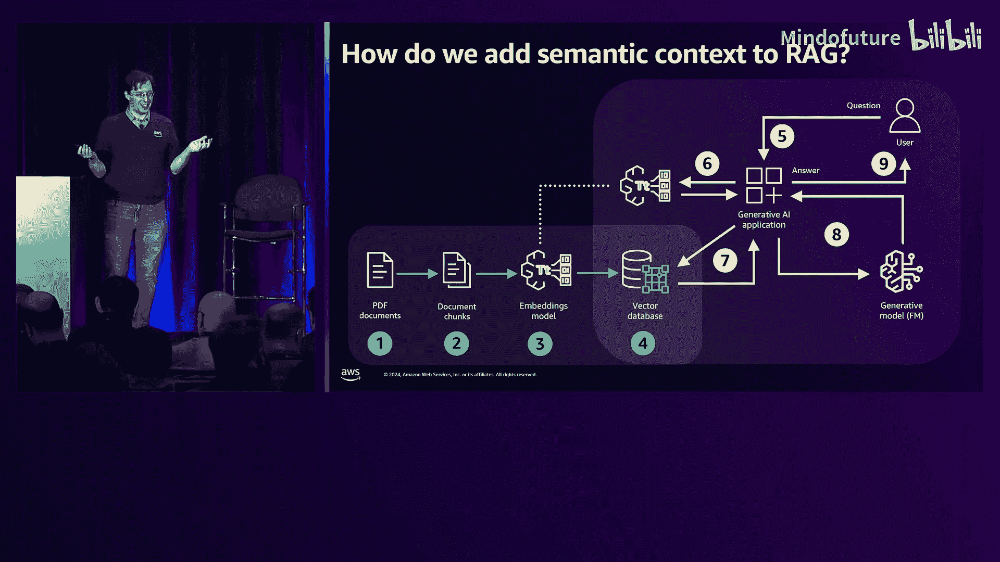
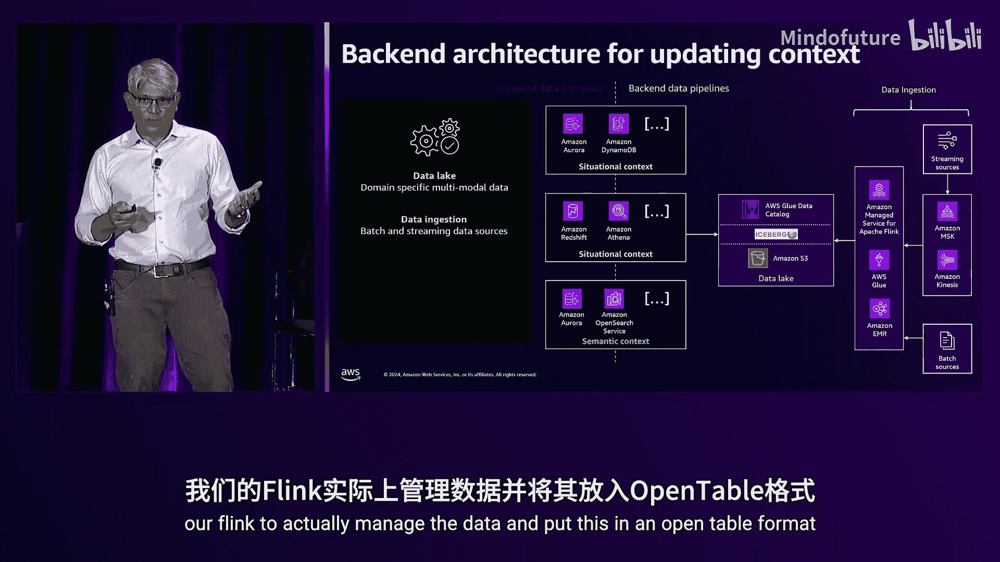
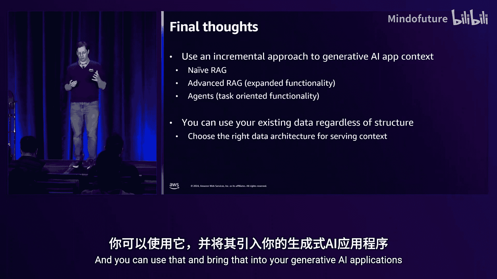
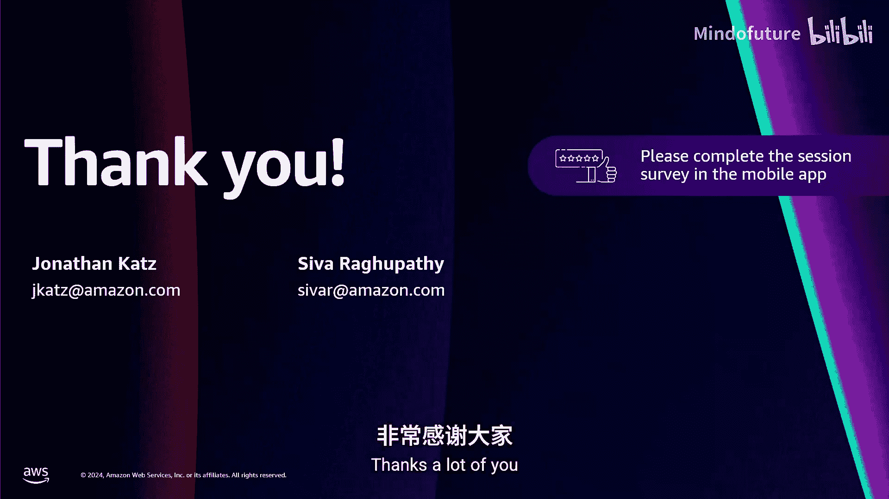

# 【AWS数据库峰会2024全集-•-中英】AWS-re：Invent-2024---Databases-p35-P35-A-practitioner’s-guide-to-data-for-generative-AI-(DAT319)--BV1VAR5Y6Es1_p35-

All right， good afternoon。Welcome， so first before we begin just to let you know the Expo hall is open so we are standing between you and the party at the Expo hall。

 so we'll try to make this fit within the timeframe。

 but welcome to practitionerers's Guide to data for Genrative AI， I'm Jonathan Katz。

 this is Siva Rauppathy who has been at AWS since。2002009 so he's seen a lot with data throughout the years and he's going to come in at the end of the presentation and tie everything we're talking about all together so Steveva thank you for briefly joining me on stage thank you Jonathan and yeah you're welcome and the context to give this talk is it's all about data flows。

You've probably heard a lot about vector databases， vector search and geneative AI。

 but the magic of generative AI is really taking all of those private data sources you've built up over the years and bring them into these foundation models to give these very rich personal responses so this is a level 300 talk which means we're going to try to get into as much of the technical details as possible。

 but this is a very far wide-ranging topic and the goal is we're going to give you as many strategies as possible to make informed decisions as you're building out these generated AI applications。

And what better way to do that than through an example， so let's dive right in and talk about Pat。

Pat needs car insurance。 This is probably something that you're all familiar with in some way。 I。

 who's bought car insurance before。Right and it's probably something that we can build a virtual AI assistant to be able to help with。

 but just going to buy car insurance can be kind of complex because there's driving history。

 accident records， payment history， how much you've paid before which car insurance providers you've used before and to do that you know we need to be able to pull from a lot of different data sources to deliver that personalized experience but it's also understand nuance and language。

 because Pat comes in and says something like I'm interested in getting car insurance。

 and that phra is very important because interested can mean a lot of different things is Pat research and car insurance is Pat ready to buy car insurance and that can ultimately dictate the workflow so as we come and we're trying to deliver that response。

 we need to understand how do we take all of that data that we have and deliver that rich experience。

Or that personalized experience。 And the technique that has been established to do this is called Re augmented generation。

 Who's heard of Rag。Cool well you're in for a treat because this is pretty much going to be the entirety of the talk is discussing RAG is to understand how we bring in our different databases to RAG。

 we need to understand how RAG works and we're going to be going into very detailed workflows in terms of the different RA techniques that emerged and how data gets involved in it so let's take this question。

 I'm interested in getting car insurance if you go to a foundation model that's just trained on publicly available information you're not going be able to deliver a response of any value if you bring in the private data sources。

 things like driving history payment history accident record。

 you can probably be able to deliver a detailed quote。So as the first part of this talk。

 we're going to walk through what this first column response will look like。

 and then we're going to start building in more workloads that incorporate more data sources and techniques to enrich this application。

And the key thing to know is that to get from the user question to the augmented prompt。

 we need to understand where our data is coming from。

 and there's two types of context to think about。First there's situational context。

 tell me about this person that's here or what's the current situation。

 what's in the current session， so for things like this with Pat it's going to be location。

 driving history， car specifications， these are facts that we know about the current person that's asking and there's semantic context。

 semantic context is going to give meaning to the facts， so things like car regulations， photos。

 uploaded claims。Now situational context probably exist in your databases already in your traditional enterprise data stores it could be relational databases。

 other operational databases， etc cetera， where Sammantic context is often dealing with transform data it's data that's in a different format that we need to put into a place that we can search over it and this is where you probably have encountered vector databases or vector search engines so what we're going to see in this example is where does all this data fit in。

And if we're building an augmented prompt， what we need to look at at the prompt is well these four steps。

 first instructions of the foundation model， things like hey。

 we're building out like car insurance quotes don't make things up。

 you I don't want to be giving everyone free car insurance， then the situational context。

 here's the person that's logged in， here's all the information about them。

 make sure we're giving them adding that specific information to that person， then semantic context。

 the meaning behind it， make sure we understand if they're in the state of Nevada。

 what are the regulations for Nevada in terms of selling car insurance。

 they might not match up with those in New York， and then maybe maybe the user input it depends on the foundation model you might need to add that in or not。

So the first thing is that we get the prompt instructions so in this case we want to have a friendly insurance agent that is delivering this information now what does the prompt instructions have to do with the database。

 maybe nothing， it could be hard coded into your application。

 maybe everything you might have a prompt database that you need to pull from。

 but again it's important to understand that flow as you're designing those applications。

Then you have the situational context， and I can almost guarantee you this is coming from your database。

 but these are basically filling in the facts， and again you might have a prompt that has the ability to interpolate that information similar to like string substitution where you put that information in。

Then all the semantic information， if you need to be able to perform the search over。

 say a document collection that has all the different rules and regulations and pricing that will add that in。

 finally note with the prompt。So what happens here。

 how do we actually build out this specific solution？So you have your users， they come in。

 they ask the question and it goes to your application。

So the first thing that's going to happen is that based upon the question。

 you're going to want to be able to access your prompt repository。

 which again could be hard code with the application， maybe it's in a Git repo。

 maybe it's in a database， you know you pull that all in。

And then you're going to retrieve the situational context。

 which is probably similar to what you've been doing with transactional applications to date。

 it's as simple as querying a database。Meanwhile， you're also going to take that user input and get a vector embedding。

 so the vector embedding is going to effectively transform what's in that user input and put it into a format where you're able to compare it against other semantically related things to be able to find the most appropriate response。

So think of the vector as just a transformation， you have some text or images or video or what have you。

 you transform into this mathematical construct so you can compare it against other text and images in video and effectively have a common language for being able to do so。

And finally， you tie that all together， you send it to the generative AI model or the foundation model and you get a response。

 and it looks something like this in a way where if I'm pulling the situational context。

 in this case there's a SQL query， hopefully we're all familiar with that and the semantic context because we create an open search an open search database it's going to be an API call again nothing new we've been doing this for a long time which is pulling it all together putting into a prompt and getting an answer So based upon the prompt we had we're gonna to have an answer like this because we said something like hey。

 you validate like all of Pat's information is real first before we proceed So it spits out that information in natural language and it's like yeah。

 do you want to proceed。And Pat comes in and says， yes， that's correct and gets the response back。

 okay， you're interested in car insurance， well， car insurance in your area costs between $20 and $5000。

 do you want more information。The answer from paths probably going to be probably because that's a very wide range。

 it's correct， it's semantically correct， that's the meaning that it has。

 but it's still not a great response and that's going to be the name of the game of bringing in your data sources for generative AI。

 it's going to be about how do we enrich the semantic content to give the most tailored response because it's going to have a cost if we keep having to go back and forth。

So what have we done so far。So first we've defined what situational semantic context is this is going to be very important as you build out a wide ranging data architecture because one is going to impact how you query that data and bring it in。

 but also it's going to be because you have to think about things like performance and timing and ultimately how do I minimize my interactions with my users。

Because there's a cost here， it's not just the cost according the foundation model。

 like certainly there's a cost of generating input and output tokens and it could be quite substantial if you're generating a lot of them。

 but it's just like traditional application development。

 the old adage that the more clicks the user has to make。

 the less likely they're going to complete a transaction。

 well the more questions or the more answers a user has to give in a virtual AI experience。

 the less likely they're going to complete the transaction。

 so you have to keep in mind that cost as well。So the focus of the rest of the talk is how do we optimize these interactions。

 How do we deliver as much semantic meaning to this data as possible。

We're going to exploit different RAG techniques and basically build a RA foundation and look through how do we iterate and add more complex techniques as we need it。

Then we're going to see how this fits into our overall data foundation。

 which effectively is not just understanding our data sources。

 but how do we prepare our data in a way so we can use it in RAG， and finally。

 we're going to see how to connect it all together。

 particularly if you have a data sprawl and all these different private data sources that can ultimately deliver a rich generative AI application。

So let's have some fun， what's happened with RAG so far。

 how' has it evolved well first lets let's look at the workflow in RAG to fully understand what's happening。

Let's say if we're trying to build our semantic data。You know we might have some PDF documents。

 We need to transform those PDF documents into sizable chunks that we can use with with our embedding model。

 because an embedding model might not be able to read in a full embedding document。

The embedding model takes that， transforms it into a vector。

 and then you can start it some kind of vector database。

So that's part one of adding semantic context to your application。 That's the ingestion pipeline。

The next part， which is the part that your customer will see is the agentic workflow where the customer comes in and asks a question。

 I'm interested in car insurance， gets ask a question， make a statement， it's an implied question。

It goes to the Genative AI application， which then is also going to take that question。

 turn it into an embedding， perform a similarity search within the vector database。

 return the answer and allow you to fulfill augmenting the prompt and giving the answer to the user。

So that's the agentic workflow and these two work in concert because you need to keep your data fresh and up to date for being able to search over your semantic context。

 and you also need to be able to well queryry it， that's ultimately the end goal of that。

So several methods that we can use as rack。The first is naive rag。

 and this is a little bit of a misnomer because it is naive in terms of what we're going to see the workflow is。

 but it's really the foundational method， it's effectively that workflow we just saw where a question comes in。

 we perform a query against a database， we give a response， we call it a day。

That might be good in a lot of cases， but as you just saw with PatTs insurance example。

 we didn't necessarily get the best response for that particular application。

 and this is where Adv drag comes in， where there's different search techniques we can use to be able to access the data and provide more context。

 for example， maybe we have information about Pats driving history that can help us narrow down what that actual quote is。

And finally， there's modular rack。Well I'm with advancedanced Ra。

 you're often pulling from multiple data sources and you have multiple knowledge bases set up。

 and you need a way to be able to choose between the different knowledge bases to be able to deliver the most accurate response at that time。

Additionally， you might have a multistep workflow where you have to query multiple resources at a given time to be able to generate that response。

 and the way you're able to further automate that can ultimately save you a lot of time。

So what is naive rag？Really we should call it foundational RaG but this is the fundamental workflow。

 this is where you're going to make the initial design and technology decisions such as how you're going prepare your data as well as what are the different retrieval techniques。

 but really it's about technology selection， what building frameworks are you going to use。

 which foundation models and embedding models are you going to use。

 and also like what data storage you need to bring in， what databases you' going to use。

 what additional technology you're going to add to the stack。But really， this is about setting。

 you know， as I keep saying， it's about setting the foundation。

 even though it is a naive and simple workflow， ultimately。

 it's iterative as you add in advanced RA techniques， you're able to bring in additional data。

 additional context to that。So let's look at a brief example。

 and again this is we're not going to build out a full code example。

 but we we look at the open source framework L chain。

 which provides a lot the primitives to be able to implement a workflow。

 and again it should look like programming any other kind of application。

 you're just building a software forgenerative AI。I want to call out this situational context in particular。

If you notice we have a Lang chain column there， but also something that looks like for those of you familiar with Postgres。

 calling the Python Postgres library， and that's fine。

 I think that's part of establishing situational context。

 which is you may be pulling from data sources that you've been using all this time and making those in this case SQL queries to be able to pull in the situational information。

And there's the bar that's highlighting that， but one of the interesting things is going to be pulling in the semantic context。

 because remember， part of building the semantic context to make it available to your users is that ingestion workflow。

 and that's going to be the magic word pipeline。Now when I was an app developer I think back to building out my first pipeline。

 I had an email management application and being the naive app developer at the time。

 I was trying to do it all transactionally like something came in send the email out boomed done it' was part of the web request but then we'd be sending 100 emails at a time and 1000 emails at a time and those web requests were really slow and I was like。

 well gee this doesn't make sense so I built the pipeline basically when it was time to send the email I made a request。

 it put somebody in the queue and it got processed asynchronously and I thought that was really cool。

But then I realized， oh wait， I have to manage like this asynchronous you this asynchronous email pipeline that had to build out all this monitoring and things。

 And again， this is a long time ago。 it's a lot easier to do this now。

 but the point is that pipeline management can be challenging。

 So let's look at this example where we have a bunch of documents that are being uploaded So what do we have to do。

 we take the documents， we split them to chunks turn limited vectors。 then we have to store them。

 we have to store them in this case， our open search database。

 And then ultimately we're able to perform similarity searches on it。

 But those first two steps are likely occurring asynchronously。

 So I need to make sure I have that code in a place where I can have it under constant management。

This is where a feature like Amazon bedrock Knowbaases comes in because knowledgebases automates that part and basically handles the pipeline ingestion for you。

 so instead of having to write out the code to be able to manage your own pipeline。

 you can take bedrock knowledge bases and say all right。

 I have all these documents in an Amazon S3 buckets。

 sometimes they get added sometimes they get removed。

 but knowledge bases is going to detect that and update your vector database to be able to automatically add or remove rows or keep all the data fresh。

And really all you have to do is you have to sub out the library that you're using to be able to manage that。

 and the code actually becomes much more condensed that instead of having to write all the pipeline management code。

 you have effectively the management console to be able to say， here's my chunk size。

 here's my destination for my data， here's the source of my data， stored in this database。

 I don't want to worry about that， I just want to focus on the similarity search aspects of it。

So one thing to look at as you're establishing your data foundation is where can you automate things like where can you automate pipeline management。

 your pipeline is not necessarily your differentiator， your application is your differentiator。

 so being able to focus on having your data sources prepped to pulled into the application will help save you overall management time。

So what are the tradeoffs of naive Ra， because even though I keep saying it's foundational Ra。

 I keep using this term naive。Well， it's very simple， and simple is good。

 simple helps you get started and it may work for a lot of different workflows that you have。

 but it might not necessarily capture the nuance of your semantic data。

 so again back to the car insurance example， if I'm saying hey car insurance for use could cost between $20 and 5000。

 that's not a well tailored response。Also， you might not be able to fully get all the guardvails you need into place。

 and we'll explore that in a second， but the point is that if we want to be able to get more personalized responses。

 we might need to combine multiple search methods to do that。And that's where advanced drag comes in。

So let's go back to this example， you may recall I said Pat had three cars and turns out like one of the cars was an an accident。

 but Pat didn't own the car at that time。So。But however， if we just use this naive rack technique。

 we might not be able to understand that because the agent looks at it and says like。

 oh your second car isn't an accident， I'm sorry I can't give you like our ultra super premium discounted rate。

And Pat's probably got to come back and say， wait， no。

 what do you talk about I sold that car years ago but the agent might not have enough information to fulfill that request because we just used a basic similarity search。

 so we need to be able to pull in more information to give that tailored response because at this point Pat's like frustrated with the agents like I'm not buying car insurance from you。

 you don't understand my driving record。So let's look at a few techniques in advanced drag that are going to help us bring in more context。

First to understand the workflow of advanced drag is that you have pre-retrieval tasks so a question comes in and you can do additional work to tailor the question。

 for example you might add in guardrails such as like hey don't complete the transaction in the agent workflow you're gonna to have to redirect to something else or an agent a human agent might need to take over but there's other techniques to also preprocess the data which we're going to explore then there's the context retrieval where we're going to see multiple techniques for doing more advanced searches and finally there's postretrieval tasks which again you might have some additional guardrails to filter down the data or you might need to rerank or summarize it which again we're going to see over the next few slides。

So first technique， hybrid search。So hybrid search is one way to unlock more semantic meaning based upon the context of your upon the context of the question so the example I talked about earlier was the word interested。

 what is interested me is interested saying like I'm just exploring if I want to buy car insurance or is interested like oh no I'm ready to buy like let's go and we're able to use hybrid search to understand more around the textual meaning using full text search techniques combining it with vector search and ultimately provide a reranking over it and this is a where we're able to bring in both the meaning of the semantic relationships we've established the embedding model and just the general text corpus that we've established。

So we see hybrid search used in a variety of different ways。

 it could be around the content generation， sumization， sentiment analysis。

 but in some ways it gives you another check on your data to make sure that you're really getting the best quality。

So let's take this example， I'm interested in getting car insurance。

This is one place we can add in a guardrail， which is making sure， hey。

 I want to make sure that the content that Pat is suggesting is not illegal legal offensive， etter。

But we can also get it an additional ask possibly like hey。

 can you look into this meaning of the word interested in this particular context as it have dis mean purchase so because of that if we rewrite it and say purchase。

 now let's do a different search let's do this vector search to see across all the documents we have what this word truly means and let's do a textbased search。

 which we've been doing for a very long time and we're going to see all the documents and what they mean。

Pull them all together and get a result， and the idea is that we're boosting the relevancy of the result。

If you think about vectors search in terms of recall。

 which is the measurement of the expected results returned。

 this is a technique that can help boost recall now like all good things there's a tradeoff the tradeoff is that your search speed might be a little bit slower here because now you're performing two searches each with the different latency times and ultimately you have to rerank them and rerannkkings typically fast but the tradeoff is that if you get a better quality result you can deliver a more personal experience to Pat who's buying car insurance。

That's going to be a lot of the tension we're looking at these techniques is that you're going to have to pay costs somewhere。

 but ideally the cost you want to be able to pay enough costs such that the return on that。

 the user experience or the end goal of the user is going to outweigh the cost of maybe a slightly slower database response time。

So next， GraphRG， GraphAG is another RAG technique that's able to or is's another search technique that's able to enhance the information in the RAG。

 in the RAG workflow because you're able to find more relationships between the data。

So let's take this， I'm interested in getting car insurance example again， in this case。

 we're less concerned about the meaning of the wordss in GraphraG。

 what we're trying to understand is Pat's car ownership history because remember particularly if you've been in an accident in a car。

 your car insurance premiums go up and we know that it was the fact that Pat's second car was in a car accident but Pat in owned it at the time and we're able to have a graph of the data or a mapping of the data we can see the lineage in say like oh Pat in owned this car this other person owned this car and they crashed at this time。

And that's good because then we could say like， oh， Pat is a low risk driver。

 we can quote our most super ultra duper premium for Pat。So trade offs， like advanced， with GraphraG。

 you're able to get more meaning behind the data， particularly if you created a lineage behind it。

 there's could to be a cost to it， there might be more time to be able to generate the query。

 you can use something like Amazon Neptune analytics or Amazon Neptune to be which is purpose built for searching graphs and be able to perform that search there and ultimately enhance the response but ultimately you want to use the technique that's going to make the most sense for searching that kind of data。

Now， there's other things we can bring into advanced direct as well， including context summarization。

So one of the challenges with Naive RaG is that， well。

 just Ra in general is that there's a cost to input tokens， if you have a lot of input tokens。

 you're effectively paying per token and not everything within those tokens might have meaning。

 for example， if you're looking at the Nevada state insurance regulations for car insurance。

 which I personally have not read， but I'm sure they're very detailed， there's a lot of information。

 and there's a challenge with foundation models called the Lost in the middle problem when there's too much information and may not effectively be able to summarize it into an appropriate response。

However， there's a technique to deal with this and that's called summarization where you take say like the insurance regulations and before you go to the big foundation model。

 you go to a smaller large language model and the smaller large language model will likely return a fast response but what it can do is it can summarize let's say the insurance regulations down into exactly what those are like the key points you take those in。

 you put them into you put them into the large foundation model and then sorry you take those you have the summarized response you put it into your prompt and then you put that prompt into the large foundation model and again。

 that's an effective technique to save cost and also give a better response。

 particularly when the source information is too much to be able to get anything meaningful when you're delivering ultimately the final response to your customer。

What what are some other advanced track techniques。

 One of my favorite natural language queries now I say that because I love writing SQL so much。

 that's probably you know it makes me a little bit sad that natural language queries are getting so powerful。

 but at least I know SQls not going away but the point is that despite that not all questions that come to the through a gender AI application really require transformation into a vector for example。

 if Pat wants to understand what was what was their car insurance last year。

 well that sounds like select star from。Payment history where user equals Pat where right。

 that kind of SQL query。In that case， what you could do is when the question comes in。

 if you have all that information say an Amazon Redshift cluster， you can get that schema。

 take that schema。Go into an augmented prompt to understand， okay。

 here's all the relationships between the data and ultimately output a SQL query and the SQL query is your natural language query。

 which then you can choose to execute against the database and return a response。

And what's very powerful about that is， again。If you don't have to transform your data， that's great。

 If you， if you literally you just have to take the question， transform it into a query。

 execute it against your data that's in place， and they get the answer that's very effective because let's say you have all this data in a data warehouse that you ultimately transform into vectors。

There's a couple things that can happen， one you can end up inflating your data because the vector representation may be larger than the source data but then you're having to manage another pipeline and remember back to earlier in the presentation every time we have to manage a pipeline that's more work that could ultimately be undifferentiated for the application you're building so if you can query data in place certainly do that and you can even incorporate that in a generative AI fashion。

All right， so we've covered quite a bit about naive rag and advanced drag， so when do you use each？

Well guess what， you're always using naive Rag because that's the foundational Ra。

 that was kind of a true question， but when do you keep using naive Ra。

 basically if there's no logic involved， which wait a second， we're working with computers。

 what do you mean？If you have something that's like a very simple Q andA。

 you know what color is the sky， I mean that's probably a bad example。

 but with a private data source like what I should have prepared a better example for that。

 but basically if you unlike me， if you don't need to think about the question。

 it's basically a fact in a database with semantic information， you can return that。

But as soon as you start wanting more personalization， particularly around。

 I have all this meaning around semantic meaning around car insurance rates that I want to be delivered to Pat for that response。

 youll probably need advanced direct。And again， this is good。

 personalization these cases are good but understand the cost and where the cost tradeoffs are。

 do you want to pay more on the database portion of your query or do you want to pay more at the foundation model？

And ultimately， advanced drag is particularly as your applications mature。

 you likely will be devitating towards advanced drag or devitating is the wrong term。

 you're going to be iterating towards it， but it's going to help deliver a much better response。

Now here's the fun part you've built up all these knowledge bases that has all this different information in it。

 how do you know when to use a particular knowledge base Well you can encode that into your application but that's gonna to be hard because suddenly like you start need an agent for your agents in a way because you have all these different disparate data sources and you don't know when to use it and it's kind of like when you're just thinking right now like I was thinking of an example like all right which example do I choose it's kind of similar to that concept and this is where modular RA comes in because we want to make sure that we're choosing the right data sources at the right time。

So this technique， this is an evolving technique， but this is quickly becoming very popular。

 is preretrieval query routing。This helps you choose between the different knowledge bases and different search techniques based upon the question that comes in。

And here's an example using Lama index code with querying multiple storage systems to be able to do this。

 and you can see that this gets quite complicated very quickly and again。

 it almost feels like you're building out an AI model at this point to be able to decide what to do it。

And this is where a feature like Amazon bedrock agents comes in because bedrock agents are going to help with the orchestration。

 these multistep workflows where you might have to go to multiple sources to be able to curate the answer。

 or you might have to call out to multiple different services to be able to get the information to add in the answer and again。

 anytime we can automate orchestration， we remove the undifferentiated heavy lifting。

 this would become my favorite term over the course of this presentation。

 because the more that we can automate the easier it'll be to add in all the application specific logic that you need。

So here's an example with Pat's car insurance dilemma。 So the question comes in。

 I'm interested in car insurance。First part of the workflow might be pulling in different context and let's say a lot of the context in the database。

 but maybe we have to query the DMV records directly because we haven't updated them or maybe we need to get Pat's claim history or credit report so we can use the the agent will know to automatically query that data based upon the context you give it and then we might need to take some additional steps once we understand the context So let's say Pat Pat is going to be preapproved of car insurance where we can go through all the different tasks such as being able to get the insurance quote updating the database to say hey。

 here's the insurance quote that we gave Pat on this different date and so on and so forth。

And this is pretty cool because ultimately by going through this multistep agent workflow on your side。

 after you set up the agentic workflow， this is just an API call。

 you make an API call to kick off this workflow， agents does the hard work of going through all these different steps and ultimately delivering the answer to give Pat that car insurance claim。

Finally， I'd be remiss not to talk about semantic caching because I keep mentioning how much or how little you may want to be able to query a foundation model。

SomeSemantic caching is a technique where if you have similar questions or similar prompts going to foundation model。

 you're able to short circuit and not call the foundation model。

 and the cache can occur in multiple levels， question it could be the question。

 the augmented context or it could be everything， question context and answer。Now。

 the challenge of semantic caching is like everything with caching， which is the scope。

 If you have like a simple public Q and A chatbot， you probably cache everything。

But if it's tenant oriented or user oriented， semantic caching may or may not make sense based upon how much the particular model is being used。

 so for something like car insurance that's probably going to be highly user oriented。

 and it's probably going to be individual interaction that using the caching technique may not necessarily make sense。

 but if you have a general chatbot that just talks about car insurance and the rules across the United States。

 that could be something where you could leverage semantic caching。So how does it work。

 well this is that typical agent at workflow that we see but when the question comes in or the question the answer to context。

 whichever method you choose， you first check to see if it's in something such as Amazon memorym DB。

 where you could perform a vector search against that， see if it's there if it's not。

 you you go to the foundation model， you get the answer。

 and then you bring it back in and you store it in the Amazon memorymory DB instance。

With semantic caching， if you have a cache hit， you bypass that whole bottom half of the workflow。

 so one you' got to get the answer back faster， which is great because who doesn't love speed。

 but also you don't have to make the call the foundation model and so there's cost savings there。

All right， so what have we done so far， so we've looked at we've looked at how we prepare our data。

 how we sorry we haven't looked at how we prepare our data yet。

 we looked at the different Ra workflows and how we start bringing our data into them。

 but there's gonna to be an important step in terms of preparing our data， particularly for this one。

 well not for this one we might need to prepare this one So structured data structured data has a defined schema。

 know there's meanings， there's patterns to it。 you know there' depending on what you're doing。

 you might not need to prepare it because you can make natural language queries against it。

 but we know the structure of it， this is likely going to be where situational context lives。

Then there's semistructured data， which is kind of weird because in my mind this is still kind of structured data。

 but it's a less defined structure， so something like JSON where JSON does have structure but it could evolve over time or data residing in your data lake where the schema for that data evolves over time。

And this data， it could end up being your situational context。

 it could end up being a semantic context， so you might have to do some preparation。

 and then there's unstructured data which we don't know what the meeting is。

 and this is where embedding models come in because those embedding models are going to help give the meeting to the data。

 in this case we will definitely need to make some sort of transformation of it。

So let's start with unstructured data how do we prepare it forRA applications but we talked about this briefly before which is we have the source information in this case of document and we need to first chunk it up now chunking what chunking is is that it's a way to take your document and put into bite sizeized chunks that you put into an embedding model and in that embedding model the embedding models go turn into a vectors the reason why we have to chunk it up is in some ways the embedding model might not be able to handle the full document。

 but it might also be cost， even if the context window is large enough。

 it might not necessarily make sense to do that and you might not actually capture the appropriate meaning of it so we need to understand what the different chunky strategies are and what makes the most sense。

So how do you pick one？Well， the quick start is something called fixed chunking where you say hey chunk only so many tokens at a given time like chunk 256 tokens。

 256 because that's a cool number and what's nice is that it's very easy to build but am I not fully capture all the context that you need for the particular problem that you're trying to solve so for example notice well I try to like color code all this year。

 hopefully the color code makes sense but let's say we're looking at like the Nevada regulations insurance document。

 if we're just taking it in chunks we might miss the meaning on a particular regulation and particularly it's a regulation meaning law that could be bad if we miss that context。

So then theres there's a schematic chunking or if you have a defined schema。

 we can use structural chunking and again this is nice because it's kind of like a pseudo pseudo structured document or a semistructured document like particularly if for' parsing something like HTML and again like if you have a defined schema this is great。

 but if not you're still making some guesses and again let's say we're chunking on paragraphs know that may have the meaning if you write like I do I try to make sure each paragraph is a self-contained meaning but that's not always possible。

So then if you want a method that's fairly balanced。

 there's hierarchical chunking and with hierarchical chunking you can say you can basically define groups or hierarchies in which that you're able to chunk everything over now it's kind of similar to structure of chunking but you don't necessarily know the structure so you have to give rules to it and what's nice is that if you're able to define those rules。

 you're going to get chunks that have like a lot of meaning to it because you basically define all the context around a particular points。

 say let's say you know each regulation section within the Nevada state insurance regulations but it also requires you to have domain understanding and if you have tons of documents coming in and they're all over the place that chunking strategy may or may not work。

So finally， this semantic chunking， which is going to be the most powerful strategy because it's effectively like using an embedding model。

 you're able to find the meaning between all the different chunks。

 you analyze the whole document and then figure out， okay， break it up into these chunks。

This is going to give you the best relevtancy ultimately when you're performing the semantic searches at the end of the day。

 but to require more time and resources is going to have an additional cost。

Likely as your methods evolve， you're going to end up either with hierarchical chunking or semantic chunking。

 particularly for mature applications， but all these chunking methods do again have their tradeoffs。

 you want to build a quick POC just to show that something's working。

 fix chunking and cool that's the way to go， but you're going to have to pick something that's ultimately going to give you more meaning around it。

Now， what about structured and semistructure data， Well。

 we've already introduced the fact that we can have we can use something like natural language queries to be able to query the data。

 but maybe there is semantic meaning that you need to unlock by transforming it。 and that's fine。

 It's actually something I've seen our customers do in production environments where they take gls of data within their relational databases or data warehouses。

Put into like some kind of document it could be just like I've seen literally just like text blobs and databases。

 but you could use a JS document or something and transform it into a vector and then ultimately you can use that as part of a semantic search And again that works if it makes sense for your application where you need a different way to be able to unlock that semantic meaning but keep in mind it's a pipeline management problem So that's going to be something that you'll have to continuously manage to keep up to date。

So how do you figure out what size chunks to use outside of using a semantic chunking where hopefully that's figured out for you well there is going to be a balance and typically smaller chunks going to be for applications where the meaning is less important in the sense that simple question and answers whereas if you need to get very specific or large you have large blocks of code or text or insurance regulations in the state of Nevada。

 you might need larger chunks to capture that again part of this is that you're gonna have to play around with what makes the most sense for your application but the idea is that you now have some techniques and strategies to look through and again if you end up with something high hierarchical chunking some of that will be answered for you。

 you might ultimately need to put a cap on the chunk size based upon the embedding model or what costs you want to incur in terms of storing that in the database。

Now now let's get to vector search so vector search is one of my favorite topics I had a breakout earlier today423 which we deep dive into this in terms of Postgres。

 but here we are about two thirdhirs into the talk and this is the first time I'm talking about choosing vector search and that's kind of the point。

Because with the chief augmented generation， vector search is a component of it。

 but a lot of the meaning that's coming to your applications are coming from all over the place from your traditional enterprise。

 transactional， operational analytical stores and maybe from your unstructured data that you've now transformed to vectors So how do you pick one of these vector search solutions。

 first start with familiarity。What you're going to see is at the end of the day。

 based upon what you're doing， a lot of the performance characteristics are going to be very similar。

 so go with the selection that you're most familiar working with。

Because that's going to help with the easeF implementation。

 we recall that in terms of the delivering personalization。

 it's going to come down to the RAG techniques that you're choosing。

 you' got to start with naive RAG， but ultimately it's going to evolve into advanced RAG and you want to make sure that you can pick a vector search solution that you feel comfortable integrating with throughout the stack。

Scale building performance may be important， but depends on the size of your data set and you know it's interesting everyone has a different definition of large in terms of how many vectors you're working with to me I feel like it's in the billions range these days but again I've been staring at these problems too much for the past two years but Ill hear people say oh I have a lot of vectors it's about a few hundred thousand but yeah but all these solutions can handle those very quickly so this is where familiarity and ease implementation come back because really what you could be doing is iterating on delivering those personalized responses in your generative AI applications。

But we do offer a bunch of different databases that incorporate vector search。

 and you can see overall they offer a lot of very similar features， features around performance。

 speed， scale， different query techniques。And if you need to pick one specifically outside familiarity。

 it's probably going to be one that solves a particular domain problem。 So for example。

 let's take graphphRA Gra if you need to utilize Gphag and search over an information graph。

 you're likely going to use Amazon Neptune analytics because it's built for that exact use case if you're going to do something involving fulltex search。

 that's where you're going to use Amazon open search service because it's built for that use case So ultimately you want to pick a solution that you're most comfortable with to start and as explore as you're exploring and architecting deeper use cases。

 you'll be able to find the right solution for yourself。So finally， index selection。

I could spend an hour or two hours， maybe just on this topic。

 so I'm going to try to get it down into one slide。

So indexing so one thing to keep in mind when you're indexing vectors is that you're doing an approximate nearest neighbor search and approximate nearest neighbor means that you may not necessarily return all the best results。

 like you're going need to measure the search relevancy via recall so if you need 100% recall。

 basically you need to make sure that you're always seeing the best candidates that you're searching over。

 you're not going to use an index。Or you're not going to use a vector index， I should say。

 you may use a different index， you could use like a B tree and a relational database if you know you have high selectivity and that's going to give you a very fast search。

 but if you want to guarantee that you're always getting the best quality results。

 you're not going to use an approximate nearest neighbor technique。

Now there's all these different vector search sorry vector indexes available。

 but the one that emerges the most popular is H andSW。

 it stands for hierarchical navigable small worlds。

 and the long story share with HNSW is that it works for a lot of use cases first it's very easy for developers to work with because it behaves a lot like other traditional indexes where you can add and remove data from it and it automatically updates as long as the index has allowed for the automatic update and delete like that's actually a little bit harder to do at HNSW but it's possible but in general from your standpoint you don't care about that footnote I just gave because it's easy it just works it gives high quality results with pretty good performance。

Now you might see that your HNSW indexes grow very large and it's true like it is kind of a bulky index and quantization is a technique that ultimately reduces storage by shrinking the vector sizes down。

 but it does impact it impacts your recall ultimately so then it becomes like what are my tradeoffs so I can reduce the storage of my database and maybe I can get faster responses from my database but maybe I'm not getting the relevancy I want and ultimately I need to pay down what the cost of my foundation model because that's where I'm spending the most cost so quantization may not necessarily make sense for a particular application。

 so you have to work with your data science team to see where ultimately they want to be able to spend that time。

And finally， other index types may be better if they have high selectivity。

 so high selectivity is kind of it's an inverse property if you say something is highly selective。

 it means you're returning very few results and if you're returning very few results。

 you may not want to use a vector index to search over it。

 there's all these other indexing methods to help。So now we've talked about。

 we've talked about all these different RA techniques to personalize the data。

 We've talked about how to prepare the data， So how do we ultimately get this data to flow all together。

 and I'm happy to turn this over to Seva。Thank you。 Thank you Jonathan still here。

 So we're going to the final stretch So where does the context come from So in in a rag application。

 as you have probably seen so far， in my mind you know it's always about the context So what you're doing is you're taking the context and supplying it to your application So let's go back into so does where does this come from it really comes from all your operational databases。

 your data warehouses， data lakes and even streaming data stores， let's take the insurance example。

 for example in this case right you know the horizon God example that we've been walking through。

 probably there's a lot of information about the customers。

 the customer profiles are kept in potentially a relational database all your history whether it be court history or your policy history or your claims history is' probably in a data warehouse or a data lake Also the rules you know Jonathan talked about you know if you're in the state of Nevada。

 there's a bunch of rules theyre probably in a PDF document in your file store。Audor data lake。

 if you will like S3， for example， or in some cases。

 some companies are offering usagebased insurance。 In other words。

 they put a device in your car or install an app in your application。

 So it transmits all the data on your driving characteristics when you're driving the car So they may actually give you a big discount。

 So that's kind of streaming data that's coming in。 all of this data is actually flowing into it。

 So your DMV department of motor vehicle as your licensing information as well as your wake records。

 know， for example， we talked about a situation where the second car was potentially in an accident。

 that's because actually the data of the car sales didn't actually show up in the system。

 there was an issue。 So all of this is essentially coming into your sort of the data systems。

 if you will， in the company。 So that presents itself many challenges。

 know these data is in various data silos and you need to be able to track the lineage。

 In other words， where did this data come from and data quality issues， for example。

 right if you're getting data from two sources。 You need to be able to actually。

Udate that and keep that in saying we need to understand and assess the data quality of the data that's coming in。

 Also， there is the PI data， for example， they may be credit history that you're getting for a customer。

 theres social security numbers associated with that if you're getting a driver's information from the driving depart DMV there's also the driver's license I which is typically confidential and your name and address details。

 So all of that you need to be able to actually your pipelines need to be able to deal with it manage it in some case tokenize this etc Also there's the identity resolution。

 for example， know the DMV identifies you by the driver's license I for example。

 the credit bureau identifies you with your social security number potentially and you have a customer I in your organization that you gave the customer right all three things are the same So you need systems that actually match this together and then come back and say all of this pertain to the same customer if you will So access control obviously。

 if you're writing a chatbo application。 it needs to access。data with relevant permissions。 So。

 so you need an architecture that solves all of this。

 So I've built a lot of big data pipelines for customers。

 I've qualifiedified these five rules that has actually withstood the test of time for me at AWS。

 no new launch and other things have changed。 I'm gonna to share those with you。 So first is。

 know any time I build a big data application and architecture feels like a pipeline。

 there's data going in from one side and answers coming out on the other side。

 And then what goes in between， is the kind of data that you deal with。

 And typically when you want to build a decoup system， you build it in a way。

 there's a processing stage and there are two processing situations， systems on either side。

 you decouple this with the storage subsystem。 For example， if you're doing a stream processing。

 you potentially take the data stream， know， all the information that comes about you're driving when you put this device on the car。

 that's potentially lands in kinesis or Kafka， right And then once you land that then you probably are using spark streaming。

To process that。 That's the processing stage。 Then if you want to do some kind of a graph rag on top of this。

 you want to land that data in a graph database right So essentially where you put this data depends upon really this comes to the second thing right in each stage of the pipeline。

 what you use the technology or the tool that you use is based on the structure of the data that you deal with where do you want to load the data and what kind of a latency requirements that you want。

 like in other words， you need to be at you need to understand the access patterns to be able to land the data in the right place。

 And then the third， but not the least is you know you're busy building your entire application。

 the best practice is if there's a managed service that deal with this entire managing the cluster problem。

 you should probably use the managed service or even a serverless service。

 then you're not dealing with actually spending time managing the cluster rather than you're building you're spending time actually enhancing your application。

And for even our streaming data， it's always the best practice to land a copy of the data in。

 for example， S3。 I call this logcentric design patterns。

 even if I've been in the database for a long time。

 even databases actually right to the transactional log first and materialize the data in their various systems whether it be pages that back your rows etc。

 So really using the similar paradigm keep a copy of the data in S3 sometimes in applications of bugs。

 it's always a good idea to go back to the original data and then get back to it and really creating views。

 materialized views is going to be pretty important last but not the least big data should not be equal to big cost Anytime I do a design review for customers after 20 or 30 minutes I park the design review and say let's find out what the cost of this N2N solution is Oftentimes it's a little bit out of whack chances are I'm using the right wrong tool for the job or I have to change the design to fit my customers needs right So when we build data services at AWS we build them to do their function extremely well at a low。

Cost usually when you're using something that is like big cost。

 you find out that you potentially not using the right right service， if you will。

 So with that in place， So what how is it relevant for rag pipeline choosing the right data data architecture for Ra always entails about actually creating a serving layer it feels like a rivers Etl to me you build a serving layer。

 for example， if you want to materialize the data in the graph database。

 essentially you have to land this in a graph database right。

 So the real requirement there is maybe in some rack systems。

 you may do tens of requests are hundreds ofres to materialize the semantic meaning of what you're trying to look for。

 And if that's the case， you potentially need millisecond response rates。

 right like if you do hundred calls， it's00 milliseconds， it might be okay for the customer to wait。

 But if you're calling a system that takes seconds to answer that question。

 you literally don't have the time to answer that question。

 So your latency requirements for the pipeline dictate where you land this data。 for example。

 typically。abases， operational databases take millisecond to get the response back。

 and then if you are looking for sort of a data lake architecture。

 probably landing this in a data lake potentially would be like second or somewhere around their response rates that's one decision。

 The second decision is really the backend pipelines So if I call this data freshness if you're building a backend pipeline。

 if you want a data to show up in a few milliseconds potentially you want to stream that data directly to a database or directly right to the database if you will and the second option is if you want this to be in a second。

 really actually streaming the data to a data warehouse such as Redshift。

 we have connectors that stream firehouseses that can actually take data stream streaming data in Kinsesis or Kafka and then materialize that in Redshift I would use that pattern for that and open table formats are getting popular and then if you are thinking about landing this data for tableular data access land this in an open table format。

Eberg so if you want the access to be in a minute or so you know landing the streaming data into an opentable format and accessing that is the right pattern or something that worked very well for customers and if you have about five minutes or more maybe running a bad job to actually materialize the data in opentable format would be the right way to think about that now using this things I think Janna talked a lot about the frontend pattern Im want to summarize this year so in terms of the application is going to keep the conversation history you know in conversation history。

 a lot of customers using dynamo Db for conversation history where if you know the details of dynamo it has a hash key or the partition key or the range key for doing parent childil relationships。

 you put the customer ID in the hash key and you put a timest and the range key can keep all the conversations for you on stick the payload as part of a point or to an object in S3 or directly and there are stored that compressed and similarly your situational context can come from operational databases you know SQL NosQL graph。

Any database that suits your usage pattern right and then your analytics。

 you know your context can also come from the analytics system typically it takes a second or so to get that so it could be through your opentable format that you data and opentable format that you access through Athena or Redshift for example and similarly the semantic context as vector data store as Jonathanna walk through So is really what is really what is the backend architecture for updating the context So know this is the sort of the serving layer in the middle and then in the middle the situational context if you're deriving through an analytics data store really keeping the data in S3 I think of this in three layers the very bottom layer is S3 where you keep the files and potentially parque file format and you have store the data in an opentable file format and then there's a data catalog on top of that and in Athena can retrieve this data set very nicely also it allows you to keep all the metadata the catalog there the met。

The metadata catalog there blue datata catalog keeps all the metadata that's applicable when you're actually you know in some cases like the text to SQL scenario that Jonathan pointed out。

 you're aggregating all that data you first getting the schema and then materializing the SQL could that can really happen if you put that in a technical data catalog similarly if you have streaming data sources you do your standard stream processing landing the data in kinesis or Kafka and running spark streaming or glue streaming or fllink to actually manage the data and put put this in an opentable format or this is also this chunking piece that Jonathan talked about right know this is the river CTl that takes all the data in your data lake and potentially things like kinesis or Kafka and Lance that in the frontend serving layer so all that should be pretty familiar to you and there's nothing different than all that we have done so far in stream processing or batch processing the only difference is we are really tying this。

You knowsacing context in terms of a serving layer you know for your RA application I'll get into a little bit of data governance as I think about data governance you know the idea of data sharing you know some people call this you know various types of you know like architectures it could be called for example know data sharing architecture data marketplace etc So for example if you think of example that we talked about in the case of an insurance company probably the sales department has a data lake one thing is the chatbot builder can actually build the entire data lake and source all the data and build the data lake themselves a better pattern would be you know potentially if a sales department has its own data lake then and also the claims department has its own data lake you could potentially create a data product you know data product typically comprises of you know the construct data product multiple artifacts there you know the artifacts could be S3。

Filees could be various tables that you're bringing in there。

 and then if you could register that with data zone and there is actually a subscription data flow where the chatbot building team can subscribe to this various data products that the various teams are building what happens is if you use this model of data sharing and governance when you ask for permission as a chatbot team when you ask for permission to share a specific data product。

 the entire workflow when when the creator of the product approves it。

 all the permissions required permissions， etc cea that come with it So that is the best practice think of this as a data build data sharing architecture where you can actually think of your entire thing as a data products and sharing the data products with relevant teams is the best practice there like we talked about data quality and lineage right know for example。

 one of the business rules for ensuring data quality could be the claim date should be with。

The policy big in date and the end date right if you're writing a policy in the state of Nevada。

 that might be some minimal liability coverage required there。 All of those are business rules。

 your pipeline should be able to actually cater to that and there could be former things like the phone format or or the policy ID should be unique you need a system to keep track of that in terms of data quality for example。

 if you're using Aws glue and if you're doing AwS glue pipelines if you will you can actually there's a language called the data quality definition language which is a language that we invented。

 it comprises a various rules that you can declaratively specify these rules and then when you run a job that actually would verify if these rules are met and you can come up with the data quality data quality score as well so if you have 10 rules only nine rules that have been met when you run this job then you have a9 out of 10 which is 90% data quality you the team that's actually。

Building this data product can ensure that the specific artifact that they are exposing meets a specific data quality role。

 It's pretty important to understand data quality and then have coming up with measures as well。

 and also data lineage is going to be important like， for example。

 in this case there's a data producer， the underwriting team in an insurance setup。

 what happens is that I'm going to use that example So when I give a quote when the sales department gives a code say customer。

 this is the code Id， here's the premium right And then in this case， maybe the。

Under and it goes to the underwriting， the underwriting team says that well within this code。

 these are the various policy that I'm gonna to write for the customer right then there's a policy and the policy ID。

 So typically they take the premium amount and keep it there in that table if you will and then when you creating an embedding。

 let's say in your application scenario you're taking a policy that is created by an underwriting department and it's a PDFd document you're sticking that in a vector store by chunking this one in that policy document you might be having a table that has the vector embeddings and also the premium amount when you find out that the premium amount is wrong。

 you need to be able to go back and trace that lineage right So if you're using data zone for keeping all these assets there is an open lineage is an open standard for keeping lineage So any open lineage compatible technology such as PA or even if you're using DBT can actually keep this keep this lineage and it's pretty important to understand data lineage as as a chatboard building team for。

With that I want to pull this all together like this is sort of the into an architecture for Ra as I see it right and there's a front end。

 the key piece here is to come up with a serving layer that can actually materialize the data in the form that can be served to the Gene application With that I would like to pass this on to。

Jna to summarize the talk。 I know we went really fast。

 but I'm trying to fit this within the window and then so you can get out of here on time。

 so I'm the summarization model here。So what do we learn today？We did a lot， right， as we said。

 this is an L300 talk where we have to get technical to cover a lot of different concepts。

 So what are the takeaways。I am a traditionalist， I always like to work backwards from the data。

 but in this case you need to work backwards from the workflow， how are you bringing the data in。

 what are the RA techniques you're using to power the generative AI application because your data sources or the data sources here like they're going to ultimately power what that is and really the data source selection is going to end up being a data target selection like where am I moving the data to and you can iterate towards that and wherever you can leverage automation。

Also you can use your existing data， that's the takeaway you might be hearing like oh I got to turn everything into vectors。

 guess what， as much as I love vector search， most of the things we talked about today were not vectors。

 they're the original source data that you have and you can use that and bring that into your generative AI applications。

And finally， automation， as much as you can automate， please automate it。

 Like that was why the biggest mistake I made as an app developer was I didn't automate enough。

 It would have saved so much time on operational tasks。 So with that， thank you so much。

 please give feedback on the talk。 and thank you for joining us today。 Thanks a lot of me。 Ra。😊。

