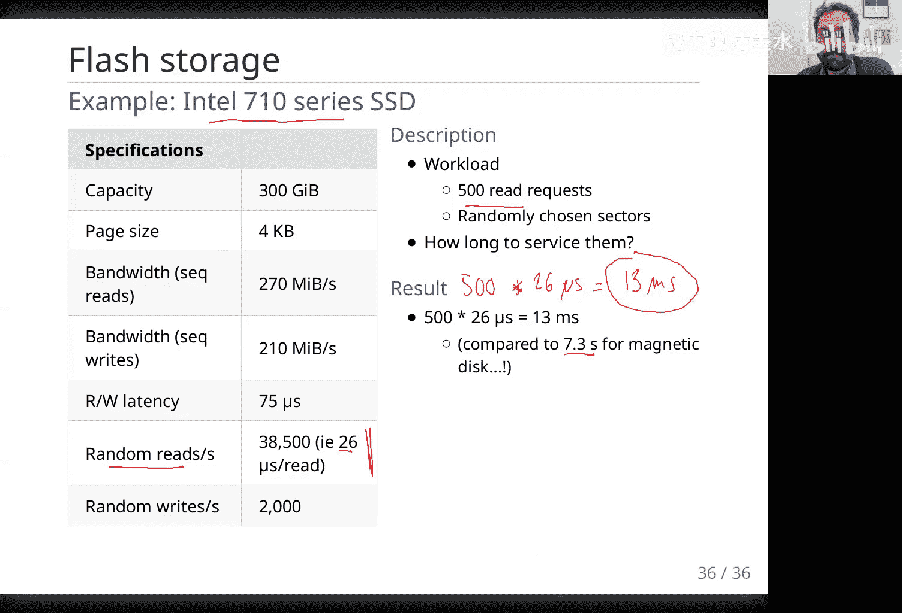

# 【全集 附课件】加州大学戴维斯分校 操作系统与系统编程 中英字幕 1080P p19 Lecture 19 - 存储part2 [BV1jXr5BBEKa_p19]

Hi， everyone。So today we're going to continue talking about storage。

 we're going to finish our conversation about magnetic disks。

And then we're going to talk about flash memory。So quick recap from last time we talked about the different memory technologies using SRAM。

 staticgramM， mostly for on chip caches。And those are made exclusively of transistors。

 we talked about D， so that's for the main memory that's off ship。

And it's made of transistors and capacitors need to be refreshed regularly because capacitors leak。

 that's why it's called D for dynamic。And we also presented quickly the technologies for secondary storage such as magnetic disk。

 which is the conversation that we're having right now。And flash memory， which will。

Study a little bit further in later during this lecture。So magnetic disk， we saw the autonomy of it。

 we saw that it was made of platters， every platter has two surfaces on surfaces。

 we have the head which is in charge of reading or writing from a surface。

The information is arranged into tracks divided into sectors。

 every sector is made of a header of the actual data and of some air codes。

And everything spins pretty fast， and so yeah， that's how it works。

And so we saw that now from say like the OS point of view。

 when the OS wants to read a sector out of the disk。

the time that it's going to take to access a certain sector on disk is called the access time and it's made in fact of three sub components which are the sick time。

 which means that it's the time for the head to move so in fact like for the the arm here like on the arm assembly it's the time for this arm to move。

Itself so that the head gets positioned above the right track。

Then we need to wait for the sector to spin and to finally appear underneath the head。

 so that's the rotation time。And once the head is above the sector that we're trying to read。

 then we need to actually read it or write it。And that's called the transfer time。

So the access time is the composition of those three times。

Now we run this example using the specifications of a real hard drive。

And we saw something that's pretty interesting is that。

If we have a workload of 500 random read reads。Then it takes a lot of time to service them。

Whereas if we have 500 sequential reads， which means that we essentially only have to pay the sick time and the rotation time once and all that that's left is just like transfer time。

Then the time that it takes to do all of that is extremely low。And that kind of tells us something。

 it tells us that the sick time and the rotation times are the the two components of the access time that。

Have the highest overhead。And so we could try to find ways to minimize their impact。

By finding essentially like algorithms， scheduling algorithms。

 how can we reorder requests to minimize the sick time and that why that's what we're going to talk about right now。

So let's take an example。Let's imagine that at a certain moment。The arm and the head。Are above。

 say like track 53。And the OS submits a certain queue of request in no particular order is' just like say the order that the OS received those requests in the first place from like different applications trying to read fives。

And so the question is like， okay， if the head is above track 53。What do we do with it。

 Like in which direction do we move it to be able to serve all of those other requests in the queue。

In order to minimize the sick time， that's pretty much the answer that we're trying to get at here。

The way that we're going to try to evaluate whether an algorithm is like better than another one in some ways。

Is to count。The head movement。 So essentially， like。

If we choose a certain algorithm and the head moves in certain ways to serve this entire queue。

 at the end， how many tracks has the head been over total and that will hopefully like tell us something？

So let's start with the first algorithm， which is pretty much the one that we've talked about so far。

 which is just5O， like we get a certain Q。In a certain with requests in a certain order and we're actually not changing this order。

 we kind of take into account or we。Assume that those requests have been made in a certain order by applications and we're just going to serve them in that very order。

And so the head starts at 53 and just goes to the first one in the queue 98。

And then the second one in the queue，183 and so on。

 And it just served them in the exact order that they appeared。Overall。

 it tells us that the head went over 640 trucks。呃。So that's kind of our starting point here。

Now we're going to try to see other algorithms that could yield a total head movement that is lower than this value。

就。Now it's just before we move on to other algorithms。

 we can still try to analyze this one5fo it's not all bad。P for here has some advantages。

One being that it's completely fair。By serving the request exactly in the order that they arrived。

 we are being fair， which it means that a certain when a certain application sent a request。

 it's going to be processed in the order that it arrived。 So that's that's a good thing。

Obviously also has many flaws。One being that， like。

You see here graphically it's pretty telling that the head kind of goes back and forth。

 which are called wild swings， it's when the head or the arm like moves the head kind of back and forth on the surface of the disc。

所有。So what would be another strategy that could minimize the sickile？And here's a meta file for you。

Imagine you're a Uber driver in Davie and you have a list of clients that are waiting to go somewhere。

Say you are in ways da。And so you have， you just like drop someone。

 And so you're looking at your phone to see which client you should go fetch next。

Now say you have another client that's in West Davie as well。

 like a couple of blocks from where you are， or there's another client that's in East Davie。

And you would have to go on the highway， and it would take like 10 minutes to get there in the first place。

 What do you do。Probably you just choose the client that is only a couple blocks away。Well。

 that's pretty much what the next algorithm dot does， it's called SSTS。Shortest seek time first。

So essentially you start your somewhere like the head is somewhere at 53， that's the starting point。

And then we're going to look at the queue and we're going to choose whichever request is the closest from where we are。

😡，So here that would be 55， so okay， that's where we go。Then from 55， okay。

 where is the next request that is as close as possible from where we are， okay， 67。

And so you see here how like。The queue is reordered to always go to the nearest available request。

And。We were at 640 tracks total， we've divided this value almost by three now we have a total head movement of 236 tracks。

 which should hopefully decrease the access time overall by a lot。

There's one big issue with this strategy here。So going back to the example with the Uber driver。

 imagine that like after dropping this new client somewhere else in West days。

 you essentially keep having like four hours in a row。

New client in Was Davis only wanting to go to West Davis。

What's going to happen is that the poor person in East Davie is still waiting。

You haven't been in that direction， you keep having new clients in the area that you're already in。

And you're not moving anywhere。What is that called that's starvation your poor guy in East Daes would be star from from transportation。

Here is the same。If your queue keeps receiving new requests。

In the area that you're already servicing， then chances are。

The request that's like other on the other hand of the surface will never get served。

So that's a big flow of this strategy。Okay， so how do we prevent that from happening。

 We need to make sure。That the Uber driver in Da will be kind of forced to like travel the city back and forth so that like it can serve people in West Davis and also in East Davie。

Same here。 It's called can。And scan belongs to a category of algorithm called elevator algorithm because it kind of works like as an elevator。

 it goes from the first floor up to the last floor and then kind of back and it like goes through all of the floors all the time。

嗯。So here again， we start at。53。And essentially， the arm will go only in one direction。

Serve all of the requests that are on like。On the， on the way。

Up until it goes to like the beginning of the disc and then it switches direction and it goes all the way to the other end servicing all of the requests on the way。

And you see here， like we're actually able to decrease even more the number of tracks that we've traveled above。

And。So that's a pretty nice strategy。There are a few drawbacks though， one being that it unfair。

I don't know if you see it， but like。Requests that are in the middle。

Will kind of be served like twice as often。呃，各是。When the arm。Goes in that direction。

So it's going to serve all of the requests that are on the way。

 but then because like it goes back like kind of right away。

Chances are there won't be any new requests that have appeared on this area that has just been served。

So here like what kind of。We're gonna waste time， kind of。

And then we're going to address the requests that are in the middle。

And once we reach the end and we go in the other direction again。

 like that area most likely will not have new requests because we just serve this area， however。

We might have new requests in the middle， so the middle has an advantage against the extremes。

So yeah， that's one drawback。How do we address this drawback？ Well。

 there's a simple solution is that we're going to serve request。Only when we go in one direction。

That's called C scan。Circular elevator algorithm。So essentially， so now we start from say 53。

 we go only in one direction。And we only serve request in that one direction。

And once we reach the end。We just go， like， as fast as possible。Back to the beginning。

Without serving anything on the way。It can seem a little strange。

 but at least here it means that whenever we're servicing requests on one way。

 it's totally fair regardless of where the requests are。

And then the fact that like we can do a return trip back to the beginning as fast as possible。

 it's actually kind of a good thing because like it really means we can put a lot of power in the all movement to move the head from beginning to end as fast as possible。

That's why those like 200 tracks for the return trip。

 I kind of put them like on the side because it might be possible to do this return trip like pretty fast。

However， in terms of like track movement to really like service requests with。

Being able to decrease them even further。There's a。A tiny optimization to this algorithm C scan。

 so you see here that we go up to the end of the surface like 199。

 even though there's nothing to serve here， and then we go back to zero。

 even if like there's nothing to serve at zero。The small optimization is called Sea Look。

And so look means that we're looking ahead and we're not making the kind of go beyond the last request that we need to serve and then we go we stop the return trip and we actually do not go beyond where the first request is。

And so we save a little bit of time like not going all the way to the end。

Any it further like decreases the number of tracks that we have to travel。嗯。

There are other like a few other algorithms， so here are like some variations。

 so one is called like C RRC scan RRC scan is interesting because it accounts for the rotation time。

So。In us， can imagine like the arm。Is traveling in in one direction。

 And you have like two requests that are extremely close。

 Like they are just like almost like on on two separate tracks。

But they are like right next to one another or something like that。Technically。

 the first request should be served first， and then we should move to the second one。

Except that it's possible that。When we get to the first request to this one。

It turns out that like we've missed it。Because because it's just passed underneath the head and then we have to wait for the disc to like keep rotating and make like almost an entire revolution。

Before that sector that we're looking for comes back underneath the head。However。

 it turns out that say like this next request is about to show up underneath the head。

So here what's possible to do is to kind of move the arm， serve the second request。

And then go back to the first by。Taking advantage of this rotation time。嗯。Another one。

 another variation is called F scan， so F scan here。Is the idea that like let me clear the screen。

In the algorithms that I've presented so far， imagine you have like different requests here on the way。

 and so the arm is moving and is like serving all of them。In the way that I've presented it。

 if you have like new requests coming in as the arm is already moving。

Then those requests will just be added， and the arm will like serve them along the way。

But that can be tricky because say like if you have all of a sudden like the Army is moving in that direction。

 you've had a request that's over that's over there and has been over there for kind of a while。

And all of a sudden like you have a bunch of new requests in that like one location on the way。

 and so the Army is currently moving and going in that direction and those requests are going to take a lot of time。

Even though and will be served first， even though they， they just arrived。

 whereas like this one has been there for a while and will be served afterwards。

F scan tries to mitigate that by having two cues。There is the one cu that the head is currently serving。

And every new request that appear。As the head is already moving in one direction。

 they are not going to be served right away。They're going to be kind of buffered in another queue。

And once the head has serviced like all of the request in that direction and goes back to the beginning。

 we're essentially swapping the two cus， and so now we're addressing all of the new requests that have appeared in the meantime。

And then you have another variation， which is N scan instead of having two cues， you have n cues。😊。

Anyway。Moving forward。So the question here is kind of like which one is the best right。

 Like is it 54 the best， Is it SSTF or is it one of the elevator algorithms。Well， actually。

 none of them is really the best。They are just good in different scenarios。 So， for example。

 if you're in a scenario where the system is not making a lot of requests。

Then using54 FFS would be very fine like。And it would actually make sense to process requests in the order that they arrive。

Now， when the workload on the disk starts becoming heavier。

 then P4 would make you lose a lot of time。So then that would be interesting to start switching to。

SSTf。Up until the moment where like if the load keeps increasing。

 then SSTF might get you into some salvation。So it's time to switch to an elevator algorithm to make sure that like everything is fair。

 even if the workload starts becoming like really heavy。So essentially what it means is that like。

The best algorithm depends on the workload and you can switch from one strategy to the other。

 adapting to the current workload。呃，O。Now let's actually see the effect of having a disscheduling strategy rather than just doing PIFO。

 so we go back to the previous problem which was the 500 random request。

 random read request and instead of servicing them in PIO order。

We're going to serve them in silu order。So。What it means is that。

So we'd have say like we have the disk right with all of the tracks and so we have 500 requests that are completely scattered across the disk right and we need to serve all of that。

And we're going to do that using Cok， which means that like the the head would start on on one end and would only move。

In one direction， servicing like all of the different sectors along the way。What it means。

 so we need to be able to estimate the sick time here， which might be a little complicated。

What we can do to estimate the sick time to know what will be the average sick time between a pair of those random requests。

We can do the following。Say if you look at that section here。So thats， that would be like。

 say the inner track and that would be the outer track， right， And so the head will start。

Above here and well move in that direction up until it reaches the outer track。

And so what it means is that on that whole distance。Were gonna have 500。Request。On average。

 it means that two requests。Will be separated。So if if this entire distance here it is 100%。

 then it means that the average distance between two requests will be 02。Pcent。

So we need to be able to evaluate what is the sick time for a distance of 0。2%。And。

What we know for sure is that as long as the head needs to move。Regardless of where。

We have to pay1 millisecond， which is the track to track cost or also like the head switching cost。

 like essentially it means that whenever we need to like。

Have the head be readjusted to breed the sector， we're going to have to pay this price no matter what。

So we need to take it into account。And then if we need to travel between two tracks between two adjacent requests。

 then we need to travel 0。2% of the sick time。What we know is that those 10。5 milliseconds。

 they actually correspond to。33。Percent of the distance。

If you forgotten why go back to the previous lecture， we've talked about that。

 that the average sick time is usually one third。Of the distance， which is 33%。

So here it' it's a simple like a rule of three if I know that 33%。Is 10。5 millcond。Then。

 I can determine。What is。Point2%。Okay， so let's look at the calculation here。

So the sixth time we've evaluated per request to be 1。06 millisecond。

 which is this 1 millisecond incompressible because if we're moving the headward。

 we have to pay that price。And then we have this like rule of three to be able to estimate what is the exact cost of 0。

2%。Then the rotation time that's the same as last time， transfer time is the same as last time。

And so now with Clu， we have 500 times。All of all of those， right？

Seems like I lost the screen sharing。 Sorry about that。Okay。And as you can see。😊。

That is a massive improvement from earlier。Earlier with no scheduling。

 we were serving those 500 income requests in more than 7 seconds。

Now that we have the strategy of reorganizing the queue and serving them kind of like linearly as the head only moves from like one end to the other。

 we're able to like divide this time by like more than two， which is a pretty solid gain。O。

And so now let's switch to the next technology that I wanted to talk to you about。

 which is flash flash memory。So flash memory is also a mass storage technology for mass storage like to really like store a lot of data。

But contrary to magnetic disk has no moving parts。There's nothing that spins around like there's no arm that needs to move or anything because it's just transistors。

Which means that the random access performance is a lot better because there's no time for like something to move from A to B。

It also takes less power because there's no motor that needs to like spin anything。

It's a lot more resistant to physical damage as an example， like you take a USB key。

 you throw it on the ground， most likely you're not going to break it， still going to work。

Do that with the magnetic disk， most likely you just lost a bunch of data。嗯。But it's obviously， like。

 a lot more expensive。So quick。Discussion about the technology here。

 because it's honestly like pretty fascinating。So there are at least two technologies for flash memory。

 you have N and Nand。It relates to the way that the transistors are organized to form the memory cells。

Nor is like pretty rare， it's pretty expensive and difficult to do so most of the SSDs and flash memory in general they use the Nn technology so we're just going to talk about that。

So here's the way that it works。😊，ATranistor， if you've never talked about that。

So you draw it like this。It has three pins。This bin is called the control。

That would be well the drain and that would be the source。

And the idea is that this transistor is an interrupt。Just like a light switch。

 Like if the light switch is off， then there's no light。 If the light switch is on。

 then there's light。 That's pretty much the same idea。So the control here。😡，If you put0volt。

Then there's no connection between the drain and the source， which means that the transistor is off。

 there's no current that flowing。If you put a certain voltage。On the control gate here。

 So say like you put， I don't know，5vols， which would be the equivalent of saying like a logical one。

Then current will flow between the drain and the source。

So the switch is on that that's pretty just what a transistor is。Now。

 what's interesting with a flash memory is that。That transistor has something in the middle。

 called a floating gate。Which can be charged。Orre uncharged。So you have the control。

 the drain and the source。Now， let's see。Imagine， that's the voltage。Or a time。

If the control gate here， the floating gate， sorry， is empty。

It means that this transistor will behave just like a normal transistor。

So if you increase the voltage。On the control gate。You increase it， you increase it。

 you increase it almost like you have a noob and you like increase the light。And at a certain moment。

When you increase the voltage， it kind of like clicks。Does the threshold of the transistor。

And then above that threshold， nothing really happened。And so say like the threshold。

 let's imagine it's like， I don't know，075 volts or something like that。Once you hit that threshold。

It means so up until now。Up until that threshold。The current that was between the drain and the source here was zero。

 like the transistor was off。 and once you hit that threshold on the control gate。Then。

 all of a sudden。The transistor。Is activated。And current starts flowing。

And say like it flows at like one volt or something like that。Now。

Imagine that this floating gate can be charged with a certain voltage。

 Imaginem that this floating gate is charged with say 0。5volt。What it means。Is that。If we start。

Increasing。The voltage that's on the control gate。 So by slightly like turning the node。Now。

 the threshold will be reached。A lot faster。Because those 0。

5 volts are going to be added to whatever voltage we're inputting through the control gate。

So now it means that if this thing is charged。At about， let me erase that。At about， like， point。

25vols。We're going to have the click。Where。The transistor was like still zero。

 and we're reaching now this click moment where the current starts flowing。And so essentially。

 it means that like now we're able by having this floating gate gate either being empty。

Or being full。We're able to store information。And the way that we can read that information is by inputting。

Current。On the control gate， slightly turning the node。And kind of seeing on the other side。Here。

When the current starts flowing。If the current starts flowing。

When the click happens as we're putting like， say， 025 volt on the control gate。

It means that this thing was charged and so we can deduce like， oh。

 this transistor here is containing a logical one。If we have to turn the noob up until we reach。75 V。

Until the transistor starts flowing， then it means that this thing is empty。

And that would mean that the information that it is storing is say like a logical。0。

So that's pretty much how this floating gate is able to encode whether a bit of information is zero or1。

And now it's even better， so that would be the single level。

It's possible now with modern technologies to do multi level transistors。Which means that。

Instead of only having， say， the floating gate be being empty or full。You can have various way。

 you can say， oh， it's empty。 that's going to encode bits，2 bits，0，0。

Or we can recognize that it's like one third fool。Then it's going to encode bit 0，1。

Or it's like two third full。And is going to encode10。

 or it's completely full and its going to encode bit 1，1。

 And so now with only one transistor by varying the the charge of the floating gates at different levels。

 we're actually able to encode multiple bits of information。

That's how it works and that's how we are able to pack。250 GB in like such a small area。

 only made of those tiny transistors。Okay， let's move on。So the way that flash memory is organized。😡。

There's like a hierarchy。The smallest units are pages。Of four kilobys。

Those are like the greenle thing。Then pages。Are organized into blocks。 So typically。

 a block will contain 120 pages。Then those blocks are organized into planes。

 so planes have multiple blocks。And finally， on what we call the die。

 So the die is actually like one chip。 So if I go back to the。I don't know if you can see like here。

That would be one die。And here that's another one。And here I think you can see like there there's a little bit over over there。

 so you would have like three different chips on this board。

And so that would be a die and that you can have multiple planes on a die。

What's interesting is that each plane。Can be accessed in parallel completely independently。

 so there can be multiple requests at the same time。Which is not possible to do on the magnetic disk。

 for example。So now how do you read a page or write a page， it's a little complicated。And so again。

 when you read or write to a flash memory， you have to。

 the unit is a page in the same way that for magnetic disk， the unit is a sector。

 you cannot read than a sector or less than a sector。Like you have it it's the sector。

 if you want to read or write， it's a sector， here it's a page。

So reading a page is actually like super easy， takes about like 10 microseconds super fast。

 you're like， hey， flash memory， I want to read page 42 flash memory like I got you and just send like。

4 kilobytes worth of data from page 42 text super fast。

Writing is slower because writing you need to like modify the floating gate for a bunch of transistors that takes time so it takes actually like 10 times the time that it takes to read a page。

To make it even more complicated。Writing a page can only be done。Even the page is empty。

So essentially， like you cannot overrite。A page that's already。Being in use。

The reason is that like you essentially need to reset all of the floating gates to a certain like basic level。

 and then you can only modify the floating gate in one direction so that's why you need to reset and then change the values。

So you need to write always to an empty page and to make things more complicated and that's going to be the end。

You can only reset a page。When you reset the entire block。😡，And erasing a block。

Text a little bit of time。 It's like usually above 1 millisecond。

So let me show you an example of that。So that it's more， you understand it more practically。

Imagine you're writing a program and see that， you know， like open the file。

 read some bytes out of it， modifies those bytes， and then write those data back to the file。

How long does it take to write a single page。In flash memory。And let's take， as an example。

 a flash drive with the following specifications so pages of four kilobytes in size。

It takes like three milliseconds to erase an entire block。

 blocks contain 128 pages and the time is like 150 microseconds to read and write pages here like we're doing something fairly simple。

If you do things。Niveively， then here's the way that you would do it。And here's a picture。

 so the picture doesn't have like 128 pages and so on because that would be a lot to draw so I。

Simplified， so we have here， like four pages。Per block。 And we have four blocks。

So the whether it would work， if the US has。4 kB of data。That need to be written。

 said to block number 3。ok。How do you do that？Well， with the naive approach。

 you would need if you want to essentially write 4 kilobys2 page number 3。

 you would need to first save the entire black。 so you need to save。Block 1， block 2。Block 3。

 so you would read them out of the the the flash drive and you would put all of that data。

So three times4 kiloBs。You would read that in memory。Then you could erase。The entire block。

And finally， you would。Rewrite all of those three blocks that you saved in the memory plus the one that you wanted to write in the first place。

So here it means that in that example， you would need to read 127 blocks to save them to memory that would take like 50 microseconds for each。

Then erase the whole block and then rewrite all of the blocks plus the new one that you wanted to sorry the pages plus the one that you wanted to write in the first place。

透。16 milliseconds。Not that great， right？So how can we do better？Well。

 we can do better with something that's called right remapping。How does it做。

It works by having something called。The flash translation layer。It means that。DOS， the system。

 the software system will only see logical page。And in fact。

 the flash will know about physical pages。And let me show you why it's important。In that strategy。

 the flash。Will only show。A certain number of pages。 And you see here， it shows only 12 pages。

Whereas in fact， it has up to 16 pages。Why we do that， Why we do that， Because the flash now。

Can maintain。An entire block。Of empty pages。So now when the OS has a page。Of 4 kiloB。And it says。

 hey。I w to write this page to block。Number 3。Well， here， instead of having to like， you know。

 read everything and erase and rewrite everything。The flash memory， the flash memory， can say， hey。

 I have already an empty block。 So what I'm going do is， in fact。Write this page。To an empty page。

 say like empty page 13。Whi is just going to take like almost just it's going to take like 50 microseconds and then what I'm going to do is that I'm going to change the association and now logical page number three will be associated with physical page number 13。

Next time around， say the US wants to write a new page。To page number one。

Same thing is going to happen。We're actually not going to update page physical page number one。

 we're going to change the association， we're going to say hey。

 logical page number one will be now associated to physical page 14。And this guy will go down here。

And here we had an empty page because we had emptied the block beforehand and we can write directly in that。

So essentially like the cost of erasing a block。We do it once。 And then in that example。

 we pay like 3 milliseconds to erase this entire block。 and then we can write four pages。

With no overhead up until that block now is full。Now we can take another block。Empty it。

 which will take like3 milliseconds， and then we get again like four pages that we can write with no overhead。

So the other of erarissing a block is amortized by the number of pages that we can write afterwards。

And now that new strategy brings down the time that it takes to write a page。Buy a lot， right？说单子间一点。

There are some issues with flash memory， one being that it's a technology that wears out like the more you use it。

 it starts degrading。So for example， like the more you erase blocks and actually like it's not that much like if you can be erasing a block like a thousand times like 10。

000 times something like that， and then it starts it stops working。

The floating gates can no longer be configured to hold bits。Or even。As you read the information。

 like reading will disturb the information that floating gates nearby contain。

 So even reading will affect。The stability of some of the memory cells。

So there are solutions for that multiple ones， one solution is to use error correcting code so that at least。

If a transistor is affected and its floating gate， for some reason like lose some data。

 having air collecting code will be able to detect that some bits were lost and will be able to recover from that and not lose any data。

 so that's one thing。One other thing is that instead of erasing already always the same blocks or instead of like always reading from the same blocks。

 we're going to do something called were leveling。So and using right remapping and this like flash translation layer。

Essentially， it allows the flash drive to keep moving things around。

 like to keep moving pages around so that all of the pages across the drive will be used about the same amount of time。

嗯。Instead of having like certain blocks like that keeps being erased or certain blocks that pages that keep being read。

Now when it happens that like some pages become bad。

 like they cannot reliably store some information or some entire blocks cannot be erased efficiently anymore。

 they can be marked as bad pages or bad blocks and just stop being used。

Now it would be kind of annoying right if you spend so much money like buying a flash drive and after two years。

 you've lost like half of the quantity because like things have become bad。Well。

 what's interesting here is that like。Manufacturers， they will actually sell you， say。

 like a 250 gigabyte flash drive that in fact， internally can hold a lot more than 250。

 say would it could hold 350。But this 100 GBabyte extra will not be visible。

 it will be used to mitigate the bad pages and the bad blocks that might happier over time and also so that like even if your hard your flash drive becomes full。

 you can still do where leveling because you still have some spare pages or blocks that can be used to keep like moving things around and make sure that like all of the cells are being used equally。

Okay， so quickly。Here's an example， let's go back to this like workload of 500 read requests that are random。

 but now let's apply it on an SSD on a flash drive that has those specifications。嗯。Here。

There's no sick time。 There's no rotation time。 It's all transistors。And actually， the， the。

When you buy a flash drive。It will directly tell you the number of read requests that it can serve per second。

 and so this one tells you that it can serve about like 40，000 read requests per second。

So here the calculation is really not complicated， it's essentially like 500 times。26。Microseconds。

Which is。13 milliseconds。Now you compare 13 milliseconds to read 500 random requests。

To the more than 7 seconds it was taking for magnetic disk。 That's a lot。

 That's why flashs are so much faster than magnetic disk。😊，One thing that's very interesting too。

 and we'll finish on that is that here do we need a certain scheduler to organize requests？

The answer is not really。Here we can serve a request in5 for order just in the order that they arrive。

 because it doesn't really matter。 there's no movement involved。

It's just like the CPU accessing the main memory， it can access like almost any chunk of memory at a time。

 and it's pretty much the same。Okay， so that's the end of this topic around mass storage and next time we're going to talk about how mass storage is used to store files by organizing the variable space into a file system。

