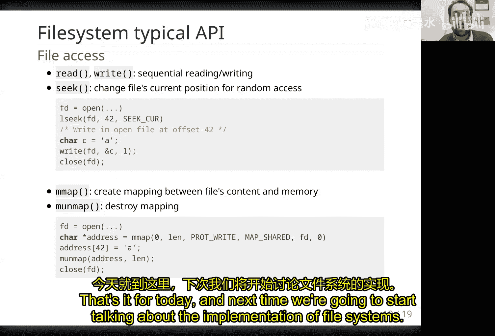

# 【全集 附课件】加州大学戴维斯分校 操作系统与系统编程 中英字幕 1080P p20 Lecture 20 - 文件系统抽象 [BV1jXr5BBEKa_p20]

Hi， everyone。So after talking about mass storage in the last two lectures。

 today we're going to talk about how do we organize the data that is provided by mass storage。

So first， let's talk about requirements like what do we expect？

From the organization of the mass storage devices。Well， first of all。

 we know that those master devices such as SSDs or hard drives， you know。

They're going to hold a very large amount of data like today we're talking about terabytes of data。

All of that data， we need an easy way to find it because it's one thing to be able to like store terabytes of data。

 but how do we organize all of that？It would be the same like if you have a library and a lot of space to put books。

 like how do you make sure that if someone is looking for a particular book。

 they get access to it pretty fast and are not spending like an entire week like looking through。

 say all of the books that the library contains in order to find the one that they want to read。Also。

 we need to provide the fact that。A typical computer runs multiple processes concurrently。

And many of those processes might be accessing。The data that is stored on the master device at the same time。

 so we need to allow for that。Next， we also need to be mindful that on some computers such as servers and and such。

There are multiple users using the computer at the same time， or like at least at different times。

 but。Using that computer and so potentially they're also using the mass storage to hold some of their own data and we need to make sure that that sharing of that space is controlled。

Next， we need some good performance。 We know now that mass storage tends to be pretty slow。

And so we want to find strategies so that when the user is using the computer。

 we can handle the fact that those devices are inherently slow。And finally。

 we want some good reliability。So far like the whole purpose of having mass storage devices is that it's non volatile。

 it's persistent， it needs to survive when the computer is rebooted or is powered off and so on。

Ideally， we also need to survive when the OS crashes， when the computer crashes。

 and we have to reboot it。It wouldn't be acceptable to lose all of the data that was stored in the master like we need to have good techniques so that it doesn't happen。

we also need to handle that like if a process that is currently like using some data out of the mass storage。

And the process even like terminates abruptly， like it shouldn't lose all of the data。

So those are that's kind of a laundry list of requirements and what I'm getting at is that file systems are。

These abstractions that will accommodate those requirements。

 so file systems are essentially a way to organize the data in on a master device。So that。

All of those requirements are kind of fulfilled。 So how does it do that while it organizes the data into files。

Which is kind of the unit， the logical storage unit。

It organizes the files into directories and subdirecties so that the user can navigate those files easily。

It ideally like provides a good performance。诶。And tries to like hide the fact that those files are stored onto a pretty slow device。

It provides access control between users so that if I have a file and I don't want anyone else to see it。

 I can like set up some permissions so that it remains invisible or unaccessible to other users。

And ideally， it provides some sort of tolerance to crashes and to storage air and all of that。

So that's what file systems are。 They're aware of organizing master devices。

So next we're going to go through a list of names and concepts around file systems and we're going to start with the most obvious one files。

 so what are files files are an abstraction so you have a bunch of data that's connected in some ways because say like it's part of the same text document or it's an MP3 those are just bytes but they're connected to one another in logically。

 and so that would form what we call a file。And that is said to be the logical storage unit。

 like every byte that is on a ma storage device and that the user can interact with necessarily belongs to a file。

Now a file is composed by two parts。 The first part is called the metada。

So the metadata only characterizes the file。And so it can be like the size of the file。

 some times associated to the file so like the creation date and time of the file or like the last time that it was modified and so on。

 who owns it， if the file system provides access control， then we need to know the owner。

 we need to know the permissions and so on。It also determines where the content of the file is located。

And then we have the actual content of the file， and so that's a bunch of like zero and one。

 those are just like random bytes。And that's essentially whatever the user writes into those files。

All we we know is that like those are bytes and it's it's just it's a sequence of bys that's pretty much all window。

You'll notice here that something is missing right when we talk about a file usually a file is also described by a name that's how we find it and here in that slide there's no mention of any names right？

That's because interestingly enough， like a file。On the file system doesn't know its own name。

The name of the file is only determined by a directory。 So now a directory is another abstraction。

 and the director is， in fact， the one that provides a name for a file。

So directory is like larger than that。 It's also a way to like organize other directories and file it into like sometimes a fairly complex like hierarchy of of。

OfFights and directories。But at the bottom of it。😮。

A directory is contains a mapping list of file names。Towards the file itself。

So when you want to open a file from a certain file name， the directory will tell you， oh， okay。

 I know about this file and you can find it at this location。

And so from that location you can access the metadata and then the metadata tells you， okay。

 the actual data of the file is located like somewhere on the hard drive or the SSD。

 like at this and that sectors and so on， we'll talk about that later。

So a directory is a little bit like a DNS server， you know， on the internet。

 like when you type Google。com。In fact， like you have to ask a DNS server like what is the IP address of Google。

com and the IP the DNS server will tell you， and that's actually how you can talk to Google。com。

It's kind of the same idea with directories here。Speaking of file names and directory names。

 there are like different conventions and it largely depends on the file system itself。

 so we'll talk about different types of file system well in the next lectures will talk mostly about two of them Microsoft fats。

 which is pretty old file system that Microsoft had back in the 80s。And we'll talk about。

A UniX file system called FFS。But then， you know， like today there are many other types of file systems。

 you have like NtFS， you have EXD3， EXD4， But F， I mean you have like a ton of them。嗯。🤧Sorry。

So in terms of casing， Windows has traditionally been case insensitive。

 where Linux has been case sensitiveitive in terms of file namess。

 the length also has varied over time like so back in the day。

 the length of a file La was pretty restricted， it was for example。

 like 11 characters on Microsoftof fat。Today， for the most part。

 you can have file names that are pretty long up to like 255 characters。

And the extension also has varied over time， so before the extension of a file。

 you know if like the fact that the file is dot TxT or dotmp3 actually like really mattered like the extension was like separate from the file name it was its own thing and it was really determining what the type of the file was。

Now the extension is actually only a part of the file name， you could even like you know。

 create a file name that's called like dottxt dot zipip。

If you wanted to because like it's just it's just characters that are part of the fine name。

Nothing else。And it's just a hint for the OS so that when you essentially like double click on the file。

 the OS knows which program to run in order to open that file， but that's pretty much it。

There's you can totally like。Change the extension of an executable to dot TxT。

 even though it's actually an executable and you can also kind of rename a text file like say dot X even if it's like just an ASI file。

 so it's just an hint。是。Actually， speaking of executables， there's something that's interesting。

If the extension is only a hint and it doesn't determine like what the file is。

 then how come the OS knows how to run executables， for example。Well， for the most part。

 when you have a binary executable， so something like you write a program in C and you compile it and you have an actual binary executable that you can run。

The way that the OS knows how to handle it and actually like knows that it is an executable that can be loaded and run on the computer。

And。😊，It relies on the fact that the file will start with the magic number。

 so say you take like for example， like Firefox and you look at the first few bytes。Of the file。

 like the executable that's behind Firefox。And you'll see that， like it says。Elf。

Elf is a format of binary executable。 So when you call like when if you have a shell and you do like fork and exec Vp。

 for example， on Firefox。Then the O will like open that file and will look at the first few bytes and willll know like。

 oh， okay， it's an L。 So that's， it's a binary executable。I know how to load this thing。

Now for scripts， scripts are also kind of executables because if you have a script。😊。

You can also call a for and exag on it， and it works。

So that means that theOS also needs to be able to load scripts and know how to do that。

So here it's quite different and it's interesting， it relies on something that's called a Shiang。😊。

Which is has to be like the very first line of a script and start with the pound sign and the exclamation points。

And essentially， the Shibang will determine how the script should be run。

 like what is the interpreter that knows how to run the script and that essentially like tells the US how to run it。

诶。So for example， like if you have a script that starts with this Shib that says like， hey。

 in fact I'm a shell script， like you should run me with a slash bin slash slash S。

When you run the script。It's going to work。And when you do that， in fact。

 it's strictly the equivalent of saying， oh， I'm running slash bin slash S on this。Scrt。

 that's essentially what the OSs is going to do by reading this Shiang line and call S on that script。

Okay， so end of the slide digressions here。Going back to some file system concepts。

So there's the notion of a path， which I'm sure you'll。Familiar with now。

So we have two different kinds of path， we have absolute path， so here it's like the path to a file。

To a directory from the root directory， like from really like the beginning of the folder structure。

And so that would always on Uni， that would always start by saying by slash。

Or the notion of relative path so now you know that like every time that a process is running when you have an existing process in the system。

 that process as part of its PCB has a current working directory。

 which is where the process was started from and the process can change its own current working directory by say calling the CHD function exactly like you did in your shell in project one。

呃。And so it means that if the running process is already somewhere。

It can also access files from its own location by providing a relative path。 So absolute。

 it always starts from the root relative path。 It starts from where the process currently is。嗯。😊。

And actually， for that， it means that every directory can reference itself as part of a path and can also go back up one level to the parent directory。

Okay， let's go on。Next concept that I wanted to mention is the concept of hard links。

So what is a hard leak？Hardlink is essentially the idea that you can have multiple names like multiple file names。

Pointing onto the same file。So for example， like in one directory， you would have。

File food dot T X T and in another directory， bar dot T X T。 But it turns out that therere， in fact。

Just one and only file。 Like there's only one collection of data that correspond to that file。

The way that it works is that the two directories。They will have the association of essentially like two different names。

 but towards the same file number， so towards the same metadata and so eventually the same data。And。

So that's that's that's the idea Now there can be some it can become tricky。 So first of all。

 like let me draw， say like a fake。嗯。Folder structure。 So here， like squares。A directories。

And circleles。A5。So you start from the root directory and say like， I don't know。

 you have like subdirecty Toto and subdirecty Tt。And you have like files in them and so on。

You can even have like files directly in the re if you want and so on。

If I were to ask you what kind of data structure sort of represent that structure of files and directories。

 you would probably say a tree， right？Now， if we have hard links in the picture。

 it essentially means that like we can create from a certain directory。

 another mapping to the file that's already that already has a mapping in another directory。

If I do that。It's not a tree anymore， it's a graph。It's actually a directed graph。

 because you see that I have。Errows。Now。There's one kind of trickiness。

What if I could say create a hard link？😮，In T T with a certain name that is actually a link。

Say on the root directory。What am I creating here， I'm creating。A cycle。

That's a danger because if I have a cycle， that's going to be like extremely difficult to。Handle。

 let me explain a little bit more about that。With hard links。

There is no difference between the original mapping and the new mapping。

Like if you create a hard link， then there's no way of knowing that this hard link is in is in fact。

 like， you know， a copy of the of the original mapping。

So here's an example like imagine I create a file name is like test and so what it means essentially is that to this name test。

😊，I have a mapping to a certain file number， which I can make appear by using the dash I option of L S。

 like here， it shows me the file number。Now， if I create。A hard link called test 2。

What I'm really doing is thatm now I now have two names test and test2。

 and they are both pointing onto the same file number。But。There's nowhere now that tells me like。

Somehow， the test was the original mapping and test to is only a copy of this original mapping。

 I just have two mappings。 I don't know which is which。If we were to allow。Cyclees are。

 if we were to allow。Hardlings of on directories， then we would create cycles。

And the problem is that those cycles would be extremely difficult to detect because we wouldn't really know when were cycling back to the top。

Unless we were to like keep track of all of the Iode that were like traversing on the way and we were somehow like able to identify like。

 oh， we're going back to an Iod that we've already traverse before。

 which means that like we've kind of gone back up， but that would be extremely difficult to do。So。

 long story shot。To make things simple。Hard links。Are just forbidden on directories。Piner。

So that's the radical way of solving that issue。😊，So again， like if we have a certain。

File an subdirecty structure。鞋。😊，It's not a tree because we know that we can have multiple hlings towards the same file。

However， they can be cycles。So what we end up having is a directed。Graph。But there is said to be。

Acyclic。Which is a D A G。A DAG is what represents truly like a file and directory structure。Okay。

 moving on。There's another type of licks that are not hot licks and。

Theyre interestingly called soft links or also known as symbolic links。

Those are quite interesting because。Soft links are files themselves。 They are a separate file。

 so say。I have a file， food。txt。That file is associated to a certain file number。

 which me access to the metadata， which gives me access to the actual data of the file。

That's one thing。Now， if I have a symbolic link onto that file。Say butter T。 And I want butter T to。

 in fact。Point onto food。With hard links， you know。

 it would mean that the mapping would be towards the same file number。With soft links， it's not。

With soft links， the mapping is towards another file。

Another file with some other metadata with some other data。

But it turns out that the data of that symbolic link is， in fact。

 the path to whichever other file we're trying to point onto。😮。

That's the big difference between hard and hard links and soft links。

Now what's interesting is that soft links， we can tag them。As such， as part of the metadata。

 we can say like， ay， you know what， like this file here is， in fact。

 a soft link and we can write it as part of the metadata。

Which means that they are well identified and so back to the problem that we had before。

 if we are using a program that that whose job is to like you know walk through all of the subdirecties and files to say like search something or whatnot。

We call those programs like file tree walkers， those walkers because they're able to detect whether a file is a regular file or if a file is a symbolic linked。

 it can ignore symbolic links and so even if a symbolic links，Creates a loop。On the file system。

 it can be ignored。Or if it's not ignored， the only thing that we need to do to avoid going into like cycles that would never terminate。

Is that we can count the number of symbolic links that we are following。And。

Psics defines a certain limit。Which is typically like eight， which means that。

If you start opening files that are following like more than eight symbolic links。

 then it starts failing because the system will determine like， you know what that sounds weird。

 there might be like a cycle issue in there。So let's not do it。Okay， moving on。

So the next concept here is the concept of volume。嗯。A volumeume is pretty much like。

So let me rephrase that。Let's say you have a master device on your computer and you just。

Consider that this entire device will be formatted in， I don't know。

 like NFS that would make one volume like that's one volume where you can store files and subdirecties。

Now it's also possible that you could say， hey， you know what。

 like I have this massive SSD with like I don't know。

 one terabyte and I want to format this one terabyte of data into two partitions of say 512 gigabytes。

And I want to format the first partition into like， I don't know， N TFS。

 and I want to format the other partition into like， I don't know， fat or something like that。Well。

 so here it means that in on that part， you would have。hierarchy of files and directories。

And thus on this other partition， you would have another hierarchy of files and directories。

 and the two are completely independent。Almost like you have a building。

 you want to build a library and and instead of saying like， oh。

 we're going to just have a big room and we're going to just like organize all of the books in that big room。

We're going to split the building into， have two different rooms and have like two separate organizations in each of those rooms that's pretty much what parts are about。

So here you would have two volumes。A volume can also be the aggregation of multiple disks。

 You could have a powerful computer with like four SSDs in it。And you， in fact。

 want to aggregate all of that space。Within the same kind of logical within one logical big device。

 that is the addition of all of those subdicees。嗯。So that's also something that's possible。Now。

 speaking of partition， if you have a device and you want to partition it。

 the device needs to kind of like be aware of that and so that the system when it boots knows like。

 oh， here's a hard drive or an SSD and it in fact contains multiple partitions。

The way that it works is that on a magnetic disk。😮，The first sector。Of the disk， it's called the MR。

 the master boot record。 So that would be a six sector 0。Of a magnetic disk。

It you have like 512 bytes of data here。And it essentially contains a table of partitions。

 so back in the day you could have like up to four different partitions。Far is a specific hard drive。

Now it turned out that like four partitions， when hard drives starting to become bigger and bigger。

 having only the possibility of dividing the space into four partitions was not enough。

So they created the way to essentially have。Primary parts be further。ASplit into extended partitions。

 and so here you could like divide up your space into even more partitions。Nowadays。

 when you buy a hard drive， you can partition it using another system than this MR。

Something called GPT。With GPT， now you can have up to 128 partitions for the same hard drive。

 which allows you to divide up the space into even more partitions。For compatibility purposes。

 you still have this old school MBR as the first sector。

But it would kind of be ignored on new computers。So now let's imagine， let's say you have a computer。

 you have like multiple volumes， so you have like I don't know。

 you have two SSDs and each of the SSDs is。Split into different partitions。

How does the OSs deal with all of those volumes， you have two ways of doing that。The first way。

 the Microsoft Windows way is to actually see each volume as something that's completely independent from the rest。

嗯。And the way that Windows does it is that it assigns a letter。

A specific letter to each of the volumes。 So you all know like， for example， like you know。

 like C period or and so on。And。😊，So say like you have two disc in your system the first disc only has like one partition and you call it like and it's gonna be the primary partition and it's a C and then you have say a second disc on your system and this one is split into multiple partitions and so you have like partition E partition F partition G and then here you even have like an extended partition so like the fourth primary partition is further dividediding into22 and so now it's like H and I。

嗯。And so all of those volumes， they appear in the the file browser as just like a different letter。

That's for Windows。For Linux， it's different。So let's take an example。

 that's actually an example of like how computers organized the CSIF computers。So。

 the CSI of computers。They have a local hard drive。That is separated into two parts。

You have something called like the boot partition。And you have the root part。

And then it turns out that when you log onto CSF and you have your own account and your own files。

 those files are not stored locally on the CSIF computers。

The reason is that like you can log on any CSI computers and you always have access to your own files so they can't be stored locally。

The way it works is that they're stored outside of the CSIF on a server on an internet server。呃。

That has a specific address。And。And actually， I believe that this server is somewhere in Sacramento。

 so every time that you log on to CSIF and that you have your own files in your home directory。

 the files that you're seeing， they' are actually like being accessed in real time。

On a computer that's located somewhere in Sacramento。Anyway。So you have different volumes here。

 right？Those volumes on Unix， they， in fact。Put all together。Inside of the same hierarchy of files。

 which is called the virtual file system， it's a unified file system。

 so it's not like Windows where you have like separate letters and every all of the volumes are independent here they all like nested one into one into the other so that from your experience it feels like it's something that's very consistent。

So， for example， on CSIF， the second partition of the hard drive will be mounted。

At the actual root of this virtualtro5 system， then the boot partition。

 which is the partition number one， will be mounted underneath this root partition。

Under like slash boots。And this internet server that contains all of the files for all of the CSI users will be mounted under slash home。

And you see that like here now， like everything is。Nested with like kind of part of the same tree。

 I mean， now， you know that tree is not the right word， but I'm simplifying。嗯。

How does the system know that's how we should like mount the different volumes。

 what it's actually part of a certain configuration file that's on Linux is called FS tab。

 which and it's located in slash ETC/ FS tab。And on F S tab， it's。

 it's a configuration file made of different lines。 And for each line， you have， okay。

 what hardware part are we talking about。 So here like that would be， say the first part。

Of the first hard drive， second part of the first hard drive， first part of the second hard drive。

 the C D Ram player and so on， or even like some sort of。Folder that is on the internet。

Then you have the mount point， where should that hardware partition be mounted？

In the unified virtual file system。And then you have the format。Of that partition， like。

 how should it be interpreted。嗯。So that's how it works。呃，OK。Here is。

The different layers of softwares that are involved in accessing the data that is on master devices。

 So， for example， like disks or SSDs。So let's start from the top。

 so at the very top you have applications or processes。

Those are the ones that are going to call like open on certain files and then read。

 write from them and so on。Those functions， which now you know are mostly ciscolls。

 they go through the ley and they go into the kernel。

The kernel receives all of those commands from processes。

In terms of opening and reading and writing files。Through。A subsystem of the kernel called the VFS。

 the virtual file system， that's the file interface。

Then according to where the file is located on the file system。It will redirect。

The request to the right kind of back end。 So， for example， let me actually like rewind two slides。

Imagine that you write an application on CSIF that opens， you know sm slash AAA， whatever。

 and you want to access like that file。That file here is not local to the CAs computer。

It's located somewhere on that server on the internet down in Sacramento。So。

When the process calls open and then read and write on that file。

And it gets to the virtual file system， the virtual file system will know， oh。

 that file is not local to this computer， it's somewhere on the internet。

So I'm actually going to transfer that request to the back end that knows how to do those like network requests in order to really like access that file。

Now， if the file is local。😊，Then we're going to address one of those backends that know how to interact with the file locally。

And the backend will depend on how the volume is formatted。

 so if the volume is formatted using Microsoft fats， we're going to use the fat driver。

 if the volume is formatted using like EXT2， three or four。

 we're going to use the right driver and so on。嗯。And eventually we'll get to the right driver that knows how to talk to either a magnetic disk or to the driver that knows how to talk to an SSD and will really able to like access the different pages from the SSD or the different sectors from the disk and will really be able to like interact with the files。

And。For some of the files that are on the computer。

They are actually like not really files because they are not contained anywhere。

 either on the network or locally on the disk。They are actually fake files that allow the user to get some introspection about the system。

 so for example， like。On CSIF。In the terminal， if you do something like a cat slash。Proc。That's PR。

 R O C slash。c b u。info。You'll get a lot of text。 That appears。That like。

 show you some information about the processors that are part of the the， the， the。

 the computing system， like that are part of the computer。That file here。Has no like。

 doesn't exist anywhere。 It's not on the SSD。 It's not on the disk。 It's not on the the network。

 It's， it's， it's not a real file。 It's just an abstraction。

The content of the file when you use CAAT and you specify that path。Will in fact。

 be generated directly by the kernel in real time whenever you access the file。But anyway。

 that's kind of a digression here。Okay， now in terms of API。

 So you're in a process and you want to interact with files， there's a certain API。

So processes might want to create files。When they want to create a file。 So at first。

 like an empty file。They will need to specify a file name and a mode， like some permissions。

And the create function will essentially like check that there's space on the disk will check that the user is。

Authorize to create a file the in the current directory and so on。

And it will create the metadata for that file and will create a mapping in the directory where that file is created。

Now we have some other functions as well in terms of file creation。

 we can create a file by only linking a new file name to a file name that already exists。

So here we're not going to create any metadata or whatever because like that would already exist。

 the only thing that we're going to create is a new mapping from the new file name to whatever metadata this existing file name is already pointing onto。

嗯。And then to remove a file。It's， in fact， kind of the function only because we're removing a mapping between a file name and the file number。

And now it turns out that like。If if we remove the last mapping from a name to a specific file number。

 which means that like that file number is no longer pointed by like any file name。

 there are no existing mappings to that file number。

 that's when the actual file like both metadata and data can be fully removed。嗯。

So here is an example of those different functions。诶。

So interestingly enough like these create function so that API that I'm presenting it's a little bit of an abstract API those are not necessarily meant to be like real function it's more in terms of like functionality。

There used to be a function called create， you'll see that there's no E， I don't know why。

 but that's the name of the function create with no E。

That would only create a file exactly like I described。

 like create an empty file with some metadata and some a name mapping in the directory。

And that would be。Nowadays， this create function is deprecated and it's encouraged to just use open。

With the flag or create and here you can give the mode and open well， in fact。

 create the file and also open it two in one。Anyway。Then。Now， imagine you have a file。

 it exists and you want to open it in order to interact with it。 So you have this function open。

 you give a file name。And this open will verify that like， first of all， you're authorized to。

Really open the file。 Like， do you have the permission， Like， can this file be open， Like do you。

 like， can it be open in like read mode or write mode and so on。And if everything goes well。

 the open function will return a file descriptor， which is kind of the handle that you can then use to really like interact with the files data with the files contents。

Here's a complicated picture here to show you the different scenarios in terms of opening files。

 so let's go through it。呃。The the typical case is that you have a certain program and you open。

A certain file。What's going to happen in the background like on the kernel， so the kernel will。

Take the first available file descriptor。And will， essentially， like， create。

An entry in another table called the open file table for that file that you're trying to open。

 so you have an entry over there。On the entry you have a certain offset which is where you are in the file so at first when you open a file the offset would be zero because you're starting from the beginning and then as you read all right the offset is incremented。

And so in fact， this thing has two levels。So the first level is the open file table。

And then that level points onto to another level。Which is the INote table and so here in that level now we're really connecting the file descriptor to really like the file on on the disk。

So when you go open from a certain process， that's what happens。Now， let's see。

Imagine you open another file。In F1。 So that other file points onto another。

Entry in the open file table， which then points onto like an actual other file。

Now what's interesting is that if you tag this file descriptor and you do it。Using Dupe 2。

And you copy it to another entry。In your filescriptor table。With Do2。

 what you're doing is that you're creating。A file descriptor that， in fact， points onto to the same。

Entry in the open file table。Why is it important， Well。

 it's important because it means that they're going to both share the same offset if you start reading from FD1。

 for example， that's going to modify the offset。If you then continue reading from Fd20。

Then the offset will will be shared here。 and so you will start again from the same location in the file。

However。If say in another process， you also open the same file。As you had done here previously。

So saying like F3。嗯。Then F3 would have its own entry。In the open file table with its own offset。

Right。Even though。Ultimately。It's interacting with the same file。

So what it means is that when you call open。On the same file name。

 you will get entries in the open file table that are separate and that each have their own offset。

 However， if you call， if you open a file and then you dope to another file descriptor。

 you only get another file descriptor。But they both point onto the same entry in the open file table。

And last。Imagine you open a file here。So you have a certain entry into the open file table that's pointwning onto an actual file somewhere on the file system。

Now say that process A， in fact， Fox。Into process B。 So process B， inherits。

All of process is a file descriptor。Then it means that the same filescriptor entry would be pointing。

Also onto the same open file table。 And they both would share the same。呃呃呃呃 offset。

I know that this figure is a little complicated。 so feel free to like。

Rewatch it or spend some time on the slide and make sure that you understand it。Okay。

 and last very quickly， so now that you've opened the file， you have a file descriptor。

 you can now like actually access the data and so you have a few functions here。

 you have read and write。😊，To do sequential reading and writing。

 meaning that like you start from the beginning of the file and as you call read All right。

 you actually go in sequence。You can change the location of the offset。

 which is where you are currently are in the file with C。So for example， you can open the file。

 you can change the offset and go to a certain location in the file， and then you can modify it。

 add that offset。Another way of accessing files that is a lot more powerful。

 but different is using this function called MMap， which is a very powerful function。

MM creates a mapping between the content of the file and some location in memory and in short MM allows you to access the content of the file as if it was an array。

 which in some cases is extremely convenient because you can then do like random accesses。

 which is difficult to do with just like read write and seek because those are inherently sequential。

So for example， with M， you can so say open a file， you get a file descriptor。

 then you em up the content of the file。Spifying the filescriptor and you can em map that into an array in memory that's pointed by a certain address。

 and then you can simply access that array at like whatever offset you want at whatever location and modify it。

And that will modify the file itself。Okay。That's it for today and next time we're going to start talking about the implementation of file systems。

