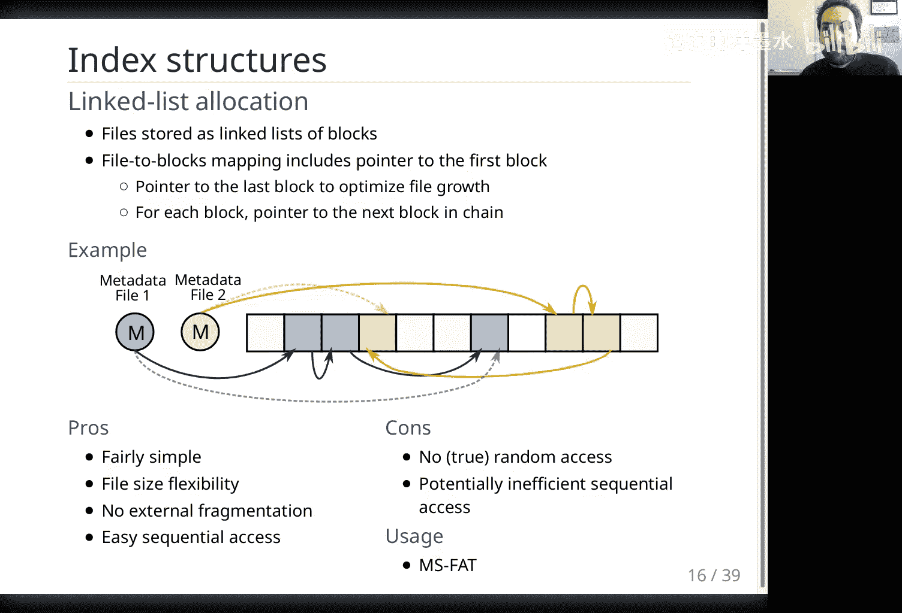

# 【全集 附课件】加州大学戴维斯分校 操作系统与系统编程 中英字幕 1080P p21 Lecture 21 - 文件系统实现part1 [BV1jXr5BBEKa_p21]

Hi， everyone。So last time we talked about the different abstractions around file systems。

 today we're going to start a new deck of slides， but now talking about the implementation of file systems。

So very quick recap here of some of the concepts。At the core of file systems。

 we essentially have disks or more largely like storage devices that provide us with a lot of data。

 it's essentially a big array of data blocks。A file system is the way that we can。

Use the method that we can use in order to organize。Filees and directories。嗯嗯。On that storage device。

嗯。So what's a directory is a way to organize the files so that we don't have just a bunch of files in that storage devices。

 we can organize them logically in a way that makes sense for us。

 human beings who are like putting a lot of data onto those hard drives。

And so we saw last time that a directory is really nothing more than the association between a file name。

And the file number so that we can find where the file is。

Onto the storage device and we'll actually talk a lot more about directories and how they're implemented in that presentation。

And then we have the files themselves。Whi obviously contain data that's really like the data that you want to put in the file。

 but also has some metada that describe some of the characteristics of the files such as you know。

The size， the time that it was created and the owner and things like that。Okay， so。

Now we're going to start talking about how do we design a file system。

 How do we design a way to organize directory and files。On ontoto a disk。

The objectives that we want to try to meet when designing a file system are thoughtfulfold。First。

 we have the objective of being performant right， we know now that like storage devices such as hard drives or a flash memory。

 they have limitation。Hard drives， for example， they have huge limitations。

 they are mechanical devices with a head that needs to move on different locations of the surface。

 it takes a lot of time and so on。嗯。The way that we're going to try to achieve the best performance possible。

 especially， say on a magnetic disk is to。Do what is called special locality。

 which means like trying to put。What goes together next to another on the storage device。 So。

 for example， like all of the data belonging to a file。

 we should try as much as possible to put that data。

In a contiguous manner on the storage device so that we can access it faster。

Then the second objective is one of flexibility。There are many different files。

And types of files and size of files that can be stored onto a storage device。

 and we essentially need to support all of them。We need to support small files and large files。

 we need to support files that will be accessed sequentially and files that are going to be accessed randomly。

We need to handle files that are。Goon to be accessed extremely frequently， like almost all the time。

 and also files that are almost never going be used。

And we also need to handle files that might exist for a fraction of a second and files that are going to exist for 20 years。

So the file system needs to handle all of those use cases。The file system。

 in addition to containing like directories and files。

 which is really what the user wants to have access to。

 it also needs to maintain some internal data structure。

 which is like all of the bookkeeping that makes that organization possible。

And so that's going to take a little bit of overhead as well。

 but that it's also part of the fire system and it also needs to be as resistant as possible。

And finally， there's an aspect that we're not going to really cover in those lectures。

 but it's a very important aspect is the one of reliability。And so here it means that ideally。

 the file system should be extremely resistant to any type of crashes of hardware air so that if you put files onto a hard drive like。

Ideally， like 20 years later， you should not have lost your data， otherwise that would be pretty bad。

So those are the objectives。Before we get to some like the actual implementation of file systems。

 we need to understand what are the different constraints。

 like what kind of considerations we need to take into account to design good file systems。

The first thing that we need to understand is the type of workloads that were facing。

 so here are a few examples that I thought were interesting。If you going on to CSIF。

And you look into the directory slash user slash bin。

 which usually contains most of the applications that are installed on the computer。

You see that overall all of the applications， they take about one gig of data， which is kind of big。

 but not that big。Now， if you look at how many files you have in slash user slash bin like how many executable files you have in that directory。

You have 4，500 files， like 04，000。500 executable files in that directory。

Which pretty much means that， like， on average。Each executable。

That is installed on any of the CSF computers is about like 35 kilobytes inside。

Which seems pretty small to me。Now， you take。Virral disk。Of say。

 like an Uuntu installation that I could have on my own computer。And now only for one find。

It takes 20 gigabytes。Sorry。So。That observation tells us two things， which is that。

Most files in general， on a computer， on a typical computer， most files are pretty small。But。

If you have one or more large files。They will take。Most of the storage space。

Which you can see here like I have almost 5000 executable applications。Tex one gigabyte。

 I have one virtual disk virtual box disk text twenty。Like 20 times as much。Here's another example。

In terms of file access and Io transfer。You can try that yourself。 It's an interesting experiment。

Imagine you run chromroe。And you want to know how many files。

Are being opened by Chrome when you start， when you launch it。

 just when you launch it when you like double click on the icon and it starts。

So here I use this tool， which is called S trace， which shows all of the ciscolls that are called by。

Chrome， when it runs。And I try to look at all of the open， like file opening Ciscos。

And then I count the number of them。And so when I do that。

It takes about like one second for Chroe to like。Show the， the， the window on my computer。

But in the one second that it shows the window and then I close it， Chrome has opened。😮，557 files。

 like it， it's performed 500 open ci on two files。Now， on the other hand。If I say， I copy。

My Utu Vi disk。Into another file。It takes。62 seconds。

It takes an entire minute to only copy this big 20 gigabyte file。What do those experiments tell me？

It tells me that when I use my computer。Most of the files that are going to be accessed are rather small。

 you see that here like just running Chrome for like a few seconds just to start the window and then close it。

It's already open 500 files。But on the other hand。It's when you deal with large files。That。

It's gonna take the most ion transfer。And so finally。

 the last few observations in terms of workload that I wanted to point out here。Most of the filess。

That are accessed on the computer。 They're usually going to be read or written to sequentially。

 like from beginning to end。 So typically like。When Chrome opens a bunch of files。

 they're usually like， you know configuration files or theme files for how the icons are going to be displayed and all of that。

 those files are just they're open and we read them from the beginning to the end。

And it is the same also for like running executables， you know like so you run an executable。

 it means that we need to open the executable and load the code segment and the data segment。

 that's also going to be done fairly sequentially。Some other files， it's more rare。

 they will be accessed randomly， meaning that we open the file and then we don't start running it from the beginning。

 we can jump directly to the middle， run read a little bit of it。

 then jump to another location in the file， read a little bit of it and so on。So for example。

 like databases are like that。But it's a little bit more rare。嗯。And then in terms of size。

 some files， we will know the size in advance， so for example。

 if you download something from the internet from a server。

 the server will most likely tell your computer oh。

 you want to download that file well the file is like two megabytes in size。So in advance。

 before you download the file， you know how much space it's going to take。But on the other hand。

 there are also plenty of files that are created on the computer。

That for which like upon the creation of the file， you have no idea how big or small it's going to be。

So for example， like if you redirect the output of a program into a file like you did in Project one。

 there's no way of knowing in advance how big this output file will be because it depends entirely on how much data will be produced at runtime by the executable that you're redirecting。

嗯。There's another consideration to take here into account。So you know that， for example。

On a hard drive。All of the tracks are divided into sectors， right？

You have sectors and each sector is 512 bys。On flash memory， it's not sectors。 You have pages。

 and typically， they are 4 kiloB pages。Well， so let's focus just on the hard drives here。

 so for a hard drive， the typical size of a sector is 512 byte。DOS can decide， well， you know what。

 I'm not going to allocate individual sectors when I give that space to files。

I'm going to allocate something that's bigger than a sector。

 I'm going to allocate a block of sectors。The rationale is that and you know that now。

When we access a certain sector。The actual transfer time is very small compared to the sick time and the rotation time。

To the point that like accessing one sector on the hard drive is almost equivalent as accessing eight sectors that are contiguous。

嗯。😊，So it doesn't really like cost more to access consecutive sectors。 so the US can decide。

 you know what， instead of。Allocating sectors individually。

 I'm going to consider sector sectors by block of， say， like four sectors or eight sectors。

 something like that。 And that's going to be the。The logical unit of data that we're going to use。

So now the question is like， okay， so you can use。Big block sizes。 So for example。

 like I a really large amount of sectors all at once。In which case。

The management is going to be less complicated because you have less blocks overall to distribute and to manage。

Performance is going to be improved because every time that you read a blog。

 you're actually going to read a bunch of consecutive sectors， which is pretty efficient。However。

If the block is not full of data， then you're wasting space。

 like if you allocate your sectors by4 by4。 but in fact， the file， say， only is using like only half。

Of one sector， then you're wasting like three and a half sectors because your granularity of allocation is a block。

On the other hand， you can also say we're not going to do big big blocks。

 we're going to do small blocks， so for example we're not even going to do blocks at all。

 we're just going to do like sectors by sectors。Well， in that case。

 your management is heavier because you have to keep track of multiple sectors。诶。Also。

 the sectors are not necessarily going to be contiguous like the file might be scattered through like many different sectors and many different tracks。

 so the performance are not going to be great。But you're going to less waste less。Data。

 if a sector or if a block is not full， because the block now has a much smaller size。So as a friend。

If。A big block size has some advantage and some inconvenience and then the small block size has some other advantages and some other flaws。

 you try to find a trade off that is somewhere in the middle。And a good trade off is to， in fact。

 match。The size of a memory page， which on most computers is 4 kilobytes。

So typically it means that you're going to see sectors。

 contiguous sectors to a size of4 kilobytes so that when you read a block of4 kilobyte sectors。

 you can just bring them into one single memory page in the run memory。Okay， so。

Kind of review of everything that we've discussed so far。

So we know that we have small files in the system and large files in the system， we might have both。

What's difficult is that for small files， we know that small blocks would be better because they would fit better the size of the file。

We also know that those files they should be like files that are being used together should be stored together。

 so for example， like all of the files of that are defining like the icons that Chrome is using。

They are probably in the same directory on the file system， they should be also grouped together。

On the the storage device itself， like the data should be close to one another because chances are when Chrome reads all of the icon files。

Of the hard drive， it might just access all of them at the same time。

Now large files they have a slightly different different story for large files。

 larger blocks would be more efficient because then we need less blocks to contain an entire large files。

We also probably want to have。All of the data of that large file be grouped together。

 like be contiguous on disk so that we can read or access this entire large file quickly。嗯。

And finally， large files that tend to be more accessed in a random manner than in a sequential manner。

 so we want to be able to access them randomly。The problem or the problems。

Is that and we mentioned that already like we don't necessarily have a lot of information。

Upon the moment that a file is created， like when a file is created， we have no idea where the file。

 if the file is going to be small or large， it might evolve over time。

 we don't know if the file is meant to be on the computer for like the next 10 years or if it's a file that the user will just like remove in two seconds。

And we don't know if the file will be mostly read or accessed sequentially or accessed in a random manner。

Okay， so。Those were the different considerations。 Now， let's start talking about the implementation。

There are different things that we need to keep in mind。So。The fundamental。

Mission that we expect from a file system。Is that。We say， hey。I want to access a filing。

At a certain offset。 So it's it's almost like you go to the library and the ideas that like I would like to get access to page 42 of that book。

And the goal of the library organization is to know where to find the book in which bookshelfs。

And then inside of the book， how to get to the right page。That's pretty much the same idea here。

You give a file name and you give an offset and the file system is in charge of like locating in which bookshes so which directory and so on。

 we can find it， get the file number from the file number understand where the data。

Of the file is located because it might be located at different locations on disk itself。

 like it's not necessarily contiguous。And according to the offset that we wanted to access。Actually。

 locate。Specifically， like which sectors are like which blocks on disk that data is。

That's the fundamental mission of a file system。In order to make that happen。

 we're going to need a few data structures。So we're going to need a data structure that。

For designing directories， so to handle the mapping between file names and file numbers。

 we're going that。When the file system will need to define the index structure。

How for a certain file do we express？Where the different data blocks are located on disk。

 like physically located， oops sorry。嗯。And then。呃。The file system also needs to keep track of which data blocks on disk are available。

The disc probably is not full like you have space on the bookshelves and you need to be able to track that space so that。

When new books are here， like new files are added to the file system。

 you need to be able to allocate new data blocks to put more data。系啊。And。On top of that。

 we want to be mindful that the implementation of the directories of the index structure of the free space map and so on needs to be as efficient as possible in terms of performance knowing that the storage device might have some limitations and so for that we need to use methods called locality heuristics。

That are meant to optimize the organization of the files and of the directories so that the access to them will be as fast as possible。

So let's start from the first one now we're really going to talk about implementation。

 let's start with directories。So in fact， a directory， it's just a file。

 which means that it's also a sequence of bytes。嗯。That means something。嗯。

And the meaning is that the directory will be a list of mapping between file names and file numbers。

 the ideas that like oh， to a certain name you can associate。A certain file number。

So at the very core you have a list of what are called like direct entries and each entry is the association between a name and a file number that's really what characterizes directorates。

Now， yes， directories are file kind of， but it's not like you can open them with your text editor that would be way too dangerous。

 directories have to be protected。Only the OS really has access to the raw data of those files and the only way that applications can also consult directories are by via Cisco。

 so everything has protected and applications can not start like ruining the organization of that mapping。

嗯。And here is an example that's from the project， but the principle is the same where you see like so that's the file that contains different directory entries and each entry here is on 32 bytes and it pretty much like in that case contains the file name and the file size and some information about where the file is located。

Now， overall， for the five system， we have different ways。To organize the files on the file system。

One very simple way， which is not I like a real hierarchy because it's a completely flat hierarchy is to essentially only have one root directory and all of the files are in that root directory。

 which is exactly what we're doing for the current project。Now on a real computer。

 it would be too limited because it means that all of the files of the computer could only be located inside of the same directory。

 so in terms of organization， it wouldn't be that great。And also。

 the computer could not handle having multiple users because all of the files would just be mixed between all of the users。

So。A first improvement， at least to ensure that each user will have its own space would be to at least provide one route directory per user。

But it's still very limited because。Even at the scale of a user。

 you still only have one directory for all of your files。

So what we have in typical current computers is a hierarchy that's multi user， but also multi level。

So you have one word directory that's the very beginning of this organization。

 but then you can have subdirecties。And so the files can really be like stored in a way that makes sense to the user with a lot of flexibility。

Now， in terms of how the directory file is organized， we have different organization。

The most simple one， which is also the one that we're doing for the current project。

Is a very linear layout， which means that you have an array of entries。That would be the file。

That represents a certain directory and essentially you have entries。

There are usually the exact same size for the current project is 32 bytes。

 that's the exact same size for all of the entries。And for each entry。

 you have a file name and a file number。When an entry is free。

 then there's a way to flag it as's free， but like。

It's still an array that has a certain size that contains either entries that are valid or free entries。

嗯。And so that's typically the organization for the current project and also the organization for file systems such as Microsoft F。

The prose is that it's extremely simple。😮，The cons is that because all of the entries have exactly the same size。

When you're looking for a file inside of a directory。

 you really need to scan this entire file and all of the entries。

From the beginning of the file to the end of the file。

 that's the only way that you can know if a file is part of a directory or not。

Which can be a little slope。So。😊，If we are in person， I would ask the whole class。

 what data structure do you know that's a little bit better than a when it comes to traversal？

And hopefully， you would answer。Maybe a link list。So that's the next type of organization。

 instead of having an array of entries， you have a linked list of entries。Now， for each entry。

You have a fine name。 You have a fine number。 That's the typical mapping。

 but you also have kind of a next pointer。Like another field as part of the directory entry that tells you。

 well， the next entry in that directory that's valid is located at this offset。

And so now you have like multiple entries， they follow one another， but whenever you have。

Some free space。In between two entries。The next pointer will allow you to essentially directly jump over it and not waste time like looking at every single entry。

嗯。So at least we have this little optimization。However， again， like。

If you want to check whether or not a file name is spot of a certain directory。

 you still have to traverse the entire list from beginning to end。

Wwhich has a linear complexity and can start becoming slow if you have say like a thousand files inside of the same directory。

 which can happen so yeah。So again， if we were in person， I would ask you， okay， what other。

 what is another data structure that you know that is slightly better than linked list for organizing data？

And you would all answer。Maybe a tree， okay。So the next organization。Is using a tree。

So this one is interesting。And a lot more complicated。 The idea here is that。

If you're looking for a certain file。Inside of the directory file。You would first hash the finding。

And get some sort of key， like an a nu key。And then this key would allow you to traverse。

A tree like that's usually a B plus tree。From a certain root node in order to find the leaf。That now。

Contains the mapping between that file name and a certain file number。Advantages。If you have。

Diories that contain thousands of files， your search is fast because you're not you don't have a linear complexity。

 you have a logarithmic complexity， which is a lot better。However， as mentioned。

 it's a lot more complicated to manage。But it is a technique that is used in modern fire systems such as XFS on Linux or NtFS on Windows and so on。

Okay， so。That's it for directories。Let's talk about the next issue。

The next issue is the indexed structure。So。At this point， okay， we have a fine name。

We have the directory structure。 So from the file name， we're able to identify the file number。

The file number gives us access to the metadata of the file。

 which contains the file structure and should allow us to find the content of the file。

 the actual data。But we might have multiple options in terms of how do we find the content。

 the data blocks that correspond to a certain file。We know that we have multiple goals。

The goals is that。As much as possible。We would like the data blocks for certain files to be placed in a contiguous manner because we know that on certain storage devices。

 it's going to get us much better performance。We also would like as much as possible that say if we open a file and in fact。

 we don't want to read it sequentially， we want to jump。

Rightrite to the middle of the file and start accessing the file from there， it should be fast。

That's random access I want to access a random location within my file and I want it to be quick。

We want to be。 we want to make sure that we can support。Big files。

 but also small files or very small files。And finally。

We need to be able to manage the metadata itself。So all of those are the different goals and constraints around this index structure。

So let's start by probably the most simple。Index structure， which is the contiguous。Structure。

In that strategy。The metadata of a file will essentially need to contain two pieces of information。

The first block。On the disk that contains the files data。And then the size of the file。And because。

The allocation of blocks is contiguous。 we know that like if the data starts from a certain block。

Then we just need to read the blogs。sequentially， and we have access to the entire file。

And same here if we have another fight。嗯。So now imagine that we wanted to create a third file。

We need to handle the allocation of free blocks， there would be like different strategies such as first fit or best fit or worst fit。

 which means that we have essentially like different policies in terms of allocating free blocks to Mac new files。

That strategy is pretty simple， right， you only have two pieces of information。

What is the first data block and how many data blocks do you have。

Performance is awesome because you know that so if what you're using is a hard drive。

 then you know like， okay。Put the head over this。The sector。 and then you can just start reading。

And you're gonna read the entire file。And because everything is contiguous。

 performance is gonna be great。And。😊，Sequential access is awesome。As well as random access。

Because we know where a file starts and we know that all of the blocks are contiguous。

If I wanted to say start reading from the middle of file2， I could easily deduce。

From the information， where does the data start and how long is the data I could deuse。

Where to start reading if I wanted to read from the middle of the file。

 and that's a decision that we can make in advance。

And then move the head directly over the right sector and start reading from there， very easy。嗯。

The cons here。Is that because all of the blocks need to be allocated contiguously？

Then we might need to move entire files around when they grow。So for example。

 imagine that for file one here， which is currently taking two blocks。All of a sudden。

 the file grows and now requires five blocks。Well。It already took two blocks here。

 I only have two blocks that are available right after afterwards， but then there's another file。

 So I can't actually like， make it grow。Kind of in place。

 we would need to find elsewhere on the disk 5 continuousiguous block so that that file can grow。嗯。

And last， we are suffering from external fragmentation。Which means that if on the disk。

 we are not able to find five cons。Free blocks。 then the file cannot grow。 Even though in total。

 we might have five blocks total。 It's just， we don't have them anywhere contiguous。

I'll go back to this fragmentation in the next slide。嗯。Even if it's very simple， it actually exists。

In some optical disks， So， for example， like CdRs or DVD or blue blue rays。

Because those types of medium are kind of burnt once and for all with files that we already know the size of。

 it's a very simple way to burn a CDR， like say you want to burn like 10 files onto your CDR by the time you burn them。

 you know exactly the size that they have where they' are going to be located and everything。

 so it's very possible and easy to put their content in a contiguous manner onto the medium。嗯。Okay。

 so very quick digression here about fragmentation。There are two types of fragmentation。

One is called internal fragmentation。Internal fragmentation is when you allocate。Space。

Block by block。😡，If a block is not entirely full， then you're wasting some space。

That is called internal fragmentation。And we talked about it。

 we kind of mentioned it when we talked about the size of a block that could be much larger than the size of a disk sector。

Or smaller。 And that would affect the internal front。Now external fragmentation。

 which is what we just talked about， is completely different internal fragmentation means that you have some free space。

On your disk。Exile fragmentation means that you might be in a situation。

Where say you need a certain amount of free blocks。That need to be contiguous。

But it's not contiguous， so in fact， you cannot allocate four blocks。

 even though total you have them。When that happened。

 it means that you're suffering from external fragmentmentation。

Which is exactly the case with the contiguous allocation strategy I just presented。Okay， so next。

Another kind of allocation of blocks is a linked list allocation。So here the ID is that。

The meta of a file would contain a pointer。2， the first block that contains the files data。But then。

That like the the the files data would not be stored contiguously from that first block。

 What would happen is that say at the end of that block， we will have a pointer。

To where the next block containing the data is located and that next block might be， in fact。

 contiguous。But it might also not be contiguous and just be stored like anywhere else on the disc。

We can just follow the chain like from the metadata， we have access to the first block。

 and then each block gives us access to where the next is located and the next can be located anywhere。

And so same here for like file two， so for file two the first block is located somewhere。

 then the next one is located right nearby by and the next one is located even like。K of。Before that。

And as an optimization。To make it faster for a file to potentially grow。

The metadata might have a pointer。Onto the last block。So that from the last block。

 we can quickly say， like allocate a new one。And have a pointer on the new one。The pros。

 its still fairly simple。Now we gain the possibility that we have a lot of flexibility in terms of file size。

 files can grow very easily， we just need to allocate new blocks wherever they are and just put them as part of the chain and it works。

There's no external fermentation because we do not need anymore more for blocks to be contiguous that can be allocated like anywhere on disk。

嗯。The sequential access is easy。In the sense that if we want to read a fight from beginning to end。

Then we start from the metadata that gives us the pointer to the first block。

 and then we just follow the chain。However。Even if the sequential access is easy。

It is potentially extremely inefficient。Because the blocks now， they are not located。

 they are not contiguous to one another。We might have like a block。

On a certain track somewhere on the disc， and then the next block might be like on the other hand of the disc。

Which means that we're going to have to pay a lot of sick time to jam from one block to the next。

 So even if like。The sequence to read them is easy to figure out。The performance。

Might be absolutely terrible。Also。We don't have random access。Let me remove some some of。Here然。

If we say， okay， I would like to jump directly to the middle of file 1。I can't do it。I have to。

 the only information that I have is where the beginning is located。

So even if I want to drum directly in the middle， I still need to start from the very first block and then follow the chain。

In order to find where the middle of the file is。So I still need to traverse the file from like beginning to whichever location I want to access。

That type of allocation is the one that's behind， so it's not exactly like that and we'll see the differences later。

 but like it's pretty much the one that's behind Microsoft Fa and the one that's behind the current project。

哎。Okay， we're going to stop here and next time we'll continue discussing the other strategies。

