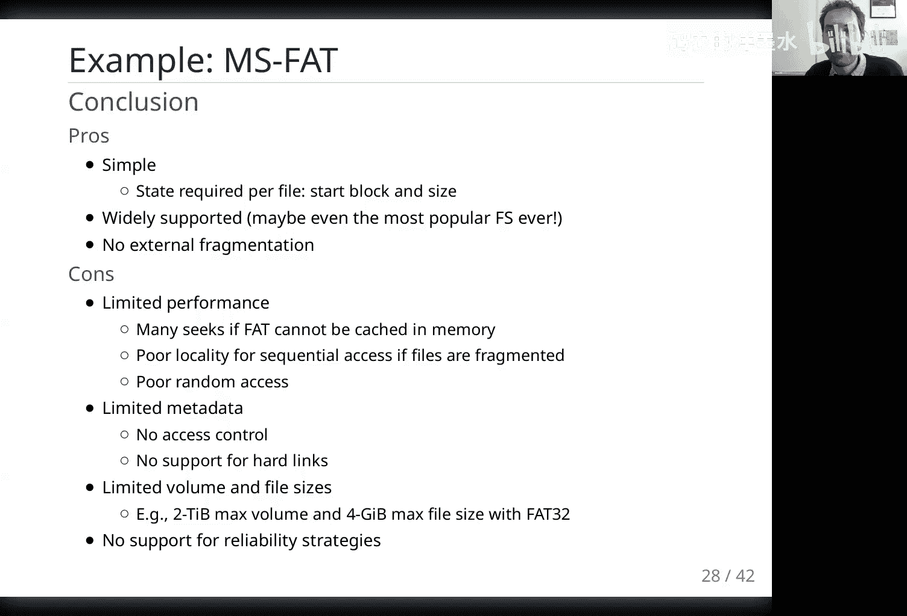

# 【全集 附课件】加州大学戴维斯分校 操作系统与系统编程 中英字幕 1080P p22 Lecture 22 - 文件系统实现part2 [BV1jXr5BBEKa_p22]

Hi everybody， so today we're going to continue talking about the implementation of five systems。

We're going to see more of the different index structures。

And we're going to start studying or study the first case study by looking at how Microsoft fat works。

But first， quick recap from last time。So we determine that in essence。

 a file system is a way of organizing all of the physical data that is provided by master devices such as hard drives。

 SSDs， stuff like that。And the goal of the file system is that from a certain file name and a certain offset。

The file system must provide methods and data structures so that from those two information。

 we can essentially locate where the information is on the actual device。

So we start from a file name and an offset， the directory tells us from that file name where is the file number。

 from the file number we find the file metadata， the file metadata will contain the index structure。

 which means where the data of that file is actually located on disk and finally we have access to where the data is on the disk and we can read from it or accessing。

We started talking about the implementation of those different data structures， namely directories。

 so we saw that for directories we had directories were files， like typical files。

 which means that it's a bunch of consecutive data。

Except that it's data formatted in a certain way made of directory entries。

And we have different strategies， one is to just have consecutive entries。

Of the same size and have pretty much an array of entries。

Then we saw that another strategy was to have essentially a linked list of entries where every entry points to the next one。

 and that allows us to like jump over consecutive free entries that otherwise with the array strategy we also need to analyze when we're looking for a file。

And finally， the better strategy， which is now used by modern file systems is to。

Fmat a directory or the entries of a directory with a tree。

 which gives us a much better time complexity to look whether a file is in a tree or not and find the file number that corresponds to it。

So that's for directories and so again like from a directory we get a fine number then we get to the metadata into the metadata we have the information of that says okay for that file。

The file is of a certain size and here are the different locations where the data for that file are on the actual storage device。

嗯。And so the first strategy that we saw was called contiguous allocation。In that strategy。

 the file metadata will contain two pieces of information that's it。

 the first is the size of the file， the second is where on the storage device the data starts like on what block。

And then with that strategy， we're guaranteed that all of the data will be contiguous on the disk。

That's a super simple strategy， the performance are amazing because the data will always be stored contiguously。

However。It also has a bunch of flaws， for example， like the fact that it's not very flexible if a file needs to grow because say like the user is writing more data to it。

 then were kind of stuck because the data needs to always stay contiguous。

 so if we're faced with external fragmentation， which means that we potentially have enough free blocks。

 but they are not contiguously located， then we can be blocked growing a certain file。

Second strategy that we talked about was the linked list allocation。

 so here the metadata would also contain the size of the file loop metadata always contains the size of the fiber。

Here， the other information that the metadata would contain is a pointer to where the first data block。

Corresponding to the file is located。And then inside of that data block。

 say like the last word of that data block would be a pointer to where the next data block is located。

And so now we have a chain of data blocks and any free block can be allocated as part of the chain if the file needs to grow。

 so here we have a lot of flexibility。However， in terms of performance。

 it can be not that great because it potentially means that to read all of data for a file。

 we're going to have to jump to different locations all the time。Which， as you know。

 on a cell on the magnetic disc would not yield very good performance。Okay。

 so let's continue talking about other type of index structures。

The next one is called direct allocation。So here it's an interesting one。

It says we essentially have an array of pointer。That is located directly into the metadata itself。嗯。

And so say like file， the files data spans multiple data blocks。

 we essentially have an array of all of those data blocks。And that array has pointers。

That can point on any blocks。So。Here with that strategy。

 we also have the flexibility of having small sizes by having， like， say。

 a small array of pointers or say， like large。Fileles by having an array that's bigger。呃。

That strategy supports true random access。If I say here， hey。

 I want to access exactly like at the middle of my file。It's pretty easy to access。

 just like the middle pointer。Of that array and get access to the block。

That contains like whichever a bite is the middle of my file。嗯。

The massive issue with that strategy is that。Because we have this array of pointers directly part of the metadata。

Were pretty limited in terms of file size。Unless we we allow the metadata to become big。

 because if we have a very large file， for example， that array would become massive。嗯。

Usually in computer science， it's。For something like metadata， we don't want to have。

A metadata can that can be of different sizes， like a small metadata for small files and a big metadata for big files。

 usually like for something that's metadata that。That's common to all of the files。

 it's better to have a data structure that's always the same size regardless of the size of the file。

嗯。So that strategy is interesting， but it wouldn't really like support very large files unless you can accommodate very large metadata。

 which is difficult to do。So here is another strategy that is not perfect。

 but will get us towards something that's a lot better。The next one is called indexed allocation。

It's very similar to the direct allocation， except that instead of having the array of pointers。😊。

To the data blocks。As part of the metadata file， we're actually going allocate。A data block。

Especially to contain those pointers。So now the metadata here is back to a fixed size that's rather small and only contain a pointer to this。

Index block。Which is a regular data block， but that's actually not really like used to contain any data from the file itself。

 it's more like for the bookkeeping。And so。This index block will now contain a list an array of pointers。

 as many as necessary to actually cover all of the filess data blocks。

And so we'll half pointed to the actual data blocks for the file。And走。If we。

 if the file grows and we need to allocate a new data block here， we'll add a pointer。

To that data lock inside of the index index。The pros and cons are very similar to the direct allocation one。

 namely that we can handle some file flexibility in terms of size。

Here the pro is that like now the metadata doesn't contain this information anymore。

 we've kind of like extracted this information outside of it so that we are back to having a metadata that is a fixed and rather small size。

The cons are also shared or the same as index allocation in the sense that's。Once this index block。

Is full like all of the pointers are taken and pointing onto to some。嗯。Data blocks。

 then it means that we've reached whatever maximum the size of the file can be。

We're also touching to a new issue here， which is that we have some overhead now for a small file。

 So let me give you an example of that。Imagine I have another file。Se like file number 2。

So that would be the metadata。And it turns out that file number two。Say only has4 bytes in it。

Something like that just for byte， super， super small file。With that strategy。

 it still means that file number two would need to allocate an index block。

This index block would only have one pointer。😮，Towards。Another block。

 which is now the data block containing the data for the file， and we'd have。In that data block。

 the four bytes that the file really contains。So， obviously， we。

The fact that we allocate data blocks， even if if the file only has4 bytes。

 we're going to have some internal fragmentation here。

 we have a big a huge portion of that data block that's wasted。

 but there's really nowhere around that like that's the price we need to pay however。

 with that strategy we're also wasting another entire data block to only contain one pointer to the file's data。

That's now a pretty big overhead。Okay， moving on。 So here， the big issue。

Is the fact that we're still limited in size like once a file is grown enough that all of the componentss in the index block are pointing to data blocks。

 then we reach the maximum of what a file can be。How do I not have this limitation？Well。

 one solution。Would be to link different index blocks to one another。 So that's the next strategy。

So here I have still my metadata， the metadata points to the first index block。

Imagine the index block can contain up to n pointers。If it can contain n pointers。

 then we' are going to have n minus1 pointers that are going to be towards actual data blocks。

So the file has like n minus1 data blocks into which it can put some data if it's not enough。Then。

 the。Last pointer， the very last pointer of the index block， can be used。To point to another。

Index block。And so here we now get another n minus-1 pointers onto some other data blocks。

And now our fight can really start growing like pretty much as much as it needs。看。

So we get a lot better flexibility to handle very large files。Now， as you can imagine。

 if the file becomes really， really large， then it also means that we're going to have to traverse this linked list of index blocks。

 which could take a while。So here is an example like imagine I have blocks。Of。4 kiloBs。

Which is a very typical value。So the pointers that I'm going to have in the index blocks are going to be pointers on 32 bits。

So I'm essentially going to have。1024 pointers。Per index block。Now imagine I have a file。

That's of size，4 gigabyte。It's a pretty big file， but it's possible like fogging Ayte is a very possible file to have on your computer。

诶。In order to cover a file that is that big， I would pretty much need a linked list of 1024 different index blocks to cover this entire file。

Which means that。If we want to access the last data block for that file。

We would need to make 1024 disk access to traverse from the metadata file。

 like all of the index block， Find the last index block and from this last index block。

Get access to the last data block of the file。So we're talking about a lot of disk access。

 And if you remember the lecture about hard drives， we know that like randomly accessing。

512 different requests， like 512 different blocks or sectors。Tt multiple seconds。 so it's pretty bad。

So how can we do slightly better， actually， a lot better， but by tweaking a little bit this strategy？

Well， the next one is somewhat similar。But now we're going to use instead of a linked list of index blocks。

 we're going to use a tree of index blocks。So。Essentially， the idea is that from the files metadata。

We're going to point to a first index block。But this index block。Doesn't point on data blocks。

It points on other。嚟 second level。Index blocks。And that second level now points onto data blocks。

So essentially， we have a structure where we have this index block of first level。

Point onto index block。Of second level。And those point onto the actual。Data blocks。For the file。

If we run the same sort of。Example as before， like have with a file of fog Gitetes。Now。

 I actually only need。Two levels。Of index blocks。In order to be able to address a file that's4 gigabytes。

 which reduces the number of disk accesses that I would need to do by a lot。And so here like great。

 great report for very large files。😊，The massive issue with this strategy is that for small fights。

It's terrible。let me啊。Explain here。Os。O。Again， if I have a file that only contains， say four bytes。

 very， very small file with that strategy。I still need to allocate an index block of first level that's only going to have one pointer onto an index block of second level。

 that index block of second level will only have one pointer to one single data block and in that data block will have or four bytes。

So now for4 bys， I'm wasting， essentially like。Two two extra data blocks plus whatever is already wasted here by not having a lot of data within that data block。

嗯。As we'll see later， when we studied the the。Secondagon case study， not today。

 but in the next lecture。We'll see that the best strategy between all of those like all of what I just presented from direct allocation to index allocation to this one like multi level index allocation。

 they all all have like。Very nice advantages and also like a set of pretty strong drawbacks。

And we'll see that in fact， as often in computer science， the best strategy is a mix of all of them。

 essentially it's a way of finding like， okay， how how can we take advantage of all of those strategies depending on the situation and we'll see how it's pretty interesting。

Okay， so。Now let's talk about a real example of a real file system called Microsoft fat。

 which is very similar to what you have to do for the current project。

So Microsoft Fa fat stands for file allocation table we'll talk about about it in a second。

 it's a pretty old file system that was invented in the late 70s originally for floppy disk you know this like old disk that were flexible and that were like very very small。

 I think it was just they could only contain a few kilobytes of data so it's a long time ago。And。

Fat was the main file system on Microsoft DoOS was also the main file system on early version of Windows。

 so Windows 3。1， 9598 were all like the main file system was fat 32 and then I think from Windows XP around like gear 2000 or something。

 the main file system became NTFS。But even if it's super old。

 it still today remains like very popular because it's extremely simple。

And sometimes you don't need really more than that so on many systems often systems that are either small or embedded systems like systems that are mobile。

 it remains like a pretty popular option。It's also one of the first file systems that new Oasis will like support like kind of right off the bat。

 so it makes it extremely popular because it's implemented everywhere。

There there have been like multiple versions over time， so for example。

 like fat 12 could only handle like hard drives or like drives of 30 megabytes。

 so not very big storage devices and only about like 4000 files。

Then fat 16 like push the limits now we could have hard drives of like2 gigabytes and about like 65。

000 files。Then F 32， which was probably the most like popular of all of those versions。

 could handle now hard drives up to two terabytes。And about like 250 million files。

And now the latest version of the fat format， which is still very popular today called X fat。

This one has even pushed the limits even further， it can support hard drives up to 128 petabytes and about like 2 billion files。

 which is a lot more in line with like the current standouts。And so。These Microsoft fat， the。

 the pretty big feature of it is this fat， which is the file allocation table。诶。

It essentially it implements the linked list strategy for allocating data blocks。

 where if you remember the metadata will point on to the first data block。

Of the file and then each data block has a pointer to the next data block and so the file can like essentially use multiple data blocks。

Each of them pointing on which one is the next one。Except that。

Instead of having this next pointer be part of the data blocks instead itself。

 this next pointer is exported in that fat table。 So essentially like the those pointers have been decoupled from the data blocks themselves。

 but the principles is exactly the same。嗯。😊，So if you have a file that spans multiple data blocks。

 then the linking of those data blocks will be made through the fat via corresponding entries。

The fat also has another purpose， which is to track which data blocks on the file system are available for allocation。

So let's actually like zoom even more into this fat allocation table。So here's an example。

First of all。The fat that's an array with entries that are like not very big from that's actually like the what the name of the fat version comes from so if you had fat 12 then it meant that the size of each fat entry was 12 bits fat 16 means that every entry in the fat was 16 bit and fat 32 it was 32 bit so that's where the name comes from's it's the size of each fat entry。

And so the idea is that this fat is an array that has a certain number of entries and that number of entries correspond exactly to how many data blocks you have on the file system。

 you have one entry per data block。For legacy reasons。

 the first two entries and the first two data blocks are reserved and cannot be allocated。

 cannot be used。So now the fat is used。As part of the index， the index structure。

To essentially like explain how a file， like how the different data blocks for a certain file。

 where they are and what is the order of them。And the way that it works is that the directory entry。

Will map a certain file name too。A certain index。Of data block。

 And that will be the first data block of the file。 So， for example， for find4 dot T X T。

 it tells us that the first data block will be data block number 9， which will be this one。

 That's where we find the first 4 k for that file。If that file is greater than 4 kilobytes。

And that's the case here， because in the directory entry， it tells us like， well。

 the fight is actually like 18 kiloby。嗯。Then it means that we have more data blocks associated to that file。

And if we go to entry number 1，9， it essentially tells us， well。

 the next data block that contains the， the next 4 kB will be block number 10。 So that tells us。

 okay。The next block is black， number 10。And then block number 10 tells us the next one is block 11。

So here we have a case where three blocks are in fact， contiguously allocated on disk。

 but it doesn't have to be the case。Here at entry 11， it tells us， well。

 the next block for that file is block number three。Which is。

Located somewhere else on the fire system， and it's fine。And then the next one will be block 17。

And finally， block 17 here， which is， in fact， the fifth block for that file。Is the last one。

That block contains the end of the data for that file。

And so it means that it's the end of the chain of data block and it's reflected in the fact that having this specific code EOC end of chain that it's a marker that specify okay。

 that's it like the chain ends so it's a little bit like linked list where the last item as an next pointer of no and that's how you determine that it's the last node in the linked list。

实在是第一点。As I was saying before， the fat has offers two features， kind of two in one。

 the next one is that it also allows us to very easily track the free space。Because every entry。

That is initialized to zero that has a value of zero。Means that the corresponding block。

 So here like block number7， which is this guy or block number 14 here and block number 19 here。

There are data blockss that are free， they' are available for allocation。So imagine that like。

Soon enough， the user opens food。tD and start typing some more data and then saves。

It means that full dot Txt needs to grow， and so we need to allocate more data blocks we'll be able to scan the fat table。

And find an entry that's worth zero。 And that means， okay。

 this one can be allocated to now contain data from a certain file and therefore become part of a chain。

And。And actually， speaking of。Going through the fat to find empty entries。

There's a strategy for that and usually in fat implementation。

 the algorithm that' is being used is called nextfi。What it means is that。

Whenever we look for an available entry in the FAso for an available data block。

We're going to start from the last location。That was allocated。So say。

 I don't know if the last block that was allocated on this file system was say block 17。

 That's the very last one that like bar dot T0 grew a little bit。 And so we had to allocate block 17。

The next time we need a new block。We're going to start the search from blocks， sorry， 16。Onwards。

And so the next block that should be allocated will be block 90。

 even if we have three blocks before that， we always start from the last one that was allocated。

The rationale is pretty easy to understand is that。

If you were to always start looking for a free block。Back from like the beginning of the fact。

You will be more likely to have to search for a long time before you find an available block because you would go over blocks that were just allocated like moments ago。

And。And FYI in as you know， for the current project， we are not using this next fit algorithm。

 we' are actually using the first fit algorithm， which is going back from the beginning of the fat all the time。

 which is not necessarily the best strategy， but for the project wanted to do make it pretty simple。

But ideally， we should use a next fit。And。So that's for the fat structure。

Now we have the directory structure。 So again， like a directory is a file。

It's a bunch of coniguous data。And it's a file that's organized as an array of entries。

 and each entry is of fixed size， which is 32 bits。A bitete， sorry。

And so for each entry in that 32 bytes， we have a certain amount of information about the file。

So typically we have the file name。So originally on fat 12 and fat 16。

 I think the file name was pretty small， you could only have a fine name of eight characters plus three characters for the extension。

And so there you see it， like that would be the file name from here。To there。

 and that would be the extension。嗯。I think starting from F 32。

 they came up with a solution to have long files that were bigger than just like 11 characters characters total by allowing to chain multiple entries kind of into one。

 but it's a little complicated and we're not going to study that。

And then you had like some other type of information such as like the creation time and the creation date of the file。

 the last time that it was accessed， the last time that it was modified and so on。

You also had the index of what they called the first cluster。

 which is essentially the first data block。Where the first data block of the file is contained and the size of the file and then you have some like other so I think this one is just like padding。

That's a byte that contains some attributes about the file like is it a file or directory。

 is it like Rily or is it a hidden file or like that kind of stuff？But anyway。

 those bitetes are not very important。Do two things that you can notice here from。That organization。

 that director structure。The first one is that， as you can see， there's no information。

About who this file belongs to。Which means that there's no control sharing。

If you have a volume that's formatted in fat 32， say？And you have multiple users on the computer。

 It's impossible to say， oh， that fire belongs to a certain user and should not be accessible by other users。

 There's just not that information that's embedded into the description of a file。

 So a big issue here， like no control sharing。Another thing that you can notice。

Is that fat doesn't allow hardlings。And the reason here is that in order to support hardlings。

 you want to have kind of a two step process。 You want to be able to associate。

A file name to a file number。And then from that final number， you can find the metadata。

And that allows you to have multiple names point onto to the same file number and therefore the same metadata。

Here， in fact， the fine name。Is， in fact， directly associated。2。The metadata of the file。

So we're missing that step which would offer this like abstractstruction。

Here we have a name that's directly associated to the metadata。

 so it's impossible to have two entries。That I in fact relate to the same file。

 and that's why Microsoft fat cannot support hard links。Okay， and so overall。

To kind of like sum everything up， here is the layout of of those different structures on disk so。

If you look at， say， a thumb drive， USB key that is formatted in fat。Then， the first block。

Will be the super block that。Explains how the file system is formatted and how many blocks there are and so on。

 like some information。Then we're going to have some blocks for the fat。

Then we'll have some blocks for the root directory。

 and then we'll have the remaining of the blocks that can contain actual data。And。

And here's a little bit more about some locality heuristics。

 So how do we overcome some of the potential limitations coming from the hard drive itself。嗯。

What we know here is that， say we have a hard drive that's formatted in fat。

And we want to say read the file4。tt from beginning to end。Well。

 we know that accessing the first three blocks should be rather fast because we'd move the heads。

Over the sector that correspond that corresponds to that block。

 And then we can read a bunch of sectors in a row， like because they're continue their cons。

 and the hard drive knows how to do that pretty efficiently， however。

After reading those three blocks， then the next one needs to be read from here。

Which means that we're going to now have to move the head over to another sector。

Read a few sectors and then move ahead again somewhere else on the disk and read some other sectors。

So we're going to have a lot of like head movement， which is not great as we know。

The strategy here to improve。To overcome some of that limitation is to do something called def fragmentation。

Which essentially means that we can rearrange the data blocks。

And make them contuous to improve the spatial locality。

So here is an example of how we could do it we could。

Reorganize the blocks and make it so that like on disk。

 all of the blocks for a certain files would be in the right order。

And say all of the free blocks would also be contiguous so that like we can allocate them in a contiguous manner。

So that that's a strategy， I don't know if it's still a thing。

 but I remember that back when I had Windows XP on my own computer like 20 years ago。

Every Saturday morning was dedicated to running the de fragmentmentation tool and I would wait for like two hours like seeing the little blogs that were like being rearranged to supposedly like improve the performance of the computer a lot so that's how it works。

Okay， so let's conclude on Microsoft Fa。It is， in fact。I don't know if you agree on this one。

 but it is simple， it's a pretty simple file system maybe when we study in the next one you'll see why this one is simple the state that's required per is pretty easy we just need to know the start block and the size and then we can follow along the chain through the fat to understand how the file is organized。

😊，It's extremely widely supported。Like pretty much all existing Oss have a fat driver and know how to read fat file systems。

And because of using this linked list allocation block allocation strategy。

 it doesn't suffer from external fermentation。As long as we have free data blocks available。

 they can be allocated to a certain file。Now it also has a bunch of drawbacks。So。

In terms of performance。There are some limitations。The first one is that。Ideally， the fat structure。

 the fat array。 you want to read it from disk entirely so that you can go through it。

In Ram so that it's fast。The thing is like。If the volume that's formatted in fat is big。

 then the fat itself will also be pretty big。 And you can't really read it entirely inside of the disk。

 So， for example， if you have a partition on a hard drive。Which size is like 400 GB。

Which is for two day standard， not a huge partition size。 like it's， it's fairly standard。Well。

If you have a part of 400 gigytes and your block size is 4 kilobytes， then your fat。Will have。100。

Mega entries， like 400 million entries。If each entry is 32 bit in size。

 then it means that your fat has a size of 400。Mgaby total， which is now huge。

 If you have a laptop that only has。8 gigytes of Ram and out of that8 gigyte of Ram。

 you need to dedicate 400 megabytes just to contain the fat in memory that's big。

If you cannot read in the entire fat in the RA memory。

 then it means that you're going to have to access it on disk。

And now it becomes painful because if you have a file。That spans multiple data blockss。

 and you need to go through the linked list by reading the fat and every time you need to make an access to the fat。

 that's going to be costly。So， that's an issue。As we mentioned in the previous slide about deramentation。

If the fires are fragmented， then the sequential access to fires might be pretty bad because the different blocks composing of a file will not be coniguous。

 and that's going to make like a lot of head movement。And then finally， for in terms of performance。

Random access is not great。If say you want to open a file and directly jump to the middle of it。

 you still have to go through the fat and follow the chain up until you identify which block is the middle one。

 it's not an information that you can pre calculateculate in advance。As we mentioned already。

 the metadata， because theyre kind of part of the directory mapping already。

We lose a lot of flexibility。Like there's no support for hard linkss， for example。

 as we talk there's also no access to control， we don't have any information about file permissions like file ownership or anything it just doesn't exist。

And finally as we kind of like slightly mentioned at the beginning。

 I mean so that depends on the version， but for the most part like the file systems that are formatted in fat are usually like pretty limited and in terms of sizes like the size of the partitions or like the size of the files。

 so for example with fat 32 which was the most common fat implementation for decades。

It could only handle a maximum of two terabytes， which nowadays is like fairly stand out for a hard drive or an SSD and a file size of four gigabytes maximum and again like two dates very typical to have files that are a lot bigger than four gigabytes and finally。

嗯。We're not really going to talk about that in this class， the reliability strategies。

 making sure that a file system would still work even if it crashes right in the middle。

 but at least fat doesn't provide any strategies for reliability， which means that。

If in the middle of writing some data or updating the fat also on like interacting with the file system。

 the system crashes， you probably will have lost actual data that you cannot recover from。

Which with other file systems would not be the case。Okay， so that ends。😊，Today's lectures。

 and next time we're going to talk about another case study。

 another type of file system that was mostly used on UniX computers。

