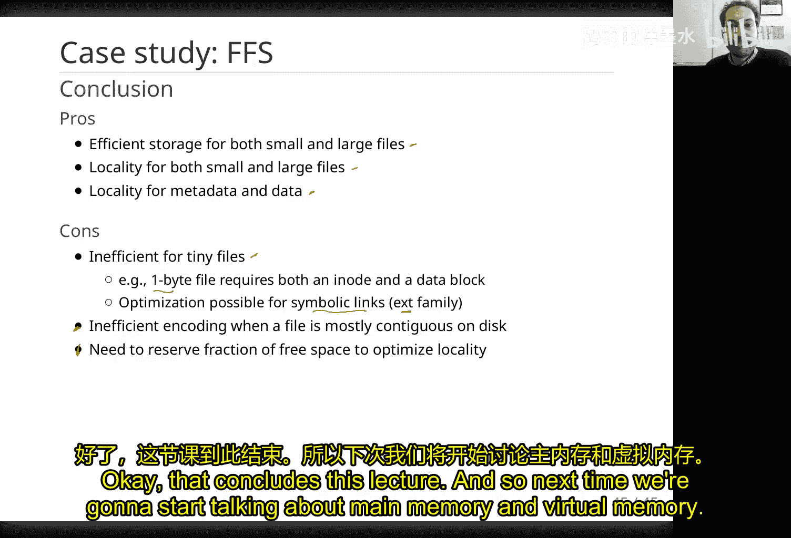

# 【全集 附课件】加州大学戴维斯分校 操作系统与系统编程 中英字幕 1080P p23 Lecture 23 - 文件系统实现part3 [BV1jXr5BBEKa_p23]

Hi， everybody。So today is the last part of our current topic file system implementation。

 it's also the last lecture of this big topic that we've been talking about for a couple of weeks around storage devices and file systems。

So next time we're going to start a new topic around main memory and virtual memory。Okay。

 so quick recap from last time， last time I presented this case study around Microsoft fat。

 this pretty old file system invented by Microsoft in the late 70s。

 we talked about the different ways that fat was implementing the different things that we need in the file system such as the index structure。

 so with Microsoft fats， it's implemented with a linkedist strategy。

Where blocks are kind of chained to one another using this， the file allocation table。嗯。😊。

Where essentially， I mean， it's a linked list， like every entry in the fat corresponds to a certain data block。

 and if that data block is part of the of a files data。

 then its content is essentially the number of the next block in that chain of data blocks。

The fat serves two purposes， in addition to this index structure to represent files。

 it also tracks the free space。So the way that we can know whether data blocks is available or not for allocation is that the。

Corresponding entry in the fat array will be 0。And finally， to optimize this file system。

 we have some locality heuristics。Two of them， the first one is the way that data blockss are allocated when we need to create files or when certain files are growing and we use what is called the next fit policy。

 which means that the next datab that will be allocated。

We will start looking for an available data block from the last location from which a data block was allocated。

嗯。😊，And second， to optimize。The location of data for files。

 we can run a different fragmentmentation tool that were essentially like arranged different data blocks so that they end up being consecutive on disk so that we can benefit from sequential accesses。

And so in conclusion， it's a pretty simple file system that has been around for like almost 50 years now。

It is widely still widely used on some devices it's widely supported by。

Almost all of the operating systems in existence。However。

 it does suffer from a collection of drawbacks。It has a poor locality unless you do deramentation。

 it has poor random access if you want to access anywhere inside of a file。

 you need to follow this link list to find a datab that contains the offset you want to jump to and it has pretty limited metadata that doesn't support any access control doesn't support hard links and so on。

Okay， so today。I wanted to present to you another file system， another case study called FFS。

So FFS actually comes from UniX。So Uni， you know， was invented in the 70s。

And the original UniX file system was simply called UFS。

And FFS was kind of the improvementS of UFS by UC Berkeley。

 UC Berkeley had their own version of Unix， which they called BSD。And in BSD。

 they improved UFS into FFS and that FFs file system really like。

Invented a bunch of things that are still being used in current file systems， so for example。

 like all of the family of the EXT23 and  four which are very much used on Linux based systems nowadays。

There the origin of this EXT family comes directly from FFS。The big。

 I guess invention in FFS and the UniX file system are the concept of iNots。

 and you'll see that here we're very close to the theoretical design that we talked about before with the numbers and so on。

So an iNote is a data structure。That essentially contains the file's metadata and the index structure of the file。

And that as like a separate thing。And。😊，Now the index structure here that we can see here。

Is a pretty interesting thing in the sense that it's a combination of all of the different many of the different allocation strategies that we talked about so you remember like we talked about contiguous allocation that's used in CDDRs and DVDs and so on then we talked about linkedist allocation that's the strategy that was used by Microsoft Fab。

And then we started talking about some other strategies such as direct allocation。

Or index block allocation， multi level index block allocation。

It turns out that here FFS is a combination of all of those direct allocation or index based approaches。

In such a way that it creates an asymmetric tree， I'm going to show you some examples in a minute。

And it allows to support like small files and very large files kind of at the same time。

 it's pretty interesting。And so all of those iNots。

 there's one iNot per file or per directory in the file system， they're all stored in a big in array。

And they have each have a number which is their index in that array so here again like when we were talking about file system in a theoretical way。

 you remember like the idea was that a file was identified by a name but that name only meant something as part of a directory and the directory was the association of a file name to a file number and from that file number we were able to find the file's metadata and the file data blocks and so on that's exactly what we have here。

The file number that we find from a directory entry that would be number the index in the Iode array and then the Iode array would give us access to the files metadata and to how do we access the data blocks so we're very close to the theoretical design that we talked about before。

So let's start zooming onto this iode structure。And let's look at the metadata part。So in the metada。

 now we have a bunch of things， a lot more than what we had in Microsoft F。So for example。

 the metadata will keep track of the type of file that we have。The metadata。

 the i note can correspond to a regular file to a directory or to a symboling click。 You remember。

 we said that symbolic link could be。Specifically identified that's through the metadata itself that we know whether a file is in fact a regular file or a symbollinkling。

Then we have some information about the permissions of the file， whether it's readant or readwrite。

 readwrite， execute and so on， and its owners。So now we have some access control。

 which we didn't have with Microsoft F。Then we have obviously the size of the file in bytes。诶。😊。

With FFS， we support。Hard legs。Which means that the。

The files in needs to know how many file names point onto this in and we keep track of that by counting the number of links to that in they are in the system。

And finally， we have a bunch of timests to know when the file was created。

 when it was last modified or even last accessed。So here's an example。starting from a directory iNot。

 so if we have a directory iNot， it means that the type here would say that it's a directory。

 it would have a certain mode， it would build out to a certain user and so on Bar。

And then the data that would correspond to this directory inode。

Would be a data block that essentially contains entries。

And each entry is exactly as we talked about in the CR。

 like it would be the association between a fine name and a fine number， which here is an I number。

That iNot numbers， I note number would give us access to。

The iNot of the file let's say it's called a password here and so here if it's a file。

 the type would tell us， okay， that's an ordinary file。

And it has this mode and belongs to this user and so on， has a certain size。诶。

If that file has multiple hard links， like there are multiple names pointing onto the same iNotode number。

 we would know through this number of links field here like how many entries there are。

Wed have like time steps and so on and we would also have this index structure that would eventually give us access to the data behind that high。

So that's how it works。So here we talked about the metada now let's talk about this actual index structure。

 how does it work？So I briefly mentioned that this index structure was an asymmetric tree。

And we call it a multile index and the idea is that it's a combination of many of the techniques that we talked about before。

 like direct point like direct access or direct allocation index allocation and multilel index allocation。

So here's the idea。The in will have a bunch of pointers here。Some of them， like， actually。

Many of them will be direct pointers。2， actual。Data blocks。

So every block on the file system has a certain number， has an ID。

And here the in would contain directly the ID of a certain data block that corresponds to the first data block of the file。

And then the second data I block out the file and the third data I block the file and so on。

If that's not enough， so here we're in the direct allocation strategy。

 you can go back to the previous slides that talked about that on a theoretical level and that's exactly what we're doing。

Except that， okay， what happens if the file grows bigger。

Then what we can handle only having direct pointers as part of the in。Well。

 that's when we start switching to an index。Allocation strategy。

And so here it means that like now the next pointer here will in fact， be a pointer。To。

A block that doesn't contain like the any of the file data。

 but contains now another set of pointers to data blocks。

And so now we're able to start handling bigger files。And if that's not enough。

 then the next order here will be。A double indirect block。

 which means that if it will contain corners。Two blocks that are not data blocks。

 but that are themselves。Pos two data blocks and we able to handle even bigger files。

And it goes down to having like。A triple indirect pointer。So actually。

 let's see technically what kind of file size we're able to handle。

 and we'll see that in a couple of slides。呃。Quickly。

 what are the characteristics of having this multi level index？Well。

 the first characteristic is that now we're representing the file， the data of the file as a tree。

Which makes it like pretty efficient to find any data block in the file。

So we can't really like achieve true random access like right from the files metadata we can have access in。

To like any location in the file， but it's pretty fast。

 like if we want to access the middle of the file pretty fast。

 we know we can almost like precalculate where we're going to find it and we're going to be able to get to it in not many accesses。

嗯。The second characteristic is that because we're using blocks containing pointers。Two other blocks。

And those blocks have a lot of pointers。Were not say using a binary tree here。

 a binary tree would be a tree for into which like each node only has two pointers to the next level。

Here we have a tree， but each node doesn't contain just two pointers it contains。

Hundreds of pointers。So every time that we essentially like access a node。

 which is an indirect block， we have access to hundreds of other blocks in the next level that's called having a tree of high degree and when we use a hard drive it's very important because it means that with only one hard drive access。

 we get access to a ton of information if we were using a tree a binary tree we need to make a lot of accesses to go through the tree。

嗯。Tell you a bit similar to using bee trees if you remember that from 3060。

Another characteristic is that the tree has a fixed structure， it's asymmetric can。

 but it has a fixed structure， we're always going to have 12 direction pointers。

 then one indirect pointer， one doubling indirect pointer， one triple indirect pointer and so on。

 which means that like for any file。If you want to access a certain byte n， if it exists in the file。

 then it will always be accessible via the same logic。

 which makes it a lot simpler to implement rather than say like having a dynamic tree。And last。

 the tree is asymmetric。Which means that we can pretty efficiently。

Handle small files with very little overhead because we can have direct pointers to the data blocks。

And also we can support very large files by having like multiple levels of indirections which gives us access to plenty of data blocks。

So actually， let's now look at the different file sizes that we can handle by this strategy using this multile index。

So in an In， we have a total of 15 pointers that's fixed， it's not dynamic， it's always 15。

The first 12 pointers are direct pointers， which means that they can directly contain the number。奥啲。

Identifier of a data block and we can have access directly to some of the files' data。

If we have 12 direct partners。😡，Two data blocks and every data block is four kilobytes。

 which is pretty common size， then it means that through those direct pointers we can access directly the first 48 kilobytes of a five。

It also means that if5 is you know smallerer than 48 kilobytes。

 then that's it that's all we need and we have no overhead。Now if a file grows beyond 48 kilobytes。

Then we can start using the next pointer。The 13th one。Which is now a pointer to a block。

Not a data block， just a block that itself contains。1024 direct pointers to some data block。

 So that's the first level of indirect， the single indirect。

And that allows the file now to grow to another。4our megabytes。

 in addition to the 48 kilobytes that we already had access through the 12 direct pointers。

If that's not enough， if the file still grows more than that， then okay， we can use the next pointer。

This next pointer is a double indirect， which means that it's a pointer that will point to a block。

Of pointers to other blocks。Of 1024 zero pointers。So now we have essentially we have a tree of two levels of nodes before we get to the leaves。

And now we can grow the file to four gigabytes。And if that wasn't enough。We have。

The last pointer of the 15 per node， which is a triple interaction pointer so it's a pointer to a block of pointer to a block of pointer。

 two blocks of diic pointers。2 data blocks。 I know it's a lot of toilets， but bottom line。

 now we can reach。A size for one file that can be up to theoretically four terabytes。

 which now is kind of a lot。So in total， you say that like with this asymmetric structure。

 we can address。Plenty of data blocks and really handle like small files pretty efficiently and also large files when it's necessary。

In practice for FFS because of some limitations here and there the。

The maximum of a fire is in fact two terabytes， but anyway， it doesn't matter。AndOkay。

 let's actually quickly look at the sea for a small file。 So as we said。

If we have a small file that says like that， for example， only spans。For data blocks。

So say less than 16 kilobytes。Then all we're going to need is the ine for that file and we're going to use only four direct pointers containing the identifier of those four data blocks and that's it that's all we need to pay the overhead is very。

 very small。And if we want to read any of that data block here。

 like if we open the file and we set the offset to a certain location and we start ringing from it。

 we' only need two accesses。One access to the Inode to get that data structure and then we'll be able to identify which direct point we need to follow and then one access to actually get to the data block and access the data itself。

So overall it's， pretty efficient。If we were not using an asymmetrical tree structure。

 like I just described。The price would be pretty hefty。

If we were by default using a fixed three level tree instead of having this like asymmetric structure。

Then。A file that's only 4 kB。Would。Tech 16 kilobytes on disk because we'd have the 4 kilobytes of data plus the whole structure of indirect blocks for this like three level tree that would be totally unnecessary。

 but we would have it if we were following that logic。

And it would require a lot of accesses to finally get to a data because we need to。Retrive the iod。

 then we need to follow the different like levels in the tree and finally get to the data block so you see how here having this asymmetrical tree is really efficient for small files。

嗯。There's another kind of file that we can efficiently support with this strategy and those are spa files。

So spa size are a little weird， they are files that tend to be like big。

But that somehow contain empty areas。By empty， we mean that like the file was created and created up to a certain size。

But in some areas， we haven't written anything， and so by default。

 we can assume that it's just full of zeros。嗯。And those empty areas， I'll call them holes。

 so here's a way that we can create such a spa fight。Imagine I create a file here。

 I pretend it's an SQL database and using the function F truncet。

 I pretty much grow the file to one gigabyte by just running this slide。It's kind of artificial。

 I'm just creating an am file that's super big。And then I only write。Say a little buffer。

At the beginning of the fight。Then using ElI， I jump towards the end of the file。

 the end of that gigabyte。And I write again like a tiny buffer。And so what I really have is like。

A pretty big file of one gigabyte。And。And I just wrote just like a tiny amount of data at the beginning and a tiny amount of data at the end。

And in the middle， this is just a big hole， I haven't written anything。

 and if I were to breed from it， I guess I would expect that I would just read a bunch of zeros。

So how do I efficiently support that？Well， here's how F F S does it。So first of all， as I said。

 when we read from zero， we much expect when we read from the whole。

 we pretty much expect to read from zeros。Now， the technique is that when we write to a hole。

Essentially， we're only going to dynamically allocate the missing data blocks and potentially the missing indirect blocks。

So in that case， when I do that， when I grow a file to one gigabyte。

I only really need to set the size of the file in the metadata to one gigabyte， that's it。

 I just change the size。But it doesn't mean that I need to like necessarily allocate one gigabyte worth of data blocks and then initialize all of them to zero。

What I do instead is that when we do the two right here。

So right of say like four kilobytes at index zero， okay I'm going to create a data block that corresponds to index zero and write a little bit of data over there that will correspond to like writing that part。

And then when I move the offset to the end of the file and write another bunch of data at that offset。

 what I really need to do is on like go to wherever。In the the fixed structure。

 the fixed asymmetrical structure， I need to essentially like determine where that would land。

Create the missing， indirect blocks。Up until I can allocate the data block that corresponds to that offset and writes essentially just what I need here。

And this big hole in the middle， I don't need to fill it。

 It can be totally empty in the index structure。And if ever。😊，Later hearing in that code。

 I went to L seek to say somewhere in the middle here and start reading。

The US could just return a buffer full of zero without actually like doing any access to the disk because the disk would say like。

 oh， that's just nothing， there's a big hole。And so that technique essentially allows me to create files that can be super big。

 such as this one， which is technically like a gigabyte long and in fact， on disk。

It's going to take one，2， three， four blocks， which means like 16 kilobys， and that's it。

So that's a great technique to allow creating big files。

 but actually like not really take much space or just take the space that is relevant and discard the space that's empty。

Okay， so let's move on。In terms of directory structure， it resembles what we have from Microsoft T。

 so a directory is a file in a directory we have directory entries。

So before it actually looked a little bit like Microsoft Fa in the sense that the entries were organized into an array and each entry had a fixed size。

 which was 16 bytes， 14 bytes for the file， meaning that the final name could have up to 14 characters。

 and then two bytes for the Iodeode number， for the file number。And。Now in later versions of FFS。

 instead of having an array， we had a linked list。So every entry points on to the next and that allowed to have file names that were of viable length。

嗯。But the principle remains the same， which is that every directory entry is again the association between a file name and a file number。

 that's the only two information that it contains here。And。😊，Now， in the directory file。

 there are always two entries， two directory entries by default， the first entry。

Is the entry that's which file name is dot。Wwhichch in fact points onto itself so here the directory entry。

 the find name would be dot and the find number would be the iode of the directory itself。

And the second entry is dot dot。And that file name would be associated to the file number that corresponds to the director's parent。

And that's how we can go back up the。The file tree。嗯。

And kind of last in the different structures that we need is the management of the free space。嗯。😊。

So the free space here is how do we keep track of which i nodes in the inode array and which data blocks are free？

So with Microsoft fat， we knew that like for data blocks， for example。

 we were using the fat and if a certain entry in the fat was zero。

 then it meant that the corresponding data block was available。Here it works differently。

 we're going to use something called a bitmap。A bitMap is a data structure where essentially we're tracking n pieces of resource。

And so we're going to track that with having。Kind of a long word。

Of bits and every bit will track one piece of resource。If the bit is 0。

 then it means that the resource is free。 If the bit is one， then the resources are okay。

 So what I need essentially is like。Just a bunch of contiguous bits。

And so say like that bit we will track resource zero， that bit will track resource one。

 that bit will track resource two and so on。And then the value will tell me if that resource is free or is not free。

Okay， so let's now like sum it up。And look at how does it look when this file system is on disk when we have say a partition on the disk that's formatted with FFS。

So same as pretty much all the file system， Microsoft fat and so on。

 the first block is always the super block， it describes some information about the file system itself has like a certain signature。

 determines like the size of the partition and so on， like has a bunch of initial information。

Then next， we have。嗯。A bit map。For the i note。 So we have a stream of bits。Every bit。

Corresponding to a certain entry in the Iode array and telling if that entry in the I array is either not available。

 like taken or if it's free。This way， when we want to allocate。嗯。A certain iNot in the array。

 we look at the bitmap， we find an entry that zero， we switch it to one。

 and then it means that the corresponding entry can be now used。

And next we have a bitmap for the data blocks， so same again。

 we have like as many bits in that bitmap as the number of data blocks on the file system and every bit in that bitmap tracks whether this data block is free or taken。

嗯。O。And so the data blocks， they actually。Represent actual data blocks for files and also directory contents for directories or indirect blocks if some files are bigger than 48 kilobytes。

So let's take an example here。Imagine that I have some application where I'm opening a file by giving an absolute path。

And then I try to like rate from the file， so what's going to happen here？Well， thats。

Path here is an absolute path， it starts。With a slash。 So that tells me like， okay。

 that path starts from the root directory and on FFS。I know it's deterministic。

 the root directory will always be in number two this way I have like a starting point that I know。

So if I go to the Iode array to entry number two， that's going to be an iode of type directory and it tells me。

 okay， the content of this。Dictory is in data block 912， so I go to the data block。

 I locate the block 912。And here I have a list of mapping that tells me like， okay。

There's a subdirecty bin。Which is I know number 47， I have another entry food， which is。

In number 31 and then one USR， i number 98。Here I know that I'm looking for subdirecty F。

 So I'm going to locate this entry F， and I'm going to go to I know number 31， which is this one。

Okay， so here it tells me it's a directory as well and its content is in data block 194。

 so I go there。Data block 194， and I have another list of mapping between file names and file numbers。

 i numbers。And I'm looking now for bar。So bar， I find the entry and it tells me bar as a9n number of 73。

 okay， I go there。It's another directory， the content is in data block 991， I go there。

And now I'm trying to locate file total。And so I find the entry and it tells me， okay， file total。

Has an I number 40。 So I go to 40。Okay， and so now it's a file。This file is bigger than 4 kiloB。

 So I'm going to have multiple direct pointers to。Different data blocks。

And so I can essentially follow them。 So the first data block will be 302。 So it means that。The呃。

First four kilobys of my file will be in data blocks， 302。Then if I keep reading。

I'm going to follow the next direct pointer，913。 And here I have access to the next4 kiloBs of the5 and finally block 301 and I get。

The following forkyytes on the file and so on。嗯。So I wrote it everything there after that you can follow along。

Okay。诶。The last thing that I wanted to talk about for this FFSK study is the locality characteristics。

 so remember like for Microsoft fat it was the idea of deframenting to optimize the spatial locality of data blocks。

Here we have different strategies to also optimize the performance of FFS when we're using a hard drive。

So the first heuristics to optimize the file system。Is to define something called blog groups。

If you remember the layout that I showed you just minutes ago， we had the super block。

 so that was kind of a a theoretical layout， we have the we had the super block。

 we had the inode beatmap。Then we had the data block Bmap。Then we had the in array。

And then we had all of the data blocks themselves。If we were following that logic。And if we were to。

If we go back to this example， you see that when we open a certain file。

 there's going to be a lot of back and forth。Between accessing different iods in the Iod array and then accessing different data blocks。

If on disk。The ins and I in maps and all of that。 they are all， all of that。嗯。

All of that are stored towards the beginning of the hard drive and then all of the data blocks are stored like elsewhere。

 then it means that the head on the hard hard drive will keep like kind of going back and forth。

 which is not great in terms of performance。So the idea of block groups is that instead of packing all of the Iodeode array towards the beginning of the disk and so on and all of the bit mapps。

We're going to make different groups。And in every group。

 we're going to have a bitmap for the like the different bitmaps and we're going to have some i notess。

 and then we're going to have some data blocks。And then in another group。

 we're going to have also the bit mapps， the i notess。And some data blocks， and so on。And。

The idea is that now， when a file。Belongs to a certain blog group。

Then the in for that file will be in the in area for that group and the data block for that file will be in the data block area for that group。

And the rationale here is that when we have to move between the the array and the the Iode area and the data block area。

The head will just have to move like very slightly。

 which is going to be a lot better for improving sick time。So that does the big idea of blog groups。

嗯。Now， how do we determine which files goes into which block group？

The idea here is to put the files that belong to the same directory into the same group。

Because when we look at the workloads of how we use files usually。

 like oftentimes files belonging to the same directory are kind of accessed together。

 so it makes sense to have them be in the same region on the disk。嗯。😊，Now。

 in terms of allocating the data blocks in the data block area。

 the strategy that is used is to use first fit。Which means that essentially you start from the beginning of the data block area。

And if you need to say write two data blocks， well you just find the first two data blocks that are available and that's the one that you use。

诶。And interestingly enough， it。Privileges， long term locality over short term locality。

 So let me explain that with an example。Here is an example of a blog group and the the different like data blogs that are being used。

 So you see here， like we have a big。Stream of data blocks that are being used。

 then we have two data blockss that are available that are like separated by one data box that's taken then we have a few more data blockss and so on。

So use data blocks that tend to be packed towards the。The beginning here。

 but we do have three blocks here that are available in small quantities that might be like in different little holes。

 and then we tend to have like a stream of empty or three blocks toward the end。

Of the data block region。So。What we meant by short term locality versus long term locality is that when we write a small file。

What's going happen is that， oftentimes。The content for that small file will be not contiguous because we're going to start by taking the first few free blocks that are available。

Even if they' are not contiguous， so they're not going to be like too far away from one another。

 but theyre not going to be contiguous。And that's okay， that's a price to pay。Now。

 we privilege the long term locality because when we get to writing a large file。

Then that large file will start taking free blocks that are also kind of like scattered around。

But hopefully， quickly enough。That large fight will get。To occupy this long stream。

Of data blocks that are contiguous on disk and that's going to really optimize the location of those data blocks。

That's kind of the idea to privilege the locality for large files over the locality of small files。

There's another heuristics to heuristic to。Also， improve the performance。

And it's the idea that like FFS will reserve some space， so here's the idea。

The blog group heuristic is pretty efficient with the first fit data placement and all of that。

 but it kind of requires to have some free space if the disk is near full。

Then it's very difficult to actually like have any strategy because if the disease is nearful。

 then it means that you're going to have very little free data blocks and so you don't really have a choice to like implement anything。

 you can just use the ones that are free。So in order to not be in that situation。

 what FFS does is that it takes a fraction of the space about like 10%。And that space。

Is not presented to applications。 So imagine your disk is like， I don't know，1 TB in size。

100 gigabytes out of this terabyte will not be shown to application application instead of seeing a disc of one terabyte。

 it will see a disk of 900 gigabytes。100 gigabytes will be totally hidden from the user。

And that 100 gigabyte will be kind of used by FFS internally to make sure that it always has a like more free space in order to continue optimizing the placement of data no matter what。

Even when the disk is technically like kind of full。呃。This choice。

 which can seem kind of weird that like we would kind of sacrifice 10% of the this that cannot be used kind of。

That choice is not dumb， it's actually pretty smart because we know that the disk space actually increases pretty fast like one year your the disk technology will sell you like a disk of I don't know。

You know，500 gigte for a certain price two years later for the same price， you can buy a terabyte。

 So space is cheap。 That's why you can sacrifice space if it means that you're going to improve the performance on the other hand。

The sick time。Is expensive。Because it doesn't improve very， very much。

Like if one year you buy a hard drive and the sick time tells you on average and it's like 10 millisecond。

 two years later， chances are the sick time is still about 10 milliseconds because the technology to improve the sick time is pretty difficult to improve。

So it's worth sacrificing some this space here， which is cheap to improve。The sick time。

 which is otherwise like technologically not easy to improve。O。And so let's conclude now on FFS。

So as we saw， thanks to the asymmetric tree structure were efficiently able to。

Handle small files and large files。Thanks to the heuristics。

 we have good locality for small files and large files。And because of the blog groups。

 we have good local for metadata and data。Now there are a few。Faws with F F S。

It's kind of inefficient for very， very tiny files because for tiny files。

 it means that we're still going to have neat space for the Iodeode itself and then have a direct pointer to an actual data block of4 kilobytes and say if you have a file that only contains one byte。

 then you're wasting a bunch of data。There's an interesting optimization that was。

Implemented by the EXT family， especially for symbolic linkss that tend to be like pretty small because all that they contain is a pointer to the path of another file on the file system。

And so if the path for a symbolic link is short， then the optimization is to use。

The space you have in the iNot so that instead of using the space to contain direct pointers and pointers to data block。

 you actually use that space to directly have the path of the symbolic link。嗯。😊。

Another flaw is that the encoding with all of the direct pointers and the indirect blocks and so on is kind of inefficient if the file ends up being mostly contiguous on this because you just end up having a lot of pointers that just like are pointing onto cons blocks and it would be a lot you know easier to just say like。

Okay， the data starts from that block and then spans like 15 block in a row instead of having like 15 separate pointers。

 each pointing on a consecutive block。And finally， as we just talked about。

 in order to maintain good locality， we need to sacrifice a little bit of space on the disk so that's some overhead。

Okay， that concludes this lecture and so next time we're going to start talking about main memory and virtual memory。

