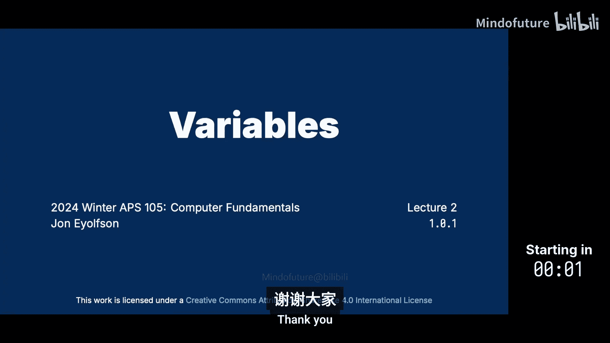
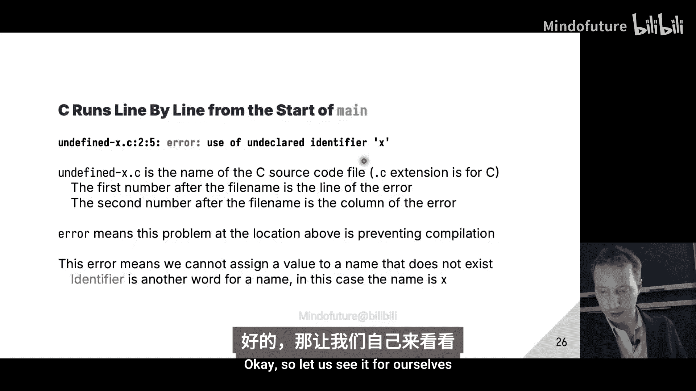
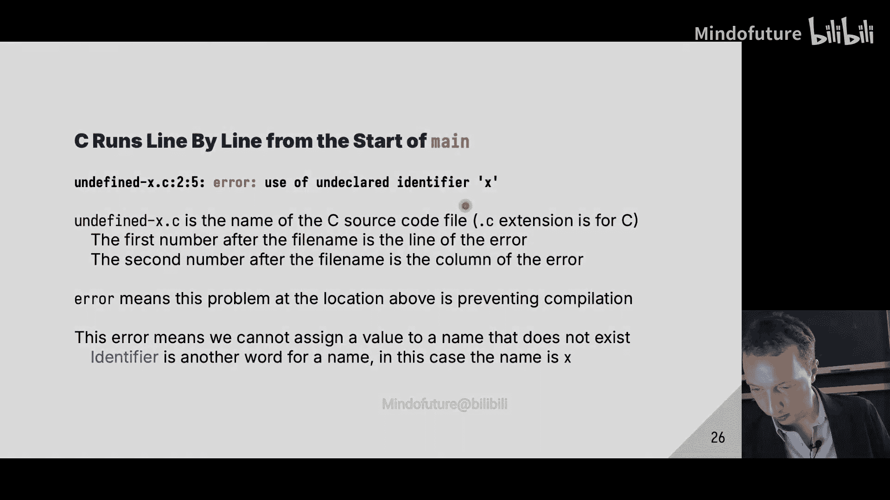
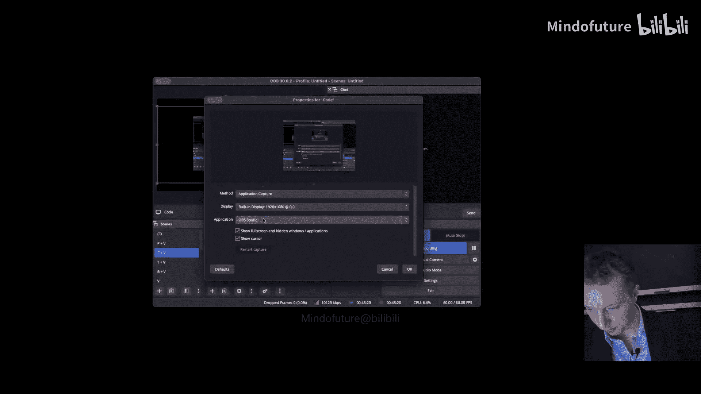
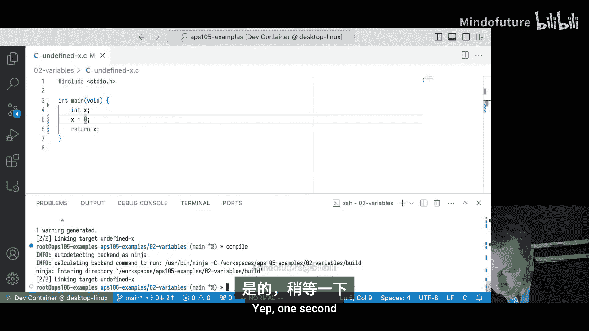
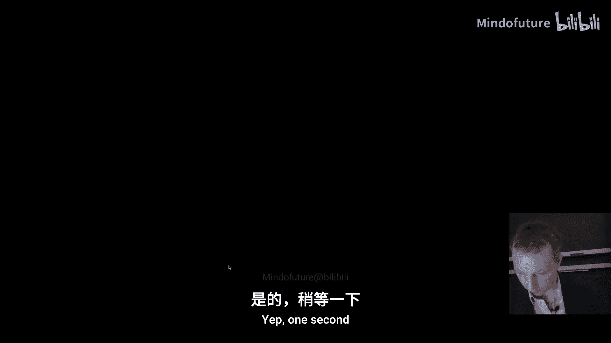

# 【多伦多大学】C语言计算机编程-｜-Computer-Fundamentals-｜-2024-p02-P02_变量--BV1zL6GBwEGe_p2-

Whoops。こよね。たち品な。反其一年。Oh， no。

All right， that was weird。Com门。Come on。There we go all right， welcome back to。Al right。

 welcome back to Computer fundamentalamentals。 Thank you for joining me again today。😊，So today。

 we get to talk about variables， and we have to rewin。

 rewind a bit and talk again about how computers work。So programs always access memory。 And when。

 again， when we talk about memory， we're referring to Ram or random access memory。

 also called main memory。 These things all mean the same thing。

So we can also access longterm storage or longterm memory through main memory by asking the OS。

 but that's not covered in this course， but it's something you will see later after you have the fundamentals using files and things like that will be really straightforward。

So we get to talk about how computers actually access memory， and they again。

 access memory in something called B。 So recall that one B is 8 B。

You will have this seared into your memory if you are into computers at all。 That is one thing。

 you will just， if you ask anyone in EC E， go up to them and ask how many bits are in a by。

 they'll be able to tell you， you'll also be able to tell people。So if there are 8 bits。

 that means there are 256 different representations， because while each bit could be a one or a 0。

 there's two options。 And since I have eight of them。

 there's two to the  eight different possibilities。

So we went over last lecture how you know you can actually write out a number in binary same principle as writing it in base 10。

 you know， there's 100 column， the1s column in the ones column， well with powers of two。

 each column is a power of two to another exponent， so instead it's the ones column， the twos column。

 the fours column， the eighths column and so on and so forth。

So if you use that scheme and you have 8 bits， the numbers you can represent are 0。

 So everything is a 0，0 plus or0 times any exponent and adding them all together is going to be 0。

 And if they're all one， that's going to be like 1。

28 plus 64 plus 32 all the way to one using powers of two。 And that number is going to be 255。

So in general， if we are using like the whole number representation。

 So numbers that are 0 or positive， then if we have n bits， we can represent the number 0，2。

2 to the n-1。 and that is inclusive。 So that includes both n。 So if we have 8 bits。

 we can represent numbers。0 to 2，55。So in memory， every byte has its own unique address。

 That is just another word for its location in memory。 And we call memory byte addressable。

 So the smallest unit you can actually access in memory is a byte。 You can't access a single bit。

 You have to access an entire byte at once， which is again。😊，8 bit。

So this is kind of what it looks like in memory。 So each address contains a byte。

 So here the blue boxes represent a byte， and that is the value of the byte。

 and I will just write it out in decimal because we're human。 So it's easier to understand。

 So every number in a blue box since it is a byte will be 0 to 255。 So below each is the address。

 So computers have a can store a lot of bytes。So the byte that has the value 50 or57 might be at address。

512000 or something like that， because it can store a lot of bys。 So this is how memory would look。

 So there might be different values。 In this case， we have four Bs across the top and the address would just go up by one。

 So it's just like having an address of a house。 although these just always go up by one。

 instead of like odds numbers on some street or something like like that。

 And then we'd have four more bys at the bottom that just continues along the same way。

 This one seems to have a bigger value， but doesn't really matter。 each address stores a single by。

 So any questions about that。Very important to know。 In fact， for some reason。

30 years still get this wrong。 So as long as you remember this， you are good。

So your CPU has instructions to access memory， so an instruction can read a byte from memory。

 that means it retrieves that value that is stored in memory， and then the CPU can access it。

 and another instruction can also write a byte to memory so you can transfer some information from the CPU to memory。

 Thankly in this course， you don't have to deal with that。

 This is why we use programming languages because that is very， very tricky to get right and very。

 very tedious So this is why we use programming languages。 C handles this for us thankfully。

 but it's still important to understand what's actually going on and how you actually store information。

So the number of actual addresses depends on your CPU。 You may have heard the term， oh。

 I have a 64 B CPU。 and that means the CPU can address up to。2 to the 64 things。

 So it has 64 Bs that is used for that address。 And it's easiest just to think of that address as' just a whole number。

 So if I have two to the 64 possible addresses， if I write out what 2 to the 64 is。

 It is just a gigantic number， which is like 18 quintillion B， So if I have a 64 B CPU。

 I could actually access up to 16 quintillion B。So that's just to say。

 computers can hold a lot of bytes and saying 18 quintillion。

 no one has ever heard that representing like some storage size or something like that。

 So we communicate using prefixes instead， you might be used to this while with normal units。

 So you have meters And if you have 100 meters， you have a kilometer in the United States。

 you have some garbage。 Allright。So the typical prefixes are for computers are kilo or kilo mega and giga。

 So whenever we write units， if we're specifying a size of something。

 we write a byte as a capital B and then a bit as a lowercase B makes sense。

 So the uppercase is the larger one， a byte is 8 bits and a bit is only well，1 bit。

 So we write it as a lowercase B。So you might also see this difference when it comes to your Internet speed。

 So when you see like something downloading， it'll probably be in megabytes， capital B。

 But when you pay for your Internet and they advertise a speed to you， it is in mega bits。

 It's a lowercase B。 So if you want to get the actual theoretical speed。

 you have to divide by 8 or multiply by 8 or divide by 8。 Yeah。

 So they try and give you the bigger number。 And if people don't know the difference between bits and bytes。

 then they won't know the difference。So。We're used to a kilo being 1000。

 but because computers are in powers of two， we use a power of two instead of exactly 1000。

 So 1 kilo is actually 1024 B， which is two to the power of 10。

 that just happens to be a number that's close enough to 1000 and  two to 10 kind of makes more sense to us as humans。

 and1 meby is going to be 1024 kilo or2 to the power of 20。

 and then 1 GB is2 or is 1024 meby or two to the power of 30 B。

So old computers that your parents use that I have definitely never used because I'm you know。

 that young。Well， they had 32 B CPUs。 And that means since memory is byte addressable。

 That means I can only access up to 2 to the 32 different B。 So if you want to use our prefixes。

 we can rewrite whatever 2 to the power of 32 is using something that might be more readable to us。

 So using that exponent law from math， we can rewrite to the power of 32 as just2 the two times 2 to the 30。

 And we now know that 2 to the 30 is one gig， So in other words。

 this would be able to address up to 4 gig of memory， which is just two small first。 now。

 most of our laptops probably have more than 4 gig of memory。

 That's why we had to move away from it and have 64 B CPUs， which as you might notice。

 computers like powers of  two64 is just the next power of 2 after 32。😊。

So C uses something called types to describe values。 So I had a question that yesterday of like。

 well， if。Like the number 65 is an A。 How do you tell the difference。

 So types are a way for you to tell the difference of what that byte is actually supposed to represent。

So a type actually tells you two things。 It tells you most importantly to us what it represents。

 And it also tells you how much memory they use。 So， for instance。

 an int is a type that represents an integer。 So it's kind of a shorthand。

 We like shorthand in computing。 And you just have to know that it uses4 bys because if you read the C standard。

 that's how big it is when they tell it to you。 And this integer can represent positive and negative numbers。

 And without any decimal points behind them or anything like that。 just a straight up number。

 no decimal points。So how do we actually represent this number。

 We kind of saw how you can take a binary number and then just convert it to a number so。Well。

 that's kind of true。 And if。We have4 B。 That's 32 B。 So 4 times 8， that gets us to 32 B。

 That means there are  two to the 32 different representations of those bits。

So if this was a whole number like we had before， what numbers could it represent？

Or what is the range of numbers that it could represent。

If we remember from before the generalized form of it。Yep， it's0 to。32 minus1。Yeah， so it would be。

 oh， it close。So itd be 0，2，2 to the32-1。So it can represent any number in that range。

So that would be if it was just using that whole number of representation。

 that would mean it could represent 0 to was at 4 billion something。

But integers can actually represent negative value。

 So there has to be a way that it actually stores it。So this is how it actually stores an integer。

 And I just write out every single bit here。 So this is like our same。

Same idea of having columns to represent the value of each bit。

 So we have to the power of 0 to the power of one。 And since we have 32 Bs in this case。

 it goes all the way up to two to the power of 31。So some terminology here is bit 0。

 that one that represents the ones column。 we always call the least significant bit because it has the smallest value and。

The bit at the very end。 So the highest value。In this case， it would be B 31。

 We call that the most significant bit because it has the largest value。

But when we represent integers。That most significant bit。Specifically for integers。

 we interpret that as a sign bit。 So that tells us whether the number is positive or negative。

 So if that number is 0， it means it is a positive number。

 And then the remaining bits here represent。Just the whole numbers that we have gone over before。

So the range of this， if these were a whole number。 So we have 31 Bs left over。

 would mean we have a range of 0 to to the power of 31-1。

 So those are the positive values we can represent。 So any questions about that， yep。

I can sort of like negative zero or something。Yeah， so that's a good question。

 So does that mean we can store negative 0。 So there is a way to represent negative 0 in the olden days。

 But we have learned since then。 So you might think of one way to represent negative numbers is。

 okay， I'll just take that sign bit。 One means it's negative。

 And then I'll just interpret the rest as a number in which case you would have negative 0 and positive 0。

 which would be a weird。 So you'll learn in。2，43， how we actually represent that， but。It's close。

 It was a good idea。 It was used for a time。What actually happens is that sign bit。 Yeah。

1 means it's negative。 but the remaining bits I will not tell you about。

 So you just have to trust me for now that the remaining bits， Well。

 there is2 to the power of 31 possibilities， and theres no representation of negative 0。

 There's just a plane 0。 So the range of negative numbers is negative 1 to2 negative2 to the power of 31。

 So our entire range that we can represent with an integer is。Negative 2 to 31。

 all the way to 2 to the 31-1。 So any number that is smaller than the minimum and larger than the maximum。

 we can't represent with an integer。 We need something that has more memory。

 So computers have a finite amount of space。 ins have a finite amount of space。In this case，4 by。

So we saw how to start A C program later。 Some of you may have already started lab。

 the lab 1 and have started it。 But you're way ahead of us。So。

This is how you always start a seed program。 There'll be something like int main void。

Curly brackets and the return 0。 So now we can actually。

 I can actually explain this a bit more to you。So。What this does is define a function called main that takes no input。

 So void is actually another type， just like int， but it has a special meaning。 It means nothing。

 So this says if you we take that black box model again。 It says this function。 main has no inputs。

 That's what void means。 and it output is an int。 So its output is 4 B。 It's an whole。

 Well it's an integer。That will be something between。

NNative 2 to the power of 31 all the way up to2 the power of 31 minus-1。

So that space right after the main， we can add something called statements there between those curly brackets。

 We usually call them curly brackets right here and right here。

And the computer will run those statements in order。 and computers are very， very， very stupid。

 They will not。 They do not have a mind of their own。 They will start running those statements。

 and they will always go in order。 So whenever you have to reason about your program。 Just remember。

 computers do exactly what you tell them to。 So they only go line by line by line is what we call it。

So that return is actually also a statement， so it starts with return。

 and then it has a value that matches the functions output type。

 So0 is an integer so that we're allowed to do that。

 that is a perfectly valid output to have and all the return statement does is stop executing the function and produce an output right away。

 So at that point， this function is something we called say it's complete。

 it has given us an output and it won't execute anymore。 And our program is done。😊。

So usually just note that usually every statement in C ends with that semicolon。

 you'll get probably get some problems whenever you start programming that you forgot a semicolon。

 Don't worry about it。 Just get in the habit of just putting a semicolon at the end of every line。

 C is a little bit annoying in that way。But it's just something we'll have to get used to。Yep。

Is there a reason why we want？Fuction to output。Yeah， so that's a good question， sorry。

 what's your name？Daniel， okay， so Daniel had a good question。

 Why does this main function output an integer instead of just void and do nothing？

 So that integer is actually read by the operating system to see if your program had an error or not。

 But in this course， we don't actually use it。 So pretty much will always just return 0。

 But that's its actual use。Yep。Yeah， it's a bit weird when you start off。

 but it's a way to tell the operating system something。So。We can actually declare。

 declares another word for create our own variables in C。 And they're kind of like， you know。

 real variables in math， But they're a little bit different in really annoying ways。

 So in programming languages， there is something called a syntax， you might hear that word。😊。

Syntax is just basically a set of rules you have to follow in order for your compiler to actually know what you mean and actually create a program out of it。

So the syntax for declaring variables， So which in other words。

 is the rule for declaring variables is you take， you just have a type and then you create a name。

 and then you end it with a semicolon。 So both of those words that are in the angle brackets are something you replace。

 So you replace that type with the C type。 So the only type we know for now is int。

We couldn't create a void variable because it doesn't exist。 So it doesn't quite make any sense。

 So for now， the only valid type we could put there is int。 And the next thing is just a name。

 So we get to name variables in C。 just like you name variables in math。

 So it has some of its own rules。 So it always has to start with a letter。

 it can be lowercase or uppercase。 We'll see what the rules are for them。

 But the compiler doesn't actually care。 And then after you start it with a letter。

 Then it can have letters， digits and underscores。And you are not allowed to have spaces in your name。

So。If we go back to our C program， we can declare a variable called X， so we start int main。

 and then the next line could be int X。 so that creates a variable called X and its type is an integer so that x will consume four bytes and it could have any value from the range we said before。

So。If we're saying what is going on that point， we say at the first line。

 we declare an integer called it X is probably how we would say it in English。

So after when you run your program， after it executes that index X line。

Then C sets aside 8 by or sorry，4 B for you to use for x。 And now x just has a value。

 So instead of saying0 or one， if I want to get the value of x， I just say x。

So how would that look in memory， which is why it's。We thankfully have C。So remember。

Memory is actually like byte addressable。 So it only stores in bys。

 What C will do is just take a group of4 Bs and then use that as a value for X。

 And it will be somewhere in memory in this case， it's the four addresses at the bottom。

 but you don't have to worry about it。 It is set aside for you by C。

 So you don't have to worry about。 But it's going to be important。

 especially later on that you understand what it is actually doing。

 So it's setting aside some memory for you to use for your X variable。

 The number of bytes it will set aside depends on how what the type is。Because the type。

One of the things the T tells you is how many bytes。Do I need to actually store a value of that type？

So if we have a variable， then we must be able to change it or at least assign it something。

So we change the value of a variable through something called assignment。

 The syntax of an assignment statement。 So again， this is something that ends with a semicolon is you take it a name。

 So this should be a variable that currently exists at this point in the program。

 and then you use an equal sign。 and then a value。 So you replace a name by a name you previously declared。

 And then value by a value that actually is representable by that type of whatever name was originally declared as。

 So this trips people up。 So I will say it slowly。 So note unlike mathematics。

 that equal sign does not hold true till the end of time。

 So if you say x equals one that is only true until you。That's only true until you change X again。

 And you are allowed to change X again and redefine it in programming languages， unlike in math。

 where if you say x is2， it's always 2。So that might trip you up。 Just remember。

 we always have to read a program or whenever we argue about how a program behaves。

 we start at main and we start reading line by line in order。

So computers aren't any smarter than that。 if you see x equals。1。

 that only means x is definitely equal to one at that line。So let's put it into practice。

 So if we have int void main， we have int X。 So right after this line。X has。

Actually has a random value。 So this will also trip you up at one point， because。If I just declare X。

 all C does is set aside some memory for you。 And it turns out that it's not that picky。

 It just sets aside some memory for you， and it will actually just be what is seemingly looks like just a random value。

 So only after I execute the next line。 Does x actually have the value of one。 So right before that。

 it has a random value。 And then right after I say x equals equals to1。 Then it has the value 1。😊。

Everyone， good with that。Okay。So you can actually combine those two lines and do a bit of a shortcut if you want。

 So you can do an assignment as part of the variable declaration。

 And then you don't have to worry about that random value。

 And I encourage you to always do this because typically， if you have random values。 it's really。

 really hard to figure out what is actually going on。

 So you should probably always use this and set the variable to some value。

 So it's just kind of combine them together。 So we can say， type name equals value。

 and then have a semicolon， which ends our statement。 So this statement。

Does those two operations in one。 So it creates a variable and then assigns it something called we call an initial value。

 So that's the first value it has。That's what initial value means。

So we might also call this initialization。 We， So we might say we initialized x to one if we actually set the value to one。

So our next types。 So we'll explore some types we'll use in this course。

 And then we're just going to use those types from now on。 So this will。B。More or less。

The basic types you need to know。 So in C， there is a type called a char。

So we like shortening things because we don't like typing， I guess。 So char is short for character。

And that represents letters， digits punctuation， something called white space。

 which is a new term we'll probably haven't have heard before。

 and also something called control characters。 So white space is just a fancy word to kind of group a whole bunch of things together。

 So white space mean spaces， tab characters and return characters。

 So basically just things that change where characters actually are， but not are not actual。

 like things we。😊，Conceive， per se。They just kind of move things around。

And the other thing is controlled characters， those you definitely can't see。

 but they usually do something。 So， for instance， a tab like the tab key generally moves something a few spaces。

But we can't see it。 It's nothing we could print on the screen。 It's called a control character。

 And also， your return key or enter key is also another thing that goes to the next line that is also represented by a control character because it's not something we can directly print on the screen。

So， a char。What remember types need to tell you two things。 So a char represents letters。Digits。

 punctuation， white space， control characters。 And then the next thing a type tells you it's its size and the rule for chars is they are always exactly one by。

 So theyre always that one unit。 So we only have 256 different representations。So， how we。

Define a char value。 They start and end with just a single quote。

 So a char is only a single character。 Remember， we can't we can only have one at a time。

 So you could declare something called char C and then set it equal to。Single quote， capital A。

 single quote。 And then well， as we learn in the。Last lecture。Well。

A actually gets a magical number associated with it。 So that would actually store the bit 65。

 but you don't really have to know that。😊，So we need to be able to type out those invisible characters。

 so they're called nonprintable characters， so we need to be able to say that a character is like an enter key or a tab key or something like that。

 but we can't just press enter because it would move to the next line。

 it wouldn't fit just within our single quotes。So in order to represent an enter key or something like that。

 the rule is， we need to prefix them with a backslash character。 And that tells C that。Well。

 this represents a character that I you can't， you can't represent。

 And the next character you type after that will tell see what it actually represents and not literally use that character。

So this backslash is called an escape character。 It's basically a word to tell see， hey。

 I mean something weird here。 So just look at the next thing I type。

 That will tell you what I actually mean。 We're breaking the normal rules here。

So Wikipedia has will list all of them， the only ones you'll use for this course are you probably will never even use the tab character。

 but to represent a tab character its this backslash T。

 they generally just start with the letter that they're supposed to represent。

A new line is backslash n。 So this is the return character。

 and we saw that that's what ended hellello world。 So it was hellello world， and then backslash n。

 So the convention is whatever we're done with a line。

 you put a new line at the end of it to go to the next line。So you can also think of it as hitting。

Return or， you know， sending a message。 So if you want to send a message to your friend or something like that or you send a message on Discord。

 you type what you meant， and then it won't send until you hit enter。 samee idea for C。

 You want to always。Do that enter character whenever you're done。

If you you might notice that oh if backslash is an escape character。

 how do I make the character actually backslash so in order to represent a backslash。

 you do backslash and then backslash so that means well I'm using a escape character but I really meant backslash。

 so it kind of weird， but you'll get used to it and then well if a single quote starts it and I want to represent a single quote if I didn't have an escape character。

 it would be like single quote， single quote single quote， which wouldn't quite work。

So to actually represent a single quote， it's a single quote， then backslash， single quote。

 and then a single quote to end that character。 Again， it looks a bit ugly。

 but those are just the rules。So。We can also interpret that cha， like we said before。

 as a whole number。 So remember， a byte can represent a whole number in the range 0 to 2，55。

 It just depends what that byte actually represents。 And that's exactly what types are telling us。

 but。Under the hood in memory， they're just being stored as ones and zeros。

 It's only how we interpret them。 That gives them any meaning。

So which of those byte numbers corresponds to which character is defined by something called ASI。

 So it's short for the American standard code for information exchange。 It's a very exciting acronym。

 So ASCI， you'll probably hear people use that term a lot。 It only uses 7 bits。

 So that most significant bit of that byte is always 0。

 and that would correspond to whole numbers in the range 0 to 127。

 because we only have 7 Bs to use for our ASII character。

 But that turns out to be more than plenty to represent the number of characters on a standard US keyboard。

 it is a very US centric thing。 in order to represent characters in other languages that is a much more。

😊，Much more complicated topic。So for now， you can look up the values if you want on like AScitable。

com。Again， printing non English characters out of the scope of this course。

 we've only finally agreed on how to do it。 There was like 20 different ways to do it before。

 but it's kind of it's more or less standardized now。Okay， our next type is called a double。

 and that represents a number that has a decimal point。So if the rule in C should always be。

 if you don't require a decimal point， you should use an integer。 If you do need a decimal point。

 you need a double and a double is 8 B。And the reason why it's called a double is because while there's a less precise version called a float。

 and that's short for floating point， it has to do with the way computers actually represent the decimal point so they move it around or they can move it around。

 if that doesn't make sense， don't worry， you'll learn how they are represented in a later course。

 not this one， but just know that well there was something called a float。

It represents something with the decimal point。 In this course， we won't use a float。

 We're only going to use doubles。 So a double is just double the size of a float。

 That's why it's called a double。 We don't really have。Good names in computing。 I don't know why。So。

All you need to know， though， is that a double represents an integer with or sorry。

 a number with a decimal point， and it takes up 8 by。 So， for example。

 if I wanted to create a double， I would say like double pi and then equals to 3。

141592 so on and so forth。 So that is how you would define a double。

So the last type you'll be using in this course is called a bo。 It is short for Boolean。

 and a Boolean is just a name for a value that can either be true or false。

 And those are the only options。So。If it can only be true or false， we talked about that before。

 that should be like that light bulb， it should only be one bit。 But in practice， since memory。

 the smallest unit of memory is only a by。 a bull still takes up one whole bite。

 So there are certain situations where it can lead to a faster program。

 So if what you're trying to represent can only be two different values， true or false。

 then you should use a bull。 Otherwise， you should use one of the other types。So by default。

 you can't use the bull type。 If you just type it， you need to add include STD bo。 again。

 that's short for standard。 So standard bo do dot H to the beginning of your code。

 And then after that， you can define a boolean like this。 So bo is snowing equals true。

 or your other option is equals false。 And with Boolean， you only have two options。

And why you need to do this is， apparently， bulloles didn't exist in the 70s When they first came up with the C language。

 They added it after the fact。So all of the previous types， except for bull are enabled by default。

 So you don't have to do anything special in order to use them。

 So these default built in types are something called primitive types。

 you might hear that term being used。 And for now， in this course up until probably way after the midterm。

 We're only going to use the types in char， double and bull。 And that's it。 So after a while。

 there's some other built in types。😊，We'll see some more of those soon。 But for a good while。

 this will do us for now。Later in the future， we will also create our own types。

 which is a lot of fun。 But that is something to look forward to later。😊，So。When we develop software。

 this is our usual development cycle。 So we start here by editing some code。

 We think we have some great idea。 We think it's going to work。 So our next step。

 and you might have already done this if you've started the lab。 if not， don't worry about it。

 So you edit some code and then we compile it。 And then well。

 that code can either compile or it cannot。 So we get to a decision here。

 which is that diamond shape， So we ask ourselves， well， was that correct or not。

 if it was not correct， That means the compiler gave us an error or in other words。

 it's telling us something is wrong and it actually can't create a program for us。

 So if something bad happens when we're compileiling。

 we call that a compile time error or a compile time problem。

 we have some issues when we're compiling。😊，If we successfully compile。

 so we followed this decision here， we're able to run our program。

 so you might try running your program and then when you run your program。

 then you check if it's correct if it produces the correct output that you expect， if it doesn't。

 well then that's something we call a runtime error。You know。

 it might be something wrong with how youve structured your program or how you' thought about it or just something weird might be going on in if something is wrong。

 Well， then you have to go back， you have to edit your code， change something。 Try again。

 go over the whole cycle again and again and again until eventually you run it。 It's correct。

 and then you're done that done probably shouldn't exist because software is almost never done。

So just ask Microsoft。So。Compilile of time errors means you cannot create a program the compiler failed at some point。

 so we can actually introduce and error ourselves to see what happens。 So if I。

Start off by saying it main void。 And then my first line is x equals one。

 Well whenever the computer runs this， it will start executing it from line by line from top to bottom。

 So if my first line is x equals one， well。It doesn't know what X is。

 We haven't created anything called X。At this point in the program。 So it has no idea what it is。

 So we'll probably see something like this。Where we get an error and we get some weird terminology here that you haven't seen before。

 It says the use of an undeclared identifier X。So remember C runs like line by line from the start of main。

 So if we break down this error a little bit， this undefined X dot C。

 that's just the name of the C file， your C source code file。 usually they'll always end in dot C。

 That's the extension for C。 and then it will have a colon followed by a number。

 So that first number after the file name is the line of the error。

 So if you start reading it line by line on visual studio code。

 I'll also tell you what the line numbers are on the lefthand side。 So that is the line of the error。

 And then the second number here is the column of the error。 So wherever that error actually is。

 and then it will tell you error in red， basically the rule is， if you see red， you're dead。

 So it did not work。 So that just means there is a problem。

 That's something it couldn't actually compile your program。So in this case。

 this error means we cannot assign a value to a name that does not exist。

 So identifier is just a fancy compiler word for a name。 And in this case。

 it's telling you that the name is X。 So use of undeclared identifier。

 if I translate that to you in English。 It means that the variable X does not exist。Alright。

 any questions about that。Okay， so let us see it for ourselves。

Okay， let's not see it for ourselves。

Sometimes visual Studio code does silly things。

To to do。哦。Oh why， why visual studio。

Okay， here we go， we are back。So we can have something like this。

 So this is the same thing we have before。 We have in main。 We have x equals to1。

 And if we have something like this， this should be a compiler error。

 So your compiler may give you a different result， but it will translate to the same thing， so。

I have a little bit of a shortcut here where I just type compile instead of hitting the button because that's a bit more clear to me。

 So it will try to compile it and then give us that error and it points to it。

 It says use of undeclared identifier X。So we can verify that if we go ahead and we change it around。

 So we put in X above and we go to compile it again。

 it just gives us some warning that X is set but not used。

 So the compiler is actually a fairly smart。Piece of software。

 And it will give you warnings that you're doing something that is not quite right。

 So what this is saying is that you don't actually use the variable X for anything。

 So why did you create it in the first place， But we don't really know how to do anything else。

Any questions about what we have so far or want me to do anything silly with this program。

So something we owe， yeah。You just say it。Great packs。Oh， so。We didn't give it a value。Yeah。

 so it'll just at this point right here where my cursor is。Like， whoops。So right here。

X will just have a random value， and we don't know how to print it yet。

 So thats that's the next lecture。 We can print it in the next lecture。But for now。

 it will just be a mystery。So。We don't know enough to do anything that exciting yet。

 The only thing we could do is we could get rid of this warning that says x is set but not used because what we can do is。

 well， we're not done yet。 So main returns an integer， right， So x is an integer。

 So instead of returning 0， well。I could return X if I really wanted to， so if I did this。

 I should not have a compiler warning because I created an X， I set it to1， and now I return x。

 so I'm returning one from the value from main， which is a bit weird。

 so we should probably set to zero to just go with how we're doing it in this course。

 but this means the same thing except that C is going to go ahead and set aside some storage for x for us。

Alright， any questions from today。Alright， so we don't know enough to do anything silly。

 Next lecture will be the first fun one where we can do some really silly things。 So just remember。

 phone for you。 We're on this together。😊，はい。I have quite。One second。

Yeah。什么下。Problem with that first time。

