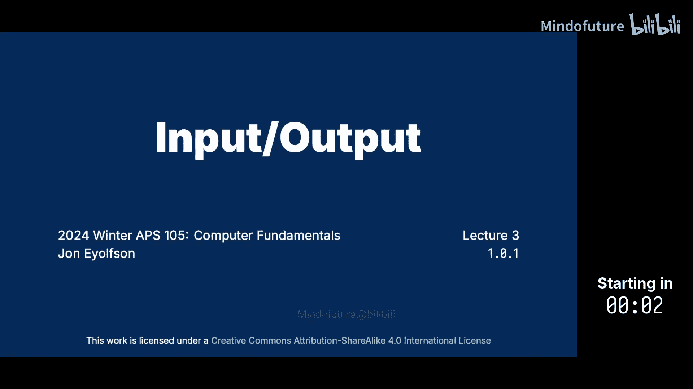
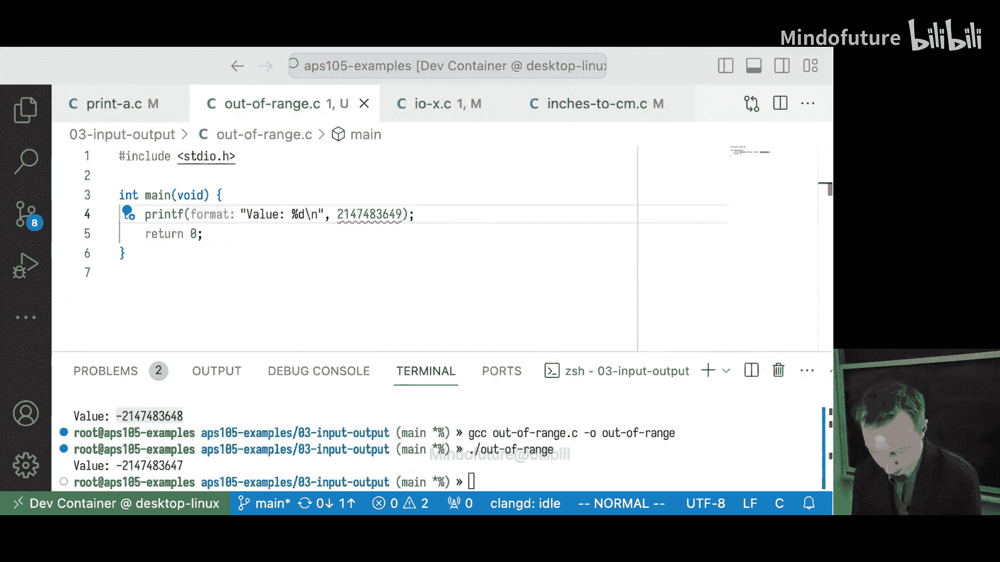

# 【多伦多大学】C语言计算机编程-｜-Computer-Fundamentals-｜-2024-p03-P03_输入输出--BV1zL6GBwEGe_p3-

。

All right， welcome back to 105， thank you for joining me on this wonderful late Friday。

 this is not a great time。So where were we at last time？Oops。So。

We actually want our programs to do something and so far they can't do anything。

 we want them to kind of behave like that engineering black box where we take some input。

 our program does something with it and then produces some output and right now we don't know how to do either after this lecture you will be able to do both and you should be able to at least do lab one part one。

 and more or less part two， you might need lecture4 if some bad things happen though。

So let's revisit our first Hello World program because that actually gave us some output。

 although we didn't quite understand what was going on now。

 but now after understanding data types a bit more， we should be able to explain it a bit better。

So remember the first line here that include STD。Io， that's short for standard input output。

 that's what we're going over today， and it contains the what's called a declaration of print F。

 so it tells you what inputs and outputs print F has， that's what a declaration means。So。

After it main void， we actually use the print F function。

 And what it actually does is it outputs a string。 So that is also a new term for us。

 and a string is simply just a sequence of characters。 So remember。

 we went over character's last lecture。 A character is basically anything you can type on your keyboard assuming you have a standard US keyboard because unfortunately。

 it is a bit UScentric。😊，And note just like texting where you have to hit sendend or hit enter at the end of the line。

 it should always have a backslash n， which is that new line control character that we went over yesterday and the backslash was that escape code。

So specifically that print F， the string， how you create a string。

 or how you write out a string value is it will begin with a double quote and not a single quote。

 single quote again is just for a single character。Sequence of them。 We， it's bigger。

 So we need two quotes， I guess。 So string begins with a double quote followed by any number of characters until there is another another double quote。

 And that signifies the end。 And whenever it's printed out， you don't see the quotes。

 They're not part of what's actually being printed。 just like for characters。

 a single quotes aren't used。So。That main is a function， and it can take inputs and output as well。

 So that main is a function that takes no inputs。 That's what that boy type means。

 It just means nothing。Why it's a different word， I don't know。 they like the word void。

 whoever designed this language。And at the beginning。

 that int means the output of it is an int value。 And then that tells the operating system something。

 For now， we just always use the value 0 to indicate that no problems have occurred。So for functions。

 we call the inputs to functions arguments， so you'll probably hear that term。

 no one says the input to a function， they say the functions arguments， but it means the same thing。

 that's the input to the function。So they're separated by commas if there is more than one。

 So functions can take multiple inputs， and you separate them by commas。So print F。

 how we would say it is it takes a string argument。

 so the first input is supposed to be a string we'll get to the type of a string much later in the course。

But for now we can just ignore it and what it does is print F actually also outputs an int value。

 but no one really cares about it， it actually outputs a value that says how many characters were shown to the terminal and it also does the work of actually displaying the characters in the terminal。

 which is the real important part here， you don't really care about the return value of it or what its output is generally people ignore it。

So another definition is function call， and that is just running a function。

 So in our main when we had print F there， we'd say we used print F or we'd say that we had a function call or we called print F。

So it can actually take multiple arguments or again， multiple inputs。So here's that example again。

 So for print F at the beginning there， I have my string that's hellello world with a new line。

 and then I could put comma and then one， and I could give it as many inputs as I want。

 but right now it can't use them so if I ran this program。 I would just still see Hello world。

So like and that value1 there， well because we wrote it out like that， it is an int。

 so the second argument in this case is an int， but we'll see later what flexibility print F has。

So if we actually want to use print F to print values of things。

 we can use something called a format string， so I could give print F as the string argument。

 I could say integer and then something that looks a bit weird right now， I could say percent D。

 and then a new line and what will actually happen is print F will go ahead and replace percent sign D with the value of the first integer argument。

So just like for characters， we had an escape character to actually。

Tell the computer that we're inputting something a bit weird。

 The format string has its own escape character， and it is that percent sign。

 So because it's part of a format string， it's technically called a format specifier。

 is the technical name of it。So some format specifiers we use。 it just tells print F what to。

 what format to present the data actually in。 So percent sign D means。Output it as an integer。

 so it should be either a negative or a positive whole number。 percent sign LF is for doubles。

 So if I want something with a decimal point in it and the type of it is a double， I should use LF。

 If I want to print a character is just percent sign C， most of them make sense。

 the only one that doesn't really make sense is LF。But you just have to remember it。 unfortunately。

 it stands for long float because they were not very creative with the names。

 and they couldn't use D because they used it for int because it was a digit， I guess。So。

You might notice that because of this escape character that if you actually want to show a literal percent character。

 well， just like with the character， if you want to use a backslash character。

 you do backslash backslash to say I really mean a backslash。

 same idea for the format specifier if you want to show a percent sign， you have to really mean it。

 you have to say percent sign， percent sign and that will print a single percent sign。

Any questions so far？All right， things we will just have to， unfortunately remember a bit。

 There's not much memorization in this course， but this is something you will get used to。

So this is how I would use it。 So for the string in print F， that's my format string。

 So I could say integer and then percent sign D。 And then as the second argument， I could say one。

Now。These values are used in order。 So the first format specifier corresponds to how it's going to present the first argument。

 So in this case， if I actually ran it， what would I see， I would see integer。Or colon space 1。

 So I would just see the number output in my terminal。 So any questions about that。Yep。Yeah。

 so question is， is there a limit of the number of arguments you can have and the answer is practically。

 no。You can have as many as you want until your computer runs out of memory。

Which will be a very long time。All right。Anything else quick？So。We could extend this a little bit。

 so say I combined everything we know so far， I could create a variable called X。

Iitialize it or to set its first value to one， create a y set it equal to two。

 and then I could print off two values。 so here is me using two other arguments with my format string。

 so I could say point percent D comma percent D and again they're going to be in order。So。

That means X will be printed first because it is the first format specifier there。

 and then y will be second。 So these will always be done in order， so。After the format string。

 the first format specifier is the first argument。So on and so forth。So any questions about that。

 So if we run this， we would see in our terminal point，1，2， because， well。X is1。

 it came first and then y is 2， and it came second。So， now we can。Actually。

Wr programs that do a little bit of something。So。看 on。So。Now， we can kind of combine things together。

 So if we want to see that， well， really， computers just use numbers。

 I can kind of mix and match them if I really want to。 So I could do something like， say。

 the interteger value of。Just the character A。 so I could use the format specifier to say， hey。

 print it as an integer， So interpret it as an integer。 and then I can give it as an argument。

 Just the chart A。 And this is another way， you can figure out what the value actually is。

 So if I go ahead and compile that。 and then run it， I'll see that the integer value of a is 65。

 So if I wanted to and I wanted them to all match。 All I have to do is change the format specifier。

 I could say the。Character value of a。I could save it， go ahead。Compile it， run it again。

 and itll simply just print an A。 But really， we know because if you look up in the ASI table。

 just because someone a long time ago said so， Capital A is equal to 65。

 Everything on computer At the end of the day， There're stored as bytes。

 It will just be a number at some point。 So any questions about that， yep。That。Yeah。

 so the question is， can I just put 65 here， and then will it just print？Print A。 so if I do that。

 so I saved it， I can pile it run again。So if I want， just to see that that wasn't magic。 Well。

 the desires of it had it make sense。 So the next number up is just the next letter of the alphabet。

 so。By just arguing about it，66 should be B。And you can go up。So on and so forth。

 if you want to see all the numbers， ASciTable。com。So any other questions about that？Yeah。

So remember for like 65，66， since they're integers。

 we just write out the integer value and for characters just the rule。

 how C defines it is we have to do it with a single quote。It's just C's rule。

 I didn't make the rules。Allright， so do do。Oh， geez。Allright。

 so the other piece of the puzzle is we can use scan F and scan F allows you to get input from the terminal。

 So it's kind of like the opposite of print F。 So print F is for output and then scan F is for input。

The nice thing about it is it's kind of consistent。 They use that same format string。But however。

 instead of using a value， it actually assigns to a value。

 So that first thing we saw before with how we change a value， well。

 that's what print F will or scan F will do for us。

 It will go ahead and change our variable to another value。 But for it to do that。

 it gets a little strange and we actually have to talk about the details of memory a little bit again。

 which is why we started with that。So in order for scan F to work， annoyingly。

 it needs the starting memory address of the variable and not the value of a variable itself。

 So if I declared in x， well， it just means x is a value that is of type integer。

Can't really do anything with that for scan F。 It doesn't really care about the value。

 It wants to change a value。With computers it actually needs to know where that is stored in memory so remember that value of a variable if it is an integer takes up four bytes。

 so it will take up four of these addresses because remember memory is just a bunch of bytes。

 each number is just where a byte is in memory so if it's an int。

 it will take up four of them and it just so happens that they will always be sequential so they'll always be in a row so。

In this case， we only really， we just need two pieces of information where it starts and how big it is。

 And because it's an integer， we know how big it is。

 So we just need to know where in memory it starts。 So in this case。

 it would start at this address 512 and4。 So in order to actually get that number out of C。Well。

 we need to do something with it。 And yes， recall that in means it means four bytes。

So in C to get that starting address， it makes things easy for you。

 you just have to type a single character for it。 so if you put an ampers send in front of a variable name that will get the starting address of where that is stored in memory。

 so it will become a pain point later， but for now we just need to know that scan F needs that address in order to set a value so。

If we assume we have something called int X， again that takes up four bytes。

Amperserson is something called like a unary operator。 So plus we need two numbers to add together。

 That's a binary operator。 An Amperserson just needs one single operaand。

 That's why it's a uninary operator。 So we just need one name of a variable。

 So we would say something like Amperserson X。 And that would be the starting address of X in memory。

So。The result of Ampersand X。 so that's a new value。

 it will have a new type that we will get into later。

 but really that type is how it looks to you is it's just going to be original type with that star at the end。

 So if my original type was in X。The type of ampersand X in this case is going to be int star。

 So if the compiler is telling you about types and they have a star in them。

 that means it's talking about its address and。We'll get to that at like the halfway point of the course where the details actually really。

 really matter。 But for now， just a starting address of that variable， wherever it is in memory。

So now we can actually use our terminal for input and output。

 So here is a full program that will take some input from the user， and then。😊，Provide some output。

 So here we would have like print F here。 Let's just go to the example itself。

So here we could print F and we're just prompting the user usually it's considered polite or to tell the user what they need to actually type so here we'll just say input X and then give it a space so it looks pretty and then we'll just define or declare a variable called X and then we'll use scan F to actually assign a value to x for us so as part of our format specifier what we want from the user is just a single integer if I wanted two integers I can just type another percent sign D but then I need to provide another address of an int to actually store that value to so here I only want a single integer as input so I just say percent sign D and then I give it the address of X and then after that I will just use print F with the same format specifier。

SoIt's a digit。 so I'll print off the value of X。 So basically with this silly program。

 whatever I input， I should immediately output， but I can see that I can type in the number and then display it。

So if we go ahead and compile that。And actually run it， it will say input X。

Then wait for us to actually type something so I can type， I don't know，14， hit enter。

 and then it will go ahead， store that to X and then actually display what X was。

 So if I wanted to do something more substantial， I could do something with X。

 use it to compute something more exciting than nothing。And actually output it when I'm done。

 So any questions with this。Yep。Yep。Oh， so the question is， for the address， why did in this example。

 I have it start from like。500 and。Some gigantic number。 So that's just to illustrate。

 you don't actually know this number。 It doesn't actually matter。

 So your C compiler is going to pick the number for you and you don't have a choice about it。

So this is just a random number that I picked to show that it doesn't really matter。Yep。Yeah。

 so the question is if I print Am percent X， will show me the location and memory and yes。

So we can do that to see that it is fairly meaningless， it'll probably yell at me a little bit。

 so if I change this， while this is the address of X。

 and if I do that I'll probably get some nonsensical number here。So I got some nut oops。

So here I change it to be address of x， what I output， and I get this weird number。So it's really。

 really， really big。 It's just going to be essentially a random number， y。Make it。Yeah。

 so this is a 64 bit machine， so that address is 64 bits。 ints are 32， so it's not quite big enough。

 so we get some weird things。You could make it long。Giant number。

So is going be some nonsensical number， and it will probably change every time， too。

 because that's just at the bottom， just the add the。Bite。

 it is in memory or the starting bite in memory。 So nice thing about C is it picks， Ps it for us。

 We don't have to really worry about what the actual value is。 We just use it， yep。😊，Input text。何か？

Yep。Yes， so the question is， what if I just， you know。Completely ignore it。 and be like。

So I'll get some nonsensical output。We don't actually know how to check for errors or anything yet that the user did something silly。

 so all the test cases for the labs right now just assume the user is nice to you and didn't do something silly like that。

 but in real programs that's something you'll have to consider for a good while in this course we will be nice to you and assume you get valid input。

But it is something we should check。All right， any other questions？Alrighty， so。Where。

So here that scanF there converts the characters part of Scanf's job is to convert the characters we type into an int value and then it assigns that value to X using its address through some type of magic that C can figure out and that you will figure out like halfway through the course so don't worry about it quite yet。

So one of the things scan F does is while that function actually also outputs a number and it returns the number of values successfully assigned。

 so in that case where I just typed hello， it would probably output a0 well if I type something valid。

 it would probably return a1。But we don't know how to actually do anything about that yet。 And。

 in fact， we'll need another week to figure out how to do something about that。So。

Just note here that the type of the arguments for scanf and the format specifier should match。

 Otherwise， you'll get very weird and unpredictable results， so。Like I showed before。

 sometimes it's okay for print F in that it will make somewhat sense like when I printed the integer value of a and just converted it to an integer just so I could see whatever the value was。

 sometimes it makes sense to mix them， but in general they should always be the same。

So next little thing we can do is we know how to create variables and we can constantly reassign them。

 sometimes that is confusing so we can actually create variables that do not change in C so we do the same thing we can declare variable with a type and then a name but now we just add a cont keyword before the type and a keyword just means it's a named reserve by C that you're not allowed to use as a name。

 so if you tried to create a variable called cont you would not be able to do it and cont。

You might have noticed a trend now where C programmers like to just save typing a little bit for whatever reason。

 So constant is just short for constant。 We pretty much just chop off letters， because。We're lazy。

 I guess。Now， if you want， you could write cont int X equals1。

 and now what that means is you not it is not allowed to change anymore it's more like that mathematical sense。

 so you aren't allowed to reassign X after you declare it。

 So it's a good practice to add cons to any variables that should never change because you're just not allowed to do it。

 it will stop you from making a mistake。嗯。But。Gets and this keyword gets much more complicated later on。

 In fact， I got a PhD out of it。 So it gets pretty complicated。 No， do not clap for that one。

 That was no， bad。All right，So you should actually be consistent with variable naming as well。

 So there's a certain style we should follow。 So normal variable names。

 the style or the convention we use。 convention is just another term for rules。

 but they're not really enforced。So the rules ish our variable name should start with a lowercase letter and instead of a space。

 we just capitalize the next word and the rule for cost variables since they're a bit different and they're a bit special and we can't change。

 we just start them with a capital letter instead of a lowercase one。

 so if it starts with the capital， we know it's something we can't change。

So there's some special values where every letter is capitalized。

 which you might see if you started lab one， but we'll get into a bit later and for those the words are just separated by underscores if they are words。

So。Consistent coding style is really， really important。

 especially when you go back to code after not reading it for a while。

 the C compiler itself ignores white space， so white space is just like tab characters。

 spaces enters all that stuff， the compiler doesn't really care about them Therefore you as a human to add some structure to your code so you can actually read it so La  zero has you set up a formater。

 but you should also know the rules。So a function definition like main。

 So you tell it the input and output types and its names。

 Well that should be start at the beginning of the file。

And then every time you start a new set of curly brackets。

 so I'm telling the computer to do something， you need to indent the next lines。

 and that just means I shove it in four spaces。And for now。

 I only have like one level of indentation because， well。

 we don't really have other sets of curly brackets or anything like that。 but that's the rule。

 The indent is four spaces。 So that's why print F it's four spaces in。

So now we can actually write a program to actually do something useful。

 it only took us three lectures。So。We can whoops， I didn't hit the button so we can create。

A program together just to do some simple conversions so we can convert， let's say。

 inches to centimeters。 So if we want to do that， well。

 if we think at a high level about what our program should do。

 our input should probably be the inches， and then our output is just that same measurement。

 but now in centimeters。 So to start it off Well I know that I'm going to convert two values and the inches per centimeter does not change。

 So I could put a constant in front of it。 And because it is a number that needs a decimal。

 I should use a double if it didn't need a decimal， I should have used an int。 in this case。

 I should probably use a double。So。We thought about the input， the input should be inches。

 so I should probably prompt the user first before I try to get some input。So I would say。

And enter number of inches， something like that。Oops。All right。

 so now I'm prompting the users for something。 so now I need to get some type of input from them right。

 so I'll probably need some help here because。I don't know why， I。Don't have a good excuse。All right。

 so I want some input。 I want just。A double to represent the number of inches the user has typed。

 So I need the format specifyifier L F。 So if I'm using scan F。I need something else。

 Where am I actually going to store the value that the user has inputted。 What should I do next。Yep。

We to access that。Yeah， I need to declare a variable that I can actually store the number of inches that the user actually inputs。

 right， So since。Inches will let them input a double， so I'll declare a double。

 I'll just call it inches。And。For scan F， I have to tell scan F the address of the variable to actually change。

 So I want to change it to inches like that。So if I want to be really， really safe when I program。

 remember our first rule is， well， it's probably a good idea to just initialize variables just in case something bad happens because right here。

Inches is just some random value and who knows of scanF something bad might happen to it。

 So just to be on the safe side， generally， you can initialize variables to a0。

 it's generally a safe thing to do， but in this case it probably won't matter。

So now that I have the inches and I want to convert to centimeters。

 while I could just be really explicit about it and create a double called centimeters。

So if I want to compute the number of centimeters， I can just assign it a new value。

 and here I already have my input， so my input is inches。

And we'll go over this more in the next lecture， but if C。

 you can just multiply two numbers together， it essentially lets you represent math。Very simply。

 so I can check the number of inches and then multiply it by the inches per centimeter。

 and then after that I will have the number of centimeters in the variable called CM。So now。

 if I actually want to display that to the user， let's start writing we want。

 if we want to output something to the user， we have to use print F。So I'll say。Measurement。

Measurement in CM。Is。Now， what format specifier should I use right here to actually print off that value of that double。

Yep。L F， right， and format specifiers start with an apers。 So it's just a percent LF。

 Am I done writing this format string。No， because I should be polite and essentially hint enter。

 How do I represent an enter in a string。Backslash n， right？So now。

That's why I'm going to input or output。 And I need the actual value of the variable to output。

 which was centimeters。So now if I go ahead and I compile this。

 so I say GCC inches to CM and then create a file called inches to CM。And I run it。

 it'll say enter the number of inches。 Let's just verify that it can multiply by one。

 So I'll just say one。And then it says measurement in CM is，ooh， that's a lot of digits。 It says 2。

50000， which kind of is a little bit ugly。So。What you will do in lab1 and what you can do is part of this format specifier。

 it will do some rounding for you and you can just use it to round so some extension we can do to this format specifier is before the LF。

We can say dot and then some number here。And what that means is the number of digits to print after that decimal point and it will do the rounding for you。

 so in lab1， when it says round， don't worry about having to round it yourself。

 just use the format specifier to change the data。So now if I do something like this。

And I entered the number of inches， let's say， I don't know， 12， which is like a foot。

So this measurement cent me is 30 point。4，8， which is just two decimal places。

 which is properly rounded。 And we can just do that。 So any questions about that， yeah。

Po to F without the L。So， like。So if we do this， pretty sure nothing bad happens。So。For。For print F。

 you can use F or L F， and it doesn't matter。 but for scan F， it matters。 So for this course。

 since we're not using just a float， just always use LF。 But in the case， you forget it for print F。

 it doesn't actually matter for。Rules we won't get into。た公す。Yeah。Yeah对。

 so if you get into the details then you just print F。

 So you don't actually need to know this because you should never use F， but F。

F still converts it to a double anyways。And it's weird。F print LF and F actually mean the same thing。

 four weird historical reasons。Yep。Right。Yeah， so is there a way around to the nearest 10 and this number here is just the number of decimal places or number of things to print after the decimal place right so if I wanted to round to the 10。

 I could just change the two to a1。Let's like 12 oh， you have to run to the Ts。 No。

 if you want to run to the Ts， you， you would have to essentially。Divide by 10， then round。

 then multiply by 10。 So， So the rounding。We'll go over rounding functions in the next lecture。 No。

 it'll be two lectures from now， but they only round to the nearest integer。

So if you want to round to a different decimal points。

 you have to mess around with the decimal point。Any other questions？Anything else fun we can do。

All right。We can think a bit。 I will finish the slides。

 and then we can I have some fun things planned。So here is what we had before it printed way too many digits。

 and this one did not initialize inches。 so it's on the lecture side for you。 so you have it。

 but this is just what we typed。So note if I really wanted to。

 I could actually declare multiple variables on the same line by just separating them by commas。

 so at the beginning， if I wanted to go ahead and declare inches and centimeters ahead of time。

 I could have done double comma centimeters and that would create a doublecal inches and doublecal centimeters。

 generally I find that confusing so you can just have them on separate lines。

 C doesn't really care and it might be easier to read because with that comma things tend to be able to hide on you and you might actually miss it when you're reading it so it's better to put them all on separate lines。

So doubles by themselves contain approximately 16 decimal places。

 What we saw was something called a subspecifier to change how to actually print the value。

 so four numbers after you start with that function or format specifier。

 put a dot fall by a whole number to indicate the number of decimal places to print。

There's a full list of subspecifiers you can use to change how you actually print things if you want them to use a certain number of characters or you know。

 be left aligned or right aligned or whatever you want。 So there's a full list there。

 but we don't really need to know any of them aside from that rounding one。

So the other thing about that rounding one is。Here， I go back。So here when we。

 let's say we just did 0。1 here。And。Let's say we just have one inch whoops， I didn't recompile it。

 I didn't save。So here， if I only have it to one， it rounds to 2。5， but note that the 2。

5 here is only what it shows you that value of that variable CM is still 2。 or 2。54。

Just because you're printing it， it does not change the value of that variable at all。

 still it's just changing however you display it to the user。So doesn't change that actual variable。

Alrighty， so do。So。Other thing is。We can change that to only output two decimal places。

And then sometimes it's good practice not to use like what are called magic values。

 so when I return zero from mainine it was just a number I picked up out a thin air that you didn't really know why I was using it generally it's a good idea to give things names and try and be expressive about them so I could include standard standardlib do H so that short for standard library and it defineds something value called exit underscore success for you that you can use that's what you're supposed to use to like express that there's no errors in your program so we could be a bit more expressive and a bit more intentional I guess and use that whenever we're returning from Maine so instead of returning zero we can return exit success it will actually mean the same thing but it makes a bit more sense to humans right。

Writing an A is a lot easier than writing 65 and looking it up every time。 So the same idea。

It's the same idea here。All right， any other questions？So now we can do very broken things。

 which is fun。Yep。Sorry， how。Yeah， so here standard library and standard output。 So the question is。

 how are they different， So they' are two different files。And they include different things in them。

 So， for example， this exit success is in this standard library dot H。 while in the standard I O1。

 that is where print F and scan F are。So the different files will have different things。

 how you know which one has which is you have to either look it up or remember it most of the time you just look it up。

 some of them you'll get used to y。If you don't do include either of them。

 the compiler will be very angry at you。And it may or may not refuse to compile it。

 depends on how the compiler set up。Sometimes it will be chill about it。 Sometimes it will not。Yep。

I think in one previous lecture。一。Ha I guess。Yeah， so the question is。

 why does that Boolean type have a separate header file for it and why do we need to use it？

Basically， for historical reasons， it didn't exist when the language was first created。

 So it was something brought in after。 So they。Decided to do it like that。 Why I don't know。

All right，No other questions。 I'll start doing random stuff to。To be fun。

 so we had a good question last time of like。Hey， what happens if I write a number that is bigger than an integer So we went over it last time the maximum value of integer was like 2 to the 31 minus-1 for positive values。

 so that's essentially this number but with the seven is the maximum。

 so if I go one over the maximum。What we think is going to happen。

So it can't represent a name or it's too big。 So let's actually see what happens。

 because this is my warning for you of like。Computers only have a finite amount of space。

So if I go ahead and compile this， I'll see that my compiler is complaining a bit that the types don't match because。

 well， it is bigger than its。All right， here we go， all right， sorry。I'll restart。

 So here I have print F。And。I am going to print a try to print a value of an int。

 which is bigger than an int。So the maximum size of an int is essentially this number。

 but with the seven。If I just write this out， this is as big as an ink can represent。

 So if I compile that。And I run that， I get exactly what I put in， right， makes sense。So。

This is just awarding that computers get weird。 You'll be able to explain this by second year。

 I believe， but。Just because we have extra time。 There's no other questions。 I'll do weird stuff。

So if I compiled again， seems to compile OK， I get a little bit of a warning here that says format specifies int。

 but argument has type long， which we don't know what that is yet。

 basically long is just a longer int so it takes up eight bytes instead of four。

 basically it's trying to tell us that this don't fit。 So if I just happily ignore it。

I get that number， but negative。yeah， that'd be weird for your program and here if I increase it by one。

 so to 49， well you might think it's that same number but negative that， but actually。Same number。

 but negative at the end 7。So it does weird things。 So this is actually defined， so。

The rule is if you go over the maximum it just loops back around and then it goes to the smallest number it can represent。

 So here was the smallest number it represents and it just keeps doing that over and over again。

 so thankfully in this course you won't have to deal with this will be nice and everything will be within the limits。

 but if you're actually developing computer software it's good to know that everything has a limit。

 you can only represent a certain amount of values and if you go over that。

 bad things happen So any other questions are silly things you want me to do after doing something that silly。

All right， well we still can't do anything that silly。

 so we'll do a lot more silly things in the next lecture。

 but for now you should be able to do lab one part one and maybe two if you get like a little bit on two it'll be all covered by the next lecture so just remember I'm poll for you。

We're all on this together。

