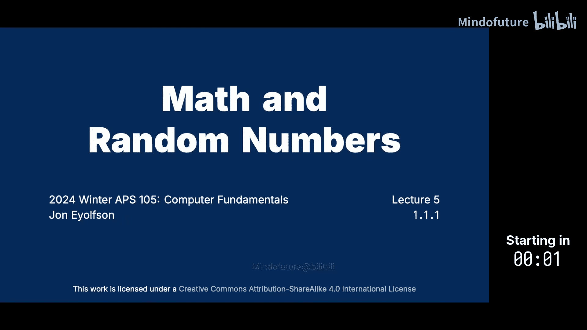
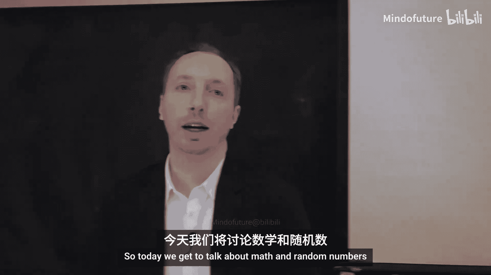
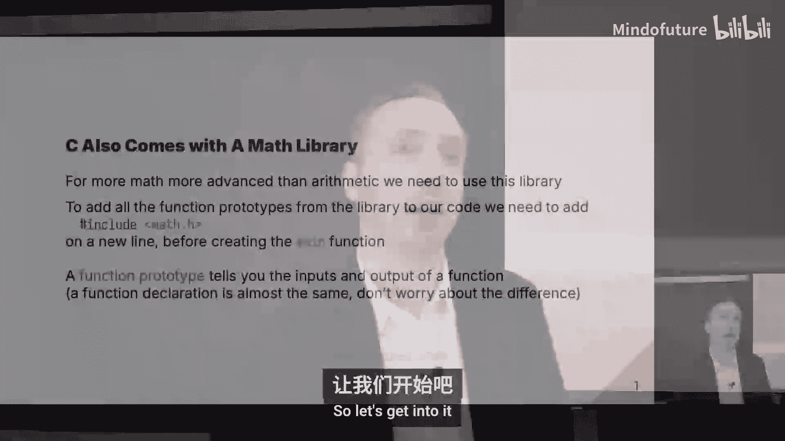
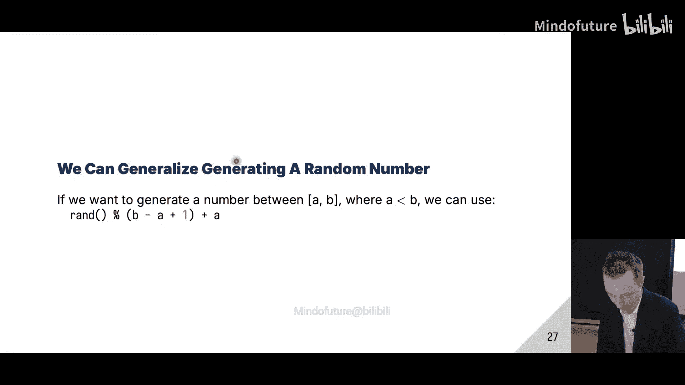

# 【多伦多大学】C语言计算机编程-｜-Computer-Fundamentals-｜-2024-p05-P05_数学与随机数--BV1zL6GBwEGe_p5-

All right， welcome back to 105， thank you for joining me on today's cold evening。

 so today we get to talk about math and random numbers。

So by the end of this lecture， you will definitely have everything you know to complete lab one and to complete a bunch of lab two。

 So let's get into it。 So see。

Comes with the standard C library， and it also comes with a math library。

 So we've seen a little bit of math so far， basic arithmetic， adding， subtracting， multiplying。

 dividing， getting the remainder sometimes。 But if we want to do anything more advanced and arithmetic。

 we need to use this library。So to add all function prototypes from the library to our code。

 which is a new word for us today， we need to do like a hashtag include and then math do H on a new line and that's before creating the main function like we had with our other library includes so function prototype new word today so a function prototype tells you about the inputs and outputs of a function you might hear the word function declaration almost the same thing for the purposes of if course we can consider it the same thing don't worry about the difference。

So a function prototype tells you the input and output types to the function。

 so all function prototypes have this form。 So the output type comes first。

 So you would see that this kind of looks like main main starts with int。

 and that is the output of main。 So in general， we can have different output types we can create functions。

 that output different things。 So first thing is the output type， then the function name comes next。

 In this case， we've only really seen main。 And then there is a parentheses。

 and then there are input types here。 So you're allowed to have more than one input。

 we've already seen that with print F。 So print F will take more than one input and so we'll scan F。

Vooid is that special type。 that means nothing。So we can have multiple input types。

 we just separate them by commas and input types can be void and that just means there are no inputs to this function。

 and that is exactly what we have with Ma。So some examples of function prototypes are I'll just put start adding comments to the code so that everything is all together。

 So if I have something that says double fo and then brackets double and then every line ends with a semicolon。

 that means that I'm declaring that there is a function called F。

 that takes a single double as input and then outputs a double。

So everyone okay with that function one input， double output double。

 if I have something that looks like this， I have double fo， double common double。

 well that means the function is called fo， it takes two doubles as inputs or there's two double arguments if you want to say it like that and it outputs a double。

Could also have void F double。 So that means there's a function called F takes a single double as an input。

 has no output。And finally， I could have something like this。 again， another function called F。

 This time， it goes double fo void。 That means it has no inputs and then outputs a double。

 So any questions about those function prototypes。All right， we are good。

 so this is how you will read what's in a library y。Saing。Oh， so yeah， there's a question。

 So in the last case， do I have to say void or can just type nothing。

 So depending on the version of C you use， you can type nothing。

 The strictest sense of C wants you to type void there。 So sometimes it's up to you should just。

Get into the habit of just doing whatever C tells us to do。So that's the safest one。

 Sometimes you can get rid of it。So you might see function prototypes that can actually optionally name the arguments if you want。

 but these names are only for your benefit to make it easier to read。

 So example I could have double fo and then double X and then double y。

 So those kind of look like variable names， but they're just there to help you understand which arguments are which you might。

Be confused if you see a function that takes like three doubles that does something you might write the order is important。

 which one is which So in order for you to understand which is which you can actually name them and then from the name you know which one to use for what So the order matters for all of whatever we use functions。

 So when you actually use this function， those names don't matter I don't have to have a variable called x I don't have to have a variable called Y they don't have to match whatever is in that function prototype So just to demonstrate that I could just say when I use this function I could just call it with like you know 7。

0 or something like that。 And if I have something like 7。0 like just an actual number that's a value。

The compiler calls those literals。 So it's like a literal number。 if I don'。嚟个声啊。有。Yeah。

 so these like having no name oops like here， just food double double。

 So if you were to write this function， right， you would have to name them。 But in this case。

 this is only to say what arguments the function take， that's the only purpose for this。

 But when we get into writing functions， Yeah， we'll have to name them。

But we're not writing functions yet， that's later in the course。All right。

 any other questions are good？Alright， so here's some background knowledge because， all right。

 that first off， this little symbol here。 What do you want me to call that， Most people。

 probably your age hashtag， Is that a thing。Hashtag， pound， hash。Any preferences。

 I don't really care what I call it hashtags sure allright， so。

There's something called a C preprocessor that's part of the compiler that runs before the compiler actually converts what you wrote into machine code。

 so this is not testable， so this is just to help you understand what happening。

 I won we won't ever ask you a question about it。 Other sections probably don't even go over this so。

Basically， how to interpret as anything that starts with like a hashtag。

 It's technically called a preproor directive。 So that's to tell the preprocesor to do anything。

 do something。 So that include preprosor directive。By the time it actually compiles。

 it replaces that include with the contents of that file。

 So there's a file somewhere in this case that would be called like math dot H or STD do Io dot H or something like that。

 that would actually be a file on your machine。 and whenever the compiler runs。

 it will find that file and just replace that hashtag include with the contents of that file。So。

Those files you might have noticed so far。 They've all ended in dot H。

 It's because they are called header files。 Don't ask me why we call them header files。

Because they're supposed to be at the top or the head of your program。

 So that's why we call them header files。 I guess basically all those header files do is to a bunch of function prototypes in them。

 So the library will come with one or more header files that contains all the function prototypes that you can use in that library。

 So we can see what we can use in the math library today。So， for instance。

 there is a function to actually compute the square root。 So in math， we'd write， you know。

 square root of X。 We can't just write squiggly lines in C。

 We have to just use things on our keyboard。 So in C， we need to use a function。 and it's called。😊。

You'll notice this in computing。 we like having short forms of stuff。 So it's not called square root。

 We tried to make it as short as possible。 So it's called squt。

So don't ask me why just to save a few keystrokes I guess and it takes a double so in this case you could call it an x just to match that so it makes sense and then it returns a double so for example if I called square root with 4。

0 well it takes a square root of4 square root of4 is2 so you would get the value2 back out of it whenever you use it so questions about that。

Alright， that's the last thing you finally need for lab 1， part 3。 Now you can do all of lab1。

 so you should be good now。 So from this point， you should be able to complete lab sooner than this。

 We had the start of the course。 So that's why。So here's an example in code if I was using square root and I have all of my includes at the top so I have math dot H。

 that's where that square root is， the square root function is then I have standard IO for print F then I have standard lib for that exit success value there so I just don't have a magic value if I didn't want to have exit success and just put zero there I wouldn't need that one but exit success it's part of this header file so in mean I could have double y equals 4。

0 then I could create a new variable called y square root and then assign it the value I get from that function and then if I go ahead and print it with just one decimal point。

If I run this， I should see what I saw in the previous slide and square root of 4。0 equals 2。0。

Any questions about that？Pretty good so far。So here is some of the extra stuff。So if we wanted to。

 we could create our own header file。 So for example。

 one of the things in that math dot H header file。It's going to contain something that looks exactly like this。

 It's going to contain the function prototype for square root。

 So it's going to be like double square root， double x。

 it may or may not have the x there depending on how nice they are and when I use it in my program。

 I could actually just do this if I create a file called square root do H so I create a header file I could instead do include the header file that I created and you might notice here I have double quotes here instead of those angled brackets So it has a slightly different meaning So if you have angled brackets it the compiler will search for that file in the standard library places if you just have a double quote there it will search for it in all the standard places and also in the current directory so you could create this and it can actually go ahead and use it if you want。

So I could have my main exactly the same as before。And then。Before compilation。

 what the preprocessor is going to do is replace that hashtag include。 so in this case。

 if all my square root dot H file contains is this function prototype after that preprocessor runs and it gets rid of all the hashtags。

To the compiler， it will see this as its code。 So it will see the function prototype for square root。

And then by main that actually uses it。 And here is that note。 If you want it。

 that tells you the difference between the。File name being in the angled brackets。

 That's just the compiler to look for。The file in the default directories， Well。

 if it's double quotes， looks for the file in the same directory as the code。

This probably is not testable。 This is just to help you kind of understand what the compiler is actually doing and trying to get rid of any magic it has that hashtag include。

 It's kind of confusing for a lot of people。 But really， all it's doing。

Those files just have a bunch of function prototypes in them。

 so you don't have to type it out yourself or remember what arguments each function takes。

 They all do it for you。So a， quick questions about that。Allright， perfect。

So there are more and more functions， so there's a function for exponents so in math I write x to the power of y and in C。

 well， of course we need to use a function， so there's a function called power short for power。

 I guess again we just shortened stuff for the hell of it。

 So it takes2 doubles and x and a y in that order， so that order corresponds to this。

 so your base is x and then your exponent is y and for example， if I used it。

 so power28 is2 to the power of8 which should be 256。Questions about that。All right， we're good。

There's trigonomic functions as well。 So we can use sine and sine is defined cosine。

 and it has all those。 they're defined in radance。 So in that math dot H file。

 there's also the value of pi in there。 So to use it， you just type M underscore pi。

 So whenever you type M underscore pi。 the compiler will go ahead and replace that with the actual value of pi。

 And the value they use for pi is 21 digits long， which is more precise than a double， but unlike。

 you know， number not being able to fit。When we had integers。

 if you have more digits than can actually be represented by a double。

 it just kind of removes the extra precision， tries to be as precise as possible and doesn't have all the weird surprises when we。

Have integers when we had something too big。 It just turned into a giant negative number。

 That stuff doesn't happen with float。 So you don't have to worry about it behaves a bit better。

 It tries its best to represent the number。So here's an example if I use that。

 so remember pi is like 180 degrees， so if I want to get the signine of 90 degrees。

 I just take pi and then divide it by 2， so that's 90 degrees in radians so a sine of 90 degrees or pi divide by 2 if you're in radians is's just 1。

0 so it works and you'll probably need to use this for lab2。

So there's also logarithmic functions so in math， usually we write so we've probably seen like the LN。

 so like the natural log or log to the base E。 so in C there is a function called log。

 but annoyingly that is not the log we all know and love the base 101。

 they define log as the natural logarithm， so to the base E， so if I use their log function。

 it corresponds to what we interpret as the natural log or the lawn or whatever the hell we call that thing。

 I forget I haven't taken math in a while。So。If you need the value of E for some reason。

 you can access it the same way。 you can access the value of pi。 It's just M underscore E。

 And if I want the actual log。 So like in math， when we write normal logs like normal human beings or log to the base 10 in C。

 it's just called log 10。So that's the common they call it the common logarithm。

 So if you want to use a log base 10， you have to use that one。

 There's also a base two version if you want to use that。

 but C has all the common math things we would need。

So we can still get a remainder as well using double values。 So remember。

 we can't use that percent operator that gave us the remainder of an integer division。Because， well。

 those need two integers。 So if we want to get the remainder using double values。

 we have to use a function。 So in that case， they named it F mod。 So F mod takes two doubles。

 and it gives you the remainder of x divided by y or the first argument divided by the second argument。

 So give you the remainder as a double。So if we did F mod。5 or sorry，3。5 divided by 2。

 a remainder would be 1。5。 Nothing terribly special here。Other fun functions。

 We can get the minimum and the maximum of two values。 this might be useful to you as well。

 So if I have there's F min， So that will take two numbers A and a B in order it doesn't really matter because it will always give you output the smallest of those two numbers。

 And then there's also an F max， that will always output the larger of the two numbers。

 So if you need to figure out between two numbers， which is larger and which is smaller。

 that's the easy way to do it。 So might not be terribly useful of both integers are just literal values。

 So if you ask it， you know， what's the min of one and two， probably a weird thing。

 you should probably just write ones because you can figure that out。

 But usually these arguments are going to be variables。But just to see what you'd get。

 So F min of like 2。0 and 3。5， while that's2， doesn't matter what the order of the arguments are。

 and then same for max， if I use the same two numbers in any order， the maximum of it would be 3。5。

Again， any questions， nothing terribly exciting so far， right？All right。

 that's good if it's boring so far。So。This is where we get into rounding。

 which gets really kind of weird。 So there are several different way to a lot of different ways。

 actually， to round floats that all do slightly different things。

 So there is a function called round and all of the rounding will always round to the nearest integer。

 So something 00。 And there are different rules for different functions。 So for example。

 the round function， it will always round round away from 0。 if in halfway cases。 So if I have 1。5。

 it'll round up to 2。 if I have 2。5， it'll round up to 3。😊，And the next one。

 our int computes the nearest integer and its rule is like the scientific rounding to try and even out the bias。

 it will always round towards the even number in halfway cases。 So if I round 1。

5 that rounds up to two if I round 2。5。 that rounds down to two because that's the nearest even value。

 and I have a little asterisks here。 that rounding rule is by default。

 we won't tell you how to actually change that so it'll be true。

 but know that there are also a lot of different rounding rules that all do slightly different things which is fairly annoying。

 but these are the only two we have to know for this course， In fact。

 I think we just use this one for this course the one that always rounds towards even。So here's。

 for example， to show the difference， so round 1。5， it always rounds away from zero。

 so it will always round up， or in this case if it was like a negative 1。5。

 it would round away from 0 to negative2。So if I have 2。5， again， the round rounds up 3。0。

 if I do R int， so I round to the nearest integer， the default rule is to round to the nearest even number。

 so 1。5 rounds to 2， 2。5 rounds to 2。Any questions about that？All right。

 just kind of something you have to know because， well， that's how it works。So just as a note here。

 I think I mentioned before， but I will mention again to be super explicit that using that double format specifier does not change the actual value。

 So if I have a program like this， so I create a variable called a and give it the value 2。0。

 if I do a format specifier where I say， hey， just。

Don't print anything after the decimal point so I can do 00 and then LF for a double if I actually run this。

 that will print 2。0， so it rounded it， it obviously used the R int because it rounded to the nearest even number because I didn't get three。

 I got two。But。This format specifier does not actually change the value of a。

 So even after this print F is done， a is still equal to 2。5。

 so it will only round it for displaying using that format specifier。

 if you actually want to change the actual value to be the random to be the rounded value。

 Then we would need to reassign a with the result of like our int or something like that。

And then for this， if I am just printing off one decimal point， well， in this case。

 it doesn't even need to round and it will just always print 2。5 in this case。

So any questions about that？So format specifyifier， show you a rounded value。

But it won't actually change the value itself。 And you can， for this point one。

 you can just use that for the lab。 you don't have to worry about actually trying to round the value itself。

 at least for lab one。So if I need to move if I want to like round more precisely around a specific decimal point。

 well， I need to move the decimal point for actually rounding So if I look at the default rules。

 they're a bit weird if it's not rounding to the nearest integer。

 so if I tell it to just print one decimal point after the0 or sorry if I just tell it to print one decimal point and my number is 2。

55， it always just round down， you have no control over it。 So if I ran this print F。

 it would print off 2。5 like it just rounded it down。

 it didn't follow any rules or anything like that， just round it down。It should have。

The rules we had so far it either always rounded up or rounded to the nearest even。

 following any of those rules， this 。5 should actually be like round up to 06， right。

 if it followed any logical rules， but。For anything that is not an integer。

 the print F function specifier just rounds down。 and to show it， I can do the same thing with 2。65。

 and that will print 2。6。 It just always rounds down。

So if I want to actually round that decimal point， how you we should round numbers。

 I actually need to shift the decimal point before I actually round it。

 so I would have to since all the rules apply just to just to integers， if I want to just。

Round to one decimal point。 I need to move that decimal point1 over to the right before I actually round it。

 So in this case， I can move that decimal point1 over to the right by just multiplying that value by 10。

 So if I take 2。55， multiply it by 10， then I get 25。5。 And then I can round that value。

 So if I round that value， and I use it to what does 25。5 round 2。26 right。

 so that does the proper rounding now if I want to get the original value I have。

 I just take that rounded value and then just go ahead and divide it by 10 again。So。

This is what I can do So I can just take 2。65 times it by 10。 So then now when I'm doing that R int。

 I'm rounding to the nearest integer and I put the decimal point where exactly where I wanted it to。

 And then after I rounded it， I can just restore where the decimal point was originally by just dividing again by the same number。

 So now if I do this， it will print 2。6。 So it will actually round。

To the next even number because I'm using our int and then for this one， well， if I multiply 2。

55 times 10， that's 25。5， goes up to 26， move the decimal point over and it would print 2。6。So to。

 to， to。So the question in the discord is I'll have to check that。

 but both of those printfs should round down。But if they don't， I will check it after the lecture。

So questions about this。 So if you want to control the rounding。

 you just have to move the deciimbel point yourself。

 kind of annoying because all the round functions， they only go to the nearest integer。Alright。

 so there's even more ways to round to the nearest integer。 if you want to call it rounding。

 So in math has anyone everyone have seen like the ceiling operator before。 Yeah， okay。

 so we've seen that So we can't just use those weird character。 So in C again， it's a function。

 why would we ever call it seal， we just call it seal。

 So it what seal does is it will compute the the first integer larger or equal to X。

 And if I want to do the opposite of that。 So called floor。

 they actually type floor instead of something else stupid。 So that's good。

 So floor will compute the first nearest integer that is smaller or equal to X。

 So gets a bit fun once we get into negative values you'll have to realize that oh。

 what's larger and what is smaller。 So the ceiling 1。1 Well。

 that goes all the way up to2 ceiling of 2。It'sAl an integer， so it wouldn't change。

 it would just be two ceiling of negative 1。9 while it goes to the next largest number so it wouldn't be negative 2 because negative2 is smaller。

 then negative1。 So the closest the largest closest integer to this is just negative 1。

 so be careful， if you do this with negative values。 So same deal with floor。 So if I floor 1。

9 that goes all the way down to 0 kind of looks like truncation a little bit。

 if we remember truncation and if I floor 2， well it's already an integer。 So it stays the same。

 if I floor 1。1 well it goes to the next lowest again。

 So it's either negative 2 or negative1 in this case， it's a floor。

 So negative 2 is smaller than negative 1。 So it would be negative 2。Questions about that。Perfect。

So truncation kind of look like it's similar to floor and ceiling。 So when we trunnccate an integer。

 remember we just chopped off the decimal point and we didn't really care past that。

 So trunccate actually happens to be the exact same as floor for positive values and then the exact same as ceiling for negative values。

 So that's what happens when you just chop off the integer。

 So I set it up to the previous slide has all the exact same number。 So if we truncate 1。

1 we get one if we truncate 2。0。 Well， stays the same， it would be2 trunccate 1。9。

 So we just chop chop off the 0。9 negative 1 trunccate1。9。Chop it off。

 It's one trunccate 2 stays 2 again， trunccate negative 1。1。

 then we just get negative 1 because it just chops off the anything after the decimal。

 So questions about that。Perfect。So way more math functions is available。

 so there's an entire list on Wikipedia that's clickable if there's a math function you need to find。

For this course， you should only use the functions that just have doubles for all the arguments。

 so we're only considering doubles。 That's the most precise thing we have。

 just gets rid of a lot of problems if you for some reason， if you ever type floatat。

Realize don't do that because you'll probably get into some very。

 you'll run into some very confusing problems that comes with mixing floats and doubles and weird things might happen。

 so if you need a number that needs a decimal point， just always use float。And for La 2。

 you might find this F A B，S that is the function to find the absolute value of a float。

 useful for lab 2。 So La2， you should use that function。

 but just takes a single argument and returns to double just the absolute value。All right。

 so we can do a little bit of a problem now so we can make some change using nickels。First。

 actual real problem。 So， right， we eliminated the penny。

 So you might get a total that is in dollars and cents。

 But if you need to make change while pennies don't exist anymore， you can only actually。

Give back nicks。 So you have to round to the nearest nichels。

 so we can actually write a program for that。 So let me switch over real quick，op。😊，So。To， to to。So。

If we want to problem solve that， a lot of。Actually thinking about the problem is thinking about what inputs you have and what outputs you should get so we're just going to have the user enter an amount in dollars。

 we'll assume it's valid so they'll just use two decimal places and not be mean to us or anything like that。

So if I want to round to the nearest nickels， I should think of what my input is going to be and what my output is going to be。

 So my input is going to be some dollar amount。 So someone just give me any old dollar amount that we want to round to the nearest nickel。

$42。42。 So if that is my input， then I have to think about what my output would be。

 So if I'm rounding to the nearest nickel， what should the result of that be。So yeah， in this case。

 if it's $42。42。Then my output should be $42 and then 40 cents， right？

So that would be the nearest nickel。What about if I had， you know，$42。43， What should my answer be。

So should it be $42。40？No， I should round up。So。I should round up， so this problem。

 if I'm trying to solve it， seems like rounding is my answer。

 so if I want to round to that amount to the nearest nickel。

What probably should I do to solve this problem？Yep。ちま。Multiply it by 20 to get the number of niels。

I could do that， but that's。Might be a little hard to read why exactly 20。

So there's 20 niels in a dollar， so I could do something like that。

But is there any way where I could just get the amount of nickels directly by just dividing by a number。

I guess it's the same thing。 So if I wanted to get the number of nickels。

 I guess the same thing I do， but using the nickel amount is I just could take like 42。

42 and then divide it by the value of a nickel right So if I just divide it by the value of nickel that will tell me how many nickels I have And in this case it will give me some value like I don't know some number I can't think of right now and then probably like 0。

4。Right。So it will essentially be 2 out of5 nickels。So。The remainder will be 04。

 If I do the other case， where I have。This， my my decimal point is going be something06 of a nickel。

 So if I take this and I round it to the nearest integer。 Well， this one will round down。

 This one will round up。 So that gets me to the nearest nickel。

 And then it's like the same thing as as just changing the value。

 So I could just divide it by the value of a nickel， get the number of nickels， then。

Round that to the nearest integer and then just multiply by the value of a nickel again to actually get the rounded value now。

 So I could do something like print F。Nearest。So I'll print off two decimal places just in case。

 but just to make it look pretty。But I could take that amount and then divide it by 0。05。

 So this is the number of nickels I have。 And then if I want to get to the nearest nickel。

 I have to round that。 So my rounding function is going to be our int。

So that will get me to the nearest number of nickels。

 And then if I want to restore the or get close to the original value again。

 all I have to do is multiply by the number of nickels again or by the value of a nickel again。

So if I go ahead and compile that。And then run it， what's it called nichels。So。

I can try it with the amount that I set aside at the beginning。 So 4204。

 I argued that it should actually come out to 4240， which hey it does。

 So this seems to ran to the nearest nickel just to make sure we can test it with another value and let's put a dollar sign there so it looks a bit better。

So if I had 42， 43， then the nearest nickel is 42， 45。

 so steam to work so this is the type of code that would be in the cash registers that tell you， oh。

 you know how much change they should give you so they'd have to rent it to the nearest nickel and then figure out your change based off that by just subtracting it。

So questions about that。Usually when you problem solve this， generally。

 it's easier just to think of inputs and what the output should be。 Think about how you would。

Get from the input to the output， and then after you come up with some solution。

 try it out to make sure that you've done it and we'll get a bunch more practice on this as we go through the course。

So。That was our problem in there Lo。 So now we can talk about random numbers to finish this off。

 So there is a C standard library function called R。 Again。

 why would we call it random or anything like that， Let's just only use four letters。

 if possible and call it Rand。 That function prototype is in standard Lib dot H。

 And the function prototype looks like this。 It is int R and then void。

 So it takes no arguments and it gives us an int， And that int should be if the name actually means anything。

 It should just be a random integer。So it will return a number between0 and RA max in most cases。

 RA max will be that very large number that looks a little bit familiar。

 that is the maximum size of an int， which is 2 to the 32 minus1 so if you want to double check that you are free to do that。

 but that's just the maximum value of an int， so it will return a positive value0 all the way up to the maximum positive value of an int。

So Rand。It's not actually random。 It's something called a pseudoran number generator。

 pseudo is just a word for meaning not genuine。 It's fake。 It's not actually real。

 So Rand uses some mathematical formula to generate the next， quote unquote random number。

 It's not actually random。 It uses a seed value， and it creates a deterministic sequence of numbers whenever you call Rand。

 deterministic。 It's just another fancy word that we're introduced to in this course。

 That just means it is the exact same every single time。So。

If we want to get a different sequence of random numbers。

 you can change the seed value for Rand using while something they cleverly named S S Rand。

 So the function signature for S Rand is void。 So it gives no output。

 and then it takes an unsigned int seed as a argument。 And that unsigned is a new thing。

 I think this should be the first time we have seen it so far。 So the type unsigned int。

That goes back way at the beginning when we talked about whole numbers and what whole numbers we could represent just using amount of bits。

 So if we have unsigned int， it means it doesn't have that sine bit so that sign bit isn't there anymore and it can only represent whole numbers so only0 up to a big positive value。

 So if it doesn't have a sign bit and still uses4 bytes。

 so that means an unsign bit can represent the numbers0 all the way up to 2 to the 32 minus-1。

 So it can't represent any negative values， so it can represent more positive values。

So in this course， we just tell you to always use it， even if you know the number can't be negative。

 because generally it is a bad idea whenever you have to mix。

 signed and unsigned and it just causes a lot of problems like Google had a real famous bug with it where they mix them up together and then suddenly。

I forget what happened I think。They probably lost like a billion dollars or something like that。

 So just don't do that for this course。We're always going to use int if we don't need a decimal。

 if we need a decimal， what type are we going to use？A double a double right。

 So double use a decimal。 if you don't need a decimal， use an int。

 if you need to represent something， you can type on your keyboard， use a char。

 and if you need to represent， you know a one or a0 or true and false， use a boolean past that。

 we don't have to use anything else other than those four types yet。So。

What we can do with R is remember that modular operator。

 so we can actually use that to generate random numbers in any range we want。

 So remember gives us the remainder after doing a integer division and R。 Well。

 it returns an integer。 In fact， it's always positive。 So it's a whole number。 So remember。

 those weird rules when we had mod with negative values。 where the mod would sometimes be negative。

 sometimes be positive。 Well， in this case， since R only returns positive numbers。

 Well we don't have to worry about those rules， the result of the mod will always be0 or above。

 So if we do something like R mod 10。😊，No matter what random number it gives to us。

 the result of moddding whatever random number by 10。

 it's always going to be a number between 0 and 9 inclusive right So those are the only choices of remainders we have。

 So if we want to generate a random number between one and 10。 Well we can just take random mod 10。

 that will give us an always a number between 0 and 9。

 So we just take that result and then add one to it。 So in that case。

 we'll always get a number between one and 10。 So you can use mod and adding to get any range of random numbers you want。

So like I said， RA mod 10 plus1， that means we'll get a random number between one and 10。

 so questions about that。苦。Allright。 So if we want to generalize this a bit。

 if we want to generate a random number between A and B inclusively where A is less than B。

 we can use this formula。 So wed do R and then mod。

B minus a plus1 because we want to generate another number and then plus a。

 so we can check that whenever we wanted to do between one and 10 while a was 1 and then B was 10。

 So that would make sense。 So 10 minus1 that's 9 plus 1。

 So that means we would mod it by 10 and then plus a while that was just one。

 So we get the same result。 So this is that general form of general getting a random number between a value。

 so。If we wanted to generate， I dont know， a random number between one and 6， what would we do。Yep。

Have one is in。Yeah。A would be one。 B would be 6。 So what would the actual C result be。Yeah。

6-1 plus1 plus1。 So at the end， we'd get rand and then mod 6 plus 1。

 And then that would give us a random number between 1 and 6。So a， questions at all from today。

 we got a whole four minutes。So should be good for lab one， encourage you to do that。Or。

Anything else I'll be here for a few minutes if there's any other questions。

 but seems to be good so far， so just remember， I'm pulling for you， we're all in this together。

