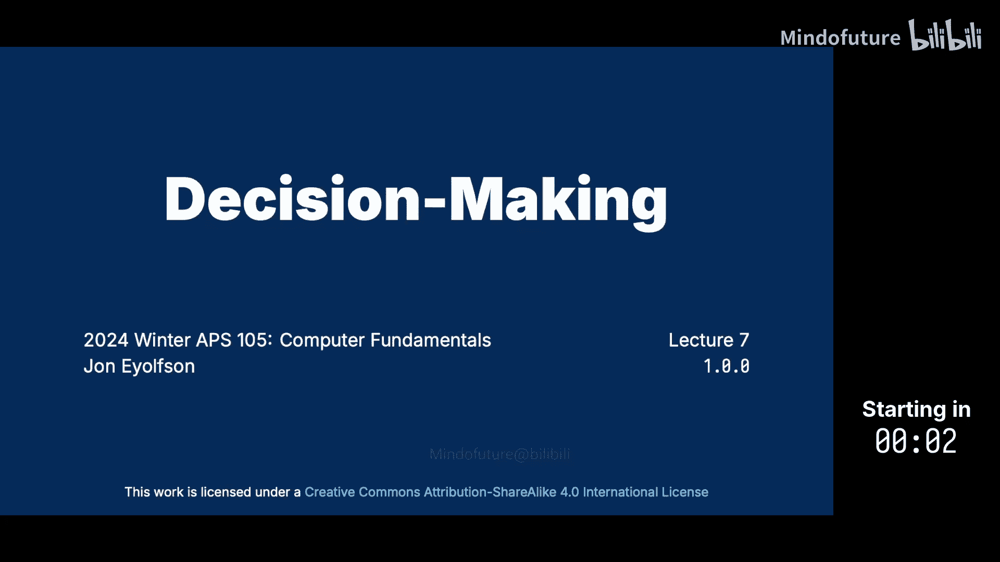
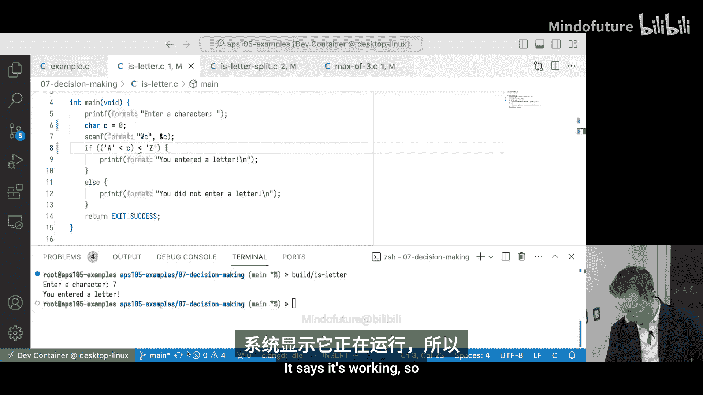
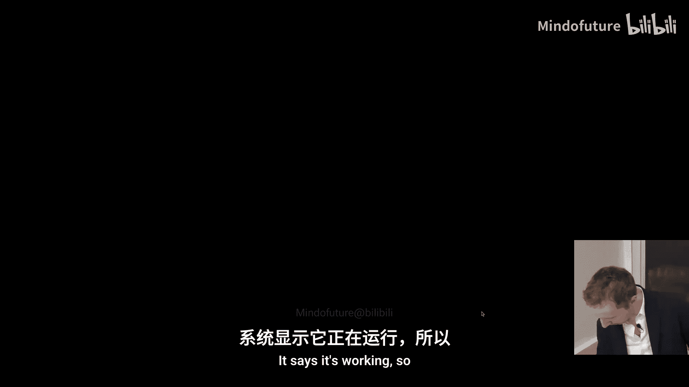
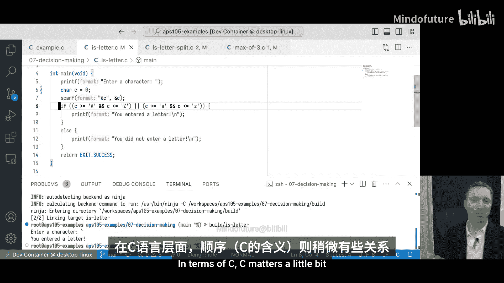
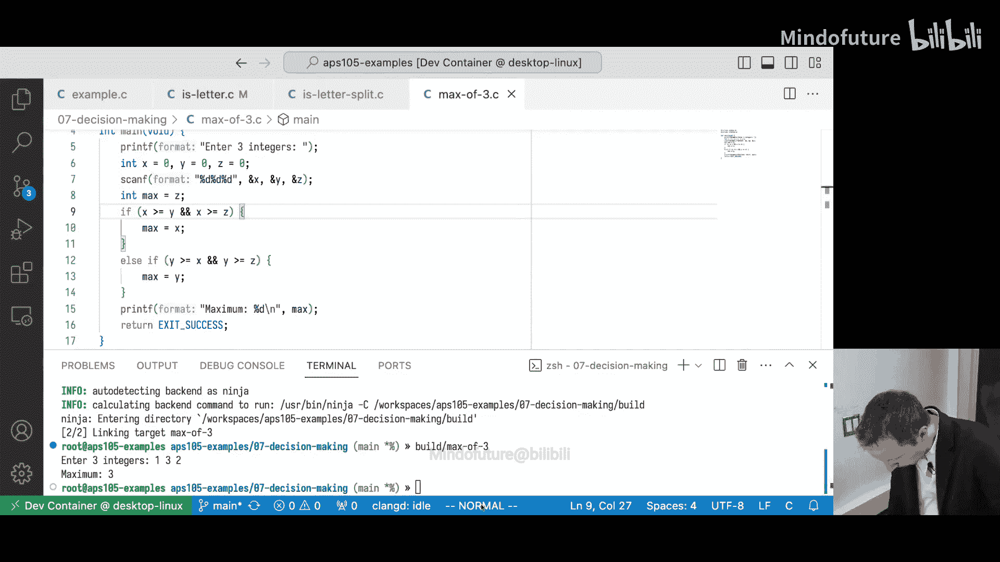
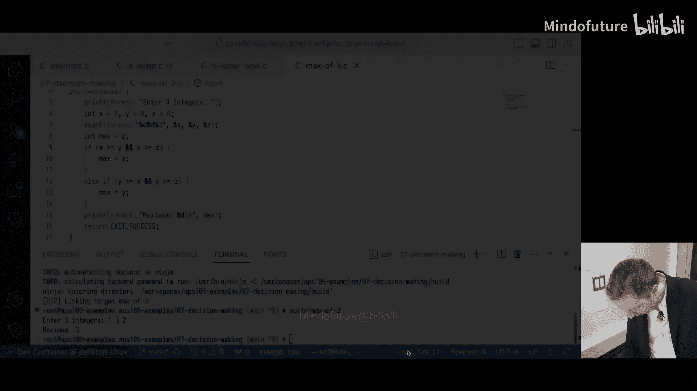

# 【多伦多大学】C语言计算机编程-｜-Computer-Fundamentals-｜-2024-p07-P07_决策制定--BV1zL6GBwEGe_p7-

。

All right， welcome back to 105 wow， that's an echo yikes， all right。

 so thank you for joining me today。Today we get to continue our journey on well making our computer do something other than blindly following statement after statement。

 we actually taught it how to jump around a little bit。

 so we'll be doing more of that today and getting some more practice。

So we saw a bunch of relational if statements。 We saw。

A bunch of ways to just have ans and or's and more logic statements。So。We saw comparing numbers。

 while we know that characters are actually just numbers represented by the computer。

 you don't actually need to know which character corresponds to which number。

 but you should know some generally how they are ordered because you are allowed to compare characters and sometimes it will be useful。

Remember， characters are ASI encoded， so they're converted into bytes and the way they are ordered so the important ones are well all of the digits are ordered in order in terms of value so zero gets the lowest actual number again doesn't really matter what that number is and then nine gets the highest of them so if you did an inequality between all them so。

The character at zero is actually less than the character one。

And then you don't actually need to know what the character capital A is。

 but you should know in terms of order， well a capital A is greater than any digit。

 so that's something you should know and then all of the capital characters are all in order so a is less than B B is less than C all the way up until Z and then after that comes all of the lowercase letters so we have。

Lowercase A then is less than lowercase B is less than lowercase C all the way up to lowercase Z。So。

These are fairly important numbers to know because they'll be actually useful， as we will see today。

So。Like I said， we can do arithmetic just on the letters， so the digits0 through9 they're sequential。

 so their values increase by one again， doesn't really。

 we don't really care what the value of zero is， but it might be nice to know that， hey。

 if we take the character0， so the characters between the single quotes。

We can do math on it like anything else， so it's a bit weird looking。

 but we can just add the integer2 to it， and then that will actually result in the character too so because。

You know， one away from the character zero is the digit 1 and then two away from the character zero is the digit 2。

And similarly， if we just take the character zero and add five to it。

 we get the character five a bit weird， but these are how the rules work。So。Again。

 all of the uppercase characters， they're sequential， so their values increased by exactly one。

 as well as the lowercase letters a through Z， and if you want to know。

 well an uppercase letter plus 32 results in a lowercase version of that character。

 but that's something you probably will never ever use for this course。

 so if there's anything to forget， you can forget about that one。But。

If we actually did some examples with it， well， if we took the uppercase A and then we added two。

 that's just two more letters in the alphabet， so a plus1 would be capital B。

 uppercase A plus 2 would be uppercase C。And then if I had lowercase A+ 3， well that's lowercase D。

 and if you could also subtract if you really wanted to， so if I wanted to know the letter before。

 I could just say oh minus1， and then I would get n。

 so just fun things we can do with characters that may or may not be fun depending on who you are。So。

We can actually。Write a program now that kind of looks for users input and tells what the user is actually inputting。

So oh， Jesus。So we can write a program that actually looks for a letter。

Here we can start the program off。 remember if we argue about executing a program。

 it always starts at main， so the first thing our program would do would output。

 enter a character and then here we will create a character I will。Very creatively named C。

 so I'll create a character name C。And I'll initialize it。

 so in this case this is a way of initializing it to a zero。

 so there is a special zero character that if you do an escape codeat and a zero。

 that means a character with a value of zero。Now I do a scan F， so I let the user input a character。

 oh yep， sorry。But that's。Yeah， so on line6， this is actually equivalent of saying this if I really wanted to。

 they mean the same thing but。Yeah， generally， if it's a character。

 character should just be in single quotes because that's what a character is。

 you can play with the numbers if you want and let it kind of implicitly convert things。

 but you don't have to。Allright， so then we do a scan F so we let the user input a single character。

 and then this is going to be our job to say， hey， did you enter a letter or did you not enter a letter so we have an if statement so if。

A condition I need to write is true。 I want it to print off。 you entered a letter。 Otherwise。

 I wanted to say I didn't enter a letter。 and again， this isn't。IfL statement。

 so only one of these things are going to print at whenever I run my program so right now since I just have if1。

 remember that's the thing if true， so that means this code should always execute no matter what I input so let's just make sure that that is true and I haven't taken my crazy pills today。

So enter a character， I can enter something that's not a letter， so let's say seven。

And now because I wrote my program wrong， it says you have entered a letter so that is no good。

 so let us start developing this relational statement we have to have in this if。

So that it will actually check that character and then see if it is a letter or not。

If we were to write you actual English or actual like math notation。

 we probably might write something like， hey， well， we want。

A capital A to B between C and then between Z， something like that。

Turns out we can't actually write that in C because， well， if we actually。

Thought about how C calculates this value， what it would do。 Remember。

 C can only do like one operation at a time with two opera ends。

 So how it would do this is it would first。Because we have less left fsociivity so it would compare a to C。

 so in this case if a is less than C， then this would be true。

 and then it would compare is true less than Z which is probably not what you want。

 so we want to make sure our character in this case is between capital A。And less than lowercase Z。

So in this case。Yep，Sorry。The YouTube crash？The stream crashed。呃。

ItSays it's working。这 two。

All right， well， if it crashes， I have a recording on my laptop， I'll upload it later。

St between an applet。Yeah， so got a comment that in this case。

 if I want both of those things to be true， so I want be between a value。

 well I should pretty much just translate it。Like exactly what I said in English。

 so I want to make sure the character is greater than a capital A and also less than a capital Z。

 so then it's between those bounds if both of those conditions are true。So in this case。

 I might want to check。Well。If C。Is greater than or equal to a。 So I want to include a。

 so this means that it is some value that is。Capital A or greater。

 so I also in this case there's some letters and other things that are after the capital Z。

 so I want to make sure that it is also less n or equal to the capital Z。

 so I should say I also want this to be true。So now if this is my if statement that looks a bit better now。

 so now this if statement is only true if the character I entered is greater than or equal to capital A。

 and it's also lesson than or equal to capital Z， so now we can compile this and try it。

So now if I enter just an A， well， that should be true。But。Conditional statement。

 whenever C computes it it's true， so I get this part of the if statement。

 so I get you entered a letter and now if I enter， I don't know， say a digit。

 well a digit shouldn't be within those bounds， it shouldn't be a capital letter so if I enter again。

 let's say six， I'd see it prints off， you did not enter a letter because this is false。So。

Right now we are close to done yep。Yeah， so。Right now， the scanF only looks for a single character。

 so if I enter more than one character。It'll do something weird。

 we'll figure out how to handle that later， but now we're just always assuming whoever is typing into the keyboard is nice to us。

Yep， and so like when you said you entered a letter like， what did you make a capital letter on your？

Ys。Yeah， so in this case， well I'm not quite done yet because there are lowercase letters。

 so if I run this program and I type I don't know， a lowercase J。

 it says you did not enter a letter so I still have some work to do so this is basically just checking if I entered a capital character。

 so I also want to check if I。I'm also allowed to enter a lowercase character。Sorry。Yeah。

 so if I want to include lowercase characters， well。If I was were to say it in English。

 I want to be able to accept an uppercase character or a lowercase character， either is fine。

 I wouldn't want an and I don't know character can be both an uppercase and a lowercase at the same time that doesn't make sense so I will have to check if it is an uppercase or a lowercase。

So in this case， well， I'm not going to worry about the precedent rules。

 So I'm just going to throw this whole。Logic statement all in brackets。

Bracketed that upper case check， and now I can write out。My or？

And then start a new set of brackets and then in here I will check if it is a lowercase。

 so I want C to be less than or equal to lowercase A。And I also want C。

To be less than or equal to a lowercase Z。So。Now if I read this out。Right here。

 this little condition will check if it is that character I entered is between capital A and capital Z。

So if that's true， well， that's an uppercase letter and。That's true if Ive。

True or anything doesn't really matter what the anything is， the whole expression is true。And。

If it is false。Well then what's going to happen is we'll compute and see if the character is a lowercase letter。

 so we'll check if it is greater or equal to lowercase A。

 and that character is also less than lowercase Z。So if we go ahead and compile and run this now。

 well。If I type AJ， it says， hey， you entered a letter so it seems to actually work now and to just check that we didn't screw up anything。

 we can also just try a capital letter again to make sure that it still works and now hey。

 it says you entered a letter。We can try a digit and says you did not enter a letter。

 so seems to work now， so any questions about that？Yep。Yeah， so the question is， well。

 what about if I just？Did some check where I just checked if it was greater equal to a uppercase a oops。

And then。Less than a lowercase said， so turns out there are some values actually in between the uppercase and the lowercase letters。

 let's see what they are oh I don't have it handy。So I believe if I do this。

And I entered a tilde character， I think that's between Yeah， so Tilde character is between。

 so now it says that's a letter， that's not a letter。Wow， I pulled that one out of my rear right。

Yeah。Yeah， so the question is when we had。When we had this statement where we were waring。

 does the order matter， so turns out it kind of matters which we'll get into later。

 but in terms of the logic， it doesn't matter at all they are equivalent。

 saying A or B is the same as saying B or A。So in terms of low logic， no， in terms of C。😡。

See matters a little bit， and we'll see why in a second。 All right。

 Any other questions based off that， whoops。

All right。So。Sometimes that whole if statement is fairly ugly。

 anyone agree with me that that's kind of ugly？So one way of making things more clear in programming especially if you're just beginning is to give things names so instead of doing all that complicated if condition if you notice yourself making giant brackets around everything that probably means you should just give something a name so when I describe it to you I said well I checked for an uppercase letter and then I check for a lowercase letter so remember there is a data type called a Boolean and that is what the relational operators give you so I could actually create a Boolean that is called is uppercase letter。

So then in this Boolean， well I can do that check so I can just write it here。

So it's an uppercase letter if the character is greater or equal to uppercase A and less than equal to lowercase Z。

And that makes it a bit more clear what I actually mean and what I'm checking。 so now well。

If like a month later you came back to this code and you looked at it， you might be like well。

 what the hell are you doing， I don't even understand what you're trying to check for here。

 it looks a bit weird so instead， like I said we just gives things a name。😡，So now。

To check for a lowercase character， well， I just do the same thing。

 but except I use a lowercase character。And now my if statement would look a lot clearer because now I just type。

If is an uppercase letter or a lowercase letter。Do the same thing now。Logically。

 the programs are exactly the same， but does everyone agree this is probably a bit more readable and you can actually understand what it's doing here。

So。In this case， you should aim to write programs that are actually meaningful to you that you could even have a hope of reading later。

So。I would suggest trying to name stuff as soon as you get if conditions that are really。

 really complicated。Just give it a name and say in English。

 because we can name variables whatever we want， try and give it an English description of what you're actually doing。

Oops。All right， so here in the slides， here is the code， so you have it。

And here is our version that is a lot more readable because we just made names and actually described what our conditions were actually checking。

So this is where the order actually kind of matters。

So the C compiler will do some fairly smart things。

 so if I write something that's like a complicated condition or another complicated condition。

In the case that this first complicated condition evaluates to true， then C is just like we， well。

 I'm not even going to bother to compute the other side because true or anything is true sot it doesn't matter what the value is so why would I even compute it so。

In that case， it would not evaluate this complex condition too。

 and evaluate is just another word for see computing that condition or your computer actually like computing the final value。

In the case I had before， if the character was an uppercase character and that was true， well。

 it wouldn't bother checking if it was a lowercase character because it doesn't matter at that point。

 it's a letter。And it can't be built at the same time， so why even bother？So。

That's the rules for a or statement because well。The rule for an or is if either the conditions are true。

 then the entire thing is true。If the left hand side is true。

 doesn't matter what the value of the right hand side is。

So there is a similar optimization for the and logic operator。

 so remember with and both of the conditions have to be true for the final result to be true。

 or in other words， if at least one of them is false， then the entire thing is false。

So if I write some complicated condition and another complicated condition and this complicated condition is false。

 well I already know ahead of time they both can't be true so the only way the whole result is true is if both of them are true so if one is already false that means the entire thing is going to be false so if we evaluate complex condition one and it is false we just skip evaluating complex condition2 and this not having to compute it because the value doesn't matter well the name we give it a say C has lazy evaluation which means it's not going to compute anything that doesn't matter anyways。

 so if it doesn't matter C will not just waste time actually computing it so any questions about that so。

The order logically is not going to matter。 but in this case， if you have an。Like A A and B。

 if it's more likely than one is going to be false， you probably want that one first。

 but doesn't really matter。All right， and there was that。All right。

 so sometimes it is useful to rewrite these logic statements and there is something called the Morgan's laws that if you've done you know this。

Discrete electronics yet， maybe you haven't。 maybe you have you might have seen these laws before。

 so there are just basically some logic laws。 So the laws state that not A or B， well。

 that is exactly the same as saying not。A and not B， so how does that make sense？Well。In this case。

The only time that this will be false is it。They're both false。So in this case。

 I can kind of take this knot， which just flips the value。

Kin of commuted in here and I can change the A to B not A and the B to B not B。

 and then I just change the connective logic gate from an or to an an。

 so these things are exactly equivalent。And I also have the version， if In here is an and。

 then I can go ahead。Bring in the not and then I'll change the symbol over to a or。 So in this case。

 the only way this is going to be false is if either of the values are false。

 so it's a equivalent way of saying。It's either not a or not A is false or not B。

 they mean the same thing。So if I want to check that a character is not a letter。Well。

 generally you want to。Kind of not have brackets everywhere to make it a lot easier to read。

 So instead of saying not an uppercase letter or a。Lower case letter。

 I could use the Morgan flaw to change that into equivalent statement that just gets rid of one of the parentheses。

 So the thing I could rewrite this as that is exactly equivalent is well。

 I can just say if it's not a。Upper case character and is not a lower case character。

 so they mean the exact same thing。And yeah， so there's not much memorization in the course。

 but you should actually kind of commit the Morgan flaws to memory。 They might make the。

 if you have a complicated。If expression， it might make it easier to understand if you just rewrite it。

So。When you use these laws， we have to be aware of the precedent rules and some bugs you might have or some issues with your programs might be you didn't exactly use the brackets to get exactly what you wanted so if I just took this so say I just said。

I meant not an uppercase letter or a lowercase letter。

 and I decided to just remove a set of brackets， so I changed it to not。

Uppercase letter or lower case letter are these two things equivalent。

These two things are not going to be equivalent because remember the uninary operator。

 so like not that flipped the value， well it is a higher precedence than anything else。

 so what this will do is just flip the value of not an uppercase character。

So this expression will be true if you do not have an uppercase character or you don't have a lowercase character instead of not having either or right so these two expressions are absolutely not equivalent and you might get into problems if you just start removing brackets Willy nilly。

So the second example， if I reintroduce the brackets to it。

 I would see that well the knot comes first， so it would be like not uppercase letter and that would be done first。

 and then it would or it with or lowercase letter。Don't really have to know the precedence rules。

 just remember that uninary operators have the highest precedentnce over pretty much any other binary operator but assignments。

 and you should never use assignments and expressions anyways。All right。

Another fun thing to be aware of is that a semicolon by itself is actually a statement。

 So remember the syntax for a。😊，If statement is just like if expression， then a statement， well。

 if I write something silly like this， I might write if。You know。

 uppercase letter or lowercase letter， and then the really subtle thing I have is I just have a semicolon right here。

So if I have a semicolon right there， that is a statement that will run if that expression is true。

 So if that expression is true， well， my computer will execute this empty statement that does nothing and then。

This print F， or if this whole expression is false。

 it will skip over that semicolon and run this print F。 So in either case。

 if I just accidentally put a semicolon there， I'll always get。The result。

You entered a letter printed off， which。I would not expect and would likely be wrong because it's not likely you're always going to enter a letter。

 so just remember， do not use a semicolon there yep。Yeah yeah。Yeah， so the question is。

 are we going to get the this does this compile type questions on the exam and hopefully not because well then。

You could compile it， but in this case this does compile， find it， this doesn't work。Well。

 I mean like， yeah， it was like。Possibly so you can look at the past exams。

 I don't think they did exactly that， but yeah。我是こ就。有。Yeah， so if I actually wrote this。

 doesn't give me an error， doesn't give me anything， it just kind of runs weirdly。

So no matter what it would always print the the it would always do this print F。

 and it would be weird。 So I should just。Don't write a semicolon here， weird things will happen。So。

Like I said before， the print F always executes every single time， just be really， really。

 really careful about it。If you write if and then parentheses do not put a semicolon so that's also the reason why I said just no matter what after that parentheses for the if just do a curly bracket。

 so do a curly bracket and you will not be disappointed。

 you will not kind of shoot yourself in the foot。All right， other things we can do。

 we can chain if statements together。So what I can do is I can write something like if a and then inside of the curly brackets after the a。

 well that code and those statements will run only if a is true and then instead of just an else I can put an else if so I can actually check another condition so in this case if a is false so it would not run these lines。

 it would go over to the else and then check the condition for B and then if B is true then it will run this code so this code I'm currently hover it over will only run in the event that a is false and then B is true。

 if B is also false， then it will just skip right to the N there and sometimes this is useful and will get an example of that at。

The very end， but any questions about that？Yep。Yeah， so in this case。

 I could still throw an else at the very end if I wanted to and end it with an else。

 so I could always have some code run if all of the conditions are false。

So here is the flow of that program， so we would always start from the top。

 it would run whatever code is， wherever that start comment is。

 and then it would check the condition for a if a is true。

 it will run the code within the A's curly brackets and then it would skip right to the end in the event that A is true。

If a is false， well then it goes into the Llf I side， checks the value of B， if B is true。

 it will run the code。It will run the code here after B's curly brackets and that will run only in the event that A is false and B is true。

 and then after it's done running that， it would skip to the end and in the event that B is false。

 it would skip right to the end。And。Like the comment said。If we wanted to。

 we could write an else at the end so that if。A is false and B is false。

 then it always runs some code here before going to the end and joining up with the other ones。

Other things we can do is we could nest if statements together so we could write if a and then within the curly brackets of a。

 we could write if B and then have some statements in there， so what that will do is if a is true。

 then we will go into the code that will check if B and then if B is true we will run these statements。

 so each time you begin a nested if that adds a another level of indentation so you should shove your code over four spaces just to make it more easier to read。

So。Generally， if you write something like this。 so if you write if A and then directly inside of it。

 you write if B， well， these statements will only run in the event that A and B are true so。

Whenever you program， you want to have as little lines of indentation as you can get away with。

So in general， you don't like nesting unless you absolutely have to。

 so if I wanted to write the equivalent thing without having two if statements well。

We should actually just use our logic statement。 So these statements only ran if A and B are true。

 So instead of that， I should actually just write， well， if A and B and then run the statements so。

Like I said， in general， the less nesting you have， the easier it is to read。

 and the better your life will be。So。Let us do our exercise of the day。

And we will write a program that actually finds the maximum of three integers。

 so we're going to have our user just input three numbers。We're going to cleverly call them X。

 Y and Z， so in our scanF we'll have three integers of percent D， percent D， percent D。

 and we'll put them in the variables X， Y， and Z， so they will go in that order。

So our job is to do something here。And actually assign the value to max， which。A。

As the larger of whatever the variables are， so say I enter。So if I enter。3，2， and one。 Well。

 the largest number out of all those is three。 So at the end。

 I should print off a three in this case， well。I didn't initialize Max and I just print it out so it should just have some gold garbage value so it likely won't be any of these。

 so if I do that ay I get 43，000 so again looks weird， that's why I said initialize your variables。

So。In this case。my maximum could be x。Or it could be y or it could be Z。

 so I have to write some logic to figure out which one it is， so generally when you do this。

 we can write out our options。So at the end， what our options are。

 well we either want max to be equal to x， max to be equal to y or max to be equal to Z。

 and we want only one of those to run， so that means well。

 we need an if statement for that because well we don't want all three of them to run。

 we only want a single one to run。So。In this case， it's generally easier to reason about it on a case by case basis。

 so first I might want to figure out the conditions that I want to assign the max value to x。

If I'm going to assign the max value to x， that means x should be bigger than everything else so one of the things x should be bigger then is let's say x should definitely be greater than or equal to y。

 so in that case we know that y is one of the biggest values。W。What's another case。

 So that's not sufficient。Right here。I know that。My biggest number is going to be x or Z in this case。

Right。I think。Good like if。Yeah， yeah， I'll get to。Yeah， yeah， we'll get to that。

For now I'm just writing code as it comes to me and we can clean it up a bit later。 so if I'm here。

 well I know that x is at least as big as y， so my maximum number is either X or Z so。

I can try to distinguish between those two cases， so if x is greater or equal to Z。O。So in this case。

 which would be the largest number？X or Z。Votes for X。This smattering votes for Zed。

Votes for were completely asleep。Yeah， all right。So in this case。Well。If I'm here， I know。

X is bigger than y。If I make it into this if statement。

 I know x is bigger than y and x is bigger than z or equal to it。

 so in this case my max is going to be x。😡，And then here I can write。I should。Consider well。

 what happens if that is not true well， I know that x is at least as big as y。

 so if x isn't also at least as big as Z， that means the maximum number is going to be Z。😡。

So that's one case where the maximum value is equal。Either x or possibly Z。

 so we can think of another case here。I should write an else if because， well。

 I actually want this code to run。Only in the case that I haven't run the other one yet。

 and I still need to check for other things， so I might want to check。That， well， I want to check if。

Why is my greatest value， So I want to think about。

The case is where I want to assign the max equal to y。So I can check， well。

 is y greater or equal to x？So now if y is greater2 or equal to x， well。

 then I know my maximum value is equal either a y or a Z。

 so I could do the same type of thing where I could check， hey， is y greater or equal to z as well？

And if y is also greater or equal to Z， well then my maximum value is y。And then in the case set。

 that is false， I could write an else here。And say that the max is equal to。Then。Okay。

 well now we have to consider the last case here， so if this is false。And this is false。Well。

 I don't have to really check anything else because I know x can't be the largest number and I know y can't be the largest number。

 so by process of elimination， I should just write else。Max equals Z。So in this case。

 I know Z is the maximum number， so that should cover all my cases。Either this is true。

 and I either assign max to X。Or Z。Or this is true， and then I assign max equals to y or Z。

Or otherwise， I know for sure that the maximum value is whatever I wrote in Z。

So now if I compile this and run it and I type。Again， my 321， well in this case， x。

 which is the first letter because order matters should be bigger than everything else。

So I'll get maximum three and that's because。If we follow what our program did， well x was3。

 so3 was greater or equal to y and3 was also greater or equal to1， so just this happened。

 so if this line happens， then nothing else would execute until we get to the print F line。All right。

 any questions about this program y？その戦立じないな。Like so numbers， number number the next。by thisの。

Then你跟来。Yeah， don't worry about。All right， yep。Yeah， so the question is。

 is the last L statement necessary， so if I just got rid of this？So。If I got rid of this， well。

 in this case。I might never actually assign anything to Max。So if I write the numbers in this case。

 let's say I do one， two， and three。That works， sorry， I do to do。Oh， yeah， so in this case。

 we don't actually really need the else unless there's something I'm forgetting。But I could。

 in order to be safe instead of writing that else， I could just initialize max equal to Z。

At the beginning。And then It also don't have to， I really don't have to write that else。All right。

 can we clean this up anymore more to make it a bit more readable because， well。

 can I get rid of that nesting of if statements？Yeah， you can use that in the book。Where did I。Yeah。

 so in this case， if I set max equal to Z， well， I don't need this else because the maximum is already Z。

 so I don't need to just reassign max from Z to Z so I can just get rid of this。

And also get rid of this。Now if I have this code， well， it looks very similar to my nested like if A。

 and then inside of that if B， I could instead write， well， if A and B。

 so this looks exactly the same so I can actually just rewrite it。I'll just move that condition out。

 so I'll say。If x is greater or equal to y， and also x is greater or equal to z。

 then I can just get rid of this because I know if both of those things are true。

 then the maximum value is equal to x， and then similarly for the other branch here。😡，Well， if。

Y is greater or equal to x， and y is greater or equal to Z。Then the maximum is equal to y。

And in this case。My entire solution actually fits on a screen and it's a bit easier to read so now if I compile and run this it should be exactly equivalent of what I had for I just got rid of my nested if so if I run this。

Sa。1，3， two， well then by maximum in this case is just going to be three。

 so it seems to actually work in this case。Yep。No， because that's only false of both if either one of them are false。

Yeah。Yeah。All right， any other quick questions？All right。

 otherwise I will be around here for a few more minutes and we can leave three vent early so just remember pulling for you。

 we're all on this together。

