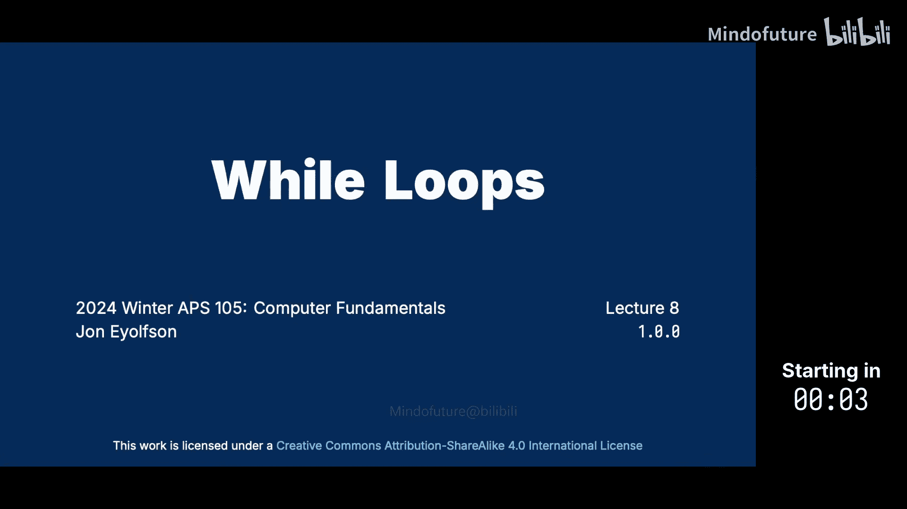
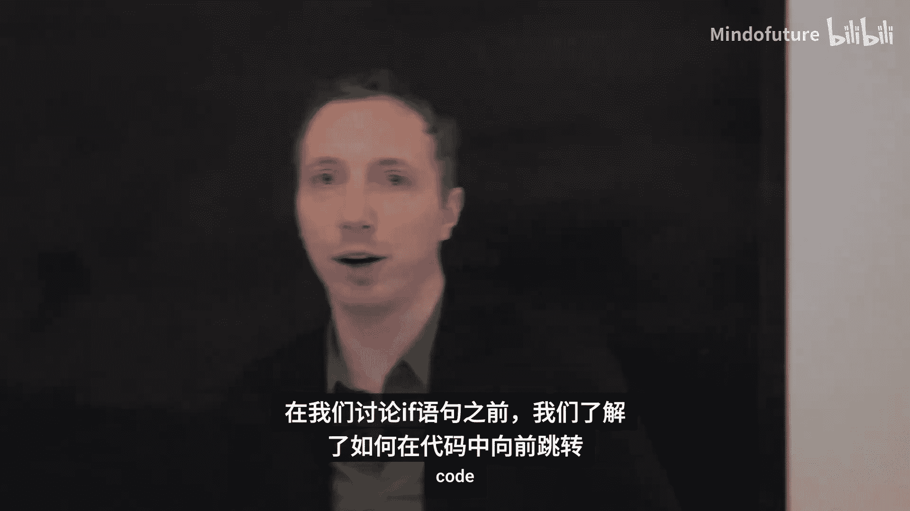
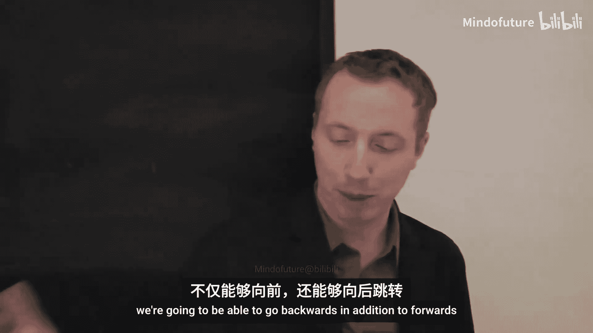
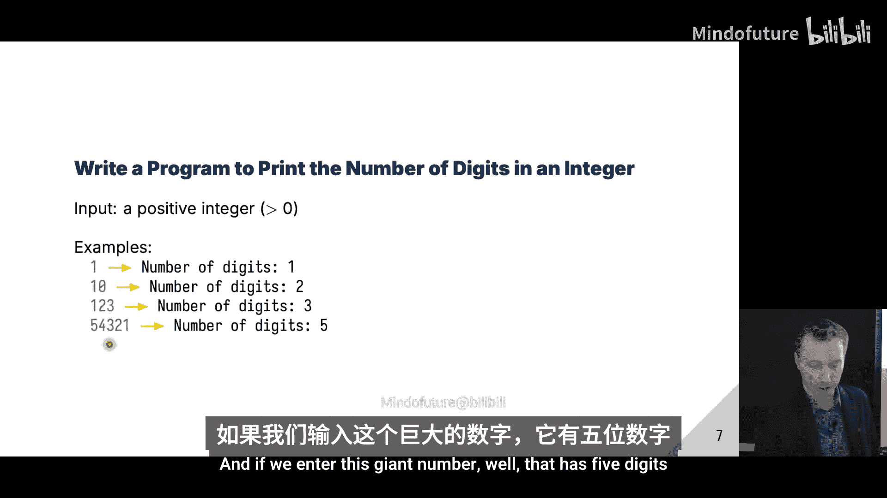
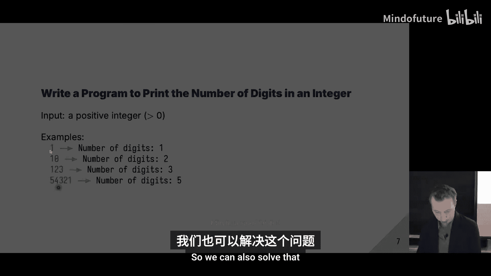
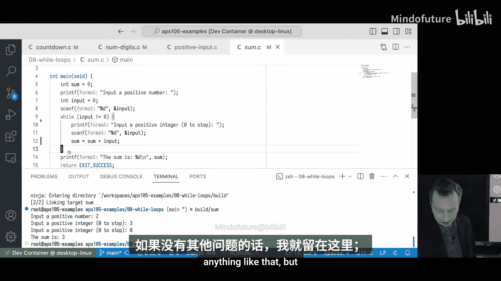
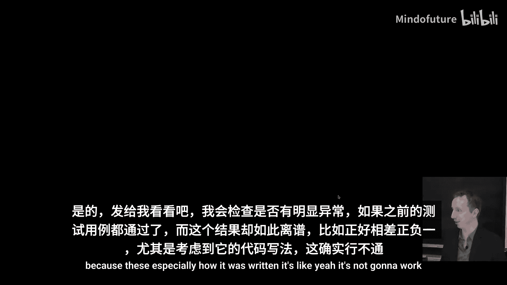

# 【多伦多大学】C语言计算机编程-｜-Computer-Fundamentals-｜-2024-p08-P08_While循环--BV1zL6GBwEGe_p8-

Alrighty， welcome back to 105。 thank you for joining me today so before。We went over if statements。

 we figured out how to jump forward in our code， well today we're going to complete our jumping routine and we're going to be able to go backwards in addition to forwards。

So today we get to talk about while loops， so while loops allow us to have some repetition。

 so like I said previously， if statements we were allowed to jump forward whenever we executed our program and conditionally execute some code。

 well， while statements，Kind of the same idea， but they allow us to jump backwards and then repeat the same operation again。

 So now we get to explore what makes computers great， they're fairly dumb。

 but they can do the same thing over and over again really， really fast。So。

How we introduce repetition is while name of the lecture， a while loop。

 which is done by writing a while statement。 So the syntax。

 which again just means the C rules for actually writing such a thing in the programming language is the following。

 So we start with the key word while， so that special reserved word by C。

 means we can't use it for a variable or anything like that because it's meant for these while loop。

So we write the word while， and then we have a parentheses and then inside of that we have an expression that will again similar to an if statement is supposed to be a boolean so it should evaluate either to true or false and then after that we have a statement。

So we could write it like this， but similarly to if statements。

 we should always write it using the curly brackets。

 so we don't make a mistake that costs billions of dollars。

 so we should do while expression and that will be a Boolean and then some code here within the curly brackets that will possibly repeat over and over again。

So the actual flow of this to compare it to our if statement is if we have a start here in a while and then some expression A。

 which should either be true or false。Then within the curly brackets， we have some code here。

 So I'll just note it by the comment A。 and then at the end of the while statement。

 I'll just have a comment that says the end which would be replaced with whatever the actual program is you have written。

 So the flow of this is。Whatever code is right above the while statement will always run and then。

The next thing that。Will happen whenever we run this program is we will evaluate that expression so C will compute what the result of this expression is。

 so if it's a， it will either be true or false if it's true。

 it will actually run all of the statements that are in this case at the place capital A and then after it's done running all those statements。

 however many we put there， it will go back and then check the value of a again and now this is where we have repetition because if it is true again well we will run that code that we have at capital A again and we will keep on doing this loop while a is true。

 which is while it's called a while loop， so we keep on doing something while a condition is true。

And the only way to stop it。To get off this crazy ride is a has to evaluate to false。

 And then as soon as it evaluates whoops to false， it just skips right to the end。

 just like what happens with if statements。 But in this case。Unlike an if statement。

 we will constantly check that expression over and over again and keep repeating all of the statements。

Every time it is true and then only once it has changed too false， will we finally stop。So。Now。

 using this， we can write some more interesting programs for your definition of interesting。

 so we can write a program that just does a simple little countdown from 10 and then finally print off。

 blast off。 So this program would have no input and our output should just be these in this case。

11 lines。 So I should say countdown 10，9，8，7， do do do do do all the way to  one and blast off。 So。

If I wanted to， I could write 11 print F statements。That is something you can do。 But as programmers。

 we want to be as lazy as possible。 So if I look at this， I see a lot of repetition here。

 So countdown repeats every single time。 And I seem to be printing。The countdown。Every time。

The value is above， in this case，0。 And every time I print it。

 I seem to just decrease its value by one。 So if we wanted to write this using a while loop instead。

Well。First our first thing we see is。A countdown for 10。

 so we'll create a variable called count that is what we're keeping track of as a condition in our while loop that we're going to write。

So we'll start it with 10， because initially。If we want to print off a countdown， well。

 our first line would look like this。 So we would do count down。D with the line and count。So。

If we just run that， well， what we're going to get is。

Count down 10 and then blast off because while we just have these two print F lines。

 we don't have a while loop， we don't have if conditions， so we would start executing from main。

 create a variable called count， initialize it to 10， print off countdown with the count。

 which is currently 10 and then print blast off。 So this is starting to look like what we want， but。

You know， not quite there， so。What we want to repeat is essentially this countdown。

 So we will start off a while loop and just write an empty condition while we think about it。

 But inside the curly brackets is the line I would like to repeat。So。In this case， if I run it。Well。

 if I just put like while1。Well， this is something bad。 This is called an infinite loop。

 So if I go ahead and run this。I will see something bad。

 So I'll just see 10 over and over and over and over again as long as I want to keep my computer doing this。

 and to stop it， I have to hit control C or something like that。 So this is called an infinite loop。

 because that condition， one is always true。 And because that is always true。

I will essentially take this loop forever and ever and ever。

 And I will have no way to get off this crazy ride。So。

If I'm thinking about the condition that I want here， well， I only want to print account if it is。

 in this case， let's just say it's greater than 0。So。

This also doesn't help me because I still have an infinite loop here because count is 10。

 so 10 is greater than 0， so it would print countdown 10 and then start over and over again， so。

Whenever you write a condition here。You never。At least in this course。

 you never want an infinite loop。 So inside of the body of the loop。

You should make a change to be able to make a change to the conditions such that it will eventually be false。

 so。In this case， well， I want the count to go down by one each time。

 So if we remember how to do that， while there's a bunch of different ways。

 I could write count minus equal 1。If I want， so that will take the current value of count。

 subtract one from it， and then reassign it to count， or I could do something like minus minus count。

We'll do the same thing， It'll just decrease it by one。So now if I write it like this。

Every time through the loop， I decrease the count by one。 So I'll get。As a result。

 I'll see countdown you know 10， then 9，8，7 and because I'm counting down eventually this condition will be false and as soon as it is false it's representing a count I do not want to print so if count is one then one is greater than0 then it would print down countdown1 and then we would decrease it from1 to a0 and now0 is not greater than0 so it would stop this so this would then be false and we would skip to the end so we would not see countdown zero so。

Now， if we run this。We'll see that， hey， we were lazy。

 we only wrote one countdown printf statement and we got countdown 10，9，8，7。

654321 all the way to blast off so the output doesn't look quite what we want because I had leading zeros there and in one of your labs they're asking you to do leading zeros。

 so if you look up that format specifier information。You are allowed to say， hey。

 how many characters should this digit print， so if I do something like2 in front of the D。

 that means that it will always be two characters。 So if I compile and run that。

 there's now an additional space here compared to what I had before。

So it will always be at least two characters。And if I want to just have a leading0 and fill that in。

 you don't have to write an if statement or anything like that。 in the format specifier。

 they will do that for you。 You can just write a0 at the beginning。 So0。

2 always makes it two characters and will' put in leading zeros。

 Yep question does it work for doubles 2。 And yes， yeah， it works for doubles。Yeah， leading zeroes。

Yeah， should work for doubles as well。 but see now if I print that， I get 10，0，9，0，8。

 do 7 all the way down。So cool loops seem to be useful。 They save us from writing a lot of code。

 If we can just extract out whatever we need to repeat and then make sure that。😊。

Whatever condition we write here will eventually be false when we want to stop repeating something。

any questions。Okay。Alright， so solution， as always， in the slides。 So you have it。

 So like I said before， beware of the infinite loops。

 So the statements will run every time eventually that expression needs to be false。

 otherwise your program never stops and this is a large source of problems。

 you will have when you're whenever you are starting programming。

 you will end up accidentally writing an infinite loop at some time。

 if this happens as long as you're on Linux or your。Connected to the ECF machine。

If you get in this situation where it won't stop， hit control C， and then it stops。Alright。

 so other program we might want to write is writing a program to print the number of digits in an integer。

 so our input would just be some positive number and well as some examples。

 if we input the integer 1， that's one digit if we enter 10 well that's two digits。 if we enter 1，2。

3 or 123， that is three digits， if we enter this giant number， well that has five digits。

 so we can also。

Solve that。So here is our program set up for that one， so here I just create an integer called input。

Prompt the user to input a positive integer。 I'll do my good old handy scan F。

 and then I'll create a variable that's supposed to count the number of digits。

 So if I wanted to solve this using a while loop。 Well。

 what I might think of is how do I decrease the number of digits by one。 Well， turns out we can。😊。

Use integer division as our friend。If my input is something like five。And I do， I don't know， input。

Divide equals 10。 So I just do the integer division。

Because it's integer division that just truncates that essentially will get rid rid of a digit。

 the lowest digit every single time。 So if I do 5。Divided by 10。

 while the result of that is going to be zero。 and that means I have no other digits。

If I have something like， I don't know， 23。Well， if I do 23， divide by 10。 Well。

 because we are in C integer division， the result should be like 2。3。

 but because it's C and it just truncates。 We're essentially going to chop off the last digit。

 no matter what it is。 So my result would be 2。 So I could keep on doing the same thing until I hit a 0。

 So if I take 2 and divide by 10。 Well， that result is a 0。 and there's a bit of a pattern here。

 So I can just keep on taking that number each time I divide it by 10， I get rid of a digit。 So。

If I want to figure out how many digits a number has。

 I can just count how many times I do that until that number becomes 0。

 So that sounds an awfully lot like a while loop。 So I could do while the input does not equal 0。

Then， just。Chop off a digit。 And each time I chop off a digit。 Well。

 I want to record that I actually chopped off a digit， which represents， you know。

 just increasing the number of digits by one。So。If I do something like that， and I run it。

So input a positive integer， if I say something like one， well， I get one digit。

 which is what I expect， so my input would be one， so currently it's not equal to0。

 then I would take the input and then assign it to the input divide 10 aka I chop off a digit。

So if it's 5 or one in this case， then the result will be a0。 and I would have。

I have to account for that digit， so I increase my numb digits variable by one。

 and then we would recheck that condition again。 this case input is equal to zero。

 so it would skip right to the end and then just print off the number of digits。Now。

 if my input was like 1，2，3， I get three digits because。What will happen is the input is currently。

123， which is not equal to 0。Input will chop off a digit。 So we'll change input to 12。

 And then we would now have one digit。 Go here。 input is not equal to 0。

 Then we would change input equal to one。 N digits is 2。Check this condition again。 It's not 0。

 So we take one divide 10。 That's 0。 Now we have three digits， and input is 0， yeah。W are you using？

So the question is， why am I using the prefix increment here？ So in this case。

 it doesn't matter for weird rules， you should just always use the prefix and not the postfi。Because。

Like， the result of this expression is the updated value。 So it would be。One in this case。

 if you use the post fix， it would be zero， which is just weird。

There's a bunch of other weird reasons to prefer this， but yeah。Always preferred posttics。Or prefix。

 prefix。 All right， almost screw it up myself。But yeah， always plus， plus something。Yeah。Well。

 I care on the exam no。嗯。No， as as it doesn yeah， in case of exams or anything like that。

 write whatever you want， as long as you're not using the result of it。

 which you shouldn't be anyways。 So as long as your programs still right， you're all good。Alright。

 any other questions for this one。Yep。Sp is like。If this。来受责。Why what？这感觉手。

So the disadvantage of using the post fixed version is。The return value is just not what you expect。

 So if I have numb digits equal to 0 here and I do numb digits。Here， let's say。

So if I write something like this。What's the value of x？So you said one。

 that's what you would expect。Well， if we actually look at the value of x。

What would make sense is that it would be one。But if we run it。It's zero。That's why。And if you do。

Yeah， if I did prefix， then it would be one。 So if I do this。And run it。Now it's one。

 which is more what you expect。 So in English might make more sense to do post fix， but in C。

As a computer programme where I can。Freely admit this， I can barely speak English。 So speak computer。

 not English。 Things work better。 So just prefix is usually what you expect。Yeah。Alright。

 any other questions or things we need to go over。All right， cool。So。Solution on the sides。

 So there is another version of the while loop called the do while loop。

 So the difference between them is sometimes we want to always run code and then only repeat it if the expression is true。

 So they came up with something called a do while loop。

 So do is also a keyword in C So you're not allowed to name a variable it and the syntax or rules for it is do statement while some expression。

 So we just put the expression at the end because we check it at the end。So。Can write it like that。

 but you should always write it like do curly brackets。

 some statements and curly brackets while expression。

So if I was to represent it using that same flow diagram I had for the plain while loop。

 it would look like this。 So some starting statements that would run。

Before we try and go into this do while loop， and then we would have dual do。

 then between the curryly brackets， some other statements here， in this case， capital A。

 and then while some condition here， that would be some boolean。Lowercase A and then an end。

 So what will happen is whenever we run this， it will run the code right above it。

 and then it will go ahead and then directly start running the code in A so it won't check the condition。

 this code will always run at least once。 and then only after it is done running。

 then we check the condition。So if the condition is true。

 then we just go back to the start and we execute all of the statements。In the curly brackets again。

 and then we check the expression， see if it is true， if it's true， we go over and over again。

 So this also has the opportunity to put us in an infinite loop。 So same rules apply。

 we should make sure that the condition eventually becomes false， whenever we want it to stop。

 So when it is false， we just skip directly to the end。 And why might we do that。 Well， currently。

At least in that last example， I just asked the user to input a positive integer。

 And if they didn't input 1， I couldn't do anything about it。 But now。

 because we have a do while loop。Well， we can actually do something about it so we can write a program to ensure that the integer is。

 in fact， positive， so the input to this program should be any valid integer that fits in an int so it could be negative0。

Some large value doesn't matter， and then we want to ensure that we always have a positive integer no matter what the user tries to type and in this situation。

 a do while loop is going to be useful because well。

 we always want to ask the user for input at least once。 So if the user。Is。

Nice and actually inputs a number， like a positive number， then we're all good。 otherwise。

 if the user is trying to be funny or try and screw with us。

 then we might have to ask until they finally learn to behave。So。If we were to write that。

 well we'll just create a variable for the input and then while we'll do the same thing we did before we need to ask the user for input。

 so in this case I always want to ask or prompt the user for input and allow them to input something。

 so I will put that in my do loop， so I'll ask for a positive integer。And then。

Allow them to input it and store it in the variable， called input。And。That is all I have to do。

 I just ask a user for input， and then as part of the condition。

 I'll just ask them as many times as I need to。 So my condition would just be well the input is less than or equal to 0 or whatever I want。

So。If this is true， so if the number they input it is0 or less， then I'm just going to repeat。

 I'm going go， ay， excuse me， can you try again， please because yeah。

 you're not having a good day and I'll do this as many times as the user tries and then at the end here in this print F。

I'll only break out of this do while loop whenever the output or input is greater than 0。

 So whenever I print this， it will always be some positive number。That is my numb digits， whoops。

Alright， so now I can run my positive input program。 So now it says input a positive number。 Well。

 I can be a jerk， negative 47。 Well， now that condition is false。

 I inputed a number that is less than or equal to 0。 So it's just going to ask me again。

 and negative1。 Oh， no， it ask me again。 negative 23。 ask me again。 and I can't outsmart my computer。

 it is a lot more stubborn than I am。 So。😊，It's going to outlast me， so。Eventually。

 I'll have to input a number that is greater than 0 so I can try and input 0， still doesn't like me。

Now， if I finally input 6， well， then I made that condition false and I know my input is greater than 0 so I can stop doing that repetition。

 I can stop asking the user because they finally。Finally， actually obeyed my rules。

 And then I print off。 you entered whatever they entered in this case，6。So， yep。More requested。

one if you and here。当时的。そは？も。Yeah， so the question is what happens in scanf if you overflow the input？

I believe it will just try。 And yeah， some overflow rule rules will happen。 and you'll essentially。

 for this course， you'll get a random number。probably still one。Yeah， you could smuggle it in。

 scanF's actually not that smart。 We should actually give you something that's a bit smarter than ScanF。

 but yeah， scanF's pretty dumb。Alright， any other questions for that。

 So now I can actually use this to actually make sure that， well。

 I can let the user input whatever they want。 I just won't let them get away with it。All right。So。

We can write our final program of the day， so we can write a program now to sum all the positive integers。

 So our input can be any number of positive integers。For now， I'm just going to assume that。

 but we just wrote a program that would make sure it was positive。

 but I'll just assume they're being nice。 and then I'll have this keep on adding all of the numbers together until the user input zero。

 and then that means stop。So the output should just be a single integer just representing the sum of all of the things the user has input。

So。If I go to some， I will set it up a bit and then。Give us some time to think about that， so。

I'll create a variable called sum。 I'll initialize it to0。

 So I need a variable to store the summation of literally everything the user types or Yeah every user or every number。

 the user inputs。 So after that， I'll ask them to input a positive number。😊。

Create a variable called input， initialize it to zero in this case it doesn't matter。

 but good form to have， and then I will do a scan F and then get a single number。So after this， well。

 I have to do some repetition because I want to allow them to input any number that they want。

 So I'll start it off a little bit。 So because we have repetition。We will need a while loop。

 so that keeps on going over and over again until the user actually inputs a zero。

So what we want to repeat is we want to ask the user over and over again to input more positive integers until they input a 0 to stop。

 So here。I can just have or do a scan F to get the next digit。All right。

So let us look at this and then think about what I need here。

So what is the condition I want to finally stop at。

So when do I stop prompting the user for more input？Yeah。Yeah， when the input is0。

 so when the input is0， I want to stop asking them。 So what should my condition here be。

 So if only when the input is 0， should I have this stop right So I want this to be false。

 whatever the input is0， So what is the condition I need to actually express that in C。Yep。

I don't know if this is bad sometimes we say wild。While input。 so I could say while input。

That gets into some weird rules， but essentially， that will work because。In this case。

The C conversion rules is if input is 0， that's false， any other value will be true。

 So that does work。 might be a bit hard to read， yeah。So I set the default value of 0 here。 So yeah。

 there's a question why I do this or doesn't this screw it up。は zero。What happens when I do the？

SoSo for running this program， it's going to create this variable。

 like it's just going to go line by line。 So it's going create this variable。

 assign the value 0 to it， then do a print F。 create this variable， assign the value 0 to it。

 And then this scan F as long as it's successful。 It will change the value of input immediately。

 So I didn't actually need to say input equals 0。 I could have left it alone。

 It's just good practice to initialize things。But yeah， in this case， I immediately changed it。

All right， so。Back to the question。 So this while input will work。 So let's make sure it does work。

It's called sum。So say input a positive integer，12，1，2。 And then whenever I hit 0， it stops。

 So I'm most of the way there。 but this。Usually this should always be a Boolean expression so。

If I want to change a number to a Boolean， I should use one of those relational operators。

Any other input as to what I should change this to， yep。Yeah， it does not equal 0。

 So if I change it to this， well。That is probably a lot easier to read， and actually。

Expresses what I mean much better， so。For any other value except0， this is going to be true。

 So no matter what the user inputs， if it's negative， well， in this case。

 if it's negative or positive， doesn't really matter。

 this while loop will keep on going and it will only stop whenever the input is exactly 0 because only when the input is 0 is this false because 0 does not equal 0 So we would stop and then say the sum is whatever。

So。Let's make sure that that works positive number，12，1，0， and then we stop。Alright。

 what about the last step of actually。Computing the sum correctly。How do I do that。

 where should I do that？有。Yeah， inside the wild loop， what should I write。Yeah二。Yep。

 some equals some plus。Input。So。Each time through the loop I'm just adding the input to the sum so what that will do is the first number I input。

 say in this case I inputted 1，2，3 and since I initialize sum to 0 the first time through the loop well sum is0 plus input so1。

2，3 thatll be 1，2，3 and we'll assign that value to sum and then it will ask me to input it another number and well I input I update that input variable with 12 it would go back up to the top check well 12 is not0 so we would increase our sum so sum was 1。

2，3 then plus 12 and then whatever the value of that is is going to be reassigned to sum and then we're going to do that again for input is one。

Then increase the sum again。 Then we input 0， and then we stop。So if we do that，1，1，2，3，12，1。

And then 0。 And now we get the sum of all that is。136， which is actually what we expect in this case。

 So we sum up the value each every time through this。Yep。对。Yeah， so in this case。

 no reason why I I wanted a positive integer。 I just said that to T to the last example。 But in this。

The code， as I've written it， it works fine for negative value， so I could sum。A negative  one。

 negative 2， negative 3， which should be negative 6。 S it，6。 It's fine。So。

I arbitrarily restricted myself for no reason。All right， any questions about this little program？

Okay， if not， I will give you a debugging exercise。 So say， I accidentally。

What if I just move this here， Is this okay？Here I'll give。

 I'll give everyone like a minute to discuss， and then I'll pull。So yeah， feel free to discuss。

 have I royally screwed up or is just moving that line all good？All right， yep。Well。

 you prompt the user to input a positive number and then you reassign it before you're able to。

So you actually never had that through。Yeah， so now if I move that line there， well。

 at the very least， I missed that first number。So in this case， say， I want to sum together。2 and 3。

Oop， they didn't compile it。So two and three and stop。 Well， now I get the sum is3。Oops。

 turns out in computing， you know， especially with programming， the order matters。

 So what happened in that case is I said input a number。And then they inputted right here。

 They inputted 2。 So2 does not equal to 0。 So we would ask them to input another number。

 And then the two they entered。 Well， this scan F would just reassign that。

 So now two gets reassigned to 3。And we lost that， too。 So we just sum is still0。We。Do 0 plus 3。

 update the value of sum to be 3。 And then I inputted 0。 and then it just stopped。

 So because of that， I missed the first input and this is like a very subtle change that makes your program suddenly not work。

 so。Whenever you need to figure out some things like this， some things like this。 remember。

 your computer is not magical。 It will only start executing at main and then go line by line by line until it does something a little more tricky。

 like a wall loop， But it's just always going to follow the same rules。

 It just won't randomly do things。 So here it would always check the input。 If it's true。

 It would do this。😊，Go ahead， check the input again。 If it's true， it does it again。If it's false。

 it goes to the end。So that's what happened。 I just seemed to mess it up a little bit。All right。

 any other questions for today because that went real fast？All right。Cool。

 so I'll just hang around here if there's any other questions or anything like that。

 but we can enjoy ending 10 minutes early。 So just remember， pulling for you。

 We're all in this together。😊。

Yeah。Yep， so since the labs are becoming like more and more complex now。

So now we have like conditional code execution and loops， everything。

 and like the lab specification usually doesn't go over like whole of the like how old of the edge cases。

I was wondering if like。If it's possible。Maybe solutions。 So we can。

Kind of like run like tests against them and see like how do they react to the？

To like some certain inputs， like HK inputs。 Yeah， I can ask， but I don't control the labs。

 but I can bring it up Yeah， if you can because like I wouldn't expect people like mill us out。

Being able to like， figure out like what the solution is actually doing。Yeah。Yeah。

 that's a good suggestion。Might be able to do that because like I was wondering I thought that's how the exercise like command works。

 but exactly like you guys know。Input and outputs that they compared。

Its never actually has any executable Yeah like I mean， like there's probably an。

It' just like in this case， they're just input available。Yeah， so。And I had like another protest。

 you probably wouldn't have like that。Like for the in confront， for one of my test cases。

My answer is like wrong and like third。Yeah。But I'm， yeah， I'm kind of not like。

 I guess I could probably just， you know， again， like multiply everything by 000 of inches。Yes。Yeah。

The test cases should。It be fine if it's off by a little bit Oh No。

 I feel like they're comparing one through。Diff like because it's output to like，5。

Up to the basketball point，5 number， like 5 intercept decimal。 and mine is like rolling into。

Certain like after that one， I think。And I'm pretty sure it doesn't like have like an epsilon Belhead。

Yeah，ll if you want， you can DM me your code on Discord too or email me to and I can see。

If you did anything。Concer because there's more than one tested。

 there's like four of them and only one of them fails。Yeah， the one but like。

 I'm assuming that's all the floor。Like numbers like well some of them are like have like nice outs。

Yeah。Yeah， if they can't do the inger like。Yeah， just show to me。

 I'll see if anything's like obviously weird if it's not like before for the other test cases and like this is crazy。

 like let them plus minus by one because these。Especially how it was written。 it's like， yeah。

 it's not going to work。 And I was wondering。

