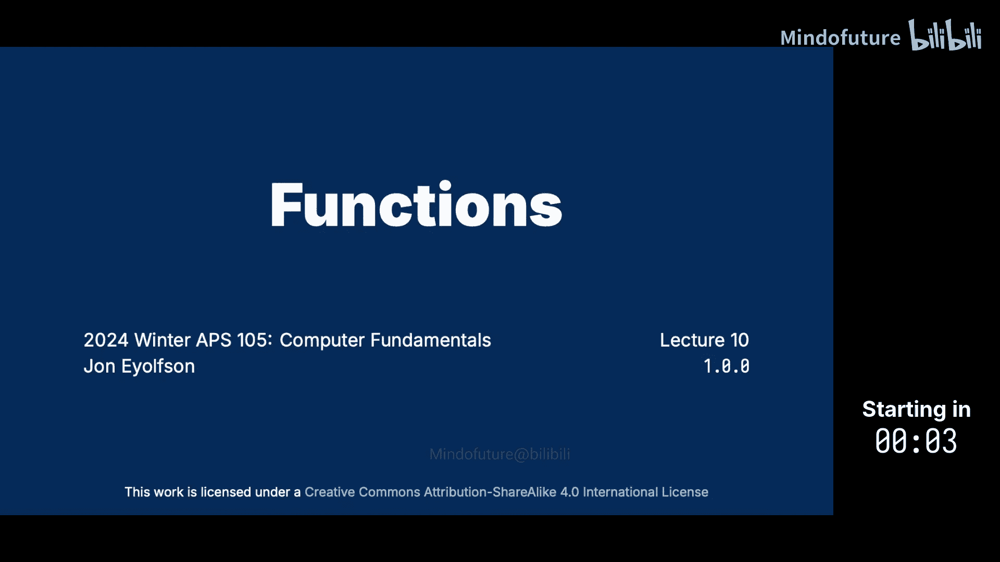
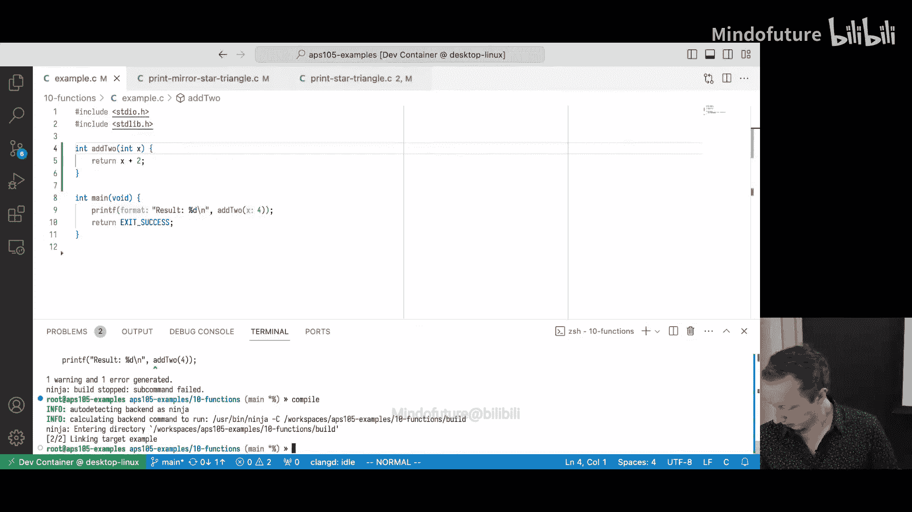
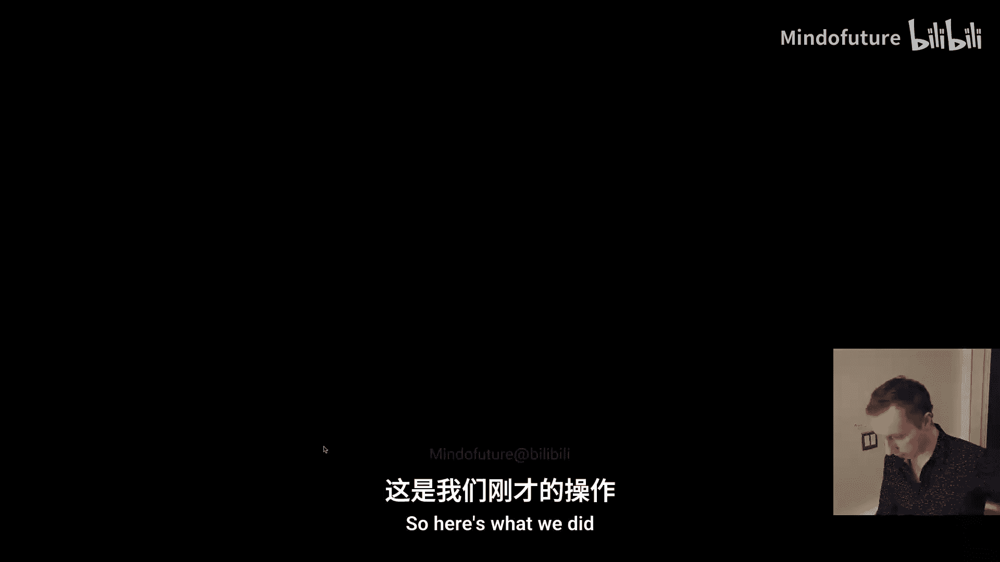
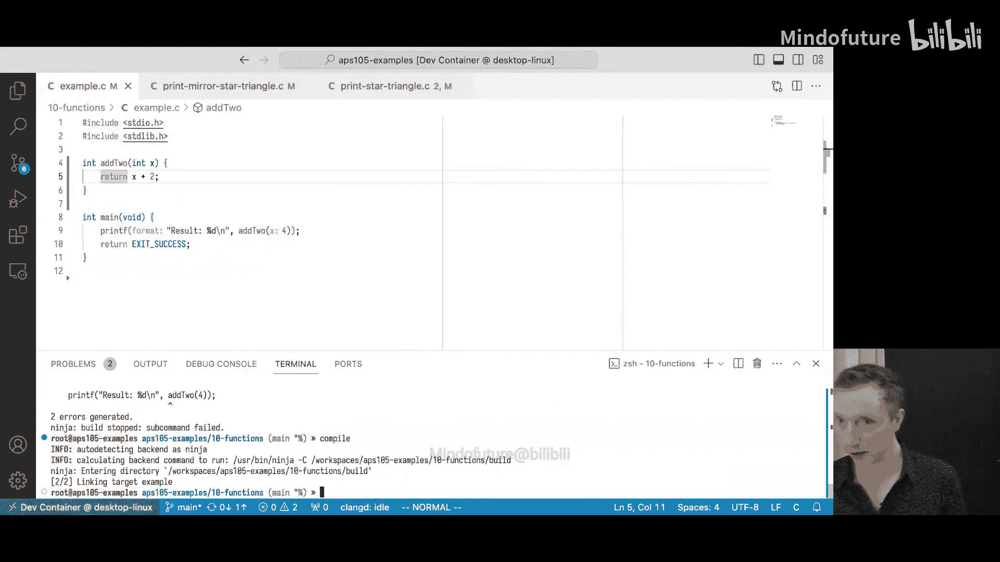
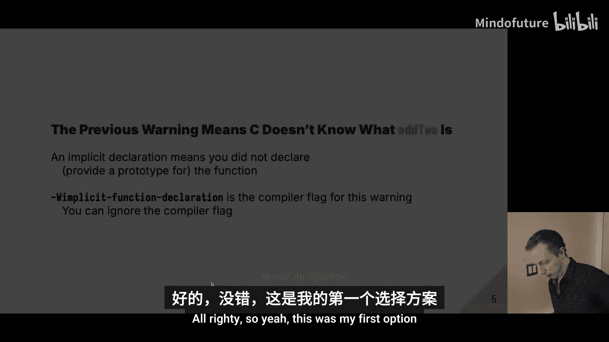
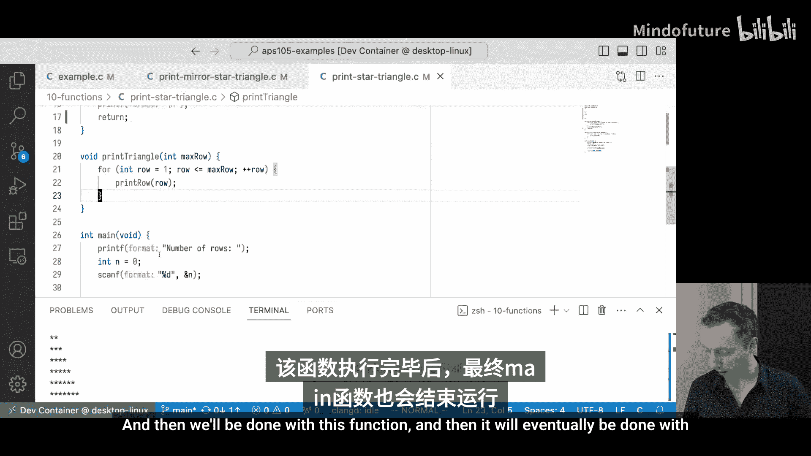
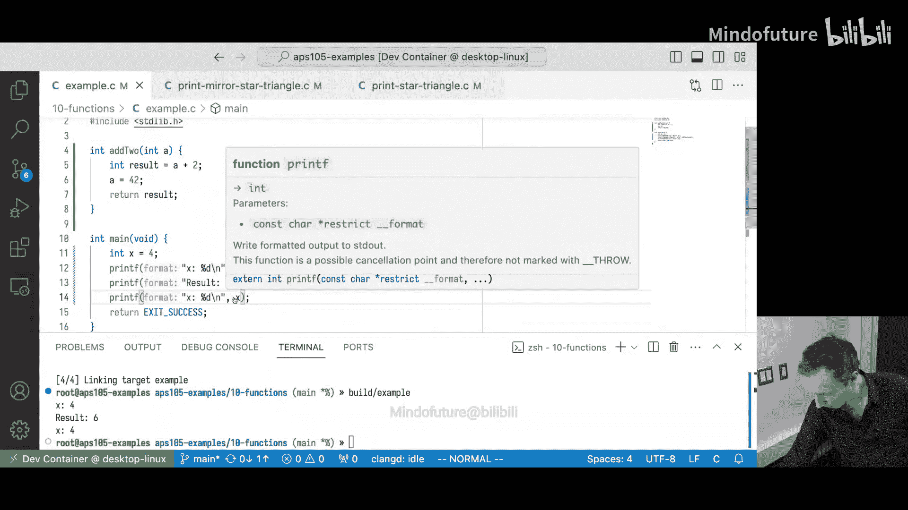

# 【多伦多大学】C语言计算机编程-｜-Computer-Fundamentals-｜-2024-p10-P10_函数--BV1zL6GBwEGe_p10-

。🎼Yeah。

Alrighty， welcome back to 105， thank you for joining me here today。Today。

 we get to talk about functions。So。When we actually write real programs。

 we just don't stuff everything in Maine because， well， that's all we have taught you so far。

 So today you get to break out of Maine。 So typically when we write more complicated programs。

We break it into pieces that are easier to understand。

 hopefully they're reusable so you can imagine something like， well， print F。

 that is probably something that's really common to do like printing some characters to your terminal so someone decided to just write a function and share it with everyone so everyone can use that function instead of starting this course with having to talk about how to actually print characters to your terminal without any help。

So。Also makes your code a lot easier to read if you can break it down into more understandable pieces and you just don't have everything cluttering up main。

So。How we define a function is we have to use the curly brackets after the prototype。

So before we've briefly talked about the function prototype。And what that tells you。

 so remember function prototype that tells you all of the inputs to the function with their types in this course should either be like int。

 double char or bo so we can have multiple inputs we can give them a name and they will all be of some type。

 and then also in that function prototype is the type of the output again， int。

 double char or bo for the purposes of this course。

And if we name an argument before we only saw the prototype， well， if you name the argument。

 you can actually use it in your function。 So， for example。This is our prototype。

So I would have like a function called add2 that takes a single input， which is an integer。

 which it names X。 And then it returns an integer。 And before we just had a semicolon at the end of that。

 and that was the end of the function prototype。 If we want to define the function。

 So we want to actually。Tell see what to do when someone actually calls this function。

 We just use curly brackets。 And it just kind of looks like if we had like a for loop。

 a while loop or an if statement or something like that。 And then within the curly brackets。

 we can put in whatever C statements we want。So the only thing special like mean。

 there's a special return statement and return will return the value and then end execution of that function。

 So， for example， I can create a function that takes add to。Takes an integer x。

 and then it returns that value plus 2。It's important to name these things。

 So if I use something function called add2， I expect it to just add2 to the number。

 had if I returned x plus 2 and I named it add 4。I would probably question my sanity。

 so should name them something that is actually appropriate。

So there are some rules when actually defining these functions， so the order actually matters。

 so the compiler reads your program like how you normally read things， so from top to bottom。

But whenever we run our code。Well， it doesn't it doesn't。Start from the top and go to the bottom。

 It starts executing at the main function。 So always remember。

 the difference between the two for this course。 your compiler is going to go top from bottom。

 Where you run it， it's going to always start at main。So。Because the compiler reads top to bottom。

 your function definition or a function prototype has to come before you use it。 Otherwise。

 C has no idea what you are talking about。 So for example。

Let's say I create that function called addd 2。 So you just put it。Anywhere you want。 So it just。

 it's not within main。 So it's just a new line by itself。 So I can call it int add 2。In X。And then。

 return x plus 2。So now if I save that and compile it well。

Probably some bad things are going to happen。So I compiled it， oops。Let me get rid of that。

 So I'll show the first error。So。Let's say in my main function， I just did print F。

 and then I called a function called add 2 that doesn't exist yet。

 So I'm just going to give it 4 as a value。 And then hopefully I get 6 as a result。

 So if I tried to compile this， you might have seen this error before in lab 1。

 But this is what it means。 So you could try and compile it。It says it failed to create it。

 and then it says undefined reference to add 2。 So that means you have told C。

 you've tried to use a function called add2 and C doesn't know where it is。

 So you might have encountered this if you tried to use like a math function and you didn't actually linked the math library。

 You probably got this error。 That's because。OrWithout that dashLM flag。

 C can't find that math function you were using， so it's just going to refuse to compile because it doesn't know what the hell you're talking about。

 doesn't know where it is。So。I could。Define it。 something like this。 So let's say， for some reason。

 I put it at the end of main， so。Your compiler should also get confused about this because it will read it from top to bottom as well。

 So your compiler will you know， read this standard out or I O do H， put all of its contents here。

Do whatever it needs to do with that。 Same thing for standard Lib， Then it would go。See int main。

 Okay， this is the main function。 And then， oh， you use a function called add 2。

 And I don't know what that is yet because I've never seen it before。 I haven't seen the prototype。

 I don't know what it is。 So even though it's kind of frustrating because it's like it's right there。

 Just read a little bit more。 what the hell is wrong with you。 Well， C was developed in the 70s。

 And it having to go through your code twice or like go backwards。 That was just way too slow。

 So this is why this rule exists。So if I compile it now。Give me a slightly different warning。

 but essentially means the same thing， it says。Implicit， again。

 implicit means I didn't write it myself。 So it says implicit declaration of ad 2 is invalid。

That's a very bad error message for you。 So implicit declaration means C just guessed a declaration for a function called add 2。

 So it just made it up because at that point， wherever I tried to use it。

 I did not declare or provide a prototype for a function called add to。

 So this just means it has no idea what the hell you are talking about。 even though that it is。

Right here。So one fix to this problem is well， I can just move it。So if C reads top to bottom。

 I'll just make sure that add2 comes before main。And now if I compile this。Hey。

 C doesn't complain at me。 It actually likes me now。 That's great。 So now when I run this。😊。

So when I run this， my result now is going to be 6 because， well。

 the compiler is going to know what add 2 is， it's this function。

 And then whenever it starts running， it will run main and then knows， okay。

 I need to print F something。 What do I need to print F。 So I need to。Figure out the value of this。

 So to figure out the value of a function， call it whatever that function returns。So。

To figure it out。 So I'll do addd 2。 And then I， we call it pass it or give it the argument。X or no。

 give it the argument for。 So I'm just giving it a4。 And then this is just my B。

 S code extension that tells me that it's named X。So。In this case， well。

Add2 will run and x is equal to 4。 So if x is equal to 4， then x plus 2 is equal to 6。

 So that is equal。 Yeah， that's equal to 6。 So then we'd return the value 6。

 So the result of this function is 6。 So that's why we see result equals 6 there。

And then question in the discord check， can we have functions inside main and no you can't see。

 should complain very loudly at you。So we can try it。So C will even tell you。

 function definition is not allowed here。 So that means you are not allowed to write functions within functions。

 So functions just have to be by themselves。So do the。Allright， any other questions about that one。

Alright， so。

Oooops。So。Here's what we did。 We put it after， and we got that warning。

 says C doesn't know what we're talking about because C will read top to bottom。

So that is what the previous message mean， implicit declaration。 Like I said。

 you didn't declare or provide a function prototype。And。That ugly thing here。

 So this W implicit function declaration， that's not part of what C is trying to tell you。

 That's actually just a compiler flag for this warning that if you were using the compiler yourself。

 you could go ahead and ignore it if you really wanted to， but that's a bad idea。

 It's just a compiler giving you too much information。Then we have another question。

 can we put void as a return type， and of course we can。For functions， we are allowed to。

 in this case。If I change attitude to void。Well， I'm going to have a problem how I use it right now。

 because void。 remember， that means the function doesn't output anything。 So C is going to be very。

 very angry with me for at least two reasons。 So we can see the fun。

We can see how bad these compiler warnings are。So first one says on line 5。 So this line。

 it says void function。 So that means if I have a void function。

 the function doesn't return anything。 It gives no output， right。

So this says the void function return to should not return a value。 So that's saying here。

 I'm trying to return the value 6， which is an integer， and it's saying， well， it's a void function。

 it's not supposed to output anything。 what are you doing。 So if I wanted to write a void function。

Then I could just have return by itself。 if I have return by itself。

 that means stop executing the function right now。 If I wanted to。

 I could get rid of the return and then see， we'll put a return at the very end as the last statement there for you。

The other complaint it gives is that argument of type void is incomplete。Wow， that's a bad warning。

 So that basically just means that。Here。I'm supposed to get like an int， a double， a bo， a char。

 or something that actually exists。Boyd represents nothing， So it has to be a value of something。

 It can't be nothing。 And the result of this function is a nothing。 So doesn't make any sense。

 And it should tell you that， well。AThis void function doesn't return a value。

 so you can't use it as an argument to print F。Wow， these compiler warnings are bad for beginners。

All right， Any other questions with that， I've fixed it again。

Al readyy。

So。Yeah， this was my first option。 I just move that function。

Before main and then my compiler will go ahead and read， add two before it encounters main。

The other option I have is to essentially do that thing。Like just write the prototype ahead of time。

 which is essentially what is in all of those like header files。 So remember for like math dot H。

 if you wanted to， you could get rid of it and just do like double square root double if you really want and provide your own prototype。

So。If I wanted to。Say for whatever reason I really liked。I really liked add two coming after Ma。

But I want to tell C that， hey， there's going to be a function called add 2。

 I'm going to tell you what it does later。 Trust me about that。

 So I will tell you its inputs and its outputs and then trust me bro I will define it later。

 So for that， we can just put a function prototype that matches the function before main。

 So here the function prototype would just be add2。And X。And then a semicolon。So here。This。

 remember function prototype。 So I'm saying the function is called add 2。 It takes an int。

I called it X， didn't need to put that there， and then it returns an in。 And then later。

 I can go on and define it。So now when I compile this。

 C also gives me the green light because now when it reads it from top to bottom， well， it will see。

 okay， C will know theres， I should know that there's a function called Add2， takes an in。

 returns an in。And then。By the time I use it here， well， it already knows what it should do。

 So it's pleased with me now。 And it will go ahead and figure out that， oh， okay。

 that's something I'll figure out how to call that later。

 but I know it's something that actually exists。And then here， that's where I actually define it。

Nothing really changed with that。 So if I compile and run that。No problems whatsoever。

So questions about that。All right， and here。Didn't really like， this is a function prototype。

 if I wanted to。 I didn't really even have to name it if I wanted。 I could just say， oops。

I could just leave it unnamed because at that point it's optional， but here。

 if I didn't give it a name， well， then I actually can't use the argument that's passed into me because I don't know what the hell it's called so here this four that gets passed in。

I can't access a anymore anymore without a name。 I need to call the argument something in order to access it。

 So lets called it X。 I could have called it whatever I want。And yeah， the question is。

Do I need to repeat the types in the prototype？ And， yes。

 it needs to match exactly or else really bad and interesting things may happen so。If， for example。

 I did something like this。Where Ive messed it up。The compiler actually tells me conflicting types for ad2。

 so it's saying， okay。And how that works is it would read， okay。

 add2 takes a double and then returns an int， and that's a function that you tell me is going to exist。

 And then you have a function called add2。 And then it takes an int and returns an int and sees like。

 not， nope， thats not that doesn't make any sense。 that's not going happen。So not allowed to do that。

Ch。And same thing if you just do add two without brackets or oh， that one works， okay， great。

Thanks C。 So that one will work and C will just kind of guess。Yeah。So， that one。

Will work because C will just guess its type。Based off what you pass to it。

 turns out it doesn't actually matter for C for input types。

 because there's a defined way the C compiler does it。 But please do not do that。

 That is very confusing because。Remember， I talked about function declaration verse prototype complicitoc。

Can walk out with us in solidarityity to King's College circleircle and make a statement against U of T。

 thank you。All right。Oh， okay， great。 Allright， so that was interesting so。Here we have to， to do。

 Yeah。 so it has to match。To， to do。Yeah， so here we are。

 That function prototype just should come before All the type should match， otherwise。

C will be unhappy and having it without a input types。

 that's technically a C declaration and C will kind of figure it out。

 and that's the difference between a prototype and a declaration。

 but you shouldn't need to know that just always type out the full input types and output types and that's a prototype and always do that。

Otherwise， people will be very， very confused and very， very angry with you。So。

Let's write a new program that is slightly more challenging for some practice。

 So we will write a program to print a mirrored triangle of stars， which is。

Slightly different than what we had。Before we were just printing like。One star。 And then。That's it。

 And then next line， we are praying two stars and three stars and four stars and5。 Now。

 we want to have it。Kind of right aligned。 So to do this， if I'm having five rows of stars。

 there's four spaces here， followed by a star， then three spaces here， followed by two stars。

 then two spaces followed by3， then one followed by4， then。5 stars。

So let us try to do this because this is something that would。Technically， be on an exam。So。

Our program probably looks something like this to start off。 so we can think about rows and columns。

 So what I want。Is essentially the first line should be 1，2，3，4， and then a star。

Second line should be 1，2，3， and then。Two stars。Third line should be two spaces。

 and then three stars。Next line should be a space and then four stars。Next line should be five stars。

So。If I was to write a so， let's think about how we would implement that。

And you can let me know because my bout of Amnesja is about to hit。Alright。

 so I'll give you another minute， and then。We'll see if anyone has some suggestions to help me。

All right， anyone with ideas？Yeah。Okay， so。Yeah， yeah， if you didn't hear that， his solution was。

 okay， well， where my cursor is right now， So within those nested for loops。

 I could have some more for loops， so I could have a for loop that prints the number of spaces。

Which is going to be， you said equal to the number of row。5 minus the number of row。

Let's just make another for loop。 So ink count equals。1。To count。Is lesson。5 minus the row。

And then plus plus count。And then that's to print off spaces。And then I could have another loop。

That goes up to。The row。 and then print stars。Okay， that's it。All right， so。

You can compile and run this， and we will see something a little bit odd because it is almost right。

Groups。Hm。So。First one is。after this loop， which prints all of the columns。

We should probably have a new line there because that's a new line。So let's compile and run it now。

 So now。Looks a bit weird。哦。Turns out， so this one would actually be right。I assume if。

My problem is that for each row and for each column， so that's supposed to be for one single element。

 I'm doing this for each one， so I'm getting it repeated five times。

So if I wanted to do this solution， I have to get rid of this for loop， and then。Shove this all back。

So there we go。So that's one solution。So can we do it without？Two， four loops in the inner one。Hello。

Yeah， the solution's not bad。But， yeah。Yeah， so here， this comment was， let's go back to。This。So。Now。

 we know that。So we're always going to be printing five characters each time， so for each row。

We're printing。 We're going。5 characters or， well， we're iterating。Five columns。

 and here we'll always print five characters。 And since we're going through it every single time。

 well we can use an if statement instead， because each time through it。

 I'm either printing a space or a star。So。I could， instead。Do some if， something。

That'll leave the later。And there's lots of different ways to write it。

 So I'll do this version of it。So now we want to figure out whether we should print a star or a space。

So。Let's see if we can break this down because when you。Start thinking about it。

 Sometimes it's easier just to kind of draw an example or try and visualize it somehow。

 So if I go here。So say we have row。1，2。Actually， I'll leave a bit of space。

And then we'll have the column up here。1。2。3。F。5。T。So。If I want to think about the first。Row。

 it's a space。Space， space， space， star， and I want to try and make a relationship between the column and the row so that whenever that relationship is true。

 so something with column is five，Compared to row is one should be true。 and then。

For the rest of the values。For column should be false because I want to print a space。

And then for the second row， it would be space， space， space。Star， star。So。

One way to think about the relationship between them is it's， yeah。

 it's kind of inverted with the row， right， So thinking about it in terms of。哦。Roow。in-5。

Might be useful。So。I'll just make this a little column here。For this row。Roow or sorry。

5 las row oops。So 5 minus row kind of inverts the number， right， So for row1。

5 minus row is equal to 4。For row 2， it's equal to 3， then 2。Then  one， then 0。

 So it kind of inverts the number， right， So now， instead of getting bigger as we go on。

 it's getting smaller as it goes on。So。I notice here。Well， if I take this number。

 what's the relationship between this and the column。

This is the column that I want to print a star in。Yeah。Any guesses？Bueler。

That's probably way too old。Any brave soul yep？Yeah like。Yeah， so I want to write。Some。

 like I have right now， some if statement。 I want to know what to write in this if statement such that if it's true。

 I print a star。 and if it's false， I print a space， yeah。Yeah， so it seems like the condition for。

All of the cases where I want to print a star from， so。Let's take this first row as an example。So。

 in this first row。Well。If I look at the only true statement。It's when column is equal to 5。So。

Colon is equal to 5， well。That seems to only be true。Or sorry。If I do column is greater than。

5 minus rh。So if I do that as my condition， okay， well， if column is equal to。0ero。Or sorry。

 if column is equal to1 in the first row， well then one is not bigger than 5 minus row。

 which is just4。 So it's false， so I should print a space。 same thing here， same thing here。

 And then if column is4。 then while 5 minus row is still 4， it's not bigger。

 So4 is not greater than4。 So that's still false。 And then as soon as column becomes5。

 while 5 is greater than 4。 So。That's true。 And that's the only case in this column when it's true。

So now for the second row。Let him do the same thing。 But the only difference is that now。

5 minus row is 3 for this row。 So let's see if that still holds。So in this case， okay， well。

 column is one， So one is not greater than3。 So that would be a space。 Same thing。

 two is not greater than3。3 is not greater than 3。 So it should be a space。 Oh，4 is greater than3。

 So we'd have a star。 yay， and then we could。And then seems to hold true for the next one。

So we can always try it and run it and see if we are correct。So I did call。 It's greater than。

5 minus rh。So if I go ahead， compile and run that， hey， that works too。So。

More than one way to actually solve this problem， having those two four loops。

Might be more straightforward。If you're not used to it， but this if statement。Also works quite well。

 although。Thinking about this logic statement takes a bit of practice。 So again。

Especially if you're new。Do that learningC。 org， the online textbook。 So we're up to chapter 4。

 so you should be able to do all the exercises。 And again， they're taken from the exam。

 which we're currently writing。Good thing to practice。All right， any questions about that？Because。

This is not the only way I could write it， I could try and figure out。The Boolean expression。

 that's the opposite of that right that's false when I want or that's true why I want to print a space and false why I want to print a star。

 so I could just switch it around if I really wanted to。Whoops shouldn't do that。

So if I want to switch it around， what was a lesson？Oh， whoops， I inverted it。 Okay， never mind。

 Shouldn't do that on a fly。Oh。Yeah， and then now we have a question， like。

 can we use a function that takes an input and then an output and then figures out how many spaces to print well。

That is。Kind of where we're going about this thinking。 So that is a good instinct to have。

That will serve you well。We can just do the same thing as we did in last lecture。

 like write a program to print the rows of stars using functions instead。 So maybe you think writing。

 keeping track of two four loops at a time is too much。 you don't want to bother doing it。

 You want to try and more easily relate things together so we can go ahead and do that。是。

So we'll just go back to the regular old triangle just to make it a bit simpler for now， that was。

 remember， it was just given the number of rows。We want to do something like that。

So here I can break it off into little sections。 so I could just think about。First。

 let's figure out just based off the row number， how to go ahead and just print the number of stars for that row。

So。I'll just hat write a function。 Its argument will be an integer。

 The row number we're supposed to print out。 I'll call it print row。 And in this case。

 it's void because all it's going to do is print the row。

 I don't actually need its value for anything。So I could just create a new for loop count。

So from count equals1 to count is less than or equal to row plus plus count。

Then I can just print F a star。And then at the end of the row。Well， here I know at the end。

 the row is the end of the print row function。 So it's a little harder to forget actually printing a new line at the end of it。

 So this would probably be my print row function。And then I can break it down。

 So now I can think about， okay， so that's how to print a single row。 Now。

 I don't have to worry about it， assuming that I wrote it correctly。

And I can think about just printing a triangle now。 So I can also just create 4 int row equals 1。

Row is less or equal to max row， What plus rh。Then， instead of。

Doing that inner for loop like I had before， which was kind of ugly。

 While now I can simplify it a whole heck of a lot。

 I can just use print row and then give it the row number。And then that's all I have to do。 So now。

It's a bit easier to read。 And I can say， hey， if I screwed up printing a row。

 like one my rows is wrong， Well， then it's probably this function's fault。 when I have to debug it。

 I know to concentrate my efforts in this function。 If I screw up the number of rows。 Well。

 then probably my print triangle is wrong， I should probably go ahead and fix that。

Then here in my main， I can also make my main really small and easy to read。 So here。

 all it does is take an input。 And then after I take the input。

 while all my program does is print a triangle。 So I can just call print triangle。And then give it n。

 which is my max rows。So now if I compile。They run that。Its fire trying。You can say number of rows。

 I can give it。嗯。15， something like that， and。It works， and I broke it into little pieces。So。

 questions about that。More or less okay。This。More or less readable when we just had like the two four loops and。

The two four loops and just that。So。This one。Might not be more readable。Kind of up to you。

 But whenever we start using a function more than once。Then。Actually。

 writing functions becomes more and more useful。嗯。And then yeah， this question。

 how does the output of a void work， like how is there no conflict？ So in this case。

 since these functions return nothing， so their output is nothing。Well。

 I don't have to do anything with them。 So in this case， C will go ahead and put a return。

Right here for us， if we don't specify one for avoid function， So whatever。C。

 Cs that you're out of statements。 It will just go ahead and do a return for you from this function。

 So that means whatever we call print row。Let's say row is equal to 1。 We'll just print a star。

 print a new line， and then we're done that function。 So we return。

 And that means this function is done。 So whoever called it like the print triangle。

 it doesn't need to get the output of that function because while it doesn't output anything so。

Don't need to capture anything。 We can just call print row and then just let it do whatever print row is going to do。

Then here， again， since print triangle is also void， it does not output anything。

 It doesn't output an int。 Does't output a double， Does't output a chart， Does't output a bull。

So we don't need to try and like。Get its return value into some variable or something that we just call it。

 In fact， if we just did like。In X equals the print triangle。

 it would probably complain loudly at us。Alright， other questions， yep。So the print triangle。

 so how it works is whenever we execute this。Well， when we execute this， we'll execute Ma。

Then it will just do its dumb thing where it will go ahead。Execute this line。

 So print number of rows， create a variable called n， initialize it to 0。 do the scan F。

 So wait for us to type something。 And then from this print triangle。

it'll immediately start executing whatever print triangle does。 So it won't copy and paste。

 It'll just immediately jump there。With this as the argument。

 and we'll get into more about the arguments in the next lecture。 But here。It will get a copy of n。

 So in this case， what I input 15。So print triangle would get a 15， so max R would be equal to 15。

Then we would do four row to max row。 And then first time through this loop。

Row is going to be equal to one。 So when we call print row with row equal to one。

We'll start running this function now， and this function will run。 oops， and row will be equal to1。

 So we'll go from count equals1 to count is less than in this case，1。 So we print a single star。

 then a new line， and then it would return。So it would return。

 and then we'd start resuming execution from wherever we left off。So we'd resume。

We'd go to the next iteration of the for loop。 So now row is equal to 2。

 So now it will use this function， but now row is equal to 2。 So wed just do the same thing here。

 row is now equal to 2。 So count from one。All the way to two。Print two stars， then print a new line。

 and then do that again and again and again until we're finally done。 in this case， Max row was 15。

 So as soon as。Max row or row is 15， then we'll do print row with row equal to 15。

 and then we'll go ahead and we'll be done。And then will be done with this function。

 And then it will eventually be done with main。

All right， so real quick tubes。

So here's the start of the solution， just so you have in the slides。So。

What we get into next lecture in more detail， but we should know it now is that those arguments that we're giving to the function。

 C actually makes copies of them。 So specifically in C， we refer to this as pass by value。

 different programming languages may have different rules， but in C。

 all arguments are passed by value。 So， for example， if that variable is an int。

 C creates a copy of that int value。So here， we can go back to。

To show it and to get some questions for the next lecture。Here， I'll move this up here。

 see if it's easier to read。So say， I create a variable called。X in main， let's see it was4。

So I will print the value of four。 so because our program runs line after line。

 I should immediately see X colon 4 after this print。 everyone good with that who。Sorry。W。So。

I start off x equals 4。 Then I have a print F of x colon， whatever the value is， oops。I want X。

So after I run this， x should be equal to 4， right？So here I'm going to call the function ad2。

And I will give it。X as an argument。So in here， well， it gets an X and say。We did int result equals。

X plus 2。 So I'll just create a new variable to save the result of adding 2 to x。

 And let's say I'll just change x to 42。And then I'll return the result。So this should always。

 in this case， I should return the result of。6， but I'm also changing X here。

 So I'm changing x to be 42。So if I go ahead and print X again here。

What will this second X colon print？Alright， let's do a vote of who's awake， I guess。 So this second。

Print here。 Does it say x equals。42。All right， we got one， two， like two out of like three。

3 out of a lot of people。 Allright， great。 So will it say x equals 4。Fourish， 5ish。

 well let's say x equals 6。No one。Okay， so we have like。Maybe 11 people awake of this entire class。

 right？So if I go ahead and I run this。I'll see x4 and then the result。

 and then I'll see x equals4 again。That you're not decorating it here。これ。Yeah。If he used the point。

We don't know what pointers are yet。So in this case。Why we saw it， even though that。

It looks like if we follow it。 what would happen is x equals 4， then we go ahead and we print off x4。

 That makes sense。 and then we run add2 and we give it the x。 and then here， well。

 this is the same X， isn't it， And then we do x。 Okay， that's 4 plus 2。 So result is 6。

 and then we change x to be 42。 So when we come back， it might make sense that x is 42。

 But because C copies by value。 And in fact。These names being the same。Just was a coincidence， too。

 So I could have remember， I could have called this whatever I wanted。I could have called this A。

So it might be less surprising if I do something like that。

 But the reason why I saw x equals4 both times is because when I call this function with x。

 because it's copy by value or pass by value， this function just gets。

A copy of whatever the value of x is at the time that I made that function call。

 So at the time I made this function call， x was equal to 4。 So it gets a new variable。

 So in this function creates a new variable called a and it gets a copy。

 So it just happens that a is equal to 4。 So since a is equal to 4。 well，4 plus 2 is 6。

I can change this variable， which only exists for this function。

 which we'll get into the next lecture。 and then we'll return 6。 So it is also copied。

So we'd print off six and then since X was copied mains X does not change so that's to get you ready for the next lecture we'll spend the whole lecture going into details of this but bring questions for tomorrow so just remember pulling and for you。

 we're all in this together。

