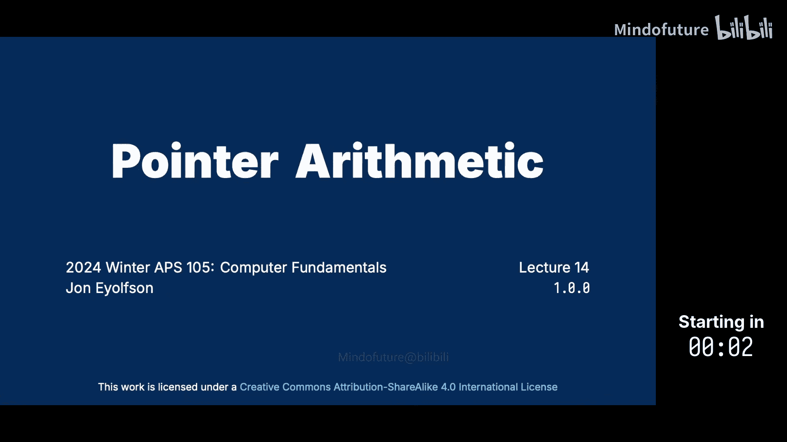
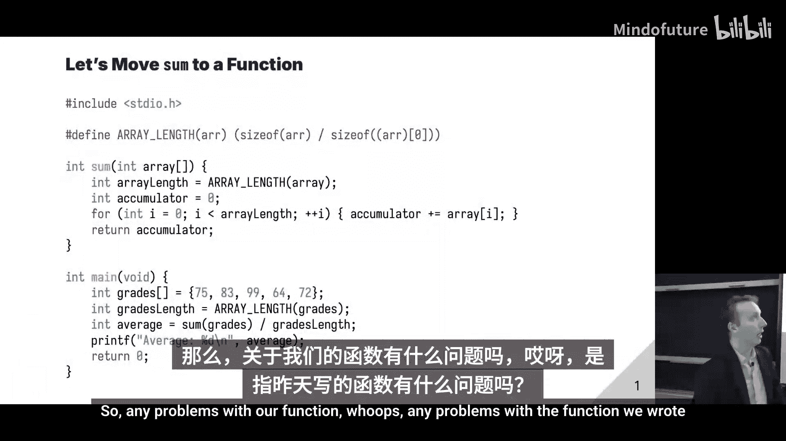
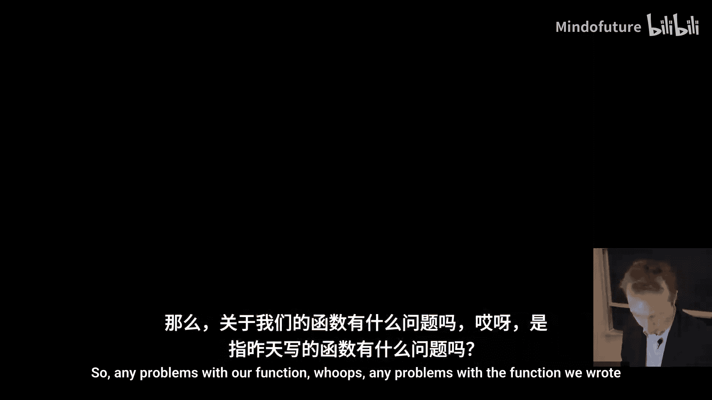
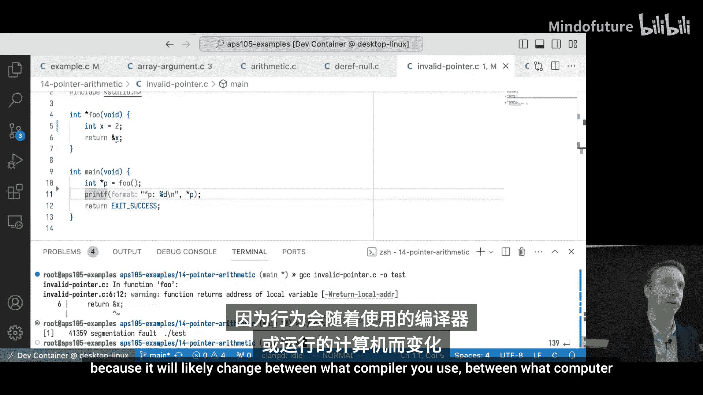
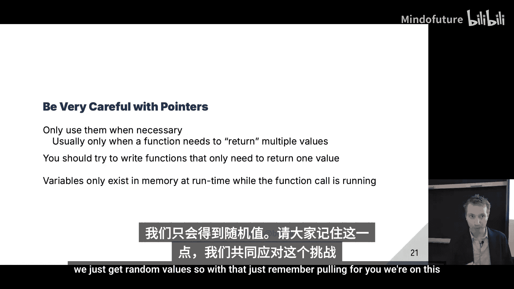

# 【多伦多大学】C语言计算机编程-｜-Computer-Fundamentals-｜-2024-p14-P14_指针算术--BV1zL6GBwEGe_p14-

Alrighty， welcome back to 105。So。Pointers， everyone okay with pointers。

 He was kind of point at things not too bad。So。Pointers probably one of the most confusing things when you start C programming。

 so today we're going to take pointers up another level。

 this lecture is basically full of things not to do so if you pay attention to the lecture and see what I'm doing and just don't do the things I am doing today you will be okay so this lecture may or may not go very poorly because I'm going to do some weird things。

So， let us。Begin the weirdness today。So any problems with our function whoops。

 any problems with the function we wrote？

Yesterday。So this function computed the averages for the grades， everyone okay with this function。

 not too bad。We if we want to add a new grade easy， we just have to just add a new grade。

 don't have to remember to update anything else。Really， really good。So everyone's okay with this。

 right？So。Let's。One of the tenets of good programming is， well， this little loop here。

Calculating a sum。If we might want to do that in multiple places。

 that seems like a useful little small piece of code that I might want to reuse。

Maybe I want to actually， you know， move it to a function。

 So let's just move that code to a function and and。Just rewrite it a bit。

 So let's create a function called sum。And well， here we're computing the sum over an array。

 and in this case it's an in array， so maybe I'll give it a general name。

 I'll just say it's an in array， and I don't have to tell it how many elements are in it。So。

After that， I'll just take this code and essentially put it here。 So actually。

 this still needs grade length。So I don't have grades anymore。 I'm trying to be general。

 So instead of grades length， I have array length， and I want the array length of the array。

 and I'll just trade change， essentially， grades to be array。And then I'll return the sum。

 maybe I want to call it a different thing than some here， just so I don't confuse myself。

This is called act short for aumulator， because I don't feel like spelling。

And then here to get the average， it's the sum of the array or of the grades array。Over this。

So it seemed reasonable， right， Any problems with that， I just kind of moved it out to the function。

So here I， I still have not recompild yet。 So this is my original version of the program that does not use a sum function。

 So here the average is 78。 and you could verify that yourself that that is indeed the average。

So if I just move this into a function， I expect the same result， right。

 I expect to see 78 is my average。So let us recompile our code， make sure we saved it。

So recompile our code， and then we'll run it。Shit。What the hell， what the。

All I did was move it to a function。Oh， geez。 all right。 So now we have to explain this。

 So this is why sometimes。C is hard， but。After we explain this and why this is wrong。

 we'll learn something about how computers work。So program looks the same。 outputput is wrong。

78 suddenly turned into 31。 What the heck happened。We might get a few clues just because of 31。

 So if we look。At the code。How is it possible anyone see how it's possible to get 31 out of that。

So this is part of debugging programs is to try and reason about what actually happened here， so。

The average got calculated wrong。 So this result of this was 31。 My grades length didn't change。

 so my grades length was the same as before。 It's 5。 So what does that mean about my sum。Yeah。I mean。

 maybe it only took the first two of them。Yeah， so it kind of looks like it only took the first two elements because if I do。

Well， if I do 75 plus 83 and then divide that by 5， well， then I get 31 so。

We can kind of guess that it just added the first two elements。

 which might mean this array length was2 and not five as we expected。Why would that be？So， yeah。

 we correctly deduced only the first two elements seem to actually get used here， so。

What we might want to do is see， hey， well， in here in this function， oops。In this function。

 what is actually the size of the array？ So let's see print F。So sometimes for debugging purposes。

 it's good just to have some print Fs。 So the size of the array。

We'll just print off what its value is， size of the array。So。

If we do this and we try and figure out what the heck is going on， it says size of the rate is 8 B。

 which would be like two integers。 maybe seems like something else is going on because before here。

In this grades， whenever we did the size of grades， it was 20 Bs， right， because each int is4 Bs。

 and we have five of them。 So something real strange seems to be going on here。

 like thinks are arrays。Four bytes now or sorry， eight bytes now。Kind of weird。So。

To explain why that is， we have to explain how C actually stores arrays in memory。

 and it's a good thing we had a pointer lecture before the array lecture。

So how arrays are actually stored in memory is。For the purposes of this course。

 it essentially just picks a random address a to start the array。

 and then all the elements of the array are going to be beside each other in memory。

 So the size of the element here depends on the type。 So I'm using an int here。So it's 4 B。

 So it picks some random address A that I just highlighted in green here just so we can keep track of it。

 And that will be the starting address of the array。 and then。

All of my ints are going to be beside each other in memory。

So the address of the first one is going to start at a or we could just say a plus0， still a。

 and then those next four bytes would all hold the value of the first integer and then the second element which would be at index1 because these are arrays which are0 index would be at address a plus4。

 so it moves four bytes over。To get to the next integer because the size of an integer is4 by。

 and then the next element would be 4 B after that， and then four by after that。

 And here I'm using Hex。 So remember Hex， it's base 16。 So it's still a multiple of four。

So if this was in decimal， this would be like a plus0， a plus 4， a plus 8， a plus 12， a plus 16。

 but because this is in Hex， this means the same thing， so remember in Hex， A is 10， B is 11。

 C is 12。D is 13。 E is14。 F is 15。 Wow， okay， I know my alphabet。 hellll yeah。 Allright， so。

 and here， yeah， this would mean in the1 column。 it's 0 and the 16s column， it's 1， So 1，16。

 That means it's 16。So。In order to keep track of an array。

 all C does because it knows all the values are going to be beside each other in memory。

 it just uses a pointer。To start the array。 And it only keeps track of the pointer to the start of the array。

 So your array is actually just represented as just one single address。

So any questions about that or how that's laid out， so it's all beside each other in memory。

 you can count it up， it's 20 bytes in this case。All right， cool。 We are experts。

Because the array is essentially a pointer。 Remember， arguments are passed by value。

 So arrays are not passed by value， because。C thinks an array is just a pointer。

 so since C thinks an array is just a pointer， what we might think is that hey。

 it gives that function a copy of the entire array， but it doesn't do that。

 so it only if it did it would have to create a giant copy of a new array C doesn't really want to do that so instead what the function gets is a copy of the starting address of the array and that's it so。

A type like int like int and then an array of ints， well if you pass it to a function。

 it just gets replaced by a pointer to an int and you might find this referred to in some things as array decay so as soon as you use an array like outside the function you declare it in。

 it just gets converted to a pointer because all C cares about is what the starting address of that array is。

So in this case， we got size of array equals 8 in that sum function， because in that function。Aray。

 that argument name is just a pointer。 and we all have 64 B machines now， so。

That means the size of any address is 64 B， which is。

8ight bytes so 64 divide like 64 Bs divided by 8 Bs per byte。 that means we have 8 byte。

 so any type that ends like with a star or a or not a percent an asterisk。

 whatever you want to call it， that just means it's an address and for the purposes of this course。

 we can just assume that any address is going to be8 bys because we're on a 64 B machine。

And then question， is this also known as a shallow copy of the array and。Kind of in other languages。

You might consider that if you've ever heard that term in C。C doesn't really have a concept of the。

 it just thinks a razor pointers and you get a copy of the pointer。So。

Because that function just gets a， like the starting address of the array。 Since we know a。

 which is the value， like the value of that pointer。

 then we can actually address any element because well， we know that all of the。

Values are going to be beside each other in memory。 So again。If we have。

 you can kind of see the formula here， so。At index 0。

 our first int that would be starting at where the array starts。And then， the next。

Value that is an int would be four bytes after that。

And in this case it's 83 and then we'd have another one four bys after that and then four bytes after that and then four bytes after that。

 so you can kind of see a formula here， so given like the starting address of the array and some index I so in this case this would be the value of I typically we just use I as a short form for index so seems like the address of the element should just be like a so the starting address。

Plus。The current index times like the size of an int。 so in this case， size of an in is4。

 if we had an array of doubles， then while doubles take up eight bytes。

 so the addresses would be a bit further spaced apart because doubles are bigger。So。

Turns out that if you do this， you will get something weird。 So C。

 what it will do is whenever you try to like， in this case。

 this is a pointer and we're trying to add something to it。 So C has special rules for pointer。

 arithmetic。 So the rules for pointer arithmetic are that if you have like a plus I。

 that results in this address above。 So C will kind of。Do you a little bit of a favor。

 And it automatically uses that size of operator for you。 So it knows。Based off the type。

 what that pointer type is pointing to， and it will do the size of for it。 So if I write。A。Plus。

 I and C， the address I would get is if I did that。So this would be the address， like just in bytes。

And the result I would get， I would assume， is just an address。

 but that address will actually be the result of this C expression。

 So C will go ahead and do it for you。So。What does that look like， So for pointer arithmetic。

 we can only do addition and subtraction if you try and do multiplication or division。

 it gives you an error and it refuses to compile your code and it might question your sanity while you're doing that。

 So if we have something like int star A。 So we have a variable called a which is a pointer to an int。

If we do like a plus I， that results in the address a plus I times like the size of an int。

 so it would be four if we had a double。Pointter， so variable called B。

 which is a pointer to a double。If we do B plus I and C。

 the resulting address we will get is like B plus I times 8 because that is the size of a double。

If we have something even weirder， where we have cha star， star。 So we have a pointer。To a pointer。

To a char。 So in the case， we have that。Well， C plus I， that will result in oops。

 that's the typo here， so it will result in c plus i times 8 because that pointer is pointing to a pointer and the size of a pointer。

 which is just an address is always going to be8 bytes。If however we dereference it。

 so the type of dereferencing C is just going to be a char pointer。

 so if we do a char pointer plus a number well it will it will move it over the size of a char so the resulting address will be like whatever the value is at C plus I so the index times the size of a char which is just1。

 so we can do weird things with pointers。But for that。Don't have to worry about too much right now。

All we really need to know is that C will actually guarantee the order of the elements in memory for us and what that guarantee is sometimes referred to。

 you'll hear this so many times after this in everyone you'll just talk about forever you'll say that elements in the array are contiguous All that means is that they are together in memory。

 there's no gaps between them or anything。 they're all in a row， so they're all beside each other。

 that's what the word contiguous means so。In this case， there's no wasted space we have。5 integers。

 each integer is 4 bys。 So in total we have 20 Bs and we just use 20 B in memory in a row。

 So that would be like the addresses a plus 0 all the way up to a plus 14 in hex。

 which is just how you write 20。 And this is a normal range in mathematics。

 So if you write out would a range like this square bracket means inclusive。

 So it starts at a plus 0。 And then this。Prenheses， that means exclusive。

 so I don't use the bitete at this address， I use the one just before it， but you can count it up。

And see that in other words， it see addresses a plus 0 all the way up to a plus 19。

 which is 20 bytes if you count it。 So questions about that。We are getting in the weeds here。

All right， so。With this weirdness。We can actually just use pointer arithmetic to access any element we want。

 So assume that we have our int array called grades。 So again， that's how theyre lay out in memory。

 If we just take grades。 So our in array is called grades。 It's essentially a pointer。To an integer。

 so if we do grades plus1， that will actually give us the address of the second element here。

 so we start at grades and then we go over one element and since they're integers。

 we would get exactly this。And then if we want to get the value at that address。

 we would just do grades plus1 and then de referenceence all that。

 And then we would get the value 80。Three， so this。Does this look familiar to an array index at all？

Should look pretty familiar， so。Turns out that the syntax for just accessing a value of array is just for your convenience。

 So if I do grades and then square brackets index。 that's actually the exact same thing as doing like pointer arithmetic on grades。

 If I do grades plus index and then dereence it。 I'm going to get exactly the same value。

 So the only reason they came up with this syntax for accessing elements of an array is because pointer arithmetic is bad。

 So。Especially in this course， if you have to do pointer arithmetic。You are doing something wrong。

 So the only point arithmetic you should be doing is with grades。And well。

 if you get an error with it， it's because the index you use was not valid for the array and well。

Under the hood， it uses pointer arithmetic， so you just started pointing to just some old random address and some weird things happened。

So even though these are equivalent， again， you should probably just write what you mean and always use the array syntax。

So with that， So the size of the array， like how many bytes it contains is only valid in the scope of its declaration。

 So in here。Yeah otherwise， if we try and use array in a different function。

 there's pointer decay because it doesn't actually know how big it is。 A function can be reused。

 so you can call it with different sized arrays if you want， and it can't tell the difference。

 so usually if we have a function that uses an array。 Well。

 we have to tell it what the size of the array is or what the length of the array is。 so。Finally。

 if I go back and I rewrite my sum function correctly， I should just add another argument。That says。

 okay， I need to know the array length。 So that is something you also need to tell me when you use this function。

 So our sum function should actually look like this。 So let's go back and fix that。So。

What we should do， because while we， like， we can't figure out the array length here because。嗯。

We did not declare that array in this sum function。

 So instead of trying to calculate the array length with that little macro。

 I should just add a parameter here。 that's called array length。And then in here， when I call some。

 I should pass the grades length。 So I need to make sure that when I use this function that the array I pass。

 the length is actually valid for it。So if I now run that。

I finally get my average 78 after all that work。 So this is just a cautionary tale that if you write a function and it has an array there。

😊，And it doesn't have a length associated with it。 You have messed up。 So it should。

 you always need to know what the length of the array is。 Otherwise。

 you cannot guarantee you will be within bounds and some bad things will happen。All right， so。

Add a length on if it's not the function you declared the array And everyone good with that。

 Everyone remember that。 So I just。Made fool myself for 30 minutes， explaining what not to do。

 So do not fall into this trap， otherwise。It will be weird， but now you can kind of explain it。So。

What other so。This is slightly beyond the scope of this course， but I'll explain it anyways。

 this won't be tested on exam anything。 so this is just so we can even begin to reason about the carnage I am about to unleash so。

And I saw some of people were actually interested in this and asked about that。

 so there are some rules where variables are in memory。

 so the addresses for like variables and functions。

 the variables and functions we heard the term global variables Well if there's global there's probably local so variables within functions are called local variables and they start at a randomly picked address S short for stack pointer。

 you don't have to know what that is， you will figure it out in your architecture course you will take hopefully in second year。

So。Just know that it's just some random address where。C is going to start using memory from。

And it's random for well， it's random for security reasons because otherwise。

You might be able to guess some addresses of stuff， and things would be bad。

So there are rules after you have that random SP where the variables will be put in memory and where they're going to be put are in a certain order and it will be at lower addresses from the initial stack pointer。

 sometimes there'll be space between the variables， sometimes it'll look like arrays。

 sometimes not you can't guarantee you can't guarantee if there's space or not。

 there's a bunch of rules for that that are much more complicated than we want to get into。

 but for now there could be space between variables， no wasted space between elements of an array。So。

And even for these， like the address is getting lower as we create new variables and functions。

That details may vary between CPUs， may even vary between operating systems。

 So this is mostly tailored to what like 99% of the things do。So。This program is dumb。

 Do not do this。 So what this program is going to do。I'm actually going to show。

 So here I'll label it memory。 So on the right here。😊。

These are going to be remember why I was tracing through the program before I put the variables that were in scope here and active。

 so they will actually be somewhere in memory and now I will actually just give them addresses because we have to do some silly arithmetic so turns out on this machine。

If I declare in X， okay， well， I need four by to actually hold the value of an integer that I'm calling X。

So after running that line， the address of X will probably be something like I just made up some addresses。

 but might be something like1 FFC。 So that's what byte it starts at。 And then it goes to like byte 1。

 FF D， E。D， E， F， yeah， D， E， F， and it has the value currently one。

So if I declare an integer called Y， well， the rules are that the address it will get will be lower than that one。

 So it turns out on my computer， it will actually be beside each other。

 So it'll get a address like1 F F 8， which is only if you just look at the difference between these numbers。

 Theyre exactly four bys away from each other。 So like。The last thing here is 12，8。

 So there are only a difference of 4， which is the size of an int。Then， here。I have。I declare Zed。

Zed gets a lower address。 It might be beside。 it might be three。Then I create a pointer。

 which is currently the address we assign it is the address of Z。 So after that。Well。

 it needs to live somewhere in memory。 In this case， there's actually a bit of a gap here。

 Don't have to know that because it's not going to be important。

 So P is actually the address actually refers to wherever Z is。

 So this address would actually be the value stored there would be1 F F 4， but。For the purposes。

 of course， we never actually have to care what the actual address is。

 So whenever you have to reason about it， easier just to write a little arrow of what that value is pointing at。

So。Any questions where we are so far before we do some arithmetic？Okay， so if I execute this line。

 So I do p plus 2 and I D reference it， and then I change whatever that value is to4。

 what do we think is going to happen in memory point knowing a bit about point arithmetic now yeah X going。

Yeah， x is going to change to4。Shouldn't do this。 Don't do this。 It's really。This happens。

On my system， so in this case， if we do p plus 2 because these variables are exactly where they are in memory well。

If we take the address of Zed， which is this and then add two to it。

 that means it's going to jump forward two integers or jump forward eight bytes， so in this case。

 well this4 plus 8 is going to be 12， so it's going to jump here or just skip1，2。

Because they're all integers， and they happen to be beside each other。

 So now P plus 2 is a pointer that points to x。If we dereence it， now were changing the value。

 we're accessing the value of x， which is1， and then we change it to4。

And then now when we print off this， we get four， two， three， which is。Weird。So。Here。

 just to show you that you actually do get that。We get。Four， two， three。Turns out。

Turns out this isn even consistent between compilers。 Actually， I'll leave that。

 So sometimes this actually depends on what compiler you use as well。And yeah， so question。

 can I explain the pointer changing X again。If we go back here， so。P here is currently pointing to Z。

So。In this line right here when we do p plus2 because that pointer is a pointer to an int and we add two to it。

 that means we are going to jump forward two integers worth of bytes。

 so we're just going to jump forward to integers so it happens all these integers are beside each other in memory so P is currently pointing to Z so p plus so this is p plus0 and then p plus 1 will point here。

P plus2 will point here。We'll point here。And then once we dereence it。

 that means we access this value。 So this value is one， and then we reassign that to B4。

 So after this line xs from1 to4。And I how why got the addresses。How why got those addresses there。

 We just followed the rules of C。 So the rules of C。Give you this and。The rules of C。 Well， actually。

 the rules of C just say that the address of this will be lower or yeah。

 the address of this will be lower than this。After that。

 C doesn't say anything there could be space between them。

 they could not be just so happens that on my computer with my specific compiler that I'm using。

 they happen to be all in line。 So if you run this silly code on your machine。

 you might get a different result and you might point somewhere else in memory。

 which would be even worse。Yeah， so it is plus8 bytes， so here because it's pointer arithmetic。

 it does that size of the in and factors that in for you。P is a pointer to an integer。

 so P plus 2 will move forward two integers， or if we think of it in terms of bytes。

 it will move forward 8 bytes for us，Wh， that's funny， basically。Too long didn't read。

 Don't do things like that because this happened on my machine might not happen on yours。

 And we'll see some other weird examples。So that data structure that stores values that we define in functions is called a stack。

 So notice that like in all examples。The way it kind of worked。Is we added values to the top。

 So every time we declared a new value， it went from the top。

 And if we do a function call or anything like， and if we return from a function call or something like that。

 we get rid of them from the top。 So it's called a stack because if you've been to the cafeteria。

 Do they still like those spring loaded things of plates。So they got the name from that。

 So if you have a plate on that spring loaded stack。

 you put the plate on the top and then the last plate you put onto the stack is the first one you pull off。

 So that's kind of how memory works。 If you don't understand that and don't see how that relates to memory。

 don't worry about it。 again， you learn that in the computer architecture course。

 but this is why the rules are like they are。So again， don't have to know these rules。

 And in that previous example， I even had some wasted space between Z and P。

Didn't actually have to be there。Yeah， and then question for some reason。

 if there's space and memory between X or Z。Between X， Y or Z and Y is a double。

 then it will still work。 So in that case， if we have a different value there。

 we're probably going to like land in the half。And like half the double。

 And we're gonna get a really weird value。 So we're gonna get some more weird values to date I don't worry about。

All right， so now you might ask of like， oh， okay， well。

 if an array just gets converted to a pointer。Why don't I just use pointers as the type in the functions instead of just。

Arays， so why instead of some in array， and that's actually an array， why would't I just。

Say inch star array and just cut out the middle man and don't have to remember， so。

They do mean the same thing， but as humans， the intent is a bit different。

 So if I write int array and then the square brackets here to indicate that it is an array。

 even though it's a pointer， it actually conveys a bit more information。

 so it's a pointer that actually points to multiple contiguous values。

 so it might point to more than one thing in a row。

 while if I just have an int pointer like a pointer to an int that usually conveys to the reader of the function that you're just pointing to a single value and if you do pointer arithmetic on it。

 you have screwed up badly， so。This basically means， well you can do some point arithmetic on it。

 you should just use the array indices， and I should also tell you the length of the array。Alright。

 yeah， we have some more questions with some more weird stuff。

 Don't worry we'll do some more weird stuff， but also beware variable declaration rules are also strange with pointers。

 So if I do like int star X comma Y， you might think that I get two pointers one called X and one called Y。

 Well， it turns out in C just to make your life difficult， it does not carry the star。Across commas。

 So the type of x is actually a pointer to an int， and the type of y is actually just a plain int。

 It is not a pointer。Don't ask me why these rules are。If you don't want to remember these rules。

 which I don't just declare one variable at a time。

 and then you don't have to worry about what the hell happens with a comma because I don't know about you。

 but I don't want to remember more than I have to。 So when you're writing this， just go ahead。

 write one variable per line。😡，Alright， so。Usually。

 we want to like initialize variables to like a safe value。 like for ints， we initialized it to 0。

Otherwise， we know that we might just get a random value and if we accidentally use that really weird things will happen。

 so same rule applies for addresses or pointers， they're the same thing。

In this course you should probably only set pointers to the address of something and if you don't know the value。

 you've probably screwed up somehow or you probably need to rethink something。

 or you need to be very， very careful at least So if for some reason you have to give a pointer some value。

 there is a special value to give a pointer and it is called null。

 which well you might think of it in math， means empty or zero or nothing there。

So why you want to use null is because it has a few fun things with it。

If I screw up my point arithmetic and point to somewhere weird in memory and I dereence it。

 I just read some random values。 Well， if I dereference null。

 it's guaranteed by the operating system that I am going to cause an error。

 So it's a special address， it's actually the address 0。 and it's always invalid。

 So if I go ahead and write a little program。So all I do is I。Have a pointer to an integer called P。

 I'll set it equal to null。 And then I'll try and read the value at that address by de referencing it。

 If I go ahead and I run this。Segmentation fault。 this will be the bane of our existence。

 So segmentation fault means I try to read some invalid memory。 So in this course， well。

 in terms of like pointer arithmetic and stuff。 segmentmentation faults are actually your friend because they stopped your program dead and they indicate that something really。

 really bad has happened。 So there was a bunch of numbers there， don't have to understand them。

 all we need to really know is that our program has like crashed and it stopped immediately。

 and we have likely screwed up our memory somehow。So。They're a good thing， though。

 they're easier to debug because instead of just doing random things and just carrying on and who knows what your program does after that point。

 well， it's much， much easier to just debug。A segmentation fault。

 then just some random value happens and some random things may or may not happen。

 so there's a tool called velgrind that may help you， you're not required to use it。

 but it may be helpful， especially if you're using pointers and you see segmentation fault you might wonder where it comes from and this will tell you exactly where it comes from so。

All you have to do is use it。On ECF， it should be installed。

 all you have to do is type vgrind right before。 And if I do that。

 it has a bunch of output that you won't see because something weird happened on my computer。

 but all you need to know is that it will tell you an error like near the top invalid right of size 4。

 and it tells you what line it happened on。 So in this case it told me line 6 had the error。

 So it means well I screwed up at that point。 So that's when my program crashed and I can actually go ahead and probably debug it from there。

 Oh， I did something silly。All right。So another thing to go back to scope and tie it together with memory。

 So these local variables only exist when the function runs and we can do some dumb things with these two。

 So here we have int。 So here at our main。 We declare a pointer called P。

 So it's a pointer to an int。 and then we call fo。 So in memory in our main。 well。

 it'll create space for P。 and we're not going to know the value of it yet because we have to do this function call。

 So we would jump here doesn't take any arguments。 We don't have to copy any values or anything like that。

This function declares an integer called X。And it would go in memory。And it would live in F。

 So we said it equal to1。 and now we return the address of x。

 So we return a pointer where the arrow points into x equals1。 So it points right at x。

But after we return from Fo， we go back to Maine and we resume。 So after Fo returns。

The rule are is that the variables are。Now don't exist anymore， so I'm just。

My pointer is just kind of pointing at some random thing that is not guaranteed to exist anymore。

 So now， if I de referenceence that， well。It's just pointing at some random memory and。This is。

C does not like this。 So if you do where you point out random memory where you can't reason about what it points to。

 C is allowed to do whatever the hell it wants。 So this is where it will get interesting。So。

Here is that code。If I go ahead and run this。I get one。So I still get the value。

 So turns out in this case， I get lucky because， well， that memory didn't happen to get reused。

By the time I printed it。 So it was still seemingly valid。But。Turns out that's not always the case。

 So I just got lucky that it was still one。 So in this case here。

 let's make sure let's change it to two， oops。So I got lucky。

 and it happened to still be pointing to that。 So it's still， too。So， turns out。

Because it's pointed to something invalided。 We don't know。 So even if we do like a print。

Let's do a print F here， give it a big lull because this will do weird things。

If we compile and run that。Also I did not pick that value， but that's pretty funny。

That that's total coincidence， so C is allowed to do whatever it wants。

 so it turns out you know print F is going to have to use some memory and it uses some memory and because I'm pointing at a some random address。

 I just read whatever is there and happens to be 69， which is hilarious。But。Turns out that。

This is not even consistent between compilers。 So I used a different compiler。So in this。

 let's go back。 So it's 2。 So if I use the same compiler， you all are using like GCC， and I。

Compile it， and I run it。 I get a segmentation fault。So it's not even consistent across compilers。

 so if you are pointing to random memory， C is allowed to do random things and you will never， ever。

 ever be able to reason about it because it will likely change between what compiler you use。

 between what computer you run it on， so this is what makes programming hard。

 so do not do the stupid things I am doing today because you trying to figure out why it just printed 69 randomly。

Not going to do it， but the whole reason is because we were pointing there to just some random space out in memory。

However， we can return pointers that are still valid。 So here。

 let's take a function called like max pointer。 So we take two pointer arguments。

And we dereence them to figure out which value is bigger。 In the case of a tie。

 we'll return the one on the left。And。If B， the value at B is bigger than the value at A。

 then we'll return the pointer for B。 So we're just returning the pointer of whatever pointer is pointing to the biggest value。

So。In Ma。I declare in x assign at a value 1。 So in memory it would look like this。 then we have a Y。

 We give it the value 2， and then we call max pointer。 So that is a function call。

 and also we declare a pointer to an int called P。 So we'd reserve some space for P。

Do the function call。 And， well， it's copied by value。 So Max pointer will get。

Its own variables and the initial value will be a copy of the address of x and a copy of the address of y。

 So in max pointer A points to X and B points to y。So if I run this function， well。

 if I d reference a。 So here the value is one，1 is。Not greater than the value at B。 So in this case。

This would be false。 So one is not greater equal to 2。 So because this is an if statement。

 we'll go into the L and then we'll return B。 So the result of the function is going to be a pointer to mains y。

 so。After that function call returns because it was pointing to something in main and main is still running。

 it's still pointing to something that is valid， so this is okay。

 and if I print the max and ID reference it I'll get max is equal to2， which is what I would think。

But I'm using pointers in this case。So a， quick questions about that。Alright。 And again。

 you can ask on discord and stuff because pointers。Pointers are fun。So to wrap up today's。嗯嗯。

Comedy of errors with pointers， Just be very， very very， very careful with them。

 only use them when necessary。 So usually you only actually have to use them if a function needs like multiple return values so it needs to set multiple values that you want to access in whoever called that function。

You should try and write functions that just need to return one value so you just return that value and then you don't have to worry about pointers。

 the easiest way to use pointers is to avoid using pointers。

 so scanF had to use a pointer because well we could have multiple format specifiers and it can set multiple values at once so it needs to use pointers。

 anything else doesn't really need to use pointers and variables they only exist in memory at runtime while that function is running if that function is running。

 not running then those variables do not exist and you should not point at them otherwise you get that really weird problem I had we just get random values。

So with that， just remember pulling for you， we're on this together。

