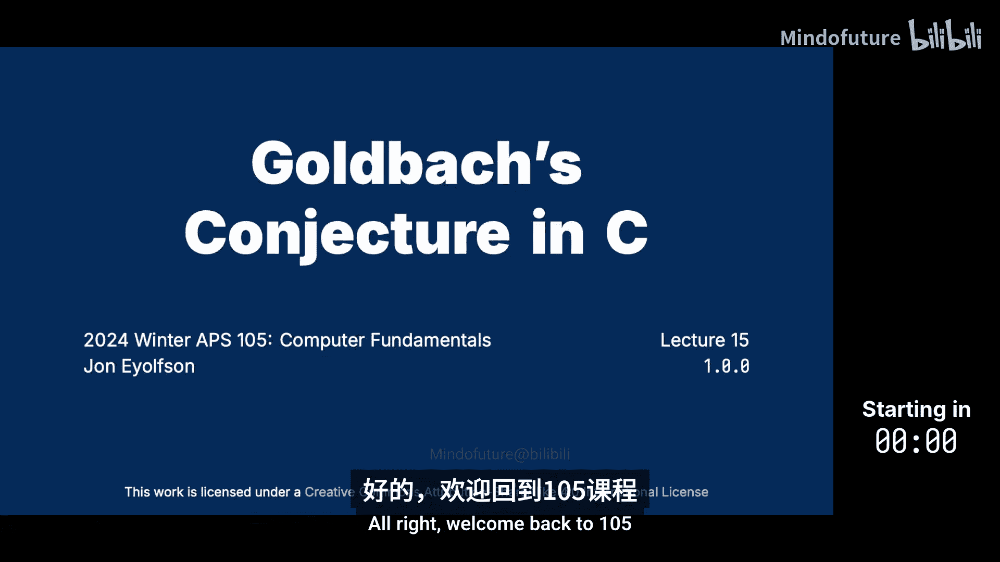
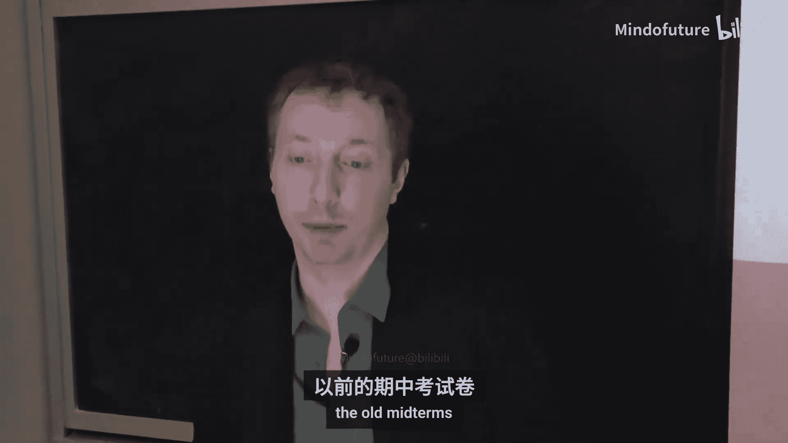
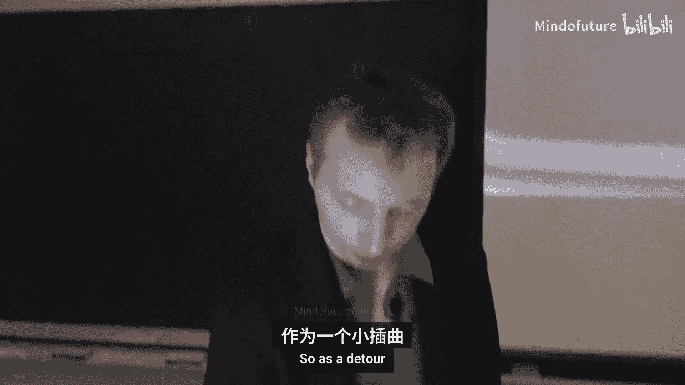
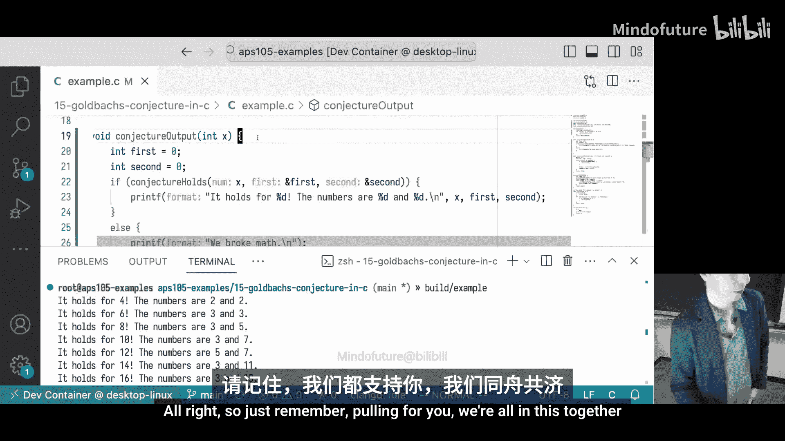

# 【多伦多大学】C语言计算机编程-｜-Computer-Fundamentals-｜-2024-p15-P15_哥德巴赫猜想在C语言中--BV1zL6GBwEGe_p15-

。

All right， welcome back to 105。We're done all the content for the midterm。 Yay。

 we're a week ahead of other people， so。Good。I guess that's good。 So today。

 we'll be doing some more practice。 We'll be solving a larger program。 And then next week。

 we can do all midterm review。 So we get a lot of practice， and we can all。😊。

Do very， very good on the midterm。 So we'll have like three lectures to go through it。 So again。

 use the discord， post questions， go go through the old exams， Look at them。The old midterms。

 Let me know if there's anything in particular。 you want me to pay special attention to。 Otherwise。

 we'll just go through them in reverse chronological order， and we will figure it out from there。

 but。

We can breathe a sigh of relief now。So， as a detour。

Let's try and write a bigger program。 So there is this thing called the Gold box conjecture and some very。

 very smarter than me person like 200 over 280 years ago， apparently just。Came up with this。

 And he just said for every even integer greater than two， this it is the sum of two prime numbers。

And this is still to this date unproven。 It seems to be true。 People have tested it up to very， very。

 very large numbers that it is true， but no one can actually prove that is indeed true。 But today。

 we'll write a program to see if it actually holds and actually be able to go ahead and test this conjecture that has not been proven。

So。We are starting from absolute scratch。So nothing here， there's just an empty mean。

 returns to exit success。Doesn't do anything， so。This is a very daunting position to be into。

 because well， I don't know where to start， so。Given this problem。

 anyone want to tell me where I should start。 What is the first thing I should think about if I want to write a program that will go ahead and test this for us。

Yeah， like how to find the。Yeah， maybe how to find a prime number。

I also should probably be concerned about getting some input from the user。

 Maybe I want to verify that。I can actually get the input。What about in terms of solving the problem。

 Well， I should probably easiest thing to do is just not even worry about how to program this in C。

 Just think about how I would solve it if I was on paper because basically programming is the art of explaining all of the steps to solve the problem to a very。

 very stupid machine。 So computers really dumb。 You have to guide them through solving all of this。

So。If I were， sometimes it's nice just to write it out by hand。 So if I were to do this by hand。

 how would I prove this conjecture is true。 So just， so we have it， let us just write。So， so every。

Even。Interature， greater。Then。2 is the。All right， so。Given that conjecture。

 if I just give you an old， just some number。 So let's say an even number greater than 2。

 So let's say I give you the number， I don't know。44。

How would you come up with proving that this is true。

 or at least that it hold not proof because then you'd be smarter than 300 years collectively of humans。

 But showing me that 4，44， this conjecture does hold。Yeah。It it even。Yeah， so 44， it isn't。

 So it is an even number。 It is greater than 2。 So this is a valid input。

 So after I have the number 44。How should I see if this conjecture does hold or not？Yeah。

Like picking one。The number one as well。人觉的す。So for this， one is not a prime number。You do。So， try 3。

So I try 3。 How do I try 344 subtract。Your case。Remaining numbers。So the other number is like 44-3。

 so 41。So I could try that and then see if they are both prime numbers。

So how do you come up with three？啊。不。那 not。Why wouldn' I be able to use two？就。So， I will。

Counter that。 So that's a good thought of like， okay， well， if I start with 2。

 then if I minus the other number， well， it'll be even， and that will not be a prime number。

What about if my input is simply4。Yeah， so。You're being a bit too clever already。

 So always good just to start with the first prime number。

 So maybe I should check that or maybe that's not to。 But， you know， in this case， yeah。

 if I did two plus。42， that's not it。 So I can just cross it off the list。

The thing is go to the next one，3 plus 41。 Oh， They both happen to be prime。

But what would I do if this was not actually the sum of two primes。What。

 what would be my next step if， for some reason， that was not true。Yes。Yeah， so I try 5。

 which is the next prime number。 So when we're solving this and we have to explain it or like write it in C。

Should any of the terms we use that like。We take the number and we get another number。

 Certainly sounds like a function。 If we can give a name to an input and an output probably gives us an idea of something we should write。

 So you said。If that wasn't true， I should go to the next prime number and then subtract it。

 So I probably need a function called next prime。Which would probably take an integer and return an integer。

Alright， so that's good。 We're already breaking the problem up into steps。

 What other function would be useful。So what did I say， So I took 40 So like， I would take three。

 then figure out， okay， the whoops， the other number is 42。What did I ask about 42。If it was prime。

 right， So maybe I need a function called pool。Is prime。And then。Other than that。

This is good enough to get me going。 I can kind of see it so I can ask for some number。 So let's say。

I asked the user for some input。And all I get is a single integer。

 So might be nice to just write your function like this because I don't need any whoops。

And this needs an int， sorry。So don't need don't need any input to the function。

 I'll just ask the user to input a number and make sure it holds true。 And well。

 I don't have to deal with pointers because I'm just returning a single value。

 So I should probably just use a function。So with that， that seems to be enough to get going。

 So let us。Turn to C。So the first function we should probably write is the user input1， user input。

 oops。So we're returning an int。And we don't need any arguments。So。

If I want the user to input a number so I can test it。

 I should probably tell them what they have to input right。 So let's say enter。Integer。Greater。Then。

2。And it's an even integer。And then I have to do scan F， oh， okay， I need。It needs to be an integer。

 So it's a percent D format specifier。 Oh， okay， right， I need to give it a variable。

 So let's just call it input。I'll just initialize it to 0 just to be safe。 In this case。

 it doesn't matter。And then scan F。 So now through that pointer。

 it goes ahead and sets that value for me。 That matches the user input， and then。

I just returned that input。And in the main， I'll use it。 So I'll just say none equals user。Input。

All right， is that a good to user input function？Look looks good。 Allright， let's see it。

So usually when we test our program， we assume the worst case that our user is an absolute jerk so。

If I go ahead and run this， enter an even number greater than two。Sure thing。

Should probably do a bit， something a bit better than that。

How would we do something a bit better than this。Yeah。丈くさ。Yeah， okay。

 so maybe have a while loop that the user that doesn't let the user input something that's not greater than2。

 So while the input is。What， so while the input is what less than or equal to 2。

So while the input is less than or equal to2。Maybe I。Maybe I cost a user a little bit。きって。Alright。

 maybe I do something like that。And maybe if you want to be clever。

 the more times the user gets it wrong， the meaner you get。

 So that could be an extension to our program。 We'll just be a little bit of a jerk for now。

 So let's see we。Enter one， we get hey jerk， enter a number greater than two。We say two。

 tells us we're a jerk again。Okay，3， was that an even number。Alright， what。

 what else do I have to put on here。Yeah。If it didn't go as all。Or if it's odd。's why。use么。Well。

It's not equals0。Like that。Maybe， okay。So looking at that so that should continue asking the user。

If they enter something that is less than or equal to 2， or it's not an even number， right。

 either one of those that fails。 So this should do the trick。So let's say I enter1， okay。

 I enter zero， okay， no。Enter a2。 No， okay，3。5 seems to not let me enter an even number。 and then。

 you know， some number greater than。Some number greater than 20 even 10。

 So that seems to be good for our user input。Any thoughts about that， or does that seem good now。

Seems relatively decent。All right。So what is are the other ones。

 So maybe we want to just write all the function。Prototypes we thought of up here。

 So we had this one。We had next prime。And then we had is。B is prime。And then we used the bowl。

 so we need this。And let's move this to the end， just for argument's sake。Alright。

 which one should we write next？If it's prime。All right。So。Let's write， Bo is prime。

Int we'll just be clever and call it an X。 So how do we know if a number is prime or not。Yeah。

 so if it's prime， it's only divisible by one and itself， right。

 So if it's divisible by any number between。2 and less than itself than it is not a prime number。

 So what would that look like so。What should I write here if I have to write it and see。Yeah。

You could check it。First， I could check if the numbers even yes。So if the number is even。

Then it is not prime。For our input is。Oh， I have a question also in the discord。

 if I enter a or nothing or a large number， we're assuming that user inputs at least an integer。

For this course， because like I said before， Scf is hard to use。So it doesn't actually do good， so。

This startss us off。 So like this， if the number is divisible by 2， then it's not a prime number。

Unless it， unless it is to。H。And if I kept going with this。In general。

 it's like up to how big the number is， right。 So I' would have to be like， well。

If the number is divisel by by 3。Then it's not prime。If the number is divisible by。Well， four。

 maybe then it's not prime， although I could skip that one because it's not prime。Yeah。

 this looks like loop territory， right every time through I'm going up by one。

 And for the sake of this course。Like， sure。If I， I don't really have， well， actually， I would。

 would have to check if it's the visiblevo for。 But we have this pesky situation where。

I shouldn't do this for the number two， because the rule is。Your prime。

 if you can't divide by like more than one and yourself， right， So two is itself。

 so that doesn't count。So probably there's like a bound。 What number I should go up to here， right。

 So I shouldn't go up to myself。And I should also start at 2。So。If I should start at two。

And this number。 So this is like x divided by something， right。Alright。

 if I want to give the something a good name， if you do like number divided by something。

 what's the and something actually called。Anyone remember their？Math。The divisor。Yeah。

 we'll call it this advisor， all right。Yeah， we can do a loop。Dvisor， so we can start it at two。

 maybe。 so we start at two doing it by one， pretty useless。

So we can go let the divisor go up till less than I or sorry， x。Because that's our input。

 So if my input is， let's say2， it wouldn't try and divide it by 2。 It would stop before that。

 And guess what， wouldn't even try anything。So we would do plus， plus divisor。And then。

We can kind of move this in。So instead of checking if x is divisible by to sum number。

 we can do if it's divisible by the divisor。And then here we have a few choices of what to do。

 So if we find that it is。Not like if this is divisible。 So it's a factor。 And we know for sure。

 if we go inside this if statement， we know for sure that it is not a prime number。

 So two strategies here。 Maybe I just have a。Booolean that I keep track of， if it's prime or not。

 And then I set it equal to false。 But usually the good thing to do in functions is if you already know the output of it。

 you can do a return and it will just immediately end that function。 And we。

 it wouldn't even try bothering trying to divide anything else。

 So I can just immediately return false。And then functions done wouldn't have to try anything。

 I know it is not a prime number。Alright， anything else with this function。

Sorry return true at the end。If the thing is prime。So if the thing is prime， then it。

You have to return true。Like if it's prime。Yeah， so I， so I have to return true if it is prime。

 So how do I know it's prime here。Yeah， it's a question。 So for the index here。The user input or。So。

So X can just be any integer。 So we're just assuming it can be anything right now。

 because we're writing just as function。Just as a little helper function。

 because we know we need to ask， hey， is some number prime or not？Yeah， to answer your question。

 you can place the return。very end， and you know that if it reaches that point， that means。

TheSt never existed。对对。Not crime in the。Yeah， exactly。

 So if I go through this entire for loop and I never go into this if statement。

 So it never returns anything。 And eventually， I've tested literally every single divisor and it's not divisible。

 So at the end of this for loop， we know for sure that。Well。

It wasn't divisible by anything that was two or less in itself。

 So it must only be divisible by one in itself so we can just immediately return true。

And we're all good。So just to test it， yeah。他对这说。So we do have to return true in this case。

 because if you just leave it out and you compile it。

 C will say something like nonvo function does not return a value in all control paths。

 which basically just means it's possible for this function that returns a value to。

End without you calling return。And for the purpose of this course。There is usually it returns 0。

 So usually the default value it returns is a 0， which is not what we want。 We want to say。

 if it makes it to the end， it's true。So。But that's a new error。

 I don't think we have seen that one yet。 Well， it's awarding。 So it still compiles。

 The compiler will do something， but it would have been a complete pain to debug。

So now we can go ahead， see， okay， I'm a jerk， How about four， okay， I can enter that。Maybe we test。

In our program， let's just。See what the result is of。

Just making sure that it is prime work so we can do is prime2。

 Let's make sure that we can say that2 is an even number or a prime number。

 So it doesn't matter what input I give it。 and it says， yep， it's prime。So that's good。

 Maybe when they test it， we don't care about the user input。 So maybe we try a bunch of values。

 So one is technically not prime。So， oh， whoops， we screwed that up。

 So maybe we have to fix that because that's kind of a bit of an edge case where。I。

 I even think they considered one as a prime number before， but then they changed their minds。

 I know， math people are weird。 So we can just make sure that。If x equals1。

 we can just special case that， we will to say it's not prime。And。That's fine。 we'll assume。

That this works。For integers， one or greater。 So we won't bother to deal with negative values because it has slightly weirder rules。

 And yeah， we just won't bother， won't test it and doesn't really matter because our input are going to be always positive。

 So don't have to deal with negatives。😔，All right。So now we've got some user input and a prime function。

So。How。Did we say， oh， wait， we need another function。 We need next prime。 Okay。

 so we need next prime。All right。How do I go about next prime。

So my X is just going to be some integer。That I assume is prime。

 and I should give it the give you the next prime number。ち wait。Yeah。

 so I could probably use next Er is prime。 So how would I use as prime。

So we can think of it in little steps， yeah。Increment X， and then check。Yeah， well。

 we can just check， right， if we had to like。Computers are basically， like， just。Really。

 really stupid things。 I can do stupid things really fast。 So if it works， it works。

 So for the next prime， what we could do is just take the number。

 Add one to it and see if it's prime。 If it's prime， great， if it's not prime。Do it again， Okay。

We try it。 We increment it again， and it's prime great。 If it's not， we do it again。So。

If I was to translate what I just said into code， how would we do that。Yeah。Yeah， a loop。

 What kind of a loop。For loop。So if we do a for loop， we have to know where to start。

 So where would I start with a for loop。嗯。觉得。せがにま。So we're assuming x is just some random number。

All we can assume is that it's probably prime。And I equals x。日。P that， we start with x。

I guess we can。 So remember， we should use four loops when we like。

 know how many times we do something。 So in this particular problem。

 do we know how many times we're gonna say， oh， this one's not prime。 This one's not prime。No。

 so for loop， what's our other option？W we。So。There's also like。A。Do well in a while， so。

In this case， well， let's think about each time we need to go through it。

 We just said we increment X， right。Yeah。Oh， you so we're going back to the for loop。

 So you want a for loop。 Allright， So if we want a for loop in I， So what's it start at。X plus  one。

 okay， and the condition you want is just that x。So， so you want I as not prime， which is like。

And then how what， and how far do I go up。Plus， I。Right。So you don't want me to write anything here。

Because this is like normally where I do， like plus plus。Okay， so that。All right， so。If I do this。

 then。How do I know when it stopped and what's the next prime number in this case。So， x。So X。

 we didn't actually change。So， and like， if I do。You might be thinking。

 I can kind of see where you're going here。 Like at the end of that for loop， I is a prime number。

 right。So。I can do returnturn I。Get a red line。air。Can you fix that？Yeah， so。

 so the eye is only in scope between these brackets， other than that， we can't access it。

 In this case， yeah， if we want to， we could just。Do inI over here and then get rid of this。

So now I is in scope， even after that。 So I create I immediately。

 and it is in scope for the duration of the function。 So I could do something like that。So。That's。

Seems like that's a good solution。 Let's see。So let's just we can test it by printing a few results。

 So let's say the next prime。Of some number equals sum number。So let's say next prime of three。

Alright， so what is the next prime of three， Do we actually know that result of or what that should be。

5， right， So let's see if we get a five。Ohoops。I did not comment。are you。Yeah，5。 so seems to work。

 so。The only slight comment I would have to this is like a poor loop with nothing in it is a bit strange。

 so。It like just converting it to itss。Loop equivalent might be a bit。Might be a bit cleaner。

And we could also。Like， we get a copy of X so we can just modify that。

 We don't actually have to create another variable。 We can just change X if we want。

 So we could do something like。Plus， plus x。 And then check if that's prime。 So we always do that。

 So if we always have to do an operation， no matter what， we can do a do while loop。

 so we could just like do。Plus， plus x。While。Not。Wow I can't type， not is prime X。

And then we can return x。But mean the same thing， oh， I can get rid of this。So mean the same thing。

 Some people pride themselves in using as little variables as possible， but means the same thing。

 Last one， perfectly acceptable。 But some people might find this a bit easier to read again。

Some things are up to taste。 Usually people don't like when four loops have nothing in them， but。

Like， like we saw。A for loop is basically just a fancy wild loop。Alright。

 so now we're looking pretty decent。So。How would we test this now。So。Remember when we saw this。

 we probably have to go back。And when we did by hand， right， we started with two。

 and then we took that and we subtracted whatever the number was and then checked if。

The result of our subtraction was a。Was。Prime， and then if it was prime， then we're good。 We're done。

So。We can do the same thing here， so。Let's go back。So we can pick a first number。

Two was our first numberberg because that's the first prime。And our second， well。

 that would be nu minus the first。And then I could go ahead and just。Iterate on this a few times。

 I don't know when I have to stop asking about when a prime number is， but we can just。Kind of C。

 So we can write the body first of like what we have to do every single repetition。

 So all we have to do is check is like， if。The second。Oops， sorry， if is prime second。Then。Word。

We're done。And then。If that's not true， then we have to， you know。

 go through it over and over again and。Kind of seems like we're also doing another bullolean。

 And it's kind of messy。 if we have to like， just。Finish this loop or break out of it。

 So that might tell us that， oh， we should probably just write another function to like bull conjecture holds。

For some X。So， let's start writing that。So， we'll just。Takeick。Our input， and。

Or our solution and put it there。 So maybe we have here， if。Conjecture holds， numb。

And then if it's false。We can just say else。If it doesn't hold， then we win like millions of dollars。

 We broke math。Cool。Alright， so I called this nu。Alright， so if the second number is prime， right。

 we can just say the conjecture does hold。 We can return true。Otherwise， well。What we just do is。

The first number， when we did this just goes to the next prime， right。 So if I were to say that。

 I update first to be the next prime。Of first。Right， something like that。So if the input。

 if my first is 2， then I get a three out of it。 If it's a 3， then I get a 5， then。5 is 7。

 and then after 7 is。11， I don't know， that's like my limit。

And then here I would have to go ahead and recalculate second。So second。

 it's equal to nu minus first。All right。And then。Kind of like looking for primes。

 We should probably figure out when we should stop this， so。If we do this， let's say。

Let's say we have to go on and on and on。So， we get up to like。Say we get up to the number22。

And then we'd do like， 22 plus 22。So if we get up to that。

 there's no use going to the next prime number because， well。

 I would have already done it on this side so I can stop as soon as these numbers are like equal to each other or。

Therere at least。This number should always be smaller than this number。 Otherwise。

 I'm going to other order。So。I can just say that while。First is less or equal to second。

 Then I do all this。 And then if I go through that and I run out of numbers。

 then I know that this whole thing is false， and we broke math。So， that seemed reasonable。Yeah。Yeah。

 so equals 2 is included in this case。 So the first case that we would probably want to check is make sure this works for four because 4。

Holds because it's 2 plus 2， right， So let's go ahead and run that。 So 4。Holds。All right。

 And then we can try it with， let's say， let's try it with 45。 Oh， I can't do that， right。

 jerk carrying 46 holds。We can do， I don't know， 60 holds。Seems to hold。And then。Last thing to do。

 Maybe I just like super functionize this whole thing and be like， okay， well。

 this kind of looks like a logical thing where like。

 I'm just like outting information about the conjecture。 So maybe I just like， do avoid conjecture。

Output。Wow， why can't I type put put is not a thing。So maybe I make this a function。

 Maybe I have it overkill， where I just move it in。And then conjecture output of numb。Alright。

 so now my main looks like super simple。 right， Take the input， give it an output。

It's kind of one of our goals to make。Our main like， make our functions just do one thing。

 And then whenever we read the code becomes a lot easier to read， right I can kind of understand。

 okay， I take a number， and then I give an output。Can't really get much simpler than that。

So 44 holds all right。Let us。Make this better。 So looking at this program。

 if I just give you like some giant numbers， So say， I give you。That and say it holds。

Wouldn't be more interesting if I like said what numbers that was true。Alright。

 so if we wanted to make this program better and say， what numbers did this actually。Apply for。 like。

 what numbers did I find that are both primed that sum together to give the original number。

 How would I do that。So the function where I figured it out was this conjecture holds。One， right。

 So I figured out the first and second。But this function already gives a value that I'm using as part of my logic。

And I kind of w to， like， output3 things， right， I kind want to output whether it holds or not。

 and then what the first number is and what the second number is。So how would I do that。

 I want to like， return three things。Yeah， pointers。 This is one shit。 I it's like scan F， right。

 Sc F can use multiple values。 If you need to give multiple outputs， then you have to use pointers。

 so。We can say， okay， well， we need to use pointers。 so we can say a pointer to int called first。

 pointer to int called second。 And then these are the things that I am going to change so the user can get that as input。

 so。We have to change a few things around。So my argument for that becomes this and then here。Okay。

 well， I should probably， I need to create variables here so that I can essentially get their inputs or let this function。

 This conjecture holds function actually update the values for me。 So maybe I just do it first。

Equals 0 in second equals 0。 I'll just initialize them to something just so I feel better about myself。

 And now this looks like scanf。 where I have to give it the pointer to that integer。

 So I'll give it the pointer to first and the pointer to second。😊，So luckily for us。

 the compiler helps us out a bit here because well we declared them before。

 because we needed two integers。 But now we're being supplied two integers that we get to update。

 So we can get rid of the declaration。 But here we do need to set them。

 So how would I change this to。So if I just delete the int。Is that all I need to do？So。First。

 it's a pointer， right。So if I say first equals to 2， what does that mean。So that means first， like。

 a pointer is just an address， right。So I say first is address 2。Is that likely to be good。

 Probably not。 So what do I need to do to actually update the value that first points to， yeah。Yeah。

 I have to dereence it first and dereence it。 All I have to do is put a star。

 And then that little underline that the compiler was telling me that I'm silly， goes away。

 So if you see that little yellow underline or compiler warnings， when you compile。 Well。

 then you should just get rid of it。 So turns out。Before when I wrote this。

 each time I used first and second， they were integers。 Now they're pointers。

 So any time I see first and second， I should just dereence it first because I'm still just using integer values if I de referenceence it。

 while， it's still an integer value。 So I'll just go ahead and change all of them， which is fun。

 So I'll just put a percent in front of all of them。😊，And including these ones。Ohoops。

And including this one， all right。 And now all my compiler warnings went away。So now。

 if I compile it。No warnings。 Thankly， I didn't miss them all。 Hopefully。

 C would give me some help if I missed one。But in this case， it doesn't look like I did。 So now。

 if I wanted to print off the two values that that function set。

 what do I do in this print statement。So I can just say。Members are D and D。

So what's the first number called？Is it first， Is it star first， Is it Amperserson first。Just first。

 right， So that was the actual integer。 I gave this function， the address of that integer。

 and it just constantly updated the value。 And while， whenever it returned。First was a prime number。

 and also second was a prime number。 So here I can just simply say first and second。So now。Oops。

So now my program looks a bit more interesting。So yeah cool。And because I wrote this one way， too。

 I can actually。Test it a lot of time。 So now let's say I wanted to just test it a whole bunch of times。

 And I wanted to see， hey， does this hold for the numbers up to， I don't know。

10000 or something like that。That turns out to be easy because I can just do like4 in X。

 I don't know。 So the first valid number was an even number greater than 2， right？ So it was 4。Say。

 I go all the way up to x equals， or x is less than。100， sure。 And then， well。

 I could do plus plus x here， but。That's not part of the conjecture because it's every even number。

 So I could just do x plus equals 2 instead。 So each time through， instead of incrementing it by one。

 I increment it by 2。 So I just go the next even number。 And here I can just go ahead and say。

Print off the conjecture output。 And then I don't need any user input。 so I can just test。

Numbers up to and。Let's say， including 1000。So if I run that boom， I can look through it。

 maybe I want to also print off in here。What my original number is， It holds for D。

 and that would be called X。So maybe I do that so I can actually verify it。

 So holds for 1000 numbers are  three and。997。I can scroll all the way up and see。

That seems like we haven't broken math。 and it has figured it out。

 There's some weird patterns that math people probably love explaining。 Oh， there's a cool one。

 It goes up to 31， wow。But see， we can go all the way up。 We didn't see we broke anything， whoops。

And makes it easy， right， We wrote in a function。 Test it up to like thousands。 was easy。

 If I want to test more numbers， I can just increase that number until， you know。

 my computer takes too long to actually do it。All right。W， that was a whirlwind。 Allright。

 Any questions about that。Alright， cool。 We developed a whole program together that's probably bigger than your next lab。

 And we did in an hour。 And I didn't actually really do that much except Ty and I tyd most things。

 so。😊，You can do it faster。 maybe。 Yeah。 And then again。

 so ask on Discor if there's any particular midterm questions you want me to go over。

 We'll be doing midterm practice all next week so we can all do super well in the midterm。 Alright。

 so just remember， pullinging for you。 We're all in this together。😊。

