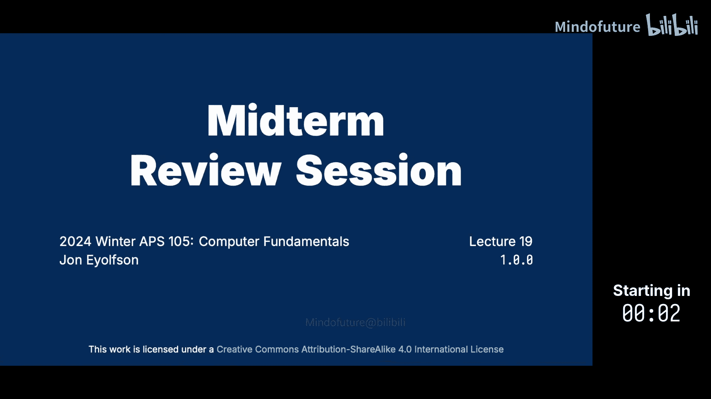
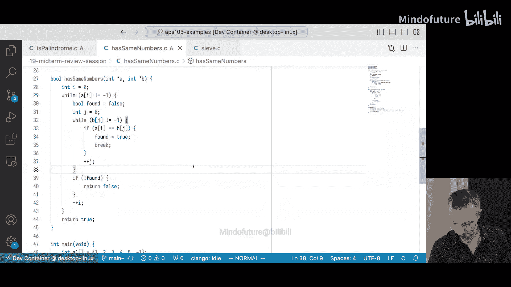

# 【多伦多大学】C语言计算机编程-｜-Computer-Fundamentals-｜-2024-p19-P19_期中复习课--BV1zL6GBwEGe_p19-

。

All right， welcome back to 105。 Trust you all had a good reading week。

I didn't really see any questions about the midterm。

I guess we'll just do more questions unless there is。Something concerning we want brought up， yep。嗯。

なとい。Okay like it's mostly about。Remembering it。Because like there is no like。Yeah。

 so there's a question of like， hey， I saw in past midterms。 You know。

 there's like compiler error warning。 And I have to identify which one is which。

Don't worry about differenting which one is which。 So you should be okay。

 So they were more pedantic for some reason。 I don't know。 We're not that bad， yep。So question is。

 if there is a question where you have to write a program， Can you write a function， Yep。

 you can write a function， sure。Unless。

You might get some alarm bells if they give you like a maine at the top and then an end bracket at the bottom。

 which probably means you should write it all in main。 It's pretty small， but。

So if you're writing a function， you might be writing too much。

 but in general you can write functions， you can do whatever you want。

 as long as you solve the problem。Yeah， allright。 any other questions， comments。

 concerns about the midterm， It is all signed， sealed and delivered。 Well。

 I guess we don't really have to sign it， but。Yeah， it is ready for you。

 whether or not you're ready for it。So any other questions before we continue in the same style and ban as before。

Everyone all studied up， everyone ready， we're going to kill this。So。In general。

 other strategies that you might want to take for the exam， who just owns from front to back。

 probably most people， so。If you haven't tried this before。

 I would suggest working from the back and going to the front。 So typically。

 the hardest questions are in the back。 So it's good to read them first and try and solve them。

 And even if you can't solve them， that's okay。 You have more time to think about it。

 Your brain is kind of a marvelous piece of。😊。

Biology， I guess。 so while you're working on other questions because you've read the hard one。

 you're going to be subconsciously thinking about it and how to solve it。 So when you go back。

 you might actually have a solution from it。 So if you haven't tried that yet at university。

 I would suggest doing that。 That's what I always did。 Most instructors。

 the exam will be like easiest to hardest and you should probably try it from hardest to easiest。

That way， you know， you can get some adrenaline flowing。 You can read the hard question， be like。

 crap。 I don't know anything。 And then you'll feel better as you write more as opposed to like feeling okay and then being like。

 oh， crap。 Oh， no。 And， you know， if you。See， you're running out of time。

 then just flip to the beginning do the easiest questions。

 But I would suggest starting at the hardest one。But。In terms of to do questions。 so yeah， again。

 we're just going through exam questions unless anyone has any comments which there are few。

 but redress them and again， you can interrupt me during this otherwise I will just go through the exam so we did 2023。

 2020， which I guess there are solutions for now and we can do 2022。So。

We can start by doing the simple questions first。 So there'll probably be questions like this。

 Write a single C statement。Generally， when the exam says， write a single C statement。

 they actually mean like just a single like assignment statement or declaration statement or like a function call。

 because technically， like a for loop is a statement， but you can have statements in that and。

You could argue。 So it is a bit weird with the wording sometimes。So for this。

So's write the single C statement that declares a double variable called number， so。

We could go ahead， we declare double number， and then we know that we want to write it equals to something and then a semicolon at the end。

 And yeah， you're going to have to write C code that actually compiles。

 So there's a bunch of different ways to do this。Easest way to do this question is， well。

 we know that Rand returns an int。 and we know like our formula。

 if we want to get like a number range between A and B inclusive， it's like Rand。啊。

Rand minus B plus a minus-1。Or sorry， mod， whoops。Al I already screwed up。So it's ran mod。

 and then A plus B。Oops， plus one。That will give us oh。Wow， I'm。

 I forgot how to do this course during reading week。 Allright， I had one fun day， and apparently。

 I forgot everything。 So that should be correct now。 So to get a range between A And B， it's ran mod。

😊，B minus a plus 1。 and then all of that plus a。 So I wrote that correctly now， hopefully， right。So。

For this， it says。We want a random number in the range。66。6 to 900 or 99。9。 So， well。

 we know Rand returns an int。 So we might want to just make this easier on ourselves and just。

Make the range we want to represent an integer range。 So instead of doing 6，66。6， I can do 666。

 And also， that's like fun， I guess， to 999。 And then I can just take that range and then just divide by 10。

 And then I'll get 66。6 or 99。9。So if I'm doing to do， do that， well。

A or B minus a in this case is 333 plus 1 is 334。 So I could do R。Moud 334。

 So that will give us some number back。 That is 0 to 333。 And then well， I can just plus a。

 So I could just do plus a。 And this case is 666。 and then I could essentially just take that whole thing。

 and then I could divide by 10。0。 that will go ahead， convert it to a double all of that fun stuff。

 Other ways I could write this。 You know， there's more than one solution。 I could do RA。Mude 3，3，4。

Divided by 10。0 plus 66。6， whatever you want， all means the same thing。So questions about that。

So just know， Rand just gives us some random integer back。Alright， question2。

 suppose these are variable types。 Write a single C statement that is equivalent， but is simpler。 I。

e。 with fewer Boolean conditions and relational operators， so。We have to think back。

 There's to Morgan's law that says， hey， if we have something that looks like。Not a and。B。Well。

 that is the same thing as saying not A or not B。So I could use that to help me on my first step to make this a bit simpler。

 so I could say， okay， let's go ahead。 Let's bring that knot in and change。You know。

 not the individual terms and then do an or between them。 So if I do that， I would have not。

X is less than or equal to y or not。Why is？Okay。Is less than or equal to Z？

So that is not that much simpler， but because I'm taking the n of this。

 I can just kind of convert that。 So not x is less than or equal to y。

 not just means it's the opposite。 So the opposite of x is less than or equal to y。

 It's just x is greater than y。And then I can keep the or。 And then I will convert this one as well。

 So y less than or equal to Z is not that is's the same as saying Y is greater than Z。

 So this is my final simplified one boulard equals。X is greater than y or z or y is greater than z。

So questions about that pretty much just says， hey， do you remember？The Morgan law we talked about。

 which。May or may not actually be important for you。All right。Good， good。All right。So， oh。

 so what does the following C program print， So you could probably guess you will get one of these。

 These are another one that just kind of take up time， but shouldn't be too hard to do。So。

So if it's asking what the C program prints。We have to remember that we're going to start executing this program by running main。

 So here we would go ahead and we're doing if。A function called to Armstrong number， with the value。

100 and。52 is true， so I have to do this function call and get the value from it because this returns a boolean。

So first thing Maine is going to do is call is Armstrong number and we're going to pass it the value 152。

 This function will start running， so nu would get a copy of that value。 So in this function。

 nu is equal to 152。And then here， it just declares a bunch of other variables。

 So we declare original nu。And then set it equal to nu we got from the function， which is 152。

Then we also declare remainder and do not give it a value。 So it's to some random value。

 And then we also declare result。Equals to0。So after that line runs， we have。

7 variables in the function。 or whyd I say 7， We have four variables in the function。

So now our execution goes to the next line。Oh， yeah。 And there's a question that， like， what。

 for the previous question， what about like other numbers between。Like。666。

5 or other numbers in between。Don't worry about it。

 We don't have to do anything like that or divide it or do anything weird。

As long as your numbers are in that range and they're always in that range。

 doesn't matter for that question。 So， yeah， don't worry about it。 but yeah。

 you could have points in between。 but this is assuming that， you know。

 it's going to go up by tens all the time。Alright， sorry， back to this question。

 So now we have a wall loops。 a wall original numb does not equal 0。 So currently， original numb。

Is equal to 152。 So that is not equal to 0。 So we're going to go into this loop。

So we're going to set remainder equal to original nu mod 10， which what is 152 mod 10？Just two。

 right？Mod 10 essentially just gives you the last digit if it's all powers of 2。

 So it's divide by 10 and then get the remainder。 So a remainder is going to be 2。

And then our result is going to be whatever the old。

 so plus equal means the new value of result is going to be whatever the old value of result was plus remainder times remainder times remainder。

 so in this case it would be2 times 2 times 2， or what's that 8。So result is going to be equal to 8。

As long as I'm not crazy。Two times two times2， hopefully that's eight。

And then it's going to set original numb。Divide equals 10， which if I wanted to write that out。

 it would be。In the non short form， it would be equal to original nu， just divide by 10。

So that's what that does。 So if I'm doing divide by 10， it's into your division A K A。

 I'm just kind of chopping off the two。 So original nu is equal to 15 now。

And then all these questions will say what gets printed。 in this case， what gets printed is。Result。

So， far。And it is equal to 8。And then we would go check the condition again。

Original nu does not equal 0， So we have to go through the loop again。

 So now remainder equals the current value of original nu mod 10。 So now a remainder gets updated。2。

Wrong thing。 remainderinder gets updated to5。Then we have result plus equals。

The old value of results。 So 8 plus remainder times remainder times remainder or 5 to the power of 3。

 which is 5 to the power of 3 is 125。So it's going be 8 plus 125。 So result gets updated to 133。

Right。Then we take original nu， divide equals 10。 So again， we just kind of chop off a digit。

And then， we print off。Result。So， far。133。Right and then when so we would go after a print check。Hey。

 does original nu equal 0。 No， O， while we're still going through this swallow loop。

 So we get a new remainder。 So remainder now is just simply one。Then we have result plus equals。

 the old value of result plus。Remainder times remainder， times remainder，1 times 1 times 1。

 which is just one。 So we would update result to be equal to。1undred and33 plus 1。 So 134。

 And then original nu divide equals 10。 We update it to just simply 0。 It would print。Oh， yeah。

 that's the camera angle， al right。So results so far。Equals 134。Then we would go back up。

 Original nu is equal to zero now， so we would break out of the while loop and then return if result is the same as numb。

 So numb is 152。 Re is 134。 So is that true or false。我。False， right。 So it is false。

 And let me try and fix this。 Hey， there I am again。 alright。So that is false， so。

Our function call would return。Right up here。So if that's false， well， then I have to go and。

Fall through to the else。 There is an else if。 So I have to do another function call。

 So I have to do it again， But now nu is equal to 413。

So I'll skip some steps here in the interest of time。And。It just prints off some more garbage。

 and it returns false as well。 So then we would go to the else， and then it would just print off。1。

52 and 4，13 are not Armstrong numbers。 And that's a lot of writing。And then questions。

 would one be penalized in the exam for using things that haven't been covered in lecture using binary operators like Bishift or Ternary condition operator。

 yeah， probably， so if you're using those， those will not help you with the exam as written so don't worry about it yep。

Yeah， in 2020， that would have helped with one of the questions。Don't have one of those questions。

 so don't worry about it。Yeah， how many bits are in an integer thing？Yeah， yeah。

 that's why the question is still infamist because。Like， we haven't gone over bit wise operators。

 Hopefully， most of you don't know what those are yet because yeah， they they're。

Fun in a psychotic way。 So， yeah， don't worry about it。Yeah。

 your exam is significantly easier than 2020， hopefully you will not write horror stories afterwards。

Allright， so this says。The following function is called with three distinct characters。

 returnsturn the middle character。If。A， B and C are past as arguments。 It returns。 B。

 rewrite this function。 such that it only uses one return and one if statement。

 So how these questions are written is if it says one if statement。

 you're allowed to like tack on as many else ifs and else's as you would like， so。With this。

You can pretty much solve this one。 It will look something like。You just kind of reduce this and do。

 like。If A is。If A is less than B and B。So if B is a middle character。

 you can write conditions like that then like。So you can just assume that the middle character is a and then write the whole if conditions that need to be true if the middle character is actually B。

 so if A is less than B and B is less than C， then that's one way B could be a middle character。

 otherwise what you might have is C is less than B， and。B is less than a。

So that would be the other case where B is the middle character。 And then you could do middle。Equals。

Be。And then here， I'll just skip some steps。 You could have like an Elsif。Wate your conditions。

To check if the middle character is equal to C。And then you just simply return。

The middle character for the value you created， and this counts as apparently。

 that's just one if statement。And if with elsess tacked onto it， apparently that's one if statement。

 I would argue that one， but I lost that one so。If it says one if statement， just remember。

 you can do that。 And here I would only have one return statement。 So this is kind of like。

 rewrite the code。Allright， let's do this one because this one's fun。

 This one's everyone's most fun topic。Pointers， yay， so。With this。

 what I recommend doing is what I've been doing in the lecture of like writing what is currently in memory over to the side or something like that。

 So here。I could write， you know， what variables are in memory and then what their values are。

 So here I declare。A variable called first。And initialize its value to be  one。

Then I create a variable called second。And then initialize its value to be 2。

 and then I create a array of four integers called data。 And when you write this in memory。

Probably what's easiest to do is just to write each value independently and then just name them by like their array access。

 So if I have an array of 4， that means I would have data 0。Data 1。Data 2。And data 3， because， well。

 the arrays are always zero indexed。 And if I have four elements in my array， wow， that camera。

 come on。If I  four elements， it means it's 0，1，2，3， which gives me 4。

 And then it initializes them in order。 So it would be 10。20。30。40，All right。

 Are we okay with all the numbers so far。So we have what we have six integers in memory。

 and those are their values。So after this， we are going to declare some pointers。

 So the first one is called third。And since it's a pointer， it would just have like some address。

And currently。We initialize it to the address of second。 So how we could represent that is we just。

Point to that。 So we don't need to know what where in memory it actually is。

 We just need to know that we're actually pointing to the value to， and it's。Named second。So。Next。

 we create fourth。Is also some address because it is a pointer。

And it is pointing to the address of first， which is。I guess I shouldn't write over that。

Which is this value currently one given by the variable name first。

And then we create a variable called fifth。Oh， and then we have to do pointer arithmetic。Yay。

 so data。That is the array。 So if we just reference it directly。

 that is the address of the first element。 So data would currently be like this if it was a pointer and then。

First is an integer， and one is an integer。 So we're just going to move that pointer that many integers。

 So first。First is equal to one。 So this would be like one plus  one。

 So we're going to eventually do data。Plus，2。So， that means。If we start at。Data。Which is at element。

Or index 0。This would be data。 This is data plus 1。 This is data plus 2。So。Let's hop over。So。

 fifth is pointing。Currently at data， at index 2。Everyone， okay ish with that。Okay， so now。

It just does a bunch of stuff So here。First thing it does is it de references third。

 So what de referencing does。 Remember， is just accessing the value that it is pointing to。

 So third is currently pointing to， here， let's highlight it。 It's currently pointing to2。

Which is also the name of the variable。 If we dereence it， it means we're accessing the value2。

 And then if we do plus plus， that means we're going to increment it。 So through the pointer third。

 we're going to change this two。2， a3。So are we okay with that？What's you order？Yeah。

 so the question is， if they didn't have the parentheses and it was just like。This。Oops。

 no parentheses。So without parentheses， I'm pretty sure that the D reference is going to go first。

 so it's going to do the same thing as the brackets。

But you shouldn't have to memorize all the precedent rules。

 so they hopefully we are nice and give you brackets otherwise。It's a guess。Becauseuse yeah。

 otherwise， you'd be like incrementing the pointer and then dereferencing it， which。

I guess it's still valid。But， yeah， we don't expect you to remember all of the precedents rules。

 A from like the normal bedmasy ones that you should already know。

And just unary operators versus binary operators always unary have higher precedents。Okay， sorry。

 So for the next one。 So， for this， So we dereence fourth。 So we are accessing in this case。Value1。

And then we increment that。 So it's one plus plus。 So we're changing that 1，2， a 2。All right。

 next line is even more fun， so it says。Data second。So data second。

 So currently the value of second is 3。 So I can say that， hey。

 this is the same as data 3 equals something。 So I'm changing element 3 in the data array。

 and it is equal to。So dereencing fifth will give us the value that fifth is currently pointing to。

Right now。Fifth is currently pointing to this， so it's currently pointing to the value 30。

So this would be 30。Plus first， okay， first is just two。What the value that third is pointing to。

Is three。So。Third is 3。 and then the value that fourth is pointing to is。

 let's follow fourth is also just2。So we get data 3 equals to 30 plus2 plus 3 plus 2。

 which is this changes to 30。Or not 34，37， sorry。So this updates to 37。And then we print everything。

So we print the value of first， so。I'll just write it in here。 It's2。 Second is3， third。

Is going to be whatever the value that third is pointing to， which is currently3。

Then the value that fourth is pointing to， which is currently2。

 And then the value that fifth is pointing2， which is currently 30。Right， and then after that。

It goes through all the elements of in and then prints all their values。 So we would get from here。

 We would get。10 comma space。Then， 20 comma space。30 comma space。And then 34 comma space。

 and then a new line。And then。Verersfully， we're done with this question。Yeah the answer。Different。

I20，374。Sorry。The the answer prints like。欢 this。37。So it changes that index。think体。第二。Yeah。

 it's this， right， yeah， this is the proper solution。So any questions， yeah？Yeah。

 so I just have a habit of doing this， I guess。Given the marking for last， again。

 I wasn't teaching this course last year， but they didn't actually grade if you had a space at the end。

 they don't really care。 so if you want。If you just wrote this。This is fine。

 butt really get the doesn't really test， I guess if you're technically correct because there'd be a space at the end after the last comma。

Yeah， up to you。And about the。So。Oh， yeah， for the new lines don't even bother。

 just write it on a new line。 I just wrote it there just to make sure。我了。Yeah。Yeah。Yeah。

 if it doesn't print in like last new line， it looks the same， right？Yeah， so if this。

 given their solutions， aren't really that panant。Just dont， don't worry about it then。

If you write it and it's wrong， they probably will grade it wrong。

 but if you don't write it and they don't look for it， then your keys grading this are humans too。

 so if you write neat too and it looks correct。Probably they'll market correct。So。

If you ever have a T A， you will probably fall into that trap too。 Yeah， just a human thing。Alright。

 we can probably solve this before。 So yeah， now there's programming。

 So your exam probably looks also similar to this。 There's like a few。What does this code do。

 outline this code， write single statements， again， probably at the front。

 and then there'll be a whole bunch of programming questions that you will have to write C for as much as you can。

So。This appelenrome is a word， number or phrase， or any sequence of characters that read the same forward and backwards。

Given the sequence of characters of a char type array named sequence and the size name size。

 complete the definition of the function is palindrome， prototype of which is given below。

It should return true if the sequence of characters it makes is a palindrome and false otherwise。

 we assume that the array has at least one element。 I。e。 size is at least one。So for the example。

 if the sequence holds know the character's radar， then your function should return true because while it should。

 you can kind of see how this works。So it's a palindrome if we start from the first character and it matches the last character。

And then also the next character matches the second last character。

 And then turns out for poundtome doesn't really matter what the middle character is， right。

 if it's an odd number。Doesn't really matter。 So this could have been an。

This could have been a D could have been any character doesn't really matter。So， and。

We could also just reverse radar， it's the same。And that says， however， if the sequence is holding F。

 L A G， then your function should return false because。

Gulf is not the same as flag for an array with only one element， it is considered a palindrome。

So if it just has one element。It should be a palindrome and this one is not because， well。

 if we look at the first character， it's an F， and that is not the same as the last character。

 So it's immediately not a palindrome。So。The way to think about this is， well。

 when I went through here， I kind of checked the first character。

 then checked it with the last character， and then I just went through that until I made it to less than half of the array。

 and if all the match then it is a pollindrome。So since we know the size and everything。

There's lots of ways to write it。 The solution given has。A lot of。Weird things。

 but we can probably write this a bit more simply。 so we can try。So，4。And。I equals 0。

 so we need to start at the first character， and we don't have to go through every single element of the array。

 We can only， we only have to go halfway。So we can go until I is less than size。Divide 2。

And then do plus plus I。So we might want to think about this array bound quick。

 because while we know that。If the size is1， then it should be considered a palindrome。If size is 1。

 what is size divide 2？0， right。 So that would be I is less than 0。 If I starts at 0。

0 is not less than 0， So we wouldn't have to do anything in this loop and。

If we don't have to do anything in this loopop， that's probably a good thing in this case， because。

If it's only one character， it is a pound drone。 We don't even have to check what it is。

 It doesnn't matter what the value is。 So we might think that。

We need to return if it's a poundro or not。So in this case， we could just simply return。True。

And then in this loop， we can just check that if it's not a poundinro， we can just return false。

So in this case， if the size is one， then this for loop would never execute no matter whatever we put here。

 So nothing would happen。 It would just return true because it is a pound drone。Itよ。For again。Yes。

Yeah， so for the for loop， remember， if we like deconstruct it as to how it flows。

 it always goes like the initialization happens。So this part。And then they'll check the condition。

 and then it'll do the body of the loop and then do the increment after that。

 and then check the condition again。So。In this case， all we have to simply do is check well。

 the current character。So， if。Sequence。I， so that's like the current character。

 Let's take the example here of radar。 So for radar， size would be equal to 5。

 So we know that if size is equal to 5， well， I need to check that。If the array。

Zero is equal to array at4， and then if array 0 is equal to array at3。

So I can use that example to help me with what。Indexes should be。 so for the first。Part。

 I'm going to check I equals to 0， and I should compare that against 4。

 So if I want to get 4 knowing the size and what I currently is。 Well， the index I should use。Oops。

It's just going to be。The size。Anyone help， what should the NX be yet？Yeah， size minus I -1。

So in this case， the size is equal to 5。 That's 5 minus I， which is 0。 Okay，5 minus-0 is just 5。

 and then -1 that gives us this。So this would be this check。So we can go through， check if。

In this case， what we're looking for is if it's not a palinrome， then， well。

 we don't have to do any additional checks， yeah。Itベ。先生ガガガ。佢未你。Car people to here。Yian。反正啲就。搞哋呢个就。

你买啲咩。Thank you。There。We don't have to make it that complicated。 So all we have to do here。

 check if the characters are not equal， if the characters are not equal。

 then I can simply just return。False， I don't have to check anything else。

So next time through this loop in this example， I would be equal to。1。So in this case。

 I'd be comparing。I index 1 to size in this case， size is still 5，5 minus I， so 5 minus-1 is 4。

 minus-1 is3， so my indexes check out here and then I would check if they are not equal to each other if they're not equal to each other then it's not in palindro。

 otherwise I go ahead and I check the next one in this case size divide by 2 is simply well if we wrote it out。

 it would be 2。5， but since it's integer division its simply equal to2。

So now trying to go through the loop again， we would get I equals to2， but2 is not less than2。

 so that's false。 So the four loop would exit， and then we would just return true。

 We have checked every characters and it is definitively not not a poundrome。

 so it is definitely a poundrome， so we just returned true。 so we can solve it with just a few lines。

All right。Any questions for that， The solution is way longer than this。For some reason。Yeah。

 so the solution。 So there's lots of different ways to do it。 Like what you said。

 you could have two numbers and adjust them and。You know。

 have a high and a low and try and get them to be equal to each other and like work inwards。

 lots of different ways to do this。 This is just the first way I thought of。 and it happens to。

 you know， not take that much code。So to do just so you have it。In the recording。

 if you want to pause just for a correct version。There it is， you can pause so you have it。Alright。

 next question， because we have8 minutes now， alright。Alright， skip that one that will take too long。

 Allright， there's a triangle question。 So you'll probably these seem to be very common。

 So we did one way before the midterm。 So this is the same idea。 There's going be three lines here。

So， we have this。There's four lines here， this， this， this。And this。

 so you're just going to have to come up with formulas for each of the lines。

Figure it out from there。The only twist for this one is it's in a big while loop。

 you just do this over and over again。All right。All right。Let' see if we can speed around this， so。

Complete the definition of the function has same numbers。

 The prototype of which is shown below takes addresses of two arrays with unknown lengths。

 Each arrays last element is marked with a negative number。

 The remaining elements contain positive integers。 if the exact set of integers exist in both arrays Otherwise。

 the function returns false。 The numbers can be in are any arbitrary order in arrays A and B。

 There are no duplicate elements in each array。 you can safely assume that there is at least one element in the array。

So there is lots of ways to do this one too， so the solution like will count the number of elements in the first array by like counting how many elements there are until it hits negative1。

 then count how many elements there are in the other array until it's a negative one for that。

 whoever ask for a function before if you do that maybe a function helps you with that because you don't have to write two four loops。

 but turns out you don't actually have to count。How many things are in the array？So。

If you are trying to do this。What you might think？This also says like unique。 So basically。

 the thought process is this for all these。 you can just kind of。B。

 they're mostly designed to be like brute forest。 You don't have to think too hard about them。

 And whatever solution pops into your head。 Hopefully it is close to being right。

 So the solution that pops into my head is for this is， okay， well， I will go through。

Each element of the array A。And then check if I can find it in the array B。

 and then if I can't find the first element， then I know it's not there。 I can return false。

 it's not there。 I'm all good。Otherwise， I can just keep on going through and just finding the numbers and then trying to look it up in the other array。

 And because they are unique， I don't have to worry about duplicates or anything like that。

And it makes the problem a lot easier。So。What I could do in here because。

I don't know how many elements are in each array。 So I can't really use a for loop。

 But what I can do is I can use a while loop。 so I could say。

If I want to iterate over every element of the array A。I could just say declare in I equals0。

 and then I could have a while。A at I。It not equal negative one。

 because if the current value is negative 1， that means I'm at the end of the array and I don't want to use that character。

So I could write that for my while loop， and I know that will。

Im doing this for every element of the array， and at the end I could just make sure that I don't forget to increment I each time。

 so I'm iterating over each element of the array A。So with that。

 that will go ahead and iterate over every single element of the array。

 And then I want to find the current value in the other array B。So。

If I'm writing this out while thinking， I can be like， okay， well。

 I have to iterate over every single element of B trying to look up that same value。 So same idea。

 I would have a nested loop。I might call the index I use for Ray B， just J。

 And then I could have while。Ohoops， B of J。Does not equal to negative1。Plus， plus J。

And in this loop， I'm trying to look up and make sure that， you know。

 I can actually find the current value of a in the array B。 So what I would like is if。

A of J is equal to B。So if that's true， I found the element， I don't have to do anything else。

 I know I found the matching number in the other array。

 so I don't have to look any further and I know that I have indeed found it。

Typical technique for like looking for an element in the array and then making sure you can find it or not is just to declare some boolean called found。

And then you initialize it to false。 This is just a trick that if you've been seen enough of these questions。

 you'll kind of know so I can initialize it to false。 and then。If I actually found a match。

 I can set it equal to true。And then if I wanted to， I could also do break here。

 It turns out you don't actually need the break， but。

No use iterating and checking other elements of B。 if I've already found it。

 But turns out you don't actually need that。So you can choose to leave it out if you want。

And then here， I all I have to do is check if it's found。 So if it's not found。

 I know that the two arrays are different so I can simply return false。Otherwise。

 if I make it through iterating over every single element of A and looking it up and finding it in B and I find a match for everything。

 then I'm all good and I know that they are the same so I can just return true similar to like that is paldrome thing where I go ahead and I check them all if I can't if I can't disprove it at the end。

 if I check them all and I found them all， then has to be true at the end。

 So just so you have it real quick， here is the solution so you can like pause and read it just in case you can't read my chicken scratch writing。

Again。Try and write better than I do on this and like leave room between lines so you can go ahead and add variables if you need to or something like that。

 So， yeah。Back。So this does not explicitly check if they're the same size。

 but since there's no duplicates， it will handle that case as well。So if they're not the same size。

 it means you can't find a match for everything， right。This handles that because they're all unique。

Alright， any other， well， we're out of time。 So any other last last things。

 there's like office hours tomorrow right wait， I guess they're not because they start when your exam starts。

 So yikes， all right， so I'll be on Discord。 I'll probably be yeah。

 I'll be on campus early in the morning if you want to try and swing by my office or message me on Discord or let me know and I am here to help。

 But good luck。 and just remember， boom for you。 We're on this together。😊。

