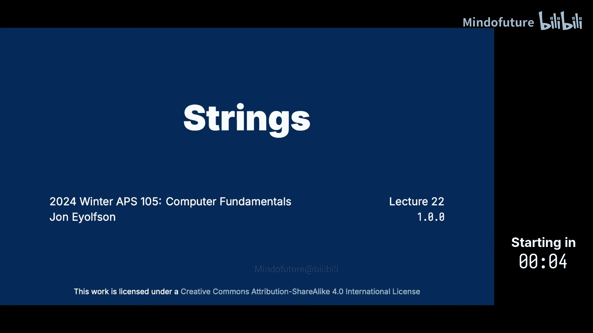
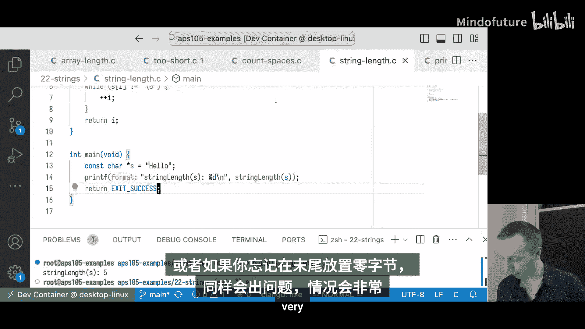
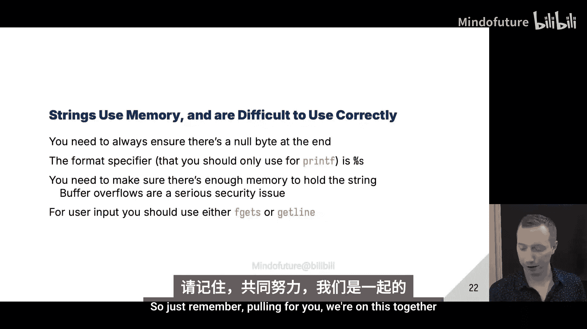

# 【多伦多大学】C语言计算机编程-｜-Computer-Fundamentals-｜-2024-p22-P22_字符串--BV1zL6GBwEGe_p22-

。

Alrighty， welcome back to 105， so today。We get to talk about strings， finally。

 it only took us like halfway through the entire course。

So let us jump right into it because they sure introduce a lot of fun that we get to have。

So a string， just an array of characters。And kind of like the exam question。

 what I did before where I just had like a variable number of integers。

And all my arrays were different sizes。 I just put a -1 at the end to indicate that that is last element and to not include that。

Same thing for strings so they're an array of characters and then C will go ahead and add a zero byte or just the character slash0 It's going to be the literal value of zero because remember characters are just some magic numbers and for the purposes of this course we're just going assume that they're asking included strings so you can go like ask table。

 co if you ever want to look up their value for some weird reason basically they're just characters represented on a US keyboard because while they were the first ones that did it so they got to name everything so。

we've already seen strings before， but didn't really know enough to actually explain them。

 So string literals are the array of characters between the double quotes。 So， for example。

 if I have double quotes hellello world and then double quotes， that is a string literal。

And it is an array of characters。 The only difference is that it is one bigger than it looks because there is a0 byte at the end to tell you that。

 hey， that is the end of that character array。Other fun rules are that C， well。

This string literal is actually stored somewhere in memory and the bytes used for string literals are actually stored in some place called read only memory。

 which means if I try to modify it， I'm not allowed to and I will get a segmentation fault and that will be a lot of good fun to debug。

So。If you write a string literal， the result of that string literal is a pointer to the start of the string and。

All we need to know is that a string is an array of characters that ends with a zero byte。

So in other words， I can actually tell you now the type of a string literal。

 it is technically const char star。 So it's a pointer to a character。

 and that can represent an array。 And this const here says you're not allowed to change the characters so I cannot reassign individual characters。

 So just remember pointer like array decay would apply in this。

 and then it represents an array of characters。 Const again means we cannot assign the individual char characters。

 So we will see an example of it really quick。 but first。

Little thing to know is that there's a format specifier for C strings and。

If we want to use a string and something like print F， some of you have discovered this already。

 some of you may have not， the format specifier is just percent S。

 so S stands for string kind of one that makes sense。So if I do print F string， space string。

 and then a new line， while the first one gets replaced with Hello。

 and then we get a space and then the next one gets replaced with Hello with World。

 so I see hellello world and then a new line。Sorry。Oh， whoops， yes。

 there should be a comma right here。 I will fix that later。 Yes， yeah， there should be a comma there。

 just like any other print F。So。C goes ahead， prints all the characters in order up to and not including that zero byte。

 so this would be like H E， LL O and then a0 byte， but C is smart enough or the way they defined it is that it will not include that zero byte as part of the input and。

You might be tempted to use percent S in scan F。We will go over why to not do that because that is a。

 as we will see soon， a terrible idea， and in order to we had to understand dynamic memory allocation before we can actually say that it's a terrible idea。

So， first off。So。If we go ahead and run this so I'll have an example so you cannot modify values that are part of the string literal so if I have like chart like pointer to a char and I call it S and I assign it equal to the string literal hello world Well the string literal is a pointer to the beginning so S is a pointer to the beginning the capital H and I can go ahead and use it as an array if I want it can do all those pointer arithmetic。

Then if I try and do access the element at index 0 and I try to。

 let's say I try and make a lowercase here， I am not allowed to do this， so。

If I go ahead and I compile this program。And then I try and run it。It compiles fine。

 doesn't really complain at you。 But if I try and run it， I get a segmentation fault。 Yay。

 my program dies immediately and。You know， we saw velgriin before。 maybe it can help us out。

 So if we run that。It says process terminated with some things we can't understand。

 bad permissions for something。Just a lot of gibberish for now， but basically says line 6 failed。

 I'm not allowed to write to it。So。I will show you something you could do to actually turn this into compiler error。

 So we know that， hey， this is read only memory。 It's like Kant char star。

 So if I actually just wrote a cons there。Then I actually get a compiler warning here。

 And it says error cannot assign read only location S。

 And we get a compiler error instead of a segmentation fault when we run it。

 and we can actually go ahead and debug it and things。Act a lot better。

One thing you should definitely do is if youre assigning like a pointer string literal， you should。

Use the type Ks char star so that you don't accidentally break that rule where you're not allowed to modify it。

 So everyone good with that。So everyone， if I use a string lital， I will use Kants char star。

 and then that will save you a lot of headache。So。There are some strange rules for it， but here。

 like I said， you should use Kants char star for string literals。

But it turns out you can just create an array in a function。

 and then you can modify that string because there are special rules。

For when we use something like char， like if we define an actual array and when we define an actual array。

 those bytes are on the stack， So they exist as long as our function exists。 so they do not。

Apply or this read only rule does not apply to them。 So if I say like char S， and then an array。You。

 I could just。Write out the array initializer myself put in values。And then that stored on the stack。

 I'm allowed to modify it。 I'm allowed to do whatever I want for it。

So there's a special rule for string literals。 So if I say。Char star。

 and then the empty brackets for like C， please figure out the sizes array for me。

 And if I do equal to string literal， C will go ahead and then copy all those char values to that array。

 and then it will be on a stack。 And then you are allowed to modify it。 So if we do this。

So all I did， I changed the declaration of S to just not be a pointer。

 so it won't point to that like readon memory， I create an array and I go ahead and assign it equal to hellello world it gets copied and then because it is a copy of it and it's on the stack I can go ahead I can modify the values to whatever I want so I go to index 0 which is this capital H I change it to a lowercase and then suddenly I lowercase everything so if I run that oops can modify。

I get the lowercase hello world， so questions about that。Yeah， like that would be a point。Yeah。

 in the previous example， when I had here， this means that。

I have a pointer to a character that I cannot change。 And what about you make。Make a point here。Yeah。

 so there's a good question here。 Like， there's two things I can't modify， right。

 There's the pointer。 and then there's what the pointer is pointing to。

 So you are allowed to use cost in different ways。 So it turns out that if I want to like。Here。

 I could say。Whoops。Say， do const。Chahar T equals。Test something like that。 I could do S equals T。

 That's perfectly fine。But if I do。But。That means I'm not allowed to change the pointer and I'm not allowed to change what it's pointing to。

And。I'm the right person ask for that， because that was。What I did for too long。

 And no one really knows these rules。 So don't worry about them too much。

 People that have been programming for years don't really understand it。 Just know。

Just write this for string literals， and the compiler will complain at you instead of seg faulting。

All right， so here is this example， I declare it on the stack， I modify it。

 so I'm changing this capital H to lower casease。Perfectly fine。I'm doing it on the stack。

 everything we've learned about arrays。Still apply， I could iterate over it。

 I could use that macro for a rate length。All that fun stuff。So。If I use that array length macro。

 C knows how many bytes to copy from the string literal。

 So if I do like that char star array or sorry， that char array called S。

 and I assign it equal to hello， the array length is 6， not 5。Because well， there's five characters。

 So H， E， L， L， O。 And then because it's a C string， there's always a null by。

 So there's always a0 byte at the end。 and it gets copied as well。 So the array length is 6。

 So this would be the exact same thing as if I just did cha， char。S， which is an array。

 And then I set it equal to the characters H， E， L， L， O， and then backslash 0 to get a literal 0。

 yep。Sorry， like if I just did this with char Star。No， so if you took this to chastar。

You would have this example like you'd be equal to a string literal。

 and then that points to read only memory。Even without the comps， yeah。

Before it didn't have a cont here， right， But it was to read only memory。

 So when I tried to modify it， I got a segmentation fault。So a little weird behavior here， but。第二。

Think this way like。Yep， and you're saying like still like that。Lets go。that。And then。And then。Yeah。

 so the question is bit of an implementation thing。 So if I just have this string literal。

 is it still stored and read only memory， And the compiler just copies it for me。

 And the answer to that is yes。 So it would get， it would get stored in read only memory。

 compileilr is also smart that if you had like。Like 10 string literals that all said hello。

 it would only just make one of them， yeah。But that's more of an implementation thing that。

That's like a compiler course， how a compiler works。 We don't really care。 We just hope。 So a。

 questions about this， yeah。Why we need what？So why we need the null bitete is because well。

For like the print F function， we just give it a pointer， right。

 We don't say how many elements are in it。 So what they decided is instead of you having to say how many elements are in the string。

They've just put a zero byte at the end， and that means the strings done。

So in this case I don't need to know that the length is5， if I want to print the string。

 I can just print the H like just keep on going while I don't see a0。

 so I could just say print the H， print the E， print the L， print the L， print the0， oh， it's a0。

 I should stop。And we'll see where this gets us into problems。All right。

 any other questions with that？All right， so。If we go ahead and just create a larger array。

 so if I did。Chahar S 8， and then hello。 So hello is five characters plus a new line。

 So I only need 6。 but the same rule applies as before when I had things shorter when I did it with 2 D arrays。

 same thing with 1 D arrays。 So if I say this， that's equivalent to it will just pad it out with zeros。

 So if I did that， the last three elements would all be 0， it's just all zeros at the end。

It turnsurs out doesn't really matter because it wastes a bit of space， but。

Like the string still works。 So it would just be H， E， L， L， O， Oh， I hit this0。 I'm done。

 I wouldn't access anything anyways。 Does't really matter。 Just wasting space。So。Like I said。

 just stops when it hits the first zero， others don't matter。That's okay。

The other problem is a much larger issue。So if I have a smaller array than what can actually hold it。

 that causes issues。 So if I have cha S 8， so I only hold8 characters and I have the string hellello world。

 Well this is H E or 1，2，3，4，5，6，7，8，9，10， and then 11 for the nullbyte。

 So it would be a lot bigger then just 8。 So if I go ahead and run this。 Well。

The only thing that actually gets copied to this array is hello wool。 So the first eight characters。

 and it wouldn't be， it wouldn't have a new line or anything or sorry。

 it wouldn't have the nullbte or anything like that。 So it turns out。When I execute that。

I just see random stuff after it， right？I'm essentially reading invalid memory。

 So this print F function will just keep on。Printing out characters until it hits a 0。

 turns out that in my array， I didn't have enough room to put a0， So it just didn't exist。

 So it will read。The first eight characters and then just reads random memory until it randomly reads a 0。

 and then it stops。 So in this case， I wrote read a。Til whatever the hell that is， back tick， thingy。

 And then a bunch of question marks。 And then if I run a few times。 Oh， I got some question marks。

 any the time I see question marks， it's basically it doesn't know how to print it。

 It's not a natural character。 So I just get like random。 Oh， I get some really strange one。

 sometimes like an amperserson M T。I'm just reading random memory， so it's all nonsense。

So this is one of the major reasons why strings are hard， because if you forget that null bitete。

Things just go off the rails really， really， really quickly。 And， you know， Valgin is your friend。

 So if I tried to run that。It would also tell me that。Oh， in fact， Valelgrain doesn't really care。

 It thinks it's all good。So turns out it's even harder because in this case。

 because we didn't malloc it or use dynamic memory。 Valgrain doesn't care。

 It thinks you know what you're doing。 So if you don't get any help。 You just get some weird output。

So。Knowing that we can write our own functions that use strings if we want。

 so if we want to write a function to count the number of spaces。

Looks pretty similar to how we wrote functions before， so we can just take a consed char star。

 so that is the string。 We're going to count the number of spaces in， declare a variable count。

 So that's where we're going to keep track of how many spaces we have encountered and then in our while loop while we just keep reading characters until we read something that is a zero。

 So as soon as we read a zero。 we want this to be false and go off and the while loop。 So。If we just。

Dereence it。 That is the first character of the array。 So in the case that it is hello world。

 we'd read a capital H and then dereence it again， check what the value is， is the value of space。

 if it is， we'd increase count oh， in this case， it's capital H。 So we wouldn't。

 And then we do plus plus S， which would do pointer arithmetic right So that is like S plus1。

 So that would move that pointer1 character。 I'm just doing pointer arithmetic just for the fun of it。

 And then I move one character， And then I dereence S again。 So now that's the second character。

 check if it's。Equal to the null byte。 If it's not， check if it's a space and increase count。

 In the case， it would be E。 So when go into if， it would advance， go to the next character。

Read an L， not a space， L， not a space，0， not a space。 Oh， space is a space。

 So count would increase to 1。And then we'd read all these characters。

 Last character we'd read is a D， and then we would increment the pointer。

 Then we're pointing at a zero byte。We would dereence it， and it turns out 0 is equal to 0。

 So this would be false。 And then we would stop。 We know we're at the end of our string now。

 and then we can return count。So。Any questions about this？Program at all。So。Like I said before。

We don't need to know the length of the array because we know when it ends。

 because we encounter the null bitete and that should signify it ends。

 and we don't consider that as a valid character otherwise。Everyone good with that？

Not too much different than what we've been doing。 I could write that a bit。

Differently if I wanted to。 So this uses pointer arithmetic， might be hard to read。

 So we could also count just the number of characters in the string。

 So maybe I write a function called string length that just counts the number of characters in the string。

 that does not include that null byte。 so I can just。De clear variable called I， Ill use as an index。

 and then I can just have a while loop that just says。

While S at index I does not equal to the nullbyte， I can just increment I so I can just increase my index by one。

 And I just keep on doing that until I actually encounter a。Noll byte。 And then well。

 I is actually equal to the size of the string By the time I exit this function。

So if I use string link with hello， it would。Increase it。 So we would start with 0， En the H。

 then increase it to1， En the E， increase it to 2， En the L， increase it to 3，4， increase it to 4， O。

 increase it to 5， and then we'd be done so。Go back。So here's our string length program。

 If we give it hello， should work。We execute it。 The length of the string is 5。So。

5 characters in the string， but we need 6 to store it， right。

 because there always has to be that null bite at the end and。

Keeping this in mind when you use like library function。

 use other people's functions is going to be very， very important because if you miss that nullbyte。

 then it just reads random memory and you are in a world of hurt。

Most of the designers of this really really regret making sea strings work like this。

 because it has caused。Many， many， many a security issue because you just。

Forget that you need one more bite than the length of the string and you're screwed。

 Or if you forget to put the zero bite at the end， you're also screwed and life is very。

 very difficult。

呃0。

So。Let's go into。Some other function。 So there's another function called put S that we can use instead of print F if we want。

 So put S is a bit easier if you're just doing string。 So it just takes a single string argument。

 So you could use put S S。 And that's equivalent to this exact same thing as if we did print F。

Format specifier for a string， and then a new line and then gave it the string。 So it will just。

Go ahead and print the string directly for you and then put a new line at the end of it。

 So you don't have to remember to do it。So other things that we might want to use print F for is you could use like the turns out the rounding that we used for。

Doubles actually works for strings， but it just kind of prints the first few characters。 So if I do。

 if I declare a string S。Equal to hello world， if I do put S。

 that should just print out hello there and then a new line。

If I do print F with just the string format specifier and N， and I do some pointer arithmetic here。

 So this is S plus 6。 So it will move forward 6 characters。 So that pointer。Well。

 S initially would point to the first。Character， which would be the capital H。

 And if I move at 6 characters， Well，1，2，3，4，5，6， that would have a pointer that starts at the T。

 So it would print all the characters starting at the T until it hits a null byte。

 which would be at the end of the string there。 So this line should just print there。

And then similarly， if I do。This format specifier， but I do like。

Point5 like round the string to five decimal places seems a bit strange。

 but I guess they consider rounding a string to five decimal places is to just print the first five characters。

So that will just print the first five characters， which would be H E LLO and then stop immediately。

So if I run this， I would see。Hello there， then there。 and then hello all on separate lines。So。

Everyone all right with that， ish。Rounding the string seems weird， but it works。

Might be useful to you， might not be useful。Allright。

 so now we get into the scanF so I put right on this slide red means I'm serious and you shouldn't do it。

 so we could， could， but should not because it is impossible to write a correct program using scanF with strings so some rules with it it might seem appealing at first scanf。

 it'll ignore some white space before the characters。

 the user enters so if you write like spacespace space John and then hit a new line you wouldn't get any of the starting characters you just get John。

And matches any characters until white space characters。

 So it doesn't matter if I do like enter or spaces。 if I did spacespace， John。

 spacespace space enter， it would just be John， just those three characters。

 And it also does this a solid， and it will terminate that string with a 0 byte。

 So itll be a valid Z string。But。Yeah， but the string produced won't have any white space characters。

 but turns out this function is impossible to use correctly because you don't know how much memory you need。

 right， you have to give it a pointer， you essentially have to give it an array。

 an array will have a certain size and you have no earthly idea how many characters the user is actually going to enter。

 even if you make it 1000。 Well， as soon as they enter。

Turns out exactly 1000 because it wouldn't have space for that null bitete。 Then you are screwed and。

You will never know so。Let us use it， because we can see that it is a silly thing to do。

So here is my program。 So here just to。Simulate us having a more complicated program。

 I'm just going to define an integer called X。Make it equal to 1，2，3，4，5，6，7，8，9。

 and then I will never modify it。 and I'll just print it at the end。

 So the last print I should see is x 1，2，3，4，5，6，7，8，9， correct。Alright， so let's see if that's true。

 So here I will say prompt the user input your last name。

 and then I will just create a array of four characters so I can only hold four characters in this。

 and then I will do a scan F。 and then I will print off whatever is in that array。

 So if I go ahead and I run this。I said my last name。 and let's say that， I don't know。

 I can't read for some reason。 I just did John， if I run that， well， that's fine。

Because John fits in it， that is three characters and a nullbte， so it's exactly four。

 it exactly fits into it， it's all good Prince John and then x is 1，2，3，4，5，6，7，8，9。 Well。

 John's not my last name。So if I run this， I type my actual last name。

I get the correct string because it does， it doesn't know how much memory you set aside for it。

 It always assumes it's valid。 So it put Eson and then a null byte。

 But turns out the memory that it used for that was X。And it just changed the value randomly and now。

Imagine debugging your program now。Oh， yeah。 Good luck。 You are screwed。 Nice thing about this is。

If we run velgrind on this one。Let's see if it helps us。Yeah。

 it turns out Valgrin doesn't help us either because， well， again， we declared it on the stack。

 Valgrin doesn't really care about anything you do on the stack。 So if I wanted to。

 I could probably get some help if I did something like this。 And I just malllocked。F characters。

And of course。I freed it。And then， I did size of。So if I do that and run it。Well。

Turns out I'll just over I'll like overwrite some other like random memory in the heap。

 and it will probably actually work this time。And yeah， I'll see Elsson and then X unmodified。

 But if I look at Valgri， it tells me。It's very unhappy。

 like it's destroy throwinging a bunch of errors after errors after errors that are quite unreadable。

 The only thing we need to know is that like invalid read， invalid read， invalid read， invalid。

 right， invalid， right。 That's basically telling us that， hey。

 we are accessing memory that we shouldn't。 This is like we're accessing invalid memory。

 and the rest of it is fairly incomprehensible。So。Let's rewind。

 So more of the story is that basically scanF impossible to use correctly。

Do not use scan F with strings。 if you see this。That is not good。So what should we use instead。Well。

There's a put S function， while there's also a get S function。

 so that reads all the characters until a new line， but it doesn't keep the new line character。

Issue with this is the same as with print or scan F with just the string format specifier。

 There's no way to know that how much space we need to actually store what the user inputs。

 And that issue is actually called a buffer overflow。

 And that has cause so many security issues and billions and billions of dollars over。Over the years。

 So what that term basically means is that the space and memory you set aside to store that user string。

 typically just some space that we're going to use to store something the user inputs is called a buffer。

 So basically just means some memory I want to set aside。

 and then recall the memory we intend to like。Use for that function， a buffer。 So in this case。

 we're using S or git S。 So we give it some memory。

 We would say S is like a buffer because we want it to write to that memory and because it might write past the end of the valid section of memory。

 then it is called a buffer overflow。 So I wrote past the number of bytes I actually allocated for it。

So there's another function that is slightly better called Fgit S。

 So Fgit S actually allows you to specify the size of your buffer and it will actually check that it fits or it only writes up to that many characters and it won't overfill that buffer So its API is well it takes a string that it pointer to a string that should be valid memory So an array of characters that it can actually write to and then an size so how many characters is it actually allowed to write and that will include the nullbyte and then there's this weird file thing we haven't seen before that's called a string that this basically will work with files on your hard drive if we know how to do this。

 but there's a standard one that kind of represents your terminal So string pointer to a point。

Of size bys a valid memory because a character fills1 by。

 and then size is the integers representing how many bytes to write at most by this function。

 So if the user inputs something that is larger， it will just go ahead and ignore it。And then。

 stream。In order to represent the terminal， there is a variable declared for you in one of the header files called STD in or standard input is what it is short for。

 and it represents terminal input declared in STD。IO， so you should just use that。

So the produced string here will always have a null byte。

So remember that the size includes a null byte， so there could be at most size-1 characters in the string。

 So if I set aside four bytes of memory， well it can use three of those for the actual contents of a string and then a null byte at the end。

So， if I go ahead。And I use。Oops。And I use F Git S。

 This is what a program would look like that uses it。 So in order to not repeat myself。

 I'll just define buffer size as equal to 4。So I'll prompt the user again， input your last name。

 declare a array of characters on the stack of size in this case4， and then I can use F git S。

 So I give it a pointer to the start of that array。

 and then I say n is equal to the buffer size So use at most four bytes because that's all the memory I have that is valid and then we use STD in to represent actually just typing something on your keyboard。

 and then we just print F whatever the string as we get。So now if we use F Git S。

 I input my last name and I actually input my last name。 Well。

 then I just see E Y O because that's all that fits。 So I only have four Btes for it。

 I can only store three actual characters。 The rest gets cut off， so。

Maybe this is something you don't expect but。You know， this is something you can actually fix。

 something you can actually debug。 And you know， if I wanted to。

 I could go ahead and just increase this。If I change this to an eight， could I input my last name？

Yeah。No， my damn last name causes problems all the time。So if it's only 8， so my last name is 1，2，3。

4，5，6，7，8 characters， but again， needs that new or needs that nullbte at the end。 So if I do that。

 it's elfso and。I was so close， that's my username here， El and then the number。

 I almost got my last name， kind of disappointing。All right。So any questions with F git S， yeah。

Thanks so。So the question is what is STD in， according to this， STD in is STD in。

 you will actually learn what it is in the operating system course。

answersw is it depends what operating system you use， so if you're using Linux or Mac。

 it is equal to zero。おゼロ？But you don't need to know that for this course。

The story is way different on Windows 2。All right， any questions about F git S？

So the only one that works， you should not use scan F。

 you should not use print F or put S with strings。Another one you could use that I would probably recommend because it does a lot of the work for you。

 Actually， it does all the work for you is you can use something like Gitline it looks a bit intimidating so its API is Gitline and then char star star a pointer to a pointerright we've seen this before。

 so it's a pointer to a buffer and then it takes a size T which is like a size pointer So that is a pointer to well size T is basically an integer that is a different size depending on your machine and then it takes that same file stream。

So the nice thing about Giline is it will malloc memory for you。

So it will malloc memory for you and tell you how much memory it has actually mallloed。

Turns out why it needs a。Char star star is because well you just use a char star。

 which is just like a pointer to somewhere。 And then you can just like if youre using scan F for other things。

 you can just give it the address of the pointer and it will go ahead and update the value for you。

 it will do malloc for you and make sure that whatever the user types can actually fit so you don't actually have to。

Think about malloc at all。 Think about how big it has to be。 Do anything like that。

 This function will do all of it for you。And what it will do is it will match the entire line the user enters。

 including white space and ending in a new line。 So you might have to do something with that line if you want to use it for anything。

 But the good thing is you get every single byte and then you can choose what you want to do with it。

 So it will return the number of characters actually written and that is excluding the null byte。

 So it will tell you essentially how big。Was the string that the user inputted？So。

 we will finish today。Well， after a summary， we'll finish it with giline。

 So looks a bit intimidating， but basically how it works is I can just declare a pointer to a char。

 And then instead of doing malloc and then guessing a size， I just set it equal to null and I say。

 well。This takes up zero bytes， so I initialize size equal to0 and then forget line I give it the address of S and then the address of sign because it will modify those for me so it will malloc and then whatever pointer it gets through malloc it will write it to S so S will point to something and then the number of bytes we are allowed that are valid are stored。

 it will store in the size variable and then we're reading input from STD in and it returns the number of bytes we actually inputted。

So。It will include the new line and stop at a new line。

 So if I want to just get rid of the new line well。

I could just take the number of bytes written and then -1 to turn that into an index。

 And while I know the last byte it matched was a new line。 So this is the index of the last byte。

 and I just change it to a0。 So I just overwrite the new line character by a 0。

 and then I don't have a new line my input anymore。So now if I want， I can output all of these。

 So size will be the how many bytes are valid to use through the pointer S， and it malls it for me。

Then the number of bytes that actually match that the user actually inputted。

 And then the string with the null byte that or with the null byte。

 And I got rid of the new line character。So the only caveat with this gi line function is that it called malloc for me。

 So when I'm done with that memory， I have to be good and I actually have to free it。

 So here I free S。 so I have to remember that I have to free it because I'm not the one that malloced it。

So if I run this now。The get line function just waits for you to input something。

 so if I input John and then a new line。Well。Turns out it grabbed 120 Bs of memory for that。

 didn't need all of them， but didn't really hurt anything。 And then Btes written was4。

 So I entered four Bs of information。 J O， N。 and then the new line character。 like when I hit enter。

 So that counts。 and then。In this case， bys written was 4。

 So the new line character would be at index 3。 So that's what this did right here。

 If I didn't have this line， it would have a new line。

 and I'd have a separate new line at the end there。 So if I went ahead and。Commented this out。

 Then it would have said it wrote 4 Btes。 It would be J， O， N， and then a new line。

And then if I go ahead and I print it。Well， it would print with the new line here。

 And then I see an empty line here。 and it looks a bit ugly。 so I can go ahead。It's a valid string。

 so it would put。They would do J O N， new line， and then a null byte。

 And if I just go ahead uncomment this， I would have two null bytes in a row because I replaced a new line by a null byte。

 but。The effect of that doesn't matter because they'll just go until the end。

 if I wrote my whole name。That's just my whole name， I input 13 characters， yeah。Yeah， so as a test。

 let's see， you know， we might be like， oh， I can just say 1，20， whatever。 That's fine。

 So let's write something a bit longer， so。Alright， efficient development was。All right。

 that's longer than 120。So let's see what it does。Oh， just printed。 okay。

 I should probably change the order。Alright， let's not print this。So。Too much information， if I just。

Bring out the string again。There's a lot of input I press enter。It got。It had to allocate。

4100 B for me。 And turns out， I actually entered 4096。So it works。

Could you imagine writing that yourself， Oh， read the user's input。 And then， oh。

 I ran out of memory。 Okay， I need to allocate some more memory。 Oh， crap。

 I need to allocate some more memory。 da da da da so。It'll go ahead and do it for us。

So questions a bit， yeah。我爱也。这レつ。Yeah this。So the 120 it had before is just a default value that they picked。

So you don't really have to worry about it。 It's a small enough value that if you waste a bit。

 memory doesn't really matter。So。With most of these， just let them pick it。 It works。

 And until you actually need to change it。Working correctly is better than being efficient and broken。

All right， any other questions about this one？So。I would recommend using Gitline。

 and then if you have to modify the string， you can。So。Oops。So because strings use memory。

 they're difficult to use correctly。 You got a lot of rules。

Because they defined it C strings like this， you always need to ensure there's a null bitete at the end。

 sometimes you have to read the functions and sometimes they will include it。

 sometimes they won't and like them treating it differently might cause confusion if you misread it。

 theres a format specifier you can use so the percent S but you should only use it in print F never use it in scan F or bad things will happen because while you always need to make sure there's enough memory to hold the string。

But for overflows， serious security issue that has， again， like I said before。

 caused lots and lots and lots of money。 And that's why people do not like C because， well。

 it's really easy to have this problem。 Other languages may be slower， but。You know。

 they actually save you from having this issue， which sometimes is worth it in and of itself。

 So for user input。You should either use。F gitS。 and then if it's not if the amount of memory you set aside is not big enough。

 well it will go ahead and not write past that so you might get something shorter or if you don't want to allocate memory yourself。

 you should just use Git line， it will malloc for you。

 I recommend using that one but it matches literally every single character you write in a line and if you want to ignore white space or ignore spaces or something like that you have to do that but you're sure that you actually capture all of the user's input and it works a bit better so sweet。

 we can then two minutes early， so just remember pulling for you， we're on this together。

